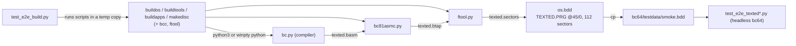
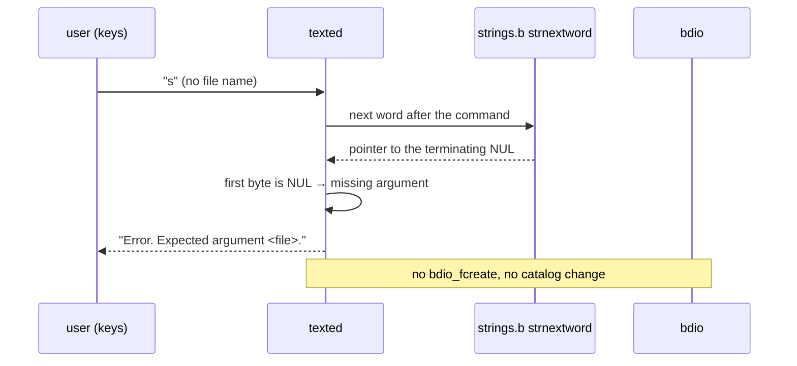

# Complete TextEd v1.2 on bdos 1.1 (Load/Save, Rebuild System Disc) Plan

**Plan Status**: `FINAL`

**Story Type**: `Internal`

**Plan Revision**: `A0`

> This plan captures **what** to build and **why**: domain, architecture, decisions, and verified facts.
> It deliberately does **not** contain implementation code, pseudocode, line numbers, mock setups, or test bodies.
> The implementation agent discovers the **how** against live code. See §4 Task Breakdown.

---

## 1. Problem Statement

*   **Context**: Most of #1 already shipped in later stories. #13 fixed the compiler's `msilib` import. #76 (PR #78) fixed bdio buffered I/O and put a fresh `BDOS.SYS` on `os.bdd`; the `iowrite` debug `printf` in `bdio.b` is commented out, and `bdos.basm` has no `iowrite`. #47 (PR #77) made `l <file>` load, rebuilt every disc program (including the first committed `texted.basm`/`.btap`/`.sectors`, and `CAT.PRG` with the line-wrap fix), and added `src/test_e2e_texted.py` (save → restart → load, a file over one sector, a missing file, load replacing the buffer, `cat -c`). The spike on the current `bc64` disc (2026-11-11) confirmed the following and found the gaps below:
    *   `texted` shows `TextEd v1.2`. `i`/`p`/`d` work (`d 20 30` → `2 lines removed`). `s <file>` → `000N lines saved`, `ls` lists the file (`0080` bytes, 1 sector). `l <missing>` → `error: E0 file not found`. A too-long name → `Error. <file> too long.`. `m` prints stats.
    *   **Gap 1, missing arguments:** `s` with no file name prints `saving ...` and **creates a catalog entry with an empty name** (`ls` shows `        .    -RW-`). `l` with no name then "loads" that file. `p`, `p 10`, `d 10` and `i` with missing numbers silently use 0, and `i` alone inserts line `0`. Cause (#82): `strnextword` in `strings.b` never returns 0; it returns a pointer to the terminating NUL. TextEd's `if(Pwstart)`, `if(Pwend)` and `if(Pwstart && Pwend)` checks therefore never fail.
    *   **Gap 2, full rebuild on Linux:** `./buildos && ./buildtools && ./buildapps && ./makedisc` cannot run as written outside Git Bash on Windows. The scripts call `winpty python` (`ftool`, `run`, `buildos`), and `buildos` also calls bare `python`. Only `bcc` is executable in git (mode `100755`); `buildos`, `buildtools`, `buildapps`, `makedisc`, `ftool`, `run` and `run_tests` are `100644`. With `core.autocrlf=true` they are also checked out CRLF (`/bin/bash^M: bad interpreter`). With these fixed (python3, LF, +x), a full rebuild in a temp copy exits 0. Every committed generated output is byte-identical (CR-normalised) **except `src/bc81asmc/bcOS/bcos.btap`**, which has been stale since 2024 (the `.b81` ROM is identical).
    *   **Gap 3, test coverage:** no automated check for the banner, `i`/`p`/`d`, the `ls` entry after `s`, the error paths, `m` after a large load, or the full rebuild itself.
*   **Goal**: every AC item of #1 holds and is checked automatically. TextEd rejects missing arguments with a message. The four build scripts run from `src/` on Linux as well as on Git Bash. A full rebuild reproduces every committed output. All outputs (including `bcos.btap`, `os.bdd`, `smoke.bdd` and the smoke transcript) are committed.
*   **In scope**: `src/bdos/texted.b` argument checks; rebuilding TextEd and `os.bdd`; the script interpreter choice, exec bits and LF line endings; the refreshed `bcos.btap`; new e2e tests; docs (`docs/05-bdos.md`, root `CLAUDE.md`).
*   **Out of scope**:
    *   the rest of #82: one `strnextword` in `strings.b`, its documented contract, and the other callers (`ls`, `cp`, `rm`, `cha`, `format`). See Decision D1.
    *   the separate `utils.bdd` disc (#85).
    *   the `CP.PRG` catalog size (`56` vs `57` sectors, kept for #49's expected-failure test).
    *   `cat -c` printing the zero padding after the last record as `#00` (`-c` shows control characters by design; the file format with zero padding is decision D6 from #47).
    *   the `docs/CHANGELOG.md` entry. The AC says "drafted after merge", so the changelog generator writes it after the PR is merged, not in this PR.

### 1.1 Technical Summary

*   **Touched projects**: bdos apps (`src/bdos/texted.b` plus its outputs), system disc (`src/os.bdd`, `src/bc64/testdata/smoke.bdd`, smoke transcript), build scripts in `src/`, bcOS build output (`bcos.btap`), e2e tests in `src/`, docs.
*   **New patterns / abstractions**: a missing argument is recognised as "the next word is empty" (the first byte at the returned pointer is NUL), not as a NULL pointer. A shared interpreter choice in every script that runs Python (same rule as `bcc`). A build-reproducibility e2e test.
*   **Infrastructure changes**: `.gitattributes` forces LF for the extensionless shell scripts in `src/`. Git file mode `100755` for those scripts.
*   **End-state observable behaviour**: `s`/`l` without a name print `Error. Expected argument <file>.` and touch no file. `i`/`p`/`d` with a missing number print `Error. Expected argument <n>.` / `<s>.` and leave the buffer unchanged. `./buildos && ./buildtools && ./buildapps && ./makedisc` exits 0 on Linux and on Git Bash, and leaves `git status` clean of generated-output changes.

---

## 2. Architecture & Design

### 2.1 Architecture Overview

#### Involved services & owners

| Component | Technical Owner |
| :--- | :--- |
| bdos apps (`src/bdos/texted.b`), system disc | repo owner (bcichonski) |
| build scripts (`src/build*`, `src/makedisc`, `src/ftool`, `src/run`) | repo owner (bcichonski) |

#### C2 diagram

#### Flow diagram

### 2.2 External Contracts & Evidence

N/A — Internal story.

#### Source Conflict Log

| Topic | Source A | Source B | Conflict | Chosen Handling |
| :--- | :--- | :--- | :--- | :--- |
| Who fixes TextEd's missing-argument checks | #1 AC: "`s`/`l` without a file name … handled with a message" | #82 (open): the same TextEd fix, plus one `strnextword` and guards in the other tools | overlapping scope | #1 fixes TextEd only (#82 option A applied to TextEd). The PR says `Refs #82` and does not close it (Decision D1). |
| Build script commands | #1 AC: `./buildos && ./buildtools && ./buildapps && ./makedisc` from `src/` | root `CLAUDE.md`: the scripts call `winpty python`; on Linux run the commands by hand | the AC command doesn't run on Linux | Make the scripts run on both (Decision D3) and update `CLAUDE.md` / `docs/05-bdos.md`. |
| `bcos.btap` | #1 AC: commit all generated outputs including `bcos.btap` | #7 plan: refreshing the stale `bcos.btap` was out of scope there | none now | Refresh and commit it in this story (T3). |

### 2.3 Affected Areas

| Area / File (pointer) | Role in this change | Likely action |
| :--- | :--- | :--- |
| `src/bdos/texted.b`: `parse2args` (used by `i`, `p`, `d`) and `fileArg` (used by `s`, `l`) | argument parsing with `strnextword`; the NULL checks never fire | Change |
| `src/bdos/strings.b` (`strnextword`, dead `strnextwordnull`) | contract: returns a pointer to the next word, or to the terminating NUL | Reference only (D1) |
| `src/bdos/texted.basm`, `.btap`, `.sectors`; `src/os.bdd` | generated outputs; TEXTED.PRG is imported at track 45/0 | Regenerate |
| `src/fcat0800.sector`, `src/makedisc` | TEXTED.PRG slot of 112 sectors (0x3800 bytes); TEST.B follows at 52/0 | Reference (must not change, D2) |
| `src/bc64/testdata/smoke.bdd`, `smoke_transcript.txt`, `smoke_session.txt` | frozen disc used by the e2e TextEd tests; CI refreshes it from `os.bdd` and fails on a diff | Regenerate (procedure in `src/bc64/CLAUDE.md`) |
| `src/buildos`, `src/buildtools`, `src/buildapps`, `src/makedisc`, `src/ftool`, `src/run`, `src/run_tests`, `src/bcc` | build/run scripts; interpreter choice, exec bit, line endings | Change |
| `.gitattributes` (repo root, new) | keeps those scripts LF in every checkout, whatever `core.autocrlf` says | New |
| `src/bc81asmc/bcOS/bcos.btap` | stale build output of `bcos.basm` | Regenerate |
| `src/test_e2e_texted.py`, `src/e2e_harness.py`, `src/bc64/testdata/e2e/` | existing TextEd e2e tests and harness (`run_session`, goldens) | Reference; new tests go in new modules / new goldens |
| `src/test_e2e_bdos.py` (`CATALOG_LINES`), `bdos_ls`/`bdos_rm` goldens | assert `TEXTED  .PRG -R-X 3800 2D 00 70` | Must keep passing unchanged |
| `docs/05-bdos.md` (catalog table, `texted` row, "Building the system disc"), root `CLAUDE.md` ("Shell scripts" bullet) | user and contributor docs | Change |

### 2.4 Key Algorithms & Behaviour

*   **Missing-argument rule (TextEd).** After the command letter, the parser asks `strnextword` for the next word. If that word is **empty** (the byte at the returned address is NUL), the argument is missing. For `fileArg` this means no file name, so print `Error. Expected argument <file>.` and return no buffer. The caller then does nothing: no `bdio_fcreate`/`fopen`, no `saving …`/`loading …` line. For `parse2args`, an empty first word means `<n>` is missing and an empty second word means `<s>` is missing. Print the existing message and return an error, so `i`/`p`/`d` don't run and the command line is not written to. The existing too-long check (`> MAXFILENAMELEN`) is unchanged.
*   **Size budget.** TEXTED.PRG must fit its 112-sector slot: `texted.sectors` ≤ **14336** bytes. Today it is 14310. The spike with empty-word checks in both parsers gave **14334**. If the build goes over, save bytes inside `texted.b` only (e.g. share one error string or prefix between the `<n>`/`<s>`/`<file>` messages). The disc layout stays as it is.
*   **Interpreter choice in scripts.** Every script that runs Python uses the rule `bcc` already has: `winpty python` when `winpty` is on `PATH`, else `python3`, else `python`. `buildtools`, `buildapps` and `makedisc` call only `./bcc` and `./ftool`, so they need no interpreter logic. `run_tests` already picks its own interpreter.
*   **Rebuild reproducibility.** A full rebuild from a clean copy of `src/` must reproduce every committed generated file (`.genb`, `.basm`, `.btap`, `.sector`, `.sectors`, `.b81`, `os.bdd`). Text outputs are compared with CR removed (a Windows/autocrlf checkout holds them as CRLF). Binary outputs are compared byte for byte.

---

## 3. Key Decisions & Assumptions

*   **D1. Fix TextEd only; #82 stays open.** The AC of #1 needs TextEd's error paths. #82 also asks for one `strnextword` in `strings.b` and changes to five other tools. Changing `strings.b` rebuilds every program that includes it, which is a large unrelated binary diff, and TEXTED has only 26 bytes of headroom. So TextEd adopts #82's option A, the existing contract ("pointer to the next word, or to the terminating NUL"), and tests for an empty word. Cleaning up `strings.b` and the other callers stays in #82. The PR body says `Refs #82`.
*   **D2. The disc layout does not move.** TEXTED.PRG stays at 45/0 with 112 sectors, and TEST.B stays at 52/0. `CATALOG_LINES` and the `bdos_ls`/`bdos_rm` goldens are protected tests and must not change. If the code doesn't fit, shrink it inside `texted.b`, never on the disc.
*   **D3. The scripts run on Linux and on Git Bash.** Same interpreter rule as `bcc` (§2.4). The scripts get file mode `100755`, and a root `.gitattributes` gives them `text eol=lf`, so `./buildos` runs right after a checkout on any platform. A CRLF shebang breaks bash, and Git Bash accepts LF. Each script keeps its own small block, as `bcc` does; there is no new sourced helper.
*   **D4. The build check is an e2e test.** `src/test_e2e_build.py` (group `e2e`, so CI's Python 3.14 `e2e` job runs it) copies `src/` to a temp dir, runs the four scripts there with `./name`, and compares outputs (§2.4). It never writes into the real `src/`. This keeps the "full rebuild runs cleanly" and "all outputs committed" AC items enforced from now on.
*   **D5. New tests go in new modules.** The new TextEd scenarios go in a new module (e.g. `src/test_e2e_texted_commands.py`) with new goldens in `src/bc64/testdata/e2e/`. They reuse `e2e_harness.py` and may import helpers from `test_e2e_texted.py`. No existing test file is edited.
*   **Assumption A1 (low stakes, closed):** "`ls` lists the file with the expected size" means the size bdos records: whole 128-byte sectors (`0080` for up to one sector of text). The test checks the `ls` row against the number of sectors the saved text needs, not the exact text length. bdos 1.1 catalogs only keep sector counts.
*   **Assumption A2 (low stakes, closed):** "`m` still works after loading a large file" is met by a file of a few hundred lines that spans several sectors, loaded with `l`. `m` must print `total lines: N` with the right N, and the session must go on (`p` still works afterwards).

### 3.1 Decision Lock (Constants & Policies)

| Constant / Policy | Selected Value | Why | Where it lives |
| :--- | :--- | :--- | :--- |
| TEXTED.PRG size limit | ≤ 14336 bytes (112 × 128) | fixed slot, TEST.B at 52/0 | `src/fcat0800.sector`, `src/makedisc` |
| Missing-argument detection | next word is empty (first byte NUL) | `strnextword` contract today | `texted.b` |
| Missing-argument messages | existing strings `Error. Expected argument <n>.` / `<s>.` / `<file>.` (may share bytes, D1) | the wording is already in the code | `texted.b` |
| Script interpreter rule | `winpty python` → `python3` → `python` | same as `bcc` (#13) | each Python-calling script |
| Script line endings / mode | LF via `.gitattributes`, `100755` | runnable after any checkout | repo root `.gitattributes`, git index |

### 3.2 Open Questions

No open questions.

---

## 4. Task Breakdown

| Task | Title | Depends on | Complexity |
| :--- | :--- | :--- | :--- |
| `T1` | Build scripts run on Linux and Git Bash | — | `Medium` |
| `T2` | TextEd rejects missing arguments; rebuild TextEd, `os.bdd`, smoke disc | `T1` | `Medium` |
| `T3` | Full-rebuild e2e check and refreshed `bcos.btap` | `T1`, `T2` | `Medium` |
| `T4` | E2E coverage for the remaining TextEd AC flows | `T2` | `Medium` |

### T1 — Build scripts run on Linux and Git Bash

*   **Goal**: from `src/`, `./buildos && ./buildtools && ./buildapps && ./makedisc` runs on Linux (python3) and still on Git Bash (winpty python).
*   **Depends on**: —
*   **Complexity**: `Medium`
*   **Pointers**: `src/buildos`, `src/buildtools`, `src/buildapps`, `src/makedisc`, `src/ftool`, `src/run`, `src/run_tests`, `src/bcc` (the model for the interpreter block); new root `.gitattributes`; root `CLAUDE.md` "Shell scripts" bullet; `docs/05-bdos.md` "Building the system disc" (drop the "the scripts use `winpty`" note).
*   **Definition of Done**:
    *   `buildos`, `ftool` and `run` choose the interpreter by the D3 rule. No script calls `winpty python` or bare `python` unconditionally.
    *   All eight scripts have git mode `100755` (`git ls-files -s`).
    *   `.gitattributes` makes those eight scripts `text eol=lf`. After re-checking them out, the worktree copies have no CR, so they run in this sandbox even with `core.autocrlf=true`.
    *   In a temp copy of the repo, `./buildos && ./buildtools && ./buildapps && ./makedisc` exits 0. Do not run it in the real `src/` in this task, because it rewrites committed outputs.
    *   Docs updated as listed.
*   **Tests expected**: none new (T3 adds the automated build check). Must pass: `python3 run_tests.py < /dev/null`.
*   **Tests to modify**: None

### T2 — TextEd rejects missing arguments; rebuild TextEd, `os.bdd`, smoke disc

*   **Goal**: `s`/`l` with no file name and `i`/`p`/`d` with a missing number print their error message and do nothing else. The rebuilt TextEd is on `os.bdd` and on the frozen `smoke.bdd`.
*   **Depends on**: `T1`
*   **Complexity**: `Medium`
*   **Pointers**: `src/bdos/texted.b` (`fileArg`, `parse2args`); `src/bdos/strings.b` (`strnextword`, read only); `src/bcc`, `src/ftool`, `src/makedisc`; `src/bc64/CLAUDE.md` (smoke refresh procedure); `src/e2e_harness.py`, `src/test_e2e_texted.py` (helpers to reuse); `docs/05-bdos.md` (`texted` row).
*   **Definition of Done**:
    *   The behaviour from §2.4 "Missing-argument rule". `s` alone creates no catalog entry. `l` alone opens nothing.
    *   `texted.sectors` ≤ 14336 bytes (D2). `texted.basm`/`.btap`/`.sectors` regenerated from the new source. `os.bdd` rebuilt with `./makedisc`, which gives the same layout and changes only TEXTED's bytes. `smoke.bdd` and `smoke_transcript.txt` refreshed by the `src/bc64/CLAUDE.md` procedure, with the transcript diff checked by eye.
    *   `docs/05-bdos.md` `texted` row says that a missing argument prints an error.
    *   No change to `strings.b` or to any other program's outputs (D1).
*   **Tests expected**: e2e (headless emulator on a temp copy of `smoke.bdd`), in a new module with new goldens:
    *   `s` without a name → the `<file>` error, and a following `ls` shows no new catalog entry;
    *   `l` without a name → the error, and the buffer is unchanged (`p 0 65535`);
    *   a name longer than 12 characters → `Error. <file> too long.`;
    *   `i`, `p`, `d` with no numbers and with one number → `<n>`/`<s>` errors, and the buffer is unchanged afterwards.
    *   Scripts must not use `q` followed by more commands, or other commands the harness docs say crash. End sessions the way `test_e2e_texted.py` does.
*   **Tests to modify**: None

### T3 — Full-rebuild e2e check and refreshed `bcos.btap`

*   **Goal**: a full rebuild is proven to run cleanly and to reproduce every committed generated output. The stale `bcos.btap` is replaced by its rebuild.
*   **Depends on**: `T1`, `T2`
*   **Complexity**: `Medium`
*   **Pointers**: `src/buildos` … `src/makedisc`; `src/bc81asmc/bcOS/bcos.btap`; `run_tests.py` (`select_src_modules`: `test_e2e_*.py` modules form the `e2e` group); `.github/workflows/tests.yml` (the `e2e` job runs on Python 3.14 after `pip install -e .`).
*   **Definition of Done**:
    *   `src/test_e2e_build.py` per D4. It copies `src/` (not the real tree) to a temp dir, keeping file modes. It runs the four scripts as `./buildos` etc. and asserts each exits 0. It then compares every git-tracked generated file under `src/` (`.genb`, `.basm`, `.btap`, `.sector`, `.sectors`, `.b81`, `os.bdd`) with its rebuild: CR removed for text outputs, byte for byte for binary ones. A failure message names the files that differ. It leaves no files behind (`cpudebug.log`, `bc64.dmp`, temp dirs).
    *   `bcos.btap` in the tree is the rebuilt one, and the `.b81` stays identical.
    *   With T2's outputs in place, the new test passes, and `python3 run_tests.py < /dev/null` passes.
*   **Tests expected**: the new e2e module above. It is the test.
*   **Tests to modify**: None

### T4 — E2E coverage for the remaining TextEd AC flows

*   **Goal**: the AC flows that work today but have no test become regression tests.
*   **Depends on**: `T2` (runs on the refreshed `smoke.bdd`)
*   **Complexity**: `Medium`
*   **Pointers**: `src/test_e2e_texted.py` (session helpers, two-session restart pattern), `src/e2e_harness.py`, `src/bc64/testdata/e2e/`.
*   **Definition of Done**: new e2e scenarios, in a new module (it may share T2's new module if T2 is done first, by appending only), cover:
    *   start-up shows `TextEd v1.2`;
    *   `i 10 10` + lines, then `p` prints them, then `d <n> <m>` reports `N lines removed`, and `p` shows exactly the remaining lines;
    *   `s <file>` reports `N lines saved` with the right N, then `q` and `ls` show the file with the expected size in sectors (A1);
    *   after a restart, loading a large multi-sector file (A2) reports `N lines loaded`, and `m` prints `total lines: N` with the session still responsive.
    *   No debug output (`iowrite`, `read md:`, `Pb:`) appears in any of these sessions (`BDOS.SYS` AC).
*   **Tests expected**: e2e, as above. Goldens only where the output is stable across rebuilds (no addresses that move with code size, or assert those lines with patterns instead).
*   **Tests to modify**: None

---

## 5. Verification

*   **All suites**: `python3 run_tests.py < /dev/null` from the repo root, exit 0. This includes the new `test_e2e_build.py` and the new TextEd scenarios.
*   **Full rebuild in the real tree**: from `src/`, `./buildos && ./buildtools && ./buildapps && ./makedisc` exits 0, and afterwards `git status` shows no changes to generated outputs.
*   **Smoke disc**: `cmp src/os.bdd src/bc64/testdata/smoke.bdd` matches, and re-running the smoke refresh leaves `smoke_transcript.txt` unchanged (this is the check CI's `e2e` job makes).
*   **Observable behaviour**: a headless session on a copy of `os.bdd` running `texted`, `s`, `l`, `p`, `i`, `s note.txt`, `q`, `ls` shows the error messages, a single new `NOTE.TXT` entry and no empty-name entry.
*   **Size**: `wc -c src/bdos/texted.sectors` ≤ 14336.

---

## 6. Fact-Integrity Checklist

| Check | Yes / No / N/A | Notes |
| :--- | :--- | :--- |
| External contracts verified from producer/contract source | N/A | Internal story |
| Evidence sources are reproducible | N/A | Internal story |
| Identifier directionality / ordering / freshness meaning evidenced | N/A | Internal story |
| Every `Assumption` is linked to an Open Question (§3.2) | Yes | A1/A2 are low-stakes readings of the AC wording, closed with a rationale; neither affects correctness of the code |
| No unresolved Open Questions (for `FINAL`) | Yes | |
| Each Decision states a single committed approach | Yes | |
| Tasks are independent, each with a Definition of Done and test expectations | Yes | serial T1 → T2 → {T3, T4} because T1 renormalises line endings in git and T2 rewrites the smoke disc |
| Required infra reflected | N/A | no toggles or messaging |

**Self-review note**: The facts come from a headless spike on the current `bc64` disc and a full rebuild in a temp copy, both on 2026-11-11. The riskiest point is TextEd's size: the spike change fit with 2 bytes to spare (14334 of 14336), so an implementation that adds anything beyond the empty-word checks must save bytes elsewhere in `texted.b`. The `.gitattributes`/exec-bit change is easy to get half-right in an autocrlf sandbox. Check with `git ls-files -s` and by running `./buildos` in a fresh `git worktree`/archive, not only in the edited tree.

---

## 7. Amendment Log

| Amendment | Request | Decision | Plan changes |
| :--- | :--- | :--- | :--- |
