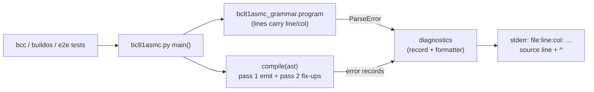
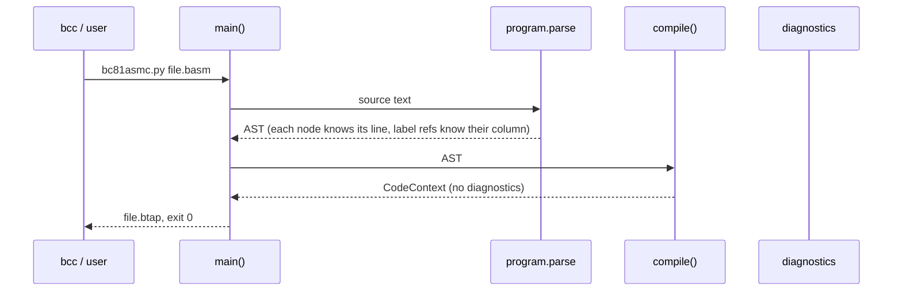

# Assembler Modernisation: Error Messages with file:line:column — Plan

**Plan Status**: `FINAL`

**Story Type**: `Internal`

**Plan Revision**: `A2`

> This plan captures **what** to build and **why** — domain, architecture, decisions, and verified facts.
> It deliberately does **not** contain implementation code, pseudocode, line numbers, mock setups, or test bodies.
> The implementation agent discovers the **how** against live code. See §4 Task Breakdown.

---

## 1. Problem Statement

*   **Context**: the assembler `bc81asmc` (`src/bc81asmc/`) reports user errors as raw Python
    exceptions (analysis `docs/analysis/02-assembler.md`, problem 3):
    *   a syntax error is a parsy `ParseError` traceback (`expected one of … at 132:11`, 0-based);
    *   an undefined label is a bare `KeyError: 'name'` traceback from pass 2, and only the first one
        is ever seen;
    *   a relative jump out of range is a generic `Exception` traceback without any position;
    *   a grammar-accepted but unencodable operand (e.g. `clr af`) is a `KeyError` traceback from
        `REG2BIN`;
    *   duplicate labels are silently accepted (the last definition wins) — and committed sources
        contain two: `exec_load_end` in `src/bc81asmc/bcOS/bcos.basm`, and `strnextword`, which
        `src/bdos/strings.b` defines twice, so every compiled bdos program that calls it carries a
        duplicate `FSTRNEXTWOR…` label;
    *   a label at address `0x0000` (or a `.def` with value `0x0000`) is wrongly reported as
        "not defined", because pass 2 tests the address for truthiness.
    Generated `.basm` files are thousands of lines long, so a character index or a bare label name
    is nearly useless.
*   **Goal**: every user error names `file:line:col`, shows the offending source line with a `^`
    marker, all pass-2 problems are reported in one run, the process exits `1` without a Python
    traceback (unless `--verbose`), and valid sources still assemble to byte-identical output.
*   **In scope**: parse errors, undefined labels, duplicate labels/`.def` names, range errors
    (relative 7-bit and 15-bit jumps, code past `0xffff`), unencodable lines; CLI exit codes;
    `docs/02-assembler.md` "Errors" section; tests; renaming the two duplicates in committed
    sources so that duplicates can be errors (owner instruction, D3) with byte-identical binaries.
*   **Out of scope**: `.assert` (#8 — it must only be able to reuse the diagnostics added here),
    listing/map output (#9), the `out #r, imm` encoding (#11 — its `expectedFailure` tests must stay
    expected failures), the short-mode `jmp cond, :label` (its page comes from `CS` at run time, so
    the assembler cannot range-check it), multiple `.org`, the compiler `bc.py` (it doesn't detect a
    B function defined twice; the assembler now does), and the frozen
    `release/bc32_v1.0/` snapshot (its `bcos.basm` also has the duplicate, but nothing builds it).

### 1.1 Technical Summary

*   **Touched projects**: `src/bc81asmc/bc81asmc_grammar.py` (positions), `bc81asmc_ast.py`
    (`CodeContext` / position attributes), `bc81asmc.py` (pass-2 diagnostics, CLI), a new
    diagnostics module in `src/bc81asmc/`, docs; `bcos.basm` and `strings.b` (one rename each) plus
    the regenerated `.basm` of the bdos programs (label names only).
*   **New patterns / abstractions**: a diagnostic record (line, column, message) plus one
    formatter (`file:line:col: error: message`, source line, caret line), and one assembler
    error exception that carries every diagnostic of a run.
*   **Infrastructure changes**: None.
*   **End-state observable behavior**: `python3 bc81asmc/bc81asmc.py bad.basm` prints e.g.

    ```
    bad.basm:12:17: error: undefined label ':nowhere'
                    cal :nowhere
                        ^
    ```

    for every problem to stderr and exits `1`; a valid source prints no diagnostics and produces
    the same bytes as before.

---

## 2. Architecture & Design

### 2.1 Architecture Overview

#### Involved services & owners

| Service | Technical Owner |
| :--- | :--- |
| `bc81asmc` (assembler) | bcichonski |

#### C2 diagram



#### Flow diagram



### 2.2 External Contracts & Evidence

N/A — Internal story.

### 2.3 Affected Areas

| Area / File (pointer) | Role in this change | Likely action |
| :--- | :--- | :--- |
| `src/bc81asmc/bc81asmc_grammar.py` — `line`, `program`, `label`, `labelarg`, `labelstr`, `paramdb`, `dMV`, `dDEF` | Produces the AST. Must attach the 1-based source line number to every parsed line node and the column of each label definition and label reference, without changing what the grammar accepts. | Change |
| `src/bc81asmc/bc81asmc_ast.py` — `Token`, `LINE`, `CodeContext._emit_addr`, `CodeContext.emit_byte` | `context.labels` today records `(addr, label, kind)`; it must also know where (line, column) each reference came from. `emit_byte` is where the address can run past `0xffff`. | Change |
| `src/bc81asmc/bc81asmc.py` — `compile()`, `main()` | Pass 1 builds the label table (last wins, today silently); pass 2 resolves references (`labeladdresses[label]` → `KeyError`; `if not labeladdr` → false "not defined" for address 0; range checks raise). `main()` lets every exception escape. | Change |
| new `src/bc81asmc/bc81asmc_diag.py` (name is the agent's choice) | Diagnostic record, assembler error exception, formatter, parsy-index → line/col conversion. Reusable by #8 `.assert`. | New |
| `src/bc81asmc/bc81asmc_emit_tests.py`, `bc81asmc_tests.py` | Existing emit and grammar tests (style reference; see Tests to modify for the ones whose expectation changes). | Change / Reference |
| `src/bc81asmc/bc81asmc_opcode_agreement_tests.py` — `PinnedFindingsTests` | Pins `clr af` as a bare `KeyError`. | Change (one test) |
| `src/bcc`, `src/buildos` | Always call the assembler with `--verbose`; rely on its exit code (`check_exit_code`, `bcc` propagates the last command's code). | Reference |
| `src/test_e2e_toolchain.py`, `src/test_e2e_bdio_buffered.py` | Compile a B program against the `src/bdos/*.b` libraries, run `bc81asmc.py --btap prog.basm` as a subprocess and fail on a non-zero exit. Once duplicates are errors, they only stay green if `strings.b` no longer defines `strnextword` twice (T5). | Reference |
| `src/bdos/strings.b` | Defines `strnextword` twice. Pass 1 lets the last definition win, so the first (which returns `0` when there is no next word) is dead code: no call can reach it. | Change (rename the first) |
| `src/bc81asmc/bcOS/bcos.basm` | Defines `exec_load_end: ret` twice; every reference resolves to the second, and both are a single `ret`. | Change (rename the first) |
| `src/bdos/*.basm` (generated, committed), `src/bdos/*.btap`/`*.sector(s)`, `src/os.bdd` | Generated outputs. After T5 the `.basm` of the programs that use `strings.b` change in label names/comments only; every binary must stay byte-identical. | Regenerate / Reference |
| `src/bc/bc.py` (`ParseError` handler) | Prior art for line context printing (uses `parsy.line_info_at`). Not changed. | Reference |
| `docs/02-assembler.md` | Needs an "Errors" section (AC-4). | Change |
| `src/bc81asmc/CLAUDE.md`, `docs/specs/memory/design-decisions.md` (A-section), `docs/analysis/02-assembler.md` (problem 3) | Component rules, standing decision for the diagnostics format, analysis status. | Change |

### 2.4 Key Algorithms & Behaviour

**Positions.** Lines and columns are **1-based**; a tab counts as one column. The line number of an
AST node is the line its instruction/directive is on. Columns:

| Diagnostic | Column points at |
| :--- | :--- |
| parse error | parsy's furthest-failure index converted to line/col (`ParseError.index` + `parsy.line_info_at`, both 0-based → +1) |
| undefined label | the `:` of that reference |
| relative jump out of range | the `:` of the target reference |
| duplicate label | the first character of the repeated label name |
| duplicate `.def` / label–`.def` clash | the first character of the repeated name |
| code past `0xffff` | the first non-blank character of the line that crosses the limit |
| unencodable line (an exception raised while emitting the line) | the first non-blank character of the line |

**Output format** (one block per diagnostic, to **stderr**):

1. `<file>:<line>:<col>: error: <message>` — `<file>` is the input path exactly as given on
   the command line.
2. the source line, verbatim but without its line terminator (`\r\n`, `\r`, `\n`);
3. a caret line: the characters of the source line before the column, with every non-tab character
   replaced by a space (tabs kept, so the caret lines up), followed by `^`.

At a position past the end of the line (e.g. end of file, missing final newline) the caret goes one
past the last character.

**Ordering and collection.**
*   Parsing is all-or-nothing in parsy: a parse error reports the **first** (furthest) syntax error
    and stops; nothing is emitted.
*   If parsing succeeds, pass 1 and pass 2 **collect** every diagnostic and keep going:
    *   pass 1: every repeated label / `.def` name is an `error` (one per repeated definition, the
        first definition is not reported); an exception raised while emitting a line becomes
        an `error` at that line (the line is skipped, assembly continues with the next one);
        the first byte emitted past address `0xffff` gives one `error` (reported once per run);
    *   pass 2: every reference to an undefined symbol is an `error` (**every use**, not every
        name); each out-of-range relative reference is an `error`. References that resolve are
        patched exactly as today.
*   Diagnostics are reported sorted by (line, column), stable within the same position.
*   If any `error` was collected, no output file is written and the exit code is `1`.

**Symbol resolution.** A reference resolves to the `.def` value if the name is a `.def`, else to
the label address — unchanged for valid sources (a repeated name is now an error, so which
definition would win no longer matters). A symbol is undefined only when it is in neither table —
its address/value being `0` makes it **defined** (fixes the `if not labeladdr` bug; no valid source
can depend on the old behaviour, because it aborted the build).

**Tracebacks.** Without `--verbose` the CLI never prints a Python traceback for a user error
(parse error, assembler errors). With `--verbose`, after the diagnostics, it also prints the
traceback of the exception that ended the run to stderr. An unexpected internal failure outside the
per-line emit (a bug in the driver itself, an unreadable input file) may still surface as a
traceback — the per-line wrapping covers every user-input path.

**In-process API (tests and #8 rely on it).**
*   `bc81asmc_grammar.program.parse(text)` still returns the list of AST nodes and still raises
    `parsy.ParseError` on a syntax error. Positions are plain **attributes** on the nodes, never
    dataclass fields, so node equality (`NOP('nop') == NOP('nop')`) and every grammar test are
    unchanged. Sub-parsers (`mnemonic.parse('nop')`, `paramdb.parse(...)`, …) keep returning the
    same values.
*   `compile(ast, verbose)` keeps its signature and returns the `CodeContext` on success. On errors
    it raises the new assembler error exception (an `Exception` subclass) carrying every collected
    diagnostic; `str()` of it contains every error message (without the source/caret lines), so
    callers matching on message text keep working.
*   Formatting needs the source text and the file name; it lives in the diagnostics module, not in
    `compile()`.

---

## 3. Key Decisions & Assumptions

*   **D1 — 1-based line and column, GNU-style `file:line:col: severity: message`.** The issue fixes
    the format; 1-based matches editors and `gcc`/`clang`, so terminals and IDEs make it clickable.
    parsy's own `line_info` is 0-based and must be converted.
*   **D2 — parse errors stop at the first error; pass-1/pass-2 problems are all collected.**
    parsy's `many(line)` cannot resume after a failed line without restructuring the grammar; the
    issue only asks for "continue" for undefined labels. Collecting everything after a successful
    parse gives all undefined labels in one run (AC-1).
*   **D3 — duplicate labels and duplicate `.def` names (and a label/`.def` clash) are errors; the
    two duplicates in committed sources are renamed away.** Owner instruction during this run: "we
    can fix the label duplication by changing them if it will not break anything". Verified in a
    spike (full rebuild of bcOS, boot, bdos and every tool/app in temp copies, base vs renamed):
    renaming the first `exec_load_end` in `bcos.basm` and the first `strnextword` in `strings.b`
    leaves every `.btap` byte-identical; only label names/comments in the generated `.basm` change.
    Both renamed definitions are unreachable today (all references resolve to the last definition),
    so the rename keeps behaviour. The first `strnextword` is kept (renamed, still dead code), not
    deleted — deleting it changes the code size of every program and therefore `os.bdd`. With no
    duplicates left, a duplicate is a real bug (e.g. a B function defined twice, which the
    compiler doesn't detect), so it fails the build. The message names the line of the earlier
    definition.
*   **D4 — range errors are the checks the assembler can actually make**: the 7-bit `jmr` and
    15-bit `jrx`/`clr` relative offsets (already hard errors, now positioned) and code running past
    `0xffff`. Over-wide immediates (`mov a, 0x100`, `0x10000`, `#0x10`) cannot be written: the
    grammar is fixed-width (A3), so they are **parse errors** whose column points at the offending
    digit — tests cover that path. Short-mode `jmp cond, :label` takes its page from `CS` at run
    time, so it can't be checked statically. `out #r, imm` belongs to #11 and is not touched.
*   **D5 — keep the existing message wording for relative jumps**: the messages keep the phrases
    `too far away for relative 7bit jump` / `too far away for relative 15bit jump` (plus the label
    and the offset in bytes), so the existing range tests stay valid unchanged.
*   **D6 — an exception while emitting a line is a user error at that line.** The grammar accepts
    a few operands that `REG2BIN` cannot encode (`clr af`); the user should see
    `file:line:col: error: cannot encode '<line as written>': <reason>` instead of a `KeyError`
    traceback (AC-2). The line contributes no bytes; assembly continues.
*   **D7 — diagnostics go to stderr; progress lines (`Reading input file`, `Code length`, …) stay
    on stdout** unchanged, so existing stdout assertions (`'Done!'`, `'Saving output file'`) hold.
*   **D8 — no output file on error.** Today an error aborts before saving; keep that, so a stale
    `.btap` is never mistaken for a fresh one.
*   **D9 — a label or `.def` at address/value `0x0000` is defined.** Required for AC-1: reporting a
    defined label as "undefined" would be a false diagnostic.
*   **Assumption A-1** (low stakes, no OQ): the issue's proposal writes undefined labels as
    `file:line: error:` but AC-1 says `file:line:col`; the AC wins, so undefined labels carry the
    column too.

### 3.1 Decision Lock (Constants & Policies)

| Constant / Policy | Selected Value | Why | Where it lives |
| :--- | :--- | :--- | :--- |
| Header format | `<file>:<line>:<col>: error: <message>` | Issue proposal, D1 | diagnostics formatter |
| Undefined label message | `undefined label ':<name>'` | Issue proposal wording | pass 2 |
| Duplicate label message | `duplicate label '<name>' (first defined at line <n>)` | D3 | pass 1 |
| Duplicate `.def` / clash message | `duplicate symbol '<name>' (first defined at line <n>)` | D3 | pass 1 |
| Renamed duplicates | `bcos.basm`: first `exec_load_end` → `exec_load_err` (A1: `exec_load_ret` is already a label in that file); `strings.b`: first `strnextword` → `strnextwordnull` (it returns `0` when there is no next word) | D3; names verified unused in their files (A1) | T5 |
| Relative range messages | contain `label ':<name>' too far away for relative 7bit jump (<n> bytes)` / `… 15bit jump …` | D5 | pass 2 |
| Address overflow message | `code exceeds the 64 KB address space (past 0xffff)` | D4 | pass 1 |
| Unencodable line message | `cannot encode '<line text, stripped>': <reason>` | D6 | pass 1 |
| Parse error message | starts with `syntax error:`; names what was expected (parsy's `expected` set, sorted) when it has at most 5 entries, otherwise names what was found at the position (the next non-blank token on the line, or `end of line` / `end of file`) | the full expected set at a line start is ~60 entries | diagnostics module |
| Exit codes | `0` success, `1` any error | Issue proposal | `main()` |
| Stream | diagnostics → stderr, progress → stdout | D7 | `main()` |
| Traceback | only with `--verbose`, after the diagnostics | AC-2 | `main()` |

### 3.2 Open Questions

No open questions.

Resolution attempts: duplicate-label severity — closed by the owner's instruction to rename the
committed duplicates, plus the byte-identical spike (D3). Range-error coverage of "8-bit immediate > 0xff" — closed by the fixed-width
grammar and the existing `TestErrorCases` tests (D4). Undefined-label column — closed by AC-1 text
(A-1).

---

## 4. Task Breakdown

| Task | Title | Depends on | Complexity |
| :--- | :--- | :--- | :--- |
| `T1` | Diagnostics module and source positions on the AST | — | `Medium` |
| `T5` | Rename the duplicate labels in committed sources, regenerate outputs | — | `Medium` |
| `T2` | `compile()` collects positioned errors | `T1`, `T5` | `Medium` |
| `T3` | CLI: report to stderr, exit codes, `--verbose` traceback | `T2` | `Medium` |
| `T4` | Documentation: Errors section, component rules, decision record | `T3` | `Low` |

### T1 — Diagnostics module and source positions on the AST

*   **Goal**: every AST node from `program.parse` knows its 1-based source line, every label
    definition and label reference knows its 1-based column, and a reusable diagnostics module can
    turn a record (or a parsy `ParseError` plus the source) into the three-line block of §2.4.
*   **Depends on**: —
*   **Complexity**: `Medium`
*   **Pointers**: `bc81asmc_grammar.py` (`line`, `program`, `label`, `labelarg`, `labelstr`,
    `paramdb`, `jmpaddrarg`/`jmraddrarg`, `dMV`), `bc81asmc_ast.py` (`Token`, `LINE`), new
    diagnostics module; parsy 2.2 offers `.mark()` and `line_info_at`. Keep the A1 rule that more
    specific alternatives come first; do not change what the grammar accepts.
*   **Definition of Done**:
    *   positions are attributes, not dataclass fields; all existing grammar/emit/agreement tests pass
        unchanged;
    *   for a node built from a line with several label references (`.db :a, :b`, `.mv dsdi, :x`,
        `cal :f`, `jmr z, :l`, `jrx nz, :l`, `clr :f`), each reference's column is retrievable;
    *   the formatter produces exactly the §2.4 block (header, verbatim line without terminator,
        caret with tabs preserved), handles CRLF sources and a position past the end of the line;
    *   a parsy `ParseError` converts to an `error` diagnostic per §3.1 (1-based, `syntax error:`
        message rule);
    *   the assembler error exception exists and carries a list of diagnostics; its `str()` lists
        every error message.
*   **Tests expected** (unit, in `src/bc81asmc/`, named `*_tests.py` so the suite picks them up):
    line numbers on nodes across comment lines and blank-ish lines; columns of label definitions
    (indented and not) and references in each instruction form above; formatter output for spaces,
    tabs, CRLF and end-of-line positions; parse-error conversion for an unknown mnemonic, a
    three-digit `0x100` immediate (column at the extra digit), and a missing final newline.
*   **Tests to modify**: None.

### T5 — Rename the duplicate labels in committed sources, regenerate outputs

*   **Goal**: no committed, built source defines a label twice, and every binary output stays
    byte-identical.
*   **Depends on**: —
*   **Complexity**: `Medium` (mechanical edits, but the rebuild/compare must be done carefully)
*   **Amended in**: `A1` (new name for the `bcos.basm` rename; the `strings.b` rename and the regenerated `.basm` are unaffected)
*   **Pointers**: §3.1 "Renamed duplicates"; `src/bc81asmc/bcOS/bcos.basm` (CRLF — keep it),
    `src/bdos/strings.b`; build scripts `src/buildos`, `src/buildtools`, `src/buildapps`, `src/bcc`
    (CRLF and `winpty python`: run the same `bc/bc.py --verbose --btap` /
    `bc81asmc/bc81asmc.py --verbose --btap` commands with `python3` from `src/`); root and
    `src/bc64/CLAUDE.md` for the generated-files rules.
*   **Definition of Done**:
    *   the first `exec_load_end` in `bcos.basm` and the first `strnextword` in `strings.b` are
        renamed per §3.1 and nothing references the new names;
    *   the generated `.basm` of every program built by `buildos`/`buildtools`/`buildapps` (bdos,
        ls, cp, format, rm, cha, cat, helloworld, texted), plus `fddtest.basm` if its regenerated
        output differs, are regenerated and committed; their diff is label names/comments only;
    *   every regenerated `.btap` is byte-identical to the committed one (`git status` shows no
        change in any `.btap`, `.sector(s)`, `.b81` or `os.bdd`); if a `.btap` differs only
        because the committed one was already stale before this change, keep the committed one and
        note it — do not mix unrelated rebuild churn into this change;
    *   `bcos.btap` is **not** regenerated (known stale since 2024; the `.b81` ROM is identical) —
        the bcOS check is that the base-commit and new `bcos.basm` assemble to the same bytes;
    *   with the base-commit assembler, a duplicate scan of every committed `.basm` outside
        `release/` finds none;
    *   `python3 run_tests.py < /dev/null` passes.
*   **Tests expected**: none new (no behaviour change); the byte comparison is a throwaway check.
*   **Tests to modify**: None.

### T2 — `compile()` collects positioned errors

*   **Goal**: `compile()` reports every undefined-label use, every repeated label/`.def`, every
    out-of-range relative reference, code past `0xffff` and unencodable lines as positioned errors
    in one run, while producing byte-identical output for valid sources.
*   **Depends on**: `T1`, `T5` (once duplicates are errors, the unrenamed sources would no longer
    assemble).
*   **Amended in**: `A2` (one more test in Tests to modify)
*   **Complexity**: `Medium`
*   **Pointers**: `bc81asmc.py` `compile()`; `CodeContext` in `bc81asmc_ast.py` (`labels`,
    `_emit_addr`, `emit_byte`, the unused `errors`/`add_error`, which may be reused or replaced).
    §2.4 "Ordering and collection" and "Symbol resolution"; §3.1 messages; D3–D6, D9.
*   **Definition of Done**:
    *   undefined symbols → one `error` per use, `undefined label ':name'`, positioned at the `:`;
        no `KeyError` escapes;
    *   a label or `.def` at `0x0000` resolves (D9);
    *   7-bit / 15-bit range errors positioned at the reference, wording per D5, all of them collected;
    *   duplicate label, duplicate `.def`, label/`.def` clash → `error` at the repeated definition,
        message names the earlier line (§3.1);
    *   an exception while emitting a line → `error` at that line (D6), assembly continues;
    *   the first byte past `0xffff` → one `error`;
    *   with any error, `compile()` raises the T1 exception with all diagnostics sorted by
        (line, column); without errors it returns the context as today;
    *   **byte-identical**: every committed `.basm` that assembles at the base commit
        (`git ls-files '*.basm'` outside `release/`, as of this branch after T5; the 3 under
        `src/bc/code/` that don't parse today stay out) produces exactly the same bytes and start
        address as with the base-commit assembler — checked by a throwaway script, not committed;
        none of them reports a duplicate.
*   **Tests expected** (unit, `bc81asmc_emit_tests.py` or a new `*_tests.py` in `src/bc81asmc/`):
    several undefined labels on different lines (all reported, correct lines/columns, sorted);
    the same undefined label used twice (two errors); label and `.def` at `0x0000` resolve;
    7-bit and 15-bit range errors carry line/column; duplicate label / `.def` / clash each give a
    positioned error naming the first line; `clr af` gives a positioned
    `cannot encode` error; `.org 0xffff` followed by two bytes gives the overflow error once;
    a valid program yields no diagnostics.
*   **Tests to modify**:
    *   `src/bc81asmc/bc81asmc_emit_tests.py :: TestLabelsAbsolute.test_label_at_address_zero_is_rejected`
        — D9 / AC-1: a label at `0x0000` is defined; assert it resolves instead.
    *   `src/bc81asmc/bc81asmc_emit_tests.py :: TestLabelsAbsolute.test_def_with_value_zero_is_rejected`
        — D9 / AC-1: same for `.def zero, 0x0000`.
    *   `src/bc81asmc/bc81asmc_emit_tests.py :: TestLabelsAbsolute.test_undefined_label_raises_keyerror`
        — AC-1 / AC-2: an undefined label is now the assembler error with `undefined label ':nowhere'`
        at line 2, column 5, not a `KeyError`.
    *   `src/bc81asmc/bc81asmc_opcode_agreement_tests.py :: PinnedFindingsTests.test_clr_af_fails_to_assemble`
        — D6 / AC-2: `clr af` still fails to assemble, but as the positioned assembler error, not a
        `KeyError`.
    *   `src/bc81asmc/bc81asmc_emit_tests.py :: TestDirectives.test_def_takes_precedence_over_label`
        — D3 / AC-1 (A2): a label with the same name as a `.def` is a duplicate symbol in the shared
        namespace (design decision A2); assert the positioned error `duplicate symbol 'thing'
        (first defined at line 2)` at line 3, column 1 instead of the `.def` value winning.

### T3 — CLI: report to stderr, exit codes, `--verbose` traceback

*   **Goal**: `bc81asmc.py` prints every diagnostic in the §2.4 format to stderr, exits `1` on any
    error without a traceback (traceback only with `--verbose`), and writes no output on error.
*   **Depends on**: `T2`
*   **Complexity**: `Medium`
*   **Pointers**: `bc81asmc.py` `main()`; D2, D7, D8; `src/bcc`, `src/buildos` (always pass
    `--verbose`); `src/test_e2e_toolchain.py` (subprocess + exit code).
*   **Definition of Done**:
    *   parse error → one formatted `error` block, exit `1`, no `.btap` written;
    *   assembler errors → all blocks, sorted, exit `1`, no `.btap` written;
    *   a valid source → nothing on stderr, `.btap` written as before, exit `0`;
    *   no `Traceback` text on stderr for these cases without `--verbose`; with `--verbose` the
        traceback follows the diagnostics;
    *   `<file>` in the header is the path as given on the command line;
    *   stdout progress lines unchanged for a valid run (`test_main_writes_btap_next_to_input` still
        passes);
    *   the python3 equivalents of `buildos`, `buildtools` and `buildapps` (run from `src/` in a temp
        copy) still succeed with no diagnostics.
*   **Tests expected** (in `src/bc81asmc/`, `*_tests.py`; run the script as a subprocess with
    `sys.executable` from a temp dir, the way the e2e toolchain test does): each class — parse
    error, undefined labels (several, one run), duplicate label, range error, overflow — checks
    exit code, the exact header lines, the caret line for at least
    one case, absence of `Traceback` without `--verbose`, presence with `--verbose`, and that no
    `.btap` exists after an error.
*   **Tests to modify**: None.

### T4 — Documentation: Errors section, component rules, decision record

*   **Goal**: the documentation describes the new error reporting (AC-4) and records the decision.
*   **Depends on**: `T3`
*   **Complexity**: `Low`
*   **Pointers**: `docs/02-assembler.md`, `src/bc81asmc/CLAUDE.md`,
    `docs/specs/memory/design-decisions.md` (assembler section, after A5),
    `docs/analysis/02-assembler.md` (problem 3 / next step 3).
*   **Definition of Done**:
    *   `docs/02-assembler.md` has an `## Errors` section: format and example, stderr/exit codes,
        `--verbose`, the error classes (syntax, undefined label, duplicate label/`.def`, range,
        overflow, unencodable line), and that over-wide immediates are syntax errors;
    *   `src/bc81asmc/CLAUDE.md` mentions the diagnostics module and that new checks (e.g. #8
        `.assert`) must report through it; the "How it works" pass-2 description matches;
    *   a new design decision `A6` records D1–D3 and D7 briefly (purpose, rationale, usage,
        trade-offs, matching the existing entries' shape);
    *   the analysis page marks problem 3 / next step 3 as done by #10 without rewriting history;
    *   `docs/05-bdos.md` (or wherever `strings.b` functions are listed) doesn't list the renamed
        dead `strnextwordnull` as an API; if `strnextword` is documented, the doc still matches the
        definition that is used.
*   **Tests expected**: None (docs only); `python3 run_tests.py` stays green.
*   **Tests to modify**: None.

---

## 5. Verification

*   **Unit tests**: `cd src/bc81asmc && python3 -m unittest discover -s . -t . -p "*_tests.py"` —
    all green, `TestOutImmediate` still reports its 3 expected failures.
*   **All suites**: `python3 run_tests.py < /dev/null` from the repo root — exit 0.
*   **Byte-identical (AC-3)**: for every committed `.basm` that assembles at the base commit,
    assemble it with the base-commit assembler (`git worktree`/`git show` into a temp dir) and with
    the new one, in temp copies, and compare the `.btap` files byte for byte — all identical.
*   **Observable behaviour**: in a temp dir, a file with a syntax error, two undefined labels, a
    duplicate label and a far `jmr` shows the expected `file:line:col` blocks on stderr, exit `1`,
    no traceback; the same with `--verbose` adds a traceback; the python3 equivalents of `buildos`,
    `buildtools` and `buildapps` in a temp copy of `src/` print no diagnostics and exit `0`.

---

## 6. Fact-Integrity Checklist

| Check | Yes / No / N/A | Notes |
| :--- | :--- | :--- |
| External contracts verified from producer/contract source | N/A | Internal story |
| Evidence sources are reproducible | N/A | Internal story |
| Identifier directionality / ordering / freshness meaning evidenced | N/A | Internal story |
| Every `Assumption` is linked to an Open Question (§3.2) | Yes | A-1 is closed by AC text; no correctness-affecting assumptions |
| No unresolved Open Questions (for `FINAL`) | Yes | |
| Each Decision states a single committed approach | Yes | |
| Tasks are independent, each with a Definition of Done and test expectations | Yes | T1→T2→T3 chain is inherent (format → collection → CLI); T5 runs in parallel with T1 |
| Required infra reflected (toggle / bicep) | N/A | No toggle key, no infra |

**Self-review note**: the main risk is D3 — duplicates in committed sources were found by parsing
every committed `.basm`; they become errors only because T5 renames them (owner's instruction), and
a spike showed the rename keeps every binary byte-identical. T5 must land before T2. The second risk is the grammar change in T1: positions must be
attached without altering what parses or how nodes compare. The agent should run the byte-identical
comparison against the base commit, not against committed `.btap` files (`bcos.btap` is known to be
stale since 2024). `out #r, imm` (#11) must stay untouched so its `expectedFailure` tests keep failing.

---

## 7. Amendment Log

| Revision | Request | Decision | Plan changes |
| :--- | :--- | :--- | :--- |
| A1 | T5 — wrong-fact: `exec_load_ret` already exists in `bcos.basm` (defined and referenced) | Accepted — verified in the live file; `exec_load_err` has no occurrence | §3.1 rename target → `exec_load_err`; T5 amended in A1 |
| A2 | T2 — test-conflict: `TestDirectives.test_def_takes_precedence_over_label` pins label/`.def` clash → `.def` wins | Accepted — D3 deliberately makes the clash an error (shared namespace, design decision A2); no committed source has a clash (verified scan); not a fail-driven change | T2 Tests to modify + this test; T2 amended in A2 |
