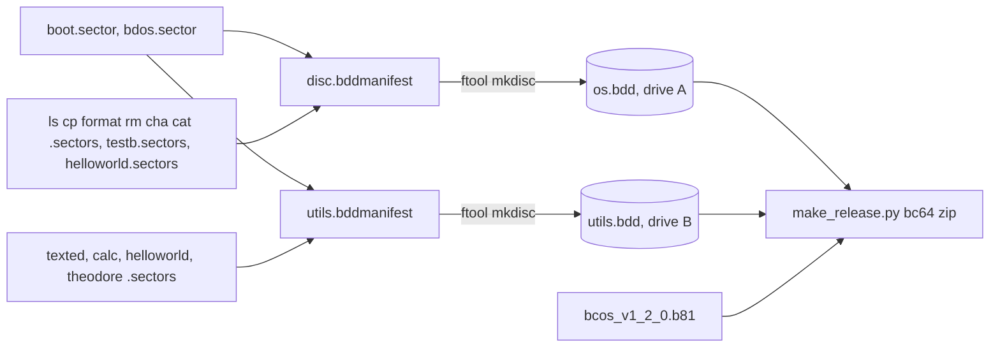

# utils.bdd: Theodore, Hellowrd, a bdos Calc, and Both Discs in the Release Zip Plan

**Plan Status**: `FINAL`

**Story Type**: `Internal`

**Plan Revision**: `A0`

> This plan captures **what** to build and **why**. The implementation agent discovers the **how** against live code.

---

## 1. Problem Statement

*   **Context**: #85 (PR #99) created `utils.bdd` (drive B, bootable alone) and moved TextEd there. `THEODORE.PRG` and `HELLOWRD.PRG` are still on the system disc `os.bdd`. `calc.b` is a bc16-era tape program: it includes `std.b` + `stdio.b` and reads input into `0x0f00`, which is where bdos itself is loaded, and it is on no disc. `scripts/make_release.py bc64` zips only the ROM and `src/os.bdd`, so a release would ship without TextEd and the other apps.
*   **Goal**: `utils.bdd` holds TEXTED, CALC, HELLOWRD and THEODORE. `os.bdd` holds only the system, the system utilities, `TEST.B` and a copy of HELLOWRD (D1). `calc` is a proper bdos program. The bc64 release zip ships both discs, and the docs describe them.
*   **In scope**: issue scope 1–6.
*   **Out of scope** (issue): shell changes for running programs on another drive; new programs; publishing a release.

### 1.1 Technical Summary

*   **Touched areas**: `src/bdos/calc.b`, `src/buildapps`, `src/makedisc`, `src/disc.bddmanifest`, `src/utils.bddmanifest`, e2e tests in `src/tests/` and inputs/goldens in `src/bc64/testdata/`, `scripts/make_release.py` + `scripts/tests/test_make_release.py`, docs (`docs/05-bdos.md`, `docs/01-emulator.md`, `src/bdos/CLAUDE.md`, `CLAUDE.md`, `README.md`).
*   **New patterns**: none. The calc port follows theodore (#2): `#code 0x6000`, a `#heap`, `stdmem.b` `malloc` for its buffer, and bdio through `bdosh.b`.
*   **Infrastructure changes**: none. `calc.btap`/`calc.sectors` are build outputs, ignored by the existing rules, as for the other programs.
*   **End state**: `cd src && ./buildos && ./buildtools && ./buildapps && ./makedisc` builds `CALC.PRG`. In the default session `--disk-a os.bdd --disk-b utils.bdd`, typing `b:` then `calc`, `theodore` or `hellowrd` runs each one from B and returns to `B>`. `make_release.py bc64` zips `src/os.bdd` and `src/utils.bdd`.

---

## 2. Architecture & Design

### 2.1 Architecture Overview

Default session: boot bdos from A, then `b:`. `bdio_execute` searches the active drive only, so `calc`/`theodore`/`hellowrd` are loaded from B to `0x6000` and return to the `B>` prompt.

### 2.2 External Contracts & Evidence

`N/A — Internal story`

#### Source Conflict Log

| Topic | Issue text | Current repo | Chosen Handling |
| :--- | :--- | :--- | :--- |
| HELLOWRD placement | plan picks: move it, or keep a copy on os.bdd | HELLOWRD is the os.bdd smoke program in 6 test modules, including `test_e2e_layout_shift` (which grows it by 8 sectors) and `test_ftool` | Keep a copy on os.bdd and add the same build to utils.bdd (D1). This is the issue's second option, so it does not deviate from the AC. |
| "Add it to `buildapps` and `makedisc`" | — | `makedisc` converts each `.btap` with an explicit `btap2bin` line | Add a calc build line to `buildapps` and a `btap2bin` line to `makedisc`. |
| Release notes | "update the release notes" | `make_release.py notes bc64` prints the README's bc64 section (no separate notes file) | Updating that README section updates the notes. |
| `release.yml` builds first | check it | verified: the `build` job runs `./buildos && ./buildtools && ./buildapps && ./makedisc` before `make_release.py bc64` | No change. A test asserts the order (T3). |

### 2.3 Affected Areas

| Area / File (pointer) | Role in this change | Likely action |
| :--- | :--- | :--- |
| `src/bdos/calc.b` | calculator v1.0 (tape-era) | Rewrite as a bdos program |
| `src/bdos/theodore.b` | model of a ported bdos app (`#code 0x6000`, `#heap 0xf000`, `stdmem` malloc, `bdosh.b`) | Reference |
| `src/bdos/bdosh.b` → `bdioh.b` → `stdio.b` | bdosh pulls in stdio; a program that includes bdosh.b must not include stdio.b again | Reference |
| `src/bdos/std.b` (`parsedecw`) | turns any byte into `digit - '0'`, no validation | Reference: calc validates input itself (D4) |
| `src/bc64/bc8183_cpu.py` (`alu_div16`, `alu_mod16`) | Python `//` and `%`: a zero divisor raises `ZeroDivisionError` and stops the emulator | Reference: calc must check the divisor (D5) |
| `src/buildapps`, `src/makedisc` | build/convert each program | Change: add calc |
| `src/disc.bddmanifest` | os.bdd layout | Change: drop THEODORE |
| `src/utils.bddmanifest` | utils.bdd layout | Change: add CALC, HELLOWRD, THEODORE (`RX`) |
| `src/tests/e2e_harness.py` | `OS_DISK`, `UTILS_DISK`, `MANIFEST`, `UTILS_MANIFEST`, `planned_entry(name, manifest)`, `run_session(disks=…)`, `ls_line` | Reference (maybe a small helper) |
| `src/tests/test_e2e_utils_disc.py` | utils.bdd structure, exact catalog, solo boot | Change (catalog list) + new tests |
| `src/tests/test_e2e_theodore.py` + `src/bc64/testdata/e2e/theodore_*.in.txt` | theodore on os.bdd in A | Change: A/B setup |
| `src/tests/test_e2e_bdos.py`, `src/tests/test_e2e_harness.py` | expect THEODORE on os.bdd | Change |
| goldens `bdos_ls`, `bdos_rm`, `disc_ls_all` (`src/bc64/testdata/e2e/`), `src/bc64/testdata/smoke_transcript.txt` | os.bdd `ls` listings with a THEODORE row | Regenerate with `python3 run_tests.py --update-golden` |
| `scripts/make_release.py` (`BC64_BUILT_FILES`, docstring), `scripts/tests/test_make_release.py` | bc64 zip contents | Change |
| `.github/workflows/release.yml` | builds before packaging | Reference |
| `docs/05-bdos.md`, `docs/01-emulator.md`, `src/bdos/CLAUDE.md`, `CLAUDE.md`, `README.md` | program lists, layout tables, release section | Change |

### 2.4 Key Algorithms & Behaviour

*   **utils.bdd layout**: boot/catalog/system lines unchanged, `TEXTED.PRG ... RX at=12/0`, then `CALC.PRG`, `HELLOWRD.PRG` and `THEODORE.PRG`, all `RX` with no `at=`, back to back. Only TEXTED's position is pinned. Tests take the others from `plan_disc`/`planned_entry(name, h.UTILS_MANIFEST)`.
*   **os.bdd layout**: the THEODORE line is removed. HELLOWRD and TEST.B stay. #89's masks mean the remaining goldens change only by the dropped `THEODORE.PRG` row.
*   **calc under bdos (spike verified)**: a prototype `#code 0x6000`, `#heap 0xf000`, `std.b` + `stdmem.b` + `bdosh.b`, with a `malloc`'d buffer, builds (image 0x109d bytes), runs from B after `b:`, and returns to `B>`. Words are unsigned 16-bit and wrap: 300*500 printed 18928, 300-500 printed 65336. A zero divisor would crash the emulator (`ZeroDivisionError` in `alu_div16`), so the guard in D5 is required.
*   **calc session protocol** (kept from v1.0, see §3.1): banner, then a loop. Prompt `calc>`, read a one-character command. `h` prints the help. `q` prints `bye` and returns. For `+ - * /` the program prompts `1>`, reads the first number, validates it, prompts `2>`, reads and validates the second, and prints `res>` followed by the decimal result.
*   **No bdos memory writes**: every buffer is in the program's own heap (above its image, below the stack). Nothing uses an address below `0x6000`. The build's `.assert sys_codeend < heap` must pass. A test runs a system utility from A after calc quits, which proves bdos still works.

---

## 3. Key Decisions & Assumptions

*   **D1 — HELLOWRD: copy on both discs.** The same `bdos/helloworld.sectors` goes in both manifests. os.bdd keeps it as its minimal smoke program, which is the issue's second option. The os-side smoke/bdos/harness/layout-shift/ftool tests are therefore unchanged. A test asserts that the HELLOWRD bytes on both discs are identical.
*   **D2 — Theodore moves.** Its line leaves `disc.bddmanifest` and joins `utils.bddmanifest` with `RX` (no `S`). Its e2e tests use the default A/B setup: os.bdd in A, a temp copy of utils.bdd in B, and every `theodore_*.in.txt` script starts with `b:`. The seeded-game and quit-path assertions are kept. Prompts become `B>`. The catalog/`ls` test reads utils.bdd: `planned_entry("THEODORE.PRG", h.UTILS_MANIFEST)`, and `ls b:` typed from A.
*   **D3 — calc includes `std.b`, `stdmem.b`, `bdosh.b`** (issue: "Use `#include bdosh.b`"), and **not `stdio.b`**, because bdosh already pulls it in. Settings: `#code 0x6000`, `#heap 0xf000` (as theodore). The input buffer is `malloc`'d and freed before return. `INPUTBUFFER 0x0f00` is gone.
*   **D4 — Bad number.** An operand is valid when it has 1 to 5 decimal digits, nothing else, and a value ≤ 65535. Anything else (empty, a non-digit, a value above 65535) prints `error: bad number`. The operation is abandoned at once: no second prompt after a bad first operand, and no `res>` line. Calc then goes back to `calc>`. Tests pin `abc` → error, empty → error, `65535` → accepted, `65536` → error.
*   **D5 — Division by zero.** When the operator is `/` and the second operand is 0, calc prints `error: division by zero` and no `res>` line, then goes back to `calc>`. It must never execute a division by zero, because that stops the emulator.
*   **D6 — Results are unsigned 16-bit, modulo 65536** (the machine's word arithmetic, unchanged from v1.0). `/` truncates. Tests pin: `12+30` → 42, `3-5` → 65534, `300*500` → 18928, `100/7` → 14.
*   **D7 — Unknown command**: any command other than `h q + - * /` prints `error: unknown command, type h for help` and asks for no operands. v1.0 instead asked for two numbers and printed the first, which was a bug.
*   **D8 — Help text** keeps the v1.0 lines, with one fix: "`- for deletion`" becomes "`- for subtraction`". The banner stays `calc v1.0` followed by `type h for help`. The version stays 1.0 because the issue AC names `calc v1.0`.
*   **D9 — Release zip**: `BC64_BUILT_FILES` gains `src/utils.bdd`. It follows the same rules as the other built files: read from the working tree, mode 0644, and a missing file is a `ReleaseError` naming `BUILD_COMMAND`. `release.yml` is unchanged (it already builds first).
*   **D10 — Base**: branch from `origin/master` (`3fc35bb`, #85 merged), and open the PR into `master` (the owner's instruction for this run).

### 3.1 Decision Lock

| Constant / Policy | Selected Value | Why | Where it lives |
| :--- | :--- | :--- | :--- |
| HELLOWRD on os.bdd | kept (copy, same build) | D1 | `disc.bddmanifest` |
| utils.bdd order | TEXTED (12/0), CALC, HELLOWRD, THEODORE | manifest order; only TEXTED pinned | `utils.bddmanifest` |
| Attributes of moved/ported programs | `RX` | issue | `utils.bddmanifest` |
| calc banner | `calc v1.0` / `type h for help` | AC | `calc.b` |
| calc prompts | `calc>`, `1>`, `2>`, result `res>` | v1.0 | `calc.b` |
| calc quit text | `bye` | v1.0 | `calc.b` |
| Bad number message | `error: bad number` | D4 | `calc.b` |
| Division by zero message | `error: division by zero` | D5 | `calc.b` |
| Unknown command message | `error: unknown command, type h for help` | D7 | `calc.b` |
| Arithmetic | unsigned 16-bit, wraps mod 65536; `/` truncates | D6 | machine |
| calc memory | `#code 0x6000`, `#heap 0xf000`, malloc'd buffer | D3 | `calc.b` |
| Release built files | ROM, `src/os.bdd`, `src/utils.bdd` | D9 | `make_release.py` |

### 3.2 Open Questions

No open questions. HELLOWRD's placement is the plan's choice (D1, an option the issue offers). The behaviour on division by zero and on a bad number was left to the plan by the issue (D4, D5).

---

## 4. Task Breakdown

| Task | Title | Depends on | Complexity |
| :--- | :--- | :--- | :--- |
| `T1` | Port calc to bdos and ship `CALC.PRG` on utils.bdd, with e2e tests | — | `Medium` |
| `T2` | Move THEODORE to utils.bdd and add HELLOWRD there; os-side tests and goldens | `T1` | `Medium` |
| `T3` | Release zip ships `utils.bdd` | — | `Low` |
| `T4` | Docs | `T1`, `T2`, `T3` | `Low` |

Every task must leave `python3 run_tests.py < /dev/null` (from the repo root; it builds first) green, and `git status` clean of build outputs. T1 and T2 both edit `utils.bddmanifest` and `test_e2e_utils_disc.py`, so they are sequential.

### T1 — Port calc to bdos

*   **Goal**: `calc.b` is a bdos user program that behaves as §2.4/§3.1 say. It is built by `buildapps`, converted by `makedisc`, and listed on utils.bdd as `CALC.PRG` (`RX`). e2e tests in the default A/B setup pin its behaviour.
*   **Depends on**: —
*   **Complexity**: `Medium`
*   **Pointers**: `src/bdos/calc.b`, `src/bdos/theodore.b` (the model), `src/bdos/std.b` (`parsedecw`), `src/bdos/stdio.b` (`readsn`, `putdecw`), `src/bdos/stdmem.b`, `src/bdos/CLAUDE.md` (B quirks: parenthesise comparisons, `=` is equality, no early return, no globals), `src/buildapps`, `src/makedisc`, `src/utils.bddmanifest`, `src/tests/test_e2e_texted.py` (A/B session pattern), `src/tests/test_e2e_utils_disc.py`, `src/bc64/bc8183_cpu.py` (`alu_div16`).
*   **Definition of Done**:
    *   `calc.b` follows D3–D8. It has no fixed buffer address and does not include `stdio.b` directly.
    *   `./buildapps` builds calc, and the build's memory asserts pass. `./makedisc` converts `calc.btap` and puts `CALC.PRG` on utils.bdd after TEXTED.
    *   No build output of calc is tracked or left untracked (`git status --porcelain` is clean after a build).
*   **Tests expected** (new, e.g. `src/tests/test_e2e_calc.py` with `calc_*.in.txt` scripts in `src/bc64/testdata/e2e/`; markers, optional golden). All run os.bdd in A and a temp copy of utils.bdd in B, starting with `b:`:
    *   banner (`calc v1.0`, `type h for help`); `h` prints all six help lines, including `- for subtraction`.
    *   One of each operation, with the D6 values: `12+30=42`, `3-5=65534`, `300*500=18928`, `100/7=14`.
    *   `/` with divisor 0 prints `error: division by zero` and no `res>`, and the session continues.
    *   Bad numbers (`abc`, empty, `65536`) print `error: bad number`. After a bad first operand there is no `2>` prompt. `65535` is accepted (e.g. `65535+0=65535`).
    *   An unknown command prints the D7 message.
    *   `q` prints `bye` and returns to `B>`. Then `a:` and `ls` list the os.bdd catalog, which shows bdos survived the session.
    *   utils.bdd structure: its catalog includes `CALC.PRG` with R+X and not S, and its length matches `calc.sectors` (`check_disc_structure` already covers lengths).
*   **Tests to modify**:
    *   `src/tests/test_e2e_utils_disc.py :: UtilsDiscStructureTests.test_catalog_is_exactly_boot_catalog_system_and_texted`: per AC-1/AC-5 the exact utils.bdd catalog now also lists `CALC.PRG`. Rename it if needed. It must still prove that no system utility is listed.

### T2 — Theodore and Hellowrd on utils.bdd

*   **Goal**: THEODORE leaves os.bdd for utils.bdd, and HELLOWRD is on both discs (D1, D2). Theodore's tests run in the A/B setup. The os.bdd goldens and smoke transcript are regenerated and reviewed.
*   **Depends on**: `T1`
*   **Complexity**: `Medium`
*   **Pointers**: `src/disc.bddmanifest`, `src/utils.bddmanifest`, `src/tests/test_e2e_theodore.py`, `src/bc64/testdata/e2e/theodore_{win,quit,big,seed2}.in.txt`, `src/tests/test_e2e_bdos.py` (`CATALOG_LINES`, rm test), `src/tests/test_e2e_harness.py` (`ManifestHelperTests`, `CatalogTests`), `src/tests/test_e2e_utils_disc.py`, goldens listed below, `python3 run_tests.py --update-golden`.
*   **Definition of Done**:
    *   The os.bdd catalog is exactly BOOTSECT.BIN, DISC.CAT, BDOS.SYS, LS, HELLOWRD, CP, FORMAT, RM, CHA, CAT, TEST.B, with no THEODORE and no CALC. A test pins this.
    *   The utils.bdd catalog is exactly BOOTSECT.BIN, DISC.CAT, BDOS.SYS, TEXTED, CALC, HELLOWRD, THEODORE, with no system utility.
    *   The HELLOWRD bytes on both discs are identical.
    *   Theodore's tests pass in the A/B setup, keeping every game/seed/quit assertion. From A with only os.bdd, `theodore` gives `error: E0 file not found`.
    *   In the A/B session, `b:` then `hellowrd` prints `Hello world!` and returns to `B>`.
    *   The regenerated goldens differ only by the dropped `THEODORE.PRG` row (and masked figures). Review each diff by eye.
*   **Tests expected**: the catalog pins above, the HELLOWRD-identical check, the hellowrd-from-B session, and theodore not found on os.bdd. The existing utils solo-boot test stays green.
*   **Tests to modify**:
    *   `src/tests/test_e2e_theodore.py :: run, every TheodoreTests test`: AC-2/D2, theodore runs from B and its catalog entry is on utils.bdd.
    *   `src/bc64/testdata/e2e/theodore_win.in.txt`, `theodore_quit.in.txt`, `theodore_big.in.txt`, `theodore_seed2.in.txt`: D2, the scripts start with `b:`.
    *   `src/tests/test_e2e_bdos.py :: CATALOG_LINES (test_ls_lists_catalog)` and `BdosShellTests.test_rm_removes_file_from_ls_and_catalog`: AC-4, THEODORE.PRG is no longer on os.bdd (`planned_entry` would raise, and the marker is gone).
    *   `src/tests/test_e2e_harness.py :: ManifestHelperTests.test_planned_entries_follow_the_manifest` and `CatalogTests.test_reader_lists_known_files`: AC-4, THEODORE is no longer in the os manifest or on os.bdd. Use another known file.
    *   `src/tests/test_e2e_utils_disc.py :: UtilsDiscStructureTests.test_catalog_is_exactly_boot_catalog_system_and_texted` (or its T1 rename): AC-1, the exact catalog adds HELLOWRD and THEODORE.
    *   `src/bc64/testdata/e2e/bdos_ls.golden.txt`, `bdos_rm.golden.txt`, `disc_ls_all.golden.txt`, `src/bc64/testdata/smoke_transcript.txt`: AC-6, the THEODORE row disappears (regenerated, reviewed).

### T3 — Release zip ships utils.bdd

*   **Goal**: `python3 scripts/make_release.py bc64 --tag <name>` zips both discs from the working tree and refuses to run when either is missing (AC-7).
*   **Depends on**: —
*   **Complexity**: `Low`
*   **Pointers**: `scripts/make_release.py` (`BC64_BUILT_FILES`, the module docstring, the missing-file error), `scripts/tests/test_make_release.py` (its stand-in built files and the expected zip listing), `.github/workflows/release.yml`.
*   **Definition of Done**: `src/utils.bdd` is in `BC64_BUILT_FILES`, with mode 0644 in the zip. A missing `utils.bdd` raises the same build-hint error as a missing `os.bdd`. The docstring names both discs.
*   **Tests expected**: a stand-in `src/utils.bdd` in the test fixture; the expected listing includes `<root>/src/utils.bdd` with mode 0644; a missing `utils.bdd` is refused with the build hint; and a check that `release.yml` runs `./makedisc` before `make_release.py bc64` (a text-order test on the workflow file).
*   **Tests to modify**: `scripts/tests/test_make_release.py :: the expected bc64 zip listing (and any fixture helper that creates the built files)`. Per AC-7 the zip now contains `src/utils.bdd`, so the pinned listing gains one entry.

### T4 — Docs

*   **Goal**: The docs describe the new disc contents, calc under bdos, and both discs in the release zip.
*   **Depends on**: `T1`, `T2`, `T3`
*   **Complexity**: `Low`
*   **Pointers**: `docs/05-bdos.md` (source table, both layout sections, program table, the "not built onto the disc" line, the `buildapps` comment, the tests section), `docs/01-emulator.md` (e2e test table, theodore mention), `src/bdos/CLAUDE.md` (program list, buildapps comment), `CLAUDE.md`, `README.md` (getting started: "the bc64 zip has the built ROM and `os.bdd`"; Releases → "What the zips contain"; the program list near "calc - basic calculator" / "theodore … on the bdos system disc").
*   **Definition of Done**: every mention says that theodore, calc and texted are on utils.bdd, that hellowrd is on both discs, and that calc is a bdos app (with its behaviour: help, operations, the errors, and wrapping). The release docs name both discs and the default A/B setup, and say that the user answers `utils.bdd` at the "Disk B name:" prompt. Nothing still says calc is "not on the disc". The layout tables come from a real build (`ls` / `ls b:`) and still say the manifest is the authority.
*   **Tests expected**: none (docs). The full suite still passes.
*   **Tests to modify**: None

---

## 5. Verification

*   **Full suite**: from the repo root, `python3 run_tests.py < /dev/null` (it builds, then runs unit and e2e tests): all PASS. `verify.sh` reports UNSUPPORTED for this pure-Python repo, so this is the check. Also run `python3 -m unittest discover -s scripts/tests` if run_tests doesn't cover the scripts suite.
*   **Default session**: `printf 'b:\ncalc\n+\n12\n30\n/\n5\n0\nq\nhellowrd\ntheodore\n100\nexit\n' | python3 bc64.py bc81asmc/bcOS/bcos_v1_2_0.b81 --disk-a <copy of os.bdd> --disk-b <copy of utils.bdd> --output out.txt` (in `src/`).
*   **Release**: `python3 scripts/make_release.py bc64 --tag check --out <tmp>` then `unzip -l` shows `check/src/os.bdd` and `check/src/utils.bdd`.
*   **Clean tree**: `git status --porcelain` is empty after build + tests.
*   **CI**: the `tests` workflow on the PR into `master` is green.

---

## 6. Fact-Integrity Checklist

| Check | Yes / No / N/A | Notes |
| :--- | :--- | :--- |
| External contracts verified from producer/contract source | N/A | Internal |
| Evidence sources are reproducible | N/A | Internal |
| Identifier directionality / ordering / freshness meaning evidenced | N/A | Internal |
| Every `Assumption` is linked to an Open Question (§3.2) | Yes | None remain |
| No unresolved Open Questions (for `FINAL`) | Yes | |
| Each Decision states a single committed approach | Yes | |
| Tasks are independent, each with a Definition of Done and test expectations | Yes | T1→T2 sequential (shared files); T3 parallel |
| Required infra reflected | N/A | |

**Self-review note**: A spike verified the calc port's build, its run from B and its wrapping arithmetic. Reading the code verified the division-by-zero crash (`alu_div16` uses Python `//`). D4's overflow check (rejecting values above 65535) is new logic in B, where comparisons and 16-bit arithmetic have quirks. The T1 agent must prove `65535` is accepted and `65536` rejected in a real session, not by reading the code. In T2, review each regenerated golden diff: only the THEODORE row may go.

---

## 7. Amendment Log

| Amendment | Request | Decision | Plan changes |
| :--- | :--- | :--- | :--- |
