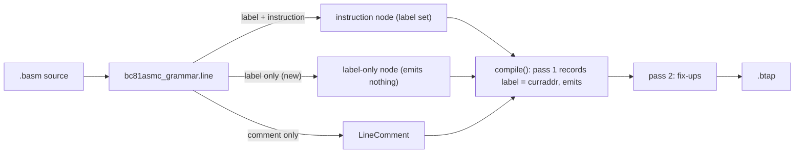
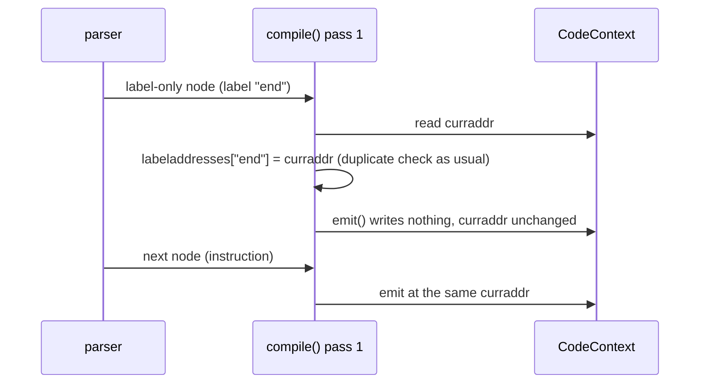

# Assembler: Allow a Label on a Line of Its Own Plan

**Plan Status**: `FINAL`

**Story Type**: `Internal`

**Plan Revision**: `A0`

> This plan captures **what** to build and **why**. The implementation agent discovers the **how** against live code.

---

## 1. Problem Statement

*   **Context**: In `bc81asmc`, every labelled line must also hold an instruction or a directive (the `line` rule in `src/bc81asmc/bc81asmc_grammar.py`: optional label, then a required `instruction`, then an optional comment). So the compiler writes `LABEL0001: nop` wherever it needs a jump target (`src/bc/bc_ast.py`, `src/bc/bc_stdlib.py`). Each of those `nop`s costs one byte and one instruction at run time. A line `name:` on its own is a syntax error today.
*   **Goal**: accept a line that holds only a label, optionally followed by a comment. The label gets the current address, and the line emits no bytes.
*   **In scope**: the assembler grammar and AST, assembler tests, `docs/02-assembler.md` and the assembler's `CLAUDE.md`.
*   **Out of scope**: removing the `nop`s from the compiler templates. That is #104 (roadmap step 19, `docs/analysis/08-self-hosted-roadmap.md`, row 16 = this issue). BASM (on-target assembler) is also out of scope; it copies the host rule later.

### 1.1 Technical Summary

*   **Touched projects**: `src/bc81asmc/` (`bc81asmc_grammar.py`, `bc81asmc_ast.py`), `src/bc81asmc/tests/`, `docs/02-assembler.md`, `src/bc81asmc/CLAUDE.md`.
*   **New patterns / abstractions**: one AST node for a label-only line, which emits nothing. It carries the label through the existing `set_label` / `label_col` path, so `compile()` records its address and reports duplicates exactly as it does for any other labelled line.
*   **Infrastructure changes**: None.
*   **End-state observable behavior**: `name:` alone (or `name: ; text`) assembles. The label resolves to the address of the next emitted byte, and the assembler's output for every existing source is byte-identical.

---

## 2. Architecture & Design

### 2.1 Architecture Overview

#### Involved services & owners

| Service | Technical Owner |
| :--- | :--- |
| `bc81asmc` (host assembler) | repo owner |

#### C2 diagram

#### Flow diagram

### 2.2 External Contracts & Evidence

N/A — Internal story.

#### Source Conflict Log

| Topic | Source A | Source B | Conflict | Chosen Handling |
| :--- | :--- | :--- | :--- | :--- |
| A label-only line before a `.org` | AC 1: "the label has the address of the next emitted byte" | `compile()` gives a label the address *before* its line's emit, so `x: .org 0x1000` today labels the old address | With a `.org` in between, "the next emitted byte" and "the current address" differ | D2: a label-only line behaves like a label on a no-byte line (`.assert`, `.def`): it gets the current address. In practice the case disappears: open PR #65 (decision A9, owner's choice on 2026-11-22) makes `.org` legal only once, before any code or label. Flagged in the PR. |

### 2.3 Affected Areas

| Area / File (pointer) | Role in this change | Likely action |
| :--- | :--- | :--- |
| `src/bc81asmc/bc81asmc_grammar.py` (`line`, `label`, `positioned`) | The line rule. It needs a label-only alternative, label then optional comment, before the newline. | Change |
| `src/bc81asmc/bc81asmc_ast.py` (`Token`, `Directive`, `LINE`) | AST nodes. It needs a node that emits nothing and accepts a label and a comment the way other tokens do. | Change |
| `src/bc81asmc/bc81asmc.py` (`compile`) | Pass 1 already records `line.label` at `curraddr` and checks duplicates for any node. It should need no change, so verify that. | Reference |
| `src/bc81asmc/tests/bc81asmc_tests.py` (grammar tests), `tests/bc81asmc_emit_tests.py`, `tests/bc81asmc_compile_diag_tests.py` | Where the new tests go: parse results, resolved addresses and fix-ups, and diagnostics (a duplicate label on a label-only line, a parse error on a bad label). | Add tests |
| `docs/02-assembler.md` (Source syntax) | User reference for the line forms. | Change |
| `src/bc81asmc/CLAUDE.md` (How it works) | Agent notes: "turns each line into one AST dataclass". | Change (one sentence) |

### 2.4 Key Algorithms & Behaviour

*   **Label-only line**: optional leading blanks, `ident:`, optional blanks, optional `;comment`, then a newline. It yields a node that emits no bytes and carries the label, its column and the comment.
*   **Address rule**: the label gets `curraddr` at that point in pass 1. Instructions emit whole bytes (a label operand can't start on a half byte), so `curraddr` there equals the address of the next emitted byte. Several label-only lines in a row get the same address. A label-only line at the end of the file gets the end address (the last emitted byte + 1, i.e. org + code length).
*   **Reference resolution** is unchanged. References to a label-only label (`jmp`, `jmr`, `jrx`, `cal`, `clr`, `.db`, `.mv`, `.assert`) patch exactly like any other label, including forward and backward references.
*   **Diagnostics** stay as they are: duplicate label/symbol at the name's column, and `.def` and labels share one namespace. A line that is not a valid label-only line (such as `foo` alone, `foo: bar`, or `1x:`) is still a syntax error. Parse errors in other lines must still point where they do today.
*   **Grammar order**: the `label + instruction` alternative stays first. The label-only alternative is tried only when that one fails, so a labelled instruction never parses as a label-only line followed by an orphan.
*   **Byte identity**: no existing source has a label-only line, because it is a syntax error today. So all existing outputs must be byte-identical. The planning probe confirmed it (§5).

---

## 3. Key Decisions & Assumptions

*   **D1 — Label-only lines are a grammar alternative with their own no-byte node.** `compile()` keeps one code path for labels. Pass 1, duplicate checks, verbose output and asserts all treat the node like any other labelled line. Rejected: making `instruction` optional in the existing `seq`. It would also accept an empty line as a label-less no-op, which is still a syntax error by design (`test_end_of_line_found`).
*   **D2 — Address = current address at the line** (same rule as a label on `.assert`/`.def`). See the Source Conflict Log for the `.org` corner case.
*   **D3 — No new design-decision record.** This is a syntax extension documented in `docs/02-assembler.md`. Open PR #65 takes the next id (A9), so adding one here would collide. Recorded as an assumption: the owner can ask for an A-record later.
*   **Assumption — the compiler keeps emitting `label: nop` in this story.** The issue says so ("the compiler part is a separate issue", #104), so it needs no open question.
*   **Assumption — a label-only line may be indented,** as a labelled instruction already may be (`ignore >>` before every line). The docs keep saying "at the start of a line" as the convention.

### 3.1 Decision Lock (Constants & Policies)

| Constant / Policy | Selected Value | Why | Where it lives |
| :--- | :--- | :--- | :--- |
| Label-only address | `curraddr` when pass 1 reaches the line | Same rule as every other label (D2) | `compile()` (unchanged) |
| Bytes emitted by a label-only line | 0 | AC | new AST node |
| Allowed trailing content | optional blanks and an optional `;` comment | issue Proposal | grammar |

### 3.2 Open Questions

No open questions.

---

## 4. Task Breakdown

| Task | Title | Depends on | Complexity |
| :--- | :--- | :--- | :--- |
| `T1` | Grammar + AST: label-only lines, with tests | — | `Medium` |
| `T2` | Docs: `docs/02-assembler.md` and assembler `CLAUDE.md` | — | `Low` |

### T1 — Grammar + AST: label-only lines, with tests

*   **Goal**: `name:` alone (optionally `name: ; comment`, optionally indented) assembles to no bytes. The label resolves to the current address.
*   **Depends on**: —
*   **Complexity**: `Medium`
*   **Pointers**: `src/bc81asmc/bc81asmc_grammar.py` (`line`), `src/bc81asmc/bc81asmc_ast.py` (`Token`/`Directive`, `LINE`), `src/bc81asmc/bc81asmc.py` (`compile`, reference only), tests in `src/bc81asmc/tests/`.
*   **Definition of Done**:
    *   A label-only line parses to a node that emits nothing. Its label, `label_col`, `lineno`/`col`/`source` and comment are set like those of other positioned nodes.
    *   AC 1: a label-only line before an instruction resolves to that instruction's address, both as a target of jumps/calls and through `.db :name` / `.mv`.
    *   AC 2: several label-only lines in a row (with or without comments, indented or not) all resolve to the same address.
    *   AC 3: a label-only line as the last line resolves to org + code length (after a `.org`, and with no `.org`).
    *   Duplicate detection works for a label-only line, in both directions (label-only vs. labelled instruction, and vs. `.def`), with the same message and column as today.
    *   Lines that are still invalid stay syntax errors: a bare identifier, `name: bogus`, and an empty or blank line.
    *   `--verbose` output does not crash on the new node.
    *   The assembler suite passes (`cd src/bc81asmc && python3 -m unittest discover -s tests -t . -p "*_tests.py"`) with the same 6 expected failures as on master (all #11, `out #r, imm`). `python3 run_tests.py < /dev/null` from the repo root exits 0.
*   **Tests expected**: unit tests in the existing assembler test files, matching their style. Cover: parse level (node type, label name and column, comment), resolution (forward and backward jump/call/`.db`/`.mv`/`.assert` against a label-only label), consecutive labels, an end-of-file label, a duplicate label diagnostic, and the invalid forms above.
*   **Tests to modify**: None

### T2 — Docs: `docs/02-assembler.md` and assembler `CLAUDE.md`

*   **Goal**: the reference describes the label-only form (AC 5).
*   **Depends on**: —
*   **Complexity**: `Low`
*   **Pointers**: `docs/02-assembler.md` (Source syntax bullets; the `.assert` row already says "a label on the line gets the current address"), `src/bc81asmc/CLAUDE.md` ("How it works", first bullet).
*   **Definition of Done**: Source syntax says that a label may stand alone on a line (optionally with a comment), emits no bytes, and gets the address of the next emitted byte. It also says that several in a row share it, that one at the end of the file gets the end address, and why (no filler `nop`, see #104). A short example is given. `CLAUDE.md` mentions the label-only node in one sentence. No other doc claims a label needs an instruction (`grep -rn "label" docs/02-assembler.md`).
*   **Tests expected**: none (docs only).
*   **Tests to modify**: None

---

## 5. Verification

*   **Assembler suite**: `cd src/bc81asmc && python3 -m unittest discover -s tests -t . -p "*_tests.py"` exits 0 with 6 expected failures (#11), the same as on master.
*   **Full suite**: `python3 run_tests.py < /dev/null` from the repo root (it builds before e2e) exits 0.
*   **Byte identity (AC 4)**: in the worktree, hash every built output (`find src -name '*.btap' -o -name '*.b81' -o -name '*.bdd'`, excluding testdata) after `cd src && ./buildos && ./buildtools && ./buildapps && ./makedisc`, built with the master assembler and then with the new one. The hashes must be identical. Planning probe (2026-11-22, trial patch on c745b4c): 16 outputs (bcOS ROM + btap, 12 bdos programs, os.bdd, utils.bdd) were identical. Also assemble `src/bc81asmc/examples/*.basm` with both versions and compare.
*   **Observable**: a 3-line source `a:` / `b: ; x` / `kil` assembles to one byte, and `cal :a` from elsewhere targets that byte.

---

## 6. Fact-Integrity Checklist

| Check | Yes / No / N/A | Notes |
| :--- | :--- | :--- |
| External contracts verified from producer/contract source | N/A | Internal |
| Evidence sources are reproducible | N/A | Internal |
| Identifier directionality / ordering / freshness meaning evidenced | N/A | Internal |
| Every `Assumption` is linked to an Open Question (§3.2) | Yes | The assumptions are closed by the issue text (#104 scope) or by existing behaviour (indentation). None affects correctness. |
| No unresolved Open Questions (for `FINAL`) | Yes | |
| Each Decision states a single committed approach | Yes | |
| Tasks are independent, each with a Definition of Done and test expectations | Yes | T1 and T2 can run in parallel |
| Required infra reflected | N/A | |

**Self-review note**: a trial patch at planning time (a new grammar alternative `label, comment?` plus a no-byte node) passed all 263 assembler tests unchanged and gave byte-identical builds, so `Tests to modify: None` is backed by evidence. The one interpretive point is D2, the `.org` corner case. #65 makes it moot by rejecting a late `.org`, and the PR flags it. The implementer should keep the existing `label + instruction` alternative first, and check that parse-error positions in the diag tests do not move.

---

## 7. Amendment Log

| Revision | Request | Decision | Plan changes |
| :--- | :--- | :--- | :--- |
