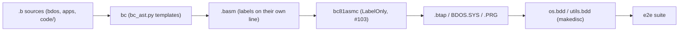
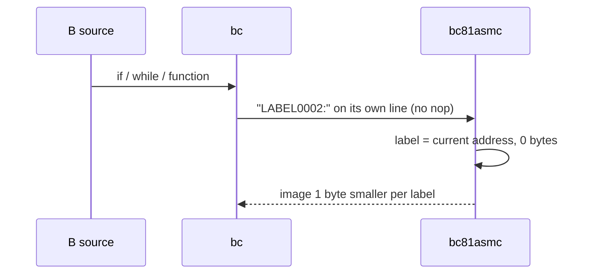

# Compiler: Remove the `nop` at Every Label and Function Start Plan

**Plan Status**: `FINAL`

**Story Type**: `Internal`

**Plan Revision**: `A0`

> This plan captures **what** to build and **why**. The implementation agent discovers the **how** against live code.

---

## 1. Problem Statement

*   **Context**: The host compiler `bc` writes `LABELxxxx:      nop` at every jump target of `if`/`else`/`while` and `F<name>:  nop` at the start of every function (`src/bc/bc_ast.py`: `STATEMENT_IFELSE.emit`, `STATEMENT_WHILE.emit`, `FUNCTION_DECLARATION.add_code`). Each one is a byte in the image, and a loop's start label is executed on every iteration. The assembler had to have an instruction on a labelled line until #103 (PR #149, on master) added label-only lines (`name:` with an optional comment; the `LabelOnly` node, no bytes, label = current address). On top of that, `src/bdos/stdio.b` carries 6 hand-written `asm "stdprntf_…: nop";` lines that also exist only to carry a label.
*   **Goal**: No program built by `bc` contains a `nop` whose only job is to carry a label. Every program gets smaller (and loops a little faster). The design page's `.IR` table stops listing `nop` for `FUNC` and `LABEL`, so the future BC64 compiler (BCC3) and `bc --obj` start without it and stay byte-identical with the host.
*   **In scope**: the three compiler templates, the 6 `stdio.b` label `nop`s, the compiler codegen tests, a full rebuild plus the test suite (and e2e goldens if any change), the code-size log, `docs/03-compiler.md`, and the design page `docs/analysis/07-self-hosted-compiler.md` (`.IR` table and the phase-1 bullet).
*   **Out of scope**:
    *   The `sys_stackhead: nop` line at the end of the runtime (`bc_stdlib.py`). It is not just a label: `sys_stackhead` is the 2-byte software-stack pointer and the `nop` byte is its low byte (see D2).
    *   `asm "nop";` in `src/bc/code/declarations.b` (a real instruction, no label).
    *   Hand-written assembly that `bc` doesn't build (`src/bc81asmc/bcOS/*.basm`, `boot.basm`).
    *   `bc --obj` and BCC3 themselves (#108 and later; neither exists yet, see D4).
    *   The roadmap status row (`docs/analysis/08-self-hosted-roadmap.md` step 19) and `docs/CHANGELOG.md`. Separate docs runs update both after the merge.

### 1.1 Technical Summary

*   **Touched projects**: `src/bc` (compiler codegen + tests), `src/bdos/stdio.b`, docs.
*   **New patterns / abstractions**: none. Labels are emitted as label-only lines (`name:`), which the assembler already supports.
*   **Infrastructure changes**: None.
*   **End-state observable behaviour**: every program is smaller. The trial build of `master` 53e6ac3 with this change gave **−1605 bytes over 18 programs** (e.g. `bdos` 17623 → 17359, `texted` 14359 → 14150); all programs behave the same.

---

## 2. Architecture & Design

### 2.1 Architecture Overview

#### Involved services & owners

| Component | Technical Owner |
| :--- | :--- |
| `src/bc` (host compiler) | repo owner |
| `src/bdos` (B sources) | repo owner |
| `src/bc81asmc` (assembler, reference only) | repo owner |

#### C2 diagram

#### Flow diagram

### 2.2 External Contracts & Evidence

N/A — Internal story.

#### Source Conflict Log

| Topic | Source A | Source B | Conflict | Chosen Handling |
| :--- | :--- | :--- | :--- | :--- |
| Label `nop` count | Issue: 176 in `texted.basm`, 220 in `bdos.basm` | Trial build on 53e6ac3: −209 B `texted`, −264 B `bdos` | The issue counted only jump labels in an older build; the trial also removes function-start `nop`s and the stdio.b `nop`s | Report the measured numbers in the PR (AC 3); the issue's numbers are not targets |
| AC 4 (`bc --obj` vs BCC3) | Issue AC 4 | Repo: no `--obj` option in `bc.py`, BCC3 (#108) not started | Nothing to compare yet | D4: the AC is not applicable today; the design-page `.IR` table states the no-byte rule for both (proposal item 2). Say so in the PR. |

### 2.3 Affected Areas

| Area / File (pointer) | Role in this change | Likely action |
| :--- | :--- | :--- |
| `src/bc/bc_ast.py` — `STATEMENT_IFELSE.emit`, `STATEMENT_WHILE.emit`, `FUNCTION_DECLARATION.add_code` | The three templates that write a label with `nop` | Change: write the label alone on its line |
| `src/bdos/stdio.b` — `printf`'s `asm "stdprntf_…: nop";` lines (6) | Hand-written label carriers compiled into every program that includes stdio.b | Change: `asm "stdprntf_…:";` |
| `src/bc/bc_stdlib.py` — `sys_stackhead: nop` | Storage byte of the stackhead pointer | Reference only (D2) |
| `src/bc/tests/bc_codegen_tests.py` | Codegen tests that assert the `label:      nop` shape | Change 4 tests (see T1); add new ones |
| `src/bc/tests/bc_assert_tests.py` | Asserts `sys_stackhead: nop` is the second-last line | Reference only: must keep passing (D2) |
| `src/bc81asmc/bc81asmc_ast.py` (`LabelOnly`) | Assembler support for label-only lines (#103) | Reference only |
| `src/bc/code_size.csv`, `scripts/code_size.py` | Append-only code-size log | Append rows with `--record` |
| `src/bc/history.txt` | Hand-written code-size history | Append a short entry |
| `docs/03-compiler.md` | User-facing compiler doc ("How the generated code works", labels) | Change |
| `docs/specs/memory/design-decisions.md` (Compiler section, last is C6) | Standing decisions; repo CLAUDE.md asks to record a new one | New decision C7 |
| `docs/analysis/07-self-hosted-compiler.md` | Design page: `.IR` table rows `10 FUNC` and `80 LABEL` say `nop`; phase-1 bullet about removing the `nop` | Change |
| `src/tests/test_e2e_*.py`, goldens in `src/bc64/testdata/e2e/` | e2e suite; goldens are masked for sizes and positions (#89) | Regenerate only if a golden changes |

### 2.4 Key Algorithms & Behaviour

*   **Label emission rule**: wherever `bc` places a jump label or a function label, it writes the label alone on its line (`LABEL0002:` / `FMAIN0001:`), then the next instruction on the following line. Label names, label numbering, jump instructions and every other instruction stay exactly as they are. The only difference in each `.basm` is the missing `nop`s.
*   **Assembler semantics** (already on master, #103): a label-only line gets the current address and emits no bytes. Several label-only lines in a row (nested `if`s ending together, an `if` end followed by a `while` start) all get the same address. A label-only line right before `ret` or `;END OF FUNCTION` is fine.
*   **Indented label-only lines**: `STATEMENT_ASM` indents the `asm` string, so the stdio.b change produces an indented label-only line. The trial build confirmed the assembler accepts it. The implementation must still check that the built `.basm` has those labels and that they assemble.
*   **Behaviour preservation**: removing a `nop` changes only addresses. All jumps are label-based, so behaviour is the same. The full e2e suite is the behavioural check. There is no golden `.basm` (owner decision, #15).
*   **Expected sizes** (trial on 53e6ac3; the real numbers come from T2's `--record`): `bdos` −264, `texted` −209, `format` −159, `cat` −141, `cha`/`rm` −130, `ls` −123, `cp` −119, `calc` −111, `theodore` −85, `fddtest` −75, `helloworld` −37, `code/*` −2…−7, `debug` −1; total −1605.

---

## 3. Key Decisions & Assumptions

*   **D1 — Labels on their own line.** Every compiler-generated label is written on its own line with no instruction, as the issue's proposal item 1 asks. No other codegen change goes in (no peephole, no label merging).
*   **D2 — `sys_stackhead: nop` stays.** `sys_stackhead` is the software-stack pointer word: the entry code stores `sys_stackhead + 2` into it, and `stackheadroll`/`stackheadrll8` and bdio's `bdio_get_sysstackhead` read and write it. Its `nop` is the low byte of that word, not a label carrier. Removing it would move the pointer one byte further outside the image, outside what this story covers. `bc_assert_tests` keeps pinning this line.
*   **D3 — stdio.b's label `nop`s are in scope.** AC 1 says "no program built by `bc`" without limiting it to compiler templates, and `stdio.b` is linked into most programs. Its 6 `asm "stdprntf_…: nop";` lines become label-only `asm` lines. This goes one step past the issue's "Problem" section, which names only the compiler templates. It's recorded here and in the PR.
*   **D4 — AC 4 is not applicable yet.** Neither `bc --obj` nor BCC3 exists today (`bc.py` has no `--obj`; #108 is not started). The issue's proposal item 2 covers this case: "If BCC3 doesn't exist yet … its template table is written without the `nop`". So the design page's `.IR` table states that `FUNC` and `LABEL` emit no byte, and the phase-1 bullet says the removal is done, so whoever builds `--obj`/BCC3 starts from the no-`nop` templates. The PR says AC 4 is vacuous today, so it isn't claimed as tested.
*   **D5 — Goldens.** e2e goldens are masked for sizes, free sectors and positions (#89), but not every golden goes through the mask. The trial e2e run on 53e6ac3 (118 tests) failed exactly one: `toolchain_run.golden.txt` (`test_e2e_toolchain`). Its program now loads with one progress dot (`.`) instead of two (`..`), because the compiled test program shrank below an 8-sector boundary (one dot per 8 sectors). That is a size-driven change by design (AC 2). Regenerate it with `python3 run_tests.py --update-golden`. Check that the diff is that one dot line and nothing else, and say so in the PR. Any other golden that changes must be reviewed the same way. If its change isn't purely size/position-driven, it's a defect.
*   **D6 — Sizes in the PR.** AC 3 is met by T2's before/after table (base = `origin/master` build, after = branch build) in the PR body, plus the `code_size.csv` rows from `--record`.

### 3.1 Decision Lock (Constants & Policies)

| Constant / Policy | Selected Value | Why | Where it lives |
| :--- | :--- | :--- | :--- |
| Label line format | `<label>:` alone, no padding instruction | Proposal item 1; #103 grammar | `bc_ast.py` templates |
| `sys_stackhead: nop` | kept | D2: storage, not a label carrier | `bc_stdlib.py` |
| stdio.b label lines | `asm "<label>:";` | D3 | `src/bdos/stdio.b` |
| `.IR` `FUNC` / `LABEL` code | "no code (0 bytes)" | proposal items 2–3, D4 | design page `.IR` table |
| Code-size log | append with `scripts/code_size.py --record`, once, after the final build | append-only CSV (#15) | `src/bc/code_size.csv` |

### 3.2 Open Questions

No open questions.

---

## 4. Task Breakdown

| Task | Title | Depends on | Complexity |
| :--- | :--- | :--- | :--- |
| `T1` | Compiler and stdio.b write labels without `nop` | — | `Medium` |
| `T2` | Rebuild, run the full suite, record the sizes | `T1` | `Medium` |
| `T3` | Docs: compiler page and the design page's `.IR` table | — | `Low` |

### T1 — Compiler and stdio.b write labels without `nop`

*   **Goal**: `bc` writes jump labels and function labels on their own line with no `nop`, and `stdio.b`'s 6 hand-written label `nop`s become label-only `asm` lines.
*   **Depends on**: —
*   **Complexity**: `Medium`
*   **Pointers**: `src/bc/bc_ast.py` (`STATEMENT_IFELSE`, `STATEMENT_WHILE`, `FUNCTION_DECLARATION.add_code`); `src/bdos/stdio.b` (`printf`); `src/bc/tests/bc_codegen_tests.py`; `src/bc81asmc/bc81asmc_ast.py` (`LabelOnly`, reference).
*   **Definition of Done**:
    *   The generated `.basm` of every program has no `nop` on a line that starts with a compiler label or a `stdprntf_` label. The only `nop`s left are `sys_stackhead: nop` and the explicit `asm "nop";` in `code/declarations.b`.
    *   Everything else in the generated code is unchanged: label names, numbering and the other instructions.
    *   The 4 listed tests now assert the label-only line instead of `label:      nop`. What else they check stays.
    *   `cd src/bc && python3 -m unittest discover -s tests -t . -p "*_tests.py"` passes, and so does the assembler suite.
*   **Tests expected** (unit, `src/bc/tests/`; add them to `bc_codegen_tests.py` or a new `*_tests.py` there):
    *   if-without-else, if/else, while and a function start each produce a label-only line and no `nop`.
    *   A program with nested `if`s that end together and an `if` followed by a `while` (several label-only lines in a row) compiles. Assembling it with the real assembler succeeds, and the image is smaller than one byte per label would make it. Follow the `assemble()` helper pattern in `bc_assert_tests.py`.
    *   A whole-program check: compile a program that uses if/else/while/functions and assert that no line in the output both defines a label and has a `nop`, except `sys_stackhead`.
*   **Tests to modify**:
    *   `src/bc/tests/bc_codegen_tests.py :: TestProgramShape.test_function_label_and_trailing_ret` — asserts the function label line ends with `nop`; by design it is now a label-only line (AC 1, D1).
    *   `src/bc/tests/bc_codegen_tests.py :: TestControlFlow.test_if_without_else` — expects `label + ':      nop'` (AC 1, D1).
    *   `src/bc/tests/bc_codegen_tests.py :: TestControlFlow.test_if_else` — expects `else_label/end_label + ':      nop'` (AC 1, D1).
    *   `src/bc/tests/bc_codegen_tests.py :: TestControlFlow.test_while` — finds the loop start as a `LABEL…nop` line and expects `exit_label + ':      nop'` (AC 1, D1).

### T2 — Rebuild, run the full suite, record the sizes

*   **Goal**: Every disc program and `BDOS.SYS` is rebuilt with T1's compiler, the whole suite passes, and the before/after sizes are recorded.
*   **Depends on**: `T1`
*   **Complexity**: `Medium`
*   **Pointers**: `src/buildos`, `src/buildtools`, `src/buildapps`, `src/makedisc`; `run_tests.py`; `scripts/code_size.py`; `src/bc/code_size.csv`; `src/bc/history.txt`; e2e goldens `src/bc64/testdata/e2e/`, `src/tests/smoke_transcript.txt` (if present).
*   **Definition of Done**:
    *   `cd src && ./buildos && ./buildtools && ./buildapps && ./makedisc` succeeds (no assembler errors, no `.assert` failures).
    *   `python3 run_tests.py < /dev/null` from the repo root exits 0 (it builds before e2e). Any expected failure that remains is listed with its issue, not counted as passed.
    *   If a golden changed: regenerated with `python3 run_tests.py --update-golden`, the diff reviewed and found to come only from sizes/addresses, and the reason written into the task notes for the PR (D5). If none changed, say so.
    *   `python3 scripts/code_size.py --record` ran once after the final build and the appended rows are committed. A before/after table (base `origin/master` built in a temp copy, after = this branch) is saved to `docs/specs/plans/104-sizes.md`, which the PR body uses (AC 3, D6).
    *   A short entry for this change (total bytes saved and the two biggest programs) is appended to `src/bc/history.txt`.
    *   `git status` shows no build outputs (they are ignored).
*   **Tests expected**: none new. This task runs the existing suites against the rebuilt system.
*   **Tests to modify**:
    *   `src/bc64/testdata/e2e/toolchain_run.golden.txt` (golden of `src/tests/test_e2e_toolchain.py :: ToolchainTests.test_compile_assemble_put_on_disc_and_run`) — the load line becomes `.` instead of `..` because the compiled program is now under 8 sectors (AC 1/AC 2, D5). Regenerate it; no other line may change.

### T3 — Docs: compiler page and the design page's `.IR` table

*   **Goal**: The docs describe labels without `nop`, and the rule is a standing design decision.
*   **Depends on**: —
*   **Complexity**: `Low`
*   **Pointers**: `docs/specs/memory/design-decisions.md` (Compiler section, after C6); `docs/03-compiler.md` (the labels bullet near "Assembly labels are …" and the "How the generated code works" section); `docs/analysis/07-self-hosted-compiler.md` (`.IR` table rows `10 FUNC` and `80 LABEL`; the phase-1 bullet "the `nop` the host writes at every label and function start removed …").
*   **Definition of Done**:
    *   `03-compiler.md` says jump and function labels are written on their own line with no `nop` (label-only lines need #103's assembler) and that `sys_stackhead`'s byte is the stack pointer word, not a label.
    *   In the design page's `.IR` table, `FUNC` = "starts a section with its global symbol; no code (0 bytes)" and `LABEL` = "local label n is here; no code (0 bytes)".
    *   The phase-1 bullet records that the removal is done (#104), without the old 176/220 figures (or with the measured ones). It also says BCC3/`bc --obj` start without the `nop` from the start.
    *   `design-decisions.md` gets **C7** in the C1–C6 format (Purpose / Rationale / Usage / Trade-offs): "Labels cost no bytes" — compiler labels are label-only lines; no padding `nop`; `asm` label lines in libraries follow the same rule; `sys_stackhead`'s byte is storage; `.IR` `FUNC`/`LABEL` (BCC3, `bc --obj`) emit nothing, so host and BC64 compiler output stays byte-identical. Before the PR, check `origin/master`'s last `### C` id and renumber if a parallel story took C7.
    *   No other doc content changes. Links and Markdown tables still render.
*   **Tests expected**: none (docs only).
*   **Tests to modify**: None.

---

## 5. Verification

*   **Unit**: `cd src/bc && python3 -m unittest discover -s tests -t . -p "*_tests.py"` passes.
*   **Full suite**: `python3 run_tests.py < /dev/null` at the repo root exits 0 (unit + build + e2e, ~7 min). List any remaining expected failures with their issues. (The `release` suite needs a real git clone and fails in a `git archive` copy; run it in the worktree.)
*   **No label `nop`s**: after a full build, grep every built `.basm` under `src/bdos` and `src/bc/code` for a line that has both a label and `nop`. The only hit allowed is `sys_stackhead: nop`.
*   **Sizes**: `python3 scripts/code_size.py` shows every program at or below its previous CSV row, and all but `debug`-sized programs strictly smaller. The before/after table is in the PR.
*   **Observable behaviour**: the e2e suite boots `os.bdd`/`utils.bdd` and runs ls/cat/cp/rm/texted/calc/theodore, which shows the programs behave the same.

---

## 6. Fact-Integrity Checklist

| Check | Yes / No / N/A | Notes |
| :--- | :--- | :--- |
| External contracts verified from producer/contract source | N/A | Internal story |
| Evidence sources are reproducible | N/A | Internal story |
| Identifier directionality / ordering / freshness meaning evidenced | N/A | Internal story |
| Every `Assumption` is linked to an Open Question (§3.2) | Yes | No assumptions; D3/D4 are decisions grounded in AC text |
| No unresolved Open Questions (for `FINAL`) | Yes | |
| Each Decision states a single committed approach | Yes | |
| Tasks are independent, each with a Definition of Done and test expectations | Yes | T2 depends on T1; T3 is independent (docs) |
| Required infra reflected (toggle / bicep) | N/A | No toggle, no infra |

**Self-review note**: A trial patch on 53e6ac3 (all three templates plus stdio.b) built every program and disc cleanly. The compiler suite then failed exactly the 4 tests listed under T1's `Tests to modify`. The emulator, ftool and assembler suites stayed green. The e2e suite (118 tests) failed only on `toolchain_run.golden.txt`, one load dot fewer (D5, listed under T2). It also kept its 1 pre-existing expected failure (`test_tape_round_trip`, #32/#62), which T2 must report as remaining, not as passed. The one judgement call is D3 (stdio.b is in scope by AC 1's wording) and D2 (`sys_stackhead: nop` is storage). The implementing agent should be careful not to "clean up" `sys_stackhead`, and should run `--record` only once, after the final build (the CSV is append-only).

---

## 7. Amendment Log

| Amendment | Request | Decision | Plan changes |
| :--- | :--- | :--- | :--- |
