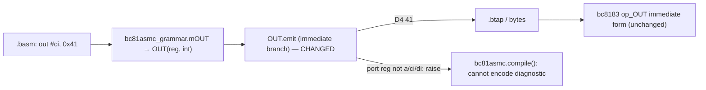
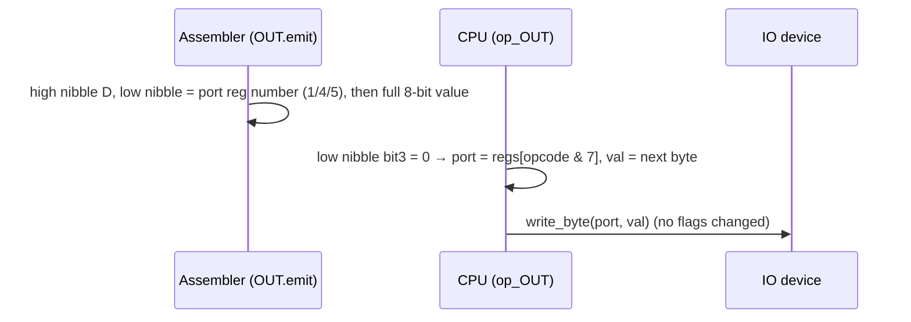

# Assembler: Fix `out #r, imm` Encoding Plan

**Plan Status**: `FINAL`

**Story Type**: `Internal`

**Plan Revision**: `A0`

> This plan captures **what** to build and **why** — domain, architecture, decisions, and verified facts.
> It deliberately does **not** contain implementation code, pseudocode, line numbers, mock setups, or test bodies.
> The implementation agent discovers the **how** against live code. See §4 Task Breakdown.

---

## 1. Problem Statement

*   **Context**: The assembler grammar accepts `out #r, 0xHH`, but `OUT.emit` (integer branch) writes the nibbles `D`, `0`, `r`, `imm & 0xf` — i.e. `D0 rH`. The CPU's `op_OUT` immediate form (low nibble bit 3 = 0) takes the port register from bits 0–2 of the first byte and the **whole** second byte as the value (`Dr HH`). So `out #ci, 0x41` assembles to `D0 41`; the CPU then reads the port from register 0 (no such register → crash) and only the low 4 bits of the value survive. The docs (`docs/02-assembler.md`, `src/bc81asmc/CLAUDE.md`, `src/bc64/CLAUDE.md`, the analysis pages) describe it as broken/unused. No shipped source uses the form.
*   **Goal**: (owner decision on the issue) **fix the instruction, don't reject it**; the CPU's 2-byte immediate form is the reference, and only the assembler encoder changes. `out #r, 0xHH` assembles to `Dr HH` for `r` ∈ {`a`, `ci`, `di`}; any other port register (`cs`, `ds`, and also `f`, `si`, `ss`, `pc`, whose numbers don't fit the 3-bit field) is a clear `cannot encode` error.
*   **In scope**: `OUT.emit` immediate branch; turning the six existing `#11` `expectedFailure` tests into real tests; new tests; docs (`docs/01-emulator.md`, `docs/02-assembler.md`, `src/bc81asmc/CLAUDE.md`, `src/bc64/CLAUDE.md`, `docs/analysis/01-emulator.md`, `docs/analysis/02-assembler.md`, `docs/analysis/07-self-hosted-compiler.md`) and a new assembler design decision.
*   **Out of scope**: the CPU (`src/bc64/bc8183_cpu.py`) — unchanged by owner decision. The register form `out #r, r2` (`D8 r r2`) — unchanged. `in r, #0xH` (`C0 rH`), which already agrees with the CPU. The grammar (`mOUT` already parses `out #r, 0xHH` for every `paramreg`; the check belongs in `emit`, like A8/A9). The roadmap table `docs/analysis/08-self-hosted-roadmap.md` (its ✅ column is maintained separately after merge, as for #66/#67).

### 1.1 Technical Summary

*   **Touched projects**: `src/bc81asmc/` (encoder + tests), docs.
*   **New patterns / abstractions**: none — reuses the `emit` raises → driver `cannot encode` diagnostic path (as A8/A9).
*   **Infrastructure changes**: None.
*   **End-state observable behaviour**: `out #ci, 0x41` → `D4 41`, the emulator writes `0x41` to the port held in `ci`; `out #cs, 0x41` / `out #ds, 0x41` → positioned `cannot encode` error with the §3.1 message and no bytes; every built ROM/disc/program is byte-identical.

---

## 2. Architecture & Design

### 2.1 Architecture Overview

#### Involved components & owners

| Component | Technical Owner |
| :--- | :--- |
| `bc81asmc` (assembler) | repo owner (bcichonski) |
| bc8183 CPU (reference only, unchanged) | repo owner |

#### C2 diagram

#### Flow diagram

### 2.2 External Contracts & Evidence

N/A — Internal story.

### 2.3 Affected Areas

*   `src/bc81asmc/bc81asmc_ast.py` — `OUT.emit`, integer branch (register branch unchanged). `CodeContext.emit_4bit` / `emit_byte` pack nibbles/bytes.
*   `src/bc81asmc/bc81asmc.py` — `compile()` catches an exception from `emit` and turns it into `cannot encode '<line>': <reason>` (reference only; a non-`KeyError` keeps its message as the reason).
*   `src/bc64/bc8183_cpu.py` — `op_OUT` (reference only).
*   Tests: `src/bc81asmc/tests/bc81asmc_emit_tests.py` (`TestOutImmediate`), `src/bc81asmc/tests/bc81asmc_opcode_agreement_tests.py` (`OutImmediateTests`, the module docstring's "Known disagreements" list and the comment next to the `out #r,reg` cases), `src/bc81asmc/tests/bc81asmc_tests.py` (grammar test `mOUT.parse('out #cs, 0xad')` — stays valid: parsing still accepts it), `src/bc64/tests/test_cpu_control.py` (`test_OUT_immediate_*` — already assert the CPU side; unchanged).
*   Docs: listed in §1.

### 2.4 Key Algorithms & Behaviour

*   **Encoding** (immediate form): byte 1 = `0xD0 | n` where `n` is the port register's number (`a`=1, `ci`=4, `di`=5 — E15 numbering); byte 2 = the full 8-bit value. 2 bytes total, byte-aligned (as before, the instruction is 2 bytes; only the content changes).
*   **Validation**: `n` must fit the CPU's 3-bit field (`n ≤ 7`). Of the grammar's `paramreg` names only `a`, `ci`, `di` qualify; `cs` (8), `ds` (9), `f` (B), `si` (C), `ss` (D), `pc` (F) are rejected. Rejection happens in `emit` (raise), so the driver reports a positioned `cannot encode` diagnostic, emits no bytes for the line and keeps assembling later lines.
*   **Flags**: the CPU's immediate form changes **no** flags; the register form `out #r, r2` sets `Z`/`N` from the value and clears `C`/`O`. Documented, not changed.
*   **No-data behaviour**: N/A.

---

## 3. Key Decisions & Assumptions

*   **D1 — Fix in the encoder only** (owner decision on #11): CPU unchanged; its immediate form `Dr HH` is the reference.
*   **D2 — Reject every port register the 3-bit field can't name**, not only `cs`/`ds`. The issue names `cs`/`ds` (the AC); `f`/`si`/`ss`/`pc` have numbers ≥ 8 too, and encoding them would silently produce a different instruction (bit 3 set = the register form). Rejecting them is the conservative reading of "can't produce broken machine code without noticing" (use case). Not a deviation: AC 2 is met as written, the extra registers follow the same reason.
*   **D3 — Error via the existing `cannot encode` path** (A8/A9 precedent), message fixed in §3.1.
*   **D4 — New design decision `A10`** in `docs/specs/memory/design-decisions.md` (assembler section, after A9): Purpose / Rationale (owner: fix, don't reject; CPU is the reference) / Usage (allowed port registers, the error, no flags in the immediate form, BASM must encode the same way — roadmap step 15) / Trade-offs (no CPU change; hand-encoded `D0 xx` still decodes as "port register 0"). **Assumption**: `A10` is the next free id on master today (A9 = #67). Open PR #151 (#65) may also claim an A-id; check `origin/master`'s last `### A` id right before opening the PR and renumber (plus links) if taken — a bookkeeping step, not a design doubt.
*   **D5 — The six `#11` expectedFailure tests become real tests** (memory policy: a fixed bug's xfails must run for real). Remove the decorator and the "Known bug / Today it assembles to D0 41" wording; assertions stay the same or get stricter (e.g. `assertRaises(Exception)` may be tightened to the `AssemblerError`/message the driver produces — never loosened).
*   **D6 — Byte identity** (AC 3): no committed source uses `out #r, 0xHH` (verified: no match in `src/**/*.basm`, `*.b`, and the compiler's emitted templates), so every build output must be byte-identical to the base build.
*   **Assumption A-1**: the analysis pages (`docs/analysis/01-…`, `02-…`, `07-…`) are updated to "done in #11" in the same style as earlier stories (e.g. "#10 (done)"), not rewritten. No correctness impact.

### 3.1 Decision Lock (Constants & Policies)

| Item | Value |
| :--- | :--- |
| `out #ci, 0x41` | `D4 41` |
| `out #a, 0xHH` / `out #di, 0xHH` | `D1 HH` / `D5 HH` |
| Allowed port registers (immediate form) | `a`, `ci`, `di` |
| Error reason (after `cannot encode '<line>': `) | `out #<r>, 0xHH takes the port in a, ci or di; load the value into a register and use out #<r>, <reg>` |
| Flags, immediate form | none changed |
| New decision id | `A10` (re-check before PR, D4) |

### 3.2 Open Questions

None.

---

## 4. Task Breakdown

| Task | Title | Depends on | Complexity |
| :--- | :--- | :--- | :--- |
| `T1` | Encode `out #r, 0xHH` as `Dr HH`, reject other port registers | — | `Medium` |
| `T2` | Docs: instruction table, quirks, CLAUDE.md files, analysis, decision A10 | — | `Low` |

### T1 — Encode `out #r, 0xHH` as `Dr HH`, reject other port registers

*   **Goal**: `OUT.emit`'s immediate branch emits `D` + port register number, then the full value; port registers outside `a`/`ci`/`di` raise so the driver reports the §3.1 `cannot encode` error. The register form is unchanged.
*   **Depends on**: —
*   **Complexity**: `Medium`
*   **Pointers**: `src/bc81asmc/bc81asmc_ast.py` (`OUT`, `ASMCODES.REG2BIN`, `CodeContext.emit_4bit`/`emit_byte`), `src/bc81asmc/bc81asmc.py` (`compile()` wrapper, reference), `src/bc64/bc8183_cpu.py` (`op_OUT`, reference), tests in `src/bc81asmc/tests/`.
*   **Definition of Done**:
    *   `out #ci, 0x41` → `D4 41`; `out #a, 0xfe` → `D1 FE`; `out #di, 0x00` → `D5 00`; `out #ci, 0xff` keeps all 8 bits.
    *   `out #cs, 0x41`, `out #ds, 0x41` (and `f`, `si`, `ss`, `pc`) → exactly `cannot encode '<line>': <§3.1 reason>` at the line's position, no bytes for that line, later lines still assembled.
    *   `out #ci, a` (`D8 41`) and every other form encode exactly as before.
    *   The six `#11` expectedFailure tests run for real and pass; `run_tests.py` shows no `#11` expected failure.
    *   Full suite `python3 run_tests.py < /dev/null` from the repo root exits 0 (it builds before e2e). A full build is byte-identical to the base build (`python3 scripts/code_size.py --check` delta 0, or hashes of every `*.b81`/`*.btap`/`*.sector(s)`/`*.bdd` under `src/` equal between base and branch builds).
*   **Tests expected** (unit, assembler, co-located in `src/bc81asmc/tests/`): encodings for `a`/`ci`/`di` with a value whose high nibble is non-zero; the error message and position for `cs`/`ds` (and at least one of `f`/`si`/`ss`/`pc`); no bytes emitted for a rejected line amid valid lines; assembler↔CPU agreement cases for the immediate form with each allowed port register (value reaches the port in the register, PC advances 2, flags unchanged) added next to the `out #r,reg` cases in `bc81asmc_opcode_agreement_tests.py`.
*   **Tests to modify**:
    *   `src/bc81asmc/tests/bc81asmc_emit_tests.py :: TestOutImmediate.test_out_ci_immediate_encodes_as_d4_41` — remove `@expectedFailure` (#11 fixed, AC 1, D5); docstring of `TestOutImmediate` updated.
    *   `src/bc81asmc/tests/bc81asmc_emit_tests.py :: TestOutImmediate.test_out_cs_immediate_is_assembler_error` — remove `@expectedFailure` (AC 2, D5); may be tightened to the §3.1 message.
    *   `src/bc81asmc/tests/bc81asmc_emit_tests.py :: TestOutImmediate.test_out_ds_immediate_is_assembler_error` — same (AC 2, D5).
    *   `src/bc81asmc/tests/bc81asmc_opcode_agreement_tests.py :: OutImmediateTests.test_out_ci_immediate_assembles_to_d4_41` — remove `@expectedFailure` and "Known bug" comment (AC 1, D5); class docstring updated ("Today it assembles to D0 41" is gone).
    *   `src/bc81asmc/tests/bc81asmc_opcode_agreement_tests.py :: OutImmediateTests.test_out_ci_immediate_agrees_with_cpu` — remove `@expectedFailure` (AC 1, D5).
    *   `src/bc81asmc/tests/bc81asmc_opcode_agreement_tests.py :: OutImmediateTests.test_out_cs_ds_immediate_is_an_assembler_error` — remove `@expectedFailure` (AC 2, D5); may be tightened to the §3.1 message.
    *   `src/bc81asmc/tests/bc81asmc_opcode_agreement_tests.py` module docstring ("`out #r, imm` encodes wrongly (#11) -> expectedFailure") and the comment "`out #r, imm` is NOT here: known disagreement #11" next to the `out #r,reg` cases — reworded/removed (D5); new agreement cases may be added there.

### T2 — Docs: instruction table, quirks, CLAUDE.md files, analysis, decision A10

*   **Goal**: every doc that calls `out #r, imm` broken describes the fixed encoding, the allowed port registers, the error, and the no-flags behaviour.
*   **Depends on**: — (wording fixed by §3.1)
*   **Complexity**: `Low`
*   **Pointers**:
    *   `docs/02-assembler.md`: I/O table row `out #r, 0xHH` → `Dr HH`, 2 bytes, port[r] = HH, `r` = `a`/`ci`/`di`, no flags; remove the "Known quirks" bullet; add a row to the Errors table (style of the `inc af`/`clr af` rows) with the §3.1 message.
    *   `docs/01-emulator.md`: next to "`OUT #r, r2` leaves `C` and `O` at 0", say the immediate form `OUT #r, HH` changes no flags; the I/O devices intro ("port number always comes from a register … or a 4-bit immediate on `IN`") stays true — keep it.
    *   `src/bc81asmc/CLAUDE.md`: replace the "Known broken and unused: `out #r, imm`" text with a Rules bullet (like the A8/A9 bullets) for the encoding + rejection; keep the `CLC_A_IMM` dead-code sentence.
    *   `src/bc64/CLAUDE.md`: drop "Known latent bug … the `OUT` immediate form is broken" (the CPU side always worked; the assembler now matches). Keep the list header sensible (no empty list).
    *   `docs/analysis/01-emulator.md` row 3, `docs/analysis/02-assembler.md` problem 5 and improvement 5, `docs/analysis/07-self-hosted-compiler.md` (the "Known quirks" bullet in the BASM section and the phase-0 sentence "`out #r, imm` is fixed, as decided in #11"): mark done in #11 (Assumption A-1).
    *   `docs/specs/memory/design-decisions.md`: new `### A10.` after A9 (D4).
*   **Definition of Done**: no doc still says `out #r, imm` is broken, emits 1.5 bytes or `D0 rH` (grep `D0 rH`, `1.5 byte`, `out #r, imm` across `docs/`, `src/**/CLAUDE.md`, `README.md`); the encoding, allowed registers, error message and flag behaviour match §3.1 exactly; links to A10 resolve.
*   **Tests expected**: none (docs only); the full suite still exits 0.
*   **Tests to modify**: None.

---

## 5. Verification

*   **Unit + e2e**: `python3 run_tests.py < /dev/null` from the repo root exits 0 (builds before e2e). Report remaining expected failures by name with their issues; none may be `#11`.
*   **Byte identity (AC 3)**: build base (`origin/master` merge-base) and branch (`cd src && ./buildos && ./buildtools && ./buildapps && ./makedisc`, in temp copies) and compare hashes of every `*.b81`, `*.btap`, `*.sector`, `*.sectors`, `*.bdd` under `src/`; or `python3 scripts/code_size.py --check` delta 0 plus ROM/disc hashes.
*   **Observable behaviour**: assemble a scratch `.basm` with `out #ci, 0x41`, `out #a, 0xfe`, `out #di, 0x00`, `out #cs, 0x41`, `out #ds, 0x41`, `out #ci, a` → bytes `D4 41`, `D1 FE`, `D5 00`, two positioned errors, `D8 41`.
*   **CPU agreement**: `bc81asmc_opcode_agreement_tests.py` passes with the new immediate cases.

---

## 6. Fact-Integrity Checklist

| Check | Status |
| :--- | :--- |
| Every AC mapped to a task / DoD (AC1→T1, AC2→T1, AC3→T1 DoD + §5, AC4→T2) | Yes |
| Facts verified against live code (`OUT.emit`, `op_OUT`, `REG2BIN` numbers, `compile()` wrapper) | Yes |
| No shipped source uses `out #r, 0xHH` (grep of `src/**/*.basm`, `*.b`, compiler) | Yes |
| `Tests to modify` derived from a trial patch (exactly six unexpected successes, nothing else failed) | Yes |
| No hedged decision; no open question | Yes |
| External contracts | N/A — Internal |

**Self-review note**: The fix is small and was trial-patched: with the immediate branch changed, the assembler suite shows exactly the six `#11` unexpected successes and nothing else fails. D2 widens the rejection from `cs`/`ds` to every register numbered ≥ 8, because encoding them would silently set bit 3 and produce the register form. The only coordination risk is the decision id `A10` colliding with open PR #151 (#65) or #149 (#103), which touch the same docs; re-check before the PR. Take care to keep the CRLF/LF endings of the edited files as they are in git.

---

## 7. Amendment Log

| Revision | Request | Decision | Plan changes |
| :--- | :--- | :--- | :--- |
