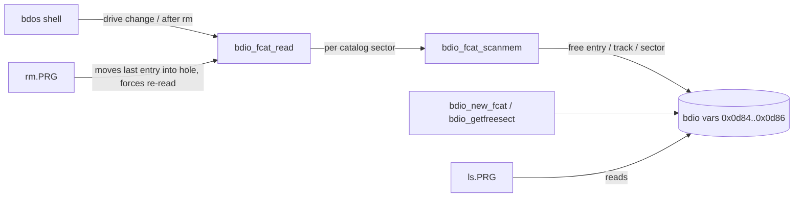

# bdos: after rm a new file overwrites an existing file; ls shows 4 sectors too many free — Plan

**Plan Status**: `FINAL`

**Story Type**: `Internal`

**Plan Revision**: `A0`

> This plan captures **what** to build and **why**. The implementation agent discovers the **how** against live code.

---

## 1. Problem Statement

*   **Context**: bdio allocates new data append-only from a "free position" (track/sector) that `bdio_fcat_read` computes on every drive change by scanning the catalog (`bdio_fcat_scanmem`, once per catalog sector). `rm` keeps the catalog compact by moving the **last catalog entry** into the hole of the removed one. After that move the catalog is no longer ordered by disc position, and the free position computed from the second catalog sector on is wrong: the running maximum is re-read as `(freetrack << 4) | freesector` while every candidate value is encoded `track << 8 | sector` (`bdio_tracksector_add`). The running maximum therefore looks tiny, and any entry in catalog sector 2+ replaces it, even one that ends *before* the real end of the used area. Reproduced in the issue: `rm hellowrd.prg`, then creating a file, allocates it at the first sector of `TEST.B` and overwrites it. Separately, `ls` computes free sectors as `(FDD_TRACKS − freeTrack) × FDD_SECTORS + freeSector`, adding the sector instead of subtracting it (52/02 → shows 194, correct is 190).
*   **Goal**: deleting a file and then creating one leaves every other file byte-for-byte intact, in every rm position (middle, last on disc, last catalog entry); `ls` prints the right free-sector count; `docs/05-bdos.md` explains how the free position is computed.
*   **In scope**: the free-position computation in bdio (and any further cause of the same data loss that the new e2e tests uncover in `bdio.b`/`rm.b`), the `ls` free-sector formula, e2e tests, docs.
*   **Out of scope**: reuse of freed space (#41 — allocation stays "after the last used sector"); `ls`'s free *catalog entries* count (see Assumption A2); the CP catalog length (#73).

### 1.1 Technical Summary

*   **Touched components**: bdos (`src/bdos/bdio.b`, `src/bdos/ls.b`, possibly `src/bdos/rm.b`), e2e tests (`src/tests/`), docs (`docs/05-bdos.md`, `docs/analysis/07-self-hosted-compiler.md`).
*   **New patterns / abstractions**: an e2e check that compares every remaining file's sectors on the session's disc image with the built `os.bdd` (via the existing `inspect` hook of `run_session`).
*   **Infrastructure changes**: None.
*   **End-state observable behavior**: after any `rm` + create sequence the free position is the first sector after the highest-ending catalog entry; `ls` prints `1024 − (track × 16 + sector)` free sectors.

---

## 2. Architecture & Design

### 2.1 Architecture Overview

#### Involved components & owners

| Component | Technical Owner |
| :--- | :--- |
| bdos (`src/bdos/`) | repo owner (bcichonski) |
| e2e harness/tests (`src/tests/`) | repo owner |

#### C2 diagram



#### Flow diagram

```mermaid
sequenceDiagram
  participant U as user
  participant RM as rm.PRG
  participant B as bdio
  participant CP as cp.PRG
  U->>RM: rm hellowrd.prg
  RM->>B: catalog: last entry moved into the hole; force catalog re-read
  B->>B: free position = max(start + length) over all used entries
  U->>CP: cp test.b new.b
  CP->>B: create NEW.B, allocate from the free position
  B-->>CP: sectors after the last used sector (no overlap)
```

### 2.2 External Contracts & Evidence

N/A — Internal story.

#### Source Conflict Log

| Topic | Source A | Source B | Conflict | Chosen Handling |
| :--- | :--- | :--- | :--- | :--- |
| Free-position encoding | `bdio_fcat_scanmem` re-reads the stored maximum as `track << 4 \| sector` | `bdio_tracksector_add`, `bdio_getfreesect` use `track << 8 \| sector` | mixed encodings in one comparison | One encoding everywhere in the comparison (D1). |

### 2.3 Affected Areas

| Area / File (pointer) | Role in this change | Likely action |
| :--- | :--- | :--- |
| `src/bdos/bdio.b` — `bdio_fcat_scanmem`, `bdio_fcat_read`, `bdio_getfreesect`, `bdio_new_fcat` | free position computed per catalog sector and consumed on create | Change (`bdio_fcat_scanmem`); others Reference unless the tests show a further cause |
| `src/bdos/bdioh.b` — `bdio_tracksector_add`, `FDD_TRACKS`, `FDD_SECTORS`, `BDIO_VAR_FCAT_*` | encoding helper and constants | Reference |
| `src/bdos/rm.b` — `remove` | moves the last catalog entry into the hole (same-sector and cross-sector branches), forces a catalog re-read | Reference; Change only if an e2e case shows it corrupts the catalog |
| `src/bdos/ls.b` — free-sector print at the end of `listCatalog` | free-sector formula | Change |
| `src/bdos/cp.b` | creates a new file from the shell (the "create" step of the e2e scenarios) | Reference |
| `src/tests/e2e_harness.py` — `run_session(..., inspect=)`, `read_catalog`, `planned_entry`, `disc_put`, `DISC_MASKS` | e2e building blocks; `disc_put` mirrors bdio allocation | Reference (a small new helper may be added) |
| `src/tests/test_e2e_bdos.py` | existing rm/ls scenarios and goldens (`bdos_rm`, `bdos_ls`) | Reference — must keep passing |
| `src/bc64/testdata/e2e/` | goldens and `.in.txt` scripts | New scripts/goldens for the new scenarios |
| `docs/05-bdos.md` — "Allocation" | describes allocation | Change |
| `docs/analysis/07-self-hosted-compiler.md` — "Disc and bdos prerequisites" rows 1–2 | lists these bugs as open | Change (mark fixed by #111) |

### 2.4 Key Algorithms & Behaviour

*   **Free position (the rule to implement and document)**: the first free sector is the maximum, over every used catalog entry (length > 0) up to the first empty entry, of `start + length` counted in linear sectors (`track × 16 + sector`), converted back to track/sector. The running maximum carried between catalog sectors in `BDIO_VAR_FCAT_FREETRACK/FREESECT` must be compared in the same encoding as each candidate. Catalog order does not matter (after `rm` it is not disc order). The first free entry is the number of the first empty entry. The catalog is compact (rm moves the last entry into the hole), so the scan may stop at the first empty entry.
*   **Allocation stays append-only**: no reuse of gaps (#41). Space freed by removing the file that ends last becomes free again automatically, because the maximum is recomputed.
*   **`ls` free sectors**: `FDD_TRACKS × FDD_SECTORS − (freeTrack × FDD_SECTORS + freeSector)`, i.e. 1024 − linear free position. 52/02 → 190 (`00BE`).
*   **No-data behaviour**: an empty catalog is impossible on a valid disc (boot, catalog and BDOS.SYS entries always exist); no change.

---

## 3. Key Decisions & Assumptions

*   **D1 — Fix the encoding, keep the algorithm.** `bdio_fcat_scanmem` keeps its per-sector running maximum but reads the stored value back with the same `track << 8 | sector` encoding that `bdio_tracksector_add` produces (or compares linear sector numbers consistently — the agent picks whichever is smaller in code, both satisfy §2.4). No rewrite of the catalog scan. Rationale: smallest change to bdos (BDOS.SYS has a `#codelimit`).
*   **D2 — The e2e tests are the definition of done for the data-loss bug, not the one cause named in the issue.** The issue says "one cause found by reading the code". If a scenario still fails after D1, the implementer finds and fixes the remaining cause in `bdio.b`/`rm.b` within T1 (still no reuse of gaps).
*   **D3 — "Create a new file" uses `cp`** (on `os.bdd`, no `utils.bdd` needed). It allocates through the same `bdio_fcreate`/`bdio_getfreesect` path as texted's `s`.
*   **D4 — "All unchanged" is checked twice**: on the printer output (`cat -c` of the remaining text file shows its original lines, per the AC wording) and on the disc image (via `run_session`'s `inspect` hook: every remaining file's sectors equal those of the built `os.bdd`, and the new file's sectors overlap no other file). The byte check covers the `.PRG` files that `cat -c` can't show meaningfully.
*   **D5 — Three rm positions, each its own scenario** (AC 1 and 2), on the built `os.bdd` layout (entries 0–10; entries 8–10 = CHA, CAT, TEST.B sit in catalog sector 2):
    1.  **middle**: a file in the middle of the disc whose catalog entry is in sector 1 (e.g. `HELLOWRD.PRG`), so the last entry is moved across catalog sectors;
    2.  **last file on disc**: the file that ends last (on a fresh `os.bdd` that is `TEST.B`, also the last entry);
    3.  **file in the last catalog entry that is not the last file on disc**: build that state in the session first (e.g. `cp` a file to add an entry, `rm` a middle file so the new one moves into the hole; now the last catalog entry is an older file), then `rm` the file in the last entry.
    Each scenario then creates a new file and checks per D4. The exact scripts are the implementer's call.
*   **D6 — `ls` test with a known layout** parses the free-sector figure from the raw (unmasked) printer output and compares it with `1024 − end of the highest planned entry` from `h.planned_entries()`; a second layout adds a file with `h.disc_put` to a temp image so the expected figure moves by that file's length. At least one layout must have a free sector ≠ 0 (the built `os.bdd` ends at 52/02 today, but derive it, don't pin it).
*   **D7 — Goldens stay as they are.** The free-sector figure is masked (`DISC_MASKS`), so the `ls` fix does not churn existing goldens or the smoke transcript. New scenarios may add goldens.
*   **Assumption A1** — `bdos.b` stays under `#codelimit 0x5d00` after the fix (a one-expression change). The build checks it; no OQ needed.
*   **Assumption A2 — deviation note, not an AC deviation**: `ls`'s free catalog entries figure (`BDIO_FCAT_LASTENTRY − freeEntry`, e.g. `EC` for 11 used of 248 entries, where 237 = `ED` would be expected) looks one too low. It is not in this issue's AC, and the existing `bdos_ls` test pins `EC`. Leave it unchanged; mention it in the PR as a possible follow-up.

### 3.1 Decision Lock (Constants & Policies)

| Constant / Policy | Selected Value | Why | Where it lives |
| :--- | :--- | :--- | :--- |
| Disc size | 64 tracks × 16 sectors = 1024 sectors | `FDD_TRACKS`, `FDD_SECTORS` | `bdioh.b` |
| Track/sector word encoding | `track << 8 \| sector` | `bdio_tracksector_add` contract | `bdioh.b` |
| Allocation policy | append after the highest-ending entry, no gap reuse | #41 owns reuse | `bdio.b` |
| Create step in tests | `cp` | on `os.bdd` | e2e scripts |

### 3.2 Open Questions

No open questions. (Resolution attempts: the AC states the scenarios and the `ls` expectation; the issue body names the encoding mismatch and the `ls` formula; the harness already offers `inspect`, `read_catalog`, `planned_entries` and `disc_put`.)

---

## 4. Task Breakdown

| Task | Title | Depends on | Complexity |
| :--- | :--- | :--- | :--- |
| `T1` | Correct free position after rm + e2e for the three rm positions | — | `High` |
| `T2` | `ls` free-sector count + e2e with known layouts | — | `Low` |
| `T3` | Document the free-position computation | `T1`, `T2` | `Low` |

### T1 — Correct free position after rm + e2e for the three rm positions

*   **Goal**: after `rm` of any file and the creation of a new one, every other file on the disc is unchanged.
*   **Depends on**: —
*   **Complexity**: `High` (data loss in the disc OS core; the issue names only one of possibly several causes).
*   **Pointers**: `src/bdos/bdio.b` (`bdio_fcat_scanmem`, `bdio_fcat_read`, `bdio_getfreesect`, `bdio_new_fcat`), `src/bdos/rm.b` (`remove`), `src/bdos/bdioh.b` (`bdio_tracksector_add`), `src/tests/e2e_harness.py`, `src/tests/test_e2e_bdos.py` (style model, esp. `test_rm_removes_file_from_ls_and_catalog` and its `inspect` use), `src/bc64/testdata/e2e/`.
*   **Definition of Done**:
    *   The free position follows §2.4 regardless of catalog order (D1); any further cause found by the tests is fixed in `bdio.b`/`rm.b` (D2).
    *   New e2e tests (new file in `src/tests/`, e.g. `test_e2e_rm_alloc.py`) cover the three D5 scenarios; each fails on the current `master` build (prove it by temporarily reverting the fix in the source file, then restoring it — no git stash/checkout) and passes with the fix.
    *   Each scenario checks D4: `cat -c` of the remaining text file prints its original lines; on the session image every remaining file's sectors equal the built `os.bdd`'s; the new file's range overlaps no other file; the catalog lists the expected files.
    *   `python3 run_tests.py < /dev/null` passes (all suites, it builds first).
*   **Tests expected**: e2e (headless emulator, temp copy of `os.bdd`), three scenarios as above. A harness helper (e.g. "files unchanged vs. reference image") is fine if it has its own self-test in `test_e2e_harness.py`.
*   **Tests to modify**: None.

### T2 — `ls` free-sector count + e2e with known layouts

*   **Goal**: `ls` prints `1024 − linear free position` free sectors.
*   **Depends on**: —
*   **Complexity**: `Low`.
*   **Pointers**: `src/bdos/ls.b` (`listCatalog`, the free-sector print), `src/tests/e2e_harness.py` (`planned_entries`, `disc_put`, `run_session`), `src/tests/test_e2e_disc.py` (layout-derived assertions model).
*   **Definition of Done**:
    *   The formula subtracts the sector (§2.4).
    *   New e2e test (new file, e.g. `src/tests/test_e2e_ls_free.py`) per D6: on the built `os.bdd` and on a temp image grown by `disc_put`, the printed hex free-sector count equals the value derived from the layout. Fails before the fix, passes after.
    *   `python3 run_tests.py < /dev/null` passes; no existing golden changes.
*   **Tests expected**: e2e, two layouts (built disc; disc plus one added file of known length), parsed from unmasked output.
*   **Tests to modify**: None.

### T3 — Document the free-position computation

*   **Goal**: `docs/05-bdos.md` explains how bdio computes the first free catalog entry and the first free sector, and how `ls` derives free sectors.
*   **Depends on**: `T1`, `T2`.
*   **Complexity**: `Low`.
*   **Pointers**: `docs/05-bdos.md` ("Allocation" under the BFS format, and the `ls` row in the utilities table if useful), `docs/analysis/07-self-hosted-compiler.md` ("Disc and bdos prerequisites" rows 1–2), `src/bdos/bdos.md` (short notes, only if it states the old behaviour).
*   **Definition of Done**:
    *   "Allocation" states the §2.4 rule: maximum of start + length over used entries (any order, rm moves the last entry into the hole), scan stops at the first empty entry, `track << 8 | sector` vs. linear sectors, append-only (gap reuse is #41), and the `ls` free-sector formula with the 52/02 → 190 example — matching what T1/T2 actually implemented.
    *   07's rows 1 and 2 say they are fixed by #111.
*   **Tests expected**: none (docs only); `python3 run_tests.py --group unit < /dev/null` still passes.
*   **Tests to modify**: None.

---

## 5. Verification

*   **Build + all tests**: from the repo root, `python3 run_tests.py < /dev/null` (builds `buildos`/`buildtools`/`buildapps`/`makedisc`, then all suites incl. e2e) — exit 0.
*   **Guard**: `git status` clean apart from intended source/test/doc changes (CI fails on build outputs being tracked or a dirty tree after the build).
*   **Observable behaviour**: on a temp copy of `src/os.bdd`, `rm hellowrd.prg`, `cp test.b new.b`, `cat -c test.b` prints `10 first line !ln` / `20 second line !ln`; `ls` on the fresh disc shows `00BE` free sectors while the layout ends at 52/02.

---

## 6. Fact-Integrity Checklist

| Check | Yes / No / N/A | Notes |
| :--- | :--- | :--- |
| External contracts verified from producer/contract source | N/A | Internal |
| Evidence sources are reproducible | N/A | Internal |
| Identifier directionality / ordering / freshness meaning evidenced | N/A | Internal |
| Every `Assumption` is linked to an Open Question (§3.2) | Yes | A1 is build-checked, A2 is out-of-scope and not correctness-affecting for this story |
| No unresolved Open Questions (for `FINAL`) | Yes | |
| Each Decision states a single committed approach | Yes | D1 leaves only an equivalent encoding detail to the implementer |
| Tasks are independent, each with a Definition of Done and test expectations | Yes | T1/T2 touch different files and new test files |
| Required infra reflected | N/A | |

**Self-review note**: The encoding mismatch is verified by reading `bdio_fcat_scanmem` against `bdio_tracksector_add`; whether it is the *only* cause of the overwrite is not proven, hence D2 and the e2e-first definition of done. On a fresh `os.bdd` the bug is hidden because catalog sector 2 lists files in disc order, so the T2 test on the fresh disc is independent of T1. The free *entries* figure looks off by one (A2) but is out of scope and pinned by an existing test.

---

## 7. Amendment Log

| Revision | Request | Decision | Plan changes |
| :--- | :--- | :--- | :--- |
