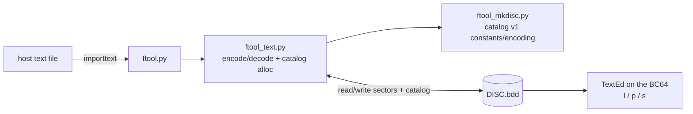
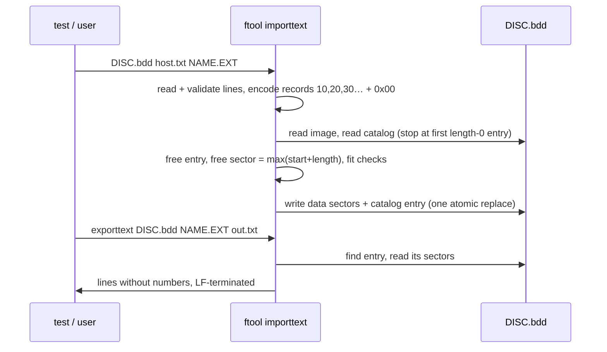

# ftool importtext / exporttext Plan

**Plan Status**: `FINAL`

**Story Type**: `Internal`

**Plan Revision**: `A0`

> This plan captures **what** to build and **why** — domain, architecture, decisions, and verified facts.
> It deliberately does **not** contain implementation code, pseudocode, line numbers, mock setups, or test bodies.
> The implementation agent discovers the **how** against live code. See §4 Task Breakdown.

---

## 1. Problem Statement

*   **Context**: Host files reach a `.bdd` image only as whole programs placed by `ftool mkdisc` (from a manifest, on a fresh image) or as raw sectors (`importsector`, no catalog entry). There is no way to put a host **text** file onto an existing disc as a file TextEd can load, or to get a TextEd file back as host text. The self-hosting roadmap (issue #112, `docs/analysis/07-self-hosted-compiler.md` "Host prerequisites" item 6, `docs/analysis/08-self-hosted-roadmap.md` step 30) needs this so e2e tests can feed B and assembly sources to BASM/BCC/BLINK running on the BC64.
*   **Goal**: two new ftool commands:
    *   `ftool importtext DISC.bdd host.txt NAME.EXT` — adds `NAME.EXT` to the disc's catalog and writes the host text in TextEd format (line numbers 10, 20, 30 …).
    *   `ftool exporttext DISC.bdd NAME.EXT host.txt [--numbers]` — writes the TextEd file's text to the host, without line numbers (with `--numbers`, each line keeps its `<number> ` prefix).
*   **In scope**: the two commands, their validation and error reporting, unit tests, an e2e test through TextEd (`l`, `p`, `s`), docs (`docs/05-bdos.md` ftool section) and a design decision.
*   **Out of scope**: replacing/overwriting an existing file (refused, see D-2); reusing gaps left by `rm` (#41 — new data goes after the last used sector exactly like bdio); the BC64-side text reader `RDR`; deleting files from the host.

### 1.1 Technical Summary

*   **Touched projects**: `src/ftool.py` (dispatch), a new side-effect-free module `src/ftool_text.py` (mirrors the `ftool_mkdisc.py` split), new tests `src/tests/test_ftool_text.py` (unit) and `src/tests/test_e2e_ftool_text.py` (e2e), `docs/05-bdos.md`, `docs/specs/memory/design-decisions.md`.
*   **New patterns / abstractions**: reading/allocating in an **existing** catalog v1 from Python (so far ftool only writes whole new catalogs). Catalog constants/encoding are reused from `ftool_mkdisc` rather than duplicated.
*   **Infrastructure changes**: None. No B source, bdos, ROM or disc layout change; `os.bdd`/`utils.bdd` builds are unchanged.
*   **End-state observable behavior**: a file imported with `importtext` appears in `ls b:` with attributes `-RW-`, TextEd `l` loads it (`000N lines loaded`) and `p` prints `10 <line1>`, `20 <line2>` …; a file saved by TextEd `s` exports to the exact lines that were typed.

---

## 2. Architecture & Design

### 2.1 Architecture Overview

#### Involved components & owners

| Component | Technical Owner |
| :--- | :--- |
| `ftool` (host disc tool, `src/ftool.py`, `src/ftool_mkdisc.py`) | repo owner (bcichonski) |
| bdos TextEd file format (reference only, `src/bdos/texted.b`) | repo owner |

#### C2 diagram

#### Flow diagram

### 2.2 External Contracts & Evidence

`N/A — Internal story`. The only "contracts" are in-repo formats, verified from source:

*   **TextEd file format** — `docs/05-bdos.md` "TextEd file format"; `src/bdos/texted.b` `saveLines` / `readLines`; decision D6. Records `<decimal line number> <text>` + `0x13`, one `0x00` after the last record, zero padding to the sector end. `saveLines` writes the number with no leading zeros, then exactly one space. `readLines` parses digits up to 65535, requires exactly one `' '` separator (any other non-digit invalidates the record), keeps every following byte (so leading spaces of the text are kept), truncates text after 80 characters (`MAXLINELENGTH 80`), skips records with no number or **no text**, and stops at the first `0x00` (records may span sectors).
*   **Catalog v1** — `docs/05-bdos.md` "Catalog entry", "Allocation"; `src/ftool_mkdisc.py` constants (`CATALOG_START`, `CATALOG_SECTORS`, `ENTRY_SIZE`, `CATALOG_ENTRIES`, `MAX_USED_ENTRIES`, `MAX_FILE_SECTORS`, `ATTRIBUTES`, name regex). Entry: number, start track, start sector, length (sectors, 1 byte), attributes, name (8, space-padded), ext (3). bdio's first free entry = first entry with length 0 (scan stops there); first free sector = max(start + length) over the used entries, linear.
*   **TextEd's own files** are created with attributes R|W (`saveFile`: `BDIO_FILE_ATTRIB_READ | BDIO_FILE_ATTRIB_WRITE`).

#### Source Conflict Log

| Topic | Source A | Source B | Conflict | Chosen Handling |
| :--- | :--- | :--- | :--- | :--- |
| Empty lines | Issue AC 1: round trip host → disc → host gives the same text | `readLines` skips a record with no text, so TextEd cannot hold an empty line | a blank host line written as `30 ` would vanish in TextEd | D-3: a blank line is written as a one-space text (`30  `); exporttext maps a one-space text back to an empty line; importtext refuses a host line that is exactly one space (it could not be told apart). Round trip stays exact for every accepted file. |

### 2.3 Affected Areas

| Area / File (pointer) | Role in this change | Likely action |
| :--- | :--- | :--- |
| `src/ftool.py` | CLI dispatch (`main()`, `checkargs`); `mkdisc` shows the error style (`mkdisc: error: …` on stderr, exit 1) | Change: two new commands |
| `src/ftool_mkdisc.py` | catalog v1 constants, name regex/normalisation, `encode_catalog`, atomic write (`mkstemp` + `os.replace`, `_output_mode`) | Reference / reuse (import, do not duplicate; small refactors to expose helpers are fine if mkdisc behaviour and its tests are unchanged) |
| `src/ftool_text.py` (new) | text ↔ TextEd records, catalog read, allocation, import/export | New |
| `src/tests/test_ftool.py` | existing ftool unit tests; shows the `_import_ftool()` trick (ftool.py runs `main()` on import) | Reference (do not edit) |
| `src/tests/test_ftool_text.py` (new) | unit tests | New |
| `src/tests/e2e_harness.py` | `run_session`, `UTILS_DISK`, `read_file`, `SECTOR_SIZE` | Reference |
| `src/tests/test_e2e_texted*.py` | how TextEd sessions are scripted on drive B (`b:`, `texted`, `l`, `p 0 65535`, `s`, `q`, `exit`), `printed_lines`, `run_two_sessions` | Reference |
| `src/tests/test_e2e_ftool_text.py` (new) | e2e through TextEd | New |
| `docs/05-bdos.md` | ftool command table + TextEd file format section | Change |
| `docs/specs/memory/design-decisions.md` | bdos section, last id `D9` | Change: add `D10` |
| `run_tests.py` | `select_src_modules`: only `tests.test_ftool` is the ftool suite; any other `src/tests/test_*.py` runs in the emulator suite (unit group), `test_e2e_*.py` in e2e | Reference only — `test_ftool_text.py` runs in the emulator suite of the unit group; do not change the suite split |

### 2.4 Key Algorithms & Behaviour

**importtext DISC host NAME**

1.  Read the host file as bytes. Split into lines on `\n`; strip one trailing `\r` per line (CRLF accepted). A final line without `\n` counts as a line; a file ending in `\n` has no extra empty last line. An empty host file is zero lines.
2.  Validate every line (1-based line numbers in messages): allowed bytes are tab (`0x09`) and printable ASCII `0x20–0x7e`; length ≤ 80 bytes; not exactly `" "` (D-3). At most 6553 lines (line numbers 10 … 65530 must fit 16 bits).
3.  Encode: for line *i* (1-based) the record is `str(10*i)` + `' '` + text (a blank line's text is `' '`) + `0x13`. After the records one `0x00`. Zero lines → just the `0x00` (one sector; TextEd loads 0 lines). Pad with zeros to whole sectors. More than 255 sectors → error.
4.  Name: same syntax and upper-casing as manifest names (1–8 + optional `.` 0–3, `A–Z 0–9`); `DISC.CAT` refused.
5.  Disc: must exist and be exactly 131072 bytes. Read the catalog (31 sectors from linear sector 1). Walk the entries in order until the first with length 0 → that index is the free entry. Used entries before it: a name already present → error (D-2). Free entry index must be < 247 (one entry stays empty, `MAX_USED_ENTRIES`), else "catalog full". Free sector = max(start + length) over the used entries (linear, `track*16+sector`), 0 if none. Free sector + sectors must be ≤ 1024, else "disc full".
6.  Write: data at the free sector; the new entry at the free index with entry number = the index, start track/sector, length, attributes R|W (`0x03`), name/ext space-padded. All other bytes of the image unchanged. Write the whole new image to a temp file in the same directory and `os.replace` it (keep the image's file mode), so a failure leaves the disc untouched.
7.  On success log/print a one-line summary (name, lines, sectors, start T/S) on stdout; on any error print `importtext: error: <message>` to stderr and exit 1, image unmodified.

**exporttext DISC NAME host [--numbers]**

1.  Disc checks as above; find the used entry with that (normalised) name; missing → error.
2.  Read `length` sectors from its start. Parse records up to the first `0x00` (or end of data): a record ends at `0x13` (or at the `0x00`/end). Each record must be `<1-5 digits, value ≤ 65535> ' ' <text>`; anything else → error naming the record index (no silent skipping). An empty record (two `0x13` in a row) is an error too.
3.  Output each record in file order as one line + `\n` (LF only). Without `--numbers`: the text; a text of exactly `' '` or empty becomes an empty line. With `--numbers`: `<number> <text>` as stored. Write the host file only after the whole parse succeeded. Errors: `exporttext: error: …`, exit 1, host file not created.
4.  `--numbers` may only appear as the 5th argument; any other extra argument → error.

**Round trip guarantee (AC 1)**: for every file importtext accepts, `exporttext` gives byte-identical text, except that line endings become LF and the last line always ends with `\n`. Tests use LF files ending in `\n` for the identity check, and check CRLF / no-final-newline normalisation separately.

---

## 3. Key Decisions & Assumptions

*   **D-1 — Separate module `src/ftool_text.py`**, imported by `ftool.py`; no side effects on import (same reason as `ftool_mkdisc.py`: `ftool.py` runs `main()` on import, so unit tests call the module directly). Catalog constants and name parsing are reused from `ftool_mkdisc`.
*   **D-2 — An existing name is an error, never overwritten** (Assumption: the issue does not say; refusing is the conservative choice, since rewriting in place could not grow a file and freeing it would leave a gap that bdio never reuses, #41). Tests that need a fresh file use a fresh disc copy or another name.
*   **D-3 — Empty lines are encoded as a one-space text** (see Source Conflict Log). Assumption-free: forced by `readLines`. A host line of exactly one space is refused with a clear message.
*   **D-4 — Strict character set**: tab + printable ASCII. `0x00` and `0x13` would break the format; other control bytes and non-ASCII bytes have no defined meaning on the BC64 terminal. Assumption: tabs are allowed (bytes are stored as-is; whether BASM/BCC accept tabs is their concern).
*   **D-5 — Line length limit 80** (`MAXLINELENGTH`), counted in bytes of the text without line ending; longer → error (issue: "Lines longer than texted's 80 characters are an error").
*   **D-6 — exporttext is strict**: a malformed record is an error, not skipped, so a test never silently loses lines. Assumption: acceptable because TextEd and importtext only write well-formed records.
*   **D-7 — Attributes R|W** like TextEd's own `s`; no option to change them (`cha` exists on the machine).
*   **D-8 — Option spelling `--numbers`**, last argument of `exporttext` (ftool's parser is positional).
*   **Deviation check vs AC**: none. AC 1 is met in the exact sense for LF files ending with a newline; CRLF → LF and a missing final newline are normalisations, documented in `docs/05-bdos.md` and in the PR.

### 3.1 Decision Lock (Constants & Policies)

| Constant / Policy | Selected Value | Why | Where it lives |
| :--- | :--- | :--- | :--- |
| Line numbers | 10, 20, 30 … (step 10) | issue | `ftool_text.py` |
| Max line length | 80 bytes | `texted.b` `MAXLINELENGTH` | `ftool_text.py` |
| Max lines | 6553 | 10 × 6553 = 65530 ≤ 65535 | `ftool_text.py` |
| Record end / file end | `0x13` / `0x00` | D6, `texted.b` `CHAR_LF` | `ftool_text.py` |
| Allowed bytes | `0x09`, `0x20–0x7e` | D-4 | `ftool_text.py` |
| Blank line | text `' '` | D-3 | `ftool_text.py` |
| New file attributes | `0x03` (R W) | D-7 | `ftool_text.py` |
| Existing name | error | D-2 | `ftool_text.py` |
| Error format | `<command>: error: <msg>` on stderr, exit 1, nothing written | same as `mkdisc` | `ftool.py` |
| Design decision id | `D10` | last bdos id is D9 | `design-decisions.md` |

### 3.2 Open Questions

No open questions.

---

## 4. Task Breakdown

| Task | Title | Depends on | Complexity |
| :--- | :--- | :--- | :--- |
| `T1` | `ftool_text.py` + `importtext`/`exporttext` commands + unit tests | — | `Medium` |
| `T2` | e2e test through TextEd | `T1` | `Medium` |
| `T3` | Docs and design decision D10 | `T1` | `Low` |

### T1 — ftool importtext / exporttext with unit tests

*   **Goal**: both commands work as in §2.4 from `cd src && ./ftool …` / `python3 ftool.py …` and from the `ftool` console command.
*   **Depends on**: —
*   **Complexity**: `Medium`
*   **Pointers**: `src/ftool.py`, `src/ftool_mkdisc.py`, new `src/ftool_text.py`, new `src/tests/test_ftool_text.py`; `src/bdos/texted.b` (`saveLines`, `readLines`) for the format; `docs/05-bdos.md` "Allocation".
*   **Definition of Done**:
    *   `importtext` / `exporttext` dispatch in `ftool.py`; missing arguments handled like the other commands (exit 1).
    *   Every rule and error of §2.4 / §3.1 implemented; errors leave the disc (import) / host file (export) untouched; exit status 1 with `<command>: error: …` on stderr.
    *   Allocation matches bdio: first length-0 entry, max end sector; existing entries and all other image bytes unchanged.
    *   `mkdisc` behaviour unchanged (existing `test_ftool.py` passes untouched).
    *   `python3 run_tests.py --group unit < /dev/null` passes.
*   **Tests expected** (unit, `src/tests/test_ftool_text.py`, on temp images made with `ftool_mkdisc` or built in the test):
    *   exact bytes of an encoded file (records, `0x13`, `0x00`, zero padding, sector count) for a small input;
    *   round trip identity for: plain lines, leading/trailing spaces, tabs, blank lines, 80-char line, empty file, a multi-sector file; CRLF input and missing final newline normalise to LF;
    *   `--numbers` output;
    *   catalog: entry fields (number, T/S, length, attribs `0x03`, padded name), placed after the max end even when catalog order ≠ disc order, appended to an image built by `mkdisc` (e.g. a copy of a small manifest image), other bytes unchanged;
    *   errors (each leaves the file unchanged, exit 1 through `main`): line > 80, bad byte, one-space line, too many lines, > 255 sectors, bad name, `DISC.CAT`, existing name, catalog full, disc full, wrong image size, missing disc/host file; export: missing name, malformed record, bad extra argument.
*   **Tests to modify**: None

### T2 — e2e: TextEd loads an imported file, exports a TextEd-saved file

*   **Goal**: AC 2 proved on the real machine.
*   **Depends on**: `T1`
*   **Complexity**: `Medium`
*   **Pointers**: new `src/tests/test_e2e_ftool_text.py`; `src/tests/e2e_harness.py`; `src/tests/test_e2e_texted.py`, `test_e2e_texted_flows.py`, `test_e2e_texted_commands.py` (session scripts, helpers `printed_lines`, `insert_script`, `numbered`); `src/tests/test_e2e_utils_disc.py` (drive B sessions).
*   **Definition of Done**:
    *   Import: a host text (a few lines incl. indentation and one blank line) is `importtext`-ed into a temp copy of the built `utils.bdd`; a session `b:` → `texted` → `l <name>` → `p 0 65535` → `q` → `exit` shows `000N lines loaded` and exactly the records `10 …`, `20 …` (the blank line as one space).
    *   Export: a session types lines with `i` and saves with `s <name>`; `exporttext` of that disc copy gives exactly the typed lines (and with `--numbers` the `<n> <text>` records).
    *   Combined: an imported file loaded, saved under another name by TextEd, and exported equals the original host text.
    *   Uses temp copies only; built `src/os.bdd`/`src/utils.bdd` and tracked files unchanged (CI requires a clean `git status`).
    *   `python3 run_tests.py --group e2e < /dev/null` passes.
*   **Tests expected**: e2e as above; keep the number of typed lines small (≈0.4 s per inserted line).
*   **Tests to modify**: None

### T3 — Documentation and design decision

*   **Goal**: users and later stories find both commands and the rules.
*   **Depends on**: `T1`
*   **Complexity**: `Low`
*   **Pointers**: `docs/05-bdos.md` (ftool command table under "Building the system disc", "TextEd file format"), `docs/specs/memory/design-decisions.md` (bdos section, after D9), README only if it lists ftool commands.
*   **Definition of Done**:
    *   ftool table rows for `importtext DISC.bdd host.txt NAME.EXT` and `exporttext DISC.bdd NAME.EXT host.txt [--numbers]`, plus a short subsection "Host text files" stating: line numbers 10/20/30, R W attributes, allocation after the last used sector, existing name refused, character set, 80-char limit, 6553 lines, blank-line encoding and the one-space refusal, CRLF/final-newline normalisation, strict export, error format.
    *   Decision `D10` in `design-decisions.md` (Purpose / Rationale / Usage / Trade-offs, like D8), covering D-2, D-3, D-4, D-6.
    *   Documented behaviour matches T1's implementation (check against the code and its messages).
*   **Tests expected**: none (docs only).
*   **Tests to modify**: None

---

## 5. Verification

*   **Unit**: `python3 run_tests.py --group unit < /dev/null` — all green (ftool suite includes the new tests).
*   **Full**: `python3 run_tests.py < /dev/null` from the repo root — all green (builds the pipeline first, ~7–8 min). Expected-failure baseline on master: only the tape round trip (`test_tape_round_trip`); no new xfails.
*   **Observable behaviour**: `cd src && printf 'line one\n  indented\n\nlast\n' > /tmp/x.txt && cp utils.bdd /tmp/u.bdd && ./ftool importtext /tmp/u.bdd /tmp/x.txt x.txt && ./ftool exporttext /tmp/u.bdd x.txt /tmp/y.txt && cmp /tmp/x.txt /tmp/y.txt` (use scratch paths); `git status` clean afterwards.

---

## 6. Fact-Integrity Checklist

| Check | Yes / No / N/A | Notes |
| :--- | :--- | :--- |
| External contracts verified from producer/contract source | N/A | Internal; in-repo formats verified from `texted.b`, `ftool_mkdisc.py`, `docs/05-bdos.md` |
| Evidence sources are reproducible | N/A | Internal |
| Identifier directionality / ordering / freshness meaning evidenced | N/A | Internal |
| Every `Assumption` is linked to an Open Question (§3.2) | Yes | D-2, D-4, D-6 are low-stakes, conservative, reversible tool policies; recorded as /grind assumptions, no stakeholder input needed |
| No unresolved Open Questions (for `FINAL`) | Yes | |
| Each Decision states a single committed approach | Yes | |
| Tasks are independent, each with a Definition of Done and test expectations | Yes | T2/T3 depend on T1 only |
| Required infra reflected | N/A | no toggles / no infra |

**Self-review note**: The one real tension is AC 1 vs TextEd's inability to hold an empty line; D-3 resolves it with a one-space encoding that the e2e test must confirm on the machine (TextEd `readLines` keeps the second space as text). Take care that allocation reads the free sector as `track*16+sector` (the #111 bug was exactly this in bdio), that an import never touches bytes outside the new data and the one catalog entry, and that ftool.py's import-time `main()` is not triggered by the new module.

---

## 7. Amendment Log

| Revision | Request | Decision | Plan changes |
| :--- | :--- | :--- | :--- |
