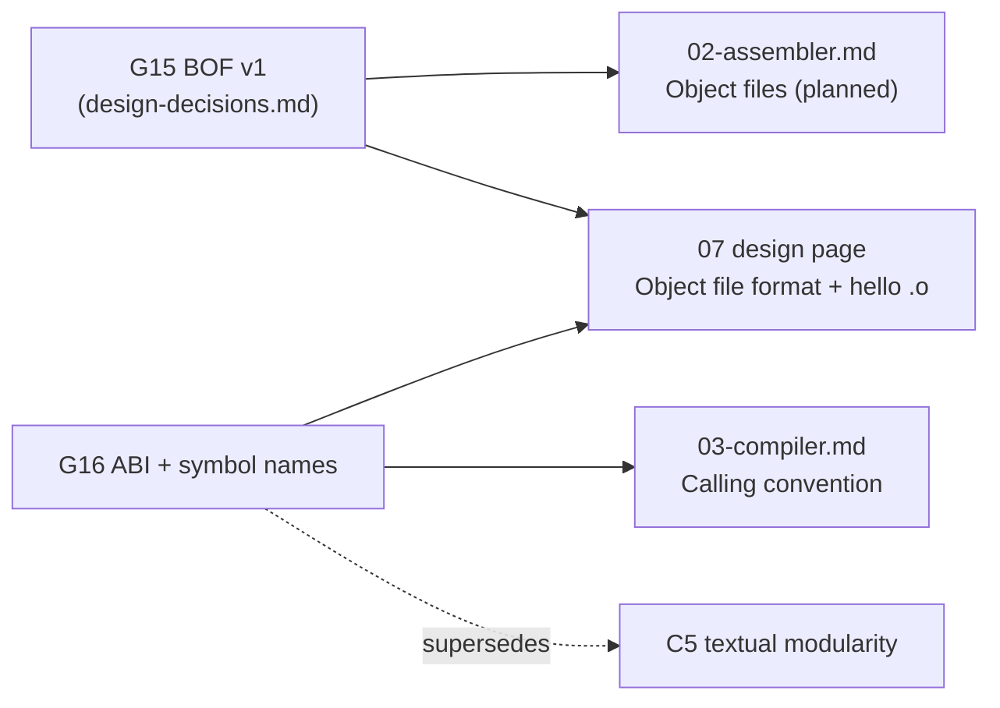

# BOF v1 Object Format and the B Calling Convention as a Frozen ABI Plan

**Plan Status**: `FINAL`

**Story Type**: `Internal`

**Plan Revision**: `A0`

> This plan captures **what** to build and **why**: domain, architecture, decisions, and verified facts.
> It does **not** contain implementation text. The implementation agent writes the documentation against the live
> design page and code. See §4.

---

## 1. Problem Statement

*   **Context**: The self-hosting design page (`docs/analysis/07-self-hosted-compiler.md`) proposes an object format,
    "BOF v1" (section "Object file format"), and the calling convention as an ABI (sections "The calling convention
    becomes an ABI" and "Symbol names"). Neither is a standing decision yet. The `SECT` flags are marked "Still open",
    and the hello example is marked "roughly". Phase 1 of the roadmap (`docs/analysis/08-self-hosted-roadmap.md`, step 31)
    needs them frozen before `bc81asmc --obj` (#115), `runtime.basm` (#116) and `blink.py` (#117) are built.
*   **Goal**: Record BOF v1, the `SECT` flags, the ABI and the symbol-name rules as design decisions. Add a short
    reference section to the assembler and compiler pages. Replace the approximate hello example with one that gives
    exact bytes. Make the design page agree with the recorded decisions.
*   **In scope**: `docs/specs/memory/design-decisions.md`, `docs/02-assembler.md`, `docs/03-compiler.md`,
    `docs/analysis/07-self-hosted-compiler.md`, and one row of `docs/analysis/08-self-hosted-roadmap.md` ("Decisions the
    owner still has to make").
*   **Out of scope**: any code (`--obj`, `.global`/`.extern`/`.sect`, `blink.py`, `bc --obj` are #114–#117 and #121);
    linker placement order and library format details beyond what BOF records carry (#117); roadmap step ticks (they
    go in the separate roadmap-status docs PRs); the changelog entry (changelog generator).

### 1.1 Technical Summary

*   **Touched projects**: docs only.
*   **New decisions**: `G15` (BOF v1 object format, including the `SECT` flags) and `G16` (the B calling convention ABI
    and symbol names), in the **Global** part of the memory bank. Both are cross-tool contracts, like G1, and the
    latest G is G14. C5 gets a "superseded" pointer to G16.
*   **Infrastructure changes**: none.
*   **End-state observable behaviour**: a reader of the memory bank finds the frozen BOF record layout, the `SECT` flag
    bits, the ABI and the naming rules. They find a byte-exact `.o` for `hello`, and no sentence in 07 still calls these
    "proposal" or "open".

---

## 2. Architecture & Design

### 2.1 Architecture Overview

| Component | Owner |
| :--- | :--- |
| Memory bank / design page / reference pages | repository owner (bcichonski) |

### 2.2 External Contracts & Evidence

N/A: Internal story.

#### Source Conflict Log

| Topic | Source A | Source B | Conflict | Chosen Handling |
| :--- | :--- | :--- | :--- | :--- |
| `SECT` flags | Issue AC-1: "with the `SECT` flags decided" | 08 roadmap lists "#113 `SECT` flags" under "Decisions the owner still has to make" | Who decides | Record the decision in §3 (D2) as the plan's choice. Flag it in the PR as **"owner to confirm"**. Strike the 08 row as decided in #113, the same way #41's row was struck. |
| C5 "replaced" | Issue item 3 / 07 "What it costs": the ABI replaces C5 | Today's host build is still textual until phase 3 (#121–#126) | Removing C5 now would describe tools that don't exist | C5 stays as the current host rule, with a header note "superseded by G16 once programs are linked (phase 3)". G16 says it replaces C5 from then on (D5). Flag this interpretation in the PR. |
| Byte return value | 07: "A byte result is in `ci`, with `cs` = 0" | `bc_ast.py` `STATEMENT_RETURN` evaluates the expression into `csci` with no truncation, and callers use all of `csci` (C3) | Is `cs` = 0 guaranteed? | The ABI states what callers rely on: the result is in `csci`, and a routine declared `byte` returns it with `cs` = 0. The host compiler doesn't truncate today (`byte f() { return 300; }` returns 300), and that gets a recorded known quirk in G16. The agent verifies it with a quick probe (D6). |

### 2.3 Affected Areas

| Area / File (pointer) | Role in this change | Likely action |
| :--- | :--- | :--- |
| `docs/specs/memory/design-decisions.md` (end of file, after G14; C2 and C5 in **Compiler**) | Memory bank | New G15 and G16, plus a superseded note on C5 and a pointer from C2 to G16 |
| `docs/analysis/07-self-hosted-compiler.md` "Object file format" | Source of BOF v1 | "A proposal" becomes decided (G15). "Still open: the `SECT` flags" is replaced by the decided flags. The hello example becomes byte-exact. |
| 07 "The calling convention becomes an ABI", "Symbol names", "What it costs", "Linker algorithm", "Risks and open questions", phase table | Source of the ABI | Point to G16, and remove or adjust anything that contradicts G15/G16 (e.g. "starting from `main`" vs. KEEP roots, the byte-return sentence) |
| `docs/analysis/08-self-hosted-roadmap.md` "Decisions the owner still has to make" | Owner-decision list | Strike the `#113` row as "decided in #113 (G15)". Leave step 31's Done column alone. |
| `docs/02-assembler.md` | Assembler reference | Short section "Object files (BOF v1, planned)": what `--obj` will write, and a link to G15 and the 07 example. Not yet implemented (#115). |
| `docs/03-compiler.md` "Functions" / "How the generated code works" | Compiler reference | Short "Calling convention (ABI)" section stating G16 in reference form, and a link to G16 |
| `src/bc/bc_ast.py` (`EXPRESSION_CALL`, `FUNCTION_DECLARATION.add_func_params`, `STATEMENT_RETURN`, `push_scope`) | Evidence for the ABI | Reference only |
| `src/bc8183_isa.py`, `src/bc81asmc/` | Encodings for the hello example's bytes | Reference only |
| `src/bdos/stdio.b` (`puts`), `src/bc/bc_stdlib.py` | The hello example's callee and runtime helpers | Reference only |

### 2.4 Key Behaviour (what the decisions say)

**G15 — BOF v1** records the 07 layout as frozen, with no record or field changes:
*   `tag(1) length(1) content` records; the tags `b0 ee de ad 5e 91 c0 1a ab f1 f2 f8 f9 fa fb ed` with the content
    and meaning from the 07 table; 16-bit values big-endian (G6); a name is the rest of its record.
*   Target encoding: top bit clear = symbol k (the k-th `ee` record), top bit set = local label n (low 15 bits).
    16-bit fix kinds keep the target in the placeholder. 8-bit kinds and `fb` carry it in the entry. There is no
    addend.
*   The writing rules (flush points, fix-record order and ascending offsets, continuation records, `ee` before first
    use, `ee` flushes `CODE`, `de`/`ad` written where they appear) make output deterministic.
*   Version: header `b0` content `version = 01`. A reader rejects any other version. Any change to a record layout or
    flag meaning bumps the version.
*   **`SECT` flags** (see D2).

**G16 — ABI and symbol names**: argument layout from `sys_stackhead`, variadic hidden count, return value, registers,
calling B from assembly, entry stubs. These come from 07 with the corrections in §2.2. Symbol names: `F_name`,
`G_name` reserved, other labels module-local; an assembly routine callable from B exports `F_name` with `.global`, and
B sees it through a prototype.

**Worked example**: `word main() { puts("hi"); return 0; }` (module `HELLO`, `#include stdio.h` → `NEED STDIO`).
It is written as an annotated hex listing of every record, with exact lengths, exact offsets in fix records, and real
instruction bytes. The instruction bytes are taken from today's host compiler output for `main`'s body (compile a
probe with `src/bc/bc.py`, keep the `main` chunk). Each call or helper label becomes an `F_`/runtime symbol, and each
string or jump label becomes a local label. Bytes are encoded with `src/bc8183_isa.py` / `bc81asmc`. Every fix entry
must point at a placeholder, and the placeholder content must follow the target encoding. A throwaway script in the
scratchpad may be used to assemble and check the listing. It is not committed, and no test parses the docs
(owner rule: no tests pinned to docs).

---

## 3. Key Decisions & Assumptions

*   **D1 — Two decisions in Global.** G15 (BOF v1) and G16 (ABI + symbol names) go after G14 at the end of
    `design-decisions.md`, where G12–G14 already sit. They are cross-tool contracts (assembler, compiler, linker,
    BC64 tools). Before the PR, check that `origin/master`'s last G id is still G14, because parallel stories collide
    on ids. If it isn't, renumber.
*   **D2 — `SECT` flags (owner to confirm in the PR).** `SECT` content is `flags(1) [address(2)] name`:
    *   bit 0 `KEEP` (`0x01`): the section is a dead-code root. The linker keeps every `KEEP` section and everything
        it reaches. The runtime entry stub in `runtime.basm` is `KEEP` and refers to `F_main`, so a B program's
        roots are the same as "from `main`" today. An assembly-only program (phase 1 e2e) marks its own entry
        `KEEP`.
    *   bit 1 `ABS` (`0x02`): the section is placed at the absolute `address(2)` that follows the flags byte (only
        present when this bit is set), not appended to the image. It is not moved. Overlapping another section is a
        link error naming both. An `.org` file assembled with `--obj` is one section with flags `KEEP|ABS` (`0x03`) at
        its `.org` address (A10 allows one `.org`, before any code or label).
    *   bits 2–7 are reserved and written as 0. A reader rejects a set reserved bit, naming the module and section.
    *   A section's offsets start at 0 either way. Fix-ups in an `ABS` section resolve like any other.
    Rationale: these are the two cases 07 names as needed, both as cheap 1-bit tests. Putting the address inside
    `SECT` keeps a section self-describing, where the alternative (an `ad` record) is a program-wide address.
*   **D3 — No record changes.** The BOF table, target encoding and writing rules are frozen exactly as 07 has them
    (owner decided the layout 2026-11-13). The only addition is D2's optional address field.
*   **D4 — The worked example replaces 07's "roughly" listing.** It lives in 07's "Object file format" section, where
    the format is explained, and G15 links to it. It uses the module name `HELLO` and `SECT` flags `00` for `F_main`
    (not `KEEP`: the runtime entry stub reaches it).
*   **D5 — C5 is superseded by G16 from phase 3, not deleted.** C5's header gets "(superseded by G16 once programs
    are linked, phase 3)". Its body stays because it still describes how today's host builds work. G16 says it
    replaces C5's "one image, no linker" from phase 3 on. C2 gets a one-line pointer to G16. This deviates from a
    literal reading of issue item 3 ("Replaces design decision C5"); flag it in the PR.
*   **D6 — Byte returns.** The ABI rule is: the return value is in `csci`. A routine whose prototype says `byte`
    returns it with `cs` = 0, because B callers use all of `csci` (C3). Record as a known quirk that the host
    compiler doesn't truncate a `byte` function's return today. Verify the quirk with a probe compile before writing
    it. If the probe shows the compiler does truncate, write that instead and drop the quirk.
*   **D7 — Reference sections say "planned".** `02-assembler.md`/`03-compiler.md` describe what `--obj` and the ABI
    are, with "not yet implemented (#115 / #121)" where a tool doesn't exist yet. They link to G15/G16 rather than
    copy the full tables (one source of truth).
*   **Assumption A1** — the 08 roadmap row strike is allowed in this story (it is an owner-decision record, not a
    status tick). Low stakes, reversible.

### 3.1 Decision Lock

| Constant / Policy | Selected Value | Why | Where it lives |
| :--- | :--- | :--- | :--- |
| BOF version byte | `01` | First version | G15, 07 |
| `SECT` KEEP | bit 0, `0x01` | Dead-code root | G15 |
| `SECT` ABS | bit 1, `0x02`, followed by `address(2)` | `.org` files | G15 |
| Reserved bits | 2–7 = 0; rejected if set | Room for v1 extensions without ambiguity | G15 |
| Decision ids | G15 (BOF), G16 (ABI + names) | Next free Global ids | design-decisions.md |
| B function symbol | `F_name` | 07 Symbol names | G16 |
| B global symbol | `G_name` (reserved) | 07 Symbol names | G16 |

### 3.2 Open Questions

No open questions. The `SECT` flags are decided here (D2) and flagged for owner confirmation in the PR, per AC-1.
Resolution attempt: AC-1 requires a decision; 07 names the two needed cases; no owner comment on #113.

---

## 4. Task Breakdown

| Task | Title | Depends on | Complexity |
| :--- | :--- | :--- | :--- |
| `T1` | G15 BOF v1 decision + byte-exact hello `.o` in 07 | — | `High` |
| `T2` | G16 ABI + symbol names, C5/C2 notes, 03-compiler reference | `T1` | `Medium` |
| `T3` | 02-assembler reference; make 07 and 08 agree with G15/G16 | `T1`, `T2` | `Medium` |

### T1 — G15 BOF v1 decision + byte-exact hello `.o`

*   **Goal**: The memory bank has G15 (BOF v1 as in §2.4 + D2/D3). 07's object-format section calls BOF v1 decided,
    states the `SECT` flags (replacing "Still open"), and gives the worked `hello` example with exact bytes (D4).
*   **Depends on**: —
*   **Complexity**: `High`. The example's bytes must be exactly right and consistent with every writing rule.
*   **Pointers**: `docs/specs/memory/design-decisions.md` (format of existing decisions: Purpose / Rationale / Usage /
    Trade-offs; G14 at the end), 07 "Object file format", `src/bc/bc.py`, `src/bdos/stdio.b`, `src/bc8183_isa.py`,
    `src/bc81asmc/`.
*   **Definition of Done**:
    *   G15 exists after G14, with the record table (all 16 tags), target encoding, fix kinds, writing rules, version
        rule and the `SECT` flags exactly as D2. It links to the 07 example.
    *   07's example lists every record of `HELLO.O` in hex with its length byte. Instruction bytes match today's
        host-compiled `main` body (symbols replaced by placeholders per the target encoding). Fix offsets point at
        the placeholders. `ee` comes before first use. The `SECT` content is `00 'F_main'`. It ends `ed 00`. The text
        says how the bytes were derived (host compiler output of the probe, encoded per G15).
    *   07's "A proposal" wording and "Still open" paragraph are gone from that section.
    *   No file outside `docs/` changes. No committed script.
*   **Tests expected**: none (docs). Self-check the listing with a throwaway scratchpad script; don't commit it.
*   **Tests to modify**: None

### T2 — G16 ABI + symbol names, C5/C2 notes, compiler reference

*   **Goal**: The memory bank has G16 (§2.4, D5, D6), C5 carries the superseded note, C2 points to G16, and
    `03-compiler.md` has a short "Calling convention (ABI)" reference section linking to G16.
*   **Depends on**: `T1` (same file; G16 comes after G15)
*   **Complexity**: `Medium`
*   **Pointers**: 07 "The calling convention becomes an ABI" and "Symbol names"; `src/bc/bc_ast.py`
    (`EXPRESSION_CALL`, `add_func_params`, `STATEMENT_RETURN`, `push_scope`/`emit_stackhead_down`);
    `docs/03-compiler.md` "Functions" / "How the generated code works".
*   **Definition of Done**:
    *   G16 states: argument layout (offsets as sums of preceding sizes, byte 1 / word 2, with the `poke8` example);
        variadic (hidden word count at 0, fixed arguments, then the extra ones as words, with the `printf` example);
        return in `csci` and the byte rule per D6; all registers caller-saved, `A`/`F` included, and the CPU stack
        balanced on return; how assembly calls B (`stackheadrll8` around the call; leaf routines don't touch
        `sys_stackhead`); entry stubs (bdio slot `0x37`, `runtime.basm` entry); symbol names (`F_name`, `G_name`
        reserved, others module-local, `.global F_name` + prototype); that it replaces C5 from phase 3 (D5).
    *   Every ABI fact in G16 matches `bc_ast.py` today (the variadic count variable is added before the parameters;
        the caller's `push_scope('CALL')`/`pop_scope`). The D6 quirk was checked with a probe compile.
    *   C5 header note per D5, and C2 one-line pointer.
    *   `03-compiler.md` section added. It doesn't duplicate the full G16 text.
*   **Tests expected**: none (docs).
*   **Tests to modify**: None

### T3 — Assembler reference; make 07 and 08 agree

*   **Goal**: `02-assembler.md` has an "Object files (BOF v1, planned)" section (D7). Nothing in 07 contradicts G15/G16,
    and 08's owner-decision row for #113 is struck as decided.
*   **Depends on**: `T1`, `T2`
*   **Complexity**: `Medium`
*   **Pointers**: 07 whole page: search for `proposal`, `open`, `SECT`, `main`, `ci`, `C5`, `ABI`, `F_`, `roughly`; in
    particular "What it costs", "Linker algorithm (BLINK)" (dead-code roots: from `main` → from `KEEP` sections,
    which reach `main` through the entry stub), "Risks and open questions", the phase table. 08 "Decisions the owner
    still has to make".
*   **Definition of Done**:
    *   07's calling-convention and symbol-name sections say they are recorded as G16 (and the object format as G15).
        The byte-return sentence matches D6. The DCE root sentences match D2. "C5 is replaced" matches D5.
    *   A read-through of 07 finds no statement contradicting G15/G16.
    *   08: the `#113` row is struck through with "decided in #113 (G15)", like the `#41` row. Nothing else in 08
        changes.
    *   `02-assembler.md` section exists, says `--obj` is not implemented yet (#115), and links to G15 and the 07
        example.
*   **Tests expected**: none (docs).
*   **Tests to modify**: None

---

## 5. Verification

*   **Unit**: `python3 run_tests.py --group unit` exits 0 (docs only; proves nothing broke).
*   **Full suite** (once, before the PR): `python3 run_tests.py < /dev/null` from the repo root. Report expected
    failures by name.
*   **Diff scope**: `git diff --stat origin/master` touches only `docs/` (plus the plan files).
*   **Links**: every new relative link and anchor in the changed pages resolves (check by hand or with a scratchpad
    script).
*   **Review**: a reader can follow the hello `.o` byte by byte against G15, and grep 07 for `proposal|Still open|roughly`
    finds nothing about BOF.
*   **AC map**: AC-1 → G15 (D2) + G16. AC-2 → T1 example. AC-3 → T3.

---

## 6. Fact-Integrity Checklist

| Check | Yes / No / N/A | Notes |
| :--- | :--- | :--- |
| External contracts verified from producer/contract source | N/A | Internal |
| Evidence sources are reproducible | N/A | Internal |
| Identifier directionality / ordering / freshness meaning evidenced | N/A | Internal |
| Every `Assumption` is linked to an Open Question (§3.2) | Yes | A1 is low-stakes and reversible, not correctness-affecting |
| No unresolved Open Questions (for `FINAL`) | Yes | `SECT` flags decided (D2), flagged for owner confirmation |
| Each Decision states a single committed approach | Yes | |
| Tasks are independent, each with a Definition of Done and test expectations | Yes | Sequenced because they share files |
| Required infra reflected | N/A | |

**Self-review note**: The riskiest part is the byte-exact example. It must come from real compiler output and the
real encoder, not be hand-guessed, and it must obey every writing rule (flush points, fix order, `ee` before use).
The `SECT` flags are this plan's choice on a point the roadmap lists as an owner decision, so the PR must ask the owner
to confirm D2. The C5 handling (D5) and the byte-return rule (D6) are interpretations to flag too.

---

## 7. Amendment Log

| Amendment | Requested by | Request | Decision | Plan changes |
| :--- | :--- | :--- | :--- | :--- |
