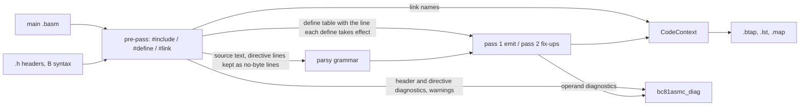

# Assembler: `#include` and `#define` from Header Files, and `#link` Plan

**Plan Status**: `FINAL`

**Story Type**: `Internal`

**Plan Revision**: `A2`

> This plan captures **what** to build and **why** — domain, architecture, decisions, and verified facts.
> It deliberately does **not** contain implementation code, pseudocode, line numbers, mock setups, or test bodies.
> The implementation agent discovers the **how** against live code. See §4 Task Breakdown.

---

## 1. Problem Statement

*   **Context**: Assembly sources (`.basm`) can only name constants with `.def name, 0xHHHH` and use them as
    label references (`:name`, 16-bit). B sources keep their constants in `#define` lines (`src/bdos/bdioh.b`
    alone has 132). An assembly module that needs a bdio call number or an error code has to copy the value
    into its own source by hand, and the copies drift. Phase 1 of the self-hosting roadmap
    (`docs/analysis/08-self-hosted-roadmap.md`, step 32) moves runtime and library code into `.basm` modules
    (#116, #127), so this gets worse unless the assembler reads the same headers as the compiler.
    The design (`docs/analysis/07-self-hosted-compiler.md`, "Shared constants") says BASM and `bc81asmc`
    accept `#include file.h` and `#define NAME value` with the same meaning as in B, skip a header's prototype
    lines, and use a defined name wherever an operand takes a number, sized by the operand.
*   **Goal**: `bc81asmc` accepts `#include`, `#define` and `#link` lines. A `#define`d name can stand for a
    number in any operand that takes one, the value is written in any B number form and checked against the
    operand's width. Headers are read with B's rules (whole-identifier replacement from #19). `#link NAME` is
    recorded for `--obj` (#115) and changes no output today.
*   **In scope**: the assembler's pre-pass for the three directives, numeric operands from names, the
    diagnostics for all of it, tests, `docs/02-assembler.md`, a design decision, the assembler `CLAUDE.md`.
*   **Out of scope**: `--obj` and the `de` record (#115); the `.o` side of the library split (#126: library
    objects, programs linked by `blink.py`). *Amended in A1:* the `.h` headers themselves are **in scope** (owner,
    mid-run: "we have no .h files yet, make sure to create them"), see D13 and T4; BASM on the machine and its include depth limit (#118/#119);
    expressions in operands (A3 stays: a name stands for one number, never `NAME+1`); changing any committed
    source to use the new lines; ticking step 32 in the roadmap (the owner's separate status PRs do that).

### 1.1 Technical Summary

*   **Touched projects**: `src/bc81asmc/` (driver `bc81asmc.py`, grammar `bc81asmc_grammar.py`, AST
    `bc81asmc_ast.py`, diagnostics `bc81asmc_diag.py`, a new pre-pass module), its tests, `docs/02-assembler.md`,
    `docs/specs/memory/design-decisions.md`, `src/bc81asmc/CLAUDE.md`.
*   **New patterns / abstractions**: a line-based pre-pass in front of the parsy grammar (the host model of the
    shared `PRE` module of 07); a "defined name" operand kind in every numeric operand; warnings as a
    diagnostic severity that does not fail the run.
*   **Infrastructure changes**: None.
*   **End-state observable behaviour**: `#define FDD_PORT 0x08` then `mov a, FDD_PORT` assembles to `11 08`;
    `#include x.h` pulls `x.h`'s defines in and skips its prototypes; `mov a, BIG` with `BIG` = `0x100` is a
    positioned error; every committed source and every build output is byte-identical to before.

---

## 2. Architecture & Design

### 2.1 Architecture Overview

#### Involved components & owners

| Component | Technical Owner |
| :--- | :--- |
| `bc81asmc` (assembler) | repo owner (bcichonski) |

#### C2 diagram



#### Flow diagram

```mermaid
sequenceDiagram
    participant CLI as bc81asmc main()
    participant PRE as pre-pass
    participant G as grammar
    participant C as compile()
    CLI->>PRE: main source text + its path
    PRE->>PRE: read lines; #include reads the header (relative to the main file's dir) and recurses
    PRE->>PRE: #define stores NAME -> value from this point; #link records NAME; prototypes skipped
    PRE-->>CLI: parser text (same line count as the main file), define table, link names, diagnostics
    CLI->>G: parse the parser text
    G-->>CLI: AST; a numeric operand may be a defined-name node
    CLI->>C: compile(AST, define table, link names)
    C->>C: resolve each name against the define in effect at its line, check width, emit
    C-->>CLI: context (bytes, line records, link names)
    CLI->>CLI: write .btap / .lst / .map; print warnings
```

### 2.2 External Contracts & Evidence

N/A — Internal story.

#### Source Conflict Log

| Topic | Source A | Source B | Conflict | Chosen Handling |
| :--- | :--- | :--- | :--- | :--- |
| Example name | Issue: `mov a, BDIO_FREAD` | `src/bdos/bdioh.b` has no `BDIO_FREAD` | the example is illustrative | Tests use their own temp headers; no reliance on a particular bdioh name |
| `:NAME` in asm text | C10 trade-off: in B, a `#define` named like a label replaces it inside `asm` strings too | Issue: "whole identifiers only" and "where an operand takes a number" | B replaces text; the assembler resolves numeric operands only | Decision D3: in assembly a `:name` is always a label/`.def` reference and is never replaced. Labels, strings and comments are untouched |
| Include depth | 07 "`#include` on the machine": depth 3 in total, `include too deep` | host `bc.preprocess` has no limit | the limit is BASM's (3 file handles) | Host has no depth limit (same as host B); a cycle is an error so it can't loop (D7). BASM (#119) adds its own limit |
| Redefinition | `docs/03-compiler.md`: a redefinition with a different value warns, last wins | the assembler has no warnings today | — | Same meaning as B: a warning (new non-fatal severity), last value wins from that line on (D6) |

### 2.3 Affected Areas

| Area / File (pointer) | Role in this change | Likely action |
| :--- | :--- | :--- |
| `src/bc81asmc/bc81asmc.py` | CLI `main()` and `compile()` (pass 1, pass 2, asserts). Reads the file, parses, compiles, writes outputs, reports diagnostics | Change: run the pre-pass first, hand the define table / link names to `compile()`, print warnings, report header diagnostics with their file |
| new `src/bc81asmc/bc81asmc_pre.py` (name is a suggestion) | the pre-pass: directive lines, header reading, define table, link names | New |
| `src/bc81asmc/bc81asmc_grammar.py` | `heximm4`, `heximm8`, `heximm16` and every rule that uses them (instruction immediates, `in r, #0xH`, `.db`, `.org`, `.def`, `.assert` literal) | Change: each numeric operand also accepts a defined name, never a register or pair name |
| `src/bc81asmc/bc81asmc_ast.py` | `emit()` per node; `CodeContext` | Change: numeric operands resolve names (or receive resolved values) with a width check; context carries `link_names` |
| `src/bc81asmc/bc81asmc_diag.py` | `Diagnostic` (has `severity` already), formatter takes one source + filename | Change: a diagnostic may name another file (a header) and its text; warnings formatted as `warning:` and not fatal |
| `src/bc81asmc/bc81asmc_listing.py` | `.lst` rows from `context.line_records`; `.map` from labels and `.def`s | Reference: directive lines show as rows with no address; `#define`s are not map symbols |
| `src/bc/bc.py` (`parse_define`, `substitute_tokens`, `apply_defines`, `preprocess`) | the B rules to mirror: define syntax, whole identifiers, numbers scanned whole, `#link` syntax/dedupe, `#include` path rule | Reference only (do not import it into the assembler; flat imports, different directory) |
| `src/bc/bc_grammar.py` (`decnumber`, `hexnumber`, `singlechar`, `type`, `function_declaration`) | the B number forms and the prototype shape | Reference |
| `src/bc8183_isa.py` (`REGISTER_NAMES`, `PAIR_NAMES`) | reserved names that are never defined names | Reference |
| `src/bc81asmc/tests/` | assembler suite (`*_tests.py`, run by `run_tests.py`) | New test files |
| `docs/02-assembler.md` | syntax reference, Errors table | Change: new section and error rows |
| `docs/specs/memory/design-decisions.md` | next assembler decision is **A13** (A12 is the last one) | Change: record A13 |
| `src/bdos/{bdioh,std,stdio,strings,stdmem,bdosh,bdostools,bdosargs,random}.b` (A1) | the shared B libraries (`_SHARED_BDOS_LIBS` in `src/tests/e2e_areas.py`); `bdioh.b` holds 132 `#define`s plus two functions and `#include stdio.b`; `bdosh.b` includes `bdioh.b` | Change: defines move to a new `X.h`, `X.b` includes it |
| new `src/bdos/*.h` (A1) | the headers: `#define`s + prototypes, B syntax, readable by `bc` and by `bc81asmc` | New |
| `src/tests/test_bdioh_codes.py`, `src/tests/test_disc_layout_reserved.py` (A1) | read the bdio defines from `bdioh.b` by path | Change (Tests to modify, T4): read `bdioh.h` |
| `src/tests/e2e_areas.py` (A1) | a change to a shared library `.b` triggers every e2e area | Change: the shared `.h` files trigger the same |
| `docs/05-bdos.md`, root `CLAUDE.md` (A1) | the B library reference and the list of committed sources | Change: name the headers |
| `src/bc81asmc/CLAUDE.md` | "How it works" and Rules | Change: one bullet on the pre-pass |

### 2.4 Key Algorithms & Behaviour

**Pre-pass (reading order).** The main `.basm` is read line by line. A line whose first non-blank text is
`#include`, `#define` or `#link` followed by a blank or the end of the line is a directive; every other line goes to
the parser unchanged. The parser text keeps exactly the main file's lines (a directive line is passed on as a line
that emits nothing and has no address, so line numbers, the listing and every existing diagnostic position stay the
same). Any other `#word` at the start of a line is not a directive and stays the syntax error it is today.

*   `#define NAME value` — `NAME` is the first token and must be a B identifier (`[A-Za-z_][A-Za-z0-9_]*`);
    `value` is the rest of the line without a trailing comment (`;` in a `.basm`, `//` in a header) and without
    surrounding blanks, and must not be empty. The value is stored as text; it is checked only when a name is used
    (a header may hold defines that only B code uses). The define takes effect from the next line in reading
    order. A register or pair name (`isa.REGISTER_NAMES`, `isa.PAIR_NAMES`) cannot be defined.
*   `#include NAME` — `NAME` is one token (the file name, optional trailing comment). The file is resolved
    relative to the **directory of the main source file**, at every nesting level (the host B rule). The included
    file is a **B header**, read line by line in place: allowed lines are blank lines, `//` comment lines,
    `#define`, `#include`, `#link`, and one-line prototypes (`byte`|`word`, a name, a parenthesised parameter list,
    optional `***` and `;`, optional `//` comment), which are skipped. Any other line is an error naming the header
    file and line. Headers never contribute code or lines to the parser text.
*   `#link NAME` — one B identifier; recorded in first-seen order without duplicates (as `bc.linkNames`), in the
    main file or a header. It changes no byte, listing row address or map entry.
*   Errors found by the pre-pass (malformed directive, unreadable include, include cycle, unexpected header line,
    register name defined) are all collected; if there is any, the run reports them and stops before parsing,
    like a syntax error. Diagnostics in a header carry the header's path (as resolved) and its own 1-based
    line/column, and the block prints the header's line.

**Defined names in operands.** Every place the grammar takes a hex literal (`0xH` 4-bit port of `in r, #0xH`,
`0xHH` 8-bit, `0xHHHH` 16-bit) also takes a B identifier that is not a register or pair name. The literal forms keep
their fixed digit counts. The width of a name operand is the width of the literal it replaces: 4 bits for the `in`
port, 8 bits for 8-bit immediates, `shl/shr pair, 0xHH` and `.db` items, 16 bits for 16-bit immediates, `.org`, the
`.def` value and an `.assert` literal.

Resolution of a name used on main-file line L:
1.  the define in effect at L is the last `#define NAME` before L in reading order (headers included at their
    `#include` line). None → `undefined name 'NAME'`, at the name's column.
2.  The value must be one B number literal: decimal (`0` or `[1-9][0-9]*`), hex `0x` + one or more hex digits (any
    count, either case), or a char literal `'c'` (its code). Otherwise → `'NAME' is not a number: '<value>'`.
3.  The number must fit the operand width (0..15, 0..255, 0..65535); otherwise
    `value of 'NAME' (0xNNNN) does not fit in N bits`. A leading-zero hex like `0x0f1` is 0xf1 and fits 8 bits:
    the size comes from the value, not the digit count.
4.  The resolved number is emitted exactly as the equivalent literal would be (same bytes).

These are positioned diagnostics on the main file (line, column of the name), collected like `undefined label`, so
every bad use is reported in one run. The line contributes no bytes when its name fails, and assembly goes on.

**Whole identifiers.** A name operand is matched as a whole identifier: `BDIO` defined does not touch `BDIO_FCAT`,
labels and `:refs` are never replaced (even `:BDIO`), and nothing inside `'strings'` or `; comments` changes. There
is no text substitution in the assembly source at all; that is how the #19 "whole identifiers only" rule holds here.

**Redefinition.** Same value → silent (a header included twice). Different value → warning
`'NAME' redefined: '<new>' replaces '<old>'` at the redefinition, and the new value applies from the next line.
Warnings print to stderr in the diagnostic format with `warning:`; they never fail the run or suppress output.

**No-data behaviour.** A source with no directive lines takes the same path as today and gives the same bytes,
listing, map and diagnostics.

---

## 3. Key Decisions & Assumptions

*   **D1 — A pre-pass, not text substitution.** Directives are handled by a line pre-pass; names are resolved in
    numeric operands by the grammar/emit. Rationale: the operand width is known only to the parser (fixed-width hex
    literals, A3/D7), and B's forms (decimal, char) are not assembly syntax, so substituting text would need either
    width-aware rewriting or a looser grammar. Resolving names keeps the strict syntax for literals.
*   **D2 — Included files are B headers.** They contribute defines, includes and links only; prototypes are skipped
    and any other line is an error. Assembly code is never `#include`d (modules are linked from #115 on). `bdioh.b`
    (defines and comments only) is a valid header today; a file with B bodies is not.
*   **D3 — `:name` is never replaced.** In assembly, `:name` stays a label/`.def` reference. This deliberately differs
    from B's `asm` strings (C10 trade-off) and follows the issue's "whole identifiers" and "where an operand takes a
    number".
*   **D4 — Values are checked at use.** A header can define strings or expressions for B; only the names an assembly
    operand uses must hold a B number literal. A value that is another name is not a number (B does not rescan
    either).
*   **D5 — Defines take effect in reading order**, as in B. A use before the define is `undefined name`.
*   **D6 — Redefinition warns**, the last value wins from that line (B's rule). Warnings are a new non-fatal severity
    of the existing `Diagnostic`.
*   **D7 — Include path and nesting.** Relative to the main source file's directory, every level (host B rule). No
    depth limit on the host; including a file that is already open in the include chain is an `include cycle` error.
    Including the same header twice in sequence is fine.
*   **D8 — `#link`** is recorded on the assembler context (`link_names`, first-seen order, no duplicates) and has no
    effect until `--obj` (#115). Malformed → `malformed #link (expected: #link NAME)`.
*   **D9 — Register and pair names are reserved.** A numeric operand never reads `a`, `ci`, `csci`, `af`, … as a
    name, and `#define` of such a name is an error: `'ci' is a register name and cannot be #defined`. Condition names
    (`z`, `nc`, …) and `hi`/`lo` are not reserved (they never sit in a numeric position; `hi(:x)` keeps its meaning).
*   **D10 — Output files.** Directive lines are listing rows with no address and no bytes (like `.def`); `#define`
    names are not in the `.map` (they are not symbols of the image).
*   **D11 — One in-process entry.** The pre-pass + parse + compile path that `main()` uses is callable in-process
    from a source text and its path, so tests do not need a subprocess for every case. Existing `compile(ast,
    verbose)` callers keep working unchanged (no defines → today's behaviour).
*   **D12 — Decision A13** in `design-decisions.md` records D1–D9 in short; `docs/02-assembler.md` gets a section and
    error rows.
*   **D13 — Library headers (Amended in A1).** Each shared B library `src/bdos/X.b` (`bdioh`, `std`, `stdio`,
    `strings`, `stdmem`, `bdosh`, `bdostools`, `bdosargs`, `random`) gets `src/bdos/X.h` (lowercase, like every
    file in the repo) holding: its `#define`s, **moved** from `X.b` (one source of truth, never copied), and a
    one-line prototype for every function `X.b` defines, in the same order and with exactly the same signature
    (return type, parameter types and names, `***` where the body has it). `X.b` starts with `#include X.h`; its
    other `#include`s stay where they are (`bdioh.b` keeps `#include stdio.b`, `bdosh.b` keeps `#include bdioh.b`).
    Programs keep including the `.b` files (linking is #126), so every build output stays byte-identical. A library
    with neither defines nor functions to declare gets no header. The headers are valid `bc81asmc` headers (D2),
    which a test checks for every committed `src/bdos/*.h`. A prototype in B reuses the declaration for the body
    (`FUNCTION_DECLARATION.emit`), so a wrong prototype would change codegen: the byte-identity check is the guard.
*   **Assumption A-1** (low stakes): the exact message wordings in §2.4 are this plan's choice; the issue fixes none.
    The B messages (`malformed #define (expected: #define NAME value)`, the redefinition warning) are reused where
    they exist.
*   **Assumption A-2** (low stakes): the include file name is one token, as on the machine (`#include stdio.h`); B's
    host code takes the rest of the line, which is the same for every existing use.

### 3.1 Decision Lock (Constants & Policies)

| Constant / Policy | Selected Value | Why | Where it lives |
| :--- | :--- | :--- | :--- |
| Directive recognition | first non-blank text is `#include` / `#define` / `#link` + blank or end of line | other `#…` stays a syntax error; `#` mid-line is the existing pair/port syntax | pre-pass |
| Name syntax | `[A-Za-z_][A-Za-z0-9_]*`, case-sensitive, not a register/pair name | B identifier (`bc.IDENTIFIER`) | pre-pass + grammar |
| Value forms | decimal `0`/`[1-9][0-9]*`, `0x` + 1..n hex digits, `'c'` | B `constnumber` (empty `0x` rejected) | operand resolution |
| Widths | `in` port 4, imm8/`.db`/shift count 8, imm16/`.org`/`.def`/`.assert` 16 | width of the literal replaced | grammar/emit |
| Include base dir | directory of the main source file | host B rule | pre-pass |
| Include depth | unlimited; cycle = error | host B has no limit; avoid an infinite loop | pre-pass |
| Redefinition | warning, last wins | B rule (`docs/03-compiler.md`) | pre-pass |
| Decision id | **A13** | A12 is the last assembler decision on master `97f23ad` | design-decisions.md |

### 3.2 Open Questions

No open questions. (Include base dir, depth, redefinition and value forms were resolved from the host B preprocessor
`src/bc/bc.py` and `docs/03-compiler.md`; the `:name` rule and the reserved names from the issue text and the
grammar.)

---

## 4. Task Breakdown

| Task | Title | Depends on | Complexity |
| :--- | :--- | :--- | :--- |
| `T1` | Pre-pass: `#include`, `#define`, `#link`, header diagnostics and warnings | — | `Medium` |
| `T2` | Defined names in numeric operands, width checks, operand diagnostics | `T1` | `Medium` |
| `T3` | Docs: `02-assembler.md`, decision A13, assembler `CLAUDE.md` | `T2` | `Low` |
| `T4` | Library `.h` headers in `src/bdos/` (Amended in A1) | `T2` | `Medium` |

### T1 — Pre-pass: `#include`, `#define`, `#link`, header diagnostics and warnings

*   **Goal**: `bc81asmc` reads the three directive lines in a `.basm` and in included headers (§2.4 "Pre-pass"),
    builds the define table in reading order and the link-name list, and reports header/directive errors and
    redefinition warnings with the right file and position. Directive lines don't change the bytes or line numbers.
*   **Depends on**: —
*   **Complexity**: `Medium`
*   **Pointers**: new pre-pass module in `src/bc81asmc/`; `bc81asmc.py` `main()`/`report_errors`; `bc81asmc_diag.py`
    (`Diagnostic.severity`, `format_diagnostic`); `bc81asmc_ast.py` `CodeContext` (add `link_names`);
    `bc81asmc_listing.py` (check a directive line lists with no address); B reference `src/bc/bc.py` `preprocess`.
*   **Definition of Done**:
    *   A `.basm` with `#define`/`#include`/`#link` lines and no name use assembles to the same `.btap` as without
        those lines; the listing shows the directive lines with no address; the map is unchanged.
    *   Defines from the main file and from nested headers are available to the compile step with the main-file line
        from which each takes effect (D5); same-value redefinition silent, different value a warning (D6).
    *   Header rules (D2): blank, `//`, `#define`, `#include`, `#link` and one-line prototypes are accepted (prototypes
        skipped); anything else is an error naming the header file and line.
    *   Errors: malformed `#define` / `#include` / `#link`, missing/unreadable include, include cycle, register/pair
        name defined (D9). All are reported (stderr, `file:line:col: error: …` with the right file's line and caret),
        exit 1, no `.btap` written.
    *   Warnings print as `file:line:col: warning: …` blocks on stderr; exit 0 and outputs written when there are no
        errors.
    *   `context.link_names` holds the `#link` names (first-seen order, no duplicates).
    *   One in-process entry runs pre-pass + parse + compile from text and path (D11); `main()` uses it; existing
        `compile(ast, verbose)` callers still work.
*   **Tests expected** (new files under `src/bc81asmc/tests/`, unit and CLI-subprocess):
    *   a header with defines, `//` comments and prototypes (with and without `;`, with `***`) is accepted, prototypes
        skipped; a header with a B body line or a global is an error naming header file:line;
    *   nested includes (main → a.h → b.h) resolve relative to the main file's directory; a defines from b.h is
        visible after the include; a cycle (a.h ↔ b.h) is an error, not a hang; a missing file is an error at the
        `#include` line of the right file;
    *   redefinition with the same value is silent, with a different value a warning and the later value applies;
    *   `#link` recording, dedupe and malformed `#link`; malformed `#define` (no value, bad name), `#define ci 0x01`
        rejected;
    *   a source with directive lines but no name use is byte-identical to the same source without them; listing rows
        of directive lines carry no address; line numbers of later diagnostics are unchanged;
    *   CLI: a header error block names the header path and prints the header line; a warning block is printed and
        the run exits 0.
    *   Required commands before returning (from the repo root): `python3 run_tests.py --group unit` and
        `python3 run_tests.py --group e2e --tier happy`.
*   **Tests to modify**: None

### T2 — Defined names in numeric operands, width checks, operand diagnostics

*   **Goal**: a `#define`d name can stand wherever an operand takes a number (§2.4 "Defined names in operands"), in
    any B number form, sized by the operand, with whole-identifier semantics and positioned errors for undefined
    names, non-numbers and values too big.
*   **Depends on**: `T1`
*   **Complexity**: `Medium`
*   **Pointers**: `bc81asmc_grammar.py` (`heximm4`/`heximm8`/`heximm16` and their users, `paramdb`, `dORG`, `dDEF`,
    `assertoperand`; alternative order in the `|` chains: a register form must still win for `mov a, ci`,
    `out #ci, a`, `in a, #ci`); `bc81asmc_ast.py` node `emit()`s; `bc81asmc.py` `compile()` (collects positioned
    diagnostics); the T1 define table and in-process entry.
*   **Definition of Done**:
    *   Every numeric operand form accepts a name: 8-bit immediates (`mov r, …`, 8-bit ALU, `out #r, …`), 16-bit ALU
        immediates, `shl/shr pair, …`, `in r, #NAME`, `.db` items (mixed with other items), `.org`, `.def` value,
        `.assert` literal. The bytes equal those of the equivalent hex literal.
    *   Values in decimal, hex of any digit count (`0x8`, `0x0f1`, `0x0008`) and char (`'x'`) are accepted.
    *   `undefined name 'X'` (use before define, or never defined), `'X' is not a number: 'v'`, and
        `value of 'X' (0x…) does not fit in N bits` are positioned at the name, every bad use reported, assembly
        goes on and exits 1 at the end; the bad line emits nothing.
    *   Whole identifiers: a define `BDIO` doesn't change `BDIO_FCAT`, a label `BDIO:`/`:BDIO`, a `'BDIO'` string or
        a `; BDIO` comment. Register/pair operands still parse as registers.
    *   All existing tests still pass unchanged (literal syntax, parse errors for `mov a, 255`, `0x100`, etc. are
        unchanged).
*   **Tests expected** (new files under `src/bc81asmc/tests/`):
    *   an operand from a `#define` for each operand kind above, compared with the literal form's bytes;
    *   each B value form; a define from a nested header used in an operand;
    *   too big: 0x100 in an 8-bit operand, 0x10 in the `in` port, 0x10000 in a 16-bit one; boundary values that fit
        (0xff, 0xf, 0xffff);
    *   undefined (including use on the line before the define), non-number value (`#define X Y`, an expression);
    *   a define does not change a longer identifier, a label, a `:ref`, a string or a comment;
    *   CLI: error block for a too-big value with the caret under the name, exit 1, no `.btap`.
    *   Required commands before returning (from the repo root): `python3 run_tests.py --group unit`,
        `python3 run_tests.py --group e2e --tier happy` and `python3 run_tests.py --group e2e --changed origin/master`.
*   **Tests to modify**: None

### T3 — Docs: `02-assembler.md`, decision A13, assembler `CLAUDE.md`

*   **Goal**: the new lines are documented as built.
*   **Depends on**: `T2`
*   **Complexity**: `Low`
*   **Pointers**: `docs/02-assembler.md` (Source syntax / Directives, Errors table, the "Object files" section's
    mention of `#link`); `docs/specs/memory/design-decisions.md` (assembler section, after A12);
    `src/bc81asmc/CLAUDE.md` ("How it works"); the T1/T2 code for the exact messages.
*   **Definition of Done**:
    *   `02-assembler.md` has a section on `#include`, `#define` and `#link` (syntax, header rules, include path,
        reading order, value forms, widths, whole identifiers, `:name` never replaced, redefinition warning, `#link`
        recorded for `--obj`) with a short example; the Errors table has rows for every new message and notes
        warnings; the file table lists the new module.
    *   Decision **A13** recorded in the assembler section (purpose, rationale, usage, trade-offs), consistent with
        D1–D9. No other decision text is edited.
    *   `src/bc81asmc/CLAUDE.md` mentions the pre-pass and its tests in "How it works".
    *   Messages in the docs match the code exactly.
*   **Tests expected**: none (docs only; no test may parse the docs).
*   **Tests to modify**: None

### T4 — Library `.h` headers in `src/bdos/`

*   **Amended in**: `A2` (created in A1 on the owner's request, mid-run; `Tests to modify` extended in A2).
*   **Goal**: the shared B libraries have real `.h` headers (D13) that both `bc` and `bc81asmc` read, with the
    `#define`s living only in the headers, and every build output unchanged.
*   **Depends on**: `T2`
*   **Complexity**: `Medium`
*   **Pointers**: `src/bdos/*.b` (the nine shared libraries above); `src/bc/bc.py` `preprocess` (B `#include` resolves
    relative to the main file's directory, so headers sit next to the libraries); `src/bc/bc_ast.py`
    `FUNCTION_DECLARATION` (prototype + body); e2e tests or harness code that copy library sources into a temp
    directory (grep `src/tests/` and `src/bc64/testdata/e2e/` for the library file names) — they must copy the
    `.h` files too; `src/tests/e2e_areas.py` (`_SHARED_BDOS_LIBS` rule); `src/tests/test_bdioh_codes.py`,
    `src/tests/test_disc_layout_reserved.py`; `docs/05-bdos.md`; root `CLAUDE.md` ("Only sources are committed");
    `docs/02-assembler.md` (the new `#include` section may point at `bdioh.h` as the real example).
*   **Definition of Done**:
    *   `src/bdos/X.h` exists for each shared library that has defines or functions; each `X.b` starts with
        `#include X.h` and no longer holds those `#define`s; no `#define` is duplicated between a `.h` and a `.b`.
    *   Every prototype matches its body exactly; every function of `X.b` has one.
    *   A full build (`cd src && ./buildos && ./buildtools && ./buildapps && ./makedisc`) gives sha256-identical
        `*.b81`, `*.btap`, `*.sector(s)`, `*.bdd` to master (compare with a `git archive origin/master` build in the
        scratchpad); `python3 scripts/code_size.py --check` reports no change.
    *   `bc81asmc` accepts every `src/bdos/*.h` as a header (a `.basm` that `#include`s it and uses one of its names
        assembles).
    *   The e2e area rule treats `src/bdos/X.h` like `src/bdos/X.b` (every area).
    *   `docs/05-bdos.md` names the headers and what they hold; root `CLAUDE.md` lists `.h` among committed sources;
        `docs/02-assembler.md` mentions that `src/bdos/*.h` are the real headers.
*   **Tests expected**:
    *   new assembler test (new file under `src/bc81asmc/tests/`): every committed `src/bdos/*.h` is accepted by the
        pre-pass with no diagnostics, and a name from `bdioh.h` assembles to the value its `#define` line holds (read
        from the header in the test, not pinned);
    *   new `src/tests/` unit test: no `#define` name appears both in a library `.h` and in a `.b`, and each library
        `X.b` that has an `X.h` includes it (static, no build);
    *   a unit case in the existing area test file only if needed — prefer a new test file for the `.h` area rule.
*   **Tests to modify**:
    *   `src/tests/test_bdioh_codes.py` :: module constant `BDIOH` (used by every test in the file and by
        `test_bdioh_disc_full.py`) — point at `src/bdos/bdioh.h`, where the defines live after D13 (A1).
    *   `src/tests/test_disc_layout_reserved.py` :: `bdioh_define` (used by every test in the file) — read
        `bdos/bdioh.h` instead of `bdos/bdioh.b` (A1, D13).
    *   `src/tests/e2e_areas.py` :: `RULES` (test infrastructure, not a test) — the shared-library rule also matches
        `src/bdos/<lib>.h` (A1, D13).
    *   `src/tests/test_bdioh_codes.py` :: `printexecres_body` — read the function body from `src/bdos/bdioh.b`
        (bodies stay in the `.b`; only the defines and prototypes are in `bdioh.h`) (A2, D13).
    *   `src/tests/test_e2e_return.py`, `src/tests/test_e2e_toolchain.py`, `src/tests/test_e2e_random.py`,
        `src/tests/test_e2e_bdio_buffered.py` :: the step that copies the bdos library sources into the temp dir —
        copy `src/bdos/*.h` as well as `*.b` (the headers are library sources after D13) (A2). Only that copy step
        changes; no assertion changes.
    *   `scripts/tests/test_check_memory_map.py` :: `FreshBuild.test_fresh_build_satisfies_the_memory_map` — its
        copy of `src/bdos` takes `.h` files as well as `.b` (A2, D13). No assertion changes.

---

## 5. Verification

*   **Unit**: `python3 run_tests.py --group unit` — exit 0 (state the expected-failure count, if any, and don't call
    it all passed).
*   **e2e during development**: `python3 run_tests.py --group e2e --tier happy` and `--changed origin/master`.
*   **Full suite, once before the PR**: `python3 run_tests.py < /dev/null`.
*   **Byte identity (AC 2)**: build the base (`git archive origin/master` into the scratchpad) and the branch
    (`cd src && ./buildos && ./buildtools && ./buildapps && ./makedisc`), then compare the sha256 of every
    `*.b81`, `*.btap`, `*.sector`, `*.sectors`, `*.bdd` under `src/` — all identical. Also assemble the four committed
    `.basm` sources directly and compare `.btap`/`.lst`/`.map`.
*   **Headers (A1)**: the byte-identity check above covers the move of the `#define`s and the prototypes; the
    assembler test covers every `src/bdos/*.h`.
*   **Observable**: a temp `.basm` that `#include`s a temp header with defines and prototypes and uses a name in
    `mov`, `.db` and `.org` assembles and its listing shows the expected bytes; `#include`ing the real
    `src/bdos/bdioh.b` from a temp `.basm` works (it is a defines-only file).

---

## 6. Fact-Integrity Checklist

| Check | Yes / No / N/A | Notes |
| :--- | :--- | :--- |
| External contracts verified from producer/contract source | N/A | Internal story |
| Evidence sources are reproducible | N/A | Internal story |
| Identifier directionality / ordering / freshness meaning evidenced | N/A | Internal story |
| Every `Assumption` is linked to an Open Question (§3.2) | Yes | A-1 and A-2 are low-stakes wording/syntax choices that don't affect correctness; no OQ needed |
| No unresolved Open Questions (for `FINAL`) | Yes | |
| Each Decision states a single committed approach | Yes | |
| Tasks are independent, each with a Definition of Done and test expectations | Yes | T2 needs T1's define table; T3 documents the final messages |
| Required infra reflected | N/A | no toggles, no infrastructure |

**Self-review note**: Facts checked on master `97f23ad`: the B preprocessor (`src/bc/bc.py`) and number forms
(`bc_grammar.py`), the assembler grammar's fixed-width literals, the 4 committed `.basm` files (none has a line starting
with `#`, so existing sources can't change meaning), and the existing parse-error tests (`mov a, 255`, `mov a, -1`,
`0b11`, `.assert :a < 10`, `mov x, a`, bare `foo`) — none puts a B identifier in a numeric position, so `Tests to modify`
is `None`. Take care with the grammar's alternative order (register forms vs names) and with keeping line numbers of the
main file intact when directive lines are handled. `#link` has no observable output until #115, so test it through the
context.

---

## 7. Amendment Log

| Amendment | Requested by | Request | Decision | Plan changes |
| :--- | :--- | :--- | :--- | :--- |
| A1 | owner (mid-run, 2026-11-25) | missing-task: create the `.h` files ("we have no .h files yet, make sure to create them") | accepted — the owner's instruction; the plan had put all `.h` work out of scope (#126). Only the headers move into this story: programs still include the `.b` files and the `.o`/linking side stays #126 | §1 out of scope narrowed; §2.3 rows; D13; new task T4; §5 headers line |
| A1 | owner (via the same request) | test-conflict: `test_bdioh_codes.py`, `test_disc_layout_reserved.py` read the defines from `bdioh.b` | accepted — D13 deliberately moves the defines to `bdioh.h`, so the path these tests read is wrong by design, not because they fail | T4 `Tests to modify` lists both (+ `e2e_areas.py` `RULES`, infrastructure) |
| A2 | T4 (`Blocked (SPEC: test-conflict)`) | test-conflict: four e2e tests copy only `src/bdos/*.b` into a temp dir | accepted — after D13 the headers are part of the library sources; the copy step is wrong by design (not because a test fails for an unrelated reason). No assertion changes | T4 `Tests to modify` + the four copy steps |
| A2 | T4 | test-conflict: `test_check_memory_map.py` fresh build copies only `.b` | accepted — same reason | T4 `Tests to modify` |
| A2 | T4 | test-conflict: `printexecres_body` reads the function body from `BDIOH` (now `bdioh.h`) | accepted — D13 keeps bodies in `bdioh.b`; the helper must read the `.b` | T4 `Tests to modify` |
