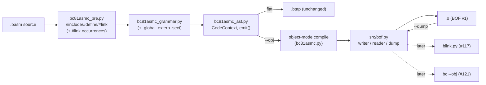
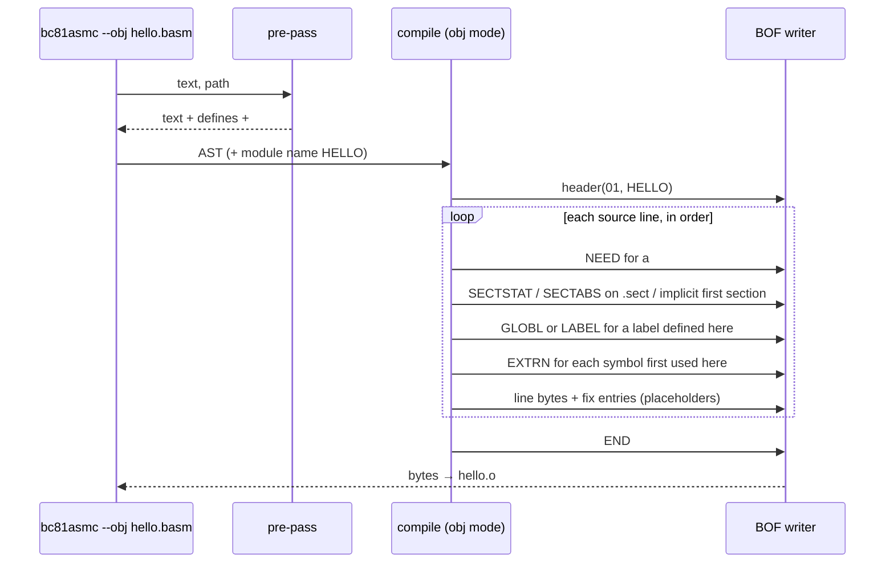

# Assembler: `--obj` Writes BOF Object Files Plan

**Plan Status**: `FINAL`

**Story Type**: `Internal`

**Plan Revision**: `A2`

> This plan captures **what** to build and **why** — domain, architecture, decisions, and verified facts.
> It deliberately does **not** contain implementation code, pseudocode, line numbers, mock setups, or test bodies.
> The implementation agent discovers the **how** against live code. See §4 Task Breakdown.

---

## 1. Problem Statement

*   **Context**: Issue #115 (roadmap phase 1, step 33 in `docs/analysis/08-self-hosted-roadmap.md`). The object format
    BOF v1 is frozen in design decision **G15** (#113, merged as PR #183). The assembler pre-pass with `#include`,
    `#define` and `#link` exists since #114 (PR #186, decision A13), and it records `#link` names for "`--obj` (#115)".
    `bc81asmc` today only writes a flat `.btap` image: every label reference is a `0xfa` placeholder that pass 2 patches
    with an absolute or relative value. `docs/02-assembler.md` has an "Object files (BOF v1, planned)" section that says
    `--obj` is not implemented yet.
*   **Goal**: `bc81asmc --obj file.basm` writes `file.o` in BOF v1, with the new directives `.global`, `.extern` and
    `.sect`, every fix-up kind (`ABS16`, `REL15`, `REL7`, `HI8`, `LO8`, `HILO`), the G15 writing rules (so output is
    deterministic), and a dump command `bc81asmc --dump file.o`. Without `--obj` nothing changes for any source in the repo.
    `bc81asmc --obj` is the byte-exact reference that BASM (phase 2) must reproduce, and its output is what `blink.py`
    (#117) links and what `runtime.basm` (#116) is built with.
*   **In scope**:
    *   A shared BOF v1 module (writer + reader + dump formatter) that later tools (`blink.py` #117, `bc --obj` #121) can import.
    *   The directives `.global`, `.extern`, `.sect` (parsed always; no-ops without `--obj`).
    *   `--obj` mode in the assembler: sections (`SECTSTAT`, or one `SECTABS` for an `.org` file), `GLOBL`, `LABEL`,
        `EXTRN` at first use, `ABS` for exported `.def`s, `NEED` for every `#link` occurrence, the `CODE` records and
        their fix records, `END`.
    *   `--dump FILE.o`.
    *   Docs: `docs/02-assembler.md` (replace the "planned" section), a new assembler decision **A14**, a clarification of
        G15's writing rules (where `de`/`ad` sit relative to `CODE`), `src/bc81asmc/CLAUDE.md`, the root `CLAUDE.md` command list.
*   **Out of scope**:
    *   The linker (`blink.py`, #117), `runtime.basm` (#116), `bc --obj` (#121), BASM (phase 2).
    *   **Assembler syntax that writes `ad` (`ADDR`) records.** `#code`/`#heap`/`#codelimit` are B lines; no `.basm` in the
        repo has them and the issue's proposal does not name them. The BOF module writes and reads `ad` (unit-tested, so
        "each record" of AC 1 is covered), but the assembler source gets no syntax for it here: #121, the first producer, adds
        what the compiler needs. Flagged in the PR as a scope note.
    *   `--lst`/`--map` together with `--obj` (rejected as a usage error; a listing of section offsets can come later).
    *   Changing the build scripts: no program is built with `--obj` yet.

### 1.1 Technical Summary

*   **Touched components**: assembler `src/bc81asmc/` (grammar, AST, driver, pre-pass), a new shared `src/bof.py`, docs.
*   **New patterns / abstractions**: a BOF v1 writer that buffers the current `CODE` record and its fix lists and flushes
    by the G15 rules; a reader that parses a record stream; a dump formatter. An object-mode compile path in the assembler
    that turns each label reference into a fix entry instead of patching it.
*   **Infrastructure changes**: None.
*   **End-state observable behavior**: `bc81asmc --obj hello.basm` writes `hello.o`; a hand-written `.basm` equivalent of
    the compiler output for `word main() { puts("hi"); return 0; }` gives exactly the 99-byte `HELLO.O` of doc 07;
    `bc81asmc --dump hello.o` prints it one record per line; every repo source assembles to byte-identical `.btap` files
    without `--obj`.

---

## 2. Architecture & Design

### 2.1 Architecture Overview

#### Involved components & owners

| Component | Technical Owner |
| :--- | :--- |
| assembler `bc81asmc` (`src/bc81asmc/`) | repo owner (bcichonski) |
| BOF v1 module (`src/bof.py`, new) | repo owner |
| docs (`docs/02-assembler.md`, `docs/specs/memory/design-decisions.md`, doc 07) | repo owner |

#### C2 diagram

#### Flow diagram

### 2.2 External Contracts & Evidence

N/A — Internal story. The format contract is internal and frozen in G15 (`docs/specs/memory/design-decisions.md`,
"G15. Object files are BOF v1…") and doc 07 ("Object file format", worked example `HELLO.O`).

#### Source Conflict Log

| Topic | Source A | Source B | Conflict | Chosen Handling |
| :--- | :--- | :--- | :--- | :--- |
| `#link` repeats | G15: "a `de` for every `#link` … written where it appears, repeats included" | `bc81asmc_pre.py`: `link_names` is first-seen order, no duplicates (pinned by `bc81asmc_pre_tests.py`) | The deduplicated list can't produce G15's records | Keep `link_names` as it is (pinned, used by `context.link_names`); add a **separate** ordered list of `#link` occurrences with the main-file line each belongs to (a header's `#link` belongs to the `#include` line). Object mode writes a `de` per occurrence. |
| `.org` placement | Issue: "`.org` only as the first line … elsewhere an error with `--obj`" | A10 (since #65): one `.org`, before any code or label (comments and `.def` may come first) | "First line" vs "before code or label" | Keep A10's rule in both modes; with `--obj`, `.org` additionally may not follow `.sect`/`.global`/`.extern` (D4). This is the conservative reading: it is what makes "the whole file is one absolute section". Not an AC deviation (the AC doesn't state it). |
| Dump command | Issue: "`bc81asmc --dump file.o` **or** `ftool bofdump`" | Roadmap/#118 notes expect `bc81asmc --dump` | Two options | `bc81asmc --dump file.o` (D10). |
| Where `de`/`ad` sit vs the open `CODE` record | G15 flush list: `LABEL`, `GLOBL`, `SECTSTAT`, `SECTABS`, `ee`, `END` | G15: `de`/`ad` are "written where it appears" | Writing a record "where it appears" while a `CODE` record is open needs that record flushed first; G15 doesn't say it | `de` and `ad` also flush the open `CODE` record (D7). Recorded as a clarification in G15 and doc 07 (no layout change, no version bump). |

### 2.3 Affected Areas

| Area / File (pointer) | Role in this change | Likely action |
| :--- | :--- | :--- |
| `src/bof.py` (new) | BOF v1 constants (tags, version, fix kinds), writer with G15 flush rules, reader, dump formatter. Shared by the assembler now, by `blink.py` (#117) and `bc --obj` (#121) later. Lives in `src/` beside `bc8183_isa.py` (G14 precedent); `bc81asmc_ast.py` already appends `src/` to `sys.path`. | New |
| `src/tests/test_bof.py` (new) | Unit tests of the BOF module (src-root tools keep their tests in `src/tests/`). | New |
| `src/bc81asmc/bc81asmc_grammar.py` | Line grammar; add `.global name`, `.extern name`, `.sect name`. Guarded by `src/tests/test_isa_single_source.py`: no int literals at module/class level. | Change |
| `src/bc81asmc/bc81asmc_ast.py` | AST node classes and `CodeContext`. Label references are recorded in `context.labels` as `(addr, label, kind)` with kinds `hi`, `lo`, `lorel`, `rel15`; `cal` and `.db :x` emit `hi`+`lo` back to back, `.mv` emits `hi` at +1 and `lo` at +3, `jmp t, :x` emits only `lo`, `.db hi(:x)`/`lo(:x)` one byte. Object mode needs to know which pairs form one `ABS16` / `HILO` entry. Also guarded by the ISA source guard: never write opcode values here. | Change |
| `src/bc81asmc/bc81asmc.py` | Driver: `compile()` (two passes, diagnostics), `assemble_text()`, `main()` (argparse; `infile` positional; `--lst`, `--map`). Add the object-mode path, `--obj`, `--dump`. | Change |
| `src/bc81asmc/bc81asmc_pre.py` | Pre-pass; records `link_names` (deduplicated). Add the ordered `#link` occurrences with their main-file line. | Change |
| `src/bc81asmc/bc81asmc_diag.py` | `Diagnostic`/`AssemblerError`; every new error goes through it (assembler `CLAUDE.md` rule). | Reference |
| `src/bc81asmc/tests/` | New test modules for the directives, object mode and the CLI (`*_tests.py`, run by the assembler suite). | New |
| `src/bdos/boot.basm`, `src/bc81asmc/bcOS/bcos.basm`, `src/bc81asmc/examples/*.basm` | Real sources: `.org` files with `.def`s before use, `.assert` (boot). Useful `--obj` smoke inputs (`SECTABS` sections) and byte-identity inputs. | Reference |
| `docs/02-assembler.md` | "Object files (BOF v1, planned)" → real `--obj`/`--dump` docs; directives table; Errors. | Change |
| `docs/specs/memory/design-decisions.md` | New **A14** (assembler object mode); G15 writing-rules clarification (D7). | Change |
| `docs/analysis/07-self-hosted-compiler.md` | Writing rules (same clarification as G15); the BASM bullet "the host `bc81asmc --obj` gets the same ones" can point to A14. | Change (small) |
| `src/bc81asmc/CLAUDE.md`, root `CLAUDE.md` | Commands (`--obj`, `--dump`) and "How it works". | Change |

### 2.4 Key Algorithms & Behaviour

**Module and output names.** The output is `<source stem>.o` beside the source (lowercase as given). The header's
module name is the source stem in **upper case** (`hello.basm` → `HELLO`), and a `NEED` name is the `#link` name in
upper case (`#link stdio` → `STDIO`): BFS file names are upper case, and that is exactly what doc 07's `HELLO.O`
shows (module `HELLO`, `NEED 'STDIO'` from `#link stdio`). Symbol and section names keep their case (`F_main`).

**Sections.**
*   An `.org` file is **one `SECTABS` section** at the `.org` address, named after the module. `.sect` in an `.org`
    file is an error with `--obj`.
*   Otherwise each `.sect name` starts a `SECTSTAT` section `name`. Code, data or labels that come before the first
    `.sect` go into an **implicit `SECTSTAT` section named after the module**, started at the first such line (so a
    plain `.basm` with no `.sect` is one section, and a file that starts with `.sect` has no implicit one). A repeated
    section name in one module is an error. A section may be empty.
*   Every section starts at offset 0. A label on a `.sect` line belongs to the new section (offset 0).

**Symbols.** Every name falls into exactly one class, fixed by the first time it is seen:
*   **global label**: declared with `.global name` and defined as a label in this module → a `GLOBL` (`91`) record at
    its definition, at the current section offset. A `.global` that is never defined is an error.
*   **external**: declared with `.extern name`, not defined in the module (defining it is an error).
*   **exported constant**: `.global name` + `.def name, value` → an `ABS` (`ab`) record at the `.def` line.
*   **local constant**: a `.def` without `.global`: no record; references to it are resolved **in place** by value (it
    is absolute), exactly as flat mode does (no fix).
*   **local label**: any other label. Local labels are numbered per module (0, 1, 2…) in order of **first appearance**,
    reference or definition, whichever comes first. Each defined local label gets a `LABEL` (`1a`) record at its
    definition with its number. A referenced local label that is never defined is the usual `undefined label` error.
*   **Declarations come first (D5).** `.global name` / `.extern name` must come before any use or definition of `name`,
    and a `.def` must come before its first use. Each is an error otherwise. This is what lets the one-pass BASM
    (phase 2) decide a name's class when it first sees it, and so produce the same bytes; every `.def` in the repo
    already comes before its uses. Declaring a name twice the same way is harmless; `.global` + `.extern` on one name is
    an error.

**References and fixes.** In object mode **every reference to a label (global, external or local) becomes a fix
entry**; nothing is patched in place except a local `.def` value. A target is a symbol number `k` (top bit clear) for
a global or external name, or `0x8000 | n` for local label `n` (G15). A reference to a global or external name that
has no symbol number yet first writes its `EXTRN` (`ee`) record, so symbol numbers follow first use (G15: a call to a
global of the same module also goes through an `ee`). The kind follows the existing reference sites:

| Source form | Placeholder bytes | Fix kind | Entry offset |
| :--- | :--- | :--- | :--- |
| `cal :x`, `.db :x` (high then low byte, adjacent) | the 16-bit target | `f1` `ABS16` | the high byte |
| `jrx t, :x`, `clr :x` | the 16-bit target | `f2` `REL15` | the first placeholder byte |
| `.db hi(:x)` | `00` | `f8` `HI8` | the byte |
| `.db lo(:x)`, `jmp t, :x` (low byte only) | `00` | `f9` `LO8` | the byte |
| `jmr t, :x` | `00` | `fa` `REL7` | the byte |
| `.mv pair, :x` (high at +1, low at +3 of `hi-mov hh lo-mov ll`) | `00`, `00` | `fb` `HILO` | the high byte (low = offset + 2) |

The linker computes `REL7`/`REL15` with exactly the arithmetic flat mode uses today relative to the placeholder's
address (sign-magnitude, G5); `docs/02-assembler.md` must state that arithmetic so #117 can copy it. How the AST tells
an `ABS16` pair or a `HILO` pair from two lone bytes is the agent's choice, but it must not write opcode values in
`bc81asmc_ast.py`/`bc81asmc_grammar.py` (ISA source guard).

**Record order per source line** (deterministic; D6): in reading order of the lines,
1.  a `NEED` (`de`) for each `#link` occurrence that belongs to this line (in occurrence order);
2.  `.sect` → `SECTSTAT`; the implicit first section → `SECTSTAT` (module name); the `.org` file's section →
    `SECTABS` (address, module name), written at the first line after the header that needs a section;
3.  the label defined on the line → `GLOBL` or `LABEL`;
4.  an `.global` `.def` → `ABS`;
5.  `EXTRN` for each global/external symbol first used on this line, in reference order;
6.  the line's bytes into the open `CODE` record, with their fix entries.

**`CODE` records and flushing (G15 + D7).** The open `CODE` record is flushed (written, followed directly by its fix
records) when it is full (255 bytes), before `LABEL`, `GLOBL`, `SECTSTAT`, `SECTABS`, `EXTRN`, `ABS`, `NEED`, `ADDR`
and `END`, and before a line whose bytes would not fit whole. A line longer than 255 bytes (only a long `.db`) starts a
new record and is split at 255-byte boundaries, moving a split point back so that a 2-byte `.db :x` item is never split.
Fix records follow their `CODE` record in tag order `f1`, `f2`, `f8`, `f9`, `fa`, `fb`, offsets ascending, empty lists not
written; a list longer than 255 bytes continues in another record with the same tag, each record holding as many whole
entries as fit (85 three-byte entries, 255 one-byte entries). Nothing is ever written in dictionary/set iteration order
that could change between runs.

**Other directives in object mode.**
*   `.assert` (amended in A1): in an `.org` (`SECTABS`) file every address is known, so asserts are evaluated as today
    (boot.basm's `.assert :bd_end <= 0x0e80` keeps working; compiler output also starts with `.org`, so its
    `sys_codeend` asserts are evaluated too). In a relocatable module an `.assert` that names a label can't be evaluated
    (addresses exist only after linking): it is **skipped with a positioned warning** (`.assert not checked with --obj:
    ':x' is relocatable`, wording free), not an error; the `.o` is still written and the exit status is 0. One that names
    only `.def`s and literals is evaluated.
*   Undefined labels, out-of-range values and every existing error keep their positioned diagnostics. A relative jump's
    range is not checked in object mode (the linker checks it, G15).
*   `--obj` writes only the `.o` (no `.btap`). `--obj` with `--lst` or `--map` is a usage error.
*   Any error → no `.o` written, exit 1, the usual `file:line:col: error:` blocks.

**Without `--obj`.** `.global`, `.extern` and `.sect` parse and emit nothing (a label on such a line gets the current
address, like `.def`/`.assert`); references resolve as today, so a `.extern` name that is not defined in the file is the
usual `undefined label` error. This keeps every repo source byte-identical and lets #116's `runtime.basm` (with its
`.sect`/`.global` lines) still be pasted into flat builds.

**Dump (`bc81asmc --dump FILE.o`).** Reads the file with the BOF reader and prints one line per record to stdout: the
record's file offset, tag, record name and decoded content — names as text, `ADDR` kinds by name, `GLOBL`/`LABEL`/`CODE`
with their current section offset, `CODE` bytes in hex (wrapping long records is fine), fix entries with offset and
target shown as `symbol k 'name'` or `label n`. Exit 0. A file that is not BOF v1 (wrong first tag, version ≠ 01,
truncated record, unknown tag, `ed` not last) → one error line naming the file and the byte offset on stderr, exit 1.
The exact layout is the agent's choice; it is documented in `docs/02-assembler.md` and pinned by tests.

---

## 3. Key Decisions & Assumptions

*   **D1 — One shared BOF module in `src/`.** `src/bof.py` holds the tags, the writer, the reader and the dump formatter.
    *Why:* `blink.py` (#117) and `bc --obj` (#121) need the same writer/reader; the ISA module (G14) set the precedent of a
    shared `src/` module the assembler imports. Its tests go in `src/tests/test_bof.py` (repo convention for src-root modules).
*   **D2 — Module and `NEED` names are upper case; symbol and section names keep their case.** *Why:* doc 07's byte-exact
    `HELLO.O` (`HELLO`, `STDIO` from `#link stdio`, `F_main`).
*   **D3 — Implicit first section.** Code before the first `.sect` goes into a `SECTSTAT` named after the module.
    *Why:* any plain `.basm` assembles to a usable object (an assembly-only program has one section, which is its entry
    when it is the first linked object); the alternative (an error) only adds friction. Deterministic, so BASM can copy it.
*   **D4 — `.org` with `--obj`.** A10's rule stands (one `.org`, before any code or label); with `--obj` it also may not
    follow `.sect`, `.global` or `.extern`, and `.sect` is an error in an `.org` file. The file is one `SECTABS` named after the module.
*   **D5 — Declarations before use.** `.global`/`.extern` before any use or definition of the name; `.def` before its
    first use (object mode only). *Why:* BASM is one pass (doc 07, "The assembler (BASM)"); these rules let it classify
    every name at first sight and match `bc81asmc --obj` byte for byte. Every repo source already complies (all `.def`s
    sit at the top of `boot.basm`, `bcos.basm`, `examples/*.basm`).
*   **D6 — Every label reference is a fix, numbered at first use.** Local labels are numbered by first appearance; `EXTRN`
    records are written at first use; local `.def`s are resolved in place. *Why:* uniform (also inside a `SECTABS`
    section: G15 says fix-ups there "resolve like any other"), one-pass reproducible, and it is exactly what `HELLO.O`
    shows (`DATA0020` = local label 0 at its first, forward, use).
*   **D7 — `NEED`, `ADDR` and `ABS` flush the open `CODE` record too.** *Why:* "written where it appears" (G15) is only
    well defined if the bytes before it are written first. A clarification of G15's writing rules, not a layout change
    (no version bump); written into G15 and doc 07.
*   **D8 — The directives are no-ops without `--obj`.** *Why:* AC 3 (flat output unchanged) and #116 (flat builds still
    paste the runtime text).
*   **D9 — No assembler syntax for `ad` in this story.** The BOF module supports the record; #121 adds whatever source
    form the compiler needs. *Why:* no `.basm` uses `#code`/`#heap`/`#codelimit`; inventing a syntax nobody uses yet is
    a decision better made with its first producer. Scope note in the PR.
*   **D10 — `bc81asmc --dump FILE.o`** (not `ftool bofdump`): the format belongs to the toolchain that writes it, and
    the reader is in the same module.
*   **D11 — Asserts in relocatable modules (amended in A1).** An `.assert` naming a label is skipped with a warning in a
    relocatable object module (addresses are unknown until link); in an `.org` module it is evaluated. *Why:* the owner
    asked to relax the rules (A1); a warning keeps the check visible without blocking a source that is also assembled
    flat, and the linker (#117) checks image end against `#heap`/`#codelimit` anyway. Was an error in A0.
*   **D12 — Why D5 stays (A1).** `.global`/`.extern` before use and `.def` before use can't be relaxed without changing
    BASM's design or the format: at a forward reference to an unseen name, a one-pass BASM must already write the target
    (local label `0x8000|n` or symbol `k`), and no G15 record can later turn local label `n` into a global or into an
    absolute `.def` value. Relaxing them needs either a BASM declaration pre-scan (a second read of the source; doc 07
    says one pass) or a G15 version bump; both are owner decisions offered in the PR, not taken here. The rules match
    `#define` (#114: a name used before its define is already an error), so "declarations at the top" is one rule.
*   **D13 — Object size (A2).** Measured `.o` size is 1.7–1.9 × the code (doc 07 estimated 1.2–1.3 ×), mostly `LABEL`
    records and the `CODE` splits they force. Kept: one pass, every label reference a fix (D6). Recorded in doc 07 "Size",
    "Disc cost of a compile" and G15's trade-offs, with the two options (backward relative fill ≈1%; two-pass BASM ≈1.4–1.5 ×)
    for the owner. The owner was asked and gave no answer during the run; the conservative choice (no code change) was taken.
*   **Assumption — new decision id is `A14`.** Last assembler id on `origin/master` is A13 (#114). Parallel stories may
    take it; check `origin/master`'s last `### A` id right before the PR and renumber if needed.

### 3.1 Decision Lock (Constants & Policies)

| Constant / Policy | Selected Value | Why | Where it lives |
| :--- | :--- | :--- | :--- |
| BOF version | `01` | G15 | `src/bof.py` |
| Tags | `b0 ee de ad 55 5a 91 c0 1a ab f1 f2 f8 f9 fa fb ed` | G15 | `src/bof.py` |
| `ADDR` kinds | `#code` 0, `#heap` 1, `#codelimit` 2 | G15 | `src/bof.py` |
| Max record content | 255 bytes | G15 | `src/bof.py` |
| Local-label target | `0x8000 | n`, n < 0x8000 | G15 | `src/bof.py` / assembler |
| 8-bit placeholder byte | `00` | G15 (`fb`/8-bit placeholders written `00`) | assembler object mode |
| Fix record order | `f1 f2 f8 f9 fa fb`, offsets ascending | G15 | `src/bof.py` |
| Module name | source stem, upper case | D2 | assembler |
| Output | `<stem>.o` beside the source, no `.btap` | issue proposal | `bc81asmc.py` |
| Dump | `bc81asmc --dump FILE.o` → stdout, exit 0; malformed → stderr, exit 1 | D10 | `bc81asmc.py` + `src/bof.py` |
| Decision id | `A14` (+ G15 clarification) | next free A id | `design-decisions.md` |

### 3.2 Open Questions

No open questions. (Resolution attempts: the issue text and G15 settle the record set and the writing rules; doc 07's
`HELLO.O` settles naming, numbering and `EXTRN` placement; the live assembler settles the reference kinds; the repo's
`.basm` sources settle that D5 costs nothing today. The `ad` syntax (D9) and the dump command (D10) are low-stakes and
reversible, so they are decisions, flagged in the PR for the owner.)

---

## 4. Task Breakdown

| Task | Title | Depends on | Complexity |
| :--- | :--- | :--- | :--- |
| `T1` | BOF v1 module: writer, reader, dump formatter | — | `Medium` |
| `T2` | Directives `.global`/`.extern`/`.sect` (flat no-ops) and `#link` occurrences | — | `Medium` |
| `T3` | Assembler object mode, `--obj` and `--dump` | `T1`, `T2` | `High` |
| `T4` | Docs: `02-assembler.md`, A14, G15/doc 07 clarification, `CLAUDE.md`s | `T3` | `Medium` |

### T1 — BOF v1 module: writer, reader, dump formatter

*   **Goal**: `src/bof.py` writes every BOF v1 record by the G15 writing rules (plus D7), reads a record stream back, and
    formats a readable dump.
*   **Depends on**: —
*   **Complexity**: `Medium`
*   **Pointers**: G15 in `docs/specs/memory/design-decisions.md`; doc 07 "Object file format" (record table, writing
    rules, worked `HELLO.O`); `src/bc8183_isa.py` as the style model of a shared `src/` module; `src/tests/` for tests.
*   **Definition of Done**:
    *   A writer API covering: header (version 01 + module name), `EXTRN` (returns/allocates the symbol number in order),
        `NEED`, `ADDR` (kind + value), `SECTSTAT`, `SECTABS` (address + name), `GLOBL`, `LABEL` (n), `ABS` (value + name),
        code bytes with fix entries of all six kinds, `END`; it tracks the current section offset.
    *   The writer buffers the open `CODE` record and flushes it per §2.4 (full; before every non-`CODE` record; before
        bytes that must stay whole and don't fit), writes fix records right after their `CODE` record in tag order with
        offsets ascending, and splits a fix list over 255 bytes into several records of whole entries.
    *   A reader that parses bytes into records (tag, decoded fields) and rejects: wrong first tag, version ≠ 01, a
        truncated record, an unknown tag, data after `ed 00` or a missing `ed`. Errors carry the byte offset.
    *   A dump formatter (text) as described in §2.4 "Dump", resolving `ee` names for fix targets.
    *   Names are ASCII; a name or a record that can't fit in 255 bytes of content is a clear error, not a silent truncation.
*   **Tests expected** (unit, `src/tests/test_bof.py`): each record kind written and read back; each fix kind; the
    exact 99 bytes of doc 07's `HELLO.O` built through the writer API; flush before each flushing record; a `CODE`
    record filling to exactly 255 bytes and the next byte starting a new record; a fix list > 255 bytes split into
    continuation records (and a list of exactly 255 bytes not split); empty fix lists not written; determinism (same
    calls → same bytes); reader round trip and each reader error; dump output for `HELLO.O`.
*   **Tests to modify**: None

### T2 — Directives `.global`/`.extern`/`.sect` (flat no-ops) and `#link` occurrences

*   **Goal**: The three directives parse into AST nodes and emit nothing in flat mode; the pre-pass records every `#link`
    occurrence in order with the main-file line it belongs to. Flat output stays byte-identical for every repo source.
*   **Depends on**: —
*   **Complexity**: `Medium`
*   **Pointers**: `src/bc81asmc/bc81asmc_grammar.py` (directive rules `dORG`, `dDEF`, `dASSERT`; the `ident` rule; more
    specific alternatives first), `src/bc81asmc/bc81asmc_ast.py` (`Directive`, `DEF`, `ASSERT`, `LabelOnly`),
    `src/bc81asmc/bc81asmc_pre.py` (`#link` handling, `PrepassResult`), `src/bc81asmc/bc81asmc_listing.py` (a directive
    row with no bytes), `src/tests/test_isa_single_source.py` (guarded files: no int literals at module/class level).
*   **Definition of Done**:
    *   `.global name`, `.extern name`, `.sect name` (one identifier each, optional label and `; comment` like other
        directives) parse; malformed forms (missing name, two names, a `:name`) are positioned syntax errors.
    *   In flat mode they emit nothing; a label on such a line gets the current address; the listing shows them as
        no-byte rows; `.map` unchanged.
    *   The pre-pass keeps `link_names` exactly as today and additionally exposes the ordered `#link` occurrences
        (repeats included), each with the main-file line number it belongs to (a header's `#link` → the `#include` line),
        reachable from `assemble_text()`'s result for T3.
    *   Every repo source (`bcos.basm`, `boot.basm`, `examples/*.basm`, and every compiler-generated `.basm` of a full
        build) assembles to byte-identical outputs: build the base (`git archive` of the base ref into the scratchpad)
        and the branch, compare sha256 of every `*.btap/*.b81/*.sector(s)/*.bdd` under `src/`.
*   **Tests expected** (unit, assembler suite, new module(s) under `src/bc81asmc/tests/`): parsing of each directive and
    each malformed form; flat-mode no-op (same bytes with and without the directives, labels on those lines);
    `#link` occurrences: order, repeats, header `#link` placed at the `#include` line, `link_names` unchanged.
*   **Tests to modify**: None

### T3 — Assembler object mode, `--obj` and `--dump`

*   **Amended in**: `A1` (relocatable `.assert` → warning, not error)
*   **Goal**: `bc81asmc --obj file.basm` writes `file.o` per §2.4 using `src/bof.py`; `bc81asmc --dump file.o` prints it.
*   **Depends on**: `T1`, `T2`
*   **Complexity**: `High` (it is the byte-exact reference BASM must match; ordering and numbering rules interact)
*   **Pointers**: `src/bc81asmc/bc81asmc.py` (`compile()`, `assemble_text()`, `main()`), `src/bc81asmc/bc81asmc_ast.py`
    (`CodeContext._emit_addr` and the reference sites in `JMP`, `JMR`, `JRX`, `CAL`, `CLR`, `DB`, `MV`; `DEF`; `ORG`),
    `src/bc81asmc/bc81asmc_diag.py`, §2.4 of this plan, G15, doc 07 `HELLO.O`.
*   **Definition of Done**:
    *   Sections, symbol classes, fixes, record order, flushing, `.assert` handling and the errors of §2.4 / D3–D7, D11
        implemented. Errors (each positioned, through `bc81asmc_diag.py`): `.sect` in an `.org` file; `.org` after
        `.sect`/`.global`/`.extern`; duplicate section name; `.global` never defined; `.extern` name defined; `.global`
        and `.extern` on one name; `.global`/`.extern` after a use or definition of the name; a `.def` used before it is
        defined; plus every existing error (undefined label, …). An `.assert` naming a label in a relocatable module is a
        positioned **warning** and is skipped (A1), printed like the pre-pass warnings; exit 0, `.o` written.
    *   `--obj` writes only `<stem>.o` (no `.btap`), nothing on error (exit 1); `--obj` with `--lst`/`--map` is a usage
        error; `--dump FILE.o` prints the dump (exit 0) or a positioned format error (exit 1); a plain run without
        these flags behaves exactly as before (same files, same stdout lines).
    *   Output identical across runs and processes (AC 2).
    *   `boot.basm`, `bcos.basm` and `examples/*.basm` assemble with `--obj` (one `SECTABS` each).
*   **Tests expected** (assembler suite, new modules under `src/bc81asmc/tests/`; CLI tests as subprocesses like
    `bc81asmc_cli_tests.py`):
    *   a hand-written `hello.basm` equivalent of doc 07's compiler output (`#link stdio`, `.global F_main`, `.extern`
        for `stackvar8st16`/`F_puts`, `.sect F_main`, the seven instructions, `DATA0020: .db 'hi', 0x00`) gives exactly
        the 99 bytes of `HELLO.O`;
    *   each fix kind from its source form (table in §2.4), with placeholders and offsets checked; forward and backward
        references; a label at section offset 0 (`LABEL`/`GLOBL` before any `CODE`), including a label on the `.sect` line;
        a `.db` line with enough `lo(:x)` items that its `f9` list exceeds 255 bytes;
    *   implicit first section, multiple sections, empty section, `.org` → `SECTABS`, exported `.def` → `ABS`, local `.def`
        resolved in place, `NEED` per `#link` occurrence (repeats, from a header), `EXTRN` at first use for globals and
        externals, `.assert` evaluated in an `.org` file and skipped with a warning in a relocatable one (A1);
    *   **consistency with flat mode**: for `boot.basm`, `bcos.basm`, the examples and a multi-section relocatable test
        source, resolving the `.o` (a small test-side resolver: lay sections out in order at the flat `.org`/base, apply
        each fix with the flat-mode arithmetic) gives the same bytes as the flat assembly — this proves every fix offset,
        placeholder and the `REL7`/`REL15` arithmetic;
    *   every error above; determinism (two subprocess runs with different `PYTHONHASHSEED`, identical `.o`);
    *   CLI: `--obj` writes `.o` and no `.btap`; `--obj --lst` usage error; `--dump` output and exit codes, malformed file.
*   **Tests to modify**: None

### T4 — Docs: `02-assembler.md`, A14, G15/doc 07 clarification, `CLAUDE.md`s

*   **Goal**: The docs describe what T1–T3 built (AC 4).
*   **Depends on**: `T3`
*   **Complexity**: `Medium`
*   **Pointers**: `docs/02-assembler.md` (Usage, Directives table, "Object files (BOF v1, planned)", Errors),
    `docs/specs/memory/design-decisions.md` (assembler A-section after A13; G15 "writing rules" bullet),
    `docs/analysis/07-self-hosted-compiler.md` ("Writing rules" bullets; the BASM "New directives" bullet),
    `src/bc81asmc/CLAUDE.md` (Commands, How it works), root `CLAUDE.md` (assembler command line / cross-component notes).
*   **Definition of Done**:
    *   `02-assembler.md`: `--obj` and `--dump` in Usage; `.global`/`.extern`/`.sect` in the directives table (with their
        flat-mode no-op); an "Object files" section replacing the "planned" one: module/section naming, symbol classes,
        declarations-first rule, the reference → fix-kind table, placeholders, record order and flushing, the
        `REL7`/`REL15` arithmetic relative to the placeholder (for the linker), `.assert`/`.org` rules, the dump format
        with a short example, and the new errors in Errors. The `ad` scope note (D9).
    *   `design-decisions.md`: **A14** (purpose, rationale, usage, trade-offs, like A13); G15's writing rules gain the D7
        clarification (no other edits to G15; no other decision touched).
    *   doc 07: the same writing-rule clarification; nothing else rewritten.
    *   `src/bc81asmc/CLAUDE.md` and root `CLAUDE.md`: commands and a short "object mode" note.
    *   Only these files change; no test parses doc text (owner rule: no tests pinned to docs).
*   **Tests expected**: None (docs only). Run the unit suite to confirm nothing broke.
*   **Tests to modify**: None

---

## 5. Verification

*   **Unit**: `python3 run_tests.py --group unit < /dev/null` — exit 0 (list any expected failures with their issues; none
    are expected in the assembler suite).
*   **e2e** (during development): `python3 run_tests.py --group e2e --tier happy < /dev/null` and
    `python3 run_tests.py --group e2e --changed origin/master < /dev/null`. **Full suite once before the PR**:
    `python3 run_tests.py < /dev/null`.
*   **Byte identity without `--obj` (AC 3)**: build `git archive <base_ref>` in the scratchpad and the branch
    (`cd src && ./buildos && ./buildtools && ./buildapps && ./makedisc`), then compare sha256 of every
    `*.btap/*.b81/*.sector(s)/*.bdd` under `src/` — all identical. `python3 scripts/code_size.py --check` reports no change.
*   **Observable**: `cd src && python3 bc81asmc/bc81asmc.py --obj <tmp>/hello.basm` writes `hello.o` equal to doc 07's
    99 bytes; `python3 bc81asmc/bc81asmc.py --dump <tmp>/hello.o` prints one line per record; `--obj` on
    `bdos/boot.basm` (in a temp copy) gives one `SECTABS` at `0x0e00`.
*   **AC map**: AC 1 → T1 + T3 tests (every record via T1, every fix kind/section-offset-0/forward+backward/>255 via T3);
    AC 2 → T1 + T3 determinism tests; AC 3 → T2 byte-identity check + §5; AC 4 → T4.

---

## 6. Fact-Integrity Checklist

| Check | Yes / No / N/A | Notes |
| :--- | :--- | :--- |
| External contracts verified from producer/contract source | N/A | Internal; the format contract is G15 + doc 07, read in full |
| Evidence sources are reproducible | N/A | Internal |
| Identifier directionality / ordering / freshness meaning evidenced | N/A | Internal |
| Every `Assumption` is linked to an Open Question (§3.2) | Yes | Only the A14 id assumption, handled by a pre-PR check, not correctness |
| No unresolved Open Questions (for `FINAL`) | Yes | |
| Each Decision states a single committed approach | Yes | D1–D11 |
| Tasks are independent, each with a Definition of Done and test expectations | Yes | T1 ∥ T2, then T3, then T4 |
| Required infra reflected | N/A | No toggles/infra |

**Self-review note**: The ordering rules (D5–D7) go slightly beyond G15's text; they are chosen so that BASM's one
pass can reproduce the host output, and they are documented as A14 plus a G15 clarification rather than silently
assumed. The riskiest part is T3's mapping of reference pairs to `ABS16`/`HILO` without writing opcode values in the
guarded files, and the per-line record order; the `HELLO.O` byte-exact test and the flat-vs-resolved consistency test
are the safety nets. `ad` assembler syntax is deliberately left to #121 (D9).

---

## 7. Amendment Log

| Amendment | Date | Requested by | Request | Decision | Plan changes |
| :--- | :--- | :--- | :--- | :--- | :--- |
| A1 | 2026-11-25 | owner (mid-run) | contradiction — relax the D5/D11 ordering rules where possible | accepted in part: `.assert` naming a label in a relocatable module → warning + skipped (D11). Rejected for `.global`/`.extern`/`.def` before use: not relaxable under one-pass BASM + G15 without a BASM pre-scan or a format version bump (owner decision, offered in the PR, D12) | §2.4 `.assert` bullet, D11, new D12, T3 DoD/tests (Amended in A1) |
| A2 | 2026-11-25 | owner (mid-run question) | wrong-fact — `.o` size estimate 1.2–1.3 × vs measured 1.7–1.9 × | accepted: docs updated with the measurement and options (doc 07 ×2, G15 trade-offs); code unchanged (D13) | new D13; T4 scope +doc 07 "Size"/"Disc cost" and G15 trade-offs (done by the orchestrator, docs only) |
