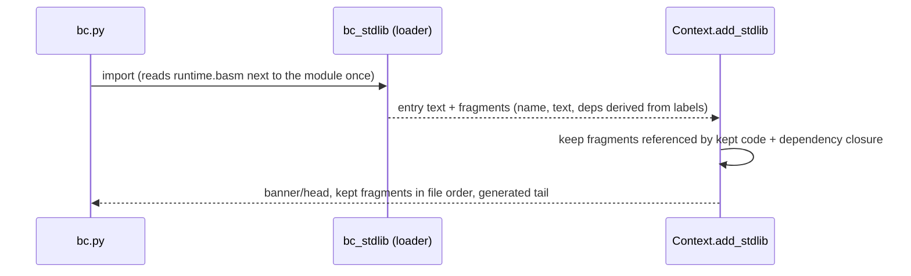

# Compiler Runtime in `runtime.basm`, One Section per Routine — Plan

**Plan Status**: `FINAL`

**Story Type**: `Internal`

**Plan Revision**: `A0`

Issue: bcichonski/bc16#116 — roadmap phase 1, step 34 (`docs/analysis/08-self-hosted-roadmap.md`).

---

## 1. Problem Statement

*   **Context**: the B compiler's assembly runtime lives in `src/bc/bc_stdlib.py` as Python strings: a banner, an 8-byte
    head (4 × `mov a, 0xff`), 39 `Fragment(name, text, deps)` objects (one per routine or data label; #16 split them,
    C9), and a per-program tail (`sys_heaphead` data, `sys_stackhead`). `Context.add_stdlib` (`src/bc/bc_ast.py`)
    emits the fragments that kept code references, plus their declared dependency closure, in template order.
    BASM on the BC64 (phase 2) and the linker (`blink.py`, #117) need that runtime as an ordinary assembly source that
    `bc81asmc --obj` (#115, A14) can turn into `RUNTIME.O`, one `SECTSTAT` section per routine, so the linker's dead-code
    elimination keeps only what a program uses.
*   **Goal**: `src/bc/runtime.basm` is the single source of the runtime routines. `bc` (flat, no `--obj`) reads it
    instead of Python strings and produces the same programs; `bc81asmc --obj` builds `RUNTIME.O` from the same file.
*   **In scope**: the new file, `bc_stdlib.py` turned into its loader, the build of `RUNTIME.O` in the pipeline,
    `.gitignore` for object files, tests, docs (`docs/03-compiler.md`, `src/bc/CLAUDE.md`, decision C11, C9 pointer).
*   **Out of scope**: `bc --obj` and `F_name` symbols (#121); the program entry stub that calls `F_main` and needs the
    `#heap` address as an `ad` record (#121, A14 says `.basm` has no `ad` syntax yet); `blink.py` (#117); two-pass
    `--obj` (#188); shipping `RUNTIME.O` in a release zip or on a disc.

### 1.1 Technical Summary

*   **Touched areas**: `src/bc/` (new `runtime.basm`, `bc_stdlib.py`, `bc_ast.py` `add_stdlib`), `src/buildos`,
    `.gitignore`, compiler tests, docs.
*   **New patterns / abstractions**: a runtime source split into sections by `.sect NAME` lines; `bc` parses it into the
    existing `Fragment` list and derives each fragment's dependencies from its label references.
*   **Infrastructure changes**: the build pipeline (`./buildos`) also writes `src/bc/runtime.o` (ignored, not committed).
*   **End-state observable behaviour**: every program's generated `.basm` is text-identical to before (so the binaries are
    byte-identical); `bc81asmc --obj src/bc/runtime.basm` writes a `RUNTIME` module with one section per routine.

---

## 2. Architecture & Design

### 2.1 Architecture Overview

#### Involved components & owners

| Component | Technical Owner |
| :--- | :--- |
| compiler `bc` (`src/bc/`) | repo owner (bcichonski) |
| assembler `bc81asmc --obj` (`src/bc81asmc/`, `src/bof.py`) — used, not changed | repo owner |
| build scripts (`src/buildos`) | repo owner |

#### C2 diagram

```mermaid
flowchart LR
    RT[src/bc/runtime.basm<br/>preamble + .sect per routine]
    LD[bc_stdlib.py<br/>loader: Fragment list]
    AST[bc_ast.py<br/>Context.add_stdlib]
    TAIL[runtime tail<br/>sys_heaphead / sys_stackhead / sys_codeend<br/>generated per program]
    PRG[program .basm (flat)]
    ASM[bc81asmc --obj]
    OBJ[src/bc/runtime.o<br/>module RUNTIME]
    RT --> LD --> AST --> PRG
    TAIL --> PRG
    RT --> ASM --> OBJ
```

#### Flow diagram



### 2.2 External Contracts & Evidence

N/A — Internal story.

#### Source Conflict Log

| Topic | Source A | Source B | Conflict | Chosen Handling |
| :--- | :--- | :--- | :--- | :--- |
| Order vs #188 | #188 body: "Do this before anything relies on the exact `--obj` bytes: #116 …" | issue #116 is invoked now; roadmap 08 lists #116 as step 34 right after #115, #188 is not in it | #188 (two-pass `--obj`) is still open | #116 does not rely on exact `--obj` bytes: no test pins `RUNTIME.O` bytes or record offsets (D6), and the file follows A14's declaration-first order, which stays valid after #188 drops it. Flagged in the PR. |
| "Always-kept entry section" | issue proposal | G16 / doc 07: the program entry stub in `runtime.basm` refers to `F_main` | `F_main` (#121) and the `#heap` address as an `ad` record (no `.basm` syntax, A14) don't exist yet, and the flat entry code is per program (heap address, `kil`/`ret`) | the first section is the always-kept entry section (D4) and holds today's always-emitted banner + head; the entry stub moves into it in #121. Flagged in the PR. |
| `.global` vs G16 "labels like `poke16` are local" | issue: `.global` for every routine called from generated code | G16 symbol-names bullet | G16's point is that B can't call them by name (the `F_` prefix); generated code in another module (`bc --obj`) must still reach `poke16` etc. | follow the issue: each routine's own label is `.global` (D3). No B-callable name is added. |

### 2.3 Affected Areas

| Area / File (pointer) | Role in this change | Likely action |
| :--- | :--- | :--- |
| `src/bc/bc_stdlib.py` | today: the runtime text as Python strings + `Fragment`; after: the loader of `runtime.basm` that keeps the public names (`Fragment`, `runtime_fragments`, the banner/head, `runtime_tail`) the compiler and tests import | Change |
| `src/bc/runtime.basm` | the runtime source: preamble (header comment, `.extern`, `.global`), the entry section, one `.sect` per fragment | New |
| `src/bc/bc_ast.py` — `Context.add_stdlib`, `asm_labels`, `STACKHEAD`/`HEAPHEAD` | emits the runtime; today it `.format`s every fragment with the two names | Change (small) |
| `src/buildos` | builds bcOS, boot, bdos: gains the `RUNTIME.O` build step | Change |
| `.gitignore` | `*.o` is not ignored today (`git check-ignore src/bc/runtime.o` finds nothing); the CI e2e guard fails on a dirty tree | Change |
| `src/bc/tests/bc_runtime_tests.py`, `bc_runtime_bcos_tests.py` | import `runtime_fragments` from `bc_stdlib`; must keep passing unchanged | Reference |
| `src/bc/tests/` (new module) | loader + `RUNTIME.O` tests | New |
| `src/bof.py`, `src/bc81asmc/bc81asmc.py --obj/--dump` | object writer/reader used to build and inspect `RUNTIME.O` | Reference |
| `scripts/code_size.py` | `--check` proves every program's `.basm` is unchanged (bytes and `basm_sha`); runs `src/bc/bc.py` from the repo | Reference (verification) |
| `docs/03-compiler.md` ("Link step" → Runtime/Sections, "Runtime stdlib" heading, file table), `src/bc/CLAUDE.md` ("How it works", Rules), `docs/specs/memory/design-decisions.md` (C9 last bullet, new C11), root `CLAUDE.md` (committed sources list, build pipeline note) | docs | Change |

### 2.4 Key Algorithms & Behaviour

*   **File layout of `runtime.basm`** (in this order):
    1.  **preamble** — a header comment (what the file is, that `bc` pastes its sections and `--obj` builds `RUNTIME.O`,
        the names fixed by G16), then `.extern sys_stackhead` and `.extern sys_heaphead` (defined per program by the
        tail that `bc` generates, later by the linker), then one `.global` per section label (D3). A14 requires every
        `.global`/`.extern` before any use or definition, so they all sit here.
    2.  **entry section** (first `.sect`, D4): the banner comment line and the 4 × `mov a, 0xff` head.
    3.  **one `.sect NAME` per fragment**, in today's template order, `NAME` = today's fragment name; the section body is
        today's fragment text with `{0}`/`{1}` replaced by the literal names `sys_stackhead`/`sys_heaphead`
        (`bc_ast.STACKHEAD`/`HEAPHEAD` are exactly those names).
    *   The `os_metacall` section holds only `.def os_metacall, 0x0008` and its comment (an empty `SECTSTAT` in the
        object; checked to assemble in a trial). It stays first among the fragments, so the `.def` precedes every use (A14).
    *   No blank lines anywhere (a blank line is a `bc81asmc` syntax error).
*   **Loader rule (`bc_stdlib.py`)**: read `runtime.basm` from the module's own directory (not the working directory:
    tests and `code_size.py` run `bc.py` from other folders), with universal newlines, so a CRLF checkout gives the same
    text. Everything before the first `.sect` line is the preamble and is never emitted. Each `.sect NAME` line starts a
    section; the line itself is not emitted; the following lines up to the next `.sect` are the section text. The first
    section is the entry section (always emitted, at the place the banner + head go today); every other section is a
    `Fragment` named `NAME`. A malformed file (no sections, a duplicate name, text after `.sect` on the same line other
    than the name) raises an error at import with the file name.
*   **Dependencies (D2)**: a fragment's `deps` are the other fragments whose labels its text references
    (`asm_labels`), computed by the loader. In `RUNTIME.O` the same references are the section's fixups, which is how the
    linker sees them. No separate declaration is kept.
*   **Emission is text-identical (D1)**: `add_stdlib` keeps its selection rule and order. The output text for every
    program must equal today's character for character, including the banner's leading newline, comment lines, and the
    trailing spaces some comment lines carry (e.g. `; PRINTHEX8(a) - prints hex number `). Fragment texts are no longer
    `.format`ted (they hold literal names); `runtime_tail` stays a per-program template in Python.
*   **`RUNTIME.O`**: `./buildos` runs `bc81asmc --obj ./bc/runtime.basm` → `src/bc/runtime.o`, module `RUNTIME`,
    40 `SECTSTAT` sections (entry + 39), a `GLOBL` for each routine/data label, `EXTRN` for the two names.
    Trial on the base: assembles, 522 code bytes, 1787-byte object.

---

## 3. Key Decisions & Assumptions

*   **D1 — Text identity, not only byte identity.** AC-1 asks for byte-identical programs. The plan requires the stronger
    result: every generated `.basm` is unchanged, so `python3 scripts/code_size.py --check` exits 0 (bytes and
    `basm_sha` per program, baseline exits 0 on `70ab5f9`). That is why the loader strips `.sect` lines and the
    preamble, though A14 makes them no-ops in a flat build anyway. It also keeps every e2e golden and the
    `code_size.csv` log untouched.
*   **D2 — Dependencies come from the references.** "Dependencies explicit" (AC-2) means each section names what it uses
    with `:label` references, which become fixups in `RUNTIME.O`. Keeping a second, declared list would duplicate the
    references and need a guard test (today's `test_declared_dependencies_equal_referenced_fragments`, which keeps
    passing because the derived list equals the references by construction). A new test checks the object side.
*   **D3 — `.global` = each section's own label** (38 names: the 36 routines and the two data labels `sys_stdprntf`,
    `sys_seektmp`), not internal labels (`poke16_ok`, `mseek_loop`, `stoffclc_end`, …), and not `os_metacall` (a
    `.def` of a bcOS address; each module `.def`s it itself, as `bdosh.h` does). Any of these can be called or loaded
    by generated code or library `asm` in another module once programs are linked. One rule, no list to maintain.
*   **D4 — The always-kept entry section.** The first section, named `runtime_entry`, holds the banner and the 8-byte
    head that every program emits today. G15's linker roots are "the first section of the first linked object", and doc
    07 links `RUNTIME.O` first, so this section is the root. #121 adds the entry stub (`cal :F_main`, the heap/stack
    head set-up) to it. Today's flat entry code stays in `PROGRAM.emit`.
*   **D5 — `bc_stdlib.py` stays as the loader** with the same public names, so `bc_ast.py` changes very little and the
    existing tests that import `runtime_fragments` run unchanged. The issue's "move `bc_stdlib.py` into `runtime.basm`"
    is about the code (the assembly), which moves completely; no assembly text stays in Python except the per-program
    tail.
*   **D6 — No test pins `RUNTIME.O` bytes or record offsets** (#188 will change them). Tests check structure: module
    name, section names and order, globals, externs, and per-section references.
*   **D7 — `RUNTIME.O` is built by `./buildos`** (after the boot loader, before bdos): the pipeline that `run_tests.py`
    and CI run, so a broken `runtime.basm` fails the build. The object stays at `src/bc/runtime.o` and isn't shipped
    anywhere yet. `.gitignore` gets `*.o` (G12: objects are build outputs; no `.o` is tracked).
*   **D8 — New design decision C11** records the file, the preamble/section rules, D2–D4 and D7. C9's last bullet points to it.
*   **Assumption A-1 (#188 ordering)**: #188 is open and asks to come first. Proceeding is safe because of D6 and the
    A14-compliant layout (see the Source Conflict Log). It doesn't affect correctness, so there's no open question. The PR flags it.

### 3.1 Decision Lock (Constants & Policies)

| Constant / Policy | Selected Value | Why | Where it lives |
| :--- | :--- | :--- | :--- |
| Runtime source path | `src/bc/runtime.basm` | compiler-owned; not ignored (`.gitignore` ignores only `src/bdos/*.basm`, `src/bc/code/*.basm`) | repo |
| Object output | `src/bc/runtime.o`, module `RUNTIME` | `--obj` writes next to the source, module name from the file name | `buildos` |
| Section boundary | a line `.sect NAME` | A14 syntax; a no-op in flat builds | `runtime.basm`, loader |
| Entry section name | `runtime_entry` | D4 | `runtime.basm` |
| Fragment/section names | today's 39 fragment names, same order | text identity, C9 order | `runtime.basm` |
| Externs | `sys_stackhead`, `sys_heaphead` | generated per program (tail) | preamble |
| Ignore rule | `*.o` | G12 | `.gitignore` |
| Decision id | C11 (last on master: C10; recheck before the PR) | parallel runs collide on ids | `design-decisions.md` |

### 3.2 Open Questions

No open questions.

---

## 4. Task Breakdown

| Task | Title | Depends on | Complexity |
| :--- | :--- | :--- | :--- |
| `T1` | `runtime.basm`, the loader, `RUNTIME.O` build, tests | — | `Medium` |
| `T2` | Docs: compiler doc, `src/bc/CLAUDE.md`, C11, root `CLAUDE.md` | `T1` | `Low` |

### T1 — `runtime.basm`, the loader, `RUNTIME.O` build, tests

*   **Goal**: the runtime routines live only in `src/bc/runtime.basm`; `bc` loads them from there with unchanged output;
    `./buildos` builds `src/bc/runtime.o`; tests cover the loader and the object.
*   **Depends on**: —
*   **Complexity**: `Medium`
*   **Pointers**: `src/bc/bc_stdlib.py`, `src/bc/bc_ast.py` (`Context.add_stdlib`, `asm_labels`, `STACKHEAD`/`HEAPHEAD`),
    `src/buildos`, `.gitignore`, `src/bc/tests/bc_runtime_tests.py` (style; `compile_source`, `assemble` helpers),
    `src/bof.py` (`read_records`), `src/bc81asmc/bc81asmc.py` (`--obj`, `--dump`). §2.4 has the file layout and loader rules.
*   **Definition of Done**:
    *   `src/bc/runtime.basm` exists with the §2.4 layout. Generate its body **mechanically from the current fragments**
        (a throw-away script, not committed), so comment text and trailing spaces stay exact, then add the preamble and
        `.sect` lines. No blank lines.
    *   `bc_stdlib.py` holds no runtime assembly except the per-program `runtime_tail`. It loads the file (module-relative
        path, universal newlines), exposes the same names as today (`Fragment` with `name`/`text`/`deps`,
        `runtime_fragments`, the banner/head text as used by `add_stdlib`, `runtime_tail`), derives `deps` (D2), and
        raises a clear error on a malformed file.
    *   `add_stdlib` no longer formats fragment text, and its selection and order are unchanged.
    *   `python3 scripts/code_size.py --check` exits 0: every program has the same bytes and `basm_sha` as before.
    *   `./buildos` also runs `bc81asmc --obj ./bc/runtime.basm` (with `check_exit_code`), and `src/bc/runtime.o` is
        ignored (`*.o` in `.gitignore`). After a full build, `git status` is clean.
    *   All built outputs are byte-identical to the base build: build `git archive origin/master` in a scratchpad copy and
        compare sha256 of every `*.b81`, `*.btap`, `*.sector(s)`, `*.bdd`.
*   **Tests expected** (compiler suite, new module in `src/bc/tests/`, `*_tests.py`; unit only, no e2e):
    *   loader: the entry section comes first and holds the 4-line head; 39 fragments with unique names in file order;
        no fragment text contains `.sect`, `.global`, `.extern` or `{0}`/`{1}`; derived deps of a few known fragments
        (`stackheadrll8` → `poke16`, `stackoffsclc8`; `mseek` → `poke16`, `peek16`, `gteq16`, `sys_seektmp`);
        a malformed source (duplicate section, no section) is rejected. Give the parser a text or a path so these cases
        need no edit of the real file.
    *   preamble: every fragment's own label has a `.global` (except the `os_metacall` `.def`), internal labels don't,
        and both externs are declared.
    *   `RUNTIME.O`: assemble `runtime.basm` with `--obj` into a temp dir (subprocess on
        `src/bc81asmc/bc81asmc.py`, as the e2e tests do, or load modules by file path: with `pip install -e .`,
        `import bc81asmc` from outside its folder loads the package, not the module). Read it with `src/bof.py`'s
        reader and check: module `RUNTIME`; one `SECTSTAT` per section in file order, entry section first; a `GLOBL` for
        each D3 name in its own section; `EXTRN` for the two names; and **each section's fixups reach exactly the
        sections in its derived `deps`** (map fixup targets — local labels and symbols — to the section that defines
        them). Never assert byte values or record offsets (D6).
*   **Tests to modify**: None. `bc_runtime_tests.py` and `bc_runtime_bcos_tests.py` must pass unchanged through the
    loader's public names.

### T2 — Docs: compiler doc, `src/bc/CLAUDE.md`, C11, root `CLAUDE.md`

*   **Goal**: the docs point to `runtime.basm` as the runtime source and explain sections, globals and `RUNTIME.O` (AC-3).
*   **Depends on**: `T1`
*   **Complexity**: `Low`
*   **Pointers**: `docs/03-compiler.md` (file table row for `bc_stdlib.py`, "Link step" Runtime and Sections bullets,
    "Runtime stdlib (`bc_stdlib.py`, assembly)" section), `src/bc/CLAUDE.md` ("How it works": the `bc_stdlib.py`
    bullets, Rules: the `bc_stdlib.py` routines/`.def` rule), `docs/specs/memory/design-decisions.md` (C9 last bullet;
    add C11 after C10 in the same format), root `CLAUDE.md` (the committed sources list: add `bc/runtime.basm`;
    the `*.o` ignore; "Object files (BOF v1)" contract: `./buildos` builds `src/bc/runtime.o`).
*   **Definition of Done**:
    *   `docs/03-compiler.md` and `src/bc/CLAUDE.md` name `src/bc/runtime.basm` as the runtime source, say `bc_stdlib.py`
        loads it, and describe the layout (preamble with `.extern`/`.global`, entry section first, one `.sect` per
        routine, deps from references, no blank lines, edit the `.basm`, not Python), `RUNTIME.O` built by `./buildos`,
        and that the per-program tail stays generated.
    *   C11 is recorded (Purpose / Rationale / Usage / Trade-offs, as C9/C10), including D3, D4 (entry stub in #121) and
        D6 (`RUNTIME.O` bytes are not pinned; #188 changes them). C9's "meant to become one `.sect`" bullet now says it is
        one `.sect` of `runtime.basm` (C11).
    *   Only these docs change. No edits to other decisions' text, and no `docs/CHANGELOG.md` edit (that belongs to the
        changelog generator).
*   **Tests expected**: none (docs). No test may read docs.
*   **Tests to modify**: None.

---

## 5. Verification

*   **Unit**: `python3 run_tests.py --group unit < /dev/null` (compiler suite includes the new tests).
*   **e2e during development**: `python3 run_tests.py --group e2e --tier happy < /dev/null` and
    `python3 run_tests.py --group e2e --changed origin/master < /dev/null`. The full suite `python3 run_tests.py < /dev/null`
    runs once, at finalize.
*   **Text identity**: `python3 scripts/code_size.py --check` exits 0 (no program changed; base exits 0 with total 77385).
*   **Byte identity**: a scratchpad build of `git archive origin/master` and of the branch, sha256 of every `*.b81`,
    `*.btap`, `*.sector`, `*.sectors`, `*.bdd` equal.
*   **Object**: `cd src && python3 bc81asmc/bc81asmc.py --dump bc/runtime.o` lists module `RUNTIME`, 40 sections, entry first.
*   **Tree**: after a full build, `git status --porcelain` is empty (the `runtime.o` is ignored).

---

## 6. Fact-Integrity Checklist

| Check | Yes / No / N/A | Notes |
| :--- | :--- | :--- |
| External contracts verified from producer/contract source | N/A | Internal |
| Evidence sources are reproducible | N/A | Internal |
| Identifier directionality / ordering / freshness meaning evidenced | N/A | Internal |
| Every `Assumption` is linked to an Open Question (§3.2) | Yes | A-1 doesn't affect correctness (D6 + the A14 layout); flagged in the PR, not an OQ |
| No unresolved Open Questions (for `FINAL`) | Yes | |
| Each Decision states a single committed approach | Yes | |
| Tasks are independent, each with a Definition of Done and test expectations | Yes | T2 depends on T1 (docs describe the built layout) |
| Required infra reflected (toggle / bicep) | N/A | no toggle; no infra |

**Self-review note**: the risky part is text identity. The fragment texts carry trailing spaces and a banner with a
leading newline, so the file must be generated mechanically and checked with `code_size.py --check` (bytes and hash),
not only by a size comparison. The entry-section reading (D4) and the `.global` rule (D3) are interpretations of the
issue's proposal against G16, and the PR flags both. `RUNTIME.O` was assembled in a trial on the base, so the A14 order
and the empty `os_metacall` section are known to work.

---

## 7. Amendment Log

| Amendment | Request | Decision | Plan changes |
| :--- | :--- | :--- | :--- |
