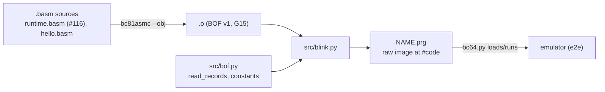

# Blink Reference Linker for BOF Objects Plan

**Plan Status**: `DRAFT - BLOCKED`

**Story Type**: `Internal`

**Plan Revision**: `A0`

> This plan captures **what** to build and **why**. It does not contain implementation code.
> It is blocked on a prerequisite that is not on `master` (see §1.2 and §3.2). The task breakdown in §4
> shows the intended shape once it lands. Once #116 is merged, re-check OQ-1 against its `runtime.basm`,
> close it, and flip this plan to `FINAL`.

---

## 1. Problem Statement

*   **Context**: Issue #117, roadmap step 35, the last step of phase 1 in `docs/analysis/08-self-hosted-roadmap.md`.
    `bc81asmc --obj` (#115, PR #187) writes BOF v1 objects (G15), and `src/bof.py` reads and dumps them. Nothing links them yet.
    `docs/03-compiler.md` still says "Linking is planned … today the whole program is one image (C5)".
*   **Goal**: `blink.py NAME` on the host, a reference linker that implements exactly the algorithm BLINK will use
    (`docs/analysis/07-self-hosted-compiler.md`, "What the linker does" and "Linker algorithm (BLINK)"). Real links
    prove the object format before BASM (phase 2) and BLINK (phase 3) copy it.
*   **In scope**: the linker (pass 1, mark, layout, size checks, pass 2), its errors, a size/sections report, unit tests,
    the AC-1 e2e test and the docs.
*   **Out of scope**: `bc --obj` (phase 3), `LIBB.L` libraries (doc 07 "later"), BLINK on the BC64, switching any disc
    build to linking, and the `disc full` check of doc 07 step 6. The host writes a host file and has no disc (D6).

### 1.1 Acceptance criteria (from the issue, verbatim)

*   **AC-1**: e2e: an assembly-only program (`runtime.basm` + a `hello.basm`) linked by `blink.py` runs on the emulator.
*   **AC-2**: Unit tests for every error, for dead-section dropping, `NEED` chains and the size checks.
*   **AC-3**: An out-of-range relative jump is reported by symbol name.
*   **AC-4**: Documented in `docs/03-compiler.md` (or a new linker section).

Facts closed directly from the issue's Proposal:
*   Search path: the main object's folder, then the library folder. `RUNTIME.O` always first; others only through `de` (`NEED`).
*   Pass 1 collects sections, globals, references and `ad` records. It reports duplicate and undefined symbols and conflicting `#code`/`#heap`/`#codelimit`.
*   Mark from the runtime entry and `F_main`, drop unreached sections, and lay out from `#code` (default `0x6000`). Define `__end` and `__heap`.
*   Size checks come before writing: over 32,640 bytes (`program too big`), and reaching `#heap`/`#codelimit`.
*   Pass 2 applies fixups (sign-magnitude `REL15`/`REL7` as the assembler encodes them) and writes the raw image.
*   Report the program size and the sections kept and dropped.

### 1.2 Why this is blocked

Verified on `origin/master` 70ab5f9 (2026-11-25):
*   The issue says **Depends on #113, #115, #116**. #113 (PR #183) and #115 (PR #187) are merged. **#116 is OPEN.**
    `git ls-tree origin/master` has no `runtime.basm` anywhere. A `/grind 116` run started on 2026-11-25 at 14:07 in a
    parallel session and is still at its spec-plan step.
*   AC-1 names `runtime.basm`, which is #116's deliverable. Several things blink depends on are still undecided, and #116
    decides them:
    *   the runtime **entry section**: the first section of the first linked object, a dead-code root placed at `#code`;
    *   how the runtime refers to `F_main`;
    *   how `sys_stackhead`/`sys_heaphead` (today emitted by `bc_stdlib.py`) become the linker-defined `__end`/`__heap`
        (doc 07: "`__end` … today's `sys_stackhead` sits there");
    *   where `RUNTIME.O` is built, which is blink's "library folder".
*   The roadmap orders step 34 (#116) before step 35 (#117). The owner set that order on 2026-11-19.
    Precedent: #118 bailed out with a blocked plan (PR #182) when its roadmap prerequisites weren't on `master`.
*   #188 (two-pass `--obj`) is also open and asked to land before #116. It does **not** block this story (D7).

The linker core (T1, T2) does not need #116 and could be built today against test objects. Shipping it before #116
would mean writing the AC-1 e2e against an invented runtime. That deviates from AC-1 and from the roadmap order, so
only the owner can choose it (OQ-2).

### 1.3 Technical Summary

*   **Touched areas**: new `src/blink.py` (next to `src/bof.py` and `src/ftool.py`); new tests in `src/tests/`; an e2e test
    and a `hello.basm` fixture; `docs/03-compiler.md`.
*   **New patterns / abstractions**: a two-pass linker on top of `bof.read_records`.
*   **Infrastructure changes**: None. `run_tests.py` already picks up `src/tests/test_*.py`. The e2e test is registered in
    `src/tests/e2e_areas.py` (README "Testing").
*   **End-state observable behaviour**: `python3 blink.py hello` (or with a path) writes `hello.prg`, a raw image for
    `#code`, and prints `blink: hello -> hello.prg, N bytes, K sections kept, D dropped`. Every link error is reported on
    stderr before any output is written, and the run exits 1.

---

## 2. Architecture & Design

### 2.1 Architecture Overview

#### C2 diagram



#### Flow diagram

```mermaid
sequenceDiagram
  participant CLI as blink.py NAME
  participant P1 as Pass 1
  participant M as Mark + layout
  participant C as Size checks
  participant P2 as Pass 2
  CLI->>P1: module list = [RUNTIME, NAME]
  P1->>P1: read each module, append NEED targets, collect sections/globals/refs/ad
  P1->>M: symbol table, sections, addresses
  M->>M: roots = SECTABS + entry; follow references; assign addresses from #code
  M->>C: image size, end address
  C->>P2: all checks pass
  P2->>P2: per kept section: CODE bytes + fixups -> image
  P2->>CLI: write NAME.prg, print report
```

### 2.2 External Contracts & Evidence

N/A — Internal story. The object format is the repo's own frozen contract: G15 in
`docs/specs/memory/design-decisions.md`, implemented by `src/bof.py` (record tags `TAG_*`, `FIX_*`, `ADDR_*`,
`LOCAL_LABEL_FLAG`, `read_records`, `dump`).

#### Source Conflict Log

| Topic | Source A | Source B | Conflict | Chosen Handling |
| :--- | :--- | :--- | :--- | :--- |
| Roots | Issue: "Mark from the runtime entry and `F_main`" | G15 / doc 07: roots are every `SECTABS` section plus the first section of the first linked object (the runtime entry stub, which refers to `F_main`) | The issue roots `F_main` directly; G15 reaches it through the entry stub | G15 rules: the frozen contract. An assembly-only program whose runtime entry doesn't refer to `F_main` keeps only what the entry reaches (D3) |
| Link-error stage | doc 07 step 6 lists `disc full` | the host writes a host file | — | Not checked on the host (D6) |
| Linking named as #121 | `docs/03-compiler.md` "Linking is planned (#121)" | Issue #117 is the linker | Doc pointer out of date | T4 rewrites that sentence |

### 2.3 Affected Areas

| Area / File (pointer) | Role in this change | Likely action |
| :--- | :--- | :--- |
| `src/bof.py` | Record reader (`read_records`), tags, fix kinds, `ADDR_*`, local-label flag, `BofWriter` (handy for building test objects) | Reference. Add a small shared helper only if needed; never change the format |
| `src/bc81asmc/` (G5 encoding of `jmr`/`jrx`/`clr`) | The assembler's sign-magnitude encoding and range limits that pass 2 must match byte for byte | Reference (reuse the encoder if it can be imported cleanly) |
| `src/blink.py` | The linker and its CLI | New |
| `src/tests/test_blink.py` | Unit tests (AC-2, AC-3) | New |
| `src/tests/test_e2e_*.py`, `src/e2e_harness.py`, `src/bc64/testdata/e2e/` | AC-1 e2e: assemble `runtime.basm` + `hello.basm` with `--obj`, link, run on the emulator | New test plus fixture |
| `src/bc/runtime.basm` (or `src/bdos/`; **from #116**) | The runtime entry section and the `__end`/`__heap` users | Reference (blocked, OQ-1) |
| `docs/03-compiler.md` | Linker section (AC-4); replaces "Linking is planned (#121)" | Change |
| `run_tests.py` area map (#175) | Make sure the new tests run in the right group/area | Check / small change |

### 2.4 Key Algorithms & Behaviour

Follows doc 07 steps 1–9 and G15. Rules:

*   **Module list**: starts `[RUNTIME, NAME]`. Pass 1 reads them in order and appends each `de` name not already
    listed. A name is found in the main object's folder first, then the library folder. A missing object is an error
    naming the module that needs it (`RUNTIME` and `NAME` are needed by the command line).
*   **Per object**: check the `b0` header and the version. Collect `ad` values (the same kind with a different value from
    another module is an error naming both modules), sections (kind, name, address for `SECTABS`, size), `GLOBL`
    (section, offset), local `LABEL`s, and each section's references (the `EXTRN` symbols and local labels its fix
    entries target). Fix targets follow G15: top bit clear means symbol k (the k-th `ee`), top bit set means local label n.
*   **Duplicates**: a global defined in two modules is an error naming both.
*   **Mark**: the roots are every `SECTABS` section plus the entry (the first section of the first linked object). Follow
    references transitively: a symbol goes to its defining section, a local label to the section that holds it. An
    undefined symbol used by a **marked** section is an error naming the user module. An undefined symbol used only by
    dropped sections is not an error.
*   **Layout**: marked `SECTSTAT` sections get addresses from `#code` (default `0x6000`) in module-list order, then
    section order. The entry comes first, so it lands at `#code`. `SECTABS` sections keep their address and are not part
    of the appended image (D4). `__end` is the address after the last placed byte. `__heap` is the `#heap` address. The
    linker defines both, and an object defining either is a duplicate-symbol error.
*   **Size checks** (all before any output is opened):
    *   image size over 32,640 bytes → `program too big` with the size;
    *   image end reaching `#heap` or `#codelimit` → error naming the address and the limit.

    The rule matches today's `.assert :sys_codeend < <heap>` and the `#codelimit` assert (#8).
*   **Pass 2**: for each kept section, copy its `CODE` bytes and apply the fix records that follow each `CODE` record.
    *   `ABS16`: the address of the 2-byte placeholder target.
    *   `HI8`/`LO8`/`HILO`: bytes of the target address. `HILO` puts the high byte at the offset and the low byte at
        offset + 2.
    *   `REL15`/`REL7`: sign-magnitude per G5, relative to the same base the assembler uses. A target out of range is an
        error naming the **symbol** (a local label is named by module and label number). This is AC-3, and it is
        detected before writing (D5).
*   **Output**: delete or overwrite `NAME.prg` only after every check passed. A failed link leaves the old file and
    writes nothing. Exit 0 with the one-line report. On error, print every error found, then exit 1.
*   **Determinism**: the same inputs give byte-identical output.

---

## 3. Key Decisions & Assumptions

*   **D1 — Host tool location and name**: `src/blink.py`, a top-level tool like `ftool.py`, reusing `src/bof.py`. Tests
    go in `src/tests/` (bc16 co-location rule: `src/` tools test in `src/tests/`). No new console entry point in
    `pyproject.toml`; that is left to a follow-up if the owner wants one.
*   **D2 — Output naming**: `NAME.prg` beside the main object, lower case like the other host outputs (`.o`, `.btap`).
    It is a raw image for `#code`, the `.PRG` format the disc programs already use.
*   **D3 — Roots per G15**: every `SECTABS` section plus the first section of the first linked object (the runtime
    entry). `F_main` is reached through the entry's references, not added as a separate root (Source Conflict Log).
*   **D4 — `SECTABS` sections**: always kept, placed at their own address, never moved, and not counted in the appended
    image size. If one overlaps the appended image, that is an error.
*   **D5 — All errors before output**: every check, including the AC-3 range check, runs before the output file is
    touched (doc 07: "a failed link never leaves a partial `.PRG`"). The relative-jump range check needs final
    addresses, so it runs as a resolve step between layout and writing, or pass 2 builds the image in memory and
    writes it only at the end. Either way, nothing is written on error.
*   **D6 — No `disc full` check** on the host: there is no disc. BLINK on the BC64 will have it (phase 3).
*   **D7 — #188 independence**: blink handles every G15 record, whether or not a `REL7`/`REL15` fixup or `LABEL` record is
    present. BOF v1 does not change with #188 ("No change to the BOF v1 layout"), so blink is correct for both one-pass
    and two-pass `--obj` output. Unit tests build objects directly (e.g. with `BofWriter`), not only through the assembler.
*   **D8 — Error format**: `blink: error: <message>` on stderr. Each message names the modules or symbol involved. The
    exit code is 1, matching the other tools' clean-error style (C6, the assembler's diagnostics).

### 3.1 Decision Lock

| Constant / Policy | Selected Value | Why | Where it lives |
| :--- | :--- | :--- | :--- |
| Default `#code` | `0x6000` | Issue, doc 07 | blink |
| Max image size | 32,640 bytes (255 sectors) | Issue, file-system limit | blink size check |
| First module | `RUNTIME` (always, no `#link`) | Issue, doc 07 | module list |
| Module search | main object's folder, then the library folder | Issue | blink (library folder: OQ-1) |
| Linker-defined symbols | `__end`, `__heap` | Issue, doc 07 | blink |
| Partial output on error | never | doc 07 | blink (D5) |

### 3.2 Open Questions

| Question | Impact if wrong | Resolution Attempt | Owner / Follow-up |
| :--- | :--- | :--- | :--- |
| **OQ-1**: What is the runtime contract blink links against? That is, the name of `runtime.basm`'s entry section and how it reaches `F_main`, which runtime globals become `__end`/`__heap` (today's `sys_stackhead`/`sys_heaphead`), and where `RUNTIME.O` is built (the "library folder"). | AC-1 can't be written or checked. `__end`/`__heap` semantics and the search path could be designed against a runtime that #116 then shapes differently. | Checked `origin/master` 70ab5f9: there is no `runtime.basm`. #116 is OPEN; its `/grind` started 2026-11-25 14:07 and hasn't produced a plan. Doc 07 gives intent only ("`__end` … today's `sys_stackhead` sits there"). `bc_stdlib.py` still emits `sys_stackhead`/`sys_heaphead` as labels. | #116 (in progress). Close this when #116 merges, then re-run `/grind 117` on this branch |
| **OQ-2**: Should #117 ship before #116, with the linker core (T1–T2) and an AC-1 e2e against a test-fixture runtime, then switch to the real `runtime.basm` later? | That would deviate from AC-1 (which names `runtime.basm`) and from the owner-set roadmap order (step 34 before 35). | AC text and roadmap 08 both say #116 first. No comment on #117 relaxes it. | Owner |

---

## 4. Task Breakdown

| Task | Title | Depends on | Complexity |
| :--- | :--- | :--- | :--- |
| `T1` | Pass 1, mark and layout: module list, `NEED`, search path, `ad`, duplicates, undefined, dead sections, `__end`/`__heap`, size checks | OQ-1 (library folder, `__end`/`__heap` contract) | `High` |
| `T2` | Pass 2: fixups (all six kinds, G5 sign-magnitude), range errors by symbol name, image write, report, CLI | `T1` | `High` |
| `T3` | AC-1 e2e: `runtime.basm` + `hello.basm` → `--obj` → `blink.py` → runs on the emulator | `T2`, #116 | `Medium` |
| `T4` | Docs: linker section in `docs/03-compiler.md` (and 02's `--obj` section pointer) | `T2` | `Low` |

### T1 — Pass 1, mark and layout

*   **Goal**: from `NAME`, build the module list, read every object, and produce the kept sections with their addresses,
    the global symbol table including `__end`/`__heap`, or the full list of pass-1/mark/size errors.
*   **Depends on**: OQ-1 (only the library-folder default and the `__end`/`__heap` contract; the rest is fixed by G15).
*   **Complexity**: `High`. This is the format's first consumer; mistakes here are the ones BLINK would copy.
*   **Pointers**: `src/bof.py`; G15; doc 07 "What the linker does" steps 1–6 and "Linker algorithm (BLINK)"; §2.4.
*   **Definition of Done**:
    *   The module list starts `RUNTIME`, `NAME`, follows `NEED` chains transitively without duplicates, and searches
        the main folder, then the library folder.
    *   These are each reported, naming the modules involved: missing object (naming the module that needs it), bad
        header/version, conflicting `ad`, duplicate global, undefined symbol used by a kept section, size over 32,640,
        end reaching `#heap`/`#codelimit`.
    *   Dead sections are dropped: only sections reachable from the `SECTABS` sections and the entry are kept.
    *   Kept sections are laid out from `#code` (default `0x6000`) with the entry first.
*   **Tests expected** (unit, `src/tests/`):
    *   one test per error;
    *   a `NEED` chain of 3 or more modules, including a cycle and a duplicate need;
    *   dead-section dropping (unreferenced, referenced only by a dropped section, and an undefined symbol used only by a
        dropped section is not an error);
    *   `#code` default and override;
    *   each size check, at the boundary and one byte over.
*   **Tests to modify**: None.

### T2 — Pass 2, output and CLI

*   **Goal**: turn T1's layout into the raw image, report out-of-range relative jumps by name, write `NAME.prg` only when
    the link is clean, and print the report.
*   **Depends on**: `T1`.
*   **Complexity**: `High`. Byte-exact relocation and G5 encoding.
*   **Pointers**: G15 fix records; G5; the assembler's relative-jump encoder in `src/bc81asmc/`; §2.4, D5, D8.
*   **Definition of Done**:
    *   All six fix kinds patch correctly, for symbol and local-label targets, across and within sections.
    *   `REL15`/`REL7` are byte-identical to what the assembler emits for the same distance.
    *   An out-of-range relative jump is an error naming the symbol (AC-3).
    *   On any error, no file is created and an old `NAME.prg` is untouched.
    *   `blink.py NAME` prints `size, kept, dropped`, and the output is deterministic.
*   **Tests expected** (unit):
    *   each fix kind;
    *   `REL7`/`REL15` at ± the limits and one past each (the error names the symbol);
    *   equivalence: a multi-section `.basm` assembled flat vs assembled with `--obj` and linked gives the same bytes at
        the same address, where the layout allows;
    *   no partial output on error;
    *   CLI exit codes and messages.
*   **Tests to modify**: None.

### T3 — AC-1 e2e

*   **Goal**: an assembly-only `hello.basm` plus #116's `runtime.basm`, each assembled with `bc81asmc --obj`, linked by
    `blink.py`, loaded and run on the emulator, printing its greeting.
*   **Depends on**: `T2`, #116 merged.
*   **Complexity**: `Medium`.
*   **Pointers**: `src/e2e_harness.py`, an existing `src/tests/test_e2e_*.py` as model, `src/bc64/testdata/e2e/`; how
    `.PRG` programs are run in e2e today.
*   **Definition of Done**: the e2e test builds both objects, links them, runs the program and checks its output. It is
    registered in `src/tests/e2e_areas.py` (area `assembler`), and in `HAPPY` (linking is a main flow from now on). Build outputs stay untracked (#90).
*   **Tests expected**: one e2e happy-path test (tier happy).
*   **Tests to modify**: None.

### T4 — Docs

*   **Goal**: document `blink.py` (AC-4).
*   **Depends on**: `T2`.
*   **Complexity**: `Low`.
*   **Pointers**: `docs/03-compiler.md` ("Linking is planned (#121)"); `docs/02-assembler.md` `--obj` section; `src/CLAUDE.md` / tool tables if they list tools.
*   **Definition of Done**: the command line, search path, module list, roots, dead-section dropping, `__end`/`__heap`,
    size checks, the error list and an example run are documented. The out-of-date #121 sentence is fixed. No test
    parses the doc (owner rule).
*   **Tests expected**: none.
*   **Tests to modify**: None.

---

## 5. Verification

*   During development: `python3 run_tests.py --group unit`, `--group e2e --tier happy`, `--group e2e --changed origin/master`.
*   Before push: the full suite, `python3 run_tests.py < /dev/null`.
*   Observable: `bc81asmc --obj` on `runtime.basm` and `hello.basm`, then `blink.py hello`, then `hello.prg` runs on
    `bc64.py` and prints its greeting. A deliberately broken input (missing `NEED`, out-of-range `jmr`) gives a named
    error and no output file.

---

## 6. Fact-Integrity Checklist

| Check | Yes / No / N/A | Notes |
| :--- | :--- | :--- |
| External contracts verified from producer/contract source | N/A | Internal; the BOF contract is G15 + `src/bof.py` |
| Evidence sources are reproducible | N/A | Internal |
| Identifier directionality / ordering / freshness meaning evidenced | N/A | Internal |
| Every `Assumption` is linked to an Open Question (§3.2) | Yes | The runtime contract is OQ-1 |
| No unresolved Open Questions (for `FINAL`) | No | OQ-1 (#116), OQ-2 (owner) |
| Each Decision states a single committed approach | Yes | |
| Tasks are independent, each with a Definition of Done and test expectations | Yes | |
| Required infra reflected | N/A | No toggles or infra |

**Self-review note**: The linker algorithm is fully specified by G15 and doc 07, and T1/T2 could start today. What is
missing is #116's runtime contract (entry section, `__end`/`__heap`, where `RUNTIME.O` lives), and AC-1 names
`runtime.basm` itself. So the plan is blocked, not the design. When #116 merges, read its `runtime.basm` and plan,
fill OQ-1 into §2.4 and D-decisions, and flip to `FINAL`. Take extra care to keep pass 2's G5 encoding identical to the
assembler's (reuse it, don't re-derive it), and to report every error before any output is written.
