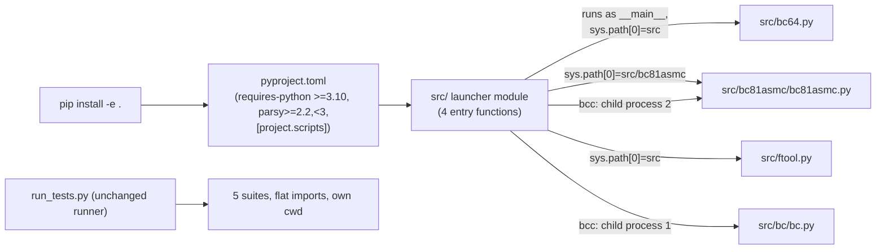
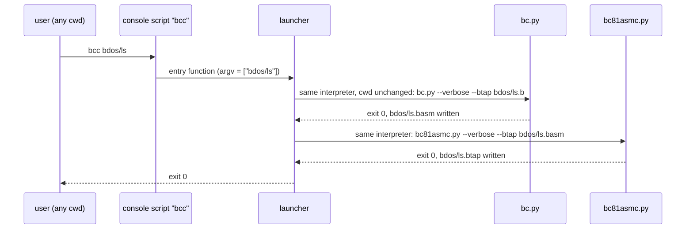

# Assembler Modernisation: Replace the Python 3.7 Pipfile with a Top-Level `pyproject.toml` Plan

**Plan Status**: `FINAL`

**Story Type**: `Internal`

**Plan Revision**: `A0`

> This plan captures **what** to build and **why** — domain, architecture, decisions, and verified facts.
> It deliberately does **not** contain implementation code, pseudocode, line numbers, mock setups, or test bodies.
> The implementation agent discovers the **how** against live code. See §4 Task Breakdown.

---

## 1. Problem Statement

*   **Context**: The only packaging file is `src/bc81asmc/Pipfile` (+ `Pipfile.lock`), which pins **Python 3.7** (EOL June 2023) and declares `parsy` for the assembler alone. Since #50 there is also a root `requirements.txt` (`parsy>=2.2`) that CI and the docs use. Nothing declares the supported Python version, and there are no installable commands: every tool is started as `python3 <path>/<script>.py` from a specific directory, because the code uses **flat imports** (`from bc81asmc_ast import *`, `from bc64 import bc64_io`). `bcc` (compile + assemble) and `ftool` exist only as bash scripts in `src/` (`ftool` calls `winpty python`).
*   **Goal**: one standard project definition at the repo root — `pyproject.toml` — so that `pip install -e .` in a fresh virtual environment installs `parsy` and four console commands, `bc64`, `bc81asmc`, `bcc`, `ftool`, that work from any directory on any OS; `requires-python = ">=3.10"`; all suites pass on Python 3.10 and 3.14; a full rebuild through the new commands is byte-identical; the Pipfile is gone and the docs show the new install and test commands.
*   **In scope**: root `pyproject.toml`; a small launcher module behind the four console scripts; deleting `src/bc81asmc/Pipfile`, `src/bc81asmc/Pipfile.lock` and the root `requirements.txt`; CI install step; `run_tests.py`'s missing-parsy hint; docs (root `CLAUDE.md`, `README.md`, `docs/README.md`, `docs/01-emulator.md`, `docs/02-assembler.md`, `docs/03-compiler.md`, `docs/05-bdos.md` where it shows commands, `src/*/CLAUDE.md`, `docs/specs/memory/design-decisions.md` G10/G11).
*   **Out of scope**: converting the components to package imports (flat imports stay, see D2); rewriting the bash build scripts (`buildos`, `buildtools`, `buildapps`, `makedisc`, `run`, `ftool`, `bcc`) or removing `winpty` from them — that is the cross-platform `build.py` story (`docs/analysis/06-toolchain.md`, next step 1); non-editable (`pip install .`) or wheel/PyPI distribution; `release/` (frozen, G9 — its own Pipfiles stay); `docs/analysis/*` (dated analysis snapshots, left as written); refreshing the long-stale `bcos.btap` (see §2.2).

### 1.1 Technical Summary

*   **Touched projects**: repo root (`pyproject.toml`, `run_tests.py` hint, CI workflow), a new launcher module in `src/`, docs. No component source (emulator, assembler, compiler, ftool) changes.
*   **New patterns / abstractions**: a launcher module whose four entry functions run the existing scripts exactly as `python <script>` would (script directory first on `sys.path`, the script as `__main__`, the caller's working directory and arguments unchanged).
*   **Infrastructure changes**: CI installs with `pip install -e .` instead of `pip install -r requirements.txt`.
*   **End-state observable behavior**: in a fresh venv, `pip install -e .` → `bc64 <rom> …`, `bc81asmc [--verbose] [--btap] file.basm`, `bcc path/name` (compile `name.b` + assemble `name.basm`, like `./bcc`) and `ftool <cmd> …` work from any directory and produce exactly what the script invocations produce; `python run_tests.py` passes on 3.10 and 3.14.

---

## 2. Architecture & Design

### 2.1 Architecture Overview

#### Involved components & owners

| Component | Technical Owner |
| :--- | :--- |
| Packaging (`pyproject.toml`, launcher), CI, docs | repo owner (bcichonski) |
| emulator / assembler / compiler / ftool scripts | unchanged — only invoked |

#### C2 diagram

#### Flow diagram

### 2.2 External Contracts & Evidence

`N/A — Internal story`. No external API or repository is involved.

#### Verified facts (spikes and reads on base `5c819f5`)

| Fact | Source / evidence |
| :--- | :--- |
| Flat imports: `bc64.py`/`ftool.py` import `from bc64 import …` (package `src/bc64/`), `bc81asmc.py` imports `bc81asmc_ast`/`bc81asmc_grammar`/`bc81asmc_diag` flat, `bc.py` imports `bc_ast`/`bc_grammar` flat | `src/bc64.py`, `src/ftool.py`, `src/bc81asmc/bc81asmc.py`, `src/bc/bc.py` import lines |
| `bc64.py`, `bc81asmc.py`, `bc.py` have `if __name__ == "__main__"` blocks (argparse, `-h` works); `ftool.py` runs at module top level, prints `[DBG]:ftool v1.0` + a usage complaint and exits 0 with no arguments | ran each script on base |
| `./bcc X` = `bc.py --verbose --btap X.b`, stop with "Error" and its exit code on failure, then `bc81asmc.py --verbose --btap X.basm`; paths are relative to the caller's cwd | `src/bcc` |
| Editable install of a **src-layout** (`package-dir = {"" = "src"}`) adds `src/` itself to the venv's `sys.path` via a static `.pth` (so `bc`, `bc64`, `ftool`, … become importable top-level names); works with setuptools ≥64 from `pip install -e .` on `python:3.10-slim` (pip 23) and `python:3.14-slim` | spike in Docker, scratch project |
| `parsy` latest is 2.2 (versions 2.0–2.2 in the 2.x line); the code already requires ≥2.2 (`requirements.txt`) | `pip index versions parsy`, `requirements.txt` |
| `requirements.txt` is referenced by `.github/workflows/tests.yml` (install + pip cache key), root `CLAUDE.md`, `design-decisions.md` G11, and `run_tests.py`'s missing-parsy message; no test asserts that message | `git grep requirements.txt`; `src/test_run_tests.py` |
| `run_tests.py` partitions `src/test_*.py`: every module not `test_e2e_*`/`test_bc64_smoke`/`test_ftool` goes into the **emulator** suite automatically; suite list and order are asserted by `src/test_run_tests.py` | `run_tests.py` `select_src_modules`, `src/test_run_tests.py` |
| CI `unit` already runs on 3.10 and 3.14, `e2e` on 3.14 | `.github/workflows/tests.yml` |
| A full rebuild (python3 equivalent of `buildos`/`buildtools`/`buildapps`/`makedisc`) on recent bases differs from the commit in exactly one file, `src/bc81asmc/bcOS/bcos.btap` (stale since 2024; the `.b81` ROM is identical) | #7 plan §2.2 and its T3 result; #10 plan |

#### Source Conflict Log

| Topic | Source A | Source B | Conflict | Chosen Handling |
| :--- | :--- | :--- | :--- | :--- |
| Where `parsy` is declared | Issue: Pipfile is "the only place any dependency is declared" | Repo: root `requirements.txt` added by #50 | Two declarations today | `pyproject.toml` becomes the only one: delete both the Pipfile (+ lock) and `requirements.txt` (D5). |
| "Test configuration so one command runs all three suites" | Issue proposal | Repo: `run_tests.py` (since #48) already runs all five suites with one command; `unittest` has no `pyproject` config section | Nothing to add in pyproject for tests | `python run_tests.py` stays the one test command; pyproject adds no test tool config (D6). |
| "A full rebuild … is byte-identical" | AC-4 | Repo: `bcos.btap` already differs from a rebuild at base | A rebuild can't match the commit byte-for-byte in that one file today | AC-4 is met when the new commands produce **exactly the same bytes as the old script invocations** for every output, and every output other than the pre-existing `bcos.btap` drift equals the commit. `bcos.btap` is not refreshed here (unrelated churn, G3), same as #7/#10. |

### 2.3 Affected Areas

| Area / File (pointer) | Role in this change | Likely action |
| :--- | :--- | :--- |
| `pyproject.toml` (root) | project metadata, `requires-python`, `parsy` pin, `[project.scripts]`, setuptools config (src-layout, launcher module only) | New |
| `src/bc64_toolchain.py` | launcher: four entry functions `bc64`, `bc81asmc`, `bcc`, `ftool` | New |
| `src/test_bc64_toolchain.py` | launcher tests (picked up by the emulator suite) | New |
| `src/bc81asmc/Pipfile`, `src/bc81asmc/Pipfile.lock`, `requirements.txt` | superseded declarations | Delete |
| `run_tests.py` | missing-parsy hint names `requirements.txt` | Change (message only) |
| `.github/workflows/tests.yml` | install step + pip cache key use `requirements.txt` | Change |
| `CLAUDE.md`, `README.md`, `docs/README.md`, `docs/0[1-5]-*.md`, `src/bc/CLAUDE.md`, `src/bc64/CLAUDE.md`, `src/bc81asmc/CLAUDE.md`, `src/bdos/CLAUDE.md` | install/run/test commands | Change |
| `docs/specs/memory/design-decisions.md` G10, G11 | "no packaging" trade-off, `pip install -r requirements.txt` usage | Change |
| `src/bcc`, `src/ftool`, build scripts | unchanged; still work as before | Reference |
| `.gitignore` | already ignores `*.egg-info/`, `build/`, `dist/` | Reference |

### 2.4 Key Algorithms & Behaviour

*   **Launcher rule (single-script commands `bc64`, `bc81asmc`, `ftool`)**: locate the script relative to the launcher's own file (never the cwd); make the script's directory the first `sys.path` entry; set `sys.argv` to the script path followed by the user's arguments; run the script as `__main__` in-process; return/propagate its exit status (a `SystemExit` from the script becomes the command's exit code; falling off the end is exit 0). The caller's working directory is not changed, so relative file arguments, `--tape-dir`, `cpudebug.log`, `bc64.dmp` and output files land exactly where `python <path>/<script>.py` would put them. Stdin/stdout/stderr are untouched (the emulator stays interactive; piped stdin still works).
*   **`bcc` rule**: one positional argument — the source path **without** the `.b` extension, relative to the cwd, as `./bcc` takes it; `-h` prints usage. Step 1 runs the compiler with `--verbose --btap <name>.b` in a **child process of the same interpreter** (`sys.executable`); on a non-zero exit it prints `Error` and exits with that code, without assembling. Step 2 runs the assembler with `--verbose --btap <name>.basm` the same way and exits with its code. Child processes keep the two flat-import tools in separate interpreters, as the bash script does.
*   **Source tree missing**: if the launcher can't find a script next to itself (e.g. a non-editable install), it exits non-zero with a one-line message saying to install with `pip install -e .` from a checkout — no traceback.
*   **No behaviour change in the tools**: the scripts themselves are not edited; the output of every command is byte-identical to the script invocation with the same arguments.

---

## 3. Key Decisions & Assumptions

*   **D1 — Launcher module, not package imports.** The four entry points live in one new module `src/bc64_toolchain.py` that runs the existing scripts (§2.4). *Why*: the issue allows keeping flat imports; converting to package imports touches every component and every test suite's import lines and working directory, which is far beyond this story and would put test-guarded tests in play. The launcher needs zero changes to component code.
*   **D2 — Flat imports and the per-directory test commands stay exactly as they are.** `python3 bc64.py …` from `src/`, the bash scripts, and every suite command keep working unchanged.
*   **D3 — Editable install is the supported install (`pip install -e .`).** `[tool.setuptools]` uses `package-dir = {"" = "src"}` and lists only the launcher module (`py-modules`), so nothing else is packaged. A non-editable install is not supported; the launcher fails with a clear message (§2.4). The editable src-layout puts `src/` on the venv's `sys.path` (verified, §2.2); this matches what the flat imports already assume and no `src/` name collides with the standard library or `parsy`, so it is accepted.
*   **D4 — `pyproject.toml` content.** Build backend setuptools (`setuptools>=64`, PEP 660 editable); `name = "bc64"`; `version = "1.0.0"` (static); `requires-python = ">=3.10"`; `dependencies = ["parsy>=2.2,<3"]`; `[project.scripts]` maps `bc64`, `bc81asmc`, `bcc`, `ftool` to the launcher's functions; short description, MIT license (as `LICENSE`), `readme = "README.md"`.
*   **D5 — One dependency declaration.** Delete `src/bc81asmc/Pipfile`, `src/bc81asmc/Pipfile.lock` and the root `requirements.txt`; CI, docs and `run_tests.py`'s hint switch to `pip install -e .`. `release/**/Pipfile*` stay (frozen, G9).
*   **D6 — `python run_tests.py` stays the one test command.** No pytest, no `[tool.*]` test section; the runner already covers all suites. The docs present it as the test command right after `pip install -e .`.
*   **D7 — CI.** Both jobs install with `pip install -e .` and key the pip cache on `pyproject.toml`. The `unit` job (3.10 and 3.14) adds a step that runs the four installed commands from outside the repo checkout root (`bc64 --help`, `bc81asmc --help`, `bcc --help`, and `ftool` with no arguments, which prints its version) and fails if any command is missing or exits non-zero. The e2e job stays on 3.14 only (the 3.10 e2e check is a one-time acceptance check in T4, §5).
*   **D8 — Build scripts unchanged.** `bcc`, `ftool`, `buildos`, `buildtools`, `buildapps`, `makedisc`, `run` are not edited; the docs show the console commands as the portable way and keep the scripts as the existing Git Bash way. Removing `winpty` is the `build.py` story.
*   **D9 — Docs**: `docs/analysis/*` are dated analysis snapshots and are not rewritten. `docs/CHANGELOG.md` belongs to the changelog generator and is not edited here.
*   **Assumption A1 (no OQ needed, low stakes)**: the name `bcc` may shadow an unrelated system `bcc` (e.g. Bruce's C compiler) — inside an activated venv the venv's `bin` comes first, which is the documented usage. Recorded, not changed.

### 3.1 Decision Lock (Constants & Policies)

| Constant / Policy | Selected Value | Why | Where it lives |
| :--- | :--- | :--- | :--- |
| `requires-python` | `>=3.10` | issue proposal; CI matrix 3.10/3.14 | `pyproject.toml` |
| `parsy` pin | `parsy>=2.2,<3` | major-version pin; 2.2 already required | `pyproject.toml` |
| Console scripts | `bc64`, `bc81asmc`, `bcc`, `ftool` | issue proposal | `pyproject.toml` → `src/bc64_toolchain.py` |
| `bcc` compiler/assembler flags | `--verbose --btap` for both steps | identical to `src/bcc` | launcher |
| Supported install | `pip install -e .` (editable) | AC-1; flat imports need the source tree | docs, launcher message |
| Test command | `python run_tests.py` (from repo root) | already the single runner | docs |

### 3.2 Open Questions

No open questions.

Resolution attempts: "test configuration" — closed from the repo (`run_tests.py` exists, D6). "Flat imports vs package imports" — closed from the issue text ("make sure the flat imports still work, or switch …"), D1. "Byte-identical rebuild" vs the stale `bcos.btap` — closed from the #7/#10 precedent and G3 (§2.2 conflict log). `requirements.txt` — closed by the issue's goal of one standard project definition (D5).

---

## 4. Task Breakdown

| Task | Title | Depends on | Complexity |
| :--- | :--- | :--- | :--- |
| `T1` | `pyproject.toml`, launcher module and its tests; delete the old declarations | — | `Medium` |
| `T2` | CI installs the project and checks the four commands | `T1` | `Low` |
| `T3` | Docs and design decisions show the new install, run and test commands | `T1` | `Medium` |
| `T4` | Acceptance checks: fresh venv on 3.10/3.14, all suites, byte-identical rebuild | `T1` | `Medium` |

### T1 — `pyproject.toml`, launcher module and its tests; delete the old declarations

*   **Goal**: `pip install -e .` installs `parsy` and the four commands, which behave exactly like the scripts (§2.4); the Pipfile, its lock and `requirements.txt` are gone.
*   **Depends on**: `—`.
*   **Complexity**: `Medium`.
*   **Pointers**: new root `pyproject.toml` (D4, §3.1); new `src/bc64_toolchain.py`; new `src/test_bc64_toolchain.py`; `src/bcc` (behaviour to mirror); `run_tests.py` missing-parsy message; delete `src/bc81asmc/Pipfile`, `src/bc81asmc/Pipfile.lock`, `requirements.txt`.
*   **Definition of Done**:
    *   `pyproject.toml` matches D4/§3.1; setuptools packages only the launcher module (no auto-discovery of `src/` packages);
    *   the launcher implements §2.4 for all four commands, finds scripts relative to its own file, works from any cwd, propagates exit codes, and prints the one-line message when the source tree is missing;
    *   `run_tests.py`'s missing-parsy hint says `pip install -e .` (no other runner change);
    *   the three files are deleted; `git grep -n "requirements.txt\|Pipfile" -- ':!release' ':!docs/analysis' ':!docs/specs/plans' ':!docs/CHANGELOG.md'` only shows hits T2/T3 will change (workflow, docs);
    *   `python3 run_tests.py < /dev/null` from the repo root passes (the sandbox has no `venv` module: run the launcher tests without installing; T4 does the real install).
*   **Tests expected** (unit, `src/test_bc64_toolchain.py`, silent, temp dirs only; they must run **without** the project installed, by calling the launcher module from the source tree in a child process of `sys.executable`):
    *   `bcc` on a small B program in a temp dir (copy what it `#include`s, as `test_e2e_toolchain.py` does) produces `.basm` and `.btap` byte-identical to running `bc.py --verbose --btap` then `bc81asmc.py --verbose --btap` directly, and runs from a cwd outside `src/`;
    *   `bcc` stops after a compile error with a non-zero exit and writes no `.btap`;
    *   `bc81asmc` on a small `.basm` gives the same `.btap` and exit code as the script; an assembler error gives the script's non-zero exit code;
    *   `ftool btap2bin` gives the same bytes as `ftool.py btap2bin`;
    *   `bc64 --help` exits 0, and a short headless `bc64` run (e.g. `--no-floppy` with scripted input and `--max-instructions`) gives the same output file and exit code as `bc64.py`;
    *   the missing-source-tree path gives a non-zero exit and the install hint, without a traceback.
*   **Tests to modify**: `None`.

### T2 — CI installs the project and checks the four commands

*   **Goal**: CI uses the project definition, so the install path is exercised on every PR.
*   **Depends on**: `T1`.
*   **Complexity**: `Low`.
*   **Pointers**: `.github/workflows/tests.yml` (both jobs' install step and `cache-dependency-path`).
*   **Definition of Done**: both jobs run `pip install -e .` and cache on `pyproject.toml`; the `unit` job (3.10 + 3.14) has a step running `bc64 --help`, `bc81asmc --help`, `bcc --help` and `ftool` from a directory outside the checkout root (e.g. `$RUNNER_TEMP`), failing on a missing command or non-zero exit (D7); nothing else in the workflow changes; the workflow passes `actionlint` (`docker run --rm -v "$PWD":/repo -w /repo rhysd/actionlint:latest`).
*   **Tests expected**: none in Python; `actionlint` clean; the PR's CI run is the check.
*   **Tests to modify**: `None`.

### T3 — Docs and design decisions show the new install, run and test commands

*   **Goal**: every doc that tells a reader how to install, run or test shows `pip install -e .`, the four commands and `python run_tests.py`; nothing mentions the Pipfile or `requirements.txt`.
*   **Depends on**: `T1`.
*   **Complexity**: `Medium`.
*   **Pointers**: root `CLAUDE.md` (build pipeline/conventions, the commands block, "only dependency" line), `README.md` (add a short "Getting started": venv, `pip install -e .`, run the emulator, build a program, run the tests; Python ≥3.10), `docs/README.md` quick start, `docs/01-emulator.md` (running section; the `winpty` note), `docs/02-assembler.md` (`pip install parsy` usage block), `docs/03-compiler.md` (running + the Python-dependency line), `docs/05-bdos.md` build section, `src/bc/CLAUDE.md`, `src/bc64/CLAUDE.md`, `src/bc81asmc/CLAUDE.md`, `src/bdos/CLAUDE.md`, `docs/specs/memory/design-decisions.md` G10 (packaging now exists: `pyproject.toml`, Python ≥3.10, editable install, console commands; the `winpty` wart remains in the bash scripts) and G11 (`pip install -e .`).
*   **Definition of Done**: the docs above show the new commands (console command form; keep the existing script/`python3 path/script.py` forms where they document the flat-import working-directory rules, the per-suite commands and the bash build scripts, D2/D8); state Python ≥3.10 and the supported OSes plainly; no doc outside `release/`, `docs/analysis/`, `docs/specs/plans/` and `docs/CHANGELOG.md` mentions `Pipfile` or `requirements.txt` or `pip install parsy`; every command shown was run once to check it (record which in the task notes).
*   **Tests expected**: none (docs only); `python3 run_tests.py < /dev/null` still passes.
*   **Tests to modify**: `None`.

### T4 — Acceptance checks: fresh venv on 3.10/3.14, all suites, byte-identical rebuild

*   **Goal**: evidence for AC-1, AC-2 and AC-4 on the finished branch, without changing any build output.
*   **Depends on**: `T1`.
*   **Complexity**: `Medium`.
*   **Pointers**: Docker images `python:3.10-slim` and `python:3.14-slim` (the sandbox has no `venv` module); `src/buildos`, `buildtools`, `buildapps`, `makedisc` (the command lists to mirror); `src/fcat0800.sector`; memory note: the bash scripts are CRLF in the sandbox worktree (`core.autocrlf`), run them as `bash <(tr -d '\r' < script)` or mirror their command lists.
*   **Definition of Done**:
    *   in each image: copy the worktree to a temp dir inside the container (don't write into the shared worktree as root), create a fresh venv, `pip install -e .` succeeds, and from a directory outside the repo the four commands run (`--help`, plus `bcc` building a program and `ftool btap2bin` on it);
    *   in each image: `python run_tests.py < /dev/null` (all groups, e2e included) passes;
    *   rebuild check in a temp copy on 3.14: a full rebuild using only the console commands (`bc81asmc`, `bcc`, `ftool`, in the order of `buildos` → `buildtools` → `buildapps` → `makedisc`) produces outputs byte-identical to the same rebuild with the old `python3 <script>` invocations, and equal to the committed files except the pre-existing `bcos.btap` drift (§2.2); nothing from the rebuild is committed;
    *   the results (commands, Python versions, test totals, diff result) go in the agent's report and the task's sidecar notes; no results file is added to the repo.
*   **Tests expected**: none added; this task only runs checks. If a check fails, report `Blocked` with the evidence rather than changing code outside T1's files.
*   **Tests to modify**: `None`.

---

## 5. Verification

*   **Unit + e2e**: `python3 run_tests.py < /dev/null` from the repo root — `ALL PASSED` (local 3.14).
*   **Python 3.10 and 3.14, fresh venv**: T4's Docker checks — `pip install -e .`, the four commands from outside the repo, `python run_tests.py < /dev/null` passes in both.
*   **Rebuild**: T4's rebuild check — new commands ≡ old invocations byte-for-byte; vs commit only the pre-existing `bcos.btap` drift; `git status` clean afterwards.
*   **No component change**: `git diff --stat origin/bc64 -- src/bc64 src/bc64.py src/bc81asmc/*.py src/bc src/ftool.py src/bdos src/bc81asmc/bcOS` is empty (the only `src/bc81asmc` change is the Pipfile deletion).
*   **Old files gone**: `src/bc81asmc/Pipfile`, `src/bc81asmc/Pipfile.lock`, `requirements.txt` don't exist; `git grep -nE "Pipfile|requirements\.txt|pip install parsy" -- ':!release' ':!docs/analysis' ':!docs/specs/plans' ':!docs/CHANGELOG.md'` is empty.
*   **CI**: the PR's `tests` workflow (`unit (3.10)`, `unit (3.14)`, `e2e`) is green, including the new command check.

---

## 6. Fact-Integrity Checklist

| Check | Yes / No / N/A | Notes |
| :--- | :--- | :--- |
| External contracts verified from producer/contract source — not story text | N/A | Internal story |
| Evidence sources are reproducible (exact repo file path/symbol) | N/A | Internal story; local facts in §2.2 cite files and spikes |
| Identifier directionality / ordering / freshness meaning evidenced | N/A | Internal story |
| Every `Assumption` is linked to an Open Question (§3.2) | Yes | A1 is low-stakes and does not affect correctness |
| No unresolved Open Questions (for `FINAL`) | Yes | |
| Each Decision states a single committed approach | Yes | D1–D9 |
| Tasks are independent, each with a Definition of Done and test expectations | Yes | T2–T4 depend only on T1 |
| Required infra reflected (toggle / bicep) | N/A | no toggle, no Service Bus |

**Self-review note**: The editable-install behaviour was spiked in Docker on 3.10 and 3.14, and the script interfaces were run on base. The main risk is the launcher subtly changing how a script runs: `sys.path[0]`, `sys.argv[0]` and `__main__` must match a direct `python <script>` run, and `bc64` must keep stdin/tty behaviour (interactive and piped). The tests compare the launcher's output with the direct script invocation byte for byte. The rebuild check must compare new commands against old invocations, not just against the commit, because `bcos.btap` is already stale.
