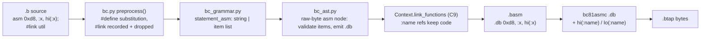
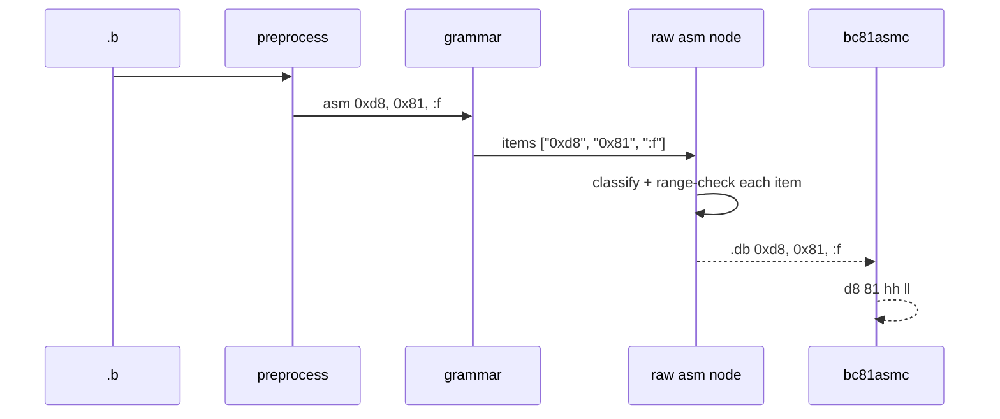

# Compiler: Raw-Byte `asm` Statement and `#link` Plan

**Plan Status**: `FINAL`

**Story Type**: `Internal`

**Plan Revision**: `A0`

> This plan captures **what** to build and **why** — domain, architecture, decisions, and verified facts.
> It deliberately does **not** contain implementation code, pseudocode, line numbers, mock setups, or test bodies.
> The implementation agent discovers the **how** against live code. See §4 Task Breakdown.

---

## 1. Problem Statement

*   **Context**: B code can only drop to assembly through `asm "…"`, a text string copied verbatim into the
    `.basm`. The self-hosting roadmap (`docs/analysis/08-self-hosted-roadmap.md`, phase 3, step 38) replaces
    it with a **raw-byte** `asm` statement that BCC (the compiler on the BC64) can handle without an
    assembler, plus a `#link name` line that names the objects a header needs
    (`docs/analysis/07-self-hosted-compiler.md`, "Raw `asm` in B" and "What the linker does"). Neither
    exists today: `asm 0xd8, 0x81;` and `#link util` are both syntax errors.
*   **Goal**: the host compiler `bc` accepts
    *   `asm item, item, …;` where an item is a number 0–255 or a `#define` name (1 byte), `:name`
        (2 bytes), or `hi(:name)` / `lo(:name)` (1 byte), and compiles it to one `.db` line;
    *   `#link name`, which has no effect on the output (it is accepted and remembered for `--obj`).

    `asm "…"` keeps working unchanged. Existing programs compile byte-identical.
*   **In scope**: the grammar, AST node and errors in `bc`; `#link` in `bc.py preprocess()`; the
    assembler `.db` operands `hi(:name)` / `lo(:name)` that the `.db` output needs (see D2); tests; docs.
*   **Out of scope**:
    *   `bc --obj` and everything it writes — `ABS16`/`HI8`/`LO8` fixups for the items and the `de` (NEED)
        record for `#link` — belongs to **#121** (step 39), whose issue lists "`#link` → `de`". `bc` has no
        `--obj` today, so the issue's "with it, a `de` record" can only be done there. (Not a deviation:
        the issue itself says `#link` has "no effect without `--obj`".)
    *   `#link` in the assembler (#114), `bc81asmc --obj` fixups (#115), removing `asm "…"` (#127).
    *   Using the new statement in any existing B source (that is #122–#125).

### 1.1 Technical Summary

*   **Touched projects**: compiler `src/bc/` (grammar, AST, preprocessor), assembler `src/bc81asmc/`
    (`.db` operand forms), docs `docs/03-compiler.md`, `docs/02-assembler.md`,
    `docs/specs/memory/design-decisions.md`.
*   **New patterns / abstractions**: one new statement AST node for raw-byte `asm`; a per-compile list of
    `#link` names in the preprocessor.
*   **Infrastructure changes**: None.
*   **End-state observable behavior**: `asm 0xd8, :poke16, hi(:x), lo(:x);` in a function produces
    `.db 0xd8, :poke16, hi(:x), lo(:x)` in the `.basm`, which `bc81asmc` assembles to
    `d8 HH LL hh ll` (labels high byte first); bad items give `file: error: …` and exit 1; `#link util`
    changes nothing in the output; every existing program's `.basm` and every built output is unchanged.

---

## 2. Architecture & Design

### 2.1 Architecture Overview

#### Involved components & owners

| Component | Technical Owner |
| :--- | :--- |
| `bc` compiler (`src/bc/`) | repo owner (bcichonski) |
| `bc81asmc` assembler (`src/bc81asmc/`) | repo owner (bcichonski) |

#### C2 diagram

#### Flow diagram

### 2.2 External Contracts & Evidence

N/A — Internal story.

#### Source Conflict Log

| Topic | Source A | Source B | Conflict | Chosen Handling |
| :--- | :--- | :--- | :--- | :--- |
| `.db` output for `hi(:name)` / `lo(:name)` | Issue: "Without `--obj` it compiles to `.db` lines" | `bc81asmc` `.db` accepts only `:label`, `'string'`, `0xHH` (`paramdb` in `bc81asmc_grammar.py`) | the `.db` the issue asks for cannot be assembled today | D2: add `hi(:name)` / `lo(:name)` as `.db` operands in the assembler (it already has `emit_hi8addr` / `emit_lo8addr`, used by `.mv`) |
| `#link` → `de` record | Issue: "a `de` record with it [`--obj`]" | Issue #121 AC: "`#link` → `de`"; `bc` has no `--obj` | the record can't be written before #121 | D5: #120 parses, validates and stores `#link` names; #121 writes them |
| `:name` byte order | 07 "Raw asm in B": `:name` is "2 bytes, high byte first" | `.db :label` emits `emit_hi8addr` then `emit_lo8addr` (`DB.emit`, `bc81asmc_ast.py`); G6 big-endian | none — they agree | `.db :name` as is |

### 2.3 Affected Areas

| Area / File (pointer) | Role in this change | Likely action |
| :--- | :--- | :--- |
| `src/bc/bc_grammar.py` (`statement_asm`) | parses `asm "…"` today | Change: `asm` + quoted string (unchanged, still `STATEMENT_ASM`) **or** `asm` + item list → new node |
| `src/bc/bc_ast.py` (`STATEMENT_ASM`, `Context.add_error`, `asm_labels`/`LABEL_REF`) | statement nodes, error reporting, C9 reachability | New: raw-byte asm node (validates, emits one `.db`); reference only: `LABEL_REF` already finds `:name` inside `hi(:name)` |
| `src/bc/bc.py` (`preprocess`, `parse_define`, `IDENTIFIER`, `codeLimit` reset pattern) | directives | Change: `#link NAME` handled like the other directives (validated, recorded per compile, dropped from the source) |
| `src/bc81asmc/bc81asmc_grammar.py` (`paramdb`, `labelstr`) and `bc81asmc_ast.py` (`DB.emit`, `emit_hi8addr`/`emit_lo8addr`) | `.db` operands | Change: add `hi(:name)` / `lo(:name)` operand forms |
| `src/bc81asmc/bc81asmc_listing.py` | `--lst` / `--map` (#9) | Reference: a `.db` with the new operands must list like any other `.db` |
| `src/bc/tests/` (`bc_tests.py`, `bc_define_tests.py`, `bc_dce_tests.py`, `bc_assert_tests.py` — has an in-process `assemble()` helper, `bc_codegen_tests.compile_source`) | compiler tests | New test module(s); existing ones keep passing |
| `src/bc81asmc/tests/` (`bc81asmc_emit_tests.py` `.db` label tests, `bc81asmc_compile_diag_tests.py`, `bc81asmc_diag_tests.py`) | assembler tests | New tests |
| `docs/03-compiler.md` (preprocessor table with `#define`; statements table "inline asm" row; link-step section) | compiler reference | Change |
| `docs/02-assembler.md` (`.db` directive) | assembler reference | Change |
| `docs/specs/memory/design-decisions.md` (A3 usage list, C5/C9) | standing decisions | New A12, C10; A3's directive bullet points to A12 |

### 2.4 Key Algorithms & Behaviour

**Raw-byte `asm` statement**
*   **Syntax**: the keyword `asm`, at least one space or tab, then one or more items separated by commas,
    then `;`. If the first non-blank character after `asm` is `"`, it is today's `asm "…"`, unchanged.
    `asm;` (no items) stays what it is today (an expression statement reading a variable `asm`), and an
    identifier that merely starts with `asm` (e.g. `asmfoo(1);`) is never taken as the keyword.
*   **Items** (after `#define` substitution, which already happens in code — D3):
    *   a number: B decimal (`0`, `129`; no leading zeros) or `0x` hex of any digit count; value 0–255;
        emitted as `0x{:02x}`;
    *   `:name` (`name` = B identifier): emitted as `:name`, 2 bytes, high byte first;
    *   `hi(:name)` / `lo(:name)`, blanks allowed around the parentheses and the label: emitted as
        `hi(:name)` / `lo(:name)`, 1 byte each;
    *   anything else is an error (D4). A `#define` name whose value is not one of the forms above is an
        error in the same way, reported with the substituted text.
*   **Output**: exactly one line `.db item, item, …` per statement, in source order, items separated by
    `, `, with the indentation the compiler uses for `asm "…"` lines. No other code around it: like
    `asm "…"`, the bytes run in order with the generated code, and `csci` holds what the previous B
    statement left there.
*   **Errors** are collected through `Context.add_error` (C6: `<file>: error: <message>` on stderr, exit 1,
    no `.basm` written); every bad item in a statement is reported, not just the first.
*   **Reachability (C9)**: the `.db` line sits inside its function's chunk, so `asm_labels` sees `:name` and
    `hi(:name)` / `lo(:name)` references; a function or runtime fragment referenced only from a raw
    `asm` item is kept. No change to the link step is expected — a test proves it.

**`#link name`**
*   A source line (after stripping) starting with `#link` followed by whitespace: the rest is exactly one
    B identifier. Recorded in a per-compile list (reset on every `preprocess()`, like `codeLimit`), in
    first-seen order, duplicates kept once; also accepted inside `#include`d files (they are inlined
    before directive handling). The line is removed from the preprocessed source; no `#define`
    substitution is applied to the name. Without `--obj` the list is not used, so the output is
    unchanged; it is traced with `--verbose`.
*   `#link` with no name, more than one token, or a name that is not an identifier → error
    `malformed #link (expected: #link NAME): <line>`, exit 1 (same path as a malformed `#define`).

**Assembler `.db hi(:name)` / `lo(:name)`**
*   New `.db` operand forms, lowercase, written `hi(:name)` / `lo(:name)` (blanks inside the parentheses
    allowed; the compiler writes none). Each emits one byte: the high / low byte of the label's address,
    resolved in pass 2 like `.db :name` and `.mv` (forward and backward references, `.def` names).
*   An unknown label is the same positioned error as for `.db :name`. Mixed with the other operands in
    one `.db` line.

---

## 3. Key Decisions & Assumptions

*   **D1 — No dependency on phase 1.** Roadmap step 38 sits after phase 1 (#114–#117, not started), but
    everything #120 delivers is the non-`--obj` behaviour, and the issue's only declared dependency is
    #19 (closed). The `--obj` side (fixups, `de`) is #121's. So the story proceeds now.
*   **D2 — The assembler learns `hi(:name)` / `lo(:name)` in `.db`.** The issue requires `.db` output,
    and `.db` can't express a single address byte today. It is an operand form, not an expression
    language (A3 stays: no arithmetic, no `:label+n`), and it reuses the hi/lo emission `.mv` already has.
    The same spelling as the B item keeps the compiler a pass-through. Recorded as decision **A12**;
    A3's directive bullet gets a pointer to it.
*   **D3 — `#define` names reach the items through the existing substitution.** Defines are already
    replaced as whole identifiers in code (#19, C5), so `asm 0xd8, OUTCS;` arrives as `asm 0xd8, 0x81;`.
    A consequence, documented, not special-cased: a define whose name equals a label used as `:name`
    replaces it too (as in `asm "…"` strings today).
*   **D4 — Lenient parse, strict validation.** The grammar takes each item as raw text up to the next `,`
    or `;`, and the AST node classifies and validates it, so errors name the item instead of being a
    parsy "expected …" at a column. Locked wording in §3.1.
*   **D5 — `#link` is recorded, not acted on.** The names are kept per compile for #121 to write as `de`
    records; nothing else reads them yet.
*   **D6 — Char literals are not items.** "A number 0–255" is read as the decimal and `0x` forms; `'a'`
    is an unknown item. This keeps the item set what 07 lists for BCC. (Assumption, low stakes: easy to
    add later if the owner wants it; flagged in the PR.)
*   **D7 — Compiler decision C10** records the raw-byte statement and `#link` (syntax, `.db` output,
    errors, "no effect without `--obj`", the `--obj` mapping to `ABS16`/`HI8`/`LO8`/`de` owned by #121).
    Check `origin/master`'s last `### A` / `### C` ids right before the PR (open PR #183 adds G15/G16
    only).
*   **Assumption — byte-identity is checked on built outputs**, not only `.basm`: no existing source uses
    the new forms, so the `.basm` of every program and the 28 built outputs (`*.b81/*.btap/*.sector(s)/*.bdd`)
    must match a build of the base commit, and `scripts/code_size.py --check` must report no change.
    No `code_size.csv` rows are recorded.

### 3.1 Decision Lock (Constants & Policies)

| Constant / Policy | Selected Value | Why | Where it lives |
| :--- | :--- | :--- | :--- |
| `.db` line for a raw `asm` | `.db ` + items joined by `, `; numbers `0x{:02x}`; labels `:name`, `hi(:name)`, `lo(:name)` | A3 fixed-width hex; compiler is a pass-through | raw asm AST node |
| Out-of-range error | `raw asm: <item> is out of range (0-255)` | names the offending text | raw asm AST node |
| Unknown item error | `raw asm: unknown item '<item>' (expected a number 0-255, :name, hi(:name) or lo(:name))` | lists the accepted forms | raw asm AST node |
| Malformed `#link` error | `malformed #link (expected: #link NAME): <line>` | mirrors the `#define` message | `bc.py preprocess()` |
| `#link` name rule | one B identifier (`[A-Za-z_][A-Za-z0-9_]*`) | object names come from identifiers in 07 (`util`, `std`, `stda`) | `bc.py` |
| Decision ids | A12 (assembler), C10 (compiler) | next free on master b5096b5 | `design-decisions.md` |

### 3.2 Open Questions

No open questions.

---

## 4. Task Breakdown

| Task | Title | Depends on | Complexity |
| :--- | :--- | :--- | :--- |
| `T1` | Assembler: `.db hi(:name)` / `lo(:name)` | — | `Medium` |
| `T2` | Compiler: raw-byte `asm` statement and `#link` | `T1` | `Medium` |
| `T3` | Docs: compiler reference and decision C10 | `T1` | `Low` |

### T1 — Assembler: `.db hi(:name)` / `lo(:name)`

*   **Goal**: `bc81asmc` assembles `hi(:name)` and `lo(:name)` as `.db` operands, one byte each.
*   **Depends on**: `—`.
*   **Complexity**: `Medium`.
*   **Pointers**: `src/bc81asmc/bc81asmc_grammar.py` (`paramdb`, `labelstr`), `src/bc81asmc/bc81asmc_ast.py`
    (`DB`, `MV` for the hi/lo emission, `label_name`), `src/bc81asmc/bc81asmc_listing.py`,
    `src/bc81asmc/CLAUDE.md`, `docs/02-assembler.md` (`.db`), `docs/specs/memory/design-decisions.md`
    (A3, new **A12**).
*   **Definition of Done**:
    *   `.db hi(:x), lo(:x)` emits the high then low byte of `x`'s address; works for backward and
        forward labels and `.def` names, mixed with `0xHH`, `'text'` and `:label` operands;
    *   an unknown label in `hi(…)` / `lo(…)` is the same positioned diagnostic as `.db :nowhere`;
    *   existing `.db` forms, `--lst` and `--map` unchanged; all built outputs byte-identical;
    *   `docs/02-assembler.md` documents the forms; decision A12 added and A3's directive bullet refers
        to it.
*   **Tests expected**: assembler unit tests (emit tests: bytes for backward/forward/`.def`/mixed
    operands; diagnostics: unknown label position). `python3 run_tests.py --group unit` green.
*   **Tests to modify**: None.

### T2 — Compiler: raw-byte `asm` statement and `#link`

*   **Goal**: `bc` compiles `asm item, …;` to one `.db` line with validated items and accepts `#link NAME`
    with no effect on the output, per §2.4.
*   **Depends on**: `T1` (the assemble-the-output tests need `hi`/`lo` in `.db`).
*   **Complexity**: `Medium`.
*   **Pointers**: `src/bc/bc_grammar.py` (`statement_asm`, `statement` alternatives order), `src/bc/bc_ast.py`
    (`STATEMENT_ASM`, `Context.add_error`, `asm_labels`), `src/bc/bc.py` (`preprocess`, `parse_define`,
    `codeLimit` reset), `src/bc/CLAUDE.md` ("How it works": preprocessor bullet, add the raw asm node),
    tests in `src/bc/tests/` (`compile_source` in `bc_codegen_tests.py`, `assemble` in
    `bc_assert_tests.py`, `bc_dce_tests.py` for the reachability style, `bc_define_tests.py`).
*   **Definition of Done**:
    *   every item kind compiles to the `.db` form in §3.1; a whole statement is one `.db` line in place;
    *   a `#define` name item works (number value) and a define with a non-item value is an error;
    *   out-of-range numbers (decimal and hex) and unknown forms (identifier, char literal, expression,
        `hi(name)` without `:`, empty item) give the locked messages via `Context.add_error`; exit 1,
        no `.basm` written; several bad items in one statement are all reported;
    *   `asm "…"` parses to the same node and output as before; `asmfoo(1);` and `asm;` behave as
        before;
    *   a function referenced only from a raw `asm` `:name` or `hi(:name)` item is kept by the C9 link
        step;
    *   `#link NAME` (also from an `#include`d file) is accepted and recorded per compile without changing
        the `.basm`; malformed `#link` lines give the locked error;
    *   the compiler output of a program using every item kind assembles with the real `bc81asmc`
        to the expected bytes (labels high byte first);
    *   every existing program compiles byte-identical (`python3 scripts/code_size.py --check` after a
        build reports no change).
*   **Tests expected**: compiler unit tests (grammar: both `asm` forms, keyword boundary; codegen: each
    item kind, the define item, every error; DCE: kept through a raw item; `#link`: accepted, no output
    change, include, malformed, reset between compiles) plus one compile-and-assemble test that checks
    the emitted bytes. Use new test files in `src/bc/tests/` (`*_tests.py`); add imports on new lines.
    Run `python3 run_tests.py --group unit`, `--group e2e --tier happy`, `--group e2e --changed origin/master`.
*   **Tests to modify**: None.

### T3 — Docs: compiler reference and decision C10

*   **Goal**: `docs/03-compiler.md` documents the raw-byte `asm` statement and `#link`; decision C10 is
    recorded.
*   **Depends on**: `T1` (both edit `design-decisions.md`).
*   **Complexity**: `Low`.
*   **Pointers**: `docs/03-compiler.md` (preprocessor directives table, statements table "inline asm" row,
    link-step section on `asm` labels), `docs/specs/memory/design-decisions.md` (C5, C9, new **C10**),
    `docs/analysis/07-self-hosted-compiler.md` "Raw `asm` in B" (source of the design; link to it, don't
    copy it).
*   **Definition of Done**:
    *   `docs/03-compiler.md` has a `#link NAME` directive row (no effect without `--obj`, recorded for
        #121) and a raw-byte `asm` statement row/section: item forms, the `.db` output, the errors, the
        `#define` behaviour (D3), char literals not accepted (D6), that labels referenced in items count
        for the link step, and that `asm "…"` stays until #127;
    *   decision **C10** written in the file's style (Purpose / Rationale / Usage / Trade-offs), naming
        the `--obj` mapping (`ABS16` / `HI8` / `LO8`, `#link` → `de`) as #121's;
    *   no edits to other stories' decisions or to unrelated docs.
*   **Tests expected**: none (docs only). Do not add tests that read docs text.
*   **Tests to modify**: None.

---

## 5. Verification

*   **Unit**: `python3 run_tests.py --group unit < /dev/null` — all green (assembler and compiler suites
    include the new tests).
*   **e2e**: `python3 run_tests.py --group e2e --tier happy < /dev/null` and
    `--group e2e --changed origin/master` during development; the full `python3 run_tests.py < /dev/null`
    once before the PR.
*   **Byte identity**: build the base commit (`git archive origin/master` into the scratchpad) and this
    branch (`cd src && ./buildos && ./buildtools && ./buildapps && ./makedisc`); the sha256 of every
    `*.b81/*.btap/*.sector/*.sectors/*.bdd` matches; `python3 scripts/code_size.py --check` exit 0.
*   **Observable behaviour**: a small `.b` with `asm 0xd8, 0x81, :f, hi(:f), lo(:f);` and `#link util`
    compiles to a `.basm` containing `.db 0xd8, 0x81, :f, hi(:f), lo(:f)` and no trace of `#link`, and
    assembles to the expected bytes; `asm 256;` and `asm foo;` fail with the locked messages.

---

## 6. Fact-Integrity Checklist

| Check | Yes / No / N/A | Notes |
| :--- | :--- | :--- |
| External contracts verified from producer/contract source | N/A | Internal story |
| Evidence sources are reproducible | N/A | Internal story |
| Identifier directionality / ordering / freshness meaning evidenced | N/A | Internal story |
| Every `Assumption` is linked to an Open Question (§3.2) | Yes | D6 and the byte-identity assumption are low-stakes and decided; no correctness blocker |
| No unresolved Open Questions (for `FINAL`) | Yes | |
| Each Decision states a single committed approach | Yes | |
| Tasks are independent, each with a Definition of Done and test expectations | Yes | T2 waits for T1 only for the assemble test |
| Required infra reflected (toggle / bicep) | N/A | |

**Self-review note**: the main uncertainty was whether phase 1 must land first; the issue's own scope
(no `--obj`) and #121's AC settle it (D1). The `.db` output needs a small assembler extension (D2), which
is the one place this story touches a second component. Take care with the grammar: the new alternative
must not capture `asm "…"`, `asm;` or identifiers starting with `asm`, and errors must go through
`Context.add_error` so every bad item is reported and no `.basm` is written.

---

## 7. Amendment Log

| Revision | Request | Decision | Plan changes |
| :--- | :--- | :--- | :--- |
