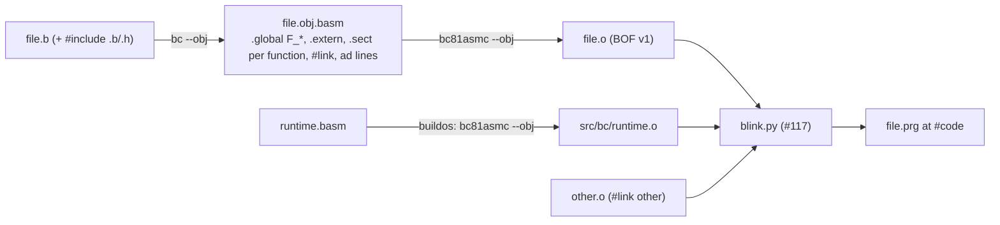

# Compiler --obj Writes BOF Objects Plan

**Plan Status**: `DRAFT - BLOCKED`

**Story Type**: `Internal`

**Plan Revision**: `A0`

> This plan captures **what** to build and **why**. It does not contain implementation code.
> Blocked on **#117** (`blink.py`, OQ-1): AC-1 needs `blink.py`, which is not on `master` on 2026-11-27. #117's
> own plan was made `FINAL` the same day, and its implementation was in progress in a parallel /grind run. The design below
> follows that plan's linker contract (entry placement, `__end`/`__heap`, roots), so once #117 is merged
> this plan only needs re-checking against the merged code (OQ-2), not rewriting.

---

## 1. Problem Statement

*   **Context**: Issue #121, roadmap step 39 (phase 3, `docs/analysis/08-self-hosted-roadmap.md`), design in
    `docs/analysis/07-self-hosted-compiler.md` "Host prerequisites" item 2. The pieces it builds on are on `master`:
    BOF v1 and the ABI (#113, G15/G16), `bc81asmc --obj` (#115, A14), `runtime.basm` (#116, C11), raw `asm` and
    `#link` (#120, C10), labels without `nop` (#104, C7). Today `bc` writes one flat image per program (C5):
    function labels are generated (`FNAME0001`), the runtime is pasted in, and `#link` is recorded but changes nothing.
*   **Goal**: `bc --obj file.b` writes `file.o`, a BOF v1 module that `blink.py` (#117) links with `RUNTIME.O` and other
    modules into a program that runs.
*   **In scope**: `bc --obj` (an object-mode `.basm` plus `bc81asmc --obj`), `F_name` symbols, externals from prototypes,
    one section per function with its strings, `de`/`ad` records, the runtime entry stub in `runtime_entry`,
    tests, and `docs/03-compiler.md`.
*   **Out of scope**: switching disc builds to linking (#122+), library split (`.h` + `.o`, roadmap item 5),
    `G_name` globals (the compiler rejects globals), moving `asm "…"` (#127), #188's two-pass `--obj`.

### 1.1 Acceptance criteria (from the issue, verbatim)

*   **AC-1**: `helloworld` built by `bc --obj` + `blink.py` runs; so does a program of two modules joined by `#link`.
*   **AC-2**: Output identical across runs.
*   **AC-3**: Without `--obj` the output is unchanged.
*   **AC-4**: `docs/03-compiler.md` documents `--obj`.

Facts closed from the issue's Proposal: `.o` goes through `.basm` and `bc81asmc --obj`; `name` → global `F_name`;
a prototype without a body → external reference; one section per function, strings after its code; `#link` → `de`;
`#code`/`#heap`/`#codelimit` → `ad`; runtime helpers are external references to `RUNTIME.O`.

### 1.2 Prerequisites (verified on `origin/master` ed66a75, 2026-11-27)

*   Closed: #104, #113, #115, #116, #120.
*   **Open: #117** (`blink.py`). Draft PR #189 was `[BLOCKED]` on #116. Its plan
    (`117-Blink-Reference-Linker-Bof-Objects.md` on branch `ai/feature/117-…`) is now `FINAL`: roots = `SECTABS` +
    the runtime entry + `F_main`'s section; `F_main`'s section follows the entry (D10); blink defines `__end` (address
    after the last placed byte) and `__heap` (the `#heap` value) (D12); library folder `src/bc/`; output `NAME.prg`.
*   **Open: #188** (two-pass `--obj`). It changes `.o` bytes but not the BOF v1 layout. This story stays correct
    across it. Tests pin structure and the run result, not `.o` bytes (as #116 did). AC-2 compares two runs of the same build.
*   The assembler writes `de` from a `#link` line (`bc81asmc_obj.py`, A13/A14), but has **no syntax for `ad`**.

### 1.3 Technical Summary

*   **Touched areas**: `src/bc/bc.py` (CLI, `--obj`), `src/bc/bc_ast.py` (object-mode emit: labels, sections,
    externs, entry), `src/bc/bc_stdlib.py` + `src/bc/runtime.basm` (entry stub in `runtime_entry`, program cells),
    `src/bc81asmc/` (an `ad` source form), tests in `src/bc/tests/`, `src/bc81asmc/tests/` and an e2e test in
    `src/tests/`, `docs/03-compiler.md`, `docs/02-assembler.md`, design decisions.
*   **End-state observable behaviour**: `python3 bc/bc.py --obj bdos/helloworld.b` writes `helloworld.o`. Then
    `python3 blink.py bdos/helloworld` writes a `.prg` that prints `Hello world!` and `10` on the emulator. A flat compile
    writes the same `.basm` as before.

---

## 2. Architecture & Design

### 2.1 Architecture Overview

#### C2 diagram



#### Flow diagram

```mermaid
sequenceDiagram
  participant BC as bc --obj
  participant AS as bc81asmc --obj
  participant BL as blink.py
  BC->>BC: compile as today, but label functions F_name, keep each function's strings beside it
  BC->>BC: no runtime paste, no entry stub, no tail; .extern for runtime + prototype names
  BC->>AS: write object-mode .basm, run assembler in --obj mode
  AS-->>BC: file.o (ee/91/55/c0/fixups/de/ad)
  BL->>BL: RUNTIME first; runtime_entry -> F_main; NEED chain; __end/__heap
```

### 2.2 External Contracts & Evidence

N/A — Internal story. The contracts are the repo's own: G15 (BOF v1), G16 (ABI, `F_name`), C10, C11, A13, A14, and
#117's linker rules (its plan, OQ-2).

#### Source Conflict Log

| Topic | Source A | Source B | Conflict | Chosen Handling |
| :--- | :--- | :--- | :--- | :--- |
| Who holds the entry stub | C11: "the program entry stub moves into `runtime_entry` in #121" | Flat `bc` emits the stub before the functions | Flat output must not change (AC-3) | The stub goes into `runtime_entry`. Flat mode keeps emitting today's stub from `bc_ast.py` and takes only the 8-byte head from the entry section (D4) |
| `sys_stackhead`/`sys_heaphead` | C11: `.extern` in `runtime.basm`, defined per program by `bc`'s tail | #117 D12: linker defines `__end`/`__heap` | There are no aliases in BOF v1 | D5 |
| `ad` source form | Issue: `#code`/`#heap`/`#codelimit` → `ad` | `bc81asmc` has no `ad` syntax | Missing piece | D6 |
| Function labels | G16: `F_name` | `get_function_call_label` truncates to 10 chars, upper-cases and numbers | Flat output must not change | Object mode only (D2) |

### 2.3 Affected Areas

| Area / File (pointer) | Role in this change | Likely action |
| :--- | :--- | :--- |
| `src/bc/bc.py` | CLI (`--btap` today), `#link` collection (`linkNames`), `#code`/`#heap`/`#codelimit` parsing | Add `--obj`. Write `.obj.basm`, run the assembler in obj mode |
| `src/bc/bc_ast.py` | `Context` (labels, `link_functions` DCE, `add_stdlib`, `add_preamble`), `PROGRAM.emit` (entry stub), `FUNCTION_DECLARATION` (prototypes, labels), `EXPRESSION_CALL` | Object-mode switches |
| `src/bc/bc_stdlib.py`, `src/bc/runtime.basm` | Runtime loader / entry section / program cells | Entry stub in `runtime_entry`. Flat mode still gets only the head |
| `src/bc81asmc/bc81asmc_pre.py`, `bc81asmc_obj.py`, `src/bof.py` | Pre-pass and obj writer, `BofWriter.addr` | Add the `ad` source form (D6) |
| `src/bc/tests/`, `src/bc81asmc/tests/` | Unit tests | Add |
| `src/tests/test_e2e_*.py`, `src/tests/e2e_areas.py` | AC-1 e2e (compiler area) | Add and register |
| `docs/03-compiler.md`, `docs/02-assembler.md`, `docs/specs/memory/design-decisions.md` | AC-4. New decision C12 (and A15 for `ad`). Re-check ids before the PR | Change |
| `scripts/code_size.py`, `src/bc/code_size.csv` | AC-3 proof (`--check` delta 0, no "code changed") | Run only |

### 2.4 Key Algorithms & Behaviour

*   **Object mode is a second emit mode of the same compiler.** Parsing, scopes, codegen templates and the DCE input are
    shared. The mode changes only labels, layout and what is pasted. `--obj` with `--btap` is a usage error.
*   **Symbols**: a function with a body is the global `F_name` (full name, case kept, no number), and its section is named `F_name`.
    A prototype without a body is `.extern F_name`. Runtime labels that generated code or `asm` strings reference
    (`poke16`, `printstr`, `stackvarget8`, `os_metacall`, …) are `.extern`. Jump/data labels inside a function stay local.
*   **Sections**: one `.sect F_name` per function, in source order. Its code is followed by its strings and data
    (today's per-chunk `data` slice, `Context.chunks`). Dead-code elimination is the linker's job in object mode: every
    function with a body is written (D3).
*   **Declarations come first** (A14 one-pass rule): all `.global`, `.extern` and `#link` lines go before the first `.sect`.
*   **Records from directives**: each `#link NAME` → a `#link NAME` line → `de` (module name upper-cased, as the
    assembler does). `#code`/`#heap`/`#codelimit` → `ad` kinds 0/1/2, written where they appear, repeats included (G15).
*   **Entry and program cells** (D4, D5): `runtime_entry` becomes head + stub. The stub sets the stack head from
    `__end`, the heap head from `__heap`, `cal :F_main`, then `kil`. The linker places it at `#code` with `F_main`'s section after it.
*   **Determinism**: no time, path or set-order dependence in the `.basm` or `.o`. Building twice gives identical bytes (AC-2).
*   **Flat mode unchanged**: `code_size.py --check` must report delta 0 and no "code changed" for every program (AC-3).

---

## 3. Key Decisions & Assumptions

*   **D1 — CLI and files**: `bc --obj file.b` writes `file.obj.basm` (generated header like every bc output, ignored by
    git) and runs `bc81asmc --obj` on it to get `file.o` beside the source. Module name = the source stem, upper-cased by the
    assembler as today. *Assumption*: a separate `.obj.basm` name so a flat `.basm` and an object `.basm` of the same
    program never overwrite each other. Check that `.gitignore` and the CI "tracked `X.basm` beside `X.b`" guard cover it.
*   **D2 — `F_name` only in object mode**: flat mode keeps its generated labels (AC-3). Object mode uses the full B name. A
    B name over the assembler's label-length limit is an error naming the function. *Assumption*: no truncation, since a
    truncated global could collide across modules.
*   **D3 — No compiler DCE in object mode**: `link_functions` is skipped. Every defined function becomes a section, and
    blink drops the unused ones (G15). This matches "one section per function makes dead-code elimination exact".
*   **D4 — Entry stub in `runtime.basm`**: the stub moves into `runtime_entry` (C11 says so). `bc_stdlib.py` splits the
    entry section so flat mode still emits only the banner + 8-byte head, and `bc_ast.py` keeps writing the flat stub.
    The stub ends with `kil`, as with today's default `hardkill`.
*   **D5 — `sys_stackhead`/`sys_heaphead` in a linked program**: `runtime.basm` gets a data section for the heap-head cell
    (a 2-byte global `sys_heaphead`) and uses `__end` as the stack-head cell (in flat code `sys_stackhead` is the last
    label of the image, with the stack after it). The runtime's references switch to these names, with flat mode
    substituting today's names when it pastes the text, so the flat output stays identical. *Assumption* resting on #117
    D12 (`__end`, `__heap` are linker globals). Re-check against the merged blink (OQ-2).
*   **D6 — `ad` in the assembler**: `bc81asmc`'s pre-pass accepts `#code ADDR`, `#heap ADDR`, `#codelimit ADDR` lines (the
    same spelling as B) and, in `--obj` mode, writes an `ad` record where each appears. In flat mode the line is dropped. A
    flat program's `.org` still comes from bc. New decision A15.
*   **D7 — Two-module AC-1 program**: a new fixture, a main module that `#link`s a second B module and calls a function
    of it through a prototype, plus that module. Each is compiled with `bc --obj`, and the result is checked on the emulator. Kept light (G13).
*   **D8 — How AC-1 runs**: the e2e test links to a `.prg` and runs it the way #117's AC-1 test runs a linked program
    (re-use its harness helper). *Assumption*: reuse rather than invent. Depends on OQ-1/OQ-2.
*   **D9 — Decision records**: C12 (object mode of `bc`), A15 (`ad` lines). C5's note "superseded by G16 from phase 3"
    gets a pointer to C12. Re-check the last ids on `origin/master` before the PR.

### 3.1 Decision Lock

| Constant / Policy | Selected Value | Why | Where it lives |
| :--- | :--- | :--- | :--- |
| Function symbol | `F_name`, full name | G16 | bc object mode |
| Object `.basm` name | `file.obj.basm` | D1 | bc.py |
| Section per | function (code, then its strings) | Issue, G15 | bc object mode |
| Stub end | `kil` | today's `hardkill` default | runtime.basm |
| Flat output | byte-identical | AC-3 | `code_size.py --check` |

### 3.2 Open Questions

| Question | Impact if wrong | Resolution Attempt | Owner / Follow-up |
| :--- | :--- | :--- | :--- |
| **OQ-1**: `blink.py` (#117) is not on `master`. AC-1 ("built by `bc --obj` + `blink.py` runs") can't be met or tested without it. | AC-1 unmet, or a plan built on a linker that changes when it merges | Checked 2026-11-27: #117 OPEN, PR #189 draft, its plan `FINAL` and a /grind 117 run active on `ai/feature/117-…`. Stacking on an unmerged, in-progress branch was rejected: the roadmap order puts #117 first, and the memory rule says bail out when a phase needs the earlier step's artifacts | Owner / re-run `/grind 121` after #117 merges |
| **OQ-2**: D5/D8 rest on #117's plan (D10 F_main after entry, D12 `__end`/`__heap`), not on merged code | Wrong stub or cell names; a re-plan | Read #117's FINAL plan | Re-check against merged `src/blink.py` on the re-run, then flip to FINAL |

---

## 4. Task Breakdown

> Valid once OQ-1/OQ-2 are closed. Re-check `Tests to modify` against master at that time.

### T1 — `ad` lines in bc81asmc

*   **Goal**: the assembler pre-pass accepts `#code`/`#heap`/`#codelimit ADDR`. `--obj` writes an `ad` record where each appears, and flat mode ignores it (D6).
*   **Depends on**: —
*   **Complexity**: Low
*   **Files**: `src/bc81asmc/bc81asmc_pre.py`, `bc81asmc_obj.py`, `src/bof.py` (reference), `docs/02-assembler.md`, design decision A15.
*   **Definition of Done**: `--dump` shows `ADDR` records at the right place, in order, with repeats. A malformed line is a positioned error. Flat outputs are byte-identical.
*   **Tests**: assembler unit tests: each kind, repeats, malformed, flat no-op.
*   **Tests to modify**: None

### T2 — Entry stub and program cells in `runtime.basm`

*   **Goal**: `runtime_entry` = head + stub (`__end`, `__heap`, `cal :F_main`, `kil`), heap-head cell per D5. The flat paste is unchanged (D4).
*   **Depends on**: —
*   **Complexity**: Medium
*   **Files**: `src/bc/runtime.basm`, `src/bc/bc_stdlib.py`, the runtime tests in `src/bc/tests/`.
*   **Definition of Done**: `./buildos` builds `runtime.o` whose entry section references `F_main`, `__end` and `__heap`. `code_size.py --check` delta 0, no code change.
*   **Tests**: compiler unit tests on the parsed runtime (entry split, new externs/globals).
*   **Tests to modify**: to be listed on the re-run: any `src/bc/tests/` test pinning `runtime_entry`'s section content or the externs list (C11 structure tests), AC/D4. Grep `runtime_entry`, `sys_stackhead` in `src/bc/tests/` first.

### T3 — `bc --obj`

*   **Goal**: object-mode emit (D1–D3) and `de`/`ad` lines. `bc.py --obj` writes `file.obj.basm` and runs the assembler in obj mode.
*   **Depends on**: T1, T2
*   **Complexity**: High
*   **Files**: `src/bc/bc.py`, `src/bc/bc_ast.py`, `.gitignore`, `src/bc/tests/`.
*   **Definition of Done**: helloworld and the D7 fixture compile to `.o` files. The dump shows one `SECTSTAT` per function, a `GLOBL F_name` each, an `EXTRN` per prototype and runtime label, `NEED` per `#link`, and `ADDR` per directive. Two runs are byte-identical. Flat `code_size.py --check` delta 0.
*   **Tests**: compiler unit tests: symbols, prototype → extern, strings in their function's section, `de`/`ad`, determinism, `--obj --btap` error, long-name error.
*   **Tests to modify**: None expected (flat output unchanged)

### T4 — AC-1 e2e: linked helloworld and a two-module program

*   **Goal**: build with `bc --obj` + `blink.py` and run on the emulator (D7, D8).
*   **Depends on**: T3 (and #117 merged)
*   **Complexity**: Medium
*   **Files**: `src/tests/test_e2e_*.py`, fixtures, `src/tests/e2e_areas.py` (compiler area, not HAPPY unless it is a main flow).
*   **Definition of Done**: both programs print the expected output; the test runs in tens of seconds.
*   **Tests to modify**: None

### T5 — Docs

*   **Goal**: `docs/03-compiler.md` documents `--obj` (AC-4), with decision C12 and pointers from C5/C11.
*   **Depends on**: T3
*   **Complexity**: Low
*   **Tests to modify**: None

---

## 5. Verification

*   `python3 run_tests.py --group unit`, `--group e2e --tier happy`, `--group e2e --changed origin/master`; full `python3 run_tests.py < /dev/null` before the PR.
*   `python3 scripts/code_size.py --check` (AC-3).
*   Build helloworld's object twice and `cmp` (AC-2).

## 6. Fact-Integrity Checklist

| Check | Yes / No / N/A | Notes |
| :--- | :--- | :--- |
| External contracts verified | N/A | Internal |
| Evidence sources reproducible | N/A | Internal |
| Identifier meaning evidenced | N/A | Internal |
| Every `Assumption` is linked to an Open Question (§3.2) | Yes | D5/D8 → OQ-2; D1/D2 are low-stakes defaults |
| No unresolved Open Questions (for `FINAL`) | No | OQ-1 (#117 not merged) |
| Each Decision states a single committed approach | Yes | |
| Tasks are independent, each with a Definition of Done and test expectations | Yes | T4 needs #117 |
| Required infra reflected | N/A | |

**Self-review note**: the compiler side (T1–T3, T5) does not depend on blink's code, but AC-1 does. The stub/cell
names (D5) follow #117's plan, not its merged code. On the re-run, read `src/blink.py` for the linker symbols and entry
placement first, then grep `src/bc/tests/` for tests pinning `runtime_entry` to fill T2's `Tests to modify`.

## 7. Amendment Log

| Rev | Request | Decision | Plan changes |
| :--- | :--- | :--- | :--- |
