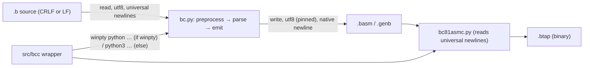
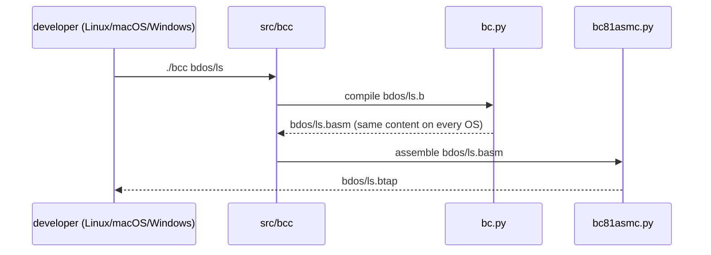

# Compiler: Run on Linux/macOS and Python 3.13+ Plan

**Plan Status**: `FINAL`

**Story Type**: `Internal`

> This plan captures **what** to build and **why** — domain, architecture, decisions, and verified facts.
> It deliberately does **not** contain implementation code, pseudocode, line numbers, mock setups, or test bodies.
> The implementation agent discovers the **how** against live code. See §4 Task Breakdown.

Issue: [bcichonski/bc16#13](https://github.com/bcichonski/bc16/issues/13). Branch: `ai/feature/13-compiler-run-on-linux-macos-python`, cut from `bc64` (active development branch, see root `CLAUDE.md`), PR base `bc64`.

> **Amendment (2026-11-08, before any task started).** The first FINAL version said that committed generated files are CRLF and decided to pin the compiler's output to CRLF (old D2). That was wrong. Every blob in the repo is **LF**: `git show HEAD:src/bdos/helloworld.basm` has no `\r`. The CRLF seen in the working tree comes from `core.autocrlf=true` in the sandbox's global git config, which converts files on checkout. Pinning CRLF would have written CRLF into the repo on any Linux setup without autocrlf. The plan below is corrected: the newline behaviour stays platform-native, only the encoding is pinned, and the byte-identical check compares LF to LF directly. This is the only change to the FINAL plan.

---

## 1. Problem Statement

*   **Context**: `src/bc/bc_ast.py` imports `Error` from `msilib.schema`. `msilib` is Windows-only and was removed from the standard library in Python 3.13, so `bc.py` and `bc_tests.py` fail at import time on Linux, macOS and any Python ≥ 3.13 (`ModuleNotFoundError: No module named 'msilib'`, verified on Linux / Python 3.14.4). `Error` is used only for the three internal scope errors in `Scope` (`Scope push error`, `Scope none error`, `Scope pop error`).
    `bc.py` writes `.basm` and `.genb` in text mode with the platform default newline (CRLF on Windows, LF elsewhere) and the platform default **encoding** (cp1252 on Windows, UTF-8 elsewhere). It reads input as UTF-8. The repo stores all text as LF, and a Windows `core.autocrlf` checkout normalises CRLF on commit. So native newlines already give the same committed bytes on every OS: with the import stubbed, a Linux compile of `bdos/helloworld.b` equals a Windows-built `.basm` once line endings are normalised. The output encoding is the remaining host dependency.
    The compiler wrapper `src/bcc` hard-codes `winpty python …` (Git Bash on Windows) and does not run on Linux/macOS.
*   **Goal**: The compiler and its tests start on Linux/macOS with Python 3.10 and 3.13+, and produce the same `.basm` content as the unchanged compiler.
*   **In scope**:
    *   replace the `msilib` import with a compiler-owned `CompilerError(Exception)`;
    *   make the compiler's output encoding host-independent (UTF-8, as for input). Newlines stay platform-native, as today;
    *   make `src/bcc` run on Linux/macOS while behaving exactly as today on Git Bash with `winpty`;
    *   update `src/bc/CLAUDE.md` and the reference/memory docs that describe the workaround.
*   **Out of scope**:
    *   fixing the 6 stale grammar tests (#15);
    *   the other build scripts (`buildos`, `buildtools`, `buildapps`, `makedisc`, `run`, `run_tests`) and the cross-platform `build.py` (toolchain analysis, next step 1);
    *   packaging / `pyproject.toml` (#12);
    *   `.gitattributes` and line-ending normalisation of sources (toolchain analysis, problem 6);
    *   the assembler `bc81asmc` (it already reads `.basm` with universal newlines and writes binary output);
    *   the frozen `release/bc32_v1.0` snapshot, which carries its own copy of the import — never modified (root `CLAUDE.md`);
    *   regenerating the committed `.basm`/`.btap`/`.sector(s)`/`os.bdd` outputs. They are already stale relative to the current `bc64` compiler, independent of this story; a rebuild is separate churn (G3) and is out of scope.

### 1.1 Technical Summary

*   **Touched projects**: compiler `src/bc/` (`bc_ast.py`, `bc.py`, `bc_dbg.py`, `bc_tests.py`), wrapper script `src/bcc`, docs.
*   **New patterns / abstractions**: one exception type, `CompilerError`, for internal compiler errors.
*   **Infrastructure changes**: None.
*   **End-state observable behaviour**: on Linux, `cd src && python3 bc/bc.py bdos/<prog>.b` succeeds on Python 3.10, 3.13 and 3.14, and writes a `.basm` byte-identical to what the unchanged compiler produced (with a `msilib` stub) on the same host; `cd src/bc && python3 -m unittest bc_tests` runs all 21 tests (15 pass, the 6 stale ones are #15); `./bcc bdos/<prog>` works on Linux.

---

## 2. Architecture & Design

### 2.1 Architecture Overview

#### Involved services & owners

| Service | Technical Owner |
| :--- | :--- |
| compiler `bc` (`src/bc/`) | bcichonski |
| build scripts (`src/bcc`) | bcichonski |

#### C2 diagram

#### Flow diagram

### 2.2 External Contracts & Evidence

N/A — Internal story.

#### Source Conflict Log

| Topic | Source A | Source B | Conflict | Chosen Handling |
| :--- | :--- | :--- | :--- | :--- |
| Reference for "byte-identical `.basm`" | AC: compiling every `src/bdos/*.b` gives byte-identical `.basm` | Repo: committed `.basm` on `bc64` are stale. A fresh compile already differs, e.g. `helloworld.basm` `.org 0x5000` → `0x6000`, independent of this story | Committed files can't be the reference | Reference = output of the **unchanged** `bc64` compiler (run with a throwaway `msilib` stub providing `Error = Exception`) vs the changed compiler, same inputs. See §2.4 and §5 |
| Line endings of generated files | Sandbox working tree shows CRLF `.basm` | Repo blobs (`git show HEAD:…`) are LF; the CRLF comes from `core.autocrlf=true` on checkout | Apparent, not real | Native newlines stay (D2). Compare LF to LF; never commit CRLF |
| Which `.b` files are "every `src/bdos/*.b`" | AC wording | Library files (`bdio.b`, `bdioh.b`, `bdosh.b`, `bdostools.b`, `std.b`, `stdio.b`, `stdmem.b`, `strings.b`) have no `main` and are only `#include`d | Libraries aren't standalone compile units | "Every" = every `src/bdos/*.b` with a `main` function: `bdos calc cat cha cp debug fddtest format helloworld ls rm texted theodore` (13 programs, all verified to compile with the stub). Libraries are covered through their includes |

### 2.3 Affected Areas

| Area / File (pointer) | Role in this change | Likely action |
| :--- | :--- | :--- |
| `src/bc/bc_ast.py` — the imports and the `Scope` class | Imports `Error` from `msilib.schema` and raises it for the three scope errors | Change: define `CompilerError(Exception)`, raise it, drop the import |
| `src/bc/bc.py` — `save_output_file` | Writes `.basm` and `.genb` in text mode with the platform default newline and encoding | Change: pin encoding to UTF-8; leave newline handling as is |
| `src/bc/bc_dbg.py` — `save_output_file` | Debug copy of the same CLI with the same writer | Change: same as `bc.py`, for consistency |
| `src/bc/bc_tests.py` | Grammar tests. Currently can't import on Linux | Change: add a small test class for `CompilerError` (see T1). Don't touch the stale tests (#15) |
| `src/bcc` | Compile + assemble wrapper; hard-codes `winpty python` | Change: use `winpty python` when `winpty` is on `PATH`, else a host Python (`python3`, falling back to `python`) |
| `src/bc/CLAUDE.md` | Describes the `msilib` workaround | Change: remove the workaround text; state the supported Pythons and UTF-8 output |
| `docs/03-compiler.md` | Reference page; the "Python dependency" bullet describes the `msilib` problem | Change: describe the new state |
| `docs/specs/memory/design-decisions.md` — the host-tools decision (Trade-offs bullet lists `msilib` as a leftover) | Memory bank | Change: drop `msilib` from the leftovers. No new decision |
| Root `CLAUDE.md` — "Shell scripts" bullet | Says all scripts call `winpty python` | Change: note that `bcc` picks `winpty python` or `python3` itself |
| `release/bc32_v1.0/**` | Frozen snapshot with its own `msilib` import | Reference only — **do not modify** |

### 2.4 Key Algorithms & Behaviour

*   **Error type**: `CompilerError` subclasses `Exception` and carries the same messages as today. Nothing catches the old `Error` by type (it was only raised), so behaviour is unchanged apart from the class name in the traceback.
*   **Output files**: every file the compiler writes (`.basm`, and `.genb` with `--verbose`) is written as UTF-8, whatever the host OS, so the write encoding matches the read encoding. Newlines stay platform-native text mode: LF on Linux/macOS (identical to the LF blobs in the repo), CRLF on Windows (normalised to LF by git, as today). Input reading stays as it is (UTF-8, universal newlines), so CRLF and LF sources both work. All current `src/**/*.b` sources are pure ASCII, so pinning UTF-8 changes no bytes on any OS.
*   **`bcc` interpreter choice**: if `winpty` is available, run exactly today's commands (`winpty python …`). Otherwise use `python3` if available, else `python`. Arguments, the `--verbose --btap` flags, the error check and the exit code stay unchanged. The script stays bash and runs from `src/`.
*   **Byte-identical regression rule**: for each of the 13 bdos programs, the changed compiler's `.basm` must be byte-identical (`cmp`) to the unchanged compiler's `.basm`, both run on the same Linux host and Python. No line-ending conversion is involved. As cross-OS evidence, 7 of the 9 Windows-built uncommitted `.basm` files in the owner's checkout matched the unchanged compiler's Linux output once line endings were normalised. Generation order, labels and the runtime must be unchanged.

---

## 3. Key Decisions & Assumptions

*   **D1 — `CompilerError(Exception)` defined in `bc_ast.py`**: the issue's own proposal. A named class beats a bare `Exception`: it marks errors as the compiler's own, and later work (#28 diagnostics) can catch it.
*   **D2 — output encoding pinned to UTF-8; newlines stay native**: the write encoding was the only host-dependent part of the output (cp1252 vs UTF-8). Pinning it matches the UTF-8 read. Native newlines already give identical committed content (the repo stores LF; Windows checkouts normalise through autocrlf), so newline handling is left alone. Line-ending policy belongs to the `.gitattributes` work. (Corrected by the amendment above; old D2 pinned CRLF.)
*   **D3 — `bcc` keeps `winpty` when present**: the owner's Git Bash workflow behaves exactly as before; Linux/macOS get `python3`. The issue names `winpty` in `src/bcc` explicitly, so only `bcc` changes. Other scripts are the toolchain story's job.
*   **D4 — no rebuild of committed outputs**: the compiler's output doesn't change (verified by the regression rule). Rebuilding the already-stale committed outputs is unrelated churn (G3). The primary checkout also holds uncommitted owner WIP with such a rebuild.
*   **Assumption A1 — the `bc64` branch is the base**, not `master`. Root `CLAUDE.md`: "Active development is on the `bc64` branch". `master` is an ancestor 51 commits behind and lacks `docs/specs`. Low-stakes: the PR targets `bc64`.
*   **Assumption A2 — "Python 3.10 and 3.13+" is checked on Linux with CPython 3.10.22, 3.13.16 and 3.14.4** (uv-managed interpreters, `parsy` 2.2). macOS isn't available in the sandbox. The change uses only portable standard-library behaviour, so Linux evidence stands in for macOS.

### 3.1 Decision Lock (Constants & Policies)

| Constant / Policy | Selected Value | Why | Where it lives |
| :--- | :--- | :--- | :--- |
| Exception class for internal compiler errors | `CompilerError(Exception)` | Issue proposal, D1 | `src/bc/bc_ast.py` |
| Output newline for `.basm` / `.genb` | unchanged (platform-native text mode) | D2: repo stores LF; Windows normalises via autocrlf | `save_output_file` in `bc.py` and `bc_dbg.py` |
| Output encoding | UTF-8 | Same as input reading; host-independent | same |
| `bcc` interpreter order | `winpty python` → `python3` → `python` | D3 | `src/bcc` |
| Programs covered by the byte-identical check | `bdos calc cat cha cp debug fddtest format helloworld ls rm texted theodore` | §2.2 conflict log | §5 |

### 3.2 Open Questions

No open questions. Resolution attempts: the reference for "byte-identical" was settled from the repo state (committed outputs are stale), and the scope of "every `src/bdos/*.b`" from the files themselves (libraries have no `main`). The Python versions were settled by installing the interpreters. Branch base: root `CLAUDE.md`.

---

## 4. Task Breakdown

| Task | Title | Depends on | Complexity |
| :--- | :--- | :--- | :--- |
| `T1` | Portable compiler: `CompilerError` + platform-independent output | — | `Low` |
| `T2` | Portable `bcc` wrapper | — | `Low` |
| `T3` | Docs and memory bank | `T1`, `T2` | `Low` |

### T1 — Portable compiler: `CompilerError` + platform-independent output

*   **Goal**: The compiler and its tests import and run on any OS and Python ≥ 3.10. Output content is unchanged.
*   **Depends on**: `—`.
*   **Complexity**: `Low`.
*   **Pointers**: `src/bc/bc_ast.py` (imports, `Scope`), `src/bc/bc.py` and `src/bc/bc_dbg.py` (`save_output_file`), `src/bc/bc_tests.py`. The sandbox checks files out as CRLF (autocrlf); git stores LF. Edit normally; don't convert whole files.
*   **Definition of Done**:
    *   no `msilib` anywhere under `src/` (excluding `release/`);
    *   `CompilerError(Exception)` exists in `bc_ast.py` and replaces all three `Error` raises, with the same messages;
    *   `.basm` and `.genb` are written with an explicit UTF-8 encoding; newline handling is unchanged;
    *   the §5 byte-identical check passes for all 13 programs;
    *   `bc_tests` runs on Python 3.10, 3.13 and 3.14: 21 existing tests (15 pass, the same 6 stale failures as before, #15) plus the new tests, which pass.
*   **Tests expected**: a unit-level test class in `bc_tests.py`. It covers: popping a scope when none was pushed raises `CompilerError` with the `Scope none error` message; `CompilerError` is an `Exception` subclass. Don't change the stale tests.

### T2 — Portable `bcc` wrapper

*   **Goal**: `cd src && ./bcc bdos/helloworld` compiles and assembles on Linux/macOS; on Git Bash with `winpty` it runs the same commands as today.
*   **Depends on**: `—`.
*   **Complexity**: `Low`.
*   **Pointers**: `src/bcc`. Git stores it as mode `100644`, so `./bcc` isn't executable on Linux. Set it to `100755` with `git update-index --chmod=+x src/bcc`; `core.filemode=false` here, so a plain chmod isn't recorded. In the sandbox the working copy is CRLF because of autocrlf, and bash can't run CRLF scripts. Test it through an LF copy (e.g. `bash <(tr -d '\r' < bcc) bdos/helloworld`). The committed blob is LF.
*   **Definition of Done**: interpreter choice per §3.1. Exit codes and the "Error" message on a failed compile are kept. On Linux, `./bcc bdos/helloworld` produces `bdos/helloworld.basm` and `bdos/helloworld.btap`. Leave the regenerated outputs **uncommitted**: restore them with `git checkout -- src/bdos` afterwards (D4).
*   **Tests expected**: manual/scripted run on Linux, with `winpty` absent from `PATH`. Also a failure-path run (a non-existent input) exits non-zero.

### T3 — Docs and memory bank

*   **Goal**: The docs no longer describe the `msilib` workaround, and they document the new behaviour.
*   **Depends on**: `T1`, `T2`.
*   **Complexity**: `Low`.
*   **Pointers**: `src/bc/CLAUDE.md`, `docs/03-compiler.md` (the "Python dependency" bullet), `docs/specs/memory/design-decisions.md` (host-tools Trade-offs bullet), root `CLAUDE.md` ("Shell scripts" bullet).
*   **Definition of Done**:
    *   `src/bc/CLAUDE.md` says the compiler runs on Linux/macOS/Windows with Python ≥ 3.10 (tested 3.10/3.13/3.14) and writes UTF-8 output, and no longer mentions the workaround;
    *   `docs/03-compiler.md` matches;
    *   `design-decisions.md` no longer lists `msilib` as a leftover;
    *   root `CLAUDE.md` mentions `bcc`'s interpreter choice;
    *   `docs/analysis/*` stays as written (it's a dated analysis snapshot);
    *   `release/` is untouched.
*   **Tests expected**: none (docs). `rg -n msilib src docs/03-compiler.md CLAUDE.md` returns nothing outside `release/`.

---

## 5. Verification

Prerequisites: `parsy` (the only dependency) in an environment per interpreter, e.g. `uv venv -p 3.10 <dir>` + `uv pip install -p <dir> parsy`, likewise for 3.13 and 3.14. The repo has no `scripts/verify.sh` and no CI, and the generic `verify.sh` doesn't cover Python. Verify with these commands.

*   **Build**: n/a (Python). Import check on each of 3.10 / 3.13 / 3.14: `cd src/bc && python -c "import bc_ast, bc_grammar"` succeeds.
*   **Unit tests**:
    *   `cd src/bc && python -m unittest bc_tests` on 3.10, 3.13 and 3.14: the run starts; the only failures/errors are the 6 stale ones (`test_expression_unary`, `test_expression_unary_addr`, `test_if`, `test_expression_variable`, `test_function_call`, `test_function_def`); the new tests pass;
    *   regression on other suites: `cd src && python -m unittest` (emulator, baseline 22/23, the `test_CLR_opcodes` error is pre-existing) and `cd src/bc81asmc && python -m unittest bc81asmc_tests` (75/75). Results must be unchanged.
*   **Byte-identical check**:
    1.  Export the base compiler: `git archive bc64 src`, where `bc64` is the branch-point commit. Put it in a temp dir.
    2.  Compile the 13 programs (§3.1) there, from `src/`, using a throwaway `msilib` stub on `PYTHONPATH` that provides `msilib.schema.Error = Exception`.
    3.  Compile the same 13 programs with the changed compiler, in a separate temp copy of the branch's `src/`.
    4.  `cmp` each pair. All 13 must be identical.
    5.  Repeat step 3 on 3.10 and 3.13. Outputs must be identical to the 3.14 ones.
    6.  Never write compiler outputs into the working tree, or restore them afterwards (D4).
*   **Observable behaviour**: `cd src && ./bcc bdos/helloworld` succeeds on Linux. `git status` shows no generated files changed at commit time.

---

## 6. Fact-Integrity Checklist

| Check | Yes / No / N/A | Notes |
| :--- | :--- | :--- |
| External contracts (routes, payload type ids, DTO fields, identifier types) verified from producer/contract source — not story text | N/A | Internal story |
| Evidence sources are reproducible (exact repo file path/symbol) | N/A | Internal story |
| Identifier directionality / ordering / freshness **meaning** evidenced separately from field shape, or moved to an Open Question | N/A | Internal story |
| Every `Assumption` is linked to an Open Question (§3.2) | Yes | A1 and A2 are low-stakes and evidenced (root `CLAUDE.md`, installed interpreters); they don't affect correctness, so they have no OQ |
| No unresolved Open Questions (for `FINAL`) | Yes | |
| Each Decision states a single committed approach | Yes | D1–D4 |
| Tasks are independent, each with a Definition of Done and test expectations | Yes | T1/T2 are independent; T3 is docs only |
| Required infra reflected: toggle-gated where the story carries a toggle key; new Service Bus subscription/queue ⇒ a task updates `infrastructure.bicep` | N/A | No toggle, no infra |

**Self-review note**: the main judgement call is the meaning of "byte-identical". Committed outputs are stale, so the reference is the unchanged compiler's output on the same host. The sandbox's autocrlf checkout made the repo look CRLF, which led to a wrong first D2 (see the amendment). Implementers must check line endings against `git show HEAD:<file>`, not against the working tree. They must also not leave regenerated `src/bdos` outputs in the working tree.
