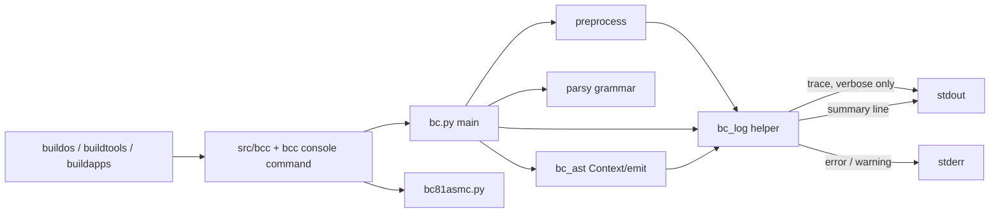
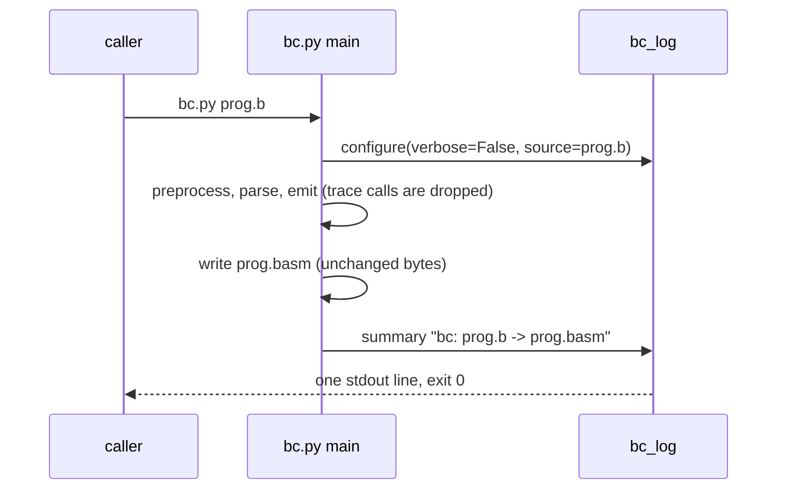

# Compiler: Quiet Output by Default, Debug Prints Behind --verbose Plan

**Plan Status**: `FINAL`

**Story Type**: `Internal`

**Plan Revision**: `A0`

> This plan captures **what** to build and **why**: domain, architecture, decisions and verified facts.
> It does **not** contain implementation code, pseudocode, line numbers, mock setups or test bodies.
> The implementation agent works out the **how** against the live code. See §4 Task Breakdown.

Issue: [bcichonski/bc16#14](https://github.com/bcichonski/bc16/issues/14). Base branch: `bc64`.

---

## 1. Problem Statement

*   **Context**: Every run of the B compiler (`src/bc/bc.py`) prints internal trace lines whether or not `--verbose` is given:
    *   in `bc_ast.py`: `PUSH SCOPE …` / `POP SCOPE …`, `TERM …` / `TERM … IS VAR …`, the variable declaration and assignment echoes, and the function data dict of every call;
    *   in `bc.py`: `Reading input file`, `Code segment was set to …`, `Heap segment was set to …`, `Code limit was set to …`, `Parsing code`, `Generating code`, `Saving output file`, `Done!`.

    Measured on `ee35df4`: compiling `bdos.b` without flags prints **4,532 stdout lines** (4,541 with `--verbose`). Errors are printed to **stdout** as `ERROR: …`. A context error is printed twice: once when it is recorded and once more by `compile()` before `sys.exit('There were compilation errors.')`. A parse error prints numbered preprocessed lines to stdout and then a parsy traceback. An undeclared variable prints `ERROR: Undeclared variable x` and then crashes with a `TypeError` traceback (the failed lookup returns `None`, a known issue noted as D7 in the codegen tests). The build launchers (`src/bcc`, the `bcc` console command in `src/bc64_toolchain.py`) always pass `--verbose` to the compiler, so every build is noisy.
*   **Goal**: A compile without flags prints nothing but one summary line on success. Errors and warnings go to stderr in one consistent format with a non-zero exit code. `--verbose` keeps everything it prints today. The generated `.basm` does not change.
*   **In scope**: `bc.py`, the trace and error sites in `bc_ast.py`, one small logging helper module, the two `bcc` launchers, and the compiler docs.
*   **Out of scope**:
    *   mapping errors to the original file and line (#28: this story only sets the format #28 will extend);
    *   assembler output (`bc81asmc.py` still prints its own `Reading input file`/`Parsing code`/… lines; #10 already gave it `file:line:col: error:` diagnostics);
    *   `bc_dbg.py` (a stale debug copy of `bc.py` with a hard-coded input path, run by nothing);
    *   fixing the D7 `TypeError` after an undeclared variable (only its *reporting* changes, §2.4).

### 1.1 Technical Summary

*   **Touched projects**: `src/bc/bc.py`, `src/bc/bc_ast.py`, new `src/bc/bc_log.py`, `src/bcc`, `src/bc64_toolchain.py`, `docs/03-compiler.md`, `src/bc/CLAUDE.md`, `docs/specs/memory/design-decisions.md` (new compiler decision C6).
*   **New patterns / abstractions**: one module-level logging helper for the compiler (trace / info / warning / error), replacing bare `print`.
*   **Infrastructure changes**: None.
*   **End-state observable behaviour**: `python3 bc/bc.py prog.b` prints exactly one line (`bc: prog.b -> prog.basm`) and exits 0. `--verbose` stdout is byte-identical to today for a successful compile. Errors appear on stderr as `<file>: error: <message>` with exit code 1. `./buildos && ./buildtools && ./buildapps` print one line per compiled program from the compiler instead of thousands.

---

## 2. Architecture & Design

### 2.1 Architecture Overview

#### Involved components & owners

| Component | Technical Owner |
| :--- | :--- |
| `src/bc` (compiler) | bcichonski |
| `src/bcc`, `src/bc64_toolchain.py` (launchers) | bcichonski |

#### C2 diagram

#### Flow diagram (successful compile, no flags)

### 2.2 External Contracts & Evidence

N/A: Internal story.

### 2.3 Affected Areas

| Area / File (pointer) | Role in this change | Likely action |
| :--- | :--- | :--- |
| `src/bc/bc_log.py` | New, small logging helper with module-level state: a verbose flag and the source name used in diagnostics. Trace goes to stdout only when verbose. Summary/info goes to stdout. Error and warning go to stderr in the §3.1 format. No `logging`-module configuration. | New |
| `src/bc/bc.py` | CLI, preprocessor and `compile()`. Its `print`s become trace (verbose-only) or summary calls. The parse-error and compile-error paths report through the helper and exit 1. | Change |
| `src/bc/bc_ast.py` | `Context.add_error` and the trace prints (`push_scope`/`pop_scope`, `EXPRESSION_TERM.emit`, `VARIABLE_DECLARATION.emit`, `VARIABLE_ASSIGNEMENT.emit`, `EXPRESSION_CALL.emit`) go through the helper. The commented-out `#print` lines in `Scope.get_variable` stay as they are. | Change |
| `src/bcc` | The shell launcher. It passes `--verbose` to `bc.py`; that flag is dropped (§3, D4). The assembler call is unchanged. | Change |
| `src/bc64_toolchain.py` (`bcc()`, `BCC_HELP`) | The console-command launcher. Same flag change; the help text stops promising `name.genb`. | Change |
| `docs/03-compiler.md` (Usage), `src/bc/CLAUDE.md` (Commands) | Describe default vs `--verbose` output, the error format and exit code, and that `bcc` no longer writes `.genb`. | Change |
| `src/bc/tests/` | Compiler tests: `bc_codegen_tests.py` (in-process, redirects stdout), `bc_header_tests.py` (runs `bc.py` as a subprocess, the model for CLI tests). | New tests + one listed modification |
| `src/tests/test_bc64_toolchain.py` | Checks that `bcc` matches running the scripts by hand (compares `.basm`/`.btap` only) and that `bcc` stops after a compile error (`Error` on the launcher's stdout, which the launcher prints itself). Both keep passing unchanged. | Reference |

### 2.4 Key Algorithms & Behaviour

*   **Output channels**:
    *   *trace*: everything printed today except errors. Printed to stdout only with `--verbose`, with the same text and in the same order as today.
    *   *summary*: exactly one stdout line after a successful write of the `.basm`, without `--verbose` only (§3, D2).
    *   *error / warning*: always printed to stderr, one line each, in the §3.1 format.
*   **`--verbose` parity**: for a successful compile, `--verbose` stdout must be byte-identical to the pre-change stdout of the same command, and `--verbose` still writes `.genb`. The only output that moves is error text, which goes from stdout to stderr in the new format. Verbose errors keep all their content: the numbered context lines of a parse error and the traceback.
*   **Context errors** (`Context.add_error`): reported to stderr **once, when recorded**. Reporting at once keeps the message visible if code generation later crashes because of it (D7). `compile()` no longer reprints them. If any were recorded, the compile ends with exit code 1 and writes no `.basm`, as today (today `sys.exit` with a message also exits 1 before writing).
*   **Exception after a recorded error**: if code generation raises any exception after at least one error was recorded, that exception is a consequence of the reported error. Exit 1. The traceback goes to stderr only with `--verbose`.
*   **`CompilerError`** (internal scope errors) **with no prior error**: reported as an error line (`internal error: <message>`) on stderr, exit 1, traceback only with `--verbose`. Any other unexpected exception with no recorded error is a compiler bug and keeps its traceback (exit 1).
*   **Parse error**: one error line naming the input file, the 1-based line and column **in the preprocessed source** (the error text says so explicitly, because #28 will map it to the original file later), and parsy's `expected …` text. Then the offending preprocessed line and a `^` caret, like the assembler's `format_diagnostic`. Exit 1. With `--verbose`, also print today's numbered context dump and the traceback, both on stderr. The negative start index of today's dump (it printed `ERR -2:` for an error on the first line) must not crash or wrap around.
*   **No-error invariants**: the generated `.basm` text, the `.basm` file name and its header line, and the `.genb` content are unchanged. Nothing the helper does may write to `Context.basm`.

---

## 3. Key Decisions & Assumptions

*   **D1. One level, `--verbose`, no `--trace`.** AC-2 requires `--verbose` to show everything it shows today, so there is nothing left for a level above it.
*   **D2. The summary line is `bc: <infile> -> <outfile>`**, using the paths as given and computed today. It is printed without `--verbose` only, because verbose already ends with `Saving output file …` and `Done!`, and adding a line would break the byte-identical verbose parity (§2.4). **Assumption (deviates from the issue's *proposal*, not from an AC)**: the proposal mentions "code size", but the compiler emits assembly text and never knows the byte size; only the assembler does. Computing it would mean assembling inside the compiler, so the summary names the files only. AC-1 ("at most one summary line") is met.
*   **D3. Error format, shared with #28**: `<file>: error: <message>` when no location is known, and `<file>:<line>:<col>: error: <message>` once one is known. That matches the assembler's (#10) `file:line:col: error:` header, so #28 only needs to add locations. The same applies to `warning`. `<file>` is the input file as given on the command line. For a parse error in this story, `<line>:<col>` refer to the preprocessed source, so the message gets no location prefix. Its message text says `syntax error at preprocessed line L, column C: expected …` instead, so it is not mistaken for a position in the original file.
*   **D4. `bcc` stops passing `--verbose` to the compiler** (both `src/bcc` and the console command). Without this, every build through `buildos`/`buildtools`/`buildapps` stays noisy, and making the build quiet is the point of the story ("Compiling bdos produces thousands of lines"). Consequence: `bcc` no longer writes `.genb`. `.genb` is a gitignored build output, and nothing in the repo reads it (checked: only `bc64_toolchain.py`'s help text and a release test excluding it mention it). Run `bc.py --verbose` directly to get it; the docs say so. The assembler call in `bcc` keeps its `--verbose`, since the assembler's output is out of scope. AC-5 holds: the scripts build the same outputs.
*   **D5. Module-level helper (`bc_log.py`) instead of a `Context` attribute.** Trace sites live in `Scope`, `Context`, AST nodes and `bc.py`'s preprocessor, and tests build `Context()` directly. Module state set once by `main()` reaches all of them without changing constructor signatures. The default state (verbose off, source name `bc`) makes in-process use (the tests) quiet on stdout.
*   **D6. Existing in-process callers keep working.** `bc.preprocess(source, verbose, dir)` and `bc.compile(ast, verbose)` keep their signatures. `verbose=True` passed to them turns trace on for that call (they configure the helper), so the codegen tests that pass `False` see no trace.
*   **D7. `bc_dbg.py` is left alone** (out of scope, §1).

### 3.1 Decision Lock (Constants & Policies)

| Constant / Policy | Selected Value | Why | Where it lives |
| :--- | :--- | :--- | :--- |
| Summary line | `bc: <infile> -> <outfile>` (stdout, non-verbose only) | D2 | `bc.py main` |
| Diagnostic header | `<file>: error: <msg>` / `<file>:<line>:<col>: error: <msg>`; `warning` the same | D3, matches assembler #10 | `bc_log.py` |
| Parse error message | `syntax error at preprocessed line L, column C: expected …` (1-based), then source line, then caret line | D3 | `bc.py` / `bc_log.py` |
| Internal error message | `internal error: <CompilerError text>` | §2.4 | `bc.py` |
| Error exit code | `1` | AC-3, same as assembler | `bc.py` |
| Traceback | only with `--verbose` (except for an unexpected non-`CompilerError` exception with no recorded error) | §2.4 | `bc.py` |
| Trace channel | stdout, verbose only, text unchanged | AC-2 | `bc_log.py` |
| `bcc` compiler flags | `--btap` only (no `--verbose`) | D4 | `src/bcc`, `bc64_toolchain.py` |

### 3.2 Open Questions

No open questions. The resolution attempts made:
*   *Summary content*: AC-1 caps the output at one line, and the proposal's "code size" is not available to the compiler. Closed by D2 (recorded as an assumption that deviates from the proposal).
*   *Error format "shared with #28"*: #28 is open and specifies `file:line:col: error: …` with a caret, matching the assembler (#10, `bc81asmc_diag.py`). Closed by D3.
*   *Should `bcc` keep `--verbose`?* Nothing consumes `.genb` (repo grep), and the issue's stated harm is build noise. Closed by D4.

---

## 4. Task Breakdown

| Task | Title | Depends on | Complexity |
| :--- | :--- | :--- | :--- |
| `T1` | Logging helper and quiet compiler (bc.py + bc_ast.py) | — | `Medium` |
| `T2` | Launchers and docs | `T1` | `Low` |

### T1 — Logging helper and quiet compiler

*   **Goal**: The compiler prints one summary line on success and nothing else without `--verbose`. Errors go to stderr in the §3.1 format with exit 1. `--verbose` stdout is unchanged for a successful compile, and the `.basm` output is unchanged.
*   **Depends on**: `—`.
*   **Complexity**: `Medium`.
*   **Pointers**: `src/bc/bc.py` (`main`, `preprocess`, `compile`), `src/bc/bc_ast.py` (`Context.add_error`, `push_scope`, `pop_scope`, `EXPRESSION_TERM.emit`, `VARIABLE_DECLARATION.emit`, `VARIABLE_ASSIGNEMENT.emit`, `EXPRESSION_CALL.emit`), new `src/bc/bc_log.py`, and `src/bc81asmc/bc81asmc_diag.py` (`format_diagnostic`, the caret style to match).
*   **Definition of Done**:
    *   No bare `print` is left in `bc.py` or `bc_ast.py`; every output goes through `bc_log` (the commented-out `#print` lines may stay).
    *   Every behaviour in §2.4 and every value in §3.1 holds.
    *   Before/after check, run on every program the build scripts compile (`bdos`, `ls`, `cp`, `format`, `rm`, `cha`, `cat`, `helloworld`, `texted`, `theodore`): the old compiler is `git show <base>:src/bc/*.py` extracted to a temp dir, and the new one is the worktree. Each `.basm` is byte-identical, and `--verbose` stdout is byte-identical. Report the result in the task notes.
*   **Tests expected** (add to `src/bc/tests/`, unit/CLI via a subprocess like `bc_header_tests.py`, in a new `*_tests.py` file):
    *   a successful compile without flags: exit 0, stdout is exactly one line matching the summary format, stderr empty;
    *   `--verbose` on the same program still prints the trace lines (for example `PUSH SCOPE`, `Parsing code`, `Done!`) and writes `.genb`;
    *   the same `.basm` with and without `--verbose`;
    *   undeclared variable: exit 1, stderr has `<file>: error: Undeclared variable x` exactly once, no traceback without `--verbose`, no `.basm` written;
    *   syntax error (including one on the first line): exit 1, stderr has the parse-error line with the 1-based preprocessed line/column, the source line and the caret, no traceback without `--verbose`;
    *   an in-process `Context.add_error` writes to stderr and not stdout.
*   **Tests to modify**:
    *   `src/bc/tests/bc_codegen_tests.py :: TestVariables.test_undeclared_variable_reported_by_context`. It asserts `'ERROR: Undeclared variable x'` in captured **stdout**. By design (AC-3, D3) the error now goes to **stderr** as `<file>: error: Undeclared variable x`, so the assertion must capture stderr and check the new text. The `context.errors` assertion and the `TypeError` tolerance stay.

### T2 — Launchers and docs

*   **Goal**: The build scripts compile quietly. The docs describe the new output contract.
*   **Depends on**: `T1`.
*   **Complexity**: `Low`.
*   **Pointers**: `src/bcc`, `src/bc64_toolchain.py` (`bcc()`, `BCC_HELP`), `docs/03-compiler.md` (Usage section and its parse-error bullet), `src/bc/CLAUDE.md` (Commands; mention `bc_log.py` in "How it works"), `README.md` (check only; change it only if it claims `bcc` writes `.genb` or shows compiler trace), `docs/specs/memory/design-decisions.md` (Compiler section, after C5; model: assembler A6).
*   **Definition of Done**:
    *   Neither launcher passes `--verbose` to `bc.py`; both still pass it to the assembler.
    *   `BCC_HELP` no longer lists `name.genb`.
    *   The docs state:
        *   default output is one summary line;
        *   `--verbose` prints the trace and writes `.genb`;
        *   errors go to stderr as `file: error: …` with exit code 1;
        *   parse-error positions refer to the preprocessed source until #28;
        *   `bcc` no longer writes `.genb`.
    *   `docs/specs/memory/design-decisions.md` has a new `C6` in the Compiler section: compiler output is quiet by default; trace only with `--verbose`; errors/warnings on stderr in the D3 format with exit 1 (#14), pointing at A6 for the shared format.
    *   `cd src && ./buildos && ./buildtools && ./buildapps && ./makedisc` succeeds in a temp copy of the repo. The compiler prints only its summary line per program. `git status` in that copy shows no tracked-file changes beyond what a pre-change build gives.
*   **Tests expected**: in `src/tests/test_bc64_toolchain.py`, add a test that the `bcc` console command prints only the summary line from the compiler on a successful build (no `PUSH SCOPE`/`Parsing code` from the compiler) and writes no `.genb`. The existing `bcc` tests must keep passing unchanged.
*   **Tests to modify**: None.

---

## 5. Verification

*   **Unit/CLI**: `cd src/bc && python3 -m unittest discover -s tests -t . -p "*_tests.py"`, all green.
*   **Full suite**: `python3 run_tests.py < /dev/null` from the repo root, all green (unit + e2e). Run `cd src && ./buildos && ./buildtools && ./buildapps && ./makedisc` first, because since #90 e2e needs fresh build outputs.
*   **Byte-identical `.basm` (AC-4)**: the T1 before/after comparison over all ten build-script programs.
*   **Observable behaviour**:
    *   `cd src && python3 bc/bc.py bdos/ls.b` prints one line and exits 0;
    *   `--verbose` stdout matches the base commit's stdout;
    *   a file with `x <- 1` and no declaration gives a stderr error and exit 1;
    *   `./bcc bdos/ls` prints the compiler summary plus the assembler's own lines.

---

## 6. Fact-Integrity Checklist

| Check | Yes / No / N/A | Notes |
| :--- | :--- | :--- |
| External contracts verified from producer/contract source | N/A | Internal |
| Evidence sources are reproducible | N/A | Internal |
| Identifier directionality / ordering / freshness meaning evidenced | N/A | Internal |
| Every `Assumption` is linked to an Open Question (§3.2) | Yes | The D2 assumption is closed in §3.2 with its resolution attempt |
| No unresolved Open Questions (for `FINAL`) | Yes | |
| Each Decision states a single committed approach | Yes | |
| Tasks are independent, each with a Definition of Done and test expectations | Yes | T2 depends on T1 only for the summary format its test checks |
| Required infra reflected | N/A | No toggle, no infra |

**Self-review note**: The riskiest part is `--verbose` parity. Trace text and order must stay exactly as today, including the AST dump `compile()` prints, `No errors`, and `Saving generated input file …`. Prove it with the before/after diff, not by reading the code. The `TypeError` after an undeclared variable (D7) is not fixed here; only its reporting changes. The implementer must not "fix" the lookup, because that changes code generation paths. `Context.add_error` is also called on `self.context` from `VARIABLE_ASSIGNEMENT` (an attribute that does not exist on the node), a latent bug outside this story; leave it.

---

## 7. Amendment Log

| Amendment | Request | Decision | Plan changes |
| :--- | :--- | :--- | :--- |
