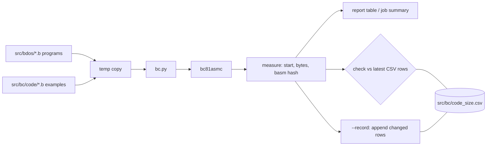

# Compiler Grammar Tests, Code-Generation Tracking and Code-Size Tracking Plan

**Plan Status**: `FINAL`

**Story Type**: `Internal`

**Plan Revision**: `A1`

> This plan captures **what** to build and **why**: domain, architecture, decisions and verified facts.
> It contains no implementation code. The implementation agent works out the **how** against the live code.

---

## 1. Problem Statement

*   **Context**:
    *   Issue #15 (analysis `docs/analysis/03-compiler.md`, problem 4 / next step 2) says the compiler's grammar tests are stale and that nothing checks the generated `.basm`.
    *   Code size is tracked by hand in `src/bc/history.txt`.
    *   The owner's comment of 2026-11-19 makes this phase 0, step 2 of `docs/analysis/08-self-hosted-roadmap.md`. It must land before the ABI, the runtime, BASM's encoder or the compiler templates are frozen. #16, #17 and #18 depend on it.
*   **Owner direction during this run (2026-11-19)**: "I do not want this files to be tracked.. can we have only .csv file with new entries for files and their sizes to track?" So no golden `.basm` copies are committed anywhere. One committed CSV records each program's size, and new entries are appended when output changes.
*   **Goal**:
    *   Every program's size and code fingerprint is measured. The report shows old → new per program, and an optional local `--check` flags unrecorded changes. **Metrics only (A1): nothing in this story fails CI.**
    *   One documented command appends the new entries to the CSV on purpose, so the CSV is the measured history of every optimisation.
    *   CI publishes the current size table.
*   **In scope**:
    *   the size script (report, check, record);
    *   the committed CSV seeded with today's sizes;
    *   the script's behaviour tests;
    *   the CI step;
    *   documentation.
*   **Out of scope**:
    *   any change to compiler output;
    *   assembler maps (#9, open);
    *   the hand-written `boot.basm` and bcOS;
    *   size thresholds that fail CI on growth (an intended change is accepted by recording it).

### 1.1 Technical Summary

*   **Touched areas**: new `scripts/code_size.py` with tests in `scripts/tests/`, new `src/bc/code_size.csv`, `.github/workflows/tests.yml`, `.gitattributes`, and the docs.
*   **New patterns**:
    *   a committed, append-only CSV log as the "golden" for code generation;
    *   the latest row per program is the expected state.
*   **Infrastructure changes**: one CI step that appends the size table to the GitHub job summary.
*   **End-state behaviour**:
    *   no unit test compares the repo's programs with the CSV, and the CI step is informational (A1); `--check` (optional, local) exits 1 on unrecorded changes;
    *   `python3 scripts/code_size.py` prints the table;
    *   `python3 scripts/code_size.py --record` appends entries for the changed programs.

---

## 2. Architecture & Design

### 2.1 Architecture Overview

| Component | Technical Owner |
| :--- | :--- |
| bc compiler (`src/bc`) | repo owner (bcichonski) |
| bc81asmc assembler (`src/bc81asmc`), used to measure | repo owner |
| CI (`.github/workflows/tests.yml`) | repo owner |

Flow (happy path):
*   The check test builds every program in a temp copy and measures it.
*   It compares each measurement with that program's latest CSV row. Everything matches, so it passes.
*   CI runs the same unit suite, then prints the table into the job summary.

### 2.2 External Contracts & Evidence

N/A — Internal story.

#### Source Conflict Log

| Topic | Source A | Source B | Conflict | Chosen Handling |
| :--- | :--- | :--- | :--- | :--- |
| How generated code is checked | Issue Proposal / AC2: golden tests "compare with the committed `.basm`" | Since #90, `.basm` files are untracked build outputs. **Owner, 2026-11-19: no tracked golden files; one CSV with entries per file and its size.** | The AC2 wording conflicts with the owner's later direction | The owner's direction wins (D1). The CSV row carries size **and** a short hash of the `.basm` text (D3), so every codegen change is still caught. **Deviation from AC2 wording; flag it in the PR and the report.** |
| Repairing the 6 grammar tests | Issue: 6 of 21 `bc_tests` fail | Live code at `473e463`: `bc_tests` runs 23 tests and all pass | AC1 is already met | No repair task (D5). Verification re-checks it. |
| Programs "covered" | AC2: "all `src/bdos/*.b` programs" | 9 of the 22 `src/bdos/*.b` files are include libraries with no `main`, so they cannot compile alone | "program" needs a definition | D2 |

### 2.3 Affected Areas

| Area / File (pointer) | Role in this change | Likely action |
| :--- | :--- | :--- |
| `src/bc/bc.py` | Compiler CLI. It writes `<file>.basm` next to the source, and `#include` resolves relative to the main file. | Reference |
| `src/bc81asmc/bc81asmc.py` | Assembler. `compile(ast, verbose)` returns a context with `startaddr` and `bytes`. The `.btap` header holds `codelen = len(context.bytes)`. | Reference |
| `src/bdos/*.b`, `src/bc/code/*.b` | Inputs. Programs with `main` today: bdos `bdos calc cat cha cp debug fddtest format helloworld ls rm texted theodore`; code `declarations functions funrec stdmemtest strings` (18). `code/expressions.b`, `code/stdio.b` and `code/stdmem.b` do not compile alone. | Reference |
| `scripts/code_size.py` | Measure, report, check, record | New |
| `scripts/tests/test_code_size.py` | Unit tests plus the repo-wide check. These run in the `release` unit suite (`scripts/tests/test_*.py`). | New |
| `src/bc/code_size.csv` | Committed size log, beside `history.txt` | New |
| `.github/workflows/tests.yml` | `unit` job | Change: report step |
| `.gitattributes` | Line endings | Change: CSV `text eol=lf` |
| `scripts/make_release.py` | Style reference: runs from any directory, resolves the root from its own path | Reference |
| `src/bc/CLAUDE.md`, `docs/03-compiler.md`, `src/bc/history.txt`, `docs/analysis/06-toolchain.md`, root `CLAUDE.md` (test commands) | Docs | Change |

### 2.4 Key Algorithms & Behaviour

*   **Program discovery**:
    *   every `*.b` directly in `src/bdos/` and in `src/bc/code/` that defines a `main` function;
    *   discovered by rule, so new programs are picked up;
    *   ids look like `bdos/ls` and `code/funrec`, sorted.
*   **Measure in isolation**:
    *   copy the source folders to a temp dir;
    *   compile each program with a fresh `bc.py` process, so preprocessor module globals cannot leak;
    *   assemble it, and record the start address, the byte count and the hash of the generated `.basm` text (LF-normalised);
    *   never write into the repo tree (the CI guards need a clean checkout).
*   **Verified determinism**:
    *   `texted.b` and `bdos.b` compiled under `PYTHONHASHSEED` 1/2/3 give identical `.basm`;
    *   CRLF and LF sources give identical LF output;
    *   so hashes are stable across machines and Python versions.
*   **Cost**: compile is ≈0.05–0.36 s per program. Assembly is ≈1.5 s for the largest (`bdos`, `texted`). Expect roughly 10–15 s for all 18, acceptable for the unit suite.
*   **CSV log (append-only)**:
    *   header `date,program,start,bytes,basm_sha`;
    *   `date` is the UTC date (`YYYY-MM-DD`), `start` is hex `0x….`, `bytes` is decimal, `basm_sha` is the first 12 hex digits of SHA-256;
    *   for each program, the **last** row in file order is its expected state;
    *   rows are never rewritten or deleted by the tool.
*   **Check**:
    *   mismatch = a program whose bytes or hash differ from its latest row, a program with no row, or a row whose latest entry names a program that no longer exists;
    *   on a mismatch the check fails and lists each program with old → new bytes (and "code changed, same size" when only the hash differs), plus the record command.
*   **Record (`--record`)**:
    *   appends one row per mismatched or new program, dated today;
    *   a removed program gets a row with `bytes` empty, marking it gone so the check stops expecting it;
    *   unchanged programs get no new row;
    *   running it twice in a row appends nothing the second time.
*   **Report (no flags)**:
    *   a Markdown table with program, start, bytes, hex size and Δ against the CSV's latest row, plus a total row;
    *   the same table is appended to `$GITHUB_STEP_SUMMARY` when set;
    *   the exit code is non-zero, with the program named on stderr, if a program fails to build.

---

## 3. Key Decisions & Assumptions

*   **D1 — No golden `.basm` is tracked; `src/bc/code_size.csv` is the only committed record** (owner direction, 2026-11-19). **Deviates from the AC2 wording** ("compare with the committed `.basm`"); flag it in the PR.
*   **D2 — "Program" = a `.b` file that defines `main`.** Include libraries are exercised through the programs that include them.
*   **D3 — Each row carries a short `.basm` hash besides the size.** The issue's intent for AC2 is that *any* codegen change fails a test. Size alone misses same-size changes. The hash is one extra column in the same CSV, not a tracked file. If the owner wants size only, the column can be dropped without other changes.
*   **D4 (Amended in: A1) — The script's behaviour tests run in the `release` unit suite; there is no repo-wide CSV-match test (metrics only)** (`scripts/tests/test_code_size.py`), because it needs both the compiler and the assembler, and `scripts/` sits outside both tools' flat-import folders. The regenerate step is the script's `--record`, not `run_tests.py --update-golden`, whose tests pin it to e2e only.
*   **D5 — AC1 needs no work.** `bc_tests` passes 23/23 at `473e463`.
*   **D6 — CI publishes the report on the 3.14 `unit` matrix entry only**, after the unit tests, as information. Nothing fails CI on an unrecorded change (A1).
*   **D7 — `history.txt` keeps its hand-written history.** It gains a pointer at the top to `code_size.csv` and `scripts/code_size.py`.

### 3.1 Decision Lock

| Constant / Policy | Selected Value | Why | Where it lives |
| :--- | :--- | :--- | :--- |
| CSV path | `src/bc/code_size.csv` | beside `history.txt` | script, docs |
| CSV header | `date,program,start,bytes,basm_sha` | D3 | script |
| Hash | first 12 hex digits of SHA-256 of the LF-normalised `.basm` | short, stable | script |
| Size | `len(context.bytes)` from the assembler | equals the `.btap` `codelen` | script |
| Record command | `python3 scripts/code_size.py --record` | D4 | docs |
| Line endings | CSV `text eol=lf` | the sandbox and Windows use `core.autocrlf=true` | `.gitattributes` |

### 3.2 Open Questions

No open questions.

---

## 4. Task Breakdown

| Task | Title | Depends on | Complexity |
| :--- | :--- | :--- | :--- |
| `T1` | Code-size script, seeded CSV and the check test | — | `Medium` |
| `T2` | CI report step and documentation | `T1` | `Low` |

### T1 — Code-size script, seeded CSV and the check test

*   **Amended in**: A1 — remove the repo-wide CSV-match test (`RepoCheck.test_current_sources_match_the_committed_csv`); keep the behaviour tests on temp trees and the repo discovery test. `--check` stays as an optional local command.

*   **Goal**: `scripts/code_size.py` measures every program and supports the report, check and `--record` modes from §2.4. `src/bc/code_size.csv` is seeded with today's entries for all 18 programs (A1: no unit test gates on it).
*   **Depends on**: —
*   **Complexity**: `Medium`
*   **Pointers**:
    *   new `scripts/code_size.py`, `scripts/tests/test_code_size.py`, `src/bc/code_size.csv`;
    *   `.gitattributes`;
    *   `src/bc/bc.py`, `src/bc81asmc/bc81asmc.py`;
    *   `scripts/make_release.py` for style.
*   **Definition of Done**:
    *   all modes behave as §2.4 says;
    *   the CSV has a header plus one row per program (18), produced by `--record` on the current sources;
    *   reported sizes equal the `codelen` of a `.btap` built by `./bcc` for the same program (spot-check `bdos/ls` and `bdos/bdos`);
    *   the repo tree is unchanged by any mode except the CSV append in `--record`;
    *   `cd scripts && python3 -m unittest discover -s tests -t . -p "test_*.py"` and `python3 run_tests.py --group unit < /dev/null` pass.
*   **Tests expected** (unit, `scripts/tests/`, using temp source trees and temp CSVs except for the repo check):
    *   discovery skips files without `main`;
    *   a tiny program's byte count is right;
    *   check reports a size change, a same-size code change (hash only), a new program and a removed program;
    *   `--record` appends only changed rows and is idempotent;
    *   the latest row wins over earlier rows;
    *   `GITHUB_STEP_SUMMARY` is appended to when set;
    *   a program that fails to compile gives a non-zero exit with its name on stderr.
*   **Tests to modify**: None

### T2 — CI report step and documentation

*   **Amended in**: A1 — the docs must say the tracking is metrics only: nothing fails CI or the unit suite on a size or code change, `--check` is optional and local, and recording rows after a program or compiler change is recommended, not enforced.

*   **Goal**: CI shows the size table in the job summary. AC3 is met (`history.txt` points to the report) and so is AC4 (`src/bc/CLAUDE.md` and `docs/03-compiler.md` describe how to run and update the tests).
*   **Depends on**: `T1`
*   **Complexity**: `Low`
*   **Pointers**:
    *   `.github/workflows/tests.yml` (`unit` job);
    *   `src/bc/CLAUDE.md` (Commands, Rules);
    *   `docs/03-compiler.md` (files table, "Code-size history");
    *   `src/bc/history.txt`;
    *   `docs/analysis/06-toolchain.md` (item 3 status);
    *   root `CLAUDE.md` (tests and CI sections).
*   **Definition of Done**:
    *   a `unit` step, gated to Python 3.14, runs `python scripts/code_size.py` so the table lands in `$GITHUB_STEP_SUMMARY`;
    *   the docs give the commands for running the compiler tests and the size check, and the `--record` command with when to use it: after an intended codegen change, reviewing the old → new sizes and committing the CSV rows with that change;
    *   `history.txt` starts with a pointer to the CSV and the script;
    *   the analysis doc no longer lists the size report as open;
    *   the root `CLAUDE.md` mentions the check under tests/CI;
    *   the unit suite still passes.
*   **Tests expected**: none beyond the existing suites (CI and docs only).
*   **Tests to modify**: None

---

## 5. Verification

*   **AC1**: `cd src/bc && python3 -m unittest tests.bc_tests -v` runs ≥21 tests, all OK.
*   **AC2 (per D1/D3)**:
    *   `cd scripts && python3 -m unittest tests.test_code_size -v` passes;
    *   the CSV has 18 program rows (13 `bdos/…` + 5 `code/…`);
    *   in a temp copy, a source change makes `--check` exit 1 naming the program, while `python3 run_tests.py --group unit` stays green (A1).
*   **AC3**: `python3 scripts/code_size.py` lists 18 programs plus a total, and `src/bc/history.txt` points to it.
*   **AC4**: the T2 docs contain the run and record commands.
*   **Full suite**: `python3 run_tests.py < /dev/null` passes, and `git status --porcelain` shows only intended files.
*   **CI**: `tests` (`unit (3.10)`, `unit (3.14)`, `e2e`) is green, and the 3.14 job summary shows the table.

---

## 6. Fact-Integrity Checklist

| Check | Yes / No / N/A | Notes |
| :--- | :--- | :--- |
| External contracts verified from producer source | N/A | Internal |
| Evidence sources reproducible | N/A | Internal |
| Directionality/ordering meaning evidenced | N/A | Internal |
| Every `Assumption` linked to an Open Question | Yes | none left |
| No unresolved Open Questions | Yes | |
| Each Decision states a single committed approach | Yes | |
| Tasks independent, each with DoD and test expectations | Yes | |
| Required infra reflected (toggle / bicep) | N/A | |

**Self-review note**:
*   The owner's mid-run direction (CSV only, no tracked goldens) overrides the AC2 wording. The PR must state that deviation.
*   D3 (a hash column) is this plan's addition. It keeps "any codegen change fails a test" with no extra file, and it is easy to drop if the owner objects.
*   AC1 was verified as already met.
*   The implementer must keep every build in a temp copy and seed the CSV with `--record` itself, not by hand.

---

## 7. Amendment Log

| Amendment | Request | Decision | Plan changes |
| :--- | :--- | :--- | :--- |
| A1 (2026-11-19, owner) | contradiction — size/hash tracking must never fail CI (metrics only) | accepted — owner direction; AC2/AC3 intent (measure) kept, the issue never asked for a CI gate | Goal, §1.1, D4, D6 reworded; T1 amended (drop the repo-wide CSV-match test); T2 amended (docs: metrics only); §5 AC2 reworded |
