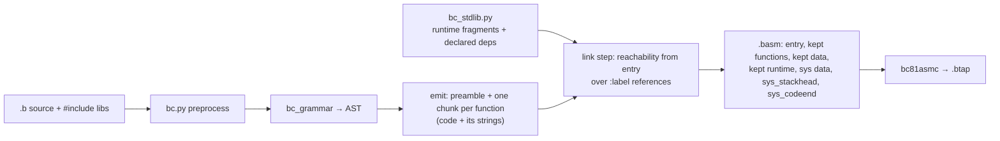
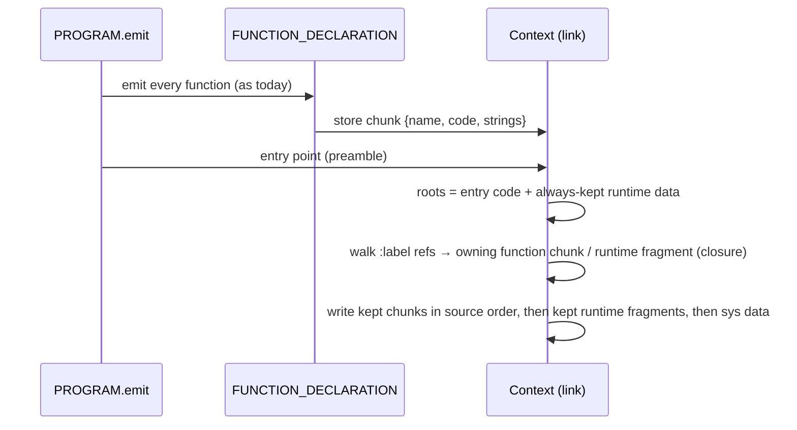

# Compiler: Dead-Code Elimination for Functions, Libraries and the Runtime Plan

**Plan Status**: `FINAL`

**Story Type**: `Internal`

**Plan Revision**: `A1`

> This plan captures **what** to build and **why** — domain, architecture, decisions, and verified facts.
> It deliberately does **not** contain implementation code, pseudocode, line numbers, mock setups, or test bodies.
> The implementation agent discovers the **how** against live code. See §4 Task Breakdown.

---

## 1. Problem Statement

*   **Context**: Issue #16 (analysis problem 2, roadmap item 5, self-hosting phase 0 step 23).
    `bc` emits every function of every `#include`d library and the whole assembly runtime
    (`src/bc/bc_stdlib.py`) into every program. Measured on master `b79cd12` with
    `scripts/code_size.py`: `bdos/helloworld` is **1626 B**, bdos **19493 B**, all 18 programs
    **105367 B** in total. Design decision C5 says "every program carries the whole of every included
    library … removing unused code is roadmap step 5".
*   **Goal**: a program contains only the B functions, string data and runtime routines reachable
    from its entry point, counting references made inside `asm` strings. The runtime is split into
    per-routine fragments with declared dependencies, shaped so #116 can turn each fragment into one
    `.sect` of `runtime.basm`.
*   **In scope**: the host compiler `src/bc/` (`bc_ast.py`, `bc_stdlib.py`, maybe `bc.py`), its unit
    tests, a full rebuild + e2e run, `src/bc/code_size.csv`, `docs/03-compiler.md`,
    `src/bc/history.txt`, design decisions (C5 update + a new C9).
*   **Out of scope**: dead code *inside* a function (unreachable statements), unused locals, a
    linker / `.sect` format (#116, #126), `bc_dbg.py`'s own preprocess copy, moving library code
    between files, the BC64-hosted compiler.

### 1.1 Technical Summary

*   **Touched projects**: compiler `src/bc/` only (plus docs, CSV and rebuilt outputs that are not committed).
*   **New patterns**: the compiler emits each function into its own chunk (code + its strings), then a
    "link" step keeps only the chunks reachable from the entry point by label references, and does the
    same for runtime fragments.
*   **Infrastructure changes**: None.
*   **End-state observable behaviour**: `helloworld` well below 1 KB (trial patch: **496 B**), every
    program smaller (trial total 77291 B, −28076 B), every system test still passing.

### 1.2 Trial patch (verified before planning)

A throw-away patch in a scratch copy of `b79cd12` (not committed) did: capture each function's
emitted code + strings as a chunk; split the runtime template on its `;=============` separators;
mark a chunk kept when a `:label` it defines is referenced from the entry code, the runtime data block
or another kept chunk (comments stripped); emit kept chunks in their original order. Results
(`scripts/code_size.py --root <copy>`):

| program | before | after | change |
| :--- | ---: | ---: | ---: |
| bdos/bdos | 19493 | 18077 | −1416 |
| bdos/calc | 6327 | 3630 | −2697 |
| bdos/cat | 8238 | 6291 | −1947 |
| bdos/cha | 7582 | 5490 | −2092 |
| bdos/cp | 7778 | 5931 | −1847 |
| bdos/debug | 585 | 148 | −437 |
| bdos/fddtest | 3439 | 474 | −2965 |
| bdos/format | 11275 | 8798 | −2477 |
| bdos/helloworld | 1626 | 496 | −1130 |
| bdos/ls | 8224 | 5262 | −2962 |
| bdos/rm | 8427 | 6601 | −1826 |
| bdos/texted | 14203 | 12661 | −1542 |
| bdos/theodore | 4780 | 2089 | −2691 |
| code/declarations | 678 | 259 | −419 |
| code/functions | 596 | 166 | −430 |
| code/funrec | 640 | 210 | −430 |
| code/stdmemtest | 806 | 423 | −383 |
| code/strings | 670 | 285 | −385 |
| **total** | **105367** | **77291** | **−28076** |

The compiler unit suite on the trial patch: 114 tests, 2 errors, both only because the trial dropped
the `DATA SEGMENT` banner comment (the real change keeps it) — plus `test_preamble_entry_and_stdlib`'s
`stackheadrll8:` assertion, which becomes wrong by design (see T2). The full `run_tests.py` on the trial
patch (build PASS, emulator/ftool/assembler PASS) gave 6 e2e failures, **all by design** and none a
run-time fault (every program ran and printed the right output):

*   five goldens lose a bdio load-progress dot line (one dot per 8 loaded sectors, masked as `<dots>`):
    HELLOWRD now loads in under 8 sectors, the toolchain/bdio-buffered test programs lose their single
    dot line, and the cmdtable transcript loses one — `test_bc64_smoke` (`smoke_transcript.txt`),
    `test_e2e_bdos::test_hellowrd_prints_greeting` (`bdos_hellowrd`), `test_e2e_bdio_buffered`
    (`bdio_buffered_run`), `test_e2e_bdos_cmdtable` (`bdos_cmdtable`), `test_e2e_toolchain`
    (`toolchain_run`);
*   `test_e2e_alloc_gap::test_rm_then_smaller_file_reuses_freed_gap` checks its own premise
    `source.length < hello.length` with a fixed 8-sector source and a 3-sector tail; HELLOWRD.PRG
    is now 4 sectors, so the premise fails before the scenario runs.

(`test_make_release` errored only because the scratch copy has no `.git`; unrelated.) The one expected
failure (tape round trip, #32/#62) is unchanged.

---

## 2. Architecture & Design

### 2.1 Architecture Overview

#### Involved components & owners

| Component | Technical Owner |
| :--- | :--- |
| `src/bc/` compiler | repo owner (bcichonski) |
| `src/bdos/` programs and libraries (consumers, unchanged) | repo owner |

#### C2 diagram

#### Flow diagram

### 2.2 External Contracts & Evidence

N/A — Internal story.

#### Source Conflict Log

| Topic | Source A | Source B | Conflict | Chosen Handling |
| :--- | :--- | :--- | :--- | :--- |
| How `asm` calls a B function | Issue: "calls made inside `asm` strings (to `:F…` labels and runtime routines)" | Live sources: no `.b` file has an `asm` string naming an `F…` label (they carry a counter, e.g. `FMAIN0001`). The real case is a label *defined in* an `asm` string inside a B function and referenced elsewhere: bdos.b `main` does `asm ".mv csci, :bdio_call"`, the label is `asm "bdio_call: psh a"` inside bdio.b's `bdio_call()`, which no B code calls | Both are covered by one rule: a reference to any label defined inside a function's chunk (its `F…` label or a label in its `asm` strings) keeps that function. Tests cover both forms (AC 4). |

### 2.3 Affected Areas

| Area / File (pointer) | Role in this change | Likely action |
| :--- | :--- | :--- |
| `src/bc/bc_ast.py` `Context` (`emit`, `emit_data`, `add_data_segment`, `add_stdlib`) | Collects output text; data segment and runtime appended at the end | Change: per-function chunks, link/selection step |
| `src/bc/bc_ast.py` `FUNCTION_DECLARATION.add_code`, `PROGRAM.emit` | Emits each function body; prepends the entry point | Change: function code + its strings go to its own chunk |
| `src/bc/bc.py` `compile()` | Calls `emit`, `add_preamble`, `add_data_segment`, `add_stdlib` in order | Change if the link step is called from here |
| `src/bc/bc_stdlib.py` | One format template with the whole runtime | Change: split into named fragments with declared dependencies |
| `src/bc/tests/` (`bc_codegen_tests.py` helpers `compile_source`, `function_lines`) | Unit tests compile small programs in-process | New tests (new file(s)); one assertion changes (T2) |
| `src/bdos/bdos.b` `main`, `src/bdos/bdio.b` `bdio_call()` | The real "kept only via asm" case | Reference (unchanged) |
| `src/bdos/stdio.b` `printf` | `asm` labels (`stdprntf_*`) defined and referenced inside one function, `sys_stdprntf` runtime data | Reference (unchanged) |
| `scripts/code_size.py`, `src/bc/code_size.csv` | Size report (#15) | Run `--record`, commit the appended rows |
| `docs/03-compiler.md`, `src/bc/history.txt`, `src/bc/CLAUDE.md`, `docs/specs/memory/design-decisions.md` (C5, new C9) | Docs of the code model and program layout | Change |

### 2.4 Key Algorithms & Behaviour

*   **Chunks.** Every function with a body becomes one chunk: its generated code (from the
    `;FUNCTION name` comment to `;END OF FUNCTION name`) plus the string literals (`DATAxxxx: .db …`)
    created while emitting it. The entry point (preamble) is the root. Label names and their
    numbering stay exactly as today (functions are still emitted, in source order, before selection),
    so a kept function's code is byte-identical to today's.
*   **Defined labels of a chunk**: every `name:` at the start of a line (after optional whitespace)
    and every `.def name, …` in the chunk's text, comments excluded. This includes the function's
    `F…` label, its `LABELxxxx` jump labels, its `DATAxxxx` strings and any label in its `asm` strings.
*   **References of a chunk**: every `:name` token in its text outside `;` comments (`cal :x`,
    `clr :x`, `jmp/jmr …, :x`, `.mv rr, :x`, `.assert :x …`). Over-approximation is safe: a false
    reference only keeps something.
*   **Reachability**: start from the entry code and the runtime's always-kept data block; a chunk or
    runtime fragment is kept when a kept text references one of its labels; repeat to a fixed point.
    Recursion and mutual recursion terminate (a set of kept chunks).
*   **Runtime fragments**: `bc_stdlib.py` becomes a list of fragments, one per routine as separated
    today by `;=============` (e.g. `os_metacall`, `fatal`, `printhex4`, … `strncpy`), each with a name,
    its text (still a format template for `sys_stackhead`/`sys_heaphead`) and a **declared** list of
    the fragments it depends on (e.g. `stackheadroll` → `stackoffscalc`, `poke16`; `mseek` → `poke16`,
    `peek16`, `gteq16`, plus its `sys_seektmp` data). A fragment is emitted when a kept B chunk or the
    entry code references one of its labels, plus the closure of its declared dependencies.
    A unit test checks that each fragment's declared dependencies equal the fragments its own text
    references, so the declaration can't drift from the code.
*   **Always kept**: the entry code; `sys_heaphead` and `sys_stackhead` (the entry code initialises both;
    `sys_stackhead: nop` must stay the last byte of the image, C7); `sys_codeend` and its `.assert`
    lines; the runtime banner comment and the `DATA SEGMENT` banner when strings exist (comments,
    0 bytes). The data `sys_stdprntf` and `sys_seektmp` are kept only when referenced (`printf`,
    `mseek`). The stale `.def var_promptbuf` / `.def var_user_mem` (no references, 0 bytes, see
    `src/bc/CLAUDE.md`) may be dropped.
*   **Output order** (unchanged apart from omissions): `.org`, entry point, kept functions in source
    order, `DATA SEGMENT` with the kept strings (in their original order), runtime banner, kept runtime
    fragments in template order, runtime data, `sys_heaphead`, `sys_stackhead`, `sys_codeend`.
    Keeping the order means every distance between two kept labels can only shrink, so no relative
    jump/call (`jmr`, `clr`, `jrx`) goes out of range.
*   **Errors are unchanged**: a call to an undeclared function, a wrong argument count etc. is
    still reported, also inside a function that will be dropped (all functions are still compiled).
    A reference to a label nobody defines is left for the assembler, as today.
*   **Trace**: with `--verbose`, the compiler traces which functions and runtime fragments were
    dropped (free-form text, C6). Nothing new is printed without `--verbose`.

---

## 3. Key Decisions & Assumptions

*   **Decision D-a (label-reference reachability, not an AST call graph).** Reachability is computed
    from `:label` references in the emitted text of each chunk. It covers B calls (`cal :F…`), `asm`
    strings (calls, `.mv` address loads, labels defined in `asm`) and runtime calls by one rule, and it
    is the same rule a section-dropping linker (#126 `blink.py`) applies, so host and linker sizes
    stay comparable. An AST call graph would miss `asm` text and need a second mechanism.
*   **Decision D-b (compile everything, then select).** All functions are still emitted in source
    order with today's label numbering; selection removes whole chunks afterwards. Kept code is then
    byte-identical to today's, errors in unused functions are still reported, and the change is easy
    to review (a kept function's text does not change).
*   **Decision D-c (runtime fragments = future `.sect`s).** One fragment per routine as already
    separated by `;=============`, with declared dependencies, in template order. #116 converts each
    fragment to one `.sect` of `runtime.basm`. The `mov a, 0xff` ×4 lines at the top of the template
    (8 bytes, no label) are left in place as the template's head, not a fragment.
*   **Decision D-d (record as design decision C9, update C5).** C9: "The compiler emits only code
    reachable from `main`". C5's "every program carries the whole of every included library" and
    "removing unused code is roadmap step 5" sentences are updated to point at C9.
*   **Assumption A-1 (the four `mov a, 0xff` lines stay).** Their purpose isn't documented and nothing
    references them; removing them is not asked for by the issue. Conservative: keep them. Flag in the
    PR as a possible 8-byte follow-up.
*   **Assumption A-2 (AC 3 "the game" = theodore).** The only game in the repo is `theodore`
    (`src/bdos/theodore.b`, on `utils.bdd`); its e2e tests (`test_e2e_theodore.py`) cover it. calc and
    the other utilities are covered by their own e2e tests.
*   **Assumption A-3 (AC 2 "size report shows the gain").** Met by running
    `python3 scripts/code_size.py --record` (appends one row per changed program to
    `src/bc/code_size.csv`) and quoting the table in `history.txt`, the docs and the PR. The CSV stays
    metrics only (owner rule, #15): no test compares programs with it.
*   **Assumption A-4 (texted slot).** TextEd shrinks, so the 112-sector disc slot noted in memory is
    no longer a constraint; manifests are computed from real builds (`ftool mkdisc`), nothing to change.

### 3.1 Decision Lock (Constants & Policies)

| Constant / Policy | Selected Value | Why | Where it lives |
| :--- | :--- | :--- | :--- |
| Root of reachability | the entry code (preamble) — it `cal`s `main` | issue: "call graph from `main`" | `Context` link step |
| Reference syntax | `:name` outside `;` comments | bc81asmc label reference syntax | link step |
| Definition syntax | `name:` at line start, `.def name,` | bc81asmc syntax | link step |
| Output order | source order for functions/strings, template order for runtime | no relative jump gets longer | link step |
| Always kept | entry, `sys_heaphead`, `sys_stackhead`, `sys_codeend` + asserts, banners | entry initialises both; C7 | `bc_stdlib.py` / `Context` |
| Fragment boundaries | today's `;=============` sections | #116 maps one fragment → one `.sect` | `bc_stdlib.py` |
| Design decision id | `C9` (C8 is the last compiler id on `b79cd12`) — re-check `origin/master` before the PR | parallel stories collide on ids | `design-decisions.md` |

### 3.2 Open Questions

No open questions.

---

## 4. Task Breakdown

| Task | Title | Depends on | Complexity |
| :--- | :--- | :--- | :--- |
| `T1` | Function-level dead-code elimination (chunks + label reachability) | — | `High` |
| `T2` | Split the runtime into fragments with declared dependencies; emit only used ones | `T1` | `Medium` |
| `T3` | Full rebuild, system tests, size record | `T2` | `Medium` |
| `T4` | Docs: compiler page, history, CLAUDE.md, design decisions C5/C9 | `T2` | `Low` |

### T1 — Function-level dead-code elimination

*   **Goal**: a compiled program contains only the B functions (and their string literals) reachable
    from the entry point by label references, including references inside `asm` strings.
*   **Depends on**: —
*   **Complexity**: `High` — changes what every program contains; a wrong rule drops live code and
    breaks bdos at run time.
*   **Pointers**: `src/bc/bc_ast.py` (`Context`, `FUNCTION_DECLARATION.add_code`, `PROGRAM.emit`,
    `emit_data`, `add_data_segment`), `src/bc/bc.py` `compile()`; real cases `src/bdos/bdos.b` `main` +
    `src/bdos/bdio.b` `bdio_call()`, `src/bdos/stdio.b` `printf`. §2.4 is the rule.
*   **Definition of Done**:
    *   each function's code and the strings created in it form one chunk; only reachable chunks are
        written, in source order; strings of dropped functions are not written;
    *   a function is kept when its `F…` label or any label defined in its `asm` strings is referenced
        from kept code (B call, `asm "cal :x"`, `asm ".mv csci, :x"`, …); references in `;` comments
        don't count;
    *   kept functions' text and label numbers are identical to today's output;
    *   compile errors in unused functions are still reported;
    *   `--verbose` traces the dropped functions; quiet output unchanged (one summary line);
    *   the runtime is still appended whole in this task (T2 trims it), so all existing compiler unit
        tests pass unchanged;
    *   `cd src/bc && python3 -m unittest discover -s tests -t . -p "*_tests.py"` passes; and a quick
        check that `bdos`, `ls`, `texted` compile and assemble (`cd src && ./bcc bdos/bdos` etc.).
*   **Tests expected** (unit, new file in `src/bc/tests/`, compiled in-process like `bc_codegen_tests.py`):
    an unused function and its string literal are absent; a transitively called function is kept;
    recursive and mutually recursive functions are kept once; a function referenced only by a label
    defined in its own `asm` string (the bdos/bdio pattern) is kept; a function referenced only by its
    `F…` label in another function's `asm` string is kept; a reference inside a comment doesn't keep
    anything; kept code is unchanged compared with the same function compiled alone; an error in an
    unused function still fails the compile; the result assembles with bc81asmc.
*   **Tests to modify**: None.

### T2 — Runtime fragments with declared dependencies

*   **Goal**: `bc_stdlib.py` is a list of named runtime fragments with declared dependencies, and a
    program contains only the fragments its kept code references plus their dependency closure.
*   **Depends on**: `T1`
*   **Complexity**: `Medium`
*   **Pointers**: `src/bc/bc_stdlib.py`, `Context.add_stdlib` in `src/bc/bc_ast.py`, runtime names used
    by codegen in `bc_ast.py` (`stackvar*`, `stackheadr*`, `peek16`, `poke16`, `eq16`, `gt16`, `gteq16`)
    and by the B libraries' `asm` strings (`printstr`, `printhex*`, `print_newline`, `mseek`, `mfill`,
    `mem_cpy`, `str_cpy`, `str_len8`, `strncpy`, `upchar`, `readstr`, `nextword`, `os_metacall`,
    `sys_stdprntf`). §2.4 and §3.1 list what is always kept.
*   **Definition of Done**:
    *   each fragment has a name, text and declared dependencies; fragment boundaries are today's
        `;=============` sections (D-c), in template order; the fragment structure is easy to turn into
        one `.sect` each (#116) — say so in a module docstring;
    *   `sys_stdprntf` and `sys_seektmp` are emitted only when used; `sys_heaphead`, `sys_stackhead`
        (last, `nop`), `sys_codeend` and its asserts always;
    *   unused runtime routines are absent from the output; `byte main() { return 1; }` contains no
        `stackvar*`/`stackheadr*` routine;
    *   compiler unit suite passes (with the one listed assertion changed); `./bcc` builds bdos, ls,
        texted, theodore.
*   **Tests expected** (unit): unused runtime routines are absent and used ones present for a small
    program; the dependency closure is emitted (e.g. a program that only moves the stack head gets
    `stackheadrll8` and `stackoffsclc8`, `poke16`, `peek16`); every fragment's declared dependencies
    equal the fragments its text references (consistency test over all fragments); `printf`-style use of
    `sys_stdprntf` keeps that data; every subset assembles.
*   **Tests to modify**:
    *   `src/bc/tests/bc_codegen_tests.py :: TestProgramShape.test_preamble_entry_and_stdlib` — its last
        assertion `stackheadrll8:` is in the output of `byte main() { return 1; }`; that program moves no
        stack head, so by design (AC 1, D-c) the routine is no longer emitted. Change only that assertion
        (e.g. to a routine the program does use, such as `poke16:`, or to the absence of
        `stackheadrll8:`); the other assertions in the test stay.

### T3 — Full rebuild, system tests, size record

*   **Amended in**: `A1` (layout-shift tests added to Tests to modify; the work already done — alloc_gap fixture, regenerated goldens — stays, continue from the second full run)

*   **Goal**: prove AC 2 and AC 3 on the real system: rebuild everything, boot `os.bdd`/`utils.bdd`,
    pass the whole suite, record the new sizes.
*   **Depends on**: `T2`
*   **Complexity**: `Medium`
*   **Pointers**: `run_tests.py`, `src/tests/test_e2e_*.py`, `src/bc64/testdata/`, `scripts/code_size.py`,
    `src/bc/code_size.csv`.
*   **Definition of Done**:
    *   `python3 run_tests.py < /dev/null` (builds the pipeline first, ~7–8 min, run in the foreground
        with a 10-min timeout, never two at once in this worktree) exits 0; report the expected-failure
        count and compare with master's (it must not grow);
    *   a manual headless session on fresh copies of the built discs runs `ls`, `cat -c` on a file,
        `hellowrd`, then `b:` + `texted` (insert a line, list, quit) and `theodore`/`calc` start, all
        with the expected output — paste the transcript summary in the task notes;
    *   `python3 scripts/code_size.py --record` run once on the final build; the appended rows are
        committed; `helloworld` < 1024 B (expected ≈ 496);
    *   `git status` after the run shows no tracked build output changes other than the CSV and any
        intentionally regenerated goldens (reviewed by eye).
*   **Tests expected**: none new required; an e2e test pinning a program size or load-progress dots
    is fixed only if listed below.
*   **Tests to modify** (all because programs shrink by design, AC 1/AC 2; found by the trial patch, §1.2):
    *   `src/bc64/testdata/smoke_transcript.txt`, `src/bc64/testdata/e2e/bdos_hellowrd.golden.txt`,
        `src/bc64/testdata/e2e/bdio_buffered_run.golden.txt`, `src/bc64/testdata/e2e/bdos_cmdtable.golden.txt`,
        `src/bc64/testdata/e2e/toolchain_run.golden.txt` — a load-progress `<dots>` line disappears
        because the loaded programs are under 8 sectors / one dot shorter. Regenerate with
        `python3 run_tests.py --update-golden < /dev/null` and check by eye that **only** `<dots>` lines
        changed; any other golden change is a regression, not something to regenerate.
    *   `src/tests/test_e2e_alloc_gap.py :: AllocGapTests.test_rm_then_smaller_file_reuses_freed_gap` —
        its fixture sizes (8-sector `SRC.DAT`, 3-sector tail) assume HELLOWRD.PRG is larger than 8
        sectors; it is now 4. Change only the fixture sizes so the premise holds again (e.g. derive the
        source and tail lengths from `hello.length`); keep every behavioural assertion. If its
        `alloc_gap_reuse` golden exists and changes, only `<dots>`/size-masked lines may differ.
    *   `src/tests/test_e2e_layout_shift.py :: compare_masked` (used by
        `LayoutShiftTests.test_hellowrd_scenario_matches_golden` and `::test_smoke_session_matches_transcript`)
        — *(A1)* HELLOWRD.PRG now loads in under 8 sectors, i.e. with **zero** progress dots, printed as an
        empty line; the shifted disc grows it by 8 sectors, so it prints one dots line (`<dots>`). The dots
        count is exactly the layout number this test exists to ignore. Change only `compare_masked` so that,
        on **both** sides, a line that is `<dots>` after `DISC_MASKS` compares equal to an empty line (e.g.
        one extra test-local normalisation applied to golden and actual alike). Do not change `DISC_MASKS`
        in `e2e_harness.py`, the goldens, the scenarios or any other assertion: the normal golden tests keep
        comparing exactly.
    *   any other `src/bc64/testdata/e2e/*.golden.txt` whose diff is **only** `<dots>` lines (a program
        shorter by a multiple of 8 sectors) — list each one in the task notes.

### T4 — Docs

*   **Goal**: AC 5 — the rule is documented and recorded.
*   **Depends on**: `T2`
*   **Complexity**: `Low`
*   **Pointers**: `docs/03-compiler.md` ("How the generated code works": program layout; "Runtime
    stdlib" table; "Code-size history"), `src/bc/history.txt`, `src/bc/CLAUDE.md` ("How it works"),
    `docs/specs/memory/design-decisions.md` (C5, new C9 after C8).
*   **Definition of Done**:
    *   `docs/03-compiler.md` states the rule (only code reachable from `main` by label references,
        `asm` references count, runtime fragments + dependencies, what is always kept, output order) and
        the program layout says "kept functions … kept runtime";
    *   `history.txt` gets a dated `bc (2026-11-23, #16)` entry with helloworld/bdos/texted/total
        before → after (take the numbers from T3's `--record` output if done, else from §1.2 and mark them
        to be checked);
    *   C9 written in the C-section format (Purpose, Rationale, Usage, Trade-offs); C5's two sentences
        updated; check `origin/master` for a newer C id first;
    *   `src/bc/CLAUDE.md` "How it works" mentions the link step and runtime fragments;
    *   only these files change; no edits to other decisions.
*   **Tests expected**: none.
*   **Tests to modify**: None.

---

## 5. Verification

*   **Unit**: `cd src/bc && python3 -m unittest discover -s tests -t . -p "*_tests.py"`; `python3 run_tests.py --group unit < /dev/null` exits 0.
*   **System**: `python3 run_tests.py < /dev/null` exits 0 (builds first); expected failures not more than master's.
*   **Sizes**: `python3 scripts/code_size.py` shows every program smaller; helloworld < 1 KB.
*   **Observable**: headless boot of `os.bdd` + `utils.bdd`: `ls`, `cat`, `hellowrd`, `texted`, `theodore` work.
*   **Guard**: `test-guard.sh check` against base `b79cd12` with T2's/T3's listed tests as the allowlist.

---

## 6. Fact-Integrity Checklist

| Check | Yes / No / N/A | Notes |
| :--- | :--- | :--- |
| External contracts verified from producer/contract source | N/A | Internal |
| Evidence sources are reproducible | N/A | Internal |
| Identifier directionality / ordering / freshness meaning evidenced | N/A | Internal |
| Every `Assumption` is linked to an Open Question (§3.2) | Yes | A-1..A-4 are low-stakes, resolved from AC text / repo; none blocks correctness |
| No unresolved Open Questions (for `FINAL`) | Yes | |
| Each Decision states a single committed approach | Yes | |
| Tasks are independent, each with a Definition of Done and test expectations | Yes | T1→T2 sequential (same code); T3/T4 parallel after T2 (T4 docs only) |
| Required infra reflected | N/A | no toggle, no infra |

**Self-review note**: the rule was proven on all 18 programs with a trial patch before planning
(sizes in §1.2). The risky parts are the label scanner (comments, `.def`, labels sharing a line with an
instruction such as `bdio_call: psh a`, char literals containing `;` or `:`) and keeping
`sys_stackhead` last. Over-keeping is always safe; under-keeping breaks bdos at run time, which only the
e2e suite (T3) proves.

---

## 7. Amendment Log

| Amendment | Source | Request | Decision | Plan changes |
| :--- | :--- | :--- | :--- | :--- |
| A1 | implementation (T3) | test-conflict: `test_e2e_layout_shift` hellowrd/smoke compare fails, golden has an empty (zero-dot) load line, shifted disc a `<dots>` line | **Accepted** — by design (AC 1/2): HELLOWRD now loads in < 8 sectors, and a zero-dot load prints an empty line the dots mask can't name; the test's purpose is to ignore dot counts, so treating `<dots>` ≡ empty line inside its own `compare_masked` keeps its intent and weakens no AC. `DISC_MASKS` and the main golden tests stay exact. | T3: `Amended in: A1`, `compare_masked` added to Tests to modify |
