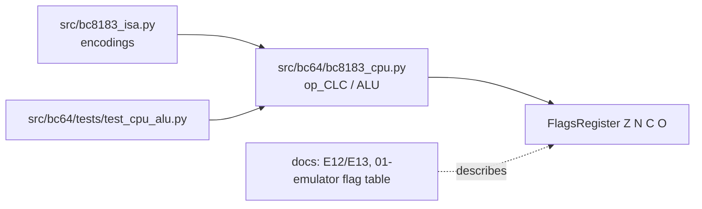
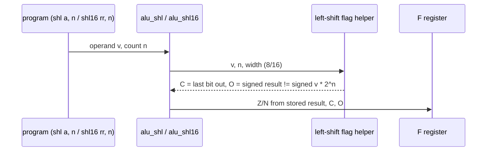

# CPU: `O` after `shl` Is Signed Overflow, Like `add` (E12 vs E13) Plan

**Plan Status**: `FINAL`

**Story Type**: `Internal`

**Plan Revision**: `A0`

> This plan captures **what** to build and **why** — domain, architecture, decisions, and verified facts.
> It deliberately does **not** contain implementation code, pseudocode, line numbers, mock setups, or test bodies.
> The implementation agent discovers the **how** against live code. See §4 Task Breakdown.

---

## 1. Problem Statement

*   **Context**: E12 (#55) defined the shift flags while `O` still meant "unsigned out of range": after `shl`/`shl16`, `O` = 1 when a 1 bit was shifted out. E13 (#54) later made `O` the two's-complement **signed** overflow for `add`/`sub`/`inc`/`dec`. So `shl a, 1` and `add a, a` compute the same value but set different `O` (`0x40` → `0x80`: shl `O`=0, add `O`=1; `0xC0` → `0x80`: shl `O`=1, add `O`=0). The owner agreed on 2026-11-23 (PR #143 discussion, issue #161 body) to make the shift follow E13.
*   **Goal**: after `shl`/`shl16`, `O` = 1 exactly when the stored result, read as a signed number, is not the signed operand × 2ⁿ. `shr`/`shr16` keep `O` = 0, now stated explicitly. Every other shift flag rule (`C`, `Z`, `N`, count 0, large counts) is unchanged.
*   **In scope**: the left-shift `O` computation in `src/bc64/bc8183_cpu.py` (8-bit and 16-bit); the existing shift tests whose `O` expectation changes; new equivalence and multi-bit tests; E12/E13 in `docs/specs/memory/design-decisions.md`; the shift flag table in `docs/01-emulator.md`; the flag-dependency audit of the built programs.
*   **Out of scope**: assembler, compiler, bcOS/bdos sources (no program reads flags after a shift — §2.4 audit); the roadmap status row for step 6a (status updates are separate docs PRs); `docs/CHANGELOG.md` (written by the changelog generator after merge); an arithmetic `sar` instruction.
*   **Roadmap**: phase 0, step 6a in `docs/analysis/08-self-hosted-roadmap.md`; it must land before step 31 (ABI freeze).

### 1.1 Technical Summary

*   **Touched projects**: `src/bc64` (emulator CPU + its tests), `docs/`.
*   **New patterns / abstractions**: none — the shift's `O` is derived with the same "signed meaning of the result" notion E13 uses for `add`.
*   **Infrastructure changes**: None.
*   **End-state observable behavior**: for every 8-bit `v`, `shl a, 1` and `add a, a` leave identical `A` and identical `Z/N/C/O`; the same holds for `shl csci, 1` vs `add csci, csci` on 16-bit values. `shr` never sets `O`.

---

## 2. Architecture & Design

### 2.1 Architecture Overview

#### Involved services & owners

| Service | Technical Owner |
| :--- | :--- |
| `src/bc64` emulator (bc8183 CPU) | bcichonski |

#### C2 diagram

#### Flow diagram

### 2.2 External Contracts & Evidence

`N/A — Internal story`

### 2.3 Affected Areas

| Area / File (pointer) | Role in this change | Likely action |
| :--- | :--- | :--- |
| `src/bc64/bc8183_cpu.py` — `shift_left_flags` (static helper used by `alu_shl` and `alu_shl16`) | Computes `(C, O)` of a left shift for width 8 or 16. Its `O` is the "a 1 bit was lost" rule. It is the only place that rule lives (grep: no other caller/copy in the repo). | Change (O rule + comment) |
| `src/bc64/bc8183_cpu.py` — `shift_right_carry`, `alu_shr`, `alu_shr16` | Right shift: `O` already forced to 0. | Reference (comment may state "O = 0, logical shift" explicitly) |
| `src/bc64/bc8183_cpu.py` — `add_flags`, `alu_add`, `alu_add16` | E13 signed overflow for `add`; the equivalence tests compare against it. | Reference |
| `src/bc64/tests/test_cpu_alu.py` — `Alu8Tests`, `ShiftFlagTests` | Existing shift tests; five assert the old `O` (§4 T1 `Tests to modify`). | Change listed tests + add new tests |
| `docs/specs/memory/design-decisions.md` — E12, E13 (E11/E14/E15 only reference E12 and need no change) | Normative decision text. | Change |
| `docs/01-emulator.md` — shift flag table after the E13 flag table | User-facing flag reference; the `O` row says "not a signed overflow". | Change |

### 2.4 Key Algorithms & Behaviour

**Left shift `O` (width `w` = 8 or 16, operand `v`, count `n`):**
*   `n` = 0: `C` = 0, `O` = 0 (unchanged, D2 of #55).
*   1 ≤ `n` < `w`: `O` = 1 iff the stored result read as signed ≠ (`v` read as signed) × 2ⁿ. Equivalently, the top `n + 1` bits of `v` (bit `w−1` down to bit `w−1−n`) are not all equal. For `n` = 1 that is "bit `w−1` ≠ bit `w−2`", the same `O` that `add x, x` gives under E13.
*   `n` ≥ `w` (count capped, result 0): `O` = 1 iff `v` ≠ 0 (the only signed value whose × 2ⁿ is 0 is 0). This also matches the general definition for `n` = `w`.
*   `C`, `Z`, `N` unchanged: `C` = bit `w − n` of `v` for 1 ≤ `n` ≤ `w`, 0 for `n` = 0 or `n` > `w`; `Z`/`N` from the stored result.

**Right shift:** `O` = 0 always (logical shift, the operand is unsigned). No behaviour change; recorded explicitly in E12 and the table.

**Worked examples (8-bit), all verified by a trial patch in a scratch copy:**

| `v` | `n` | result | `C` | `O` old (E12) | `O` new |
| :--- | :--- | :--- | :-: | :-: | :-: |
| `0x40` | 1 | `0x80` | 0 | 0 | 1 |
| `0xC0` | 1 | `0x80` | 1 | 1 | 0 |
| `0x81` | 1 | `0x02` | 1 | 1 | 1 |
| `0x20` | 2 | `0x80` | 0 | 0 | 1 |
| `0xE0` | 2 | `0x80` | 1 | 1 | 0 |
| `0x90` | 1 | `0x20` | 1 | 1 | 1 |
| `0x40` | 2 | `0x00` | 1 | 1 | 1 |
| `0xFF` | 9 | `0x00` | 0 | 1 | 1 |

**What is lost:** after a multi-bit `shl` no flag says "some 1 bit was shifted out" (e.g. `0xE0 shl 2`: two 1 bits out, `O` = 0). Nothing uses it (audit below).

**Flag-dependency audit (done during planning, repeat in T1/§5):** built `git archive` of `5f78ace` in a scratchpad (`./buildos && ./buildtools && ./buildapps && ./makedisc`), then walked forward from every `shl`/`shr` in the 15 built `.basm` files to the first flag reader (conditional `jmp/jmr/jrx/cal/clr/ret`, any `f` operand) or flag setter (ALU op, `mov a, …`, `out #r, r`). Result: **93 shifts (57 `shl`, 36 `shr`), 92 reach a flag setter first, 1 reaches a transfer**: `bcos.basm` `shr 0x04` → `cal :printhex4`, whose first instructions are `mov cs` / `psh a` / `sub 0x0a` / `jmr nc` (the `sub` sets flags before the read). So **no built program reads `O` (or any flag) after a shift**. (#55 counted 165 shifts before DCE #16.) The audit script lives in the run's scratchpad; T1 re-runs an equivalent check.

**Code size / byte identity:** the change is CPU-only; no `.b`/`.basm` source, assembler or compiler file changes, so `scripts/code_size.py --check` must report delta 0 and the built outputs are byte-identical by construction.

---

## 3. Key Decisions & Assumptions

*   **Decision D1 — define `O` by the signed meaning, not by a bit trick.** The rule is "stored result as signed ≠ signed operand × 2ⁿ", exactly the issue's primary definition. The issue's paraphrase "a bit shifted out or the new sign bit differs from the original sign bit" is read as "a bit that differs from the sign was shifted out, or the sign changed" — the only reading consistent with the issue's own table (`0xC0 shl 1` shifts out a 1 and has `O` = 0). The tests pin values, not the paraphrase.
*   **Decision D2 — counts ≥ width:** `O` = (`v` ≠ 0). Follows from D1 with the capped result 0; it keeps the old value for these counts, so the large-count tests do not change.
*   **Decision D3 — amend E12 in place, no new decision id.** E12 stays the shift-flag decision; its `O` bullet, rationale and trade-off are rewritten to cite E13 and #161, and E13's "That `O` is not a signed overflow; … left to the owner" bullet becomes "shifts follow this decision via E12 (#161)". This avoids a new E-number (parallel-story collisions have hit E12–E14 before) and keeps E14/E15 links valid (their anchors point at E12's heading, which must not be renamed).
*   **Decision D4 — the equivalence tests compare the two CPU ops at runtime** (run `shl … 1` and `add x, x` on fresh CPUs and compare `A`/pair and the four flags), for every 8-bit value and for a sample of 16-bit values (including the boundaries `0x3fff`, `0x4000`, `0x7fff`, `0x8000`, `0xbfff`, `0xc000`, `0xffff`, `0x0000`). Expected flags are not re-derived from docs (owner rule: no tests read docs).
*   **Assumption A1 — the 16-bit equivalence uses the register form `add csci, csci`** if the CPU encodes it (16-bit `op rr, rr` with the implied second pair, A7: csci→dsdi). If `add csci, csci` is not encodable, the test loads the same value into `dsdi` and runs `add csci, dsdi`. Either compares `shl csci, 1` against `x + x`; low risk, no Open Question.

### 3.1 Decision Lock (Constants & Policies)

| Constant / Policy | Selected Value | Why | Where it lives |
| :--- | :--- | :--- | :--- |
| `O` after `shl`/`shl16`, 1 ≤ n < w | signed result ≠ signed operand × 2ⁿ | Issue "Expected", E13 meaning of `O` | `shift_left_flags` |
| `O` after `shl`/`shl16`, n ≥ w | `v != 0` | D2 | `shift_left_flags` |
| `O` after shift by 0 | 0 | unchanged (#55 D2) | `shift_left_flags` |
| `O` after `shr`/`shr16` | 0 | logical shift, issue "Expected" | `alu_shr`, `alu_shr16` |
| `C`, `Z`, `N` of all shifts | unchanged (E12) | issue "Unchanged" | — |
| Decision record | E12 amended in place, E13 bullet updated | D3 | `design-decisions.md` |

### 3.2 Open Questions

No open questions. (The owner's agreement is recorded in the issue body; issue comments: none. The `O` value for counts ≥ width is closed by D1/D2 from the issue's own definition.)

---

## 4. Task Breakdown

| Task | Title | Depends on | Complexity |
| :--- | :--- | :--- | :--- |
| `T1` | Signed-overflow `O` for `shl`/`shl16` + tests | — | `Medium` |
| `T2` | Docs: E12, E13 and the emulator shift flag table | — | `Low` |

T1 and T2 touch disjoint files and can run in parallel; T2 is docs-only (no build).

### T1 — Signed-overflow `O` for `shl`/`shl16` + tests

*   **Goal**: after `shl` (immediate and register count) and `shl16`, `O` follows §2.4/§3.1; `shr`/`shr16` unchanged with `O` = 0; all other flags unchanged.
*   **Depends on**: `—`
*   **Complexity**: `Medium`
*   **Pointers**: `src/bc64/bc8183_cpu.py` (`shift_left_flags`, its comment; optionally a one-line comment in `shift_right_carry`/`alu_shr` that `O` = 0 because the shift is logical); `src/bc64/tests/test_cpu_alu.py` (`Alu8Tests`, `ShiftFlagTests` and its docstring, helper methods `shl8`/`shift_reg`/`shift16`/`imm16`); `add_flags` for the E13 reference.
*   **Definition of Done**:
    *   `shift_left_flags` implements §2.4 for widths 8 and 16; its comment cites E12/E13 and #161.
    *   Every row of the §2.4 example table holds.
    *   The five tests below are updated to the new `O` (and only `O`) values; `ShiftFlagTests`' docstring says `O` = signed overflow (E13) for shl.
    *   The flag-dependency audit (§2.4 method) re-run on a fresh build reports no flag read after a shift; result recorded in the task notes.
    *   `scripts/code_size.py --check` delta 0.
*   **Tests expected** (unit, `src/bc64/tests/test_cpu_alu.py`, new tests added in that file):
    *   `shl a, 1` vs `add a, a`: identical `A` and identical `Z/N/C/O` for **all 256** 8-bit values (run both ops on the CPU).
    *   `shl csci, 1` (16-bit) vs `csci + csci`: identical pair and flags on a sample that includes the boundaries of D4 plus a spread of values.
    *   Multi-bit cases with explicit expected `(result, Z, C, N, O)`: at least `0x20 shl 2`, `0xE0 shl 2`, `0x90 shl 1`, `0xC0 shl 1`, `0x40 shl 1`, and the 16-bit analogues `0x2000 shl16 2`, `0xE000 shl16 2`.
    *   Register-count form (`58 r5`) gives the same `O` as the immediate form for a couple of the above.
    *   `shr` / `shr16`: `O` = 0 even when the `O` flag was preset to 1 before the shift, for counts 1, 8/16 and > width.
    *   Expected values are literals in the test code; never read `docs/` or `README.md`.
*   **Tests to modify**:
    *   `src/bc64/tests/test_cpu_alu.py :: Alu8Tests.test_shl_imm_into_sign_bit` — `0x40 shl 1` now sets `O` = 1 (64 → 128 doesn't fit; issue table, AC "Expected" shl).
    *   `src/bc64/tests/test_cpu_alu.py :: ShiftFlagTests.test_shl_into_bit7_sets_n` — same case, `O` 0 → 1 (AC "Expected" shl).
    *   `src/bc64/tests/test_cpu_alu.py :: ShiftFlagTests.test_every_8bit_count_matches_the_definition` — its `o` oracle is "any 1 bit lost"; becomes the signed-overflow definition (AC "Expected" shl, D1/D2).
    *   `src/bc64/tests/test_cpu_alu.py :: ShiftFlagTests.test_shl16_imm_c_from_last_bit_out` — `0x4000 shl16 1` → `0x8000` now `O` = 1 (AC "Expected" shl16).
    *   `src/bc64/tests/test_cpu_alu.py :: ShiftFlagTests.test_shl_by_register_ci_and_di` — `0x40 shl ci(1)` now `O` = 1 (AC "Expected" shl).
    *   `src/bc64/tests/test_cpu_alu.py :: ShiftFlagTests` class docstring — describes the old `O` rule (AC "Expected").
    *   (This list was produced by a trial patch of the new rule in a scratch copy: exactly these five tests failed in the unit group; ftool/assembler/compiler suites passed.)

### T2 — Docs: E12, E13 and the emulator shift flag table

*   **Goal**: the decision record and the user docs state the new `O` rule for left shifts, the explicit `O` = 0 for right shifts, and what was lost.
*   **Depends on**: `—`
*   **Complexity**: `Low`
*   **Pointers**: `docs/specs/memory/design-decisions.md` — E12 (rationale "`O` has the meaning the owner gave in #54 … unsigned out of range", the `O` Usage bullet, and the trade-off's last sentence "If #54 changes the meaning of `O`, the shifts follow it"), E13 (the Usage bullet "8-bit `shl`/`shr` and 16-bit shifts follow E12 … That `O` is not a signed overflow; whether shifts should follow … left to the owner", and the trade-off sentence "Shifts keep E12's flags"); `docs/01-emulator.md` — the shift flag table (`O` row "not a signed overflow, see E13") and the line below it.
*   **Definition of Done**:
    *   E12's heading text is **unchanged** (E14/E15 link to its anchor). Its rationale says that #161 (owner agreement 2026-11-23) made the `shl` `O` follow E13; Usage states the §3.1 `O` rules (shl: signed result ≠ signed operand × 2ⁿ, for n = 1 the same as `add x, x`; n ≥ width: `O` = operand ≠ 0; shr/shr16: `O` = 0, logical shift); Trade-offs say that no flag reports "a 1 bit was lost" after a multi-bit shift any more, give one example (`0xE0 shl 2`), and cite the re-run audit (93 shifts in the current build, none read flags after a shift).
    *   E13's shift bullet says shifts follow E13 through E12 (#161); the "left to the owner" wording and "not a signed overflow" are gone; its trade-off no longer says shifts keep a different meaning.
    *   `docs/01-emulator.md` table `O` row: shl = "1 if the stored result, read as signed, is not the signed operand × 2ⁿ (signed overflow, as `add x, x` for n = 1; for n ≥ w: operand ≠ 0)", shr = `0` (logical shift). Optionally one example line (`0x40 << 1` → `O` = 1, `0xC0 << 1` → `O` = 0).
    *   No other decision text (D10, E14 numbering, other stories' decisions) is edited.
*   **Tests expected**: none (docs only; no test may read docs).
*   **Tests to modify**: None

---

## 5. Verification

*   **Unit**: `python3 run_tests.py --group unit` — exits 0 (emulator suite includes the new tests).
*   **e2e happy / changed areas** (wave barriers): `python3 run_tests.py --group e2e --tier happy` and `python3 run_tests.py --group e2e --changed origin/master`.
*   **Full suite** (once, before the PR): `python3 run_tests.py < /dev/null` from the repo root — exits 0; report any expected failures by name (master baseline: the tape round trip, #32/#62).
*   **Audit**: §2.4 shift flag-dependency walk on a fresh build — no flag read after a shift.
*   **Code size**: `python3 scripts/code_size.py --check` — delta 0 for every program.
*   **Observable behaviour**: `shl a, 1` and `add a, a` agree on all four flags for all 256 values (new test); `0x40 shl 1` → `O` = 1, `0xC0 shl 1` → `O` = 0.

---

## 6. Fact-Integrity Checklist

| Check | Yes / No / N/A | Notes |
| :--- | :--- | :--- |
| External contracts verified from producer/contract source | N/A | Internal story |
| Evidence sources are reproducible | N/A | Internal story |
| Identifier directionality / ordering / freshness meaning evidenced | N/A | Internal story |
| Every `Assumption` is linked to an Open Question (§3.2) | Yes | A1 is non-blocking (a test-encoding fallback), not a correctness assumption |
| No unresolved Open Questions (for `FINAL`) | Yes | |
| Each Decision states a single committed approach | Yes | D1–D4 |
| Tasks are independent, each with a Definition of Done and test expectations | Yes | T1 code+tests, T2 docs; disjoint files |
| Required infra reflected (toggle / bicep) | N/A | No toggle key; no infrastructure |

**Self-review note**: The only interpretive point was the issue's paraphrase of the rule; D1 resolves it with the issue's primary definition and its own example table, and D2 derives the large-count case from it (unchanged values). `Tests to modify` comes from a trial patch, not a guess: exactly five existing tests change, all only in `O`. The audit was re-run on the current (post-DCE) build. The implementation agent should take care to keep E12's heading (anchor) intact and to keep the 16-bit `C` rule untouched.

---

## 7. Amendment Log

| Amendment | Request | Decision | Plan changes |
| :--- | :--- | :--- | :--- |
