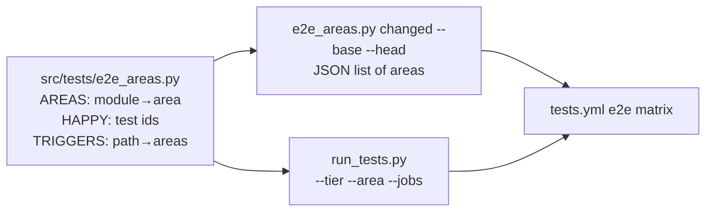
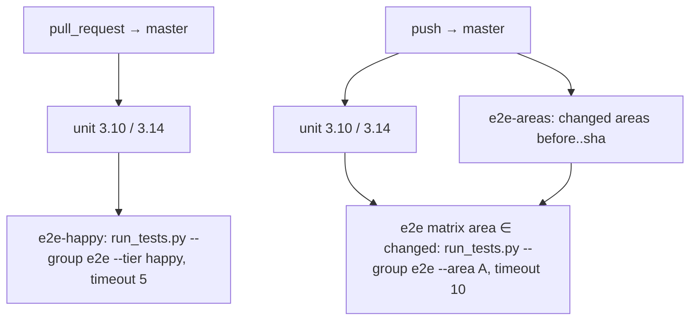

# Test Pyramid: Happy-Path E2E on PRs, Full E2E per Area on Master — Plan

**Plan Status**: `FINAL`

**Story Type**: `Internal`

**Plan Revision**: `A4`

> This plan captures **what** to build and **why**. The implementation agent discovers the **how** against live code.

---

## 1. Problem Statement

*   **Context**: the CI `e2e` job (`.github/workflows/tests.yml`, `timeout-minutes: 10`) runs all 133 e2e tests (27 modules) one after another in one `unittest` process and takes 9m27–9m48 on `master`; runs were cancelled at the limit (issue #175). Every module is a subprocess-booted emulator session, so the CPU is the cost; the runner has 4 vCPUs and uses one.
*   **Owner decisions (issue comments 2026-11-24 08:26 and 08:29)**:
    1.  A proper **test pyramid**: functionality is covered mostly by **unit tests**; say so in `README.md` and reference it from `CLAUDE.md`.
    2.  E2E is split in two: a **happy-path suite** that runs on branches (PRs), and the **full e2e** suite (edge cases) that runs **only on merge to master**.
    3.  The full suite is split into **areas like the doc folder** (emulator, assembler, compiler, bcOS, bdos), and an area runs **only when code in that area changes**. The owner asks whether the areas can be specified.
    4.  **P0**: `timeout-minutes` 5 for the happy path, 10 for each area job. **P1** (run modules in parallel): yes, if free on GitHub (public repo: standard runners are free). **P2** (CI shards) and **P6** (tiering): yes, as described. **P3**: "lets look what tests can be merged if possible". **P4, P5**: not yet.
    5.  Mid-run (side-agent note, owner reply "yes make assembler and compiler tests a chain reaction"): a change to the **assembler, the compiler or the shared B libraries triggers every area's tests**, because every e2e test runs programs they build.
*   **Goal**: PR CI runs unit + a short happy-path e2e (target ≤ 2 min for the e2e step, timeout 5); master CI runs the full e2e of the affected areas, one job per area in parallel (timeout 10 each); locally `python3 run_tests.py < /dev/null` still runs everything with the same counts, now faster.
*   **In scope**: one area/tier map (`src/tests/e2e_areas.py`) with change-trigger rules and a CLI for CI; `run_tests.py` options `--tier`, `--area`, `--jobs` (parallel e2e modules); the `tests` workflow split; docs (README test pyramid, root `CLAUDE.md`, `docs/01-emulator.md`, decision G13); a written P3 analysis of merge candidates.
*   **Out of scope**: P4 (boot snapshot), P5 (faster emulator/PyPy); moving or merging any existing test (P3 is analysis only, see D7); moving `src/bc81asmc/bcOS/` to its own folder (D3); repo settings (required status checks).

### 1.1 Technical Summary

*   **Touched projects**: `run_tests.py`, new `src/tests/e2e_areas.py` (+ unit tests), `.github/workflows/tests.yml`, docs.
*   **New patterns / abstractions**: a single declarative area map (module → area, happy-path test ids, path → areas trigger rules) read by both `run_tests.py` and CI.
*   **Infrastructure changes**: CI jobs `e2e-happy` (PR), `e2e-areas` (selector) + `e2e` matrix per area (push to master).
*   **End-state observable behavior**: a PR shows `unit` ×2 and `e2e-happy`; a merge to master shows one `e2e (<area>)` job per affected area; a docs-only merge runs no e2e job.

---

## 2. Architecture & Design

### 2.1 Architecture Overview

### 2.2 External Contracts & Evidence

N/A — Internal story.

### 2.3 Affected Areas

| Area / File (pointer) | Role in this change | Likely action |
| :--- | :--- | :--- |
| `src/tests/e2e_areas.py` | New: the area map, happy list, trigger rules, CLI | New |
| `src/tests/test_areas.py` | New unit tests of the map (named so `select_src_modules` puts it in the **emulator** unit suite, not e2e) | New |
| `run_tests.py` — `select_src_modules`, `build_suites`, `run_suite`, `main` | Runs the e2e suite; gains tier/area/jobs | Change |
| `src/tests/test_run_tests.py` | Existing runner tests (must stay green, unchanged); new tests appended | Add tests |
| `.github/workflows/tests.yml` | CI | Change |
| `README.md`, root `CLAUDE.md` (Testing, CI), `docs/01-emulator.md` ("End-to-end tests" → "Running them", "Adding a scenario"), `docs/specs/memory/design-decisions.md` (new G13; E9/G11 cross-ref) | Docs | Change |
| `src/tests/test_e2e_*.py`, `src/tests/test_bc64_smoke.py` | Classified, **not edited** | Reference |
| `docs/specs/plans/175-e2e-merge-candidates.md` | New: P3 analysis | New |

### 2.4 Key Algorithms & Behaviour

**Areas (D2).** Five areas named after the doc pages: `emulator` (01), `assembler` (02), `compiler` (03), `bcos` (04), `bdos` (05; includes the utilities and apps on both discs). Every e2e module belongs to exactly one area:

| Area | E2E modules |
| :--- | :--- |
| emulator | `test_e2e_harness` |
| assembler | — (no e2e module today; covered by unit tests and through every other area) |
| compiler | `test_e2e_toolchain`, `test_e2e_return` |
| bcos | `test_e2e_bcos`, `test_e2e_rom` |
| bdos | every other e2e module (`test_bc64_smoke`, `test_e2e_bdos*`, `test_e2e_bdio_*`, `test_e2e_alloc_gap`, `test_e2e_rm_alloc`, `test_e2e_ls_free`, `test_e2e_compile_cycles`, `test_e2e_disc`, `test_e2e_utils_disc`, `test_e2e_layout_shift`, `test_e2e_random`, `test_e2e_ftool_text`, `test_e2e_texted*`, `test_e2e_calc`, `test_e2e_theodore`) |

A new e2e module not in the map must fail a unit test (so the map can't silently rot), and `run_tests.py` must still run it in the `full` tier with no `--area` (never silently drop a test).

**Happy-path tier (D4).** An explicit list of test ids (`module.Class.test` or `module.Class` for a whole class), at least one per area that has modules. Chosen for main flows, not edge cases, from measured timings (sandbox, sequential):

*   bdos: `test_bc64_smoke` (both, ~11 s); `test_e2e_bdos.BdosShellTests`: `test_boot_prompt_and_exit`, `test_ls_lists_catalog`, `test_cat_prints_text_file`, `test_hellowrd_prints_greeting`, `test_rm_removes_file_from_ls_and_catalog` (~16 s); `test_e2e_disc.DiscStructureTests` (≈0 s) and `test_e2e_disc.DiscSessionTests.test_ls_all_lists_every_file` (~3.5 s); `test_e2e_utils_disc.UtilsDiscStructureTests.test_utils_bdd_matches_manifest`, `test_e2e_utils_disc.UtilsDiscSessionTests.test_hellowrd_runs_from_b_and_returns_to_b_prompt`; `test_e2e_calc.CalcTests.test_each_operation` (~2.5 s); `test_e2e_theodore.TheodoreTests.test_seeded_game_north_south_found_bye`; `test_e2e_texted.TextedRoundTripTests.test_save_restart_load_prints_same_lines`; `test_e2e_texted_flows.TextedFlowTests.test_startup_banner`.
*   bcos: `test_e2e_bcos.BcosMonitorTests.test_boot_and_unknown_command`, `test_e2e_bcos.BcosMonitorTests.test_dump_write_print`, `test_e2e_rom` (both, <1 s).
*   compiler: `test_e2e_toolchain` (whole module), `test_e2e_return` (~3 s).
*   emulator: `test_e2e_harness.SessionRunnerTests.test_real_boot_returns_output_and_leaves_source_untouched` plus the non-booting harness classes (`GoldenTests`, `DiscMasksTests`, `CatalogTests`, `SlowDecoratorTests`).

Budget: the happy tier must stay under **120 s sequential** in the sandbox (target ≈ 60–90 s); with `--jobs` it is well under the 5-minute CI timeout including the 13 s build. The `full` tier is every e2e test (happy ⊂ full). If a listed id turns out to be very slow, the implementer may swap it for a cheaper main-flow test of the same area and record the swap in the task notes; the per-area minimum stays.

**Trigger rules (D5, chain reaction per owner).** `areas_for_paths(changed_paths)` returns the set of areas whose full e2e must run, evaluated per path, first matching rule wins, union over paths:

| Path rule (repo-relative) | Areas |
| :--- | :--- |
| `docs/**`, any `*.md`, `LICENSE`, `bc/**` (old grammar copy), `scripts/**`, `.github/workflows/release.yml`, `src/bc/code_size.csv` | none |
| unit-test folders: `src/bc64/tests/**`, `src/bc/tests/**`, `src/bc81asmc/tests/**`, `src/tests/*.py` that are not e2e modules and not `e2e_harness.py`/`e2e_areas.py`/`__init__.py` | none |
| an e2e module `src/tests/test_e2e_*.py` / `src/tests/test_bc64_smoke.py` | that module's area |
| **shared / chain reaction**: `run_tests.py`, `pyproject.toml`, `.github/workflows/tests.yml`, `src/tests/e2e_harness.py`, `src/tests/e2e_areas.py`, `src/tests/__init__.py`, `src/bc64/testdata/**`, the build scripts in `src/` (`buildos`, `buildtools`, `buildapps`, `makedisc`, `bcc`, `ftool`, `ftool*.py`), the **emulator** (`src/bc64.py`, `src/bc64/**`), the **assembler** (`src/bc81asmc/**` incl. `bcOS/**`), the **compiler** (`src/bc/**`), the **shared B libraries** (`src/bdos/{std,stdio,stdmem,strings,bdosh,bdioh,bdosargs,bdostools,random}.b`, `src/bc/code/**`) | **all** areas |
| other `src/bdos/**`, `src/disc.bddmanifest`, `src/utils.bddmanifest` | `bdos`, `compiler` (compiled test programs run on bdos) |
| anything else (unknown path) | **all** areas (conservative default) |

Areas with no e2e module (assembler today) are dropped from the CLI's output (no empty CI job).

**Selector CLI (D6).** `python3 src/tests/e2e_areas.py changed --base <sha> --head <sha>` prints a compact JSON array of area names (sorted, only areas with modules) on stdout; it reads the changed paths with `git diff --name-only base head`. If `base` is empty, all zeros, or not a valid commit in the clone, it prints **all** areas (conservative). Standard library only; loadable by file path (never imported as a package — see the `pip install -e .` import gotcha in `bc16`'s memory: `src/` is on `sys.path` in CI).

**run_tests.py (D1).**
*   `--tier full|happy` (default `full`): `happy` runs only the HAPPY ids of the selected e2e modules; unit suites are unaffected.
*   `--area NAME` (repeatable; choices = the five areas): restricts the e2e suite to the modules of those areas. Without it, every e2e module (including any unmapped one) runs.
*   `--jobs N` (default: `os.cpu_count()`, at least 1): the e2e suite runs as one `unittest` subprocess per module (per module's id list in the happy tier), up to N at a time, and the results are merged into **one** `e2e` line and one table row with the same "Ran N tests, OK (expected failures=K)" / FAILED summary format and counts as a sequential run. `--jobs 1` keeps today's behaviour (one process). `--update-golden` forces one job (goldens are shared between modules, e.g. `test_e2e_layout_shift` reads the bdos goldens). Failing modules' output is printed as today. The output of passing modules is not printed.
*   `--changed REF` (amended in A1, D10): selects the e2e areas affected by the change against `REF` — the paths of `git diff --name-only $(git merge-base REF HEAD)` (committed and uncommitted changes of tracked files) plus untracked, not-ignored files (`git ls-files --others --exclude-standard`) — through `e2e_areas.areas_for_paths`, keeping only areas that have modules. It combines with `--tier` and is mutually exclusive with `--area`. When no area is affected, the e2e suite is reported **PASS** with the summary `not run, no e2e area affected since REF` and nothing is built. An invalid `REF` is an argument error (exit 2, clear message). The selected areas are printed on one line before the e2e suite runs.
*   Unit suites, the build step, `--no-build`, the missing-output check and the exit code behave exactly as today. `python3 run_tests.py < /dev/null` → same pass/fail and expected-failure counts as before.

**CI (D8).** `tests.yml`, triggers unchanged (`push` and `pull_request` to `master`):
*   `unit` — unchanged (both events).
*   `e2e-happy` — `pull_request` only, `needs: unit`, `timeout-minutes: 5`, `python run_tests.py --group e2e --tier happy < /dev/null` (jobs default = runner CPUs), then the existing clean-tree guard, golden-diff artifact on failure (regenerate with `--tier happy`), cpudebug guard.
*   `e2e-areas` — `push` only, checkout `fetch-depth: 0`, runs the selector with `github.event.before` / `github.sha`, outputs the JSON list.
*   `e2e` — `push` only, `needs: [unit, e2e-areas]`, `if:` the list is not empty, `strategy.matrix.area: fromJSON(...)`, `fail-fast: false`, `timeout-minutes: 10`, `python run_tests.py --group e2e --area ${{ matrix.area }} < /dev/null`, same guards; artifact name `e2e-golden-diff-<area>`.
*   Concurrency (amended in A2, A3, D11): pull-request runs share a group per ref and a newer run cancels the older one; every push to `master` gets its **own** group (keyed by the run id), so it is never cancelled or replaced while pending and runs its own selector and area jobs to the end.
*   Nightly safety net (amended in A4, D12): triggers gain `schedule` (daily, 03:00 UTC) and `workflow_dispatch`. For those events `e2e-areas` selects **every** area (the selector already returns all areas for an empty base) and the `e2e` matrix runs them all; `unit` runs as well. The `e2e-areas`/`e2e` conditions become "not a pull request" instead of "push".
*   Lint the workflow with `rhysd/actionlint` (docker) before committing.

---

## 3. Key Decisions & Assumptions

*   **D1 — Parallelism lives in `run_tests.py` (P1).** One subprocess per module is the natural unit: modules already isolate everything in temp dirs. Default jobs = CPU count, so the local run also gets faster. `--update-golden` stays sequential.
*   **D2 — Areas = the five doc pages.** Apps (TextEd, calc, theodore) are documented in `05-bdos.md`, so they are `bdos`. Smoke is a bdos session → `bdos`.
*   **D3 — Areas are declared in one map file, not by moving files.** Owner asked "can we specify or already have those areas — like all area into single folder". Sources already sit in one folder per area except bcOS (`src/bc81asmc/bcOS/`), which the rules handle by path. E2E test modules stay in `src/tests/` (the #90 layout, `bc16-tests-colocated`); moving 27 modules would churn every doc and gain nothing the map doesn't give. Moving bcOS to its own folder is offered as a follow-up in the PR, not done.
*   **D4 — The happy list is explicit test ids in the map**, not decorators in test files: no existing test file is edited (Tests to modify stays `None`), and a unit test checks every id exists.
*   **D5 — Chain reaction (owner, mid-run).** Emulator, assembler (incl. bcOS), compiler, shared B libraries, build scripts, harness and test data trigger **all** areas; a bdos-only change triggers `bdos` + `compiler`; an unknown path triggers all. Only docs/scripts/unit-test-only changes trigger none.
*   **D6 — Unresolvable base ⇒ all areas.** First push, force-push, or a shallow history never skips tests.
*   **D7 — P3 is analysis only.** "lets look what tests can be merged" is read as *look*: a written list of merge candidates (sessions that could share one boot, edge cases better as unit tests) with measured savings, for the owner to pick. No existing test is changed (AC "no coverage is lost" and the add-only rule). Flagged in the PR.
*   **D8 — Full e2e runs only on push to master; PRs never run it** (owner P6). A PR can therefore merge with an edge-case failure that only the master run catches — accepted by the owner ("P2, P6 — yes as described").
*   **D9 — Decision G13** in `design-decisions.md` records the pyramid, tiers, areas and triggers; E9/G11 get a one-line cross-reference.
*   **D10 — Development loop (owner, mid-run, A1).** While developing: unit suites, the happy tier and the affected areas (`python3 run_tests.py --group unit`, `--group e2e --tier happy`, `--group e2e --changed origin/master`). The full suite (`python3 run_tests.py`) runs **once, just before pushing the PR** (for `/grind`: at finalize, not at every wave). README "Testing", root `CLAUDE.md` ("It is the check, also for `/grind`") and G13 say so.
*   **D11 — Master runs are never cancelled (A2).** With per-push area selection (`before..sha`), a cancelled master run would leave its push's areas untested forever. So only PR runs share a concurrency group (and cancel each other); each master push has a group of its own (A3: GitHub keeps one pending run per group and cancels an older pending one, so a shared group with `cancel-in-progress: false` would still drop the middle of three quick pushes). Rejected alternative: diffing from the last successful run (needs the Actions API, which the selector must not depend on).
*   **D12 — Nightly full run (owner, A4).** Per-push selection can let a later unrelated push turn a red master green while an area's failure remains. A daily scheduled run of all areas bounds that to one day, and README says a red master run is fixed right away. Rejected for now: diffing from the last green run (Actions API dependency).
*   **Assumption AS1 (deviates from AC 1 wording)**: AC 1 "CI e2e finishes with a clear margin on master" can only be observed after merge; the PR shows the happy job's time and a local per-area timing table. Flagged in the PR.
*   **Assumption AS2**: GitHub-hosted standard runners are free for public repositories, so the per-area matrix costs nothing (owner's P1 condition). `bcichonski/bc16` is public (issue states "public repo").

### 3.1 Decision Lock

| Constant / Policy | Selected Value | Why | Where it lives |
| :--- | :--- | :--- | :--- |
| Happy job timeout | 5 min | owner P0 | `tests.yml` |
| Area job timeout | 10 min | owner P0 | `tests.yml` |
| Happy tier budget | < 120 s sequential (sandbox) | keeps PR e2e ≈ 1 min with jobs | unit test is not required; checked in verification |
| `--jobs` default | `os.cpu_count()` (min 1) | P1 | `run_tests.py` |
| Area names | `emulator`, `assembler`, `compiler`, `bcos`, `bdos` | doc pages | `src/tests/e2e_areas.py` |
| New decision id | G13 | next free global id | `design-decisions.md` |

### 3.2 Open Questions

No open questions.

---

## 4. Task Breakdown

| Task | Title | Depends on | Complexity |
| :--- | :--- | :--- | :--- |
| `T1` | Area map, happy list, trigger rules and selector CLI | — | `Medium` |
| `T2` | `run_tests.py`: `--tier`, `--area`, `--jobs` | `T1` | `High` |
| `T3` | CI workflow: happy job on PRs, per-area matrix on master | `T1`, `T2` | `Medium` |
| `T4` | Docs: test pyramid (README), CLAUDE.md, 01-emulator, G13 | `T2`, `T3` | `Medium` |
| `T5` | P3 analysis: merge candidates | — | `Low` |
| `T6` | `run_tests.py --changed REF` (A1) | `T2` | `Medium` |
| `T7` | Docs: development loop, full suite only before the PR (A1) | `T6`, `T4` | `Low` |
| `T8` | CI: never cancel master runs (A2) | `T3` | `Low` |
| `T9` | CI: nightly full e2e of every area (A4) | `T8` | `Low` |

### T1 — Area map, happy list, trigger rules and selector CLI

*   **Goal**: `src/tests/e2e_areas.py` declares the areas, the module → area map, the HAPPY ids and the trigger rules of §2.4, with pure functions to query them and the `changed` CLI.
*   **Depends on**: —
*   **Complexity**: `Medium`
*   **Pointers**: `src/tests/` (module list), `run_tests.py:select_src_modules` (how e2e modules are recognised), §2.4 tables.
*   **Definition of Done**: the map matches §2.4; functions give: area of a module, modules of areas (given the discovered list), happy ids of a module, areas for a list of paths; `python3 src/tests/e2e_areas.py changed --base X --head Y` prints a JSON array as in D6 (all areas on a bad/zero/empty base); standard library only; importable by file path; no test file edited.
*   **Tests expected**: unit tests in a new `src/tests/test_areas.py` (emulator unit suite): every discovered e2e module is mapped to exactly one known area and the map names no missing module; every HAPPY id resolves to an existing class/method (static check, e.g. by parsing the module source — must not boot anything); every area with modules has ≥ 1 happy id; trigger examples: `docs/x.md` → none, `src/bc/bc.py` → all, `src/bc81asmc/bcOS/bcos.basm` → all, `src/bdos/strings.b` → all, `src/bdos/ls.b` → {bdos, compiler}, `src/bdos/texted.b` → {bdos, compiler}, `src/tests/test_e2e_calc.py` → {bdos}, `src/tests/test_ftool.py` → none, an unknown path → all; CLI with an all-zero base → all areas; CLI on two real commits of the repo returns a JSON list. Run: `cd src && python3 -m unittest tests.test_areas` and `python3 run_tests.py --group unit < /dev/null`.
*   **Tests to modify**: None

### T2 — `run_tests.py`: `--tier`, `--area`, `--jobs`

*   **Goal**: the runner gains the three options of §2.4 (D1) with merged, format-compatible results.
*   **Depends on**: `T1`
*   **Complexity**: `High` (the one runner everybody and CI depend on; parallel merge of results; must keep every existing behaviour and test).
*   **Pointers**: `run_tests.py` (`build_suites`, `run_suite`, `summarise`, `parse_counts`, `render_table`, `main` and its injectable `runner`/`build` hooks), `src/tests/test_run_tests.py`, `src/tests/e2e_areas.py` (load by file path).
*   **Definition of Done**: options behave as §2.4; default invocation runs every e2e test (same counts as before: compare `Ran`/expected-failure counts of `python3 run_tests.py --group e2e --jobs 1` and the default jobs run); `--update-golden` runs sequentially; an unmapped e2e module still runs in `full` with no `--area`; the module docstring and `--help` describe the options; all existing `test_run_tests.py` tests pass unchanged.
*   **Tests expected**: new tests appended to `src/tests/test_run_tests.py` (or a new `src/tests/test_run_tests_e2e_options.py`) with fake runners, no real boots: tier happy passes only happy ids; area filter; jobs > 1 merges counts/summary identically to sequential and fails when any module fails, showing that module's output; `--update-golden` forces one job; argument validation. Then the real check: `python3 run_tests.py < /dev/null` (full), `python3 run_tests.py --group e2e --tier happy --no-build < /dev/null` (record wall time — must be < 120 s), `python3 run_tests.py --group e2e --area bcos --no-build < /dev/null`.
*   **Tests to modify**: None

### T3 — CI workflow

*   **Goal**: `tests.yml` per §2.4 "CI" (D8).
*   **Depends on**: `T1`, `T2`
*   **Complexity**: `Medium`
*   **Pointers**: `.github/workflows/tests.yml`.
*   **Definition of Done**: jobs `unit` (unchanged), `e2e-happy` (PR only, timeout 5), `e2e-areas` (push only, `fetch-depth: 0`, outputs the JSON list), `e2e` matrix (push only, per area, timeout 10, skipped when the list is empty, `fail-fast: false`); clean-tree, golden-diff (per-area artifact name; happy regenerates with `--tier happy`) and cpudebug guards kept in every e2e job; `actionlint` (docker `rhysd/actionlint`) reports nothing.
*   **Tests expected**: actionlint clean; locally simulate the selector step with the commands the workflow uses (e.g. `python3 src/tests/e2e_areas.py changed --base HEAD~1 --head HEAD`).
*   **Tests to modify**: None

### T4 — Docs

*   **Goal**: the pyramid and the new runner/CI behaviour are documented where the owner asked.
*   **Depends on**: `T2`, `T3`
*   **Complexity**: `Medium`
*   **Pointers**: `README.md` (new "Testing" section after "Getting started"), root `CLAUDE.md` (Tests block, CI section: reference README's Testing section and list the new options/jobs), `docs/01-emulator.md` ("Running them", "Adding a scenario": assign the module to an area in `e2e_areas.py`, add a happy id if it is a main flow), `docs/specs/memory/design-decisions.md` (new **G13**; one-line cross-refs in E9 and G11), `src/tests/e2e_areas.py` docstring.
*   **Definition of Done**: README states: functionality is covered mostly by unit tests (fast, per tool); e2e covers what only a booted system shows; e2e has a happy-path tier (PRs, ≤ 5 min) and a full tier (master, per area, ≤ 10 min, only affected areas, chain-reaction rules); an edge case goes to a unit test when possible, else to the full tier. CLAUDE.md points to that section. All commands in docs work as written. No edits to other stories' decisions.
*   **Tests expected**: none beyond running every documented command once.
*   **Tests to modify**: None

### T5 — P3 analysis: merge candidates

*   **Goal**: `docs/specs/plans/175-e2e-merge-candidates.md` lists which e2e tests could be merged into fewer sessions, or replaced by unit tests, with measured per-test timings and expected savings, for the owner to choose (D7).
*   **Depends on**: —
*   **Complexity**: `Low`
*   **Pointers**: per-test timings: `cd src && python3 -m unittest --durations 0 tests.<module>`; modules with one boot per test (e.g. `test_e2e_calc` 8 sessions, `test_e2e_bdos` cp tests, `test_e2e_alloc_gap`, `test_e2e_rm_alloc`, `test_e2e_texted*`).
*   **Definition of Done**: a table per candidate: tests, current sessions/time, proposed merge, saved seconds, coverage risk; a short recommendation; no test file changed.
*   **Tests expected**: none.
*   **Tests to modify**: None

### T6 — `run_tests.py --changed REF`

*   **Amended in**: A1
*   **Goal**: `--changed REF` as in §2.4 (D10).
*   **Depends on**: `T2`
*   **Complexity**: `Medium`
*   **Pointers**: `run_tests.py` (`main`, `select_e2e`), `src/tests/e2e_areas.py` (`areas_for_paths`, `areas_with_modules`, `discover_modules`; extend it with a helper for working-tree changes if that fits best).
*   **Definition of Done**: behaviour of §2.4; `--help` and the module docstring describe it; `--changed` with `--area` is an argument error; existing options and tests unchanged.
*   **Tests expected**: new tests (new file, e.g. `src/tests/test_run_tests_changed.py`, or appended to `src/tests/test_areas.py` / `test_run_tests_e2e_options.py` — append only) with a temp git repo or an injected path list: docs-only change → e2e PASS "not run…", nothing built; `src/bdos/ls.b` → areas bdos + compiler; an untracked new e2e module → its handling per the rules; invalid ref → exit 2; `--changed` + `--area` → exit 2. Real check: `python3 run_tests.py --group e2e --changed HEAD --no-build < /dev/null` in the worktree, and `python3 run_tests.py --group unit < /dev/null`.
*   **Tests to modify**: None

### T7 — Docs: development loop

*   **Amended in**: A1
*   **Goal**: README "Testing", root `CLAUDE.md` (Tests block; the sentence "It is the check, also for `/grind`"), `docs/01-emulator.md` "Running them" and G13 describe the development loop of D10 and `--changed`.
*   **Depends on**: `T6`, `T4`
*   **Complexity**: `Low`
*   **Pointers**: the T4 sections; `run_tests.py --help`.
*   **Definition of Done**: the loop is stated once in README and referenced (not repeated at length) elsewhere; every documented command runs; no other decision edited. Also fix the CLAUDE.md CI bullet "all jobs install with `pip install -e .`" (the `e2e-areas` job does not).
*   **Tests expected**: none beyond running the documented commands (no full-suite run needed).
*   **Tests to modify**: None

### T8 — CI: never cancel master runs

*   **Amended in**: A3
*   **Goal**: `tests.yml` concurrency per §2.4 (D11).
*   **Depends on**: `T3`
*   **Complexity**: `Low`
*   **Pointers**: `.github/workflows/tests.yml` (`concurrency`), root `CLAUDE.md` CI section, G13 usage.
*   **Definition of Done**: PR runs: one group per ref, newer cancels older; push runs: a unique group per run, never cancelled; actionlint clean; root `CLAUDE.md` CI section and G13 state in one short phrase that master runs are never cancelled and why.
*   **Tests expected**: actionlint clean; `python3 run_tests.py --group unit < /dev/null` passes.
*   **Tests to modify**: None

### T9 — CI: nightly full e2e of every area

*   **Amended in**: A4
*   **Goal**: §2.4 "Nightly safety net" (D12).
*   **Depends on**: `T8`
*   **Complexity**: `Low`
*   **Pointers**: `.github/workflows/tests.yml` (`on:`, `e2e-areas`/`e2e` `if:`), README "Testing", root `CLAUDE.md` CI section, G13 usage.
*   **Definition of Done**: `schedule` cron `0 3 * * *` and `workflow_dispatch` triggers; `e2e-areas` and `e2e` run for every non-PR event; scheduled/dispatched runs select all areas; actionlint clean; README says master also runs the full e2e of every area nightly and a red master run must be fixed right away (a later unrelated push can turn the badge green while the failure remains); CLAUDE.md CI section and G13 mention the nightly run in one phrase each.
*   **Tests expected**: actionlint clean; `python3 src/tests/e2e_areas.py changed --base '' --head HEAD` prints every area with modules; unit group passes.
*   **Tests to modify**: None

---

## 5. Verification

*   **Unit**: `python3 run_tests.py --group unit < /dev/null` exits 0.
*   **Full**: `python3 run_tests.py < /dev/null` exits 0 with the same e2e `Ran` count (133 + any new) and expected-failure count (1: `test_tape_round_trip`, #32/#62) as `--jobs 1`.
*   **Happy**: `python3 run_tests.py --group e2e --tier happy --no-build < /dev/null` < 120 s, ≥ 1 test per area with modules.
*   **Per area**: `--area bdos`, `--area compiler`, `--area bcos`, `--area emulator` each pass; the sum of their counts equals the full count.
*   **Selector**: `python3 src/tests/e2e_areas.py changed --base 0000000000000000000000000000000000000000 --head HEAD` → all areas; docs-only commit → `[]`.
*   **Changed**: `python3 run_tests.py --group e2e --changed HEAD --no-build` on a clean tree → PASS "not run, no e2e area affected"; with a touched `src/bdos/ls.b` → bdos + compiler run.
*   **Workflow**: `actionlint` clean. CI on the PR runs `unit` + `e2e-happy`; the per-area jobs run after merge (AS1).

---

## 6. Fact-Integrity Checklist

| Check | Yes / No / N/A | Notes |
| :--- | :--- | :--- |
| External contracts verified | N/A | Internal |
| Evidence sources reproducible | N/A | Internal |
| Identifier meaning evidenced | N/A | Internal |
| Every `Assumption` is linked to an Open Question | Yes | AS1/AS2 are not correctness blockers; AS1 is flagged as an AC deviation in the PR |
| No unresolved Open Questions | Yes | |
| Each Decision states a single committed approach | Yes | |
| Tasks are independent, each with a DoD and test expectations | Yes | |
| Required infra reflected | N/A | no toggles/bicep |

**Self-review note**: the owner's decisions are explicit except P3 ("lets look"), read as analysis (D7), and the folder question, answered with a map file (D3); both are flagged in the PR. The riskiest part is T2: a parallel runner must report exactly what the sequential one does, keep every existing `test_run_tests.py` test green, and never drop an unmapped module. Timings are from the sandbox (12 CPUs); the CI runner has 4.

---

## 7. Amendment Log

| Revision | Request | Decision | Plan changes |
| :--- | :--- | :--- | :--- |
| A0 | — | — | initial plan; owner's mid-run "chain reaction" note folded in before FINAL (D5) |
| A4 | owner: a later unrelated push can hide a red master area (`missing-task`) | accepted — owner chose option 1 (nightly full run) | §2.4 nightly bullet, D12, new T9 |
| A3 | orchestrator: GitHub cancels an older *pending* run in a group even with `cancel-in-progress: false` (`wrong-fact`) | accepted — D11 relied on queueing | §2.4 concurrency, D11, T8 amended |
| A2 | verifier: a cancelled master run leaves its push's areas untested (`contradiction`) | accepted — real gap in D6/D8; no AC weakened | §2.4 CI concurrency, D11, new T8 |
| A1 | owner (mid-run): run the full suite only just before pushing the PR, areas/happy paths before (`missing-task`) | accepted — owner decision, extends AC 3 without weakening any AC | §2.4 `--changed`, D10, new T6, T7, §5 row |
