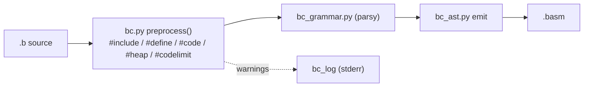
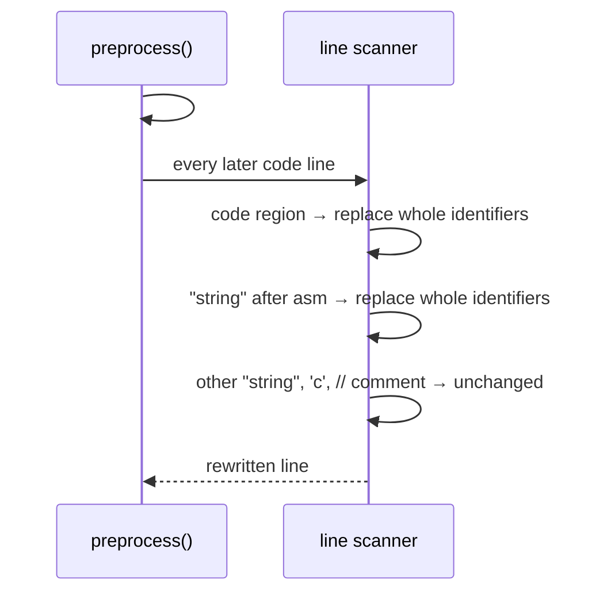

# Compiler: Token-Based #define Instead of Substring Replacement Plan

**Plan Status**: `FINAL`

**Story Type**: `Internal`

**Plan Revision**: `A0`

> This plan captures **what** to build and **why**: domain, architecture, decisions and verified facts.
> It does not contain implementation code. The implementation agent discovers the **how** against live code.

---

## 1. Problem Statement

*   **Context**: `src/bc/bc.py preprocess()` applies every `#define` as `str.replace` on each later line, longest name first. It replaces substrings anywhere: inside longer identifiers, in string literals and in trailing `//` comments. The reverse sort is the only reason `NULL` vs `NULLCHAR` works. `#define` takes the name up to the **last** space, so a value cannot contain spaces (issue #19, `docs/analysis/03-compiler.md` problem 7 / improvement 6).
*   **Goal**: a define replaces only whole identifier tokens in code and inside `asm "…"` strings, never inside other string literals, char literals or `//` comments. `#define NAME value…` takes the first token as the name and the rest of the line as the value. A redefinition gives a warning.
*   **In scope**: `bc.py preprocess()`, compiler unit tests, compiler docs, design decision C5 update, and removing the one dead duplicate `#define` found in `src/bdos/bdioh.b` (see D5).
*   **Out of scope**: `src/bc/bc_dbg.py` (a separate legacy debug helper with its own, already broken, copy of `preprocess()`; D6); function-like macros; `#undef`/`#ifdef`; mapping preprocessed lines back to source (#28).
*   **Roadmap**: phase 0, step 17 of `docs/analysis/08-self-hosted-roadmap.md` (owner comment, 2026-11-19). It must land before the ABI/runtime/templates freeze.

### 1.1 Technical Summary

*   **Touched projects**: `src/bc/` (compiler preprocessor + tests), `src/bdos/bdioh.b` (one line), docs.
*   **New patterns**: a small per-line scanner that splits a line into code / string / char-literal / comment regions and substitutes identifier tokens only in code regions and in `asm` strings.
*   **Infrastructure changes**: None.
*   **End-state observable behavior**: every existing program compiles to byte-identical `.basm` (verified by a trial patch, §2.4); new unit tests pin the token rule; a redefinition prints `<file>: warning: …` on stderr.

---

## 2. Architecture & Design

### 2.1 Architecture Overview

| Component | Technical Owner |
| :--- | :--- |
| `src/bc` compiler | bcichonski |

### 2.2 External Contracts & Evidence

N/A — Internal story.

#### Source Conflict Log

| Topic | Source A | Source B | Conflict | Chosen Handling |
| :--- | :--- | :--- | :--- | :--- |
| AC 2 "golden tests (#15)" | Issue AC 2 | #15 outcome (owner: no tracked golden `.basm`; `src/bc/code_size.csv` + `scripts/code_size.py --check`, metrics only) | There are no golden `.basm` tests | AC 2 is checked with `scripts/code_size.py --check` (size + `.basm` hash per program) plus a direct before/after `.basm` comparison of the build; no golden files are added (D4) |

### 2.3 Affected Areas

| Area / File (pointer) | Role in this change | Likely action |
| :--- | :--- | :--- |
| `src/bc/bc.py` `preprocess()` | `#define` parsing and substitution | Change |
| `src/bc/bc_log.py` | `warning()` already exists (stderr, `<file>: warning: …`) | Reference |
| `src/bc/bc_grammar.py` | Lexical facts: `quotedstr` = `"[^"]*"` (no escapes), `singlechar` = `'` any char `'`, `comment` = `//…`, `asm` statement takes a quoted string | Reference |
| `src/bc/tests/bc_codegen_tests.py` `TestPreprocessor` | existing define tests (`test_define_substitution`, `test_define_prefers_longest_name`, include test) — keep passing unchanged | Reference / add tests next to them (or a new `src/bc/tests/bc_preprocess_tests.py`) |
| `src/bdos/bdioh.b` | defines `BDIO_FOPEN_FDD_NOT_READY` twice (`0xe1`, then `0xe5`) | Change (D5) |
| `docs/03-compiler.md` (Preprocessor table) | describes the old substring rule | Change |
| `src/bc/CLAUDE.md` (How it works) | describes the old substring rule | Change |
| `docs/specs/memory/design-decisions.md` C5 | trade-off says "`#define` replaces text everywhere, including strings" | Change |
| `scripts/code_size.py`, `src/bc/code_size.csv` | AC 2 check (`--check`) | Reference (no row should change, so no `--record`) |

### 2.4 Key Algorithms & Behaviour

**Directive parsing**
*   `#define` line: strip, drop the `#define` keyword, split on the first run of whitespace. Name = first token, value = the rest of the line, stripped (may contain spaces). The name must be an identifier (`[A-Za-z_][A-Za-z0-9_]*`); a missing name, a non-identifier name or a missing value is a compile error (`<file>: error: …`, exit 1, via the existing compiler error path).
*   Redefinition of a name already defined **with a different value**: `bc_log.warning`, last definition wins (today's behaviour). Same name, same value: silent.
*   Define values are not themselves expanded (unchanged: `#define` lines are never substituted), so a define referring to another define keeps today's behaviour. Substitution is single-pass per token (a replaced value is not rescanned).
*   `#include`, `#code`, `#heap`, `#codelimit` lines and lines starting with `//` are handled as today, before substitution.

**Substitution on every other line** (left to right scan):
*   **Code region**: each maximal identifier token (`[A-Za-z_][A-Za-z0-9_]*`) equal to a define name is replaced by its value. A token that merely contains a define name (`MAXLINE` vs `MAX`) is untouched. Numbers like `0x10` must not have their `x10` treated as an identifier (a token starting with a digit is a number, scan it whole).
*   **String literal** `"…"` (ends at the next `"`; B has no escapes): untouched — **unless** the string directly follows the `asm` keyword token, then whole identifier tokens inside it are replaced (bdos relies on `asm "mov ci, PRINTF_FORMATCHAR"`).
*   **Char literal** `'c'` (exactly one char between quotes, any char including `"`, `'`, `/`): untouched and must not start a string or comment.
*   **`//` outside a string/char literal**: the rest of the line is untouched.
*   Longest-name-first ordering is no longer needed (tokens are matched whole); `test_define_prefers_longest_name` must still pass.

**Verified by a trial patch (2026-11-22, reverted)**: implementing exactly these rules and running `cd src && ./buildos && ./buildtools && ./buildapps && ./makedisc` gave all 11 generated `.basm` files byte-identical to master, and `python3 scripts/code_size.py --check` reported delta 0 for every program, including `src/bc/code/*`. So no hidden bug was masked by the substring rule in today's programs; AC 2 holds with zero codegen diff.

**Redefinitions found today**: only `BDIO_FOPEN_FDD_NOT_READY` in `src/bdos/bdioh.b` (`0xe1`, then `0xe5`; the generated code uses `0xe5`). It is included by every bdos program, so without D5 every build would print the new warning ten times.

---

## 3. Key Decisions & Assumptions

*   **D1 — Scanner, not regex `\b` over the whole line.** A per-line scanner over code / string / char / comment regions; `\b` alone would still replace inside strings and comments, and inside `0x…` digits.
*   **D2 — `asm` strings get token substitution; every other string does not.** "Follows `asm`" = the string's preceding non-space text ends with the identifier token `asm`.
*   **D3 — Redefinition with a different value warns, last wins**; same value is silent. Chosen over an error because the issue says "optionally warn", and an error would break any program with a harmless duplicate.
*   **D4 — AC 2 is checked with `code_size.py --check` + a before/after `.basm` diff**, not new golden files (owner rule from #15: no tracked golden `.basm`). Assumption: this satisfies "golden tests, #15" — **deviation from the literal AC wording**, flagged in the PR.
*   **D5 — Delete the first, overridden `#define BDIO_FOPEN_FDD_NOT_READY 0xe1` line in `bdioh.b`.** It has never had any effect (the later `0xe5` always won), so the build is unchanged and the new warning stays silent on real builds. Assumption: `0xe5` is the value the system actually returns today, so keeping it is behaviour-preserving; whether `0xe1` was the intended code is left for the owner and called out in the PR (not changed here).
*   **D6 — `bc_dbg.py` is out of scope.** It is a separate debug helper with its own `preprocess()` copy whose `#define` parsing is already broken (`newline[8:spacepos-1]` with the first space index). Changing it is not in the AC; noted in the PR as a possible follow-up.
*   **D7 — Malformed `#define` (no name, bad name, no value) is a compile error.** Today it crashes with a `ValueError` traceback or defines garbage; an `error:` line is the C6 convention.

### 3.1 Decision Lock (Constants & Policies)

| Constant / Policy | Selected Value | Why | Where it lives |
| :--- | :--- | :--- | :--- |
| Identifier token | `[A-Za-z_][A-Za-z0-9_]*` | matches the B grammar's names and asm register/label text | `bc.py` |
| Redefinition | warning if value differs, last wins | D3 | `bc.py` via `bc_log.warning` |
| Malformed `#define` | compile error, exit 1 | D7 / C6 | `bc.py` |
| Codegen diff allowed | none (all `.basm` identical) | AC 2 + trial patch | build check |

### 3.2 Open Questions

No open questions.

---

## 4. Task Breakdown

| Task | Title | Depends on | Complexity |
| :--- | :--- | :--- | :--- |
| `T1` | Token-based `#define` in the preprocessor + unit tests | — | `Medium` |
| `T2` | Remove the dead duplicate define, update docs and design decision | `T1` | `Low` |

### T1 — Token-based `#define` in the preprocessor + unit tests

*   **Goal**: `preprocess()` implements §2.4 exactly (directive parsing, scanner, redefinition warning, malformed-define error).
*   **Depends on**: —
*   **Complexity**: `Medium`
*   **Pointers**: `src/bc/bc.py` `preprocess()`; `src/bc/bc_log.py`; `src/bc/bc_grammar.py` (lexical facts); `src/bc/tests/bc_codegen_tests.py` `TestPreprocessor` (helpers `main_lines`, `compile_source`); `src/bc/tests/bc_output_tests.py` (how stderr/exit code of the CLI is tested).
*   **Definition of Done**:
    *   all §2.4 rules hold; longest-first sorting removed or harmless;
    *   full build (`cd src && ./buildos && ./buildtools && ./buildapps && ./makedisc`) succeeds and every generated `.basm` is byte-identical to the one built from the base commit (compare against a build of `git show <base>:src/bc/bc.py` in a temp copy, or keep a baseline copy before editing);
    *   `python3 scripts/code_size.py --check` exits 0 (no program changed); `code_size.csv` not modified;
    *   `python3 run_tests.py < /dev/null` from the repo root exits 0.
*   **Tests expected** (unit, `src/bc/tests/`, `*_tests.py` naming): a define does **not** change a longer identifier (both prefix and suffix cases), a non-`asm` string literal, a char literal (including `'"'` and `'/'` followed by more code on the line), or a trailing `//` comment; it **does** change whole tokens in code and in an `asm "…"` string (and not a longer token inside that asm string); a hex number containing the name's letters is untouched; a value with spaces works (e.g. an expression value); redefinition with a different value warns on stderr and the last value wins, same value is silent; a malformed `#define` gives a `error:` line and exit 1 (or the compiler's error path) instead of a traceback.
*   **Tests to modify**: None.

### T2 — Remove the dead duplicate define, update docs and design decision

*   **Goal**: real builds print no redefinition warning, and the docs describe the new rule.
*   **Depends on**: `T1` (uses the warning to confirm; both tasks build, so they must not run in parallel).
*   **Complexity**: `Low`
*   **Pointers**: `src/bdos/bdioh.b` (`BDIO_FOPEN_FDD_NOT_READY`, D5); `docs/03-compiler.md` Preprocessor table; `src/bc/CLAUDE.md` "How it works" preprocess bullet; `docs/specs/memory/design-decisions.md` C5 trade-offs (and add the token rule to its Usage, mentioning #19).
*   **Definition of Done**:
    *   only the `0xe1` line is removed; the full build is still byte-identical (`code_size.py --check` exits 0) and prints no `warning:` line from `bc`;
    *   `docs/03-compiler.md` and `src/bc/CLAUDE.md` state: name = first token, value = rest of line; whole-identifier replacement in code and in `asm` strings only; never in other strings, char literals or `//` comments; redefinition warns, last wins; malformed define is an error;
    *   C5's trade-off no longer claims replacement inside strings;
    *   `python3 run_tests.py < /dev/null` exits 0.
*   **Tests expected**: none new (docs + a behaviour-preserving source line); the existing suites must pass.
*   **Tests to modify**: None.

---

## 5. Verification

*   **Build**: `cd src && ./buildos && ./buildtools && ./buildapps && ./makedisc` — succeeds, no `bc` warnings.
*   **Codegen**: every generated `.basm` identical to the base commit's build; `python3 scripts/code_size.py --check` exits 0 (AC 2).
*   **Tests**: `python3 run_tests.py < /dev/null` from the repo root exits 0 (unit + e2e); report any expected failures by name, never as "all passed".
*   **Observable behaviour**: the new tests in `src/bc/tests/` cover every AC 1 case; docs updated (AC 3).

---

## 6. Fact-Integrity Checklist

| Check | Yes / No / N/A | Notes |
| :--- | :--- | :--- |
| External contracts verified from source | N/A | Internal |
| Evidence sources are reproducible | N/A | Internal |
| Identifier directionality / ordering / freshness meaning evidenced | N/A | Internal |
| Every `Assumption` is linked to an Open Question (§3.2) | Yes | D4/D5 assumptions are low-stakes, behaviour-preserving, and flagged in the PR instead |
| No unresolved Open Questions (for `FINAL`) | Yes | |
| Each Decision states a single committed approach | Yes | |
| Tasks are independent, each with a Definition of Done and test expectations | Yes | T2 after T1 only because both run the build |
| Required infra reflected | N/A | |

**Self-review note**: the scanner rules were proven on all real programs by a trial patch (zero `.basm` diff), so the risk is in edge cases the programs don't use: char literals holding `"` or `/`, hex numbers, and `asm` detection. The test list targets exactly those. D4 is a wording deviation from AC 2, and D5 picks the value that has always been in effect; both go in the PR for the owner.

---

## 7. Amendment Log

| Rev | Request | Decision | Plan changes |
| :--- | :--- | :--- | :--- |
