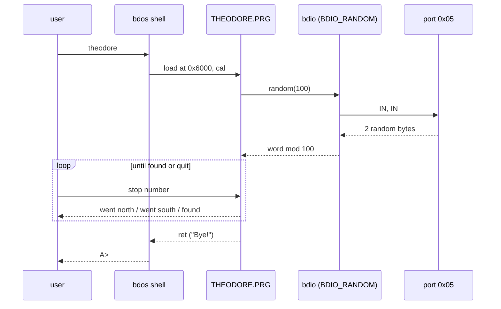

# Port "Looking for uncle Theodore" Game to the bdos System Disc Plan

**Plan Status**: `FINAL`

**Story Type**: `Internal`

**Plan Revision**: `A0`

> This plan captures **what** to build and **why**: domain, architecture, decisions, and verified facts.
> It deliberately does **not** contain implementation code, pseudocode, line numbers, mock setups, or test bodies.
> The implementation agent discovers the **how** against live code. See §4 Task Breakdown.

---

## 1. Problem Statement

*   **Context**: `src/bdos/theodore.b` ("Looking for uncle Theodore", a guessing game) is an old bc16-era program. It compiles unchanged today (`#code 0x6000`, `#heap 0xf000`, 3560 bytes = 28 sectors, verified by a spike build), but it is not built by any script and is not on `os.bdd`. It seeds its secret train stop from a typed "What time is it? (hhmm)" answer, its banner says "ucle", and it is v1.0. B programs have no way to read the hardware random generator (port `0x05`) except by hand-written `asm`.
*   **Goal**: `theodore` v1.1 runs from the bdos shell on the system disc. Its secret stop comes from the hardware random generator through a **new bdos system call** that any program can reach through a **separate, opt-in B include file**. Build scripts, catalog, disc, tests and docs are updated with it, and roadmap step 4 is marked done.
*   **In scope**:
    *   a bdio system call `BDIO_RANDOM` (`0x1a`) in bdos, plus the include file `src/bdos/random.b` with its wrapper `random(max)`;
    *   an emulator option `--random-seed N` so the game can be tested deterministically;
    *   theodore v1.1 source changes, `buildapps`, `makedisc`, catalog entry, rebuilt outputs (`theodore.*`, bdos outputs, `os.bdd`, `smoke.bdd` + transcript);
    *   e2e and unit tests, docs.
*   **Out of scope**:
    *   `utils.bdd` (#85). See Assumption A1.
    *   `calc.b`, other games, bcOS (ROM) changes, a bdos version bump, and fixing `parsedecw` on non-digit input (pre-existing).
    *   The `CP.PRG` 56/57 catalog mismatch (known, flips an `expectedFailure` test; leave it).

### 1.1 Technical Summary

*   **Touched components**: emulator CLI (`src/bc64.py`, `src/bc64/bc64_io.py`), e2e harness (`src/e2e_harness.py`), bdos (`bdioh.b`, `bdio.b`, new `random.b`), the app `theodore.b`, build scripts (`buildapps`, `makedisc`), the catalog `src/fcat0800.sector`, docs.
*   **New patterns / abstractions**: an opt-in B include for a system call (`random.b`) instead of growing `bdosh.b`; an emulator seed option for deterministic hardware randomness.
*   **Infrastructure changes**: disc layout: `THEODORE.PRG` at 53/0 on `os.bdd`, catalog entry `0x0c`.
*   **End-state observable behaviour**: booting `os.bdd`, `ls` lists `THEODORE.PRG -R-X …`, `theodore` prints `Looking for uncle Theodore v1.1`, asks for train stops with north/south hints, ends with `Yes! You have found uncle Theodore!` or a quit, prints `Bye!`, and returns to the `A>` prompt.

---

## 2. Architecture & Design

### 2.1 Architecture Overview

#### Involved components & owners

| Component | Technical Owner |
| :--- | :--- |
| emulator (`src/bc64.py`, `src/bc64/`) | repo owner (bcichonski) |
| bdos (`src/bdos/`) + system disc | repo owner (bcichonski) |
| e2e harness/tests (`src/test_e2e_*.py`) | repo owner (bcichonski) |

#### C2 diagram

```mermaid
flowchart LR
    T[theodore.b v1.1] -->|#include| R[random.b: random(max)]
    R -->|bdio_call F=0x37, A=0x1a, CSCI=max| M[bcOS os_metacall slot 0x37]
    M --> D[bdio.b: bdio_call dispatcher]
    D --> BR[bdio_random(max)]
    BR -->|IN port 0x05 twice| RNG[(emulator RandomGenerator)]
    CLI[bc64.py --random-seed N] -.seeds.-> RNG
```

#### Flow diagram



### 2.2 External Contracts & Evidence

N/A — Internal story.

#### Source Conflict Log

| Topic | Source A | Source B | Conflict | Chosen Handling |
| :--- | :--- | :--- | :--- | :--- |
| Target disc | #2 AC: `THEODORE.PRG` on `os.bdd` (system disc) | #85 (open, 2026-11-11): apps and games move to a new `utils.bdd`; theodore follow-up "targets `utils.bdd`" | #85 has not landed, `utils.bdd` does not exist | Follow #2's AC: `os.bdd`. #85 moves it with texted later (A1) |
| Where the RNG helper lives | #2 technical note: "put it in `std.b`" if useful to other programs | Owner during this run: "a separate #include file with rng as not all programs need it", a system function plus a compiler-side wrapper | — | New bdio call + separate `random.b` include (Decision D-1, D-2) |
| Free start track | #2 note: "track 52/0 is natural" | live catalog: `TEST.B` sits at 52/0 (2 sectors) since #47 | 52/0 is taken | `THEODORE.PRG` starts at 53/0 (D-4) |

### 2.3 Affected Areas

| Area / File (pointer) | Role in this change | Likely action |
| :--- | :--- | :--- |
| `src/bc64/bc64_io.py` `RandomGenerator` | port `0x05` device; already owns a private `random.Random()` | Change: accept an optional seed |
| `src/bc64.py` (`parse_args`, `Bc64.__init__`, `main`) | CLI and device wiring | Change: `--random-seed N` |
| `src/e2e_harness.py` `run_session` | runs headless sessions for e2e tests | Change: optional seed passed as `--random-seed` |
| `src/bdos/bdioh.b` | bdio call numbers and shared constants | Change: `BDIO_RANDOM 0x1a`, RNG port constant |
| `src/bdos/bdio.b` (`bdio_call` dispatcher, `bdio_getstate` shows the `IN` pattern) | bdos system call implementation | Change: new `bdio_random(max)` and dispatcher branch |
| `src/bdos/random.b` | opt-in wrapper for programs | New |
| `src/bdos/bdosh.b` | existing wrappers, included by every utility and texted | Reference only: **do not add to it** (D-2) |
| `src/bdos/theodore.b` | the game | Change: v1.1 |
| `src/buildos`, `src/buildapps`, `src/makedisc`, `src/fcat0800.sector` | build + disc layout | Change |
| `src/bdos/bdos.{basm,btap,sector}`, `src/bdos/theodore.{genb,basm,btap,sectors}`, `src/os.bdd`, `src/bc64/testdata/smoke.bdd`, `src/bc64/testdata/smoke_transcript.txt` | committed generated outputs (G3) | Regenerate + commit |
| `src/test_e2e_bdos.py`, `src/bc64/testdata/e2e/bdos_ls.golden.txt`, `bdos_rm.golden.txt` | `ls` catalog expectations on `smoke.bdd` | Change (new catalog line) |
| `src/test_e2e_bdio_buffered.py` + `src/bc64/testdata/e2e/bdio_buffered_prog.b` | model for an e2e test that compiles a B program, puts it on a disc copy and runs it | Reference |
| `docs/01-emulator.md`, `CLAUDE.md`, `docs/05-bdos.md`, `src/bdos/bdos.md`, `src/bdos/CLAUDE.md`, `docs/03-compiler.md` (B libraries table), `README.md`, `docs/specs/memory/design-decisions.md` | docs | Change |

### 2.4 Key Algorithms & Behaviour

**`--random-seed N` (emulator).** Optional, a non-negative integer (decimal or `0x` hex, same parsing style as `--max-instructions`). When given, the `RandomGenerator` on port `0x05` draws from a generator seeded with `N`, so two runs with the same seed and the same keystrokes read the same bytes. Without it, behaviour is unchanged (unseeded). It affects only port `0x05`: the tape recorder's module-level `random.seed()` and the clock are untouched. An invalid value is a usage error (exit 2, like other bad options).

**`BDIO_RANDOM` (`0x1a`), bdos.** Input `CSCI` = `max` (word). It reads port `0x05` twice and builds a 16-bit word (first byte high). `max = 0` returns that word unchanged; otherwise it returns the word modulo `max` (range `0 … max-1`; the slight modulo bias is accepted). It returns in `CSCI` like every other bdio call, never fails, and does not touch `BDIO_VAR_LASTERROR` or the disc. It is reached only through the `bdio_call` dispatcher (D4).

**`random.b`.** A new library file in `src/bdos/` with one function, `random(max)`, that calls `bdio_call(BDIO_RANDOM, max, 0)` and returns the word. It needs `bdosh.b` (for `bdio_call` and the constants) included **before** it and must not `#include` anything itself: duplicate function definitions are build errors since #10. A program that does not include `random.b` does not change by a single byte.

**theodore v1.1 game rules.**
*   Banner: `Looking for uncle Theodore v1.1`.
*   Start: the secret stop is `random(100)` (range 0..99). No time prompt and no other start prompt.
*   Each round prints `Where is uncle Theodore?` and the prompt `Type train stop number (0..99) or 100 to quit: `, then reads a line.
*   The input is parsed as a decimal **word**, so any value ≥ 100 quits. The old code truncated it to a byte, so `300` became stop 44.
*   For a guess below 100, the hints keep their current text and meaning. If the secret stop is below the guess, it prints `Uncle Theodore went south.`. If it is above, `Uncle Theodore went north.`. On a hit, `Yes! You have found uncle Theodore!` ends the game.
*   On a hit or a quit, it frees its buffer, prints `Bye!` and returns normally to the shell (`A>` prompt).

**Disc.** `THEODORE.PRG` is entry `0x0c` of `fcat0800.sector`, starting at track 53 sector 0, attributes `0x05` (R X). Its length is the sector count of the rebuilt `theodore.sectors`. bdos allocation is append-only after the last used sector (D3), so free space now starts after theodore.

---

## 3. Key Decisions & Assumptions

*   **D-1 — The RNG is a bdos system call.** Decision: `BDIO_RANDOM` = `0x1a`, the next free bdio number after `0x19`, implemented in `bdio.b`. Rationale: the owner asked for a system function. A bcOS (ROM) call was rejected: the ROM ends at `0x0d6a` with the bdio variables fixed at `0x0d80`, and bcOS prints its free-memory range at boot (`free F294 from 0D6A to FFFE` in every bcOS golden), so any ROM growth changes every e2e golden. bdos has room: it ends at about `0x52fb` against its `#codelimit 0x5d00`, and `BDOS.SYS` has 152 sectors with about 136 used.
*   **D-2 — Programs reach it through a separate include, `random.b`, not `bdosh.b`.** Rationale: the owner said "a separate #include file with rng as not all programs need it". Also, the compiler links every function of every included file (verified: `texted.basm` contains `bdio_fsetattr`/`bdio_fdelete` wrappers it never calls). TEXTED is 14334 of 14336 bytes in its 112-sector slot, so one more wrapper in `bdosh.b` would overflow it on its next rebuild. The same reason rules out `std.b` (the issue's note), which every program includes.
*   **D-3 — The seed comes from port `0x05`, not the RTC.** The AC allows either. The RNG needs no latch protocol and gives independent values per call. The RTC on port `0x03` stays unused.
*   **D-4 — `THEODORE.PRG` starts at 53/0.** 52/0 holds `TEST.B` (2 sectors). Programs on this disc start on track boundaries, and 53/0 leaves room to track 63.
*   **D-5 — The bdos version stays `bDOS 1.1`.** Adding a call number doesn't change the existing ABI, and the shell banner is in every bdos golden. The new call is documented as part of bdos 1.1.
*   **D-6 — Deterministic tests use a seed option on the emulator (`--random-seed`).** Without it the "played to the end" AC can't be checked non-interactively, because headless input is scripted up front. Goldens with a fixed seed depend on Python's `random.Random(seed).randint`. It has been stable since Python 3.2, and CI's e2e job runs a single Python (3.14).
*   **D-7 — Record D-1/D-2 as a new design decision** in `docs/specs/memory/design-decisions.md` under bdos: "**D7**. Optional services are opt-in includes: a bdio call any program may use, but whose wrapper lives in its own include file so programs that don't use it don't grow". Also mention `--random-seed` under the headless-mode emulator decision (E7).
*   **Assumption A1 (non-blocking):** theodore goes on `os.bdd` per #2's AC, even though #85 (open) will create `utils.bdd` for apps and games. #85 explicitly moves apps later ("Porting … theodore … targets utils.bdd"), so it will move `THEODORE.PRG` along with `TEXTED.PRG`. The PR notes this. Not an open question: the AC text answers it.
*   **Assumption A2 (non-blocking):** non-digit input (e.g. `q`) parses through the existing `parsedecw` as some number. That behaviour is pre-existing and stays out of scope. The prompt tells the user to type `100` to quit.

### 3.1 Decision Lock (Constants & Policies)

| Constant / Policy | Selected Value | Why | Where it lives |
| :--- | :--- | :--- | :--- |
| bdio call number | `BDIO_RANDOM` = `0x1a` | next free after `0x19` | `bdioh.b` |
| RNG port | `0x05` | emulator `RandomGenerator.DEFAULT_IO_PORT` | `bdioh.b` constant |
| `random(0)` | full 16-bit word | lets callers do their own scaling | `bdio.b` |
| Include file | `src/bdos/random.b`, function `random(max)` | owner request, D-2 | `src/bdos/` |
| Emulator option | `--random-seed N` (int ≥ 0) | D-6 | `bc64.py` |
| Game constants | 100 stops (0..99); ≥ 100 quits | existing `MAXSTOPS` | `theodore.b` |
| Banner | `Looking for uncle Theodore v1.1` | AC | `theodore.b` |
| Round prompt | `Type train stop number (0..99) or 100 to quit: ` | AC "prompts must make sense" | `theodore.b` |
| Catalog entry | `0c 35 00 <len> 05 "THEODORE" "PRG"` | D-4, AC R+X | `fcat0800.sector` |
| bdos banner | unchanged `bDOS 1.1` | D-5 | `bdos.b` |

### 3.2 Open Questions

No open questions.

---

## 4. Task Breakdown

| Task | Title | Depends on | Complexity |
| :--- | :--- | :--- | :--- |
| `T1` | Emulator `--random-seed` option + harness support | — | `Medium` |
| `T2` | bdos `BDIO_RANDOM` system call + `random.b` include, rebuilt bdos and disc | `T1` | `Medium` |
| `T3` | theodore v1.1 on the system disc | `T2` | `Medium` |
| `T4` | Docs: programs, disc layout, roadmap step 4 | `T3` | `Low` |

Common rules for every task (bc16):
*   Run every `src/` script from `src/`. The checkout is a worktree with `core.autocrlf=true`: judge line endings with `git show HEAD:<file>`, never the working file. Keep CRLF sources CRLF.
*   Never use `git stash`/`checkout`/`restore`. To prove a test fails, temporarily revert the change in the file instead.
*   Tests go in the component's own folder (emulator: `src/bc64/test_*.py`; e2e: `src/test_e2e_*.py`; goldens in `src/bc64/testdata/e2e/`). Never create a shared tests dir.
*   Must pass before returning: `python3 run_tests.py < /dev/null` from the repo root (exit 0).
*   After any `os.bdd` change, refresh `smoke.bdd` and `smoke_transcript.txt` (`src/bc64/CLAUDE.md`, "End-to-end (smoke) tests"). Regenerate affected goldens with `BC64_UPDATE_GOLDEN=1` and review the diff by eye. The only expected differences are the intended ones.
*   e2e session scripts must not use bcOS `q` or a bad-argument command except as the last command.

### T1 — Emulator `--random-seed` option + harness support

*   **Goal**: `bc64.py --random-seed N` makes port `0x05` reproducible, and e2e tests can request it.
*   **Depends on**: —
*   **Complexity**: `Medium`
*   **Pointers**: `src/bc64/bc64_io.py` (`RandomGenerator`), `src/bc64.py` (`parse_args`, `Bc64`, `main`, `positive_int` style), `src/e2e_harness.py` (`run_session`), `docs/01-emulator.md` (options table, port `0x5` section), root `CLAUDE.md` (headless options line), `docs/specs/memory/design-decisions.md` (E7).
*   **Definition of Done**:
    *   `--random-seed N` is accepted (decimal or hex, ≥ 0). With the same seed, the port `0x05` byte sequence is identical across emulator instances. Without the option, behaviour is unchanged. A bad value exits 2.
    *   `run_session` takes an optional seed and passes `--random-seed`. Existing callers are unaffected.
    *   The option is documented in `docs/01-emulator.md` (options table and the port `0x5` section), in the headless line of `CLAUDE.md`, and in decision E7.
*   **Tests expected**: unit (`src/bc64/test_devices.py` or a new `src/bc64/test_*.py`): the same seed gives the same sequence, different seeds give different sequences, and no seed still works. CLI (`src/test_bc64_cli.py` style, new tests): option parsed, invalid value exits 2. Harness self-test (new test in `src/test_e2e_harness.py` style): a seeded run passes the flag. Only add tests.
*   **Tests to modify**: None

### T2 — bdos `BDIO_RANDOM` system call + `random.b` include

*   **Goal**: any bdos program that includes `bdosh.b` then `random.b` can call `random(max)` and gets a hardware random number from bdos. The system disc carries the rebuilt bdos.
*   **Depends on**: `T1` (seeded e2e test)
*   **Complexity**: `Medium`
*   **Pointers**: `src/bdos/bdioh.b` (call numbers), `src/bdos/bdio.b` (`bdio_getstate` for the `IN` pattern, `bdio_call` dispatcher), new `src/bdos/random.b`, `src/buildos` (rebuilds bcOS + boot + bdos), `src/makedisc`, `src/test_e2e_bdio_buffered.py` + `src/bc64/testdata/e2e/bdio_buffered_prog.b` (model for a compiled-program e2e test), `docs/05-bdos.md` (bdio call table §"bdio: the system call API"), `src/bdos/bdos.md` (call list), `docs/03-compiler.md` ("B libraries" table), `src/bdos/CLAUDE.md` (libraries line), `docs/specs/memory/design-decisions.md` (new D7).
*   **Definition of Done**:
    *   Behaviour per §2.4 (`BDIO_RANDOM`, `random.b`). `bdosh.b` and `std.b` are unchanged.
    *   `./buildos` is rerun. The bcOS ROM (`.b81`) and `boot.sector` stay byte-identical; only the bdos outputs change. bdos still meets its `#codelimit`.
    *   `./makedisc` is rerun so `os.bdd` carries the new `BDOS.SYS`. `smoke.bdd` and its transcript are refreshed. No other program output changes.
    *   Docs: the call in both bdio call lists, `random.b` in the library tables (03-compiler, 05-bdos sources table, `src/bdos/CLAUDE.md`), and decision D7 added.
*   **Tests expected**: e2e (new `src/test_e2e_random.py`, modelled on `test_e2e_bdio_buffered.py`): a small B test program in `src/bc64/testdata/e2e/` includes `bdosh.b` + `random.b`, prints several `random(10)` values and a `random(0)`, and is put on a copy of `os.bdd`. It checks that every bounded value is < 10, that two runs with the same seed print the same values, and that a different seed changes them. Byte-exact goldens are optional.
*   **Tests to modify**:
    *   `src/bc64/testdata/smoke.bdd`, `src/bc64/testdata/smoke_transcript.txt`: refreshed because `os.bdd` gets a new `BDOS.SYS` (G3; CI's e2e job fails on a stale smoke disc).

### T3 — theodore v1.1 on the system disc

*   **Goal**: AC 1–5 and 7: `theodore` builds, is on `os.bdd` with a correct catalog entry, starts from the shell, takes its start from the RNG, can be won or quit, and returns to the shell. All outputs are committed.
*   **Depends on**: `T2`
*   **Complexity**: `Medium`
*   **Pointers**: `src/bdos/theodore.b`, `src/buildapps`, `src/makedisc` (both the `btap2bin` and the `importsector` line), `src/fcat0800.sector` (16-byte entries; write it with a small Python one-off, not by hand), `src/e2e_harness.py` (`read_catalog`, `run_session` with seed), `src/test_e2e_bdos.py`, goldens `bdos_ls`/`bdos_rm`.
*   **Definition of Done**:
    *   Game behaviour exactly per §2.4 / §3.1 (banner, no time prompt, round prompt, word parse, hints, found/quit → `Bye!` → `A>`).
    *   `./bcc bdos/theodore` and `./buildapps` build it. The `sys_codeend` assert holds.
    *   `makedisc` writes `THEODORE.PRG` at 53/0. The catalog entry `0x0c` has attributes `0x05`, and its length equals the sector count of `theodore.sectors`.
    *   Committed: `theodore.genb/.basm/.btap/.sectors`, `fcat0800.sector`, `os.bdd`, refreshed `smoke.bdd` and transcript, regenerated goldens.
    *   A full `./buildos && ./buildtools && ./buildapps && ./makedisc` in a temp copy of the repo reproduces the committed `os.bdd`.
*   **Tests expected**: e2e (new `src/test_e2e_theodore.py`, on a copy of `smoke.bdd` or `os.bdd`):
    *   `ls` lists `THEODORE.PRG -R-X` with its start `35 00` and its length; the catalog entry read via `read_catalog` has attributes R+X and matches the sector file's length.
    *   A seeded game: the banner says v1.1 and there is no `What time` text. A scripted guess sequence chosen for that seed (determine the secret stop by a spike) shows at least one `went north`, at least one `went south`, then the found message, `Bye!`, the `A>` prompt and `exit`.
    *   Quit: `100` prints `Bye!` and gets back to `A>`. A value ≥ 256 (e.g. `300`) also quits.
    *   Two different seeds give different secret stops.
*   **Tests to modify**:
    *   `src/test_e2e_bdos.py :: CATALOG_LINES` (used by `BdosShellTests.test_ls_lists_catalog`): `ls` gains `THEODORE.PRG -R-X …`, and the free-entries marker goes from `EB` to `EA` (AC-2 adds a catalog entry).
    *   `src/bc64/testdata/e2e/bdos_ls.golden.txt`, `src/bc64/testdata/e2e/bdos_rm.golden.txt`: the new catalog line, free entries and free sectors (AC-2).
    *   `src/bc64/testdata/smoke.bdd`, `src/bc64/testdata/smoke_transcript.txt`: refreshed from the new `os.bdd` (AC-2/AC-7; its `ls` lists THEODORE).

### T4 — Docs: programs, disc layout, roadmap step 4

*   **Goal**: AC 8: the docs describe theodore as a program on the system disc, and roadmap step 4 is done.
*   **Depends on**: `T3`
*   **Complexity**: `Low`
*   **Pointers**: `docs/05-bdos.md` (sources table "older or test programs, not on the disc", "Programs on the system disc" table + the paragraph after it, disc layout table, "Building the system disc" `buildapps` comment), `src/bdos/CLAUDE.md` (Programs list, `buildapps` comment), `src/bdos/bdos.md` (disc layout notes if it lists the tracks), `README.md` (BC64 roadmap step 4 "texted and game new versions" marked done; the software list line for theodore), root `CLAUDE.md` if it names the apps.
*   **Definition of Done**: theodore is listed with usage `theodore` and a one-line description (find uncle Theodore among stops 0..99; the start stop comes from the random generator; 100 quits). It is removed from every "not on the disc" mention (calc, fddtest and debug stay there). The layout table has row 12 `THEODORE.PRG` 53/0, the real length, R X. The README marks roadmap step 4 done (e.g. "(done: TextEd v1.2 #1, theodore v1.1 #2)"). The docs contain no wrong claims (e.g. that buildapps builds only helloworld + texted).
*   **Tests expected**: none (docs only). `python3 run_tests.py < /dev/null` still passes.
*   **Tests to modify**: None

---

## 5. Verification

*   **Build**: from `src/`, `./buildos && ./buildtools && ./buildapps && ./makedisc` in a temp copy of the repo reproduces every committed output, including `os.bdd`. (The `CP.PRG` catalog length is a known exception that isn't part of the disc content.)
*   **Tests**: `python3 run_tests.py < /dev/null` from the repo root, exit 0 (unit + e2e). CI's `tests` workflow (unit 3.10/3.14, e2e) is green.
*   **Observable behaviour**: `printf 'ls\ntheodore\n50\n100\nexit\n' | python3 bc64.py bc81asmc/bcOS/bcos_v1_2_0.b81 --disk-a <copy of os.bdd> --random-seed 1` shows `THEODORE.PRG -R-X`, the v1.1 banner, a hint, `Bye!` and `A>`.

---

## 6. Fact-Integrity Checklist

| Check | Yes / No / N/A | Notes |
| :--- | :--- | :--- |
| External contracts verified from producer/contract source | N/A | Internal story |
| Evidence sources are reproducible | N/A | Internal story |
| Identifier directionality / ordering / freshness meaning evidenced | N/A | Internal story |
| Every `Assumption` is linked to an Open Question (§3.2) | Yes | A1, A2 are answered by AC text / pre-existing behaviour and do not affect correctness |
| No unresolved Open Questions (for `FINAL`) | Yes | |
| Each Decision states a single committed approach | Yes | |
| Tasks are independent, each with a Definition of Done and test expectations | Yes | sequential through the shared `os.bdd`, intentionally |
| Required infra reflected | N/A | no toggle, no Service Bus |

**Self-review note**: Verified facts: the catalog (`TEST.B` at 52/0, 2 sectors; next entry number `0x0c`), the last bdio call number (`0x19`), that the compiler links unused library functions, TEXTED's 2-byte headroom, and that theodore compiles today to 0x0de8 bytes. The theodore length after adding `bdosh.b` + `random.b` is not known yet: measure it from the build and never guess it into the catalog. Take extra care with the order of `#include`s (`bdosh.b` before `random.b`, no nested includes), with keeping the bcOS ROM byte-identical through `./buildos`, and with refreshing `smoke.bdd` and goldens in the same commit as `os.bdd`.

---

## 7. Amendment Log

| Revision | Request | Decision | Plan changes |
| :--- | :--- | :--- | :--- |
| A0 | — | initial plan; includes the owner's mid-run direction (RNG as a system function + separate `#include`) | — |
