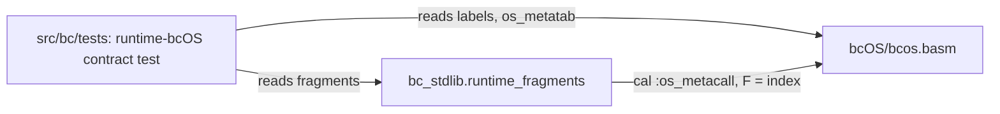

# Compiler: Clean Up the Runtime (Stale Definitions, ROM vs Private Routines) Plan

**Plan Status**: `FINAL`

**Story Type**: `Internal`

**Plan Revision**: `A0`

> This plan captures **what** to build and **why** — domain, architecture, decisions, and verified facts.
> It deliberately does **not** contain implementation code, pseudocode, line numbers, mock setups, or test bodies.
> The implementation agent discovers the **how** against live code. See §4 Task Breakdown.

---

## 1. Problem Statement

*   **Context**: Issue #29 (analysis problem 10, improvement 9) reports that the end of
    `src/bc/bc_stdlib.py` carries `.def var_promptbuf, 0x0bcf` and `.def var_user_mem, 0x0bcb`,
    bcOS 1.1 addresses that nothing references, and that the ROM-vs-private choice of routines
    looks accidental. Probing `origin/master` (f21c159) shows:
    *   **The two stale `.def`s are already gone.** #16 (dead-code elimination, commit `c267de4`)
        split the runtime into `Fragment`s and dropped them (its plan allowed it: "may be dropped").
        The only `.def` left in the runtime is `.def os_metacall, 0x0008` (fragment `os_metacall`),
        which is the real, contract-asserted address (`bc81asmc_contract_tests.py` asserts
        `:os_metacall = 0x0008`, `:os_metatab = 0x000c`).
    *   **Every runtime ROM wrapper already uses the right `os_metatab` index.** All 21 fragments
        that `cal :os_metacall` load an index whose `os_metatab` entry in
        `src/bc81asmc/bcOS/bcos.basm` is the routine of the same name (`fatal` 0x14,
        `printhex4` 0x03, … `strncpy` 0x33); `mem_cpy` uses `setvarparam16` (0x08) then
        `mem_xcpy` (0x32). Nothing checks this, so it can drift silently.
    *   What is left from the issue: `src/bc/CLAUDE.md` still warns about the stale definitions
        (AC 4), `docs/analysis/03-compiler.md` still lists problem 10 / improvement 9 as open,
        and nothing stops a hard-coded bcOS address or a wrong metacall index from coming back.
*   **Goal**: close #29: the runtime is free of stale definitions **and guarded against them**,
    the runtime↔bcOS contract (the `.def` addresses and the `os_metacall` indices) is checked by
    a unit test derived from `bcos.basm`, and the docs no longer describe the stale definitions as
    present.
*   **In scope**: a compiler unit test guarding the runtime↔bcOS contract; `src/bc/CLAUDE.md`;
    `docs/analysis/03-compiler.md` (problem 10, improvement 9); a pointer in `docs/03-compiler.md`;
    the size report and full-rebuild check from AC 3.
*   **Out of scope** (AC 2): switching any private runtime routine to a ROM call or back
    (`poke16`/`peek16`, comparisons, …) — that is #33 / #34. The undocumented 8-byte
    `runtime_head` (assumption A-1 of #16) — removing it changes every program and is not a
    stale definition. bcOS itself.

### 1.1 Technical Summary

*   **Touched projects**: `src/bc` (tests + `CLAUDE.md`), `docs/`.
*   **New patterns / abstractions**: a unit test that reads `src/bc81asmc/bcOS/bcos.basm` as the
    source of truth for the runtime's external addresses and metacall indices.
*   **Infrastructure changes**: None.
*   **End-state observable behaviour**: generated code is byte-identical to master
    (`scripts/code_size.py --check` delta 0); a runtime `.def` with a wrong/non-bcOS address, or a
    wrapper loading the wrong `os_metatab` index, fails `run_tests.py --group unit`.

---

## 2. Architecture & Design

### 2.1 Architecture Overview

#### Involved components & owners

| Component | Technical Owner |
| :--- | :--- |
| Compiler runtime (`src/bc/bc_stdlib.py`) | bcichonski |
| bcOS ROM (`src/bc81asmc/bcOS/bcos.basm`) — read only | bcichonski |

#### C2 diagram



#### Flow diagram

```mermaid
sequenceDiagram
    participant P as compiled program
    participant W as runtime wrapper (e.g. printstr)
    participant M as os_metacall @0x0008
    participant R as ROM routine (os_metatab[index])
    P->>W: cal :printstr
    W->>M: F = 0x02; cal :os_metacall
    M->>R: dispatch through os_metatab
```

### 2.2 External Contracts & Evidence

N/A — Internal story.

#### Source Conflict Log

| Topic | Source A | Source B | Conflict | Chosen Handling |
| :--- | :--- | :--- | :--- | :--- |
| Stale `.def`s | Issue #29 body / AC 1 ("No stale `.def`s in `bc_stdlib.py`") | `origin/master` `bc_stdlib.py` (after #16) | The issue describes them as present; they were removed by #16 | AC 1 is already met; this story adds the guard that keeps it met and says so in the PR (not a deviation — the AC holds). |
| CLAUDE.md warning | `src/bc/CLAUDE.md` ("The `.def var_promptbuf 0x0bcf` / `var_user_mem 0x0bcb` at the end of the runtime are stale …") | `bc_stdlib.py` | Describes code that no longer exists | Replace with the rule the new test enforces (AC 4). |

### 2.3 Affected Areas

| Area / File (pointer) | Role in this change | Likely action |
| :--- | :--- | :--- |
| `src/bc/bc_stdlib.py` (`runtime_fragments`, `Fragment`) | The runtime; its fragment texts hold the `.def` and the metacall index loads | Reference (no change expected) |
| `src/bc81asmc/bcOS/bcos.basm` (`os_metacall`, `os_metatab`, labels) | Source of truth for addresses and indices | Reference |
| `src/bc/tests/bc_runtime_tests.py` | Existing runtime/fragment tests — model for style and for how `bc_stdlib` is imported | Reference |
| `src/bc/tests/bc_assert_tests.py` (`assemble`) | Helper that runs the real assembler on a `.basm` text | Reference (may be reused) |
| `src/bc81asmc/tests/bc81asmc_contract_tests.py` | Already asserts `os_metacall = 0x0008`, `os_metatab = 0x000c` on bcOS | Reference |
| new `src/bc/tests/bc_runtime_bcos_tests.py` | The guard test | New |
| `src/bc/CLAUDE.md` (Rules, the `os_metacall` bullet) | Carries the stale warning | Change |
| `docs/analysis/03-compiler.md` (problems table row 10; proposal 9) | Lists the stale defs as open | Change |
| `docs/03-compiler.md` (runtime / "OS bridge" description) | Component doc of the runtime | Change (one pointer) |
| `scripts/code_size.py` | Size report (#15) | Run only (`--check`) |

### 2.4 Key Algorithms & Behaviour

**Runtime ↔ bcOS contract (what the guard test asserts):**

1.  **External addresses.** Every `.def NAME, ADDR` in any runtime fragment names a label that is
    defined in `bcos.basm`, and `ADDR` equals that label's address in the assembled ROM. Today that
    is exactly `os_metacall = 0x0008`. A `.def` of a name bcOS does not define (e.g. the old
    `var_promptbuf` / `var_user_mem`, which are bcOS *variables* whose addresses are only meant to be
    read from `os_vartab`) fails the test with the fragment name.
    *   The label address must come from assembling the real `bcos.basm` (the assembler already
        knows every label address), not from a hard-coded table in the test.
2.  **Metacall indices.** For every `cal :os_metacall` in a runtime fragment, the index loaded into
    `F` just before it (the wrappers do `mov a|ci, 0xNN; psh …; pop f`) selects the `os_metatab`
    entry expected for that call. The expected entry is the fragment's own name; the only exception
    today is `mem_cpy`, which calls `setvarparam16` then `mem_xcpy` — the test states that
    exception explicitly rather than skipping the fragment. `os_metatab` entries are read from
    `bcos.basm` (the `.db :label` list from `os_metatab:` up to `os_vartab:`, in order; non-label
    filler entries such as `0x00` keep their positions).
3.  **No hard-coded bcOS RAM addresses.** No runtime fragment contains a literal in the
    bcOS variable range that stands for a bcOS variable; covered by rule 1 for `.def`s. (Literal
    immediates inside routines are not inspected — too many false positives; out of scope.)
4.  **Failure messages** name the fragment, the index/address found and the entry/address
    expected, so a future runtime author sees what drifted.

**Size and behaviour:** no runtime or compiler code changes, so every program's `.basm` must be
identical to master (`scripts/code_size.py --check` reports a total delta of 0). That is the
"effect" AC 3 asks the size report to show: the stale `.def`s cost 0 bytes and their removal
landed in #16.

---

## 3. Key Decisions & Assumptions

*   **Decision D-1 — guard, don't re-remove.** AC 1 is already satisfied on master (#16). This story
    delivers the regression guard (§2.4) so the stale definitions, or new hard-coded bcOS
    addresses, cannot return unnoticed. Rationale: the issue's use case is "can't drift from bcOS".
*   **Decision D-2 — `bcos.basm` is the source of truth**, read at test time; the test never
    carries a copy of `os_metatab` or of label addresses.
*   **Decision D-3 — "general tidy-up" is limited to the stale-definition remnants** (docs and the
    `CLAUDE.md` warning) plus the guard. The undocumented `runtime_head` (8 bytes, #16 A-1) and any
    ROM-vs-private routine choice stay as they are (AC 2: #33/#34 own them).
*   **Decision D-4 — no new design-decision id.** The rule is already decision O1 ("routines in both
    the ROM and the runtime are owned by the ROM … through `os_metacall`") and O2 ("`#NN` must equal
    the real `os_metatab` index"); the guard enforces them. Avoids the parallel-run id collisions
    seen on C/E/A ids.
*   **Decision D-5 — no `code_size.csv` rows.** `--record` appends only changed rows; with a 0 delta
    there is nothing to record. The `--check` result goes in the PR body.
*   **Assumption A-1** — AC 3's "boot `os.bdd`, smoke-test `ls`, `cat`, `texted`" is satisfied by a
    full rebuild (`run_tests.py` builds the pipeline) plus the full e2e suite, which boots `os.bdd`
    and drives `ls`, `cat` and TextEd (on `utils.bdd`, drive B, since #85). Low stakes: the generated
    code is unchanged.

### 3.1 Decision Lock (Constants & Policies)

| Constant / Policy | Selected Value | Why | Where it lives |
| :--- | :--- | :--- | :--- |
| Only allowed runtime `.def` today | `os_metacall` = address of bcOS label `os_metacall` (0x0008) | contract (bc81asmc contract test) | `bc_stdlib.py`, checked by the new test |
| Metacall exception list | `mem_cpy` → [`setvarparam16`, `mem_xcpy`] | the only wrapper that calls two ROM routines | new test |
| Size effect | total delta 0 | no codegen change | `scripts/code_size.py --check` |

### 3.2 Open Questions

No open questions.

---

## 4. Task Breakdown

| Task | Title | Depends on | Complexity |
| :--- | :--- | :--- | :--- |
| `T1` | Runtime ↔ bcOS contract unit test | — | `Medium` |
| `T2` | Docs: drop the stale-definitions warning, close analysis problem 10 | `T1` | `Low` |

### T1 — Runtime ↔ bcOS contract unit test

*   **Goal**: a compiler unit test fails if a runtime fragment `.def`s an address that is not the
    assembled address of a bcOS label of that name, or loads an `os_metatab` index that does not
    select the expected ROM routine before `cal :os_metacall` (§2.4 rules 1, 2, 4).
*   **Depends on**: —
*   **Complexity**: `Medium`
*   **Pointers**: new `src/bc/tests/bc_runtime_bcos_tests.py` (picked up by the compiler suite's
    `*_tests.py` discovery from `src/bc`); `src/bc/bc_stdlib.py` `runtime_fragments`;
    `src/bc81asmc/bcOS/bcos.basm`; `src/bc/tests/bc_runtime_tests.py` and
    `src/bc/tests/bc_assert_tests.py` for import style and the assembler helper;
    `src/bc81asmc/tests/bc81asmc_contract_tests.py` for how bcOS is read/assembled.
    Note (memory, #15): `import bc81asmc` from outside `src/bc81asmc` can load the *package*
    `src/bc81asmc/__init__.py` when the repo is pip-installed — load the assembler by file path or
    run it as a subprocess, as `bc_assert_tests.assemble` does.
*   **Definition of Done**:
    *   The test passes on the current runtime (no `bc_stdlib.py` change).
    *   It derives `os_metatab` order and label addresses from `bcos.basm` at run time (D-2).
    *   It covers every fragment that calls `os_metacall` (asserts the set is non-empty and that
        each such call was matched), with `mem_cpy` as the explicit exception (§3.1).
    *   Mutation check, done by hand and reported (not committed): temporarily changing one wrapper's
        index (e.g. `printstr`) or adding `.def var_promptbuf, 0x0bcf` to a fragment makes the test
        fail with a message naming the fragment; revert afterwards by editing the file back (no git
        stash/checkout/restore).
    *   `python3 run_tests.py --group unit` exits 0.
*   **Tests expected**: unit (compiler suite): addresses of runtime `.def`s vs assembled bcOS;
    metacall index → `os_metatab` entry per fragment; the `mem_cpy` exception; a negative case
    proving the checker rejects a bad `.def` / bad index (by feeding the checker a doctored
    fragment text in-test, so the guard is itself tested).
*   **Tests to modify**: None.

### T2 — Docs: drop the stale-definitions warning, close analysis problem 10

*   **Goal**: no doc describes the stale `.def`s as present; the runtime↔bcOS rule points at the
    guard test (AC 4).
*   **Depends on**: `T1` (names the test file).
*   **Complexity**: `Low`
*   **Pointers**: `src/bc/CLAUDE.md` (Rules: the `os_metacall`/`os_metatab` bullet);
    `docs/analysis/03-compiler.md` (problems table row 10; proposal 9); `docs/03-compiler.md`
    (where the runtime / OS bridge is described). Follow the existing "done" style of the analysis
    docs (e.g. row 6 "(**resolved by #20**)", `docs/analysis/02-assembler.md` "#10 (done)").
*   **Definition of Done**:
    *   `src/bc/CLAUDE.md` no longer mentions `var_promptbuf 0x0bcf` / `var_user_mem 0x0bcb`; the
        bullet says the runtime's only external addresses are `.def`s of bcOS labels (today
        `os_metacall`), bcOS variables are read through `os_vartab`, metacall indices must match
        `os_metatab`, and `tests/bc_runtime_bcos_tests.py` checks both.
    *   `docs/analysis/03-compiler.md` row 10 and proposal 9 are marked resolved (removed by #16,
        guarded by #29), keeping the ROM-vs-private sentence pointing at #33/#34.
    *   `docs/03-compiler.md` mentions the guard in one sentence where the OS bridge is described.
    *   No other doc changes (do not touch other stories' decisions or text).
*   **Tests expected**: none (docs only); `python3 run_tests.py --group unit` still exits 0.
*   **Tests to modify**: None.

---

## 5. Verification

*   **Unit**: `python3 run_tests.py --group unit` — exit 0.
*   **Size report (AC 3)**: build (`cd src && ./buildos && ./buildtools && ./buildapps && ./makedisc`,
    or let `run_tests.py` build) then `python3 scripts/code_size.py --check` — total delta 0 against
    `src/bc/code_size.csv`; quote the result in the PR.
*   **Full rebuild + smoke (AC 3)**: `python3 run_tests.py < /dev/null` (full suite, builds the
    pipeline first, boots `os.bdd` and exercises `ls`, `cat`, TextEd) — exit 0; report the
    expected-failure count separately, never as "all passed".
*   **Grep**: `git grep -n -E "var_promptbuf, 0x0bcf|0x0bcb" -- src/bc` → no matches;
    `git grep -n "0x0bcf" -- src/bc/CLAUDE.md` → no matches.
*   **AC 2**: `git diff origin/master -- src/bc/bc_stdlib.py src/bc81asmc` is empty.

---

## 6. Fact-Integrity Checklist

| Check | Yes / No / N/A | Notes |
| :--- | :--- | :--- |
| External contracts verified from producer/contract source | N/A | Internal story |
| Evidence sources are reproducible | N/A | Internal story |
| Identifier directionality / ordering / freshness meaning evidenced | N/A | Internal story |
| Every `Assumption` is linked to an Open Question (§3.2) | Yes | A-1 is low-stakes and does not affect correctness (codegen unchanged) |
| No unresolved Open Questions (for `FINAL`) | Yes | |
| Each Decision states a single committed approach | Yes | |
| Tasks are independent, each with a Definition of Done and test expectations | Yes | |
| Required infra reflected | N/A | No toggle, no infra |

**Self-review note**: The main surprise is that #16 already removed the stale `.def`s, so the
story's code value is the guard test. The metacall-index mapping was verified by a throw-away
script on master (all 21 wrappers match; `mem_cpy` is the only two-call wrapper). The
implementation agent should take care parsing `os_metatab` (multi-line `.db` with trailing
comments and `0x00` fillers) and reading label addresses from the real assembler rather than
re-deriving them.

---

## 7. Amendment Log

| Revision | Request | Decision | Plan changes |
| :--- | :--- | :--- | :--- |
