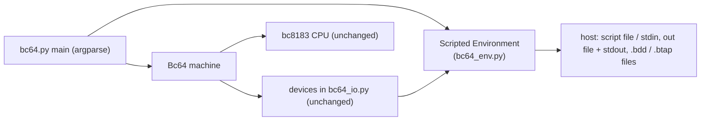
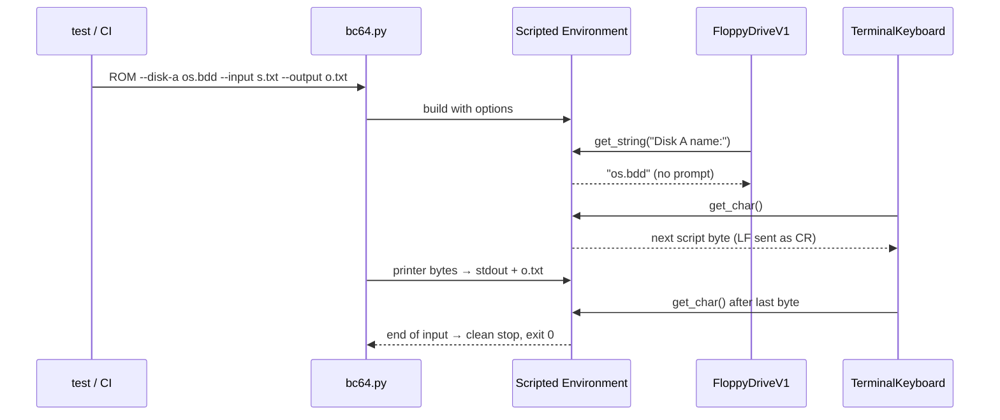

# Emulator Headless Mode: Disks, Tape, Keyboard and Output from the Command Line Plan

**Plan Status**: `FINAL`

**Story Type**: `Internal`

> This plan captures **what** to build and **why** — domain, architecture, decisions, and verified facts.
> It deliberately does **not** contain implementation code, pseudocode, line numbers, mock setups, or test bodies.
> The implementation agent discovers the **how** against live code. See §4 Task Breakdown.

Issue: [bcichonski/bc16#3](https://github.com/bcichonski/bc16/issues/3). Base branch: `bc64`.

---

## 1. Problem Statement

*   **Context**: The BC64 emulator (`src/bc64.py`) is interactive only. Disk image names are asked on stdin
    (`Environment.get_string`, prompt `Disk A name:` from `FloppyDriveV1.check`), tape names are asked the same way
    (`Type name of the tape to read: ` / `... to write: ` from `TapeRecorder.set_state`), the keyboard is a raw
    `getch` (`Environment.get_char`), and printer output goes only to the terminal (`Environment.write_char`).
    So the real system (bcOS → bdos → apps) can only be tested by hand.
*   **Goal**: Command-line options so a script can drive a whole session (boot `os.bdd`, run shell commands and
    programs, stop) and capture its printer output for comparison, plus a smoke test that does exactly that.
*   **In scope**: `--disk-a`, `--disk-b`, `--tape-dir`, `--input`, `--output`, `--max-instructions`, exit codes,
    a scripted environment, unit tests, one end-to-end smoke test, docs.
*   **Out of scope**: CI workflow wiring (separate toolchain issue), the web console (#6), emulator speed, any change
    to the CPU (`bc8183_cpu.py`) or the devices (`bc64_io.py`), any change to bcOS/bdos code or disk images.

### 1.1 Technical Summary

*   **Touched components**: emulator only — `src/bc64.py` (entry point / CLI) and `src/bc64/bc64_env.py` (host layer).
*   **New abstraction**: a scripted environment next to the console `Environment`, configured per feature (disks,
    tape dir, input source, output file), so each option works on its own.
*   **Infrastructure changes**: None.
*   **End-state observable behaviour**: `python3 bc64.py ROM --disk-a os.bdd --input script.txt --output out.txt`
    boots bdos with no prompt, types the script, writes everything the printer printed to `out.txt` (and still to
    stdout), and exits 0 when the CPU halts or the script runs out.

---

## 2. Architecture & Design

### 2.1 Architecture Overview

#### Involved services & owners

| Component | Technical Owner |
| :--- | :--- |
| emulator (`src/bc64.py`, `src/bc64/`) | bcichonski |

#### C2 diagram

#### Flow diagram

### 2.2 External Contracts & Evidence

`N/A — Internal story`

#### Source Conflict Log

| Topic | Source A | Source B | Conflict | Chosen Handling |
| :--- | :--- | :--- | :--- | :--- |
| Reading keys from stdin | Issue: "keyboard bytes come from a file (or stdin when piped)" | AC 1: "without the new options behaves exactly as today"; today a pipe answers the `Disk A name:` prompt (root `CLAUDE.md`) | Auto-detecting a pipe changes how piped text is consumed | **Owner decision (2026-11-09, during the /grind run): piping must just work.** When stdin is not a TTY and `--input` is not given, stdin is the key source. Today's piped disk name still works, because unanswered prompts read the next script line (D3, amended). |
| "Devices don't change" vs. counting instructions | Issue: CPU and devices don't change | `--max-instructions` needs an instruction count | The CPU's `run()` loop has no limit | The step loop for a limited run lives in `bc64.py` and calls the CPU's existing per-instruction method; the CPU file is not edited (D6). |

### 2.3 Affected Areas

| Area / File (pointer) | Role in this change | Likely action |
| :--- | :--- | :--- |
| `src/bc64/bc64_env.py` | `Environment`: console prompt (`get_string`), raw `getch` (`get_char`), `write_char`, file opens | Change: add the scripted environment (subclass or configurable variant) and the end-of-input signal |
| `src/bc64.py` | `main(argv)`, `Bc64`, `import_rom`, `dump_mem`; today `argv[1]` = ROM, any `argv[2]` = trace | Change: argparse CLI, limited-run loop, exit codes |
| `src/bc64/bc64_io.py` | `FloppyDriveV1.check` asks `Disk {A,B} name:` when the drive has no name (first access and after `EJECT`), appends `.bdd`; `TapeRecorder.set_state` asks the tape name and appends `.btap` | Reference only — must not change |
| `src/bc64/bc8183_cpu.py` | `run()`, `run_next_opcode()`, `inc_pc(0)`, `kill`, `flush_debug()` | Reference only — must not change |
| `src/bc64/test_env.py` | existing `Environment` tests (temp files, debug off) | Change: tests for the scripted environment |
| `src/test_*.py` / `src/bc64/test_*.py` | emulator suite, discovered from `src/` with `-p "test_*.py"` | New: CLI tests and the smoke test |
| `src/os.bdd`, `src/bc81asmc/bcOS/bcos_v1_2_0.b81` | system disc and ROM used by the smoke test | Reference only (the test works on a copy) |
| `docs/01-emulator.md`, `CLAUDE.md`, `src/bc64/CLAUDE.md`, `docs/specs/memory/design-decisions.md` | user docs, agent guidance, decision record | Change |

### 2.4 Key Algorithms & Behaviour

*   **Verified session behaviour** (spike on `bc64` @ `06df0cd`, with a scripted `get_char`/`get_string`): booting
    `bcos_v1_2_0.b81` with drive A = a copy of `src/os.bdd` prints `bcOS 1.2`, `booting from FDD`, `lding`,
    `bDOS 1.1 shell`, the free bytes, `reading disc...`, then `A>`. Typing `ls`, `cat -c test.b`, `hellowrd`
    (`Hello world!` then `10`) and `exit` (`bye!`, CPU `KIL`) works when Enter is sent as **CR (`0x0d`)**. The whole
    session takes about 3 s. The disc file was byte-identical afterwards.
*   **Disk names**: the scripted environment answers a `get_string` prompt that matches `Disk A name:` /
    `Disk B name:` with the configured image path for that drive, without printing anything or reading stdin. The
    answer is given every time the drive asks (so it still works after `EJECT`). A prompt for a drive with no
    configured image, and any other prompt, falls back: to the next line of the scripted input when `--input` is set,
    otherwise to today's console `input()`.
*   **Tape**: the tape name still comes from the prompt answer (the next script line in scripted mode, otherwise the
    console). With `--tape-dir DIR`, every file open whose name ends in `.btap` is resolved inside `DIR` (a name that
    is already absolute is left alone). Without the option, tape files stay in the current directory as today.
*   **Keyboard input**: `--input FILE` reads key bytes from the file; `--input -` reads them from stdin. Bytes are
    delivered one per `get_char` call, unbuffered by lines. Line endings are translated so that each line ending in
    the script (`LF`, `CR LF` or `CR`) becomes one `CR`. All other bytes pass through unchanged. When `get_char` is
    called after the last byte, the environment raises a dedicated end-of-input exception.
    Lines read for a prompt answer (above) consume script bytes up to and including the line ending; the ending is not
    part of the answer.
*   **Output**: `--output FILE` copies every printer byte to the file (binary, unchanged byte values, flushed so a
    crash still leaves the output so far) while stdout keeps showing it. The file is created or truncated at start.
    Debug log lines (`env.log`) and emulator messages are not printer output and are not written to the file.
*   **Stopping and exit codes**:
    *   CPU halts (`KIL`): memory dump to `bc64.dmp` as today, exit 0.
    *   End of scripted input: clean stop, no memory dump, exit 0.
    *   `--max-instructions N` reached before a halt: message on stderr, no dump, exit 3.
    *   Exception inside the emulator: today's behaviour (the CPU prints the address and stack, Python prints the
        traceback), non-zero exit (1).
    *   Bad command line: argparse's usage error, exit 2.
    *   In every case the output file is closed and the CPU trace buffer is flushed (the CPU's own `run()` does this
        in a `finally`; the limited loop must do the same).
*   **Backward compatibility**: `python3 bc64.py ROM` and `python3 bc64.py ROM d` (any second positional word turns
    the trace on) keep working. With a TTY on stdin and no new option, the console `Environment` is used exactly
    as today, so `src/run` keeps working. With piped stdin, the scripted environment takes over (D3). Piped prompt
    answers such as the disk name still work, because unanswered prompts read the next line of the pipe.

---

## 3. Key Decisions & Assumptions

*   **D1 — Scripted environment in `bc64_env.py`**: one environment class for headless mode, built from the parsed
    options; each feature is optional and independent (e.g. `--disk-a` alone still uses the console keyboard). The
    console `Environment` is not changed. Rationale: the issue asks for "a scripted environment next to the console
    one" and decision E2 (all host access through `Environment`).
*   **D2 — Enter is CR**: line endings in the input script become `0x0d`. Rationale: raw `getch` delivers CR for
    Enter, and the spike shows the shell only accepts CR. Script files can then be normal text files.
*   **D3 — Piped stdin is the key source (amended by the owner)**: when `--input` is not given and stdin is not a
    TTY, the emulator runs with the scripted environment and reads keys from stdin. `--input -` does the same
    explicitly, and `--input FILE` overrides the pipe. With a TTY and no new option, the console `Environment` is
    used exactly as today (AC 1). Compatibility: today a pipe can only answer prompts, because the raw `getch`
    fails on a pipe, and in the new mode an unanswered prompt (e.g. `Disk A name:` with no `--disk-a`) still reads
    the next line of the pipe. So `printf 'os.bdd\nls\n' | python3 bc64.py ROM` mounts `os.bdd` and then types
    `ls`. The first plan version required `--input -`. The owner overrode that: "i want it just to work".
*   **D4 — End of input is a clean stop (exit 0) without a memory dump**; the dump stays tied to `KIL`. Rationale:
    the issue says the emulator "stops cleanly"; writing `bc64.dmp` on every scripted run would leave files around
    for no reason.
*   **D5 — Exit code 3 for `--max-instructions`**: distinct from 1 (exception) and 2 (usage), so CI can tell a
    runaway program from a crash.
*   **D6 — Limited run loop in `bc64.py`**: when `--max-instructions` is given, `Bc64.run` steps the CPU through its
    existing methods and counts instructions; without the option it calls `cpu.run()` as today. Rationale: the CPU
    file must not change, and the default path must stay identical.
*   **D7 — Prompt matching by text**: the drive letter comes from the `Disk X name:` prompt text the floppy already
    sends. Rationale: devices must not change; the prompt text is a stable string in `bc64_io.py`. A test pins it.
*   **D8 — Tests**: environment unit tests in `src/bc64/test_env.py`; CLI and smoke tests in `src/` next to
    `bc64.py` (e.g. `src/test_bc64_cli.py`, `src/test_bc64_smoke.py`). The smoke test runs `bc64.py` as a subprocess
    (`sys.executable`, cwd = a temp dir) on a **copy** of `src/os.bdd`, so the committed disc and the tree stay
    untouched, and compares the output file with an expected transcript committed under `src/bc64/testdata/`.
    Tests stay silent and deterministic (decision G11). Note: `import bc64` from `src/` resolves to the
    `bc64/` package, not `bc64.py`; tests that need the module load it by file path or run it as a subprocess.
*   **Assumption A1 — transcript content**: the expected transcript covers boot, `ls`, `cat -c test.b`, `hellowrd`
    and `exit` on today's `src/os.bdd`. The free-bytes and free-sectors numbers are part of it, so a later rebuild of
    `os.bdd` changes the transcript. That is acceptable and intended (it is a regression check); the test's failure
    message must say how to regenerate the transcript. No correctness risk, no Open Question.

### 3.1 Decision Lock (Constants & Policies)

| Constant / Policy | Selected Value | Why | Where it lives |
| :--- | :--- | :--- | :--- |
| Enter byte | `0x0d` (CR) | spike + raw `getch` behaviour | scripted environment |
| Stdin as key source | `--input -`, or automatically when stdin is not a TTY and `--input` is absent | owner decision, D3 | CLI |
| Exit: halt / end of input | `0` | issue | `bc64.py` |
| Exit: emulator exception | `1` | Python default for an uncaught exception | `bc64.py` |
| Exit: usage error | `2` | argparse default | `bc64.py` |
| Exit: instruction limit | `3` | D5 | `bc64.py` |
| Memory dump | only on `KIL` | D4 | `bc64.py` |
| Disk prompt pattern | `Disk A name:` / `Disk B name:` | D7 | scripted environment |

### 3.2 Open Questions

No open questions.

---

## 4. Task Breakdown

| Task | Title | Depends on | Complexity |
| :--- | :--- | :--- | :--- |
| `T1` | Scripted environment | — | `Medium` |
| `T2` | Command line, limited run and exit codes | `T1` | `Medium` |
| `T3` | End-to-end smoke test with expected transcript | `T2` | `Medium` |
| `T4` | Docs and decision record | `T2` | `Low` |

### T1 — Scripted environment

*   **Goal**: `bc64_env.py` offers a scripted environment that answers disk prompts from configuration, reads keys
    from a byte source with CR line endings, signals end of input, resolves `.btap` files in a tape directory, and
    copies printer output to a file.
*   **Depends on**: `—`.
*   **Complexity**: `Medium`.
*   **Pointers**: `src/bc64/bc64_env.py`; prompt texts in `src/bc64/bc64_io.py` (`FloppyDriveV1.check`,
    `TapeRecorder.set_state`); existing tests `src/bc64/test_env.py`. §2.4 and D1, D2, D4, D7.
*   **Definition of Done**: every behaviour in §2.4 for disks, tape, keyboard input and output exists in the
    environment; a dedicated end-of-input exception type is exported for `bc64.py` to catch; the environment can be
    closed (output file closed); the console `Environment` behaves exactly as before; no change to
    `bc64_io.py` or `bc8183_cpu.py`.
*   **Tests expected**: unit tests in `src/bc64/test_env.py`, silent, using `tempfile`: disk prompt answered per
    drive without stdin (including a repeated ask), unconfigured drive falls back to the next script line, LF / CR LF
    / CR all become one CR, other bytes unchanged, end of input raises the exception, `.btap` names resolved under
    the tape dir and absolute names untouched, output file receives exactly the printed bytes, and the prompt texts
    used by the floppy device still match what the environment expects (drive a real `FloppyDriveV1` read through
    the scripted environment).

### T2 — Command line, limited run and exit codes

*   **Goal**: `bc64.py` parses `ROM [trace] [--disk-a F] [--disk-b F] [--tape-dir DIR] [--input F|-] [--output F]
    [--max-instructions N]`, builds the right environment, and exits with the codes in §3.1.
*   **Depends on**: `T1`.
*   **Complexity**: `Medium`.
*   **Pointers**: `src/bc64.py` (`main`, `Bc64.run`); CPU methods `run`, `run_next_opcode`, `inc_pc`, `kill`,
    `flush_debug` in `src/bc64/bc8183_cpu.py` (read only); `src/run`. D3–D6.
*   **Definition of Done**: with no new option **and stdin a TTY**, the console `Environment` and `cpu.run()` are
    used exactly as today (ROM optional, any second positional word = trace). Any new option, **or stdin not being a
    TTY** (D3, amended), switches to the scripted environment, with stdin as the key source unless `--input FILE` is
    given. The TTY check is injectable or patchable for tests. end of
    input → exit 0 without dump; `KIL` → dump + exit 0; instruction limit → stderr message + exit 3; exception →
    non-zero; output file closed and trace flushed on every path; `--help` lists every option.
*   **Tests expected**: tests in `src/` (e.g. `test_bc64_cli.py`), silent, temp dirs: argument parsing (defaults,
    legacy trace word, each option); a tiny hand-made ROM image (e.g. a few bytes ending in `KIL`, and an endless
    loop) run through `main` or as a subprocess to check exit 0 + dump on halt, exit 3 on the limit, exit 0 on end
    of input when the ROM reads the keyboard, and the output file contents for a ROM that prints; piped stdin with
    no `--input` is typed as keys, and a piped first line answers an unconfigured disk prompt.

### T3 — End-to-end smoke test with expected transcript

*   **Goal**: one unittest runs a real session — boot `os.bdd`, `ls`, `cat -c test.b`, `hellowrd`, `exit` —
    and compares the captured printer output with a committed transcript.
*   **Depends on**: `T2`.
*   **Complexity**: `Medium`.
*   **Pointers**: `src/bc81asmc/bcOS/bcos_v1_2_0.b81`, `src/os.bdd`, `src/bc64/testdata/` (new), D8, A1.
*   **Definition of Done**: the script and the expected transcript are committed under `src/bc64/testdata/`; the
    test copies `os.bdd` to a temp dir, runs `bc64.py` as a subprocess with `--disk-a`, `--input`, `--output` and a
    generous `--max-instructions` safety limit, and asserts exit 0, no prompt on stdout, and output equal to the
    transcript (on mismatch, the message shows the difference and how to regenerate); the committed `src/os.bdd`
    is unchanged after the run; the test is found by `python3 run_tests.py` and takes well under a minute.
*   **Tests expected**: the smoke test itself (emulator suite). Also check that the transcript contains
    `Hello world!` and the `ls` listing, so an empty or truncated transcript can't pass.

### T4 — Docs and decision record

*   **Goal**: the new options are documented for users and agents.
*   **Depends on**: `T2`.
*   **Complexity**: `Low`.
*   **Pointers**: `docs/01-emulator.md` (Running it), root `CLAUDE.md` (build pipeline note about piped input;
    commands block), `src/bc64/CLAUDE.md` (commands), `docs/specs/memory/design-decisions.md` (emulator section).
*   **Definition of Done**: `docs/01-emulator.md` documents every option, the Enter = CR rule, end-of-input
    behaviour, the tape-dir rule and the exit-code table, with an example session command; root `CLAUDE.md` and
    `src/bc64/CLAUDE.md` show the headless command and replace the "needs piped input" advice; a new emulator
    decision records headless mode (D1–D7 in short); no other content changed.
*   **Tests expected**: none (docs). The commands shown must actually work (run the example once).

---

## 5. Verification

*   **Tests**: `python3 run_tests.py` from the repo root — exit 0, with the new emulator tests counted. Run with
    CPython 3.10 and 3.13+ where available (decision G11).
*   **Default path**: `python3 bc64.py bc81asmc/bcOS/bcos_v1_2_0.b81` from `src/` with `os.bdd` piped as the disk
    name still boots (as today).
*   **Headless path**: from `src/`, a session with `--disk-a` (a copy of `os.bdd`), `--input` (the smoke script)
    and `--output` exits 0, prints no `Disk A name:` prompt, and the output file equals the committed transcript.
*   **Unchanged files**: `git diff bc64 -- src/bc64/bc8183_cpu.py src/bc64/bc64_io.py src/os.bdd` is empty;
    no `bc64.dmp`, `cpudebug.log` or `.btap` files are left in the tree.

---

## 6. Fact-Integrity Checklist

| Check | Yes / No / N/A | Notes |
| :--- | :--- | :--- |
| External contracts verified from producer/contract source | N/A | Internal story |
| Evidence sources are reproducible | N/A | Internal story |
| Identifier directionality / ordering / freshness meaning evidenced | N/A | Internal story |
| Every `Assumption` is linked to an Open Question (§3.2) | Yes | A1 has no correctness impact (a regression transcript) |
| No unresolved Open Questions (for `FINAL`) | Yes | |
| Each Decision states a single committed approach | Yes | |
| Tasks are independent, each with a Definition of Done and test expectations | Yes | |
| Required infra reflected | N/A | no toggles or infrastructure |

**Self-review note**: the shell's behaviour (CR as Enter, the commands, the output) was checked with a spike, not
inferred. The main judgement calls are D3 (stdin only with `--input -`, to keep AC 1) and D4 (no dump on end of
input). Implementers must not edit `bc64_io.py` or `bc8183_cpu.py`. They must run the smoke test on a copy of
`os.bdd` and leave no generated files in `src/`. Line endings in this repo are LF in git, but the sandbox checks
files out as CRLF; judge them with `git show HEAD:<file>`.

---

## Amendment log

*   **2026-11-09 — D3 changed by the owner** before T2 started: piped stdin is typed as keystrokes without
    `--input -` ("i want it just to work"). Updated: the Source Conflict Log, D3, the Decision Lock, the
    backward-compatibility rule in §2.4, and T2's Definition of Done and tests. T1 is unaffected: its
    `input_source='-'` already reads stdin.
*   **2026-11-09 — smoke test split, at the owner's request ("fix it"), after PR #71 was opened**: the owner's
    uncommitted rebuild of `src/os.bdd` changes the `ls` listing, the free-space numbers and `test.b`, so a
    byte-exact transcript of the live disc would break on every rebuild. The byte-exact transcript test now boots a
    frozen disc (`src/bc64/testdata/smoke.bdd`, a copy of `os.bdd` at `06df0cd`). A second test boots the current
    `src/os.bdd` (`ls`, `hellowrd`, `exit`) and checks only rebuild-stable markers. Both pass on the committed and
    on the rebuilt disc. This supersedes A1's note that a rebuild changes the transcript.
