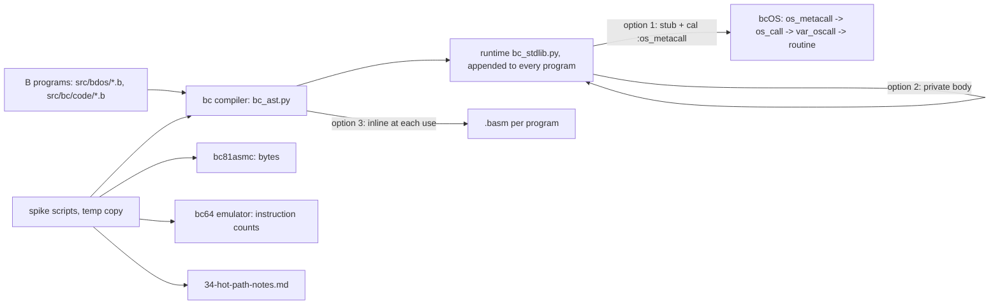

# Spike: Hot-Path Runtime Routines (ROM Call, Private Copy or Inline) Plan

**Plan Status**: `FINAL`

**Story Type**: `Internal`

**Plan Revision**: `A0`

> This plan captures **what** to build and **why**. It deliberately does **not** contain implementation code,
> pseudocode, line numbers or test bodies. The implementation agent discovers the **how** against live code.

---

## 1. Problem Statement

*   **Context**: Decision (a) (#33) says the compiler runtime (`src/bc/bc_stdlib.py`) calls bcOS ROM routines through
    `os_metacall` instead of carrying private copies. The hot paths were left out until this spike answers, for
    `poke16`, `peek16`, `gt16`, `gteq16` and `eq16`, which delivery option is best:
    1. **ROM call** through `os_metacall` (a stub in the runtime that loads the table index and calls `0x0008`);
    2. **private copy** of the routine body in `bc_stdlib.py`;
    3. **inline sequence** emitted at each use (no call).
*   **Goal**: measured numbers (bytes per use, bytes in total for bdos, texted and `ls`, instructions per call from an
    emulator run, and how often each routine is used) and a recommendation per routine, weighing **size first** and
    speed only as a tie-breaker (E6: the emulator is intentionally slow), including the interaction with #17.
*   **In scope**: a write-up with numbers and recommendations; throw-away measurement tooling kept with the write-up.
*   **Out of scope**: any production change. `src/` (compiler, runtime, bcOS, bdos, apps), `scripts/`, CI and the
    committed `code_size.csv` stay byte-identical. Writing the owner's decision into #33 or a follow-up issue is the
    owner's step after this spike.

### 1.1 Technical Summary

*   **Touched areas**: `docs/specs/plans/` only: the write-up and a spike folder with the measurement scripts.
*   **New patterns / abstractions**: none in production. The prototypes of options 1–3 are built in a **temp copy** of
    the sources by the spike scripts, never in the repo tree.
*   **Infrastructure changes**: None.
*   **End-state observable behavior**: `docs/specs/plans/34-hot-path-notes.md` holds the tables and a recommendation per
    routine. Re-running the spike scripts reproduces the numbers. `git diff origin/master -- src scripts .github` is empty.

---

## 2. Architecture & Design

### 2.1 Architecture Overview

#### Involved components & owners

| Component | Technical Owner |
| :--- | :--- |
| Compiler codegen (`src/bc/bc_ast.py`) and runtime (`src/bc/bc_stdlib.py`) | bcichonski |
| bcOS ROM (`src/bc81asmc/bcOS/bcos.basm`) | bcichonski |
| Emulator (`src/bc64/`, `src/bc64.py`) | bcichonski |

#### C2 diagram



#### Flow diagram

```mermaid
sequenceDiagram
  participant S as spike script
  participant T as temp copy of src/
  participant C as bc + bc81asmc
  participant E as bc64 emulator
  S->>T: copy sources, apply variant (today / ROM / copy / inline) per routine
  S->>C: compile + assemble every program
  C-->>S: .basm (static use counts), byte sizes
  S->>E: micro-benchmark per routine and option; scripted program runs
  E-->>S: instructions per call, dynamic call counts
  S-->>S: tables for the write-up
```

### 2.2 External Contracts & Evidence

N/A — Internal story.

#### Source Conflict Log

| Topic | Source A | Source B | Conflict | Chosen Handling |
| :--- | :--- | :--- | :--- | :--- |
| What "today" is | Issue: option 2 "private copy in `bc_stdlib.py` (today)" | `src/bc/bc_stdlib.py` | Only `poke16`/`peek16` are private copies today. `gt16`/`gteq16`/`eq16` are **already** ROM calls: runtime stubs that load `0x21`/`0x22`/`0x23` and call `os_metacall`. | Measure all three options for all five routines and label the current state per routine in every table (D2). |
| #17 status | Issue: "#17, which already inlines memory access" | #17 is OPEN (`status:todo`); `stackvar*` helpers still call `peek16`/`poke16` on every variable access | #17 is a proposal, not shipped. | Report counts twice: today, and "after #17" with the `stackvar*`-internal uses removed (D5). No #17 code is written. |
| Where to prototype | Issue: "prototype on a throw-away branch only" | Repo rule: generated outputs untracked; PR must show no production change | A pushed prototype branch would be unreviewed code on origin. | Prototypes are built in a temp copy by the spike scripts; the repo tree and origin never carry a modified compiler (D1). Flagged in the PR as a stricter reading, not a deviation in substance. |

### 2.3 Affected Areas

| Area / File (pointer) | Role in this change | Likely action |
| :--- | :--- | :--- |
| `src/bc/bc_stdlib.py` | Runtime template: private `poke16`/`peek16`, ROM stubs for `gt16`/`gteq16`/`eq16`; `stackvar*`, `stackoffscalc*`, `mseek` call `peek16`/`poke16` internally | Reference; variants applied in the temp copy only |
| `src/bc/bc_ast.py` | Emits `cal :eq16`/`gteq16`/`gt16` in `EXPRESSION_BINARY.logic`, `cal :peek16` for unary `#`, `cal :poke16` in the main entry prologue | Reference; inline variant applied in the temp copy only |
| `src/bdos/std.b`, `src/bdos/*.b`, `src/bc/code/*.b` | B wrappers `peek16()`/`poke16()` and `asm "cal :…"` uses in libraries and apps | Reference (static use counts) |
| `src/bc81asmc/bcOS/bcos.basm` | `os_metacall` (`0x0008`), `os_call` dispatcher, `os_metatab` slots `0x09`/`0x0a`/`0x21`/`0x22`/`0x23`, ROM bodies | Reference (dispatch path length, register effects) |
| `scripts/code_size.py` | Existing way to build every program in a temp copy and read byte sizes | Reference / reuse by import or by its approach; not modified |
| `src/e2e_harness.py`, `src/tests/test_e2e_*.py` | Scripted headless runs of bdos, `ls`, `texted` | Reference for the dynamic-count runs |
| `docs/specs/plans/34-hot-path/` | Spike scripts (throw-away measurement tooling) | New |
| `docs/specs/plans/34-hot-path-notes.md` | The deliverable write-up | New |

### 2.4 Key Algorithms & Behaviour

*   **Use census (static).** For every program `code_size.py` measures, count call sites of each routine in the generated
    `.basm`, split by origin: (a) compiler codegen (comparisons, unary `#`, prologue), (b) runtime-internal (`stackvar*`,
    `stackoffscalc*`, `mseek`, …), (c) B library / app code (`asm "cal :…"`, including the `std.b` wrappers). A routine
    body itself is not a use.
*   **Byte model per option**, all from real assembler output, not hand-counted:
    *   option 1 (ROM): runtime stub bytes (once per program) + `cal` bytes per use;
    *   option 2 (private copy): body bytes (once per program, i.e. the ROM body copied) + `cal` bytes per use;
    *   option 3 (inline): body bytes without `ret` per use (with unique local labels for the comparisons), 0 runtime bytes.
    *   Total per program = runtime part + per-use part. Headline programs: `bdos/bdos`, `bdos/texted`, `bdos/ls`;
        the full program list goes in an appendix table.
*   **Prototype check.** For each option the spike builds the real variant in a temp copy and reads the actual program
    sizes; the model must agree with the build (any difference is explained in the notes). A variant counts as valid
    only if the rebuilt programs still work in a short scripted run (boot to bdos, `ls`), because options 1 and 3 change
    which registers/flags are clobbered (`os_call` uses `f` as the index; inline comparisons need their own labels).
*   **Instructions per call** (emulator): executed instruction count from the `cal` at the use site to the instruction
    after it returns, per routine and option, including the whole ROM dispatch path for option 1. Measured, not
    estimated, by running a small program/snippet in the emulator and counting instructions.
*   **Dynamic frequency**: how often each routine runs during a representative scripted session (boot bdos, `ls`, a
    short `texted` run as in the e2e tests), so total instruction deltas per option can be shown.
*   **Recommendation rule** (per routine): pick the option with the smallest **total bytes across bdos + texted + ls**;
    if two options are within a small margin (state the margin used), prefer fewer instructions per call. Give the
    "after #17" result too, and say whether the recommendation changes.

---

## 3. Key Decisions & Assumptions

*   **D1 — Prototypes live in temp copies only.** The spike scripts copy the sources to a temp dir and apply each
    variant there (as `code_size.py` builds in a temp copy). Nothing under `src/`, `scripts/` or `.github/` changes;
    no prototype branch is pushed. This satisfies "no production change" and "prototype on a throw-away branch" more
    strictly.
*   **D2 — All three options are measured for all five routines**, and each table marks which option is today's
    (`peek16`/`poke16`: private copy; `gt16`/`gteq16`/`eq16`: ROM call).
*   **D3 — Size first, speed breaks ties** (issue AC). Headline totals are bdos + texted + `ls`.
*   **D4 — ROM option means the table index through `os_metacall` only.** Calling a ROM routine's direct address is not
    an option: only `os_metacall` (`0x0008`), `os_metatab` and `os_vartab` are stable (`docs/analysis/04-bcos.md`,
    fixes item 2). It may be mentioned as an excluded alternative.
*   **D5 — #17 interaction is modelled, not implemented**: the "after #17" column removes the runtime-internal
    `peek16`/`poke16` uses made by the `stackvar*` helpers (the accesses #17 would inline) and keeps every other use.
*   **D6 — Spike tooling is committed with the notes** under `docs/specs/plans/34-hot-path/` so the numbers are
    reproducible. It is not wired into `run_tests.py`, CI or `scripts/`, and needs no unit tests (throw-away by intent).
*   **D7 — Write-up location**: `docs/specs/plans/34-hot-path-notes.md` (the issue allows plans notes or an issue
    comment; the file is reviewable in the PR, and /grind's final comment on #34 links to it with the summary table).
*   **Assumption A1** — "Count how often each routine is used" is answered both statically (call sites) and dynamically
    (calls during a scripted session). Low stakes: both are reported.

### 3.1 Decision Lock (Constants & Policies)

| Constant / Policy | Selected Value | Why | Where it lives |
| :--- | :--- | :--- | :--- |
| Routines | `poke16`, `peek16`, `gt16`, `gteq16`, `eq16` | Issue scope | Notes, scripts |
| Headline programs | `bdos/bdos`, `bdos/texted`, `bdos/ls` | Issue AC | Notes |
| Option 1 dispatch | `os_metacall` table index only | D4 | Notes |
| Production tree | unchanged (`src/`, `scripts/`, `.github/`, `code_size.csv`) | Issue AC "no production change" | Whole story |
| Tie margin | stated in the notes (suggest ≤ 1% of the headline total) | D3 | Notes |

### 3.2 Open Questions

No open questions.

---

## 4. Task Breakdown

| Task | Title | Depends on | Complexity |
| :--- | :--- | :--- | :--- |
| `T1` | Static use census and byte model per option | — | `Medium` |
| `T2` | Built prototypes of each option (temp copy) with real sizes and a smoke run | — | `High` |
| `T3` | Instructions per call and dynamic call counts in the emulator | — | `Medium` |
| `T4` | Write-up with numbers and a recommendation per routine | `T1`, `T2`, `T3` | `Medium` |

### T1 — Static use census and byte model per option

*   **Goal**: a spike script that compiles every program (temp copy) and prints, per routine and program, the static use
    counts split by origin (codegen / runtime-internal / library+app), and the modelled bytes per use and per program for
    options 1–3, today and "after #17".
*   **Depends on**: —
*   **Complexity**: `Medium`
*   **Pointers**: `src/bc/bc_stdlib.py`, `src/bc/bc_ast.py`, `src/bdos/std.b`, `scripts/code_size.py` (temp-copy build,
    program list), `src/bc81asmc/` (instruction encodings: take byte lengths from the assembler, not by hand).
*   **Definition of Done**: script under `docs/specs/plans/34-hot-path/` runs with `python3` from the repo root, writes a
    Markdown table (or tables) to stdout or a file in that folder; the repo tree outside that folder is unchanged after a
    run (`git status` shows only the new folder).
*   **Tests expected**: none added to the suites (D6). The script's output is checked by T4's cross-check against T2.
*   **Tests to modify**: None

### T2 — Built prototypes of each option with real sizes and a smoke run

*   **Goal**: for each routine and option, build the real variant in a temp copy (runtime and/or codegen changed only
    there), measure every program's size the way `code_size.py` does, and prove each variant still works with a short
    scripted emulator run (boot to bdos, run `ls`) on a disc built from that variant.
*   **Depends on**: —
*   **Complexity**: `High` (inline comparisons need unique labels; ROM calls change clobbered registers/flags; a disc must
    be rebuilt per variant)
*   **Pointers**: `src/bc/bc_stdlib.py`, `src/bc/bc_ast.py` (`EXPRESSION_BINARY.logic`, unary `#`, main prologue),
    `src/bc81asmc/bcOS/bcos.basm` (`os_call`, `os_metatab`), `scripts/code_size.py`, `src/makedisc`/`ftool_mkdisc.py`,
    `src/e2e_harness.py`, memory notes on running CRLF scripts (`bash <(tr -d '\r' < script)`).
*   **Definition of Done**: script under `docs/specs/plans/34-hot-path/` that produces a table of real sizes
    (bdos, texted, ls and all programs) per variant and a pass/fail smoke result per variant; a variant that breaks is
    reported as broken with the reason, not silently dropped; repo tree outside the spike folder unchanged.
*   **Tests expected**: none added to the suites (D6).
*   **Tests to modify**: None

### T3 — Instructions per call and dynamic call counts

*   **Goal**: measured executed-instruction counts per call for each routine under each option (including the full ROM
    dispatch path for option 1), and the number of calls of each routine during a representative scripted session.
*   **Depends on**: —
*   **Complexity**: `Medium`
*   **Pointers**: `src/bc64.py` (`--max-instructions`, trace mode), `src/bc64/` (CPU loop, to count by PC in-process),
    `src/e2e_harness.py` and `src/tests/test_e2e_*.py` (scripted sessions for bdos, `ls`, `texted`),
    `src/bc81asmc/bcOS/bcos.basm` (`os_metacall`, `os_call`, `var_oscall`).
*   **Definition of Done**: script under `docs/specs/plans/34-hot-path/` printing a table of instructions per call per
    routine × option, and a table of dynamic call counts per routine for the session (and the resulting total instruction
    delta per option); repo tree outside the spike folder unchanged.
*   **Tests expected**: none added to the suites (D6).
*   **Tests to modify**: None

### T4 — Write-up with numbers and a recommendation per routine

*   **Goal**: `docs/specs/plans/34-hot-path-notes.md`: method, the tables from T1–T3, the model-vs-build cross-check,
    the #17 interaction, and one recommendation per routine with its reason (size first, speed as tie-break).
*   **Depends on**: `T1`, `T2`, `T3`
*   **Complexity**: `Medium`
*   **Pointers**: outputs of T1–T3, `docs/analysis/04-bcos.md` (improvement 4), #33, #17.
*   **Definition of Done**: the notes contain bytes per use and totals (bdos, texted, `ls`) per option, instructions per
    call per option, static and dynamic use counts, today's option marked, the "after #17" view, one recommendation per
    routine, the exact commands to reproduce, and a "no production change" statement; numbers in the notes match a fresh
    run of the scripts.
*   **Tests expected**: none.
*   **Tests to modify**: None

---

## 5. Verification

*   **No production change**: `git diff --stat origin/master -- src scripts .github` is empty; `src/bc/code_size.csv`
    unchanged.
*   **Suites unaffected**: `python3 run_tests.py < /dev/null` from the repo root exits 0 (report the remaining expected
    failures by name, never as "all passed").
*   **Reproducibility**: each spike script runs from the repo root and its output matches the tables in the notes.
*   **Content**: the notes answer the issue's four "what to do" bullets and give a recommendation per routine.

---

## 6. Fact-Integrity Checklist

| Check | Yes / No / N/A | Notes |
| :--- | :--- | :--- |
| External contracts verified from producer/contract source | N/A | Internal |
| Evidence sources are reproducible | N/A | Internal |
| Identifier directionality / ordering / freshness meaning evidenced | N/A | Internal |
| Every `Assumption` is linked to an Open Question (§3.2) | Yes | A1 is low-stakes and resolved by reporting both readings |
| No unresolved Open Questions (for `FINAL`) | Yes | |
| Each Decision states a single committed approach | Yes | |
| Tasks are independent, each with a Definition of Done and test expectations | Yes | T1–T3 parallel; T4 joins |
| Required infra reflected (toggle / bicep) | N/A | |

**Self-review note**: The issue's premise that all five routines are private copies today is only true for
`peek16`/`poke16`; the comparisons are already ROM calls, so tables must mark today per routine. #17 is not shipped,
so its interaction is modelled. Take extra care in T2: the ROM path clobbers `f` and the inline comparisons need unique
labels; a variant must be smoke-tested before its size is trusted.

---

## 7. Amendment Log

| Revision | Request | Decision | Plan changes |
| :--- | :--- | :--- | :--- |
