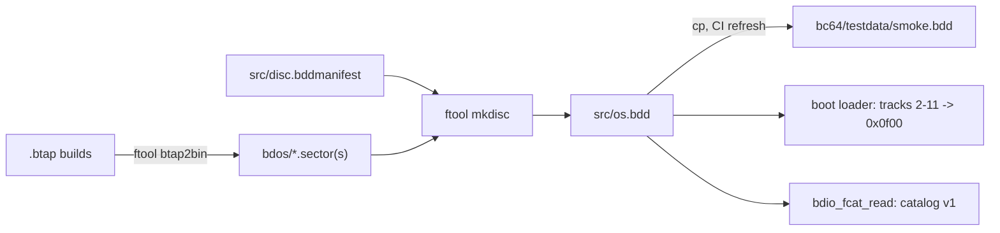
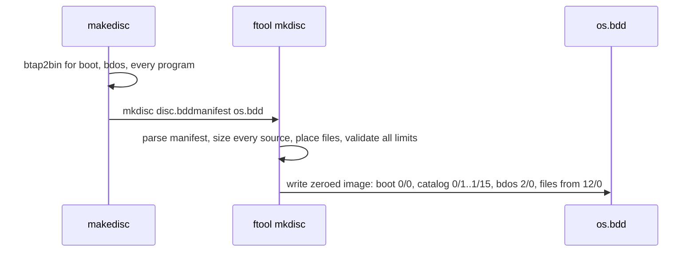

# bdos: Build os.bdd from a Disc Manifest (`ftool mkdisc`) Instead of a Hand-Made Catalog Plan

**Plan Status**: `FINAL`

**Story Type**: `Internal`

**Plan Revision**: `A4`

> This plan captures **what** to build and **why**: domain, architecture, decisions, and verified facts.
> It deliberately does **not** contain implementation code, pseudocode, line numbers, mock setups, or test bodies.
> The implementation agent discovers the **how** against live code. See §4 Task Breakdown.

---

## 1. Problem Statement

*   **Context**: The system disc `src/os.bdd` is built by `src/makedisc`. That script writes the hand-made binary catalog `src/fcat0800.sector` (2 sectors, entries 0–15) to track 0 sector 1. It also writes each program at a start track hard-coded in the script (bdos 2, ls 13, hellowrd 17, cp 21, format 25, rm 31, cha 37, cat 41, texted 45, test.b 52, theodore 53). Nothing checks sizes. The catalog has already drifted from the builds (verified, see §2.4): `BDOS.SYS` 152 sectors (build 138), `LS.PRG` 64 (58), `HELLOWRD.PRG` 15 (14), and **`CP.PRG` 56 (build 57)**. The truncated `CP.PRG` is the cause of the known `cp` failure (`test_cp_then_cat_shows_same_text`, `expectedFailure` since #49).
*   **Goal**: a text manifest `src/disc.bddmanifest` and a new `ftool mkdisc MANIFEST OUT.bdd` command. The command places the files automatically, writes a catalog in the unchanged v1 format, and fails the build when anything doesn't fit. `makedisc` calls it, and `fcat0800.sector` is deleted.
*   **In scope**: the `mkdisc` command and its unit/error tests; the manifest; `makedisc`; rebuilding `os.bdd` (new layout) with `smoke.bdd` and its transcript; updating the tests and goldens that pin the old layout or the old `cp` failure; one new e2e test for AC3; docs (`docs/05-bdos.md`, root `CLAUDE.md`, `src/bdos/CLAUDE.md`, `src/bdos/bdos.md`, design decisions, the known-failures lists).
*   **Out of scope**: catalog v2 (#39, extends this tool later); changing bdos, the boot loader, the catalog format, or any program; fixing pre-existing bdos/ls quirks noted in §2.4 (`ls` free-sector formula, `bdio_fcat_scanmem` shift); changing `format`.

### 1.1 Technical Summary

*   **Touched projects**: `src/ftool.py` (new `mkdisc` command), a new importable module next to it holding the manifest and disc-image logic, `src/makedisc`, new `src/disc.bddmanifest`, `src/os.bdd`, `src/bc64/testdata/smoke.bdd` and `smoke_transcript.txt`, e2e tests and goldens, docs.
*   **New patterns / abstractions**: a declarative disc manifest; image building that validates everything first, then writes the image in one step.
*   **Infrastructure changes**: none (CI workflow unchanged).
*   **End-state observable behavior**: `cd src && ./makedisc` builds `os.bdd` from `disc.bddmanifest`. The non-boot files sit back to back from track 12 sector 0, and the catalog lengths equal the real build sizes. `cp test.b copy.b` now works. A file that is too big, a full catalog, or a bdos past the loader range makes `ftool mkdisc` exit 1 with a message, and `makedisc` stops.

---

## 2. Architecture & Design

### 2.1 Architecture Overview

#### Involved components & owners

| Component | Technical Owner |
| :--- | :--- |
| `ftool` (disc tool), `makedisc` | repo owner (bcichonski) |
| bdos (reads the catalog; unchanged) | repo owner |
| e2e harness / tests | repo owner |

#### C2 diagram

#### Flow diagram

### 2.2 External Contracts & Evidence

`N/A — Internal story`. The contracts this story must respect are internal and verified in the code (§2.4).

#### Source Conflict Log

| Topic | Source A | Source B | Conflict | Chosen Handling |
| :--- | :--- | :--- | :--- | :--- |
| Catalog lengths | `fcat0800.sector` (BDOS 152, LS 64, HELLOWRD 15, CP 56) | built `.sector(s)` (138, 58, 14, 57) | hand catalog is stale; CP is truncated | lengths come from the source files (D4); BDOS.SYS is padded to the loader range (D3) |
| Entry numbering | `fcat0800.sector` numbers only entries 0–15; entries 16–247 are all zero | `format.b` (`formatcatmem`) numbers all 248 entries | on today's os.bdd the 17th file would get entry number 0 (bdio takes the number of the first empty entry as the free entry) | number all 248 entries, as `format` does (D5) |
| "byte for byte" (AC1) | AC1: first version may use today's tracks and compare byte for byte | D3/D4/D5 | an exact match is impossible once the lengths are corrected | a one-off comparison with today's tracks pinned, with exactly the differences listed in §2.4 accepted; then automatic placement ships |

### 2.3 Affected Areas

| Area / File (pointer) | Role in this change | Likely action |
| :--- | :--- | :--- |
| `src/ftool.py` | CLI with `btap2bin`, `createbdd`, `importsector`, …; runs `main()` at import (no `__main__` guard); `checkargs` exits 1 | Change: dispatch `mkdisc MANIFEST OUT` |
| new module in `src/` (e.g. `src/ftool_mkdisc.py`) | manifest parsing, placement, validation, catalog encoding, image writing; importable without side effects so tests and #39 can use it | New |
| `src/bc64/bc64_io.py` `FloppyDriveV1` | disc geometry (128 B sectors, 16 per track, 64 tracks); `ftool` already reads it from here | Reference |
| `src/makedisc` | today: btap2bin + createbdd + importsector at fixed tracks + `fcat0800.sector` | Change: keep the btap2bin steps, then call `./ftool mkdisc disc.bddmanifest os.bdd` with the exit-code check |
| `src/disc.bddmanifest` | the system disc's content | New |
| `.gitignore` | has `*.manifest` (PyInstaller block); the manifest's `.bddmanifest` extension avoids it | Reference only (A2: no change) |
| `src/fcat0800.sector` | hand-made catalog | Delete |
| `src/bdos/bdio.b`, `src/bdos/bdioh.b` | catalog reader (`bdio_fcat_scanmem`, `bdio_fcat_read`, `bdio_new_fcat`), constants (`BDIO_FCAT_*`) | Reference only: the format to write |
| `src/bdos/boot.basm` | loader: reads sectors `0x20..0xbf` to `0x0f00`; boot sector ends with signature `BD 05 01 01` | Reference only |
| `src/bdos/format.b` (`formatcatmem`, `createcatalog`) | how bdos itself builds a v1 catalog (numbers all entries; BOOT 0/0 len 1, DISC.CAT 0/1 len 31, attrs S R) | Reference only |
| `src/test_ftool.py` | ftool unit suite (`run_tests.py` suite "ftool" runs only this module) | Add tests |
| `src/e2e_harness.py` | `read_catalog`, `disc_put`, `SMOKE_DISK`, `OS_DISK`, goldens | Reference (may gain a helper) |
| `src/test_e2e_bdos.py`, `src/test_e2e_theodore.py`, `src/test_e2e_harness.py`, `src/bc64/testdata/e2e/bdos_ls.golden.txt`, `bdos_rm.golden.txt` | pin the old tracks/lengths or the `cp` failure | Change (listed in Tests to modify) |
| `src/bc64/testdata/smoke.bdd`, `smoke_transcript.txt` | frozen copy of `os.bdd` + transcript; CI refreshes and diffs them | Regenerate (procedure in `src/bc64/CLAUDE.md`) |
| `docs/05-bdos.md`, `CLAUDE.md`, `src/bdos/CLAUDE.md`, `src/bdos/bdos.md`, `docs/specs/memory/design-decisions.md`, `docs/01-emulator.md`, `src/bc64/CLAUDE.md` | layout table, building os.bdd, ftool commands, disk-layout contract, "new program on the disc" steps, D2 usage, known `cp` failure | Change |

### 2.4 Key Algorithms & Behaviour

**Verified facts (from code and a spike on `os.bdd` at `db023c2`):**

*   Geometry: 64 tracks × 16 sectors × 128 bytes = 131072 bytes; linear sector = track × 16 + sector.
*   Catalog v1: `DISC.CAT` occupies track 0 sector 1 to track 1 sector 15 (31 sectors, 8 entries per sector, 248 entries, last entry `0xf7`). Each entry is 16 bytes: number, start track, start sector, length in sectors, attributes, 8-byte name + 3-byte extension, upper case and space-padded. Attributes: R `0x01`, W `0x02`, X `0x04`, S `0x80`.
*   bdio reads the catalog sector by sector and stops at the **first entry with length 0**. It takes **that entry's number byte** as the free entry. While scanning it takes the largest end (start + length) as the first free sector. When no entry is empty, the catalog is full (`0xff`), `bdio_fcat_read` returns `BDIO_RESULT_ENDOFCAT`, and `bdio_setdrive` (used at boot) returns it as its result.
*   Pre-existing quirk, not to be fixed here: `bdio_fcat_scanmem` rebuilds its running maximum from the variables with `track << 4` instead of `<< 8` at the start of each catalog sector. The free sector is only right when the entries' end positions **rise in catalog order**. Contiguous placement in manifest order guarantees that.
*   Boot loader: reads linear sectors `0x20`–`0xbf` (track 2/0 to 11/15, 160 sectors) to `0x0f00`–`0x5eff`. The boot sector is `bdos/boot.sector` (exactly 128 bytes) and ends with `BD 05 01 01` (`format` checks the `0xbd05` signature).
*   Today's source sizes (sectors, rounded up): boot 1, bdos 138, ls 58, hellowrd 14, cp 57, format 82, rm 63, cha 56, cat 62, texted 112, test.b 2, theodore 38. Today's attributes: BOOTSECT.BIN SR, DISC.CAT SR, BDOS.SYS SR, LS/CP/FORMAT/RM/CHA/CAT SRX, HELLOWRD/TEXTED/THEODORE RX, TEST.B RW.
*   Spike: an image built from the committed `.sector(s)` with today's start tracks, real lengths, BDOS.SYS = 160 and all 248 entries numbered differs from today's `os.bdd` **only** in the catalog: 4 length bytes (BDOS 152→160, LS 64→58, HELLOWRD 15→14, CP 56→57) and the number bytes of entries 16–247. Every data sector is identical.
*   Spike: with only `CP.PRG`'s length patched to 57 on a copy of `os.bdd`, `bdos_cp.in.txt` runs `cp`, `cat -c copy.b` prints the `TEST.B` lines, and the session ends with `bye!`. So `test_cp_then_cat_shows_same_text` will pass (an unexpected success = a failure) once the catalog has real sizes.
*   Program loading prints a progress dot each time the running sector count reaches `n & 7 = 7` (`bdio.b`). The number of dots before a program's output therefore depends on its catalog length: HELLOWRD at 15 sectors prints `..`, at 14 prints `.` (A1).
*   `ls` lists only non-system files unless `-a`. Its line is `NAME    .EXT attrs <bytes %w> <track> <sector> <length>`, and its summary is `<free entries> catalog entries free; <free sectors> sectors free...`. The free-sector figure uses a pre-existing formula (`(64 − freeTrack) × 16 + freeSector`); don't fix it, just regenerate the goldens. `ls`, `cp`, `format`, `rm`, `cha`, `cat` support `-h`.
*   `format` copies BDOS.SYS etc. by their catalog length onto a fresh disc whose free sector starts at 2/0, so its result doesn't depend on the source layout.

**Placement and catalog rules (the behaviour `mkdisc` must have):**

1.  Parse the whole manifest and size every source **before writing anything**. Any error → message on stderr naming the line/file and the limit, exit status 1, and `OUT` is neither created nor modified.
2.  Entry 0 = the manifest's `boot` file at 0/0, length 1. Entry 1 = `DISC.CAT` at 0/1, length 31, attributes S R, written by the tool itself. Entry 2 = the manifest's `system` file at 2/0. The remaining manifest files follow as entries 3, 4, … in manifest order.
3.  The `system` file's catalog length is the full loader range, **160 sectors**: its content is zero-padded (D3). Auto-placed files start at **12/0** (the first sector after the loader range) and follow each other back to back in manifest order. A file may also carry an explicit `T/S` start, which must not be before the current next-free sector. The files after it continue from its end. End positions therefore always rise in catalog order.
4.  Each file's length = ceil(size / 128); its data is written from its start, and the last sector is zero-padded. Every unused byte of the image is zero, apart from the entry-number bytes.
5.  Every one of the 248 catalog entries carries its own number in byte 0. Unused entries are otherwise zero.
6.  Errors (each a separate unit test): source file missing; empty source (0 sectors: an entry of length 0 would end the catalog); a file over 255 sectors; `system` file over 160 sectors (bdos beyond the loader range); a file whose end passes sector 1024 (doesn't fit); more than 247 catalog entries (catalog full, D6); boot file not exactly 128 bytes or without the `BD 05 01 01` signature; first line not `boot` or second not `system`, or `boot`/`system` used elsewhere; explicit start before the next-free sector or out of geometry; bad name (not 1–8 + 0–3 of `A–Z`/`0–9`) or duplicate name after upper-casing (including `DISC.CAT`, which is reserved); unknown attribute letter or empty attributes; malformed line.

**Expected new layout** (manifest order = today's catalog order): BOOTSECT.BIN 0/0 1; DISC.CAT 0/1 31; BDOS.SYS 2/0 160; LS 12/0 58; HELLOWRD 15/10 14; CP 16/8 57; FORMAT 20/1 82; RM 25/3 63; CHA 29/2 56; CAT 32/10 62; TEXTED 36/8 112; TEST.B 43/8 2; THEODORE 43/10 38; first free sector 46/0. (Derived arithmetic. The rebuilt disc is the authority if a source size changes.)

---

## 3. Key Decisions & Assumptions

*   **D1 — Manifest format.** A text file, `#` comments and blank lines ignored, one file per line, whitespace-separated columns: `NAME.EXT  SOURCE  ATTRIBS  [PLACE]`. `SOURCE` is a path relative to the manifest's directory. `ATTRIBS` is letters from `R W X S` in any order. `PLACE` is `boot`, `system`, an explicit `T/S` (decimal), or empty for automatic. Line 1 must be `boot` and line 2 `system`. The roles are explicit keywords, not inferred from names, so #39 and other discs can reuse the tool. `DISC.CAT` is never listed: the tool owns it.
*   **D2 — Separate module.** The logic lives in a new importable module next to `ftool.py`, and `ftool.py` only dispatches to it. `ftool.py` runs `main()` on import, so a clean module is easier to test and for #39 to extend. The console launcher puts the script's directory first on `sys.path`, so a sibling module imports fine.
*   **D3 — BDOS.SYS covers the whole loader range (160 sectors).** The loader reads 160 sectors no matter what, so the catalog says exactly what gets loaded. The reserved tail is zero on `os.bdd`. `format` then copies 160 sectors, so a disc it makes also loads zeros after bdos instead of the start of `LS.PRG`. This is the conservative reading of "be very careful with the memory map". The source file must still be ≤ 160 sectors (the AC's error case).
*   **D4 — Catalog lengths come from the source sizes.** This is the point of the story. It fixes the `CP.PRG` truncation, so the `cp` `expectedFailure` test is updated on purpose (Tests to modify), not just regenerated.
*   **D5 — Number all 248 entries**, as `format` does. This fixes the latent problem where the 17th file on `os.bdd` would get entry number 0.
*   **D6 — Catalog full = more than 247 used entries.** At least one entry must stay empty. With all 248 used, `bdio_fcat_read` reports `ENDOFCAT` on every drive change, including boot.
*   **D7 — AC1's byte-for-byte step is a one-off check, not a shipped test.** T2 builds an image with a temporary manifest that pins today's start tracks (explicit `T/S`). It compares that image with the base `os.bdd` (`git show db023c2:src/os.bdd`) and accepts only the differences listed in §2.4. The result goes into the PR description. The committed `disc.bddmanifest` uses automatic placement.
*   **D8 — Validate, then write.** A failed `mkdisc` leaves no partial `OUT`. `makedisc` already stops on a non-zero exit (`check_exit_code`).
*   **D9 — Keep the old commands.** `createbdd`, `importsector`, `exportsector`, `dumpsector` stay: others use them (e.g. patching `BDOS.SYS` in #76).
*   **Assumption A1 (no OQ, low stakes):** mid-track start sectors are fine for executables and data. bdio already allocates mid-track (e.g. new files after THEODORE at 55/6), and `test_e2e_toolchain` runs a program put at the free sector. AC3's e2e test checks every program on the new disc anyway.

*   **D10 — The manifest states the layout requirements (A4, owner).** This supersedes D1's syntax. A line is `NAME.EXT  SOURCE  ATTRIBS  [OPTIONS]`, and OPTIONS are `key=value` tokens in any order:
    *   `role=boot|catalog|system`: the three special entries, which must be the first three lines (entries 0, 1, 2) in that order. `DISC.CAT` is now listed, with `-` as its source; the tool still writes its content.
    *   `at=T/S`: an exact start. It must not be before the end of the previous slot.
    *   `max=N`: the file must be at most N sectors (an error names the file, its size and N). It also reserves an N-sector slot, so the next file without `at=` starts after the slot. Without `max`, the slot is the file's own size.

    The roles keep their hardware rules, and the tool refuses a manifest that contradicts them, naming the reason. `role=boot` needs `at=0/0 max=1` and a 128-byte file with the `BD 05 01 01` signature. `role=catalog` needs source `-`, `at=0/1` and `max=31` (catalog v1, hard-coded in bdio). `role=system` needs `at=2/0` and `max` ≤ 160 (the loader range), and its catalog length is `max` (D3: padded). Every other file's catalog length is its real size. `max` > 255 is an error. `src/disc.bddmanifest` carries the requirements as these options plus short comments: boot `at=0/0 max=1`, catalog `at=0/1 max=31`, BDOS.SYS `at=2/0 max=160`, and LS.PRG `at=12/0` (first sector after the loader range). The resulting `os.bdd` stays byte-identical. `src/bdos/bdos.md` ("disk format") and `docs/05-bdos.md` ("Layout of the system disc") keep only a reference to the manifest (plus `ls -a` for the actual positions), and no longer carry their own layout list.

### 3.1 Decision Lock (Constants & Policies)

| Constant / Policy | Selected Value | Why | Where it lives |
| :--- | :--- | :--- | :--- |
| Loader range | linear sectors 32–191 (2/0–11/15), 160 sectors | `boot.basm` | mkdisc constant |
| First auto-placed sector | 12/0 (linear 192) | first sector after the loader range | mkdisc |
| BDOS.SYS catalog length | 160 | D3 | mkdisc |
| Catalog | 0/1, 31 sectors, 248 entries, entry 1 = `DISC.CAT` SR | catalog v1 / `format.b` | mkdisc |
| Max used catalog entries | 247 | D6 | mkdisc |
| Max file length | 255 sectors | 1-byte length field | mkdisc |
| Boot sector | exactly 128 bytes, ends `BD 05 01 01` | loader + `format` signature check | mkdisc |
| Error policy | stderr message, exit 1, OUT untouched | D8 | mkdisc / ftool |
| Manifest order | today's catalog order: BOOTSECT.BIN, BDOS.SYS, LS, HELLOWRD, CP, FORMAT, RM, CHA, CAT, TEXTED, TEST.B, THEODORE | keeps entry numbers and the `ls` order | `src/disc.bddmanifest` |
| Disc names / attributes | as today (§2.4) | no visible change except tracks and lengths | `src/disc.bddmanifest` |

### 3.2 Open Questions

No open questions. Resolution attempts: placement start (AC "after bdos" + the loader range in `boot.basm` → 12/0), the bdos length (loader code → D3), numbering (`format.b` → D5), the full-catalog limit (`bdio_fcat_read` → D6), and the byte-for-byte step (AC text says "may" → D7).

---

## 4. Task Breakdown

| Task | Title | Depends on | Complexity |
| :--- | :--- | :--- | :--- |
| `T1` | `ftool mkdisc`: manifest, placement, catalog v1, errors + unit tests | — | `High` |
| `T2` | System disc from `disc.bddmanifest`: makedisc, new os.bdd, smoke disc, layout-pinned tests | `T1` | `Medium` |
| `T3` | e2e: new disc boots, `ls -a` shows every file with real sizes, every utility runs | `T2` | `Medium` |
| `T4` | Docs: building os.bdd, layout, contracts, new-program steps, known failures | `T2` | `Low` |
| `T5` | Manifest options `role=`/`at=`/`max=`; layout requirements in `disc.bddmanifest` (A4) | `T4` | `Medium` |
| `T6` | Docs: layout requirements only in the manifest; references elsewhere (A4) | `T5` | `Low` |

### T1 — `ftool mkdisc`: manifest, placement, catalog v1, errors + unit tests

*   **Goal**: `ftool mkdisc MANIFEST OUT.bdd` builds a disc image following §2.4's rules and D1–D8, and rejects every invalid input with exit 1.
*   **Depends on**: —
*   **Complexity**: `High`. This is the disk-layout contract: a wrong byte gives a disc that boots but corrupts files later.
*   **Pointers**: `src/ftool.py`; new module next to it (D2); `src/bc64/bc64_io.py` (geometry); `src/bdos/bdioh.b` (catalog constants), `src/bdos/bdio.b` (`bdio_fcat_scanmem`, `bdio_fcat_read`), `src/bdos/format.b` (`formatcatmem`, `createcatalog`), `src/bdos/boot.basm`; `src/test_ftool.py` (existing fixture style: silent `Environment`, temp dir, `ftool.argv` patching).
*   **Definition of Done**: the command exists and is dispatched from `ftool.main` with an argument check. Output images follow every rule in §2.4 (entries, placement, padding, numbering, zero elsewhere, size 131072). Every error in §2.4 rule 6 exits 1 with a clear stderr message and leaves `OUT` absent or unchanged. `ftool` with no `mkdisc` arguments exits 1 like the other commands. Nothing outside `ftool.py`, the new module and `src/test_ftool.py` changes.
*   **Tests expected** (unit, in `src/test_ftool.py`, which is the only module the "ftool" suite runs; small synthetic source files in a temp dir):
    *   a minimal manifest (boot + system + two files) gives exactly the expected bytes: boot at 0/0, entry 1 `DISC    CAT` 0/1 31 SR, system at 2/0 length 160 with zero padding, the first auto file at 12/0, the next one directly after (including a mid-track start), lengths rounded up, all 248 numbers present, the rest zero;
    *   an explicit `T/S` start is honoured, and later files continue after it;
    *   attributes map R/W/X/S → bits, in any order; names are upper-cased and space-padded; an extension may be 0–3 characters;
    *   one test per error in §2.4 rule 6 (at least: file too big for the disc, catalog full at 248 used entries, system beyond 160 sectors, file over 255 sectors), each asserting exit 1 and no output file;
    *   the CLI path through `ftool.main` (exit 0 + image; missing args → exit 1).
*   **Tests to modify**: None.

### T2 — System disc from `disc.bddmanifest`: makedisc, new os.bdd, smoke disc, layout-pinned tests

*   **Amended in**: A2
*   **Goal**: `cd src && ./makedisc` builds `os.bdd` from `src/disc.bddmanifest` with automatic placement. `fcat0800.sector` is gone, and every committed disc artifact and layout-pinned test matches the new layout on purpose.
*   **Depends on**: `T1`.
*   **Complexity**: `Medium`.
*   **Pointers**: `src/makedisc`, new `src/disc.bddmanifest`, `.gitignore`, `src/fcat0800.sector` (delete), `src/os.bdd`, `src/bc64/CLAUDE.md` (smoke refresh procedure), `src/bc64/testdata/`, the tests named below. Scripts in `src/` are LF with exec bits (`.gitattributes`). The sandbox's `core.autocrlf=true` makes them look CRLF, so check blobs with `git show HEAD:<file>`.
*   **Definition of Done**:
    *   The manifest is named `src/disc.bddmanifest`, so `.gitignore`'s PyInstaller `*.manifest` rule doesn't ignore it (`git check-ignore src/disc.bddmanifest` prints nothing), and `.gitignore` is unchanged (A2, replaces A1's exception).
    *   `disc.bddmanifest` lists today's 12 files in today's catalog order with today's names and attributes (§3.1), the boot and system roles, and automatic placement for the rest. `makedisc` keeps its `btap2bin` conversions and then calls `./ftool mkdisc disc.bddmanifest os.bdd` with `check_exit_code`. No `createbdd`/`importsector`/`fcat0800.sector` steps are left. `fcat0800.sector` is deleted.
    *   **One-off AC1 check (D7):** with a temporary manifest pinning today's start tracks, `mkdisc` reproduces `git show db023c2:src/os.bdd` except exactly the catalog differences listed in §2.4. Record the command and the result in the task notes for the PR description, and don't commit the temporary manifest.
    *   `./buildos && ./buildtools && ./buildapps && ./makedisc` (from `src/`) leaves every `.sector(s)` byte-identical to the commit. The only generated change is `os.bdd`, and its catalog matches §2.4's expected new layout.
    *   `smoke.bdd` and `smoke_transcript.txt` are refreshed per `src/bc64/CLAUDE.md`, and the transcript diff shows only the intended layout changes.
    *   The goldens below are regenerated with `BC64_UPDATE_GOLDEN=1` and reviewed by eye: only tracks, sectors, lengths, the free-sector figure and progress dots change.
    *   `python3 run_tests.py < /dev/null` from the repo root exits 0, with no unexpected successes.
*   **Tests expected**: no new tests (T3 adds the AC3 test). The existing e2e suite must pass on the new disc.
*   **Tests to modify**:
    *   `src/test_e2e_bdos.py :: CATALOG_LINES` (module constant used by `test_ls_lists_catalog`): new tracks/sectors/lengths of HELLOWRD, TEXTED, TEST.B, THEODORE (AC1 automatic placement, D4).
    *   `src/test_e2e_bdos.py :: BdosShellTests.test_cp_then_cat_shows_same_text`: remove `@unittest.expectedFailure` and its stale "issue to be filed" comment. With the real 57-sector `CP.PRG` the scenario passes (spike in §2.4; AC3 "every program runs", D4). Assertions unchanged.
    *   `src/bc64/testdata/e2e/bdos_hellowrd.golden.txt`: regenerated. HELLOWRD.PRG is now its real 14 sectors (was 15), so its loading line prints one progress dot fewer (`.` instead of `..`). Only that dot may change (D4, A1).
    *   `src/bc64/testdata/e2e/bdos_ls.golden.txt`, `src/bc64/testdata/e2e/bdos_rm.golden.txt`: regenerated. The `ls` lines and the free-sector summary change with the new layout (AC1, D4).
    *   `src/test_e2e_theodore.py :: TheodoreTests.test_catalog_entry_and_ls` and `TheodoreTests.test_ls_lists_theodore`: they pin `THEODORE.PRG` at track `0x35` sector 0. Change them to the new placement (AC1). Keep the length check against the real source size.
    *   `src/test_e2e_harness.py :: CatalogTests.test_reader_lists_known_files`: it pins `HELLOWRD.PRG` at `(0x11, 0, 15, 0x05)`. Change it to the new start and the real length 14 (AC1, D4).

### T3 — e2e: new disc boots, `ls -a` shows every file with real sizes, every utility runs

*   **Goal**: an e2e test proves AC3 on the rebuilt disc: it boots, `ls -a` lists all files with the right sizes and attributes, and every program on it runs.
*   **Depends on**: `T2`.
*   **Complexity**: `Medium`.
*   **Pointers**: `src/e2e_harness.py` (`run_session`, `read_catalog`, `check_golden`, `assert_markers`, `SMOKE_DISK`, `OS_DISK`), `src/test_e2e_bdos.py` (style), `src/bc64/testdata/e2e/` (scripts/goldens), `src/disc.bddmanifest`. Scripts must not use `q` or a bad-argument command followed by more input (`src/bc64/CLAUDE.md`).
*   **Definition of Done**:
    *   A structural test: for every manifest line, `os.bdd` **and** `smoke.bdd` have a catalog entry with the manifest's name and attributes, with length = the source's sector count (160 for the `system` file), and with the source bytes (zero-padded) on the disc at its start. The catalog has nothing else besides `DISC.CAT`. End positions rise in catalog order.
    *   A session test on a temp copy of `smoke.bdd`: boot, `ls -a` (golden + markers for every file line), then `ls -h`, `cp -h`, `format -h`, `rm -h`, `cha -h`, `cat -h`, then `exit` → `bye!`. Each utility's usage text appears. (`hellowrd`, `texted`, `theodore`, `cat`, `rm` and `cp` already have running e2e scenarios.) If any `-h` turns out not to return to the shell, use the most harmless real invocation instead and say why in a comment.
    *   `python3 run_tests.py < /dev/null` exits 0.
*   **Tests expected**: e2e, in a new `src/test_e2e_*.py` module (or new test cases in `test_e2e_bdos.py`), with new `.in.txt`/`.golden.txt` files in `src/bc64/testdata/e2e/`.
*   **Tests to modify**: None.

### T4 — Docs: building os.bdd, layout, contracts, new-program steps, known failures

*   **Amended in**: A3
*   **Goal**: the docs describe the manifest-built disc and no longer mention `fcat0800.sector`, fixed tracks or the `cp` known failure.
*   **Depends on**: `T2`.
*   **Complexity**: `Low`.
*   **Pointers**: `docs/05-bdos.md` (system-disc layout table → new tracks/lengths and BDOS.SYS 160; "Building" section + ftool command table → `mkdisc` and the manifest format with its errors; "Testing" → `cp` no longer a known failure); root `CLAUDE.md` (pipeline line `makedisc` → `ftool mkdisc`, "Disk layout" contract → loader range, `disc.bddmanifest`, `mkdisc` checks); `src/bdos/CLAUDE.md` ("New or larger program on the disc" → build script + one manifest line); `src/bdos/bdos.md` (fixed tracks note); `docs/specs/memory/design-decisions.md` (D2 usage line; record a new decision for the manifest-built disc covering D1/D3/D5/D6); `docs/01-emulator.md` and `src/bc64/CLAUDE.md` (remove `cp` from the known failures); `docs/analysis/05-bdos.md` (mark problem 3 / proposal 2 as done by #37 if the page tracks status, otherwise leave it).
*   **Old-disc caveat (A3)**: `docs/05-bdos.md` (catalog / allocation section) gets a short remark for disc files that stay as they are. Discs copied from `os.bdd` or `smoke.bdd` before #37 number only catalog entries 0–15, and entries 16–247 hold 0. bdio takes the first empty entry's number byte as the slot for a new file, so on such a disc the 17th file gets entry number 0 and overwrites `BOOTSECT.BIN`'s entry; the disc still boots, but the catalog is corrupted. Fix: re-make the disc (`format` from a new system disc, or a copy of the new `os.bdd`), or keep it at 16 files or fewer. Discs made by `format`, and the committed `src/bdos.bdd` and `release/bc32_v1.0/discs/bdos.bdd`, number all 248 entries and are not affected. Add the same caveat, in one line, to the new design decision that records D5.
*   **Definition of Done**: no doc outside `docs/specs/plans/`, `docs/CHANGELOG.md` and `release/` mentions `fcat0800.sector` or the old fixed tracks as current. The layout table matches the rebuilt `os.bdd` catalog. The old-disc caveat is present. The docs keep their existing line endings.
*   **Tests expected**: none (docs).
*   **Tests to modify**: None.

### T5 — Manifest options `role=`/`at=`/`max=`; layout requirements in `disc.bddmanifest` (A4)

*   **Amended in**: A4
*   **Goal**: `ftool mkdisc` reads D10's syntax and enforces `at=`/`max=` and the role rules. `src/disc.bddmanifest` states the layout requirements, and the rebuilt `os.bdd` is byte-identical to the current one.
*   **Depends on**: `T4` (the PR's current state).
*   **Complexity**: `Medium`.
*   **Pointers**: `src/ftool_mkdisc.py` (parser, `plan_disc`, docstring), `src/ftool.py` (unchanged CLI), `src/disc.bddmanifest`, `src/test_ftool.py` (the `Mkdisc*` classes added by T1), `src/test_e2e_disc.py` (uses `plan_disc`; must keep passing unchanged).
*   **Definition of Done**:
    *   D10 syntax is parsed. The old positional `boot`/`system`/`T/S` form is gone, and an unknown key or a bad value is an error.
    *   `max=` is checked and reserves its slot. `at=` is exact and never before the previous slot's end. The role rules are enforced with errors that name the rule.
    *   `disc.bddmanifest` carries the requirements (D10) with one short comment per requirement, giving the reason: the boot ROM loads 0/0, bdio's catalog is at 0/1 for 31 sectors, the loader reads 2/0–11/15, and data starts at 12/0.
    *   Every §2.4 rule-6 check still exists.
    *   `cd src && ./makedisc` leaves `os.bdd` byte-identical (`git diff --quiet src/os.bdd`).
    *   `python3 run_tests.py < /dev/null` exits 0.
*   **Tests expected**: unit tests in `src/test_ftool.py`:
    *   `max=` too small → error; `max=` reserves the slot (the next file starts after it); `max` > 255 → error;
    *   `at=` honoured, and `at=` inside the previous slot → error;
    *   each role rule violated → error (boot not 0/0 or not max=1, catalog not `-`/0/1/31, system not 2/0 or max > 160);
    *   unknown key and malformed option → error; `DISC.CAT` listed without `role=catalog` → error;
    *   the CLI still exits 0/1 as before.
*   **Tests to modify**:
    *   `src/test_ftool.py`: the `MkdiscLayoutTests`, `MkdiscErrorTests` and `MkdiscMainTests` classes added by T1 in this story. Their manifests use the old positional `boot`/`system`/`T/S` syntax, which D10 (A4, owner decision) replaces. Rewrite their manifest text to the new syntax and keep every behaviour they check. The tests that existed before #37 stay untouched.

### T6 — Docs: layout requirements only in the manifest; references elsewhere (A4)

*   **Amended in**: A4
*   **Goal**: the layout requirements live only in `src/disc.bddmanifest`, and the docs refer to it.
*   **Depends on**: `T5`.
*   **Complexity**: `Low`.
*   **Pointers**:
    *   `src/bdos/bdos.md` "### disk format": replace the track list with a reference to `src/disc.bddmanifest`. Keep the catalog-entry format, which is format, not layout.
    *   `docs/05-bdos.md`: replace the "Layout of the system disc" table and its paragraph with a reference to the manifest and `ls -a`. Update the "Disc manifest" section to D10's syntax and errors. Keep the catalog entry, attributes, allocation and old-disc caveat sections.
    *   `docs/specs/memory/design-decisions.md` D8: syntax.
    *   `src/bdos/CLAUDE.md` "New or larger program": still one manifest line; mention `max=` for a fixed slot.
    *   Root `CLAUDE.md` disk-layout contract: the manifest states the requirements, and mkdisc checks them.
*   **Definition of Done**: no doc outside `docs/specs/plans/`, `docs/CHANGELOG.md`, `docs/analysis/` and `release/` lists system-disc start tracks or sector ranges as its own source of truth. Each doc that used to now points to `src/disc.bddmanifest`. Line endings are kept.
*   **Tests expected**: none.
*   **Tests to modify**: None.

---

## 5. Verification

*   **Build**: from `src/`, `./buildos && ./buildtools && ./buildapps && ./makedisc` in a temp copy of the repo reproduces every committed output, including `os.bdd`. A `disc.bddmanifest` with a file grown past 255 sectors (or bdos past 160) makes `makedisc` stop with an error.
*   **Tests**: `python3 run_tests.py < /dev/null` from the repo root, exit 0 (unit + e2e), with no unexpected successes. CI's `tests` workflow (unit 3.10/3.14, e2e incl. the smoke.bdd/transcript refresh check) is green.
*   **Observable behaviour**: `printf 'ls -a\ncp test.b copy.b\ncat -c copy.b\nexit\n' | python3 bc64.py bc81asmc/bcOS/bcos_v1_2_0.b81 --disk-a <copy of os.bdd>` lists all 13 entries with the new tracks and real lengths, copies the file, prints its lines, and ends with `bye!`.
*   **AC1 one-off**: the pinned-manifest comparison from T2 is reported in the PR.

---

## 6. Fact-Integrity Checklist

| Check | Yes / No / N/A | Notes |
| :--- | :--- | :--- |
| External contracts verified from producer/contract source | N/A | Internal story |
| Evidence sources are reproducible | N/A | Internal story |
| Identifier directionality / ordering / freshness meaning evidenced | N/A | Internal story |
| Every `Assumption` is linked to an Open Question (§3.2) | Yes | A1 is low-stakes and covered by T3's test; no correctness blocker |
| No unresolved Open Questions (for `FINAL`) | Yes | |
| Each Decision states a single committed approach | Yes | D1–D9 |
| Tasks are independent, each with a Definition of Done and test expectations | Yes | T1 → T2 → T3/T4 |
| Required infra reflected | N/A | No toggle, no infrastructure |

**Self-review note**: The catalog-format facts come from `bdio.b`/`bdioh.b`/`format.b`/`boot.basm`. The two consequences of using real sizes were checked by spikes on `os.bdd`: data sectors are unchanged at today's tracks, and `cp` works at 57 sectors. Take extra care in T1 with the entry-number bytes, the 160-sector BDOS.SYS padding and validate-before-write. In T2, check every regenerated golden and the smoke transcript by eye: only tracks, lengths and the free-sector figure may change. The `ls` free-sector formula and the `bdio_fcat_scanmem` shift are pre-existing quirks. Don't fix them here. The rising-end rule keeps the shift harmless.

---

## 7. Amendment Log

| Revision | Date | Requested by | Request | Decision | Plan changes |
| :--- | :--- | :--- | :--- | :--- | :--- |
| A1 | 2026-11-11 | T2 | missing-task: `.gitignore` `*.manifest` ignores `src/disc.manifest`; add an exception | accepted (verified: `.gitignore` PyInstaller block; the manifest must be committed for `makedisc` to work from a clone) | §2.3 row for `.gitignore`; T2 pointers and DoD |
| A1 | 2026-11-11 | T2 | test-conflict: add `bdos_hellowrd.golden.txt` to T2's Tests to modify | accepted (verified: `bdio.b` prints a dot at `currSeq & 7 = 7`; D4 deliberately changes HELLOWRD.PRG from 15 to 14 sectors, so the golden's `..` becomes `.`; not a fail-driven change) | §2.4 fact on progress dots; T2 Tests to modify + DoD wording |
| A2 | 2026-11-11 | owner (mid-run) | contradiction: name the manifest `src/disc.bddmanifest` instead of adding A1's `.gitignore` exception | accepted (owner decision; `.bddmanifest` isn't matched by `*.manifest`, so no ignore exception is needed) | manifest renamed throughout §1–§5; §2.3 `.gitignore` row → reference only; T2 DoD; A1's exception superseded |
| A3 | 2026-11-11 | owner (mid-run) | uncovered-AC: document the entry-numbering caveat for existing disc files that stay | accepted (owner request; verified on `HEAD:src/os.bdd`/`smoke.bdd`: entries 16–247 hold 0; `src/bdos.bdd` and `release/bc32_v1.0/discs/bdos.bdd` are fully numbered) | T4: old-disc caveat bullet + DoD |
| A4 | 2026-11-11 | owner (mid-run) | missing-task: manifest options for an exact start and a checked max length of selected files (boot, catalog, BDOS.SYS), enforced by mkdisc | accepted (owner decision; layout unchanged, os.bdd stays byte-identical) | D10 (supersedes D1's syntax); new T5 |
| A4 | 2026-11-11 | owner (mid-run) | missing-task: move the layout requirements from `src/bdos/bdos.md` / the `docs/05-bdos.md` layout table into the manifest; docs keep only a reference | accepted (owner decision) | D10; new T6 |
