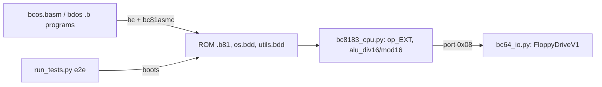

# Emulator Fixes: test_CLR_opcodes, JRX Negation Bit, Div/Mod by Zero, FDD State Typo Plan

**Plan Status**: `FINAL`

**Story Type**: `Internal`

**Plan Revision**: `A2`

> This plan captures **what** to build and **why**. The implementation agent discovers the **how** against live code.

---

## 1. Problem Statement

*   **Context**: Issue #4 lists four latent emulator bugs, found by the emulator analysis (`docs/analysis/01-emulator.md`, problems 3–4). Since the issue was written, #48 (PR #52) and #90 changed the test layout and recorded each bug as a test. Bugs with a decided fix are `@unittest.expectedFailure`, and bugs with an undecided fix are pinned tests that name #4 (policy G11). State on `origin/master` (473e463), checked 2026-11-19:
    1. `test_CLR_opcodes` (now `src/bc64/tests/test_cpu.py`) **already passes**. It was fixed by `654d15e fix: clr works` and the #48 test rewrite. `python3 run_tests.py --group unit` is green (emulator: 369 tests, 3 expected failures, all of them #4).
    2. `op_EXT` (JRX) reads the negation bit from the EXT sub-opcode nibble (`0x1`/`0x2`), not from the test code in the next byte. So `jrx nz/nc/nn/no` behave like `jrx z/c/n/o`. A sub-opcode other than 1/2 leaves `testcode`/`addr` unbound and the CPU raises `UnboundLocalError`. Pinned by `test_JRX_unknown_ext_opcode_is_not_handled_pinned`.
    3. `alu_div16`/`alu_mod16` raise `ZeroDivisionError` on a zero divisor. The emulator prints `exception at …` and a stack dump, and the Python process dies. There are no 8-bit div/mod ops: the 8-bit ALU table has no DIV/MOD.
    4. `FloppyDriveV1.write_byte` ends with `self.setate = STATE_DRIVE_FAILURE`, so an unhandled byte never sets the failure state.
*   **Goal**: the emulator suite has no #4 known failures left. Every CPU instruction is safe to run: negated `jrx` negates, an unknown EXT sub-opcode stops the CPU cleanly, a zero divisor sets the overflow flag for the program to check, and the FDD reports failure on an unhandled command. bcOS, bdos, `os.bdd` and `utils.bdd` still boot and pass e2e. Docs and design decisions record the outcome.
*   **In scope**: `src/bc64/bc8183_cpu.py`, `src/bc64/bc64_io.py`, their tests, the assembler agreement test's #4 expected failure, and the docs named in the AC (+ `src/bc64/CLAUDE.md`, which lists the same bugs).
*   **Out of scope**: the `out #r, imm` encoding mismatch (#11). No new opcodes or flags. Compiler codegen is untouched (it emits only `jrx z`).

### 1.1 Technical Summary

*   **Touched projects**: emulator (`src/bc64/`), the assembler's agreement test (`src/bc81asmc/tests/`), and docs.
*   **New patterns / abstractions**: none. An unknown EXT sub-opcode reuses the **clean-stop** pattern that #7 introduced for stack faults (`stack_fault`: one stderr line, debug trace, `kill = True`, no state changed, PC stays on the instruction). Div/mod by zero is a flag result, not a stop (A1).
*   **Infrastructure changes**: None.
*   **End-state observable behaviour**: `jrx nz, :x` jumps when Z is clear. `div csci, 0` leaves `CS:CI` unchanged, sets the `O` flag and goes on with the next instruction, so `jrx o, :divzero` right after it catches the error (A1). An FDD that gets an unhandled byte reports `STATE_DRIVE_FAILURE` (0xFF) until the next PING/CFG/SETDRV command.

---

## 2. Architecture & Design

### 2.1 Architecture Overview

| Component | Owner |
| :--- | :--- |
| `bc64` emulator (CPU, IO devices) | repo owner (bcichonski) |
| `bc81asmc` assembler (agreement tests only) | repo owner |

### 2.2 External Contracts & Evidence

N/A — Internal story.

### 2.3 Affected Areas

| Area / File (pointer) | Role in this change | Likely action |
| :--- | :--- | :--- |
| `src/bc64/bc8183_cpu.py` `op_EXT` | JRX decode | Change: negation from the test code. Unknown sub-opcode → clean stop |
| `src/bc64/bc8183_cpu.py` `stack_fault`, `run_next_opcode`, `kill` | existing clean-stop pattern (#7) | Reference (generalise or mirror it) |
| `src/bc64/bc8183_cpu.py` `alu_div16`, `alu_mod16`, `op_CLC` 16-bit path | zero divisor | Change: set `O`, leave the destination pair unchanged (A1) |
| `src/bc64/bc64_io.py` `FloppyDriveV1.write_byte` | typo on the fall-through | Change: `state` |
| `src/bc64/tests/test_cpu_control.py` | JRX tests (2 expectedFailure, 1 pinned) | Modify (see tasks) + add |
| `src/bc64/tests/test_cpu_alu.py` | 4 pinned ZeroDivisionError tests + helper | Modify + add |
| `src/bc64/tests/test_devices.py` | FDD failure-state tests (1 expectedFailure, 2 pinned) | Modify + add |
| `src/bc81asmc/tests/bc81asmc_opcode_agreement_tests.py` | `NegatedJrxTests` expectedFailure + module docstring | Modify |
| `src/bc81asmc/bc81asmc_ast.py` `JRX.emit`, `TEST2OPCODE` | the encoding the CPU must agree with: `E1 t0 hh ll`, `E2 (t+8)p`, negation = bit 2 of `t` | Reference only |
| `src/bc/bc_ast.py` | compiler emits only `jrx z` | Reference (AC 3 evidence) |
| `docs/01-emulator.md` (Known quirks, Memory), `docs/02-assembler.md` (Known quirks), `src/bc64/CLAUDE.md` (Rules), `docs/specs/memory/design-decisions.md` (Emulator section) | docs | Change |

### 2.4 Key Algorithms & Behaviour

*   **JRX negation**: the condition comes from the test code `t` (high nibble of the byte after the opcode, the same nibble as today). Flag = `t & 0x3`, negate when `t & 0x4`. In the register form the high nibble also carries `+8` (`CLC_OP_RNO`). That bit is not part of the condition, as it is today. The jump target and length arithmetic stay unchanged: the existing non-negated tests and the agreement tests pin them.
*   **Unknown EXT sub-opcode** (anything but `0x1`/`0x2`): stop cleanly, like a stack fault. One stderr line names the instruction, the address and the reason (e.g. `EXT at XXXX: unknown sub-opcode 0xN, CPU stopped`), with the same debug trace. `kill` is set. Registers, flags and memory are unchanged, and the PC stays on the instruction.
*   **Div/mod by zero** (16-bit `div`/`mod`, immediate and register forms; amended in A1): the destination pair is left unchanged, the `OVERFLOW` flag is set to 1, `Z`/`N`/`C` are left unchanged, nothing is printed, the CPU does **not** stop, and the PC advances past the instruction as for any `div`/`mod`. A non-zero divisor is unchanged. Its result is always in 0..0xffff, so `set_flags16` clears `O`, which makes `O` after a `div`/`mod` a reliable "division by zero" indicator for `jmp o`/`jrx o`.
*   **FDD fall-through**: an unhandled byte sets `state = STATE_DRIVE_FAILURE`. So do a READSECT/WRITESECT when not in `STATE_READY`, a read in RD2 with no active drive, and any other unmatched byte. It recovers as today: PING, CFG, SETDRVA/B set a new state.

---

## 3. Key Decisions & Assumptions

*   **D1 — `test_CLR_opcodes` needs no change.** It passes on master (fixed by `654d15e` and the #48 test rewrite). The test was right and `op_CAL` was fixed. The PR records this, and no task touches it.
*   **D2 — Negation bit = bit 2 of the JRX test code.** That is the encoding `bc81asmc` emits (`TEST2OPCODE`, as in `jmp`/`jmr`) and what `docs/02-assembler.md` documents. Only the CPU is wrong. The assembler is not changed.
*   **D3 — An unknown EXT sub-opcode stops the CPU cleanly** instead of raising. Issue item 2 asks for the unbound `testcode`/`addr` to be fixed, and #7 already set the clean-stop convention for faults (no Python exceptions out of the CPU for program errors).
*   **D4 (superseded by A1, see D8) — Div/mod by zero stops the CPU cleanly; no flag.** The issue offers two options, "set a flag (e.g. overflow) or stop the CPU cleanly". A flag would need defined result values and every caller checking it, and that is ABI work owned by roadmap step 31 (#54/#56–#58). A clean stop is the conservative choice. It matches #7, can't produce silently wrong results, and doesn't constrain the later ABI decision: the self-hosted roadmap can still define a flag before step 31. Shipped code already guards divisors (`calc.b` prints `error: division by zero`). This is recorded as design decision **E10** in `design-decisions.md`. **Assumption (owner review):** the roadmap's "decisions the owner still has to make" table lists division by zero against #4. This plan makes that call within the issue's own options and flags it in the PR for the owner to confirm or override.
*   **D8 — Div/mod by zero sets the overflow flag (A1, owner decision).** The owner decided during the run: "set the flag program checks". Issue item 3 offers this option ("set a flag (e.g. overflow)"). A 16-bit `div`/`mod` by zero leaves the destination pair unchanged, sets `O` = 1, leaves `Z`/`N`/`C` as they were, prints nothing and continues. Programs that may divide by zero test `o` right after the instruction. This is recorded as design decision **E10**. The owner made this call, so the roadmap's open-decision row for #4 is closed.
*   **D5 — The FDD fix is the one-word typo, plus a check that boot is unaffected.** After a PING the state is `READY|FDDV1`, not `READY`, so a READSECT straight after a PING would now hit the failure state, where today it is silently ignored. The full e2e run (all boot/disc scenarios on `os.bdd` and `utils.bdd`) is the check. If e2e fails because bcOS/bdos relied on the ignore, the task reports `Blocked (SPEC: …)` with the byte sequence. It does not change the FDD protocol.
*   **D6 — AC 1 is checked with `python3 run_tests.py` (all groups) from the repo root.** *Deviates from AC 1 wording.* The AC's `python -m unittest discover -s tests -t .` from `src/` predates the #48/#90 layout. Tests now live in each tool's `tests/` folder, and every suite needs its own working directory. Run today, that command reports 7 failures and 49 errors on master even without this change. `run_tests.py` is the repo's single test runner (G11), so it is the 100% green check. The PR lists this deviation.
*   **D7 — Removed `expectedFailure` decorators and rewritten pinned tests** are exactly the tests that #48 wrote for this issue (G11 policy: when a fix lands, remove the decorator). They are listed in `Tests to modify`.

### 3.1 Decision Lock

| Constant / Policy | Selected Value | Why | Where it lives |
| :--- | :--- | :--- | :--- |
| A2 | test-conflict (T3): `test_commands_are_ignored_while_in_failure_state` pins the typo's ignored READSECT | accepted. Issue item 4 deliberately makes an unhandled byte a drive failure, and e2e is green with the fix | T3 `Tests to modify` += that test; T3 amended in A2 |
| A1 | contradiction (owner): div/mod by zero must set the flag the program checks, not stop the CPU | accepted. It is the owner's decision and one of the issue's two options | D4 superseded by new D8; §1, §1.1, §2.3, §2.4, §3.1 updated; T2 amended (goal, DoD, tests); T4 amended (E10, docs, roadmap row) |
| JRX negation bit | test code (high nibble of byte 2) `& 0x4` | assembler encoding | `op_EXT` |
| Div/mod by zero | `O` = 1, destination pair and `Z`/`N`/`C` unchanged, no output, execution continues | D8 (A1, owner) | `bc8183_cpu.py`, E10 |
| Unknown EXT sub-opcode | clean stop, stderr `EXT at XXXX: unknown sub-opcode 0xN, CPU stopped` | D3 | `op_EXT` |
| FDD unhandled byte | `STATE_DRIVE_FAILURE` (0xFF) | issue item 4 | `FloppyDriveV1.write_byte` |

### 3.2 Open Questions

No open questions.

---

## 4. Task Breakdown

| Task | Title | Depends on | Complexity |
| :--- | :--- | :--- | :--- |
| `T1` | JRX: negation from the test code; unknown EXT sub-opcode stops cleanly | — | `Medium` |
| `T2` | Div/mod by zero sets the overflow flag | `T1` | `Medium` |
| `T3` | FDD: unhandled byte sets the drive-failure state | — | `Low` |
| `T4` | Docs, design decision E10, and the shipped-code check | `T1`, `T2`, `T3` | `Low` |

(T2 depends on T1 only because both edit `bc8183_cpu.py`.)

### T1 — JRX: negation from the test code; unknown EXT sub-opcode stops cleanly

*   **Goal**: `jrx nz/nc/nn/no` (address and register form) jump exactly when the flag is clear. An EXT sub-opcode other than 1/2 stops the CPU cleanly (D3).
*   **Depends on**: —
*   **Complexity**: `Medium`
*   **Pointers**: `op_EXT`, `stack_fault` in `src/bc64/bc8183_cpu.py`; `JRX.emit` in `src/bc81asmc/bc81asmc_ast.py`; `src/bc64/tests/test_cpu_control.py` (JRX section); `src/bc81asmc/tests/bc81asmc_opcode_agreement_tests.py` (`NegatedJrxTests`, `jump_cases`).
*   **Definition of Done**: both decided JRX tests pass without `expectedFailure`. The agreement test's negated-JRX run passes without `expectedFailure`, and its module docstring no longer lists #4. An unknown EXT sub-opcode no longer raises: one stderr line, `kill` set, registers/PC unchanged. All non-negated JRX tests still pass. `python3 run_tests.py --group unit` is green.
*   **Tests expected**: unit (emulator). Negated and non-negated `jrx` for every flag in both forms, taken and not taken, with the PC checked after. Unknown sub-opcode: clean stop, message on stderr, nothing changed. Agreement test: negated cases run through `run_case`, and, if it fits the file, include negated JRX in the normal `jump_cases` coverage.
*   **Tests to modify**:
    *   `src/bc64/tests/test_cpu_control.py :: test_JRX_address_form_negated_jumps_when_flag_clear`: remove `expectedFailure` (AC 2, D2, D7).
    *   `src/bc64/tests/test_cpu_control.py :: test_JRX_register_form_negated_jumps_when_flag_clear`: remove `expectedFailure` (AC 2, D2, D7).
    *   `src/bc64/tests/test_cpu_control.py :: test_JRX_unknown_ext_opcode_is_not_handled_pinned`: pinned `UnboundLocalError` becomes a clean stop (issue item 2, D3). Rename to match.
    *   `src/bc64/tests/test_cpu_control.py`: module docstring lines naming the #4 known failure (D7).
    *   `src/bc81asmc/tests/bc81asmc_opcode_agreement_tests.py :: NegatedJrxTests.test_negated_jrx_jumps_only_when_condition_negated_holds`: remove `expectedFailure`. Also update the module/class docstrings and the `include_negated_jrx` filter in `jump_cases`, which exist only because of #4 (D2, D7).

### T2 — Div/mod by zero sets the overflow flag

*   **Amended in**: A1
*   **Goal**: a 16-bit `div`/`mod` with a zero divisor (immediate or register form) sets `O`, leaves the destination pair unchanged and continues, per D8. It raises no Python exception and does not stop the CPU.
*   **Depends on**: `T1`
*   **Complexity**: `Medium`
*   **Pointers**: `alu_div16`, `alu_mod16`, `alu_setval16`, `set_flags16` and the 16-bit CLC dispatch in `src/bc64/bc8183_cpu.py`; `src/bc64/tests/test_cpu_alu.py` (MUL/DIV/MOD section); the agreement test `src/bc81asmc/tests/bc81asmc_opcode_agreement_tests.py` if it has div/mod cases with a zero operand.
*   **Definition of Done**: div/mod by zero in both forms leaves the destination pair unchanged, sets `O` = 1, keeps `Z`/`N`/`C` as before, prints nothing, does not set `kill`, and leaves the PC after the instruction. A following `jrx o`/`jmp o` is taken. Non-zero division and modulo are unchanged and leave `O` = 0. `python3 run_tests.py --group unit` is green.
*   **Tests expected**: unit (emulator ALU) for div and mod by zero in the immediate and register forms: registers unchanged, `O` set, other flags preserved (start with some set and some clear), PC advanced, CPU not stopped. A non-zero div/mod clears `O` even when it was set before. A short program `div` by 0 → `jrx o` reaches the error branch. Headless CLI run of such a program: exit 0, no exception text.
*   **Tests to modify**:
    *   `src/bc64/tests/test_cpu_alu.py :: test_div16_imm_by_zero_is_pinned`, `test_mod16_imm_by_zero_is_pinned`, `test_div16_reg_by_zero_is_pinned`, `test_mod16_reg_by_zero_is_pinned`, and the helper `run_expecting_zero_division` with its "PINNED (#4 item 3)" comment: the pinned `ZeroDivisionError` becomes the decided flag result (AC 2, D8). Rewrite or rename them.

### T3 — FDD: unhandled byte sets the drive-failure state

*   **Amended in**: A2
*   **Goal**: `FloppyDriveV1.write_byte` sets `state` (not `setate`) to `STATE_DRIVE_FAILURE` on its fall-through (D5).
*   **Depends on**: —
*   **Complexity**: `Low`
*   **Pointers**: `FloppyDriveV1.write_byte` in `src/bc64/bc64_io.py`; `src/bc64/tests/test_devices.py` (FDD tests).
*   **Definition of Done**: an unknown command makes the next status read return `STATE_DRIVE_FAILURE`. So does a read in RD2 with no active drive. PING/CFG/SETDRV recover from it. No `setate` attribute remains. `python3 run_tests.py` (**all** groups, e2e included, which builds and boots os.bdd/utils.bdd) is green. If e2e breaks because bcOS/bdos relied on the ignored byte, report `Blocked (SPEC: …)` with the failing scenario and byte sequence. Do not change the protocol.
*   **Tests expected**: unit (devices): the unknown command gives failure state, a read with no active drive gives failure state, and PING after failure recovers.
*   **Tests to modify**:
    *   `src/bc64/tests/test_devices.py :: test_unknown_command_sets_drive_failure_state`: remove `expectedFailure` (AC 2, D7).
    *   `src/bc64/tests/test_devices.py :: test_unknown_command_leaves_state_unchanged_today`: pins the typo, which no longer exists. Delete it (issue item 4).
    *   `src/bc64/tests/test_devices.py :: test_read_without_active_drive_stays_in_command_state`: its pinned expectation (`STATE_RD2`, caused by the typo) becomes `STATE_DRIVE_FAILURE` (issue item 4). Rename to match.
    *   `src/bc64/tests/test_devices.py :: test_commands_are_ignored_while_in_failure_state` (A2): its pinned expectation, that a READSECT outside `STATE_READY` is ignored and the state stays `STATE_READ_FAILURE`, existed only because of the typo. With the fall-through fixed, that byte is unhandled and gives `STATE_DRIVE_FAILURE` (issue item 4, D5). Update the expectation and rename to match. E2E shows no shipped code relies on the old behaviour.

### T4 — Docs, design decision E10, and the shipped-code check

*   **Goal**: the docs no longer list these bugs, D4 is recorded, and AC 3 has evidence.
*   **Depends on**: `T1`, `T2`, `T3`
*   **Complexity**: `Low`
*   **Amended in**: A1
*   **Pointers**: `docs/01-emulator.md` (Known quirks; Memory/halt bullets that list the clean stops; exit-code table; the CPU flags/ALU section), `docs/02-assembler.md` (Known quirks), `src/bc64/CLAUDE.md` (Rules: known latent bugs), `docs/specs/memory/design-decisions.md` (Emulator section, next free id `E10`), `docs/analysis/08-self-hosted-roadmap.md` (owner-decision table row naming #4).
*   **Definition of Done**:
    *   `01-emulator.md` and `02-assembler.md` list only the remaining quirks (`out #r, imm` #11 and `CLC_A_IMM`). The CPU section says an unknown EXT sub-opcode stops the CPU like a stack fault (the halt/exit-code text names it too), and that a 16-bit `div`/`mod` by zero leaves the destination unchanged and sets `O` for the program to check (D8). `docs/02-assembler.md`'s `div`/`mod` description mentions the `O` result as well.
    *   `src/bc64/CLAUDE.md` no longer lists the JRX and `setate` bugs.
    *   `design-decisions.md` has **E10** for D8 and D3. D8: div/mod by zero sets `O`, destination unchanged, owner decision in #4. D3: an unknown EXT sub-opcode is a clean stop, per the #7 convention. Give purpose, rationale, usage (test `o` right after `div`/`mod`, and a note that the compiler/runtime may rely on it) and trade-offs, in the style of E1–E9.
    *   In the roadmap owner-decision table, #4 is no longer listed for division by zero: the owner decided it in #4 (E10, flag `O`).
    *   AC 3 evidence: after `cd src && ./buildos && ./buildtools && ./buildapps && ./makedisc`, a grep of every generated `.basm` finds no negated `jrx` (`jrx n…`). `python3 run_tests.py` (all groups) is green. Put both results in the task's return message for the PR.
*   **Tests expected**: none new. The full `python3 run_tests.py` must be green.
*   **Tests to modify**: None

---

## 5. Verification

*   **All suites**: `python3 run_tests.py < /dev/null` from the repo root. Every group passes, including e2e (it builds the ROM, `os.bdd` and `utils.bdd` and boots them). The emulator suite reports no #4 expected failures.
*   **No negated `jrx` in shipped code**: build with `cd src && ./buildos && ./buildtools && ./buildapps && ./makedisc`, then grep the generated `.basm` (bcOS, bdos, apps) for `jrx n`. No hits.
*   **Division by zero by hand**: a headless run of a tiny program doing `div csci, 0` then `jrx o` reaches the error branch with `CS:CI` unchanged, prints no exception and exits 0.
*   **CI**: the `tests` workflow (`unit (3.10)`, `unit (3.14)`, `e2e`) is green on the PR.

---

## 6. Fact-Integrity Checklist

| Check | Yes / No / N/A | Notes |
| :--- | :--- | :--- |
| External contracts verified | N/A | Internal |
| Evidence sources reproducible | N/A | Internal |
| Identifier meaning evidenced | N/A | Internal |
| Every `Assumption` is linked to an Open Question (§3.2) | Yes | D4's owner-review note is a low-stakes, reversible choice inside the issue's own options; flagged in the PR, not blocking |
| No unresolved Open Questions (for `FINAL`) | Yes | |
| Each Decision states a single committed approach | Yes | |
| Tasks are independent, each with a Definition of Done and test expectations | Yes | T2 depends on T1 only to serialise edits to one file |
| Required infra reflected | N/A | no toggle, no infra |

**Self-review note**: The riskiest fix is the FDD typo (D5). The failure state becomes reachable for the first time, so bcOS/bdos boot must be checked with the full e2e run, not only the unit tests. The JRX fix only affects negated conditions, and no shipped code emits them (the compiler emits `jrx z` only; verify on the built `.basm`). Division by zero was decided by the owner during the run (A1, D8: the `O` flag). AC 1's literal command is obsolete (D6), and the PR names that deviation.

---

## 7. Amendment Log

| Revision | Request | Decision | Plan changes |
| :--- | :--- | :--- | :--- |
