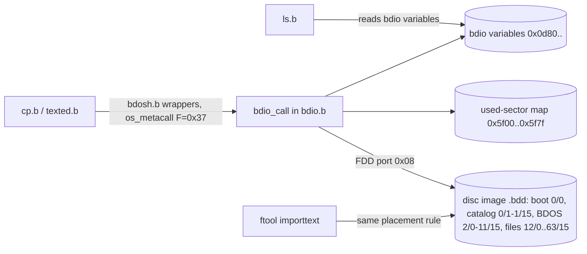
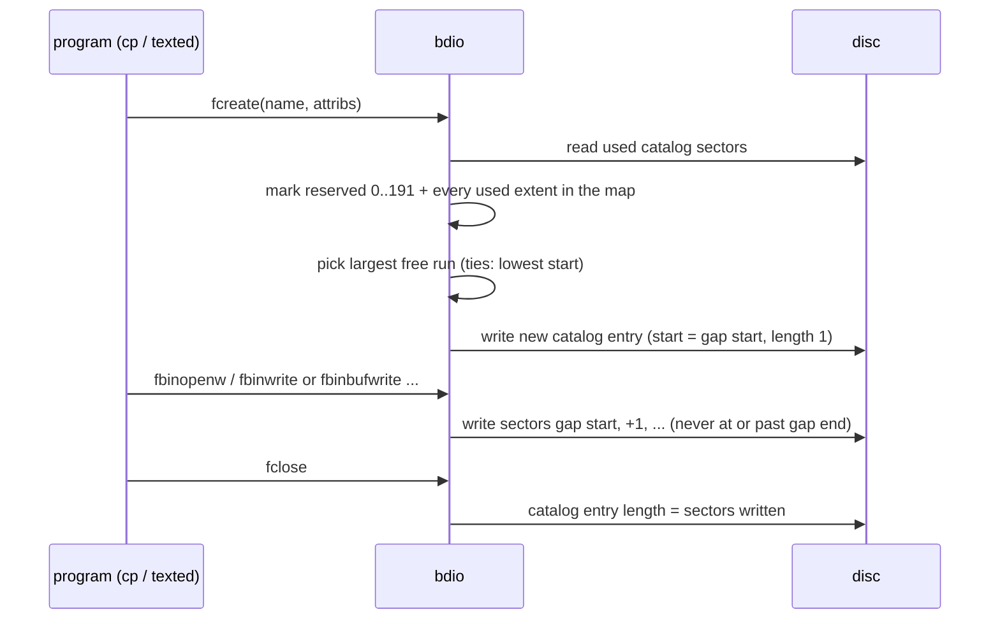

# bdos: Reuse Free Disc Space (Largest Free Gap) Plan

**Plan Status**: `FINAL`

**Story Type**: `Internal`

**Plan Revision**: `A3`

> This plan captures **what** to build and **why**: domain, architecture, decisions and verified facts.
> It does **not** contain implementation code, pseudocode, line numbers, mock setups or test bodies.
> The implementation agent works out the **how** against the live code. See §4 Task Breakdown.

---

## 1. Problem Statement

*   **Context** (issue #41, analysis `docs/analysis/05-bdos.md` problem 4 / proposal 6, roadmap phase 0 step 25):
    bdio allocates append-only. `bdio_fcat_read` (run on every non-silent drive change) sets
    `BDIO_VAR_FCAT_FREETRACK/FREESECT` to the highest end (start + length) of all used catalog entries.
    `bdio_new_fcat` (inside `bdio_fcreate`) takes the file's first sector from `bdio_getfreesect`, and the write
    path (`bdio_fbin_internal`, write mode) takes every following sector from `bdio_getfreesect` too. `rm` only
    removes the catalog entry, moving the last entry into the hole, so freed space in the middle of the disc is
    never reused. There is also **no end-of-disc check at all**: a write past sector 1023 is not detected.
*   **Goal**: a new file goes into the **largest free gap** of the allocatable area. Writing past the end of that
    gap fails with `disc full`, and no other file is touched. The reserved areas (boot sector, catalog, the bdos
    range the boot loader reads) are never allocated, and they are named constants with a test.
*   **In scope**: bdio allocation (`bdioh.b`, `bdio.b`); a new error code with a `disc full` message; `cp` and
    TextEd `s` reporting it; `ls`'s free-sector figure staying correct; `ftool importtext` following the same
    placement rule (design decision D10 says it places files where bdio would); tests (static, ftool unit,
    emulator e2e incl. the compile pattern); `docs/05-bdos.md`; a design decision.
*   **Out of scope** (owner decisions on the issue, 2026-11-19): `DEFRAG` (follow-up); moving a file that
    outgrows its gap (never moved). Also out of scope: showing the largest gap in `ls` (the issue says "may"; see
    Decision 8); opening an **existing** file for writing without `fcreate` (pre-existing behaviour, no caller
    does it); #40 linear addressing (the issue says "easier after #40", not "depends on").

### 1.1 Technical Summary

*   **Touched projects**: `src/bdos/bdioh.b`, `src/bdos/bdio.b`, `src/bdos/ls.b`, `src/bdos/cp.b`,
    `src/bdos/texted.b`, `src/ftool_text.py` (and possibly a shared constant in `src/ftool_mkdisc.py`), new tests in
    `src/tests/`, `docs/05-bdos.md`, `src/bdos/bdos.md`, `docs/specs/memory/design-decisions.md`.
*   **New patterns / abstractions**: a 1024-bit **used-sector map** (128 bytes) built from the catalog when a
    file is created, and a per-write-handle **gap end** (allocation limit).
*   **Infrastructure / layout changes**: no disc format change. The memory map gains the used-sector map at
    `0x5f00–0x5f7f` (currently unused, between the last read buffer `0x5e80–0x5eff` and the bdos heap `0x5fd0`)
    and a few bytes of bdio variables in `0x0d80–0x0dd1`.
*   **End-state observable behaviour**: `rm` a file, `cp` a smaller one: it lands at the start of the freed space
    when that is the largest gap. `cp` of a file bigger than the largest gap prints `error: F3 disc full`, and
    every other file is byte-identical. A compile-style create/delete loop no longer fills the disc.

---

## 2. Architecture & Design

### 2.1 Architecture Overview

#### Involved components & owners

| Component | Technical Owner |
| :--- | :--- |
| bdio (`src/bdos/bdio.b`, `bdioh.b`) | repo owner (bcichonski) |
| utilities `ls`, `cp`, app `texted` | repo owner |
| `ftool importtext` (`src/ftool_text.py`) | repo owner |

#### C2 diagram

#### Flow diagram (happy path: create + write + close)

### 2.2 External Contracts & Evidence

N/A — Internal story.

### 2.3 Affected Areas

| Area / File (pointer) | Role in this change | Likely action |
| :--- | :--- | :--- |
| `src/bdos/bdioh.b` | Shared constants: FDD geometry, catalog offsets, error codes (header comment lists the free range `0xf3..0xfe`), bdio variable addresses, `bdio_printexecres`. | Change: reserved-area / allocatable-area constants, `BDIO_FILE_DISC_FULL` = `0xf3`, new variable addresses, map address, `disc full` message |
| `src/bdos/bdio.b` `bdio_fcat_scanmem` / `bdio_fcat_read` | Catalog scan on drive change; sets free entry and free track/sector (max end). | Change: also compute total free sectors of the allocatable area; set the default gap end (disc end) |
| `src/bdos/bdio.b` `bdio_getfreesect` / `bdio_new_fcat` / `bdio_fcreate` | Hands out the next sector; creates the catalog entry. | Change: fcreate picks the largest gap; `disc full` when there is none |
| `src/bdos/bdio.b` `bdio_fbin_internal` (write mode), `bdio_fbinbufwrite`, `bdio_fclose` | Write path and catalog update on close. | Change: stop at the gap end, remember disc full, fclose reports it |
| `src/bdos/ls.b` | Prints `XX catalog entries free; HHHH sectors free...` from `FREETRACK/FREESECT`. | Change: print the total free figure computed by bdio (format unchanged) |
| `src/bdos/cp.b`, `src/bdos/texted.b` (`saveFile`/`saveLines`) | The two programs that create and write files (besides `format`). | Change: report `disc full` |
| `src/bdos/rm.b` | Removes an entry, compacts the catalog, forces a catalog re-read. | Reference (unchanged) |
| `src/bdos/boot.basm`, `src/disc.bddmanifest`, `src/utils.bddmanifest` | Boot loader reads `0x20..0xbf` (2/0..11/15); manifests state boot 0/0, catalog 0/1 max=31, BDOS.SYS 2/0 max=160. | Reference: the source of truth for the reserved range |
| `src/ftool_text.py` `import_text`, `src/ftool_mkdisc.py` constants | Places an imported text file after the highest used end ("like bdio", D10). | Change: same largest-gap rule and reserved range |
| `src/tests/test_ftool_text.py`, `src/tests/test_bdioh_codes.py`, `src/tests/test_e2e_rm_alloc.py`, `src/tests/test_e2e_ls_free.py`, `src/tests/e2e_harness.py` | Existing tests/harness touching allocation, codes and the free figure. | Reference; one ftool test changes by design (see T4) |
| `docs/05-bdos.md` ("Allocation", memory map, error table, `ls`), `src/bdos/bdos.md`, `docs/specs/memory/design-decisions.md` | Reference docs; the Allocation section today says "Gaps are not reused (#41)". | Change |

### 2.4 Key Algorithms & Behaviour

**Disc geometry (verified):** 64 tracks × 16 sectors = 1024 sectors of 128 bytes (`FDD_TRACKS 0x40`,
`FDD_SECTORS 0x10`). Linear sector = track × 16 + sector. bdio compares positions as `track << 8 | sector` words
(`bdio_tracksector_add`).

**Reserved area (never allocated):** linear sectors `0..191` (tracks 0–11):
boot sector 0/0, catalog 0/1–1/15 (31 sectors, 248 entries), the BDOS range 2/0–11/15 that `boot.basm` loads
(sectors `0x20..0xbf`). The **allocatable area** is `192..1023` (12/0..63/15, 832 sectors). This holds **whatever
the catalog says**: if `BOOTSECT.BIN`, `DISC.CAT` or `BDOS.SYS` were removed with `rm -f`, or BDOS.SYS is shorter
than its 160-sector slot, those sectors still count as used.

**Used-sector map** (built by `bdio_fcreate`, i.e. at every file creation, from a fresh scan of the catalog, so
`rm` done by another program is always seen): 128 bytes, one bit per sector. Reserved sectors are marked used;
every catalog entry with length > 0 marks its extent, clipped to the disc (an extent reaching past 1023 is cut,
never wraps). The catalog scan stops at the first empty entry, as today (`rm` keeps the catalog compact).

**Largest gap:** the longest run of free sectors in the allocatable area; the tail of the disc counts as a gap;
on a tie the run with the lowest start wins. No free sector at all → `fcreate` fails with `BDIO_FILE_DISC_FULL`
and writes nothing (no catalog entry). Otherwise the new entry starts at the gap start with length 1, as today,
and the gap end (exclusive) becomes the write handle's allocation limit.

**Write path:** the write handle writes the file's sectors in order from its start. A sector is written only when
its position is before the gap end. A write that needs a sector at or past the gap end writes nothing more for
that call, returns the count actually written (`fbinwrite`: sectors; `fbinbufwrite`: bytes accepted) and marks
the handle "disc full". Later writes on that handle write nothing. `fclose` (including its flush of a partly
filled buffer) updates the catalog entry with the sectors actually written, exactly as today, and then returns
`BDIO_FILE_DISC_FULL` instead of the descriptor number when the handle hit disc full. The file keeps the sectors
that fit; no other sector outside the gap is ever written.

**After `fcat_read` without `fcreate`** (a program opening an existing file for writing, not done by any caller):
free track/sector stay "highest used end", as today, and the limit is the disc end (sector 1024), so even that
path can no longer run off the disc.

**`ls` free figure:** `fcat_read` computes the total number of free sectors in the allocatable area (832 minus the
used sectors there; extents do not overlap) and stores it as a word; `ls` prints that. On a disc without gaps it is
the same number as today (1024 − highest end), so `test_e2e_ls_free` and the masked goldens keep passing.

**Error code:** `BDIO_FILE_DISC_FULL = 0xf3` (first free value; the `BDIO_FILE_` prefix keeps it inside
`test_bdioh_codes`' uniqueness checks). One value for the meaning "disc full", whether `fcreate` or a write/close
hits it (one value per meaning, #38). `bdio_printexecres` prints `disc full` for it, so the shell-style output is
`error: F3 disc full`. Only this new code gets a message (owner, #38: messages only for changed codes, since the
function grows every program).

**Callers:** `cp` and TextEd `s` print the error through `bdio_printexecres` when `fcreate` or `fclose` returns
`BDIO_FILE_DISC_FULL`. `cp`'s existing "error writing sectors" path for a 0-sector write may stay, but the user must
see `disc full`. `format` writes to a freshly formatted disc and is unchanged.

**Open write handle + fcreate:** there is one write handle and one gap end. Creating a file while the write handle
is open is not supported (no caller does it; documented, not guarded).

**ftool importtext:** knows the size up front. Same reserved range, same largest-gap choice with the same tie rule;
if the text needs more sectors than the largest gap it fails with an error containing `disc full` and leaves the
disc unchanged (no partial file; ftool validates before writing, D10).

---

## 3. Key Decisions & Assumptions

1.  **Decision — largest gap, never moved (owner, 2026-11-19).** Size is unknown at create time; a file that
    outgrows its gap fails with `disc full` and keeps the sectors that fit.
2.  **Decision — the reserved area is fixed by constants, not by catalog entries.** Sectors 0..191 are always
    "used", so a damaged or `rm -f`-edited catalog can never make bdio allocate there (issue: "Never allocate
    into the boot sector, the catalog sectors or the bdos range"). A test cross-checks the constant against the
    manifests' boot/catalog/system slots and `boot.basm`'s `0x20..0xbf` range.
3.  **Decision — the map is built in `fcreate`, from a fresh catalog scan.** Building it on every drive change
    would slow every program start; `fcreate` is the only place that allocates. `fcat_read` only adds the
    cheap total-free count for `ls`.
4.  **Decision — map location `0x5f00–0x5f7f`.** Verified free in the documented memory map (`0x5d00–0x5eff`
    handle buffers, `0x5fd0` bdos heap, `0x5fe0` file-name temp). The implementation must confirm nothing else
    (bdos B variable stack, heap) reaches it and document it in the memory map. New bdio variables go into unused
    bytes of `0x0d80–0x0dd1` (`0x0d87` and `0x0d8a–0x0d8f` look unused; verify).
5.  **Decision — one error code `BDIO_FILE_DISC_FULL = 0xf3`**, returned by `fcreate` (no free sector) and
    `fclose` (a write hit the gap end); message `disc full`.
6.  **Decision — a partly written file stays** with the sectors that fit (catalog consistent, no other file
    touched). Deleting it would need catalog compaction inside bdio (`bdio_fdelete` only zeroes the length and
    would leave a hole that stops the catalog scan); the user can `rm` it.
7.  **Decision — `ftool importtext` follows the same rule** (D10: "places the new file where bdio would place a
    file TextEd saves"). Its error stays `disc full`.
8.  **Decision — `ls` output format unchanged** (no largest-gap figure). The issue makes it optional ("may"); adding
    a line would change masked goldens and `test_e2e_ls_free`'s pattern for no AC.
9.  **Assumption — e2e setups use `e2e_harness.disc_put`** to pre-fill temp discs. Its docstring says "the way bdos
    allocates" (append after the used area); after this story that is only true for discs without gaps. The
    harness is not edited here (it is a test file); new tests use it only for setup, and their own placement
    expectations come from the largest-gap rule. Low impact, no OQ needed.
10. **Assumption — AC 1 "an emulator or ftool test"** is met with both: an emulator e2e for bdio (the real
    behaviour) and an ftool unit test for `importtext`.
11. **Design-decision id:** the next free bdos id is **D11** (last is D10). Re-check `origin/master` right before
    the PR; parallel stories collide on ids.

### 3.1 Decision Lock (Constants & Policies)

| Constant / Policy | Selected Value | Why | Where it lives |
| :--- | :--- | :--- | :--- |
| First allocatable sector | linear 192 = track 12 sector 0 | end of the boot loader range `0xbf` + 1; matches `LS.PRG at=12/0` | `bdioh.b` (named constant(s)); Python mirror for ftool |
| Disc end (exclusive) | linear 1024 (64 × 16) | `FDD_TRACKS × FDD_SECTORS` | `bdioh.b` |
| Reserved areas | boot 0/0, catalog 0/1–1/15, BDOS 2/0–11/15 | issue AC 2 | comments + constants in `bdioh.b` |
| Gap choice | longest free run in 192..1023; tie → lowest start | owner decision; deterministic | `bdio_fcreate`, `ftool_text.import_text` |
| Disc-full code | `BDIO_FILE_DISC_FULL` = `0xf3`, message `disc full` | first free code; one value per meaning | `bdioh.b` |
| Used-sector map | 128 bytes at `0x5f00` | free hole in the memory map | `bdioh.b` |
| Partly written file on disc full | kept with the sectors that fit | no hole in the catalog, no other file touched | `bdio_fclose` |
| `ls` output | unchanged format, total free sectors of 192..1023 | AC-neutral, goldens stable | `ls.b` |

### 3.2 Open Questions

No open questions. Resolution attempts: placement rule, `DEFRAG` scope and growth behaviour are answered by the
owner's decisions in the issue body; the reserved range is verified from `boot.basm` (`0x20..0xbf`) and the
manifests; the free memory for the map from `docs/05-bdos.md`'s memory map; the error-code policy from #38's
`test_bdioh_codes.py` and the `bdioh.b` header comment.

---

## 4. Task Breakdown

Build-using tasks (T1, T2, T3) must not run builds at the same time in the one worktree (they all rewrite
`os.bdd`/intermediates). T4 is Python-only.

| Task | Title | Depends on | Complexity |
| :--- | :--- | :--- | :--- |
| `T1` | bdio: largest-gap allocation, reserved area, disc full; `ls` and `cp` | — | `High` |
| `T2` | TextEd `s` reports disc full | `T1` | `Medium` |
| `T3` | e2e: compile-pattern create/delete cycles don't fill the disc | `T1` | `Medium` |
| `T4` | `ftool importtext` uses the largest gap; reserved-range cross-check test | `T1` | `Medium` |
| `T5` | Docs, design decision D11, code-size record | `T1`, `T2`, `T3`, `T4` | `Low` |

### T1 — bdio: largest-gap allocation, reserved area, disc full; `ls` and `cp`

*   **Goal**: bdio allocates every new file in the largest free gap of 12/0..63/15, never writes outside that gap,
    reports `disc full`; `ls` still prints the correct total free sectors; `cp` prints `disc full`.
*   **Depends on**: —
*   **Complexity**: `High` (bdio core, memory map, every program depends on it).
*   **Amended in**: `A1`
*   **Pointers**: `src/bdos/bdioh.b`, `src/bdos/bdio.b` (`bdio_fcat_scanmem`, `bdio_fcat_read`, `bdio_getfreesect`,
    `bdio_new_fcat`, `bdio_fcreate`, `bdio_fbin_internal`, `bdio_fbinbufwrite`, `bdio_fclose`), `src/bdos/ls.b`,
    `src/bdos/cp.b`; harness `src/tests/e2e_harness.py` (`run_session`, `read_catalog`, `read_bytes`, `disc_put`,
    `read_file`), model test `src/tests/test_e2e_rm_alloc.py`.
*   **Definition of Done**:
    *   Behaviour per §2.4 and §3.1: reserved constants; map at `0x5f00`; largest gap with the tie rule; gap end as
        the write limit; `BDIO_FILE_DISC_FULL` 0xf3 from `fcreate` and `fclose`; `disc full` message in
        `bdio_printexecres`; `bdioh.b`'s header comment lists `0xf3` and `0xf4..0xfe` free; total free count for `ls`.
    *   `cp` prints `error: F3 disc full` (via `bdio_printexecres`) when `fcreate` or `fclose` returns it.
    *   `bdos.b` still fits under `#codelimit 0x5d00`; every program still builds under its `#heap`.
    *   `python3 run_tests.py < /dev/null` exits 0 with every existing test unchanged.
*   **Tests expected** (new e2e files in `src/tests/`, positions derived from the built disc, never pinned):
    *   reuse (AC 1): a temp `os.bdd` pre-filled (with `disc_put`) so the tail is smaller than the file removed next;
        `rm` that file, `cp` a smaller one → it starts at the freed gap's start; no overlaps; every other file
        byte-identical.
    *   outgrow (AC 3): the largest gap smaller than the file copied → output has `disc full`; the new entry stays
        inside its gap; every other file and every sector outside the gap byte-identical.
    *   reserved (AC 2): on a disc whose allocatable area is full, `rm -f bdos.sys` (and/or other reserved entries)
        then `cp` → `disc full`, sectors 0..191 unchanged; on a disc with a small tail, `rm -f bdos.sys` then `cp`
        → the file goes to the tail, never into 2/0..11/15.
    *   `ls` total free on a disc with a middle gap equals 832 − used allocatable sectors.
    *   `test_bdioh_codes.py`-style static check that `BDIO_FILE_DISC_FULL` is 0xf3 and has a message (new test
        file or new test class; do not edit existing tests).
*   **Tests to modify**: `src/tests/test_bdioh_codes.py :: BdiohCodesTests.test_retired_and_free_values_are_not_used` — it asserts that no error code lies in 0xf3..0xfe; Decision 5 / §3.1 assign `BDIO_FILE_DISC_FULL` = 0xf3, so the free range becomes 0xf4..0xfe (keep the 0xe5 "retired" assertion and the free-range check for 0xf4..0xfe; A1). Nothing else. (Checked: `test_e2e_rm_alloc` expects the new file right after the highest used end;
    on the built os.bdd the tail is the largest gap in all three scenarios, so it keeps passing. `test_e2e_ls_free`
    uses discs without gaps outside the reserved area. `test_bdioh_codes`' other tests count ≥ 19 codes and check uniqueness.)

### T2 — TextEd `s` reports disc full

*   **Goal**: saving in TextEd on a disc whose largest gap is too small prints `error: F3 disc full`; other files
    are untouched.
*   **Depends on**: `T1`
*   **Complexity**: `Medium`
*   **Pointers**: `src/bdos/texted.b` (`saveFile`, `saveLines`), e2e model `src/tests/test_e2e_texted_flows.py`,
    `src/tests/test_e2e_utils_disc.py` (A = os.bdd, B = utils.bdd sessions).
*   **Definition of Done**: TextEd checks the `fclose` result (and `fcreate`'s, already printed) and prints it with
    `bdio_printexecres` when it is an error. Existing TextEd output for a successful save is unchanged (goldens
    unchanged). `python3 run_tests.py < /dev/null` exits 0.
*   **Tests expected**: e2e — a temp `utils.bdd` pre-filled so the largest gap is smaller than the text typed; `s`
    prints `disc full`; every other file byte-identical. A successful save on a disc with a reused gap loads back
    with `l`.
*   **Tests to modify**: None.

### T3 — e2e: compile-pattern create/delete, light (largest gap used; no gap big enough)

*   **Goal**: AC 4, narrowed by the owner (A3): a **light** compile-pattern e2e — one happy path where, after
    `.TOK`/`.IR` are deleted, the next file (`.O`) is placed in the **largest** free gap; and one failure where no gap
    is big enough → `disc full`. Small files only; the test must stay fast (target: a few seconds of emulator time
    each, comparable to the other e2e tests).
*   **Depends on**: `T1`
*   **Complexity**: `Medium`
*   **Amended in**: `A3`
*   **Pointers**: `src/tests/test_e2e_compile_cycles.py` (the slow 5-cycle version written in A0–A2; replace its
    content — it is this story's own new file, not a protected test), `src/tests/test_e2e_alloc_gap.py`,
    `e2e_harness.disc_put`.
*   **Definition of Done**: the file holds exactly two light tests on temp pre-filled discs, with small `cp` sources
    (e.g. `hellowrd.prg`, `test.b`): (1) create `X.TOK`, `X.IR`, `rm` them, create `X.O` → `X.O` starts at the start of
    the largest free gap (derived, not pinned; the freed space is made the largest gap), every other file
    byte-identical; (2) a disc whose largest gap is smaller than the file → `error: F3 disc full`, every other file and
    every sector outside the gap byte-identical. No multi-cycle loop. Instruction budget about 10× the measured need.
*   **Tests expected**: the two e2e tests above.
*   **Tests to modify**: None (the file is new in this story).

### T4 — `ftool importtext` uses the largest gap; reserved-range cross-check test

*   **Goal**: `importtext` places a file exactly where bdio would (D10), and one Python test ties the reserved range
    in `bdioh.b`, the manifests and `boot.basm` together.
*   **Depends on**: `T1` (the constant names in `bdioh.b`).
*   **Complexity**: `Medium`
*   **Amended in**: `A2`
*   **Pointers**: `src/ftool_text.py` (`import_text`, `read_catalog`), `src/ftool_mkdisc.py` (layout constants),
    `src/tests/test_ftool_text.py`, `src/disc.bddmanifest`, `src/utils.bddmanifest`, `src/bdos/boot.basm`.
*   **Definition of Done**: `importtext` chooses the largest free run in 192..1023 (tie → lowest start), treating
    0..191 as used whatever the catalog says; `disc full` (nothing written) when the text needs more sectors than
    that run; its summary line still reports the chosen track/sector. A static test asserts the first allocatable
    sector in `bdioh.b` equals the end of the BDOS.SYS slot (2/0 + 160) in both manifests and `boot.basm`'s last
    loaded sector + 1, and that the Python constant used by ftool equals it. `python3 run_tests.py --group unit < /dev/null`
    exits 0.
*   **Tests expected**: ftool unit — reuse of a middle gap larger than the tail; tie → lowest start; tail chosen when
    largest; text bigger than the largest gap but smaller than the total free → `disc full`, disc unchanged;
    sectors inside 0..191 left free by the catalog are never used.
*   **Tests to modify**: `src/tests/test_ftool_text.py :: CatalogTests.test_disc_full` — it builds a disc whose last
    16 sectors are used and expects `disc full`, i.e. it pins append-only placement; under Decision 7 / AC 1 the
    big gap at 12/0 is reused, so the import succeeds. Rewrite it so the allocatable area really has no gap large
    enough (same `disc full` assertion).
    `src/tests/test_ftool_text.py :: CatalogTests.test_free_sector_uses_track_times_16` — it places one file at 62/0
    (8 sectors) and expects the import at 62/8, i.e. append-only; under Decision 7 the longer run 12/0..61/15 wins.
    Rewrite its setup so the tail at 62/8 is the largest gap (fill 12/0..61/15), keeping the track × 16 guard and the
    62/8 assertion (A2).

### T5 — Docs, design decision D11, code-size record

*   **Goal**: the docs describe the allocation rule (AC 5) and the new memory-map/error facts.
*   **Depends on**: `T1`, `T2`, `T3`, `T4`
*   **Complexity**: `Low`
*   **Pointers**: `docs/05-bdos.md` (Allocation, memory map table, error-code table, `ls` row, ftool importtext
    text), `src/bdos/bdos.md`, `src/bdos/CLAUDE.md` (memory map rule if it lists addresses),
    `docs/specs/memory/design-decisions.md` (D10 text mentioning "never reuses (#41)"; new D11),
    `docs/analysis/05-bdos.md` / `07-self-hosted-compiler.md` only if they state the old behaviour as current,
    `scripts/code_size.py`.
*   **Definition of Done**: `docs/05-bdos.md` "Allocation" states: reserved 0/0, 0/1–1/15, 2/0–11/15 (constants
    named); allocatable 12/0..63/15; new file → largest gap (tail counts, tie lowest start); growing past it →
    `disc full` (0xf3), file kept with the sectors that fit, never moved; `ls` figure = total free sectors of the
    allocatable area; `DEFRAG` is a follow-up; creating while the write handle is open is unsupported. Memory map
    shows `0x5f00–0x5f7f` and the new variables. Error table has `0xf3 disc full`. D11 recorded (purpose, rule,
    reserved constants, trade-offs) and D10's #41 remark updated. `python3 scripts/code_size.py --record` run once
    after the final build (append-only CSV; drop rows from earlier builds of this story if any).
*   **Tests expected**: none new (docs). `python3 run_tests.py < /dev/null` still exits 0.
*   **Tests to modify**: None.

---

## 5. Verification

*   **Build + all suites**: `python3 run_tests.py < /dev/null` from the repo root (builds the pipeline, then unit +
    e2e) exits 0. Report expected failures separately if any remain; none are expected from this story.
*   **Story behaviour**: the new e2e tests (reuse, outgrow, reserved, compile cycles, TextEd disc full) and the
    ftool unit tests pass.
*   **Manual spot check** (headless, temp copies): `rm hellowrd.prg` on a pre-filled disc, then `cp cat.prg x.prg`
    and `ls -a` → `X.PRG` starts where `HELLOWRD.PRG` was when that gap is the largest.
*   **Clean tree**: after the build and tests, `git status` shows only intended source/test/doc changes (CI's e2e job
    fails on a dirty tree).

---

## 6. Fact-Integrity Checklist

| Check | Yes / No / N/A | Notes |
| :--- | :--- | :--- |
| External contracts verified from producer/contract source | N/A | Internal story |
| Evidence sources are reproducible | N/A | Internal story |
| Identifier directionality / ordering / freshness meaning evidenced | N/A | Internal story |
| Every `Assumption` is linked to an Open Question (§3.2) | Yes | Assumptions 9–10 are low-impact test-approach notes, not correctness blockers |
| No unresolved Open Questions (for `FINAL`) | Yes | |
| Each Decision states a single committed approach | Yes | |
| Tasks are independent, each with a Definition of Done and test expectations | Yes | |
| Required infra reflected (toggle / bicep) | N/A | no toggle key, no infrastructure |

**Self-review note**: The riskiest parts are the memory map (the `0x5f00` map must not collide with the bdos B
variable stack or heap; verify against the built bdos image and the heap use) and the write-path off-by-one: the
first sector comes from `fcreate`, the following ones from `bdio_getfreesect`, so the limit check must hold for both
and for `fclose`'s final buffered flush. The existing e2e budgets (`max_instructions`) may need checking because
`fcreate` now scans the catalog and builds the map; keep it cheap. `ftool importtext` must agree with bdio's tie
rule, or a disc edited by both tools drifts from D10.

---

## 7. Amendment Log

| Amendment | Request (from) | Decision | Plan changes |
| :--- | :--- | :--- | :--- |
| `A1` | test-conflict: allow `test_bdioh_codes.py :: test_retired_and_free_values_are_not_used` to change (T1) | **accepted** — Decision 5 deliberately takes 0xf3 out of the free range 0xf3..0xfe the test pins; this is a design change, not a fail-driven edit | T1 `Tests to modify` lists the test (free range → 0xf4..0xfe, 0xe5 stays retired); T1 `Amended in: A1` |
| `A2` | test-conflict: allow `test_ftool_text.py :: CatalogTests.test_free_sector_uses_track_times_16` to change (T4) | **accepted** — it pins append-only placement (file after the highest end); Decision 7 / AC 1 deliberately change that. Its purpose (track × 16 arithmetic) is kept by making the tail the largest gap | T4 `Tests to modify` lists it; T4 `Amended in: A2` |
| `A3` | owner, mid-run: replace the slow 5-cycle compile e2e with one happy path (largest gap used) and one failure (no gap big enough) | **accepted** — owner decision; **narrows AC 4** ("several times; the disc doesn't fill up") to one create/delete pass + the full case; to be flagged in the PR | T3 rewritten, `Amended in: A3` |
