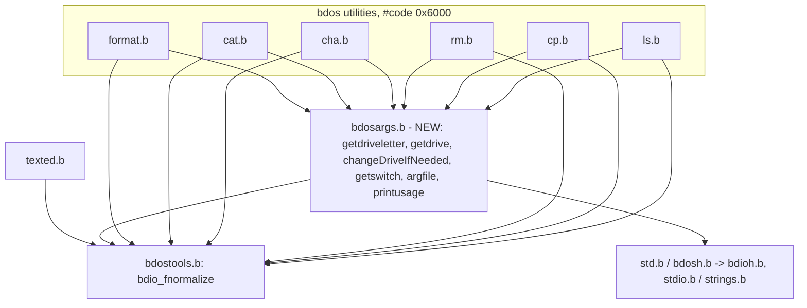
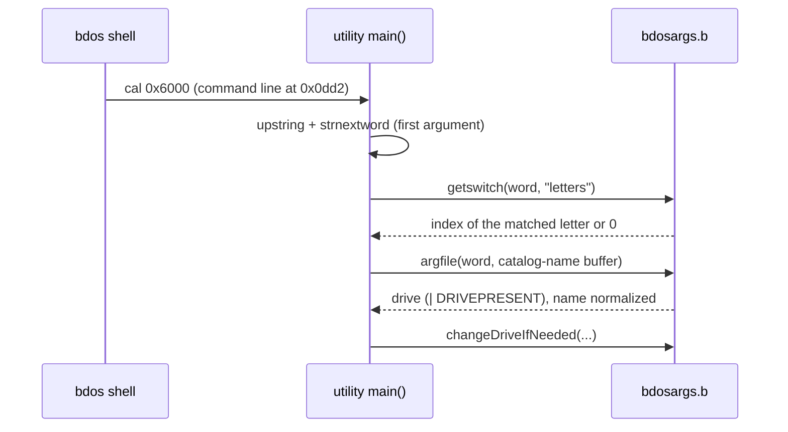

# bdos: Shared Argument-Parsing Library for the Utilities Plan

**Plan Status**: `FINAL`

**Story Type**: `Internal`

**Plan Revision**: `A0`

> This plan captures **what** to build and **why** — domain, architecture, decisions, and verified facts.
> It deliberately does **not** contain implementation code, pseudocode, line numbers, mock setups, or test bodies.
> The implementation agent discovers the **how** against live code. See §4 Task Breakdown.

---

## 1. Problem Statement

*   **Context**: Issue #43 (analysis problem 10 / proposal 8 in `docs/analysis/05-bdos.md`). Every bdos utility carries its own copy of the same argument helpers:
    *   `getdriveletter` is defined in `ls.b`, `rm.b`, `cha.b`, `cat.b`, `format.b` (in `rm.b`/`cha.b` it is only referenced from a commented-out `printf`);
    *   `getdrive` (`A:`/`B:` prefix → drive, else the active drive) is defined in all six tools (`ls`, `cp`, `rm`, `cha`, `cat`, `format`); `ls`'s copy returns the bare drive, the other five OR in a local `DRIVEPRESENT` (`0x0100`) flag;
    *   `changeDriveIfNeeded` is byte-for-byte identical in all six tools;
    *   option parsing (`-x` switches) is a per-tool `getoptions`/inline `strncmp(Pargs, "-X", n)` chain, and each tool prints its help with its own `printf("%s%n%s%n…")`;
    *   the "`[d:]name.ext` → drive + catalog name" sequence (getdrive, terminate, skip `d:`, `bdio_fnormalize`) is repeated in `cp` (twice), `rm`, `cha`, `cat`.
    `src/bdos/bdostools.b` already exists and holds only `bdio_fnormalize` (used by `cp`, `rm`, `cha`, `cat`, `texted`).
*   **Goal**: one shared library holds `getdriveletter`, the drive-prefix parsing, the `-x` option matching, the `[d:]name.ext` argument parsing and a usage printer; the six utilities use it, and every command line they accepted before gives the same result.
*   **In scope**: the library, porting `ls`, `cp`, `rm`, `cha`, `cat`, `format`; an e2e "command table" test recorded on the unported tools; the code-size before/after report; docs.
*   **Out of scope**: dead-code elimination (#16, still open); any change of tool syntax or behaviour; the known `format` bugs (bare `format` wipes drive A, `format -q` error 15 — PR #155 follow-up); `texted`'s interactive commands (see D-4).

### 1.1 Technical Summary

*   **Touched projects**: `src/bdos/` (B sources of the six utilities + a new library include), `src/tests/` + `src/bc64/testdata/e2e/` (new e2e test and golden), `src/bc/code_size.csv` (appended rows), docs (`docs/05-bdos.md`, `docs/specs/memory/design-decisions.md`, `src/bdos/CLAUDE.md`, `docs/CHANGELOG.md` is left to the changelog flow).
*   **New patterns / abstractions**: an opt-in argument library include `src/bdos/bdosargs.b` (same opt-in pattern as `random.b`, D7).
*   **Infrastructure changes**: None (no disc layout, manifest or build script change; `buildtools` already builds the six tools, and include files are not built on their own).
*   **End-state observable behavior**: identical terminal output for a table of example command lines before and after the port (a masked e2e golden recorded from the unported tools); no tool defines `getdriveletter`, `getdrive`, `changeDriveIfNeeded` or its own `-x` matching any more.

---

## 2. Architecture & Design

### 2.1 Architecture Overview

#### Involved services & owners

| Service | Technical Owner |
| :--- | :--- |
| bdos utilities (`src/bdos/*.b`) | bcichonski (repo owner) |

#### C2 diagram

#### Flow diagram

### 2.2 External Contracts & Evidence

N/A — Internal story.

#### Source Conflict Log

| Topic | Source A | Source B | Conflict | Chosen Handling |
| :--- | :--- | :--- | :--- | :--- |
| `format` usage | `docs/05-bdos.md` table: `format d: [-q]` | `format.b` `main`: the option is read from the first word, then the drive (`format -q b:`); `format b: -q` is a full format | doc is wrong | Behaviour kept (AC 2); the doc usage line is corrected to `format [-q] d:` in T4 |
| `ls` usage | doc: `ls [-a] [-h]` | `ls.b`: `ls [-a] [d:]` (a drive prefix is read after the optional `-a`) | doc incomplete | doc corrected to `ls [-a] [d:]` / `ls -h` in T4 |
| `texted` in scope | proposal: "port … `texted`" | `texted.b` takes no command-line arguments; its `l`/`s` file arguments are interactive commands already parsed with `strnextword` + `bdio_fnormalize` (`bdostools.b`) and take no drive prefix | nothing to port without changing TextEd's command syntax | D-4: texted unchanged; flagged as a deviation from the proposal in the PR (no AC is affected) |
| "each tool only pays for the helpers it uses" | proposal (relies on #16) | #16 is OPEN; `bc` links every function of every include (D7) | tools that include the library pay for helpers they do not call | D-3: kept minimal; sizes reported honestly before/after (AC 3 only asks for the report) |

### 2.3 Affected Areas

| Area / File (pointer) | Role in this change | Likely action |
| :--- | :--- | :--- |
| `src/bdos/bdosargs.b` | the new argument library | New |
| `src/bdos/bdostools.b` | `bdio_fnormalize`, used by `argfile` and by `texted` | Reference (unchanged) |
| `src/bdos/ls.b`, `cp.b`, `rm.b`, `cha.b`, `cat.b`, `format.b` | the six utilities: delete their local helpers, include the libraries, call the shared helpers | Change |
| `src/bdos/strings.b` | `strncmp`, `strnextword` (D9 contract), `upstring` | Reference |
| `src/bdos/texted.b` | not ported (D-4) | Reference |
| `src/tests/e2e_harness.py` | `run_session`, `check_golden`, `DISC_MASKS`, `golden_path`, `OS_DISK`, `UTILS_DISK` | Reference |
| `src/tests/test_e2e_bdos_args.py`, `test_e2e_bdos.py`, `test_e2e_rm_alloc.py`, `test_e2e_ls_free.py`, `test_e2e_bdio_errors.py`, `test_e2e_disc.py` | existing tool tests; must keep passing unchanged | Reference |
| `src/tests/test_e2e_bdos_cmdtable.py` + `src/bc64/testdata/e2e/bdos_cmdtable.*` | new command-table test and its golden | New |
| `scripts/code_size.py`, `src/bc/code_size.csv` | size report before/after; append-only log | Reference / append rows |
| `docs/05-bdos.md`, `docs/specs/memory/design-decisions.md`, `src/bdos/CLAUDE.md`, `src/bdos/bdos.md` | document the library and decision D10 | Change |

### 2.4 Key Algorithms & Behaviour

Library contract (`bdosargs.b`; all names fixed in §3.1):

*   **`getdriveletter(drive)`** — `"A"`, `"B"`, or `"?"` for anything else (unchanged semantics).
*   **`getdrive(Pword)`** — if the word starts with `A:` → `BDIO_DRIVEA | DRIVEPRESENT`; `B:` → `BDIO_DRIVEB | DRIVEPRESENT`; else the active drive (`bdio_getdrive()`) with no flag. The word is already upper-cased by the caller. `ls` and `format` store the result in a byte, which drops the flag exactly as their code does today.
*   **`changeDriveIfNeeded(current, target, silent)`** — unchanged semantics.
*   **`getswitch(Pword, Pletters)`** — the `-x` option matcher. Returns the 1-based position of the word's second character in the NUL-terminated letter list when the first character is `-` and the second character is one of the letters; otherwise 0. The NUL terminator never matches (so a bare `-` returns 0). It looks at the first two characters only, which is exactly what every existing `strncmp(P, "-X", 2)` does. Tools map the position to their own mode constants and keep their own precedence rules (e.g. `rm`'s `-H` wins over `-F` only because it is tested last; the port must keep each tool's resulting mode for every input).
*   **`argfile(Pword, Pcatname)`** — parses one `[d:]name.ext` word: drive via `getdrive`; skips the `d:` prefix when present; terminates the word in place at its first space (the rest of the line stays in the buffer for the caller); writes the 11-character catalog name with `bdio_fnormalize`; returns the `getdrive` result. Callers that need a later word (`cp`'s target) take its address with `strnextword` **before** calling `argfile` on the earlier word.
*   **`printusage(Ptitle, Pline1, Pline2)`** — prints each non-zero string followed by a newline (title first); `0` skips a line. It must give byte-identical output to each tool's current help `printf`.

Behaviour-preservation rules (AC 2), per tool, for every **well-formed** command line (the documented syntax, a missing argument, an unknown option, `-h`):
*   option position and skipping stay as today (`ls -a [d:]`, `rm [-f] [d:]f`, `format [-q] d:`, `cat -b|-c [d:]f`, `cha [+-]SRWX [d:]f`, `cp [d:]s [d:]t`);
*   `cp`'s help needs the word to be exactly `-H` (today `strncmp` over 3 characters, i.e. `-H` + NUL): keep that (`getswitch` plus an end-of-line check), so `cp -h x` still behaves as before;
*   `cat` with no recognised switch still prints `error: unknown switch` and then goes on exactly as today;
*   `cha`'s `+`/`-` attribute letters are cha's own syntax, not `-x` options; only its `-H` check goes through `getswitch` (a `-SRWX` word must still mean "unset", so `cha -h` is help only as today);
*   messages, their order and blank lines stay byte-identical (proved by the T1 golden).

Malformed trailing text after the last file name (e.g. `rm x.b junk`) used to be passed whole to `bdio_fnormalize`, which can overrun its 11-byte buffer; with `argfile` the name ends at the first space. This is the only intended behavioural difference and only for malformed lines; it is not part of the command table and is reported in the PR.

---

## 3. Key Decisions & Assumptions

*   **D-1 (Decision) — a new include `bdosargs.b`, not an extended `bdostools.b`.** The issue allows either. `texted` includes `bdostools.b` but parses no command line; with no dead-code elimination (#16 open) every helper added to `bdostools.b` would grow TEXTED for nothing. `bdosargs.b` follows D7 (opt-in include, no `#include` inside it); it must be included after `std.b`, `bdosh.b`, `strings.b` and `bdostools.b`.
*   **D-2 (Decision) — all six utilities include both `bdostools.b` and `bdosargs.b`.** `argfile` calls `bdio_fnormalize`, so `ls` and `format` (which never had `bdostools.b`) include it too. Rejected: a second, file-less variant of the library for `ls`/`format` — two libraries to keep in step for a few dozen bytes that #16 will remove anyway.
*   **D-3 (Decision) — sizes are reported, not forced down.** Until #16 lands, `ls` and `format` pay for `argfile`/`bdio_fnormalize`/`getswitch` they may not all use; the other tools should shrink (they lose 2–4 duplicated helpers). AC 3 asks for the report only. T4 records the after-sizes with `scripts/code_size.py --record` (the base rows dated 2026-11-23 are the "before"), and the PR body carries the before/after table. A tool that grows is listed with the reason.
*   **D-4 (Decision, deviation from the proposal text, no AC affected) — `texted` is not ported.** It has no command-line arguments; its `l`/`s` file names are interactive commands with no drive prefix. Porting them to `argfile` would add `d:` support, i.e. change TextEd's command syntax, which the issue forbids ("without changing their command syntax"). TextEd keeps using `bdostools.b`. Flagged in the PR body and the final report.
*   **D-5 (Decision) — "accepts exactly the same command lines" is proved by a recorded golden.** T1 records, from the **unported** build, the full (masked) transcript of a table of example commands (AC 2's "table of example commands … with headless mode #3"). The ports must pass it with the golden unchanged. The golden is masked with `e2e_harness.DISC_MASKS`, because `ls` shows the tools' own sizes, which this story changes by design.
*   **D-6 (Decision) — design decision id `D10`** "Utilities parse arguments with `bdosargs.b`" in `docs/specs/memory/design-decisions.md` (D9 is the last D id on master at 53e6ac3; re-check `origin/master` before the PR, parallel stories collide on ids).
*   **Assumption A-1 — `printf`'s `%n` and `putsnl`'s newline are the same `print_newline` call.** Verified in `src/bdos/stdio.b` (`putnl`/`putsnl` call `:print_newline`); the golden confirms it at run time.

### 3.1 Decision Lock (Constants & Policies)

| Constant / Policy | Selected Value | Why | Where it lives |
| :--- | :--- | :--- | :--- |
| Library file | `src/bdos/bdosargs.b` | D-1 | new file |
| Public helpers | `getdriveletter`, `getdrive`, `changeDriveIfNeeded`, `getswitch`, `argfile`, `printusage` | names of the existing duplicates kept so call sites barely change | `bdosargs.b` |
| Drive-present flag | `DRIVEPRESENT` = `0x0100`, defined once in `bdosargs.b` (removed from every tool) | existing value | `bdosargs.b` |
| Include order in every tool | `std.b`, `bdosh.b`, `strings.b`, `bdostools.b`, `bdosargs.b` | D7: includes contain no `#include` | each tool |
| Command-table scenario name | `bdos_cmdtable` | harness `golden_path` convention | `src/bc64/testdata/e2e/` |
| Golden masks | `e2e_harness.DISC_MASKS` | tool sizes change by design | test |
| Golden is never edited after T1 | T1's golden is byte-identical at the end of the story | it is the proof of AC 2 | review/verification |
| Never in any e2e script | bare `format` (no drive) | wipes drive A (PR #155 finding) | test |
| Design decision id | `D10` | D-6 | design-decisions.md |

### 3.2 Open Questions

No open questions.

---

## 4. Task Breakdown

Builds rewrite `os.bdd` and the intermediates: tasks that build must run one after the other (they do, by dependency).

| Task | Title | Depends on | Complexity |
| :--- | :--- | :--- | :--- |
| `T1` | Command-table e2e test and golden recorded on the unported tools | — | `Medium` |
| `T2` | `bdosargs.b` library; port `cp`, `rm`, `cha`, `cat` | `T1` | `High` |
| `T3` | Port `ls` and `format` | `T2` | `Medium` |
| `T4` | Size report, docs and decision D10 | `T3` | `Low` |

### T1 — Command-table e2e test and golden recorded on the unported tools

*   **Goal**: a headless e2e test that runs a table of example command lines through all six utilities and compares the transcript with a golden recorded from the current (unported) tools.
*   **Depends on**: `—`.
*   **Complexity**: `Medium`.
*   **Pointers**: `src/tests/test_e2e_bdos_args.py` (one-session pattern with `os.bdd` in A and `utils.bdd` in B), `src/tests/test_e2e_bdos.py` (`check_golden` with `DISC_MASKS`), `src/tests/e2e_harness.py`, `src/bc64/testdata/e2e/`.
*   **Definition of Done**:
    *   new `src/tests/test_e2e_bdos_cmdtable.py`, scenario `bdos_cmdtable`, `os.bdd` (A) and `utils.bdd` (B) temp copies, golden checked with `DISC_MASKS`;
    *   the session covers at least: `-h` of all six tools; `ls`, `ls -a`, `ls b:`, `ls -a b:`; `cat -c test.b`, `cat -b test.b`, `cat -c b:` + a file on `utils.bdd`, `cat test.b` (no switch), `cat -x test.b`; `cp test.b t1.b`, `cp test.b b:t2.b`, `cp b:hellowrd.prg h2.prg`, `cp a:test.b b:t3.b`; `cha +w t1.b`, `cha -r t1.b`, `cha +rx b:t2.b`; `rm t1.b`, `rm b:t2.b`, `rm ls.prg` (system-file error), `rm -f b:t3.b`; `format -q b:` and an `ls b:` after it; an `ls` and `ls -a b:` that show the results; `exit`. No bare `format`; no `cat` of a `.PRG` built from the tools being ported (its bytes change);
    *   the golden is generated with `BC64_UPDATE_GOLDEN=1` on the **unported** sources and the test passes without it;
    *   no source under `src/bdos/` changed by this task.
*   **Tests expected**: e2e (the new test, a few focused assertions on markers, e.g. help texts and `error: cannot remove system file`, plus the masked golden). `python3 run_tests.py` exits 0 (expected failures listed, not called passed).
*   **Tests to modify**: `None`.

### T2 — `bdosargs.b` library; port `cp`, `rm`, `cha`, `cat`

*   **Goal**: the shared library exists per §2.4/§3.1, and the four file utilities use it with no local copies of the helpers.
*   **Depends on**: `T1`.
*   **Complexity**: `High` (the B quirks — word↔byte truncation, `=` vs `<-`, parenthesised comparisons, single-return style, in-place pointer arithmetic on the shell buffer — make "byte-identical behaviour" easy to break silently).
*   **Pointers**: `src/bdos/cp.b`, `rm.b`, `cha.b`, `cat.b`, `bdostools.b`, `strings.b` (D9), `stdio.b`, `src/bdos/CLAUDE.md` (B quirks), `docs/03-compiler.md`.
*   **Definition of Done**:
    *   `src/bdos/bdosargs.b` holds the six helpers and `DRIVEPRESENT`, with a header comment stating the include order and each helper's contract; it contains no `#include`;
    *   `cp.b`, `rm.b`, `cha.b`, `cat.b` define none of `getdriveletter`, `getdrive`, `changeDriveIfNeeded`, `DRIVEPRESENT`; their `-x` matching uses `getswitch`; their `[d:]name.ext` handling uses `argfile`; their help uses `printusage`;
    *   `./buildtools` builds; the T1 golden passes **unchanged**; all existing e2e tests pass unchanged.
*   **Tests expected**: none new required beyond T1; full `python3 run_tests.py` (it rebuilds).
*   **Tests to modify**: `None`.

### T3 — Port `ls` and `format`

*   **Goal**: `ls` and `format` use the library; after this, `getdriveletter` and the option matching exist only in `bdosargs.b`.
*   **Depends on**: `T2`.
*   **Complexity**: `Medium`.
*   **Pointers**: `src/bdos/ls.b`, `format.b`, `bdosargs.b`.
*   **Definition of Done**:
    *   both include `bdostools.b` and `bdosargs.b` (D-2) and define none of the shared helpers; `-a`/`-q`/`-h` go through `getswitch`; help through `printusage`;
    *   `grep -n "getdriveletter\|getdrive\|changeDriveIfNeeded\|DRIVEPRESENT"` over `src/bdos/*.b` finds definitions only in `bdosargs.b` (calls elsewhere are fine; `bdio_getdrive` is not one of them);
    *   the T1 golden passes unchanged; full `python3 run_tests.py` exits 0.
*   **Tests expected**: none new; full suite.
*   **Tests to modify**: `None`.

### T4 — Size report, docs and decision D10

*   **Goal**: AC 3 and AC 4: the size report shows before/after, and the library is documented.
*   **Depends on**: `T3`.
*   **Complexity**: `Low`.
*   **Pointers**: `scripts/code_size.py`, `src/bc/code_size.csv`, `docs/05-bdos.md` (sources table, Shell, Programs table), `docs/specs/memory/design-decisions.md` (after D9), `src/bdos/CLAUDE.md` (Libraries list, "Programs get their arguments" rule), `src/bdos/bdos.md`.
*   **Definition of Done**:
    *   `python3 scripts/code_size.py --record` run once on the final sources (append-only; no duplicate rows from earlier builds), so each changed tool has a new row after its 2026-11-23 "before" row; `texted` gets no row (unchanged);
    *   `docs/05-bdos.md`: `bdosargs.b` in the sources table; a section "Argument library (`bdosargs.b`)" with each helper's contract, the include order, the size trade-off until #16, and a before/after size table for the six tools (bytes, from the CSV); the Programs table usage lines for `ls` (`ls [-a] [d:]`, `ls -h`) and `format` (`format [-q] d:`) corrected to what the code accepts (no behaviour change);
    *   decision `D10` added (purpose, rationale incl. D-1/D-2/D-4, usage, trade-offs) — check `origin/master`'s last `### D` id first;
    *   `src/bdos/CLAUDE.md` and `bdos.md` mention the library and the rule "new utilities parse arguments with `bdosargs.b`".
*   **Tests expected**: none (docs and metrics); full `python3 run_tests.py` still exits 0.
*   **Tests to modify**: `None`.

---

## 5. Verification

*   **Build**: from `src/`: `./buildos && ./buildtools && ./buildapps && ./makedisc` — no errors (the `.assert` heap checks pass).
*   **Tests**: from the repo root `python3 run_tests.py < /dev/null` (all groups, builds first) exits 0; the remaining expected failures are listed with their issues, never called "passed".
*   **AC 1**: `grep` over `src/bdos/*.b` — `getdriveletter`, `getdrive`, `changeDriveIfNeeded`, `getswitch`, `DRIVEPRESENT` are defined only in `bdosargs.b`; no tool has its own `-x` matching (`strncmp(…, "-X", …)` chains are gone).
*   **AC 2**: `src/tests/test_e2e_bdos_cmdtable.py` passes with the golden exactly as T1 recorded it on the unported tools (compare the golden's blob with T1's).
*   **AC 3**: `python3 scripts/code_size.py` shows no change against the CSV after `--record`; the CSV has before (2026-11-23) and after rows for the six tools; the PR body has the table.
*   **AC 4**: `docs/05-bdos.md` documents the library.

---

## 6. Fact-Integrity Checklist

| Check | Yes / No / N/A | Notes |
| :--- | :--- | :--- |
| External contracts verified from producer/contract source | N/A | Internal |
| Evidence sources are reproducible | N/A | Internal |
| Identifier directionality / ordering / freshness meaning evidenced | N/A | Internal |
| Every `Assumption` is linked to an Open Question (§3.2) | Yes | A-1 is verified from `stdio.b`, not open |
| No unresolved Open Questions (for `FINAL`) | Yes | |
| Each Decision states a single committed approach | Yes | |
| Tasks are independent, each with a Definition of Done and test expectations | Yes | sequential by design (shared build outputs) |
| Required infra reflected (toggle / bicep) | N/A | no toggle key, no infrastructure |

**Self-review note**: the risk is silent behaviour drift in the ports: B truncates words into bytes, the tools do in-place pointer arithmetic on the shell buffer, and each tool's option precedence is slightly different. That is why the golden is recorded first from the unported build and must stay untouched. The size outcome is mixed by design until #16 (D-3). `texted` is a recorded deviation from the proposal (D-4). The `format` and `ls` doc fixes only correct the documentation to the existing behaviour.

---

## 7. Amendment Log

| Amendment | Requested by | Request | Decision | Plan changes |
| :--- | :--- | :--- | :--- | :--- |
