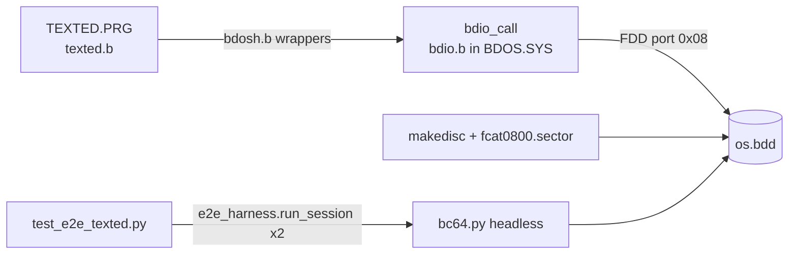
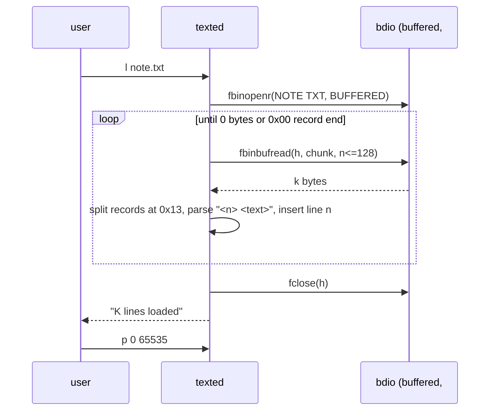

# TextEd: File Saved Before a Restart Loads but Shows No Text — Plan

**Plan Status**: `DRAFT - BLOCKED`

**Story Type**: `Internal`

**Plan Revision**: `A0`

> Blocked on **#76** (bdos buffered file I/O). The owner asked during the /grind run to split the
> bdio buffered read/write defects into their own issue, and to stop this fix if that one is
> required first. It is required: TextEd's load can't return any bytes until `bdio_fbinbufread` works.
> This plan covers the TextEd, disc and e2e work that remains for #47 once #76 is merged into `bc64`.

---

## 1. Problem Statement

*   **Context**: TextEd v1.2 (`src/bdos/texted.b`) saves files (`s <file>`) through bdos buffered
    writes. Loading (`l <file>`) a saved file after a restart reports success but the buffer stays
    empty. A headless spike on the current `os.bdd` (2026-11-09) showed more than that:
    `TEXTED.PRG` on the disc is a **stale build without the `l` command** ("Unknown command."),
    with debug output on save. `texted.basm/.btap/.sectors` have never been committed (#1).
*   **Goal**: after `i` → `s file` → restart → `texted` → `l file`, `p` shows exactly the saved
    numbered lines. This must also work for files of several sectors and 80-character lines, and on
    the rebuilt system disc.
*   **In scope**: TextEd load path (open mode, chunked read, parsing, storing lines, replace
    semantics, error messages), rebuild of texted and `os.bdd`, preservation of the `TEST.B` sample
    file on the disc, an e2e save → restart → load test (owner comment on #47), docs.
*   **Out of scope**: the bdio buffered read/write bugs and their debug `printf`s (#76); changing
    `cat` (its trailing `#00` padding display stays); saving over an existing file name
    (`bdio_fcreate` refuses, unchanged); the other bdos debug leftovers (#46).

### 1.1 Technical Summary

*   **Touched projects**: `src/bdos/texted.b` (+ generated outputs), `src/fcat0800.sector`,
    `src/makedisc`, `src/os.bdd`, `src/bc64/testdata/` (smoke disc/transcript, e2e goldens),
    new `src/test_e2e_texted.py`, `docs/05-bdos.md`, `docs/specs/memory/design-decisions.md`.
*   **New patterns / abstractions**: an e2e "restart" scenario. Two headless sessions run on the
    same disc copy; the first session's `inspect` hook hands its disc to the second.
*   **Infrastructure changes**: disc layout. `TEXTED.PRG` gets its full 112-sector slot from
    `fcat0800.sector` (100 on today's disc), and `TEST.B` becomes a `makedisc`-built file right after it.
*   **End-state observable behaviour**: `l <file>` prints `N lines loaded`, and `p 0 65535` prints
    the same lines as before the save. A missing file prints `error: E0 file not found` and leaves the
    buffer unchanged.

---

## 2. Architecture & Design

### 2.1 Architecture Overview

#### Involved components & owners

| Component | Technical Owner |
| :--- | :--- |
| TextEd (`src/bdos/texted.b`) | bcichonski |
| bdio buffered I/O (`src/bdos/bdio.b`), via #76 | bcichonski |
| Disc build (`src/makedisc`, `src/fcat0800.sector`, `src/os.bdd`) | bcichonski |
| e2e harness and tests (`src/e2e_harness.py`, `src/test_e2e_*.py`) | bcichonski |

#### C2 diagram

#### Flow diagram (load, happy path)

### 2.2 External Contracts & Evidence

N/A — Internal story.

#### Source Conflict Log

| Topic | Story text | Repository | Resolution |
| :--- | :--- | :--- | :--- |
| `cat` shows lines | "#47 item 5: `cat` won't show the lines as lines" | `cat.b` also defines `CHAR_LF 0x13` and prints it as ` !ln` + newline; `bdos_cat.golden.txt` shows the lines | Keep the `0x13` format (D1); `cat -c` already shows the lines |
| Cause of the empty load | open mode, records not stored, read length | Also: `bdio_fbinbufread` returns 0 on a fresh handle (#76), the disc's TEXTED has no `l`, and `loadFile` never sets `error`, so a missing file prints nothing | Split bdio into #76; the TextEd items are tasks here |

### 2.3 Key Code Pointers

*   `src/bdos/texted.b`: `loadFile`, `readLines` (load path); `saveFile`, `saveLines` (format
    producer); `insertLineBuf` (ordered insert, same number replaces); `deleteLines` (freeing lines);
    `main` (`PinputBuf` is `malloc(MAXLINELENGTH)` and filled by `readsn(…, MAXLINELENGTH)`; check the
    terminator fits).
*   `src/bdos/bdosh.b`: `bdio_fbinopenr`, `bdio_fbinbufread`, `bdio_fclose` wrappers.
*   `src/bdos/bdio.b`: `bdio_printexecres` (error text), buffered I/O (#76's contract).
*   `src/bdos/stdmem.b` (`malloc`/`mfree`), `src/bdos/strings.b` (`parsedecw`, `strnextword`, `strnlen8`).
*   `src/makedisc`, `src/fcat0800.sector`, `src/ftool.py` (`importsector`), `docs/05-bdos.md` (disc
    table, texted row, bdio API).
*   `src/e2e_harness.py` (`run_session(..., inspect=)`, `read_catalog`, `check_golden`),
    `src/test_e2e_bdos.py`, `src/bc64/testdata/e2e/`.

### 2.4 Key Algorithms / Rules (conceptual)

*   **File format (unchanged, D1)**: one record per line, `<decimal line number> <text>` followed
    by `0x13`. After the last record comes one `0x00`, then zero padding to the end of the sector.
*   **Load**: open the file in buffered mode. Read it in chunks of at most 128 bytes, and handle
    only the bytes each call returns. Build each record across chunk boundaries until `0x13`. Stop
    at the first `0x00` or when a read returns 0. For each record, parse the number up to the first
    space; the text is the rest. Insert it with the editor's normal ordered insert. A record with no
    valid number, or with empty text, is skipped. Text longer than `MAXLINELENGTH` is truncated, and
    the line buffer is never overrun.
*   **Replace semantics (D2)**: the buffer is cleared (lines freed, total reset) only after the
    file opened successfully, so a failed load leaves the buffer as it was.

### 2.5 Decisions & Assumptions

*   **D1 — Keep the on-disc text format** (`0x13` line end, final `0x00`). It keeps `cat -c`,
    existing files (`TEST.B`) and `saveLines` compatible, and it is the most conservative choice
    (#47 item 5 asked to decide). Record it in `docs/05-bdos.md` and as a design decision.
*   **D2 — `l` replaces the buffer**, as an editor's "load" usually does. Document it in
    `docs/05-bdos.md` and in texted's `h` text.
*   **D3 — Missing or unreadable file**: print the bdio error (`bdio_printexecres`, e.g.
    `error: E0 file not found`) and leave the buffer unchanged. The current code never sets `error`
    and prints nothing.
*   **D4 — Disc rebuild**: run a fresh `makedisc` from committed outputs, plus the texted build.
    `TEXTED.PRG` takes its 112-sector slot (45/0). `TEST.B` is kept **byte for byte** (its 2 sectors
    exported from today's `os.bdd` at 51/4, committed as a sector file). It becomes catalog entry 11
    in `fcat0800.sector` at 52/0, attributes `R W` (`0x03`), and `makedisc` imports it. It is a frozen
    sample that `test_e2e_bdos` and the smoke test rely on. Its legacy zero gap stays as it is.
*   **D5 — Rebuild only what this story changes** (texted; bdos comes from #76). `.sector(s)` churn
    from `makedisc` for unchanged programs goes in a separate `chore:` commit (CLAUDE.md).
*   **D6 — The maximum line length** is the longest line `i` accepts (`MAXLINELENGTH` = 80 through
    `readsn`). The e2e test uses lines of exactly that length.
*   **Assumption A1** — #76 delivers the buffered-read contract written there (bytes in order, any
    chunk ≤ 128, `0` only at EOF/error) and a correct buffered write. This plan's tasks rely on it.
    → OQ-1.

---

## 3. Questions

### 3.1 Resolved

*   Format change to `0x0a`? No (D1). Replace or append? Replace (D2). Debug `printf`s? Moved to #76.

### 3.2 Open Questions

| ID | Question | Owner | Blocks |
| :--- | :--- | :--- | :--- |
| OQ-1 | Merge #76 (bdio buffered I/O) into `bc64` first. Re-run `/grind 47` afterwards and re-verify A1 and D4 against the merged code. #76 may already have rebuilt `os.bdd`/`BDOS.SYS`, which changes T2's starting point. | bcichonski | all tasks |

---

## 4. Task Breakdown

| Task | Title | Depends on | Complexity |
| :--- | :--- | :--- | :--- |
| `T1` | TextEd load: buffered chunked read, store lines, replace, errors | — (needs #76 merged) | `High` |
| `T2` | Rebuild the system disc with texted and keep `TEST.B` | `T1` | `Medium` |
| `T3` | e2e: save → restart → load scenarios for TextEd | `T2` | `Medium` |

### T1 — TextEd load works

*   **Goal**: `l <file>` loads a file saved by `s` into the editor (D2), so `p` prints it. A missing
    file prints an error (D3).
*   **Depends on**: — (requires #76 on the base branch).
*   **Complexity**: `High`. It is B (`<-` assigns, `=` compares, parenthesised comparisons, single
    `return`), it has no unit-test layer, and records cross chunk boundaries.
*   **Pointers**: §2.3 texted entries; build `cd src && bash <(tr -d '\r' < bcc) bdos/texted`.
*   **Definition of Done**:
    *   the load follows §2.4 and D1–D3, opening in buffered mode;
    *   the result is reported as `N lines loaded`;
    *   no out-of-bounds writes (line buffer, input buffer for 80 characters);
    *   `texted.genb/.basm/.btap` are built and committed;
    *   `TEXTED.PRG` still fits 112 sectors (check the `.btap` length);
    *   `docs/05-bdos.md` texted row and `h` text say "load replaces the buffer";
    *   a headless spike on a temp disc copy shows the round trip working.
*   **Tests expected**: none added here (no B unit harness). The spike above is the self-check; T3 adds the e2e tests.
*   **Tests to modify**: None.

### T2 — System disc rebuild with texted and `TEST.B`

*   **Goal**: `os.bdd` holds the new `TEXTED.PRG` (and #76's `BDOS.SYS`), `TEST.B` is preserved
    (D4), and CI's frozen-disc check passes.
*   **Depends on**: `T1`.
*   **Complexity**: `Medium`.
*   **Pointers**: `src/makedisc`, `src/fcat0800.sector`, `src/ftool.py`, `src/bc64/CLAUDE.md`
    (smoke refresh), `.github/workflows/tests.yml` (e2e refresh and `git diff --exit-code`). The
    `ftool` and `makedisc` scripts are CRLF and call `winpty python`. Run them through CR-stripped
    copies that call `python3`, without committing those copies.
*   **Definition of Done**:
    *   `TEST.B`'s 2 sectors are exported from the pre-rebuild `os.bdd` (51/4) and committed;
    *   the catalog entry and `makedisc` import exist;
    *   a fresh `makedisc` produces `os.bdd`. Its catalog lists entries 0–10 as in `docs/05-bdos.md`
        (TEXTED 112 sectors) plus `TEST.B` at 52/0, 2 sectors, `R W`;
    *   `cat -c test.b` output is unchanged;
    *   `smoke.bdd` and `smoke_transcript.txt` are refreshed (CI procedure);
    *   e2e goldens are regenerated with `BC64_UPDATE_GOLDEN=1`, and their diff shows only the catalog
        and free-space lines;
    *   the `docs/05-bdos.md` disc table lists `TEST.B`;
    *   `python3 run_tests.py < /dev/null` is green.
*   **Tests expected**: existing e2e suite green on the rebuilt disc.
*   **Tests to modify**:
    *   `src/bc64/testdata/e2e/bdos_ls.golden.txt` — the TEXTED and TEST.B catalog lines and the free sectors change with the rebuilt disc (AC-6, D4).
    *   `src/bc64/testdata/e2e/bdos_rm.golden.txt` — its `ls` listing changes for the same reason (AC-6, D4).
    *   `src/test_e2e_bdos.py :: BdosShellTests.test_ls_lists_catalog` — the `CATALOG_LINES` entries for `TEXTED  .PRG` and `TEST    .B` get the new size and start (AC-6, D4).

### T3 — e2e save → restart → load

*   **Goal**: the owner's requested e2e smoke test. It saves in one emulator session and loads in a
    fresh one on the same disc.
*   **Depends on**: `T2`.
*   **Complexity**: `Medium`.
*   **Pointers**: `src/e2e_harness.py` (`run_session` with `inspect` copying `paths["a"]` out for
    the second session), `src/test_e2e_bdos.py` (style), `src/bc64/testdata/e2e/` (scripts/goldens).
    Avoid the known crashers (`src/bc64/CLAUDE.md`); texted's `q` is safe.
*   **Definition of Done**: a new `src/test_e2e_texted.py` covering:
    *   a simple save → restart → load where `p` shows identical lines (the owner's case);
    *   a file over 128 bytes that includes 80-character lines;
    *   a missing file giving an error with the buffer unchanged;
    *   a load into a non-empty buffer replacing it;
    *   `cat -c` after the restart showing every saved line as `<n> <text> !ln`;
    *   no `read md:` / `Pb:` debug text.

    Use markers and, where stable, goldens. The suite stays well within CI's 10-minute e2e timeout.
*   **Tests expected**: e2e, as listed.
*   **Tests to modify**: None.

---

## 5. Verification

*   **Build** (from `src/`): `bash <(tr -d '\r' < bcc) bdos/texted`, then a fresh `makedisc` (§T2).
*   **Tests** (repo root): `python3 run_tests.py < /dev/null`, green.
*   **CI parity**: repeat the e2e job's smoke refresh locally. `git diff --exit-code src/bc64/testdata/` must be clean after commit.
*   **Observable**: the manual round trip: `texted`, `i 10 10`, lines, `s note.txt`, `q`,
    `exit`, reboot on the same disc, `texted`, `l note.txt`, `p 0 65535`.

---

## 6. Fact-Integrity Checklist

| Check | Yes / No / N/A | Notes |
| :--- | :--- | :--- |
| External contracts verified | N/A | Internal |
| Evidence sources reproducible | N/A | Internal |
| Identifier meaning evidenced | N/A | Internal |
| Every `Assumption` is linked to an Open Question (§3.2) | Yes | A1 → OQ-1 |
| No unresolved Open Questions (for `FINAL`) | No | OQ-1: #76 first |
| Each Decision states a single committed approach | Yes | D1–D6 |
| Tasks are independent, each with a Definition of Done and test expectations | Yes | sequential via disc state |
| Required infra reflected | N/A | no toggles / bicep |

**Self-review note**: the TextEd defects and the disc layout facts were verified by reading the code
and by a headless spike (2026-11-09, `bc64` @ 74a94bf):
*   the stale `TEXTED.PRG` has no `l`;
*   the fresh build is 0x36f0 bytes (110 sectors);
*   a fresh `makedisc` gives TEXTED 112 sectors and drops `TEST.B`.

The plan is blocked only by the owner's split into #76. Once #76 is merged, re-check A1 and whether
#76 already rebuilt `os.bdd`, then flip the plan to `FINAL`. Take extra care with B buffer bounds in
T1 and with the golden diffs in T2.

---

## 7. Amendment Log

| Revision | Request | Decision | Plan changes |
| :--- | :--- | :--- | :--- |
| A0 | — | — | initial plan |
