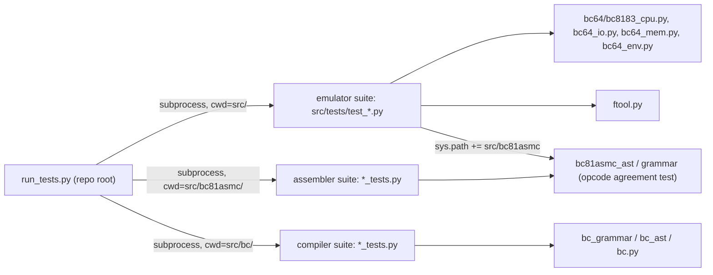
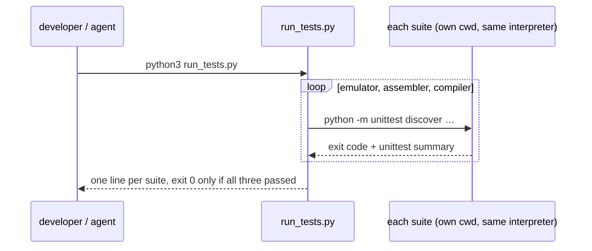

# Tests First: Fix the Current Test Suites, Then Add the Missing Unit Tests Plan

**Plan Status**: `FINAL`

**Story Type**: `Internal`

> This plan captures **what** to build and **why**: domain, architecture, decisions, and verified facts.
> It deliberately does **not** contain implementation code, pseudocode, line numbers, mock setups, or test bodies.
> The implementation agent discovers the **how** against live code. See §4 Task Breakdown.

Issue: [bcichonski/bc16#48](https://github.com/bcichonski/bc16/issues/48). Branch: `ai/feature/48-tests-first-fix-current-test-suites`, cut from `origin/bc64` (which includes #13, merged as PR #51), PR base `bc64`.

---

## 1. Problem Statement

*   **Context** (measured on the branch base, Linux, Python 3.14.4, `parsy` 2.2):
    *   Emulator suite (`cd src && python3 -m unittest discover -s tests -t .`): 23 run, **1 error**, `test_CLR_opcodes` (`IndexError` in `MemBus` after unbounded recursion; the stack dump shows the same `CAL 000f` frame repeated).
    *   Assembler suite (`cd src/bc81asmc && python3 -m unittest bc81asmc_tests`): 75/75 OK.
    *   Compiler suite (`cd src/bc && python3 -m unittest bc_tests`): imports since #13 (the `msilib` item is **already done**); 23 run, **3 failures + 3 errors**, the six stale grammar tests named in the issue (`statement_if` no longer exists, the AST is now precedence-layered `EXPRESSION_BINARY`, and the unary operators are now `#`, `!`, `~`).
    *   The suites are noisy. `tests/test_cpu.py` sets `debug = True`, which prints test names and makes the CPU append its trace to `cpudebug.log` in the working directory. `bc_tests.py` prints parse results. `Environment.log` prints device state changes.
    *   Time- and randomness-dependent tests: `RandomGeneratorTests` asserts `range(0x00, 0xff)` against `randint(0, 0xff)` (fails about 1 run in 256) and is misnamed `test_should_get_time`. `ClockTests.test_should_get_time` asserts minute and second in `range(0, 59)`, so it fails whenever either is 59. `test_should_get_date` compares with `datetime.now()` taken separately, so it fails across midnight.
    *   There is no single command. `src/run_tests` runs `python -m unittest` (emulator only).
    *   Large parts of the stack have no unit tests (see the coverage list, §2.5).
*   **Goal**: All three suites are green and deterministic on Linux with Python 3.10 and 3.13+, run from one command at the repo root. Every CPU opcode, `FloppyDriveV1`, `ftool.py` and the agreed assembler/compiler gaps are covered by unit tests.
*   **In scope**: Task 1 and Task 2 of the issue, the coverage list (§2.5), and docs (`CLAUDE.md` files, `docs/01-emulator.md` quirks, a test-policy decision in the memory bank).
*   **Out of scope** (each has its own issue; this story only adds tests that document them):
    *   fixing the JRX negation bug, division by zero, and the FDD `setate` typo (#4 items 2–4);
    *   64 KB memory (#7);
    *   the `out #r, imm` encoder fix (#11);
    *   golden `.b → .basm` tests and size tracking (#15, beyond its first bullet);
    *   end-to-end/headless tests (#3);
    *   CI;
    *   the frozen `release/**` snapshots.

### 1.1 Technical Summary

*   **Touched projects**: emulator tests `src/tests/`, assembler tests `src/bc81asmc/`, compiler tests `src/bc/`, a new root test runner, docs. Production code changes are limited to silencing output where a test needs it (see D4). No behaviour of the CPU, devices, assembler or compiler changes.
*   **New patterns**: a known-bug test policy (D2) and a single runner (D3).
*   **Infrastructure changes**: None (a `requirements.txt` naming `parsy`).
*   **End-state observable behaviour**: `python3 run_tests.py` from the repo root runs all three suites and exits 0 on Python 3.10, 3.13 and 3.14. It prints only unittest's own progress and summary, plus one line per suite. No `cpudebug.log` or other file is left in the tree.

---

## 2. Architecture & Design

### 2.1 Architecture Overview

#### Involved services & owners

| Component | Technical Owner |
| :--- | :--- |
| emulator `src/bc64/`, tests `src/tests/` | bcichonski |
| assembler `src/bc81asmc/` | bcichonski |
| compiler `src/bc/` | bcichonski |
| tools `src/ftool.py` | bcichonski |

#### C2 diagram

#### Flow diagram

### 2.2 External Contracts & Evidence

N/A: Internal story.

#### Source Conflict Log

| Topic | Source A | Source B | Conflict | Chosen Handling |
| :--- | :--- | :--- | :--- | :--- |
| `test_CLR_opcodes`: test or CPU wrong? | Test hand-encodes relative offsets as `target − instruction address` (`clr csci` with `CI=0x06`, `clr +0x0006`, `clr -0x0002`) | CPU `op_CAL` relative mode computes `target = instruction address + offset + 2`. The assembler's `rel15` fix-up (`bc81asmc.py`, pass 2) stores `label − operand address − 1` = `target − instruction address − 2`. Shipped code (`bc_stdlib.py` `clr :…`) relies on this | The CPU and the assembler agree, and shipped programs work. The test's encoding is wrong: from `0x000c`, `clr -0x0002` calls itself forever | **Fix the test** (D1). Re-encode the offsets with the `−2` convention so the intended path runs (`0x0a` twice, `A = 2`). No CPU change |
| Compiler import (Task 1, item 2) | Issue: replace `msilib` import | Branch base: done by #13 (`CompilerError`) | Already done | Nothing to do. Docs only state it |
| Correct behaviour for known bugs vs "all suites pass 100%" | AC: every opcode tested, `out #r, imm` pinned to the decided behaviour, negated/non-negated `jrx` | #4, #7 and #11 own the fixes and are out of scope; the correct behaviour fails today | A test of the correct behaviour can't pass yet | D2: decided behaviour → `unittest.expectedFailure` with the issue number; undecided → pin today's behaviour, with a comment naming the issue. The suite reports `OK (expected failures=N)` |
| Coverage list "agreed in this issue" | Issue Task 2 | No human available during the `/grind` run | Agreement can't be waited for | The issue author's candidate list is the agreed scope (A1). The list (§2.5) is posted as an issue comment for review |
| Flaky tests | Issue names `RandomGeneratorTests` only | `ClockTests` time/date tests also depend on the wall clock (minute/second 59, midnight) | Issue under-counts | Fix all three (AC: "no test depends on randomness"; wall-clock time is treated the same) |

### 2.3 Affected Areas

| Area / File (pointer) | Role in this change | Likely action |
| :--- | :--- | :--- |
| `src/tests/test_cpu.py` | Existing CPU tests; `debug = True`; broken `test_CLR_opcodes` | Change: fix CLR encoding, silence |
| `src/tests/test_io.py` | Tape, clock, random tests; flaky and misnamed | Change: deterministic clock/random, rename |
| `src/tests/test_mem.py`, `test_registers.py` | Small existing tests | Change/extend (MemBus boundaries) |
| `src/tests/` new modules | New emulator-side tests: ALU, control flow and I/O opcodes, devices, `ftool`, opcode agreement | New |
| `src/bc64/bc8183_cpu.py` | CPU under test: opcode table `create_instructions`, ALU tables `alu` / `alu16` | Reference (output silencing only, D4) |
| `src/bc64/bc64_io.py` | `FloppyDriveV1`, `TapeRecorder`, `Clock`, `RandomGenerator`, `IOBus` | Reference |
| `src/bc64/bc64_env.py`, `bc64_mem.py`, `src/bc64.py` (`TOPMEM`) | Host env (prompts via `input`), memory bus, top-level memory size | Reference |
| `src/ftool.py` | `btap2bin`, `createbdd`, `exportsector`, `importsector`, `dumpsector` | Reference |
| `src/bc81asmc/bc81asmc_tests.py` + new `*_tests.py` module | Grammar tests; new emit/label/directive/error tests | New/extend |
| `src/bc81asmc/bc81asmc.py`, `bc81asmc_ast.py` | Two-pass assembler, `.btap` writer, `rel15`/`lorel` fix-ups | Reference |
| `src/bc/bc_tests.py` + new `*_tests.py` module | Grammar tests (6 stale); new codegen/Scope tests | Change/new |
| `src/bc/bc_grammar.py`, `bc_ast.py`, `bc.py` | Grammar, AST + code generation, `Scope`, preprocessor (`#define`, `#include`) | Reference |
| `run_tests.py` (repo root), `requirements.txt` (repo root), `src/run_tests` | Single entry point; dependency list; old script delegates | New / New / Change |
| `CLAUDE.md` (root), `src/bc64/CLAUDE.md`, `src/bc/CLAUDE.md`, `src/bc81asmc/CLAUDE.md`, `docs/01-emulator.md` "Known quirks", `docs/specs/memory/design-decisions.md` | Docs that list failing tests and per-suite commands | Change |
| `release/**` | Frozen | **Do not modify** |

### 2.4 Key Algorithms & Behaviour

*   **Runner (`run_tests.py`)**: runs three suites, one after another, each as a subprocess with the **same interpreter** (`sys.executable`) and its own working directory, because imports are flat. Emulator: `-m unittest discover -s tests -t .` from `src/`. Assembler and compiler: `-m unittest discover -s . -t . -p "*_tests.py"` from `src/bc81asmc/` and `src/bc/`, so new test modules named `*_tests.py` are picked up. It prints a one-line result per suite and exits non-zero if any suite failed. If `parsy` can't be imported, it fails at once with a message pointing to `pip install -r requirements.txt`. Standard library only; works on Windows (`python run_tests.py`) as well. `src/run_tests` becomes a thin wrapper that runs the root runner.
*   **Silence**: on success, tests print nothing beyond unittest's progress and summary, and write files only into temporary directories that they remove. Debug switches in test modules are off. CPU traces (`cpudebug.log`) aren't written. Tests that exercise a path which prints (e.g. a pinned exception path that dumps the CPU stack, device `env.log`) capture stdout or use a silent environment.
*   **Determinism**: the clock test freezes "now" (patch the time source the `Clock` device reads) and asserts exact values. The random-generator test asserts the full inclusive range `0x00–0xff` and controls the generator (seeded or patched), so the outcome doesn't depend on chance.
*   **Opcode inventory** (the "every opcode has a test" rule, D5): every entry of the CPU's `instructions` table (`NOP MOV_imm MOV_reg MOV_reg_mem MOV_mem_reg CLC JMP JMR PSH POP CAL RET IN OUT EXT KIL`). Each addressing form of `CAL` (direct, register, relative direct `clr :x`, relative register `clr pair`), `JMP` (short and register), `JMR` (immediate and register), `EXT`/`jrx` (address and register form), and `IN`/`OUT` (immediate port and register port). Each entry of `alu` (`add sub and or xor shl shr not inc dec`, register and immediate operand where the encoding allows) and of `alu16` (`add sub mul div mod inc dec and or xor shl shr not`, register-pair and imm16 where allowed). ALU tests assert the result **and** the flags (zero, carry, negative, overflow as `set_flags`/`set_flags16` define them) and wrap-around at `0xff`/`0xffff`.
*   **Opcode agreement test**: for every mnemonic/operand form the assembler accepts, assemble a minimal instance and check that the CPU dispatches it to the expected handler with the expected operands and instruction length. In other words, the CPU, started on the assembled bytes, ends at the address after the instruction (or at the jump/call target) with the expected register state. It lives in the emulator suite and imports the assembler by adding `src/bc81asmc` to `sys.path`. `out #r, imm` is the known disagreement (#11) and follows D2.
*   **Known-bug tests (D2)**:

    | Bug | Correct behaviour | Test form |
    | :--- | :--- | :--- |
    | JRX negated (`jrx nz/nc/nn/no`) never negates (#4 item 2) | negated condition jumps when the flag is clear | `expectedFailure`, ref #4 |
    | FDD unknown command sets `self.setate` (#4 item 4) | state becomes `STATE_DRIVE_FAILURE` | `expectedFailure`, ref #4 |
    | `div`/`mod` by zero (#4 item 3, behaviour **undecided**) | — | pin today's behaviour (a Python `ZeroDivisionError` reaches the caller), stdout captured, ref #4 |
    | Emulator memory is 65,535 bytes (#7, decided) | memory size `0x10000`, `0xffff` readable/writable via the emulator's own `MemBus` setup in `bc64.py` | `expectedFailure`, ref #7. `MemBus` itself, given a size, is tested normally at its boundaries |
    | `out #ci, 0x41` assembles to `D0 41` (#11, decided) | assembles to `D4 41`; `out #cs/#ds, imm` is an assembler error | `expectedFailure`, ref #11. The CPU side (`D4 41` sends `0x41` to the port in `ci`) works today and gets a normal test |

    Any **other** defect a new test uncovers: don't fix production code in this story. Pin today's behaviour with a comment and report it in the task's progress notes, so the final PR lists it for the owner to file.

### 2.5 Coverage list (Task 2)

Per component: what is tested today, and what this story adds (= the agreed scope, A1). Posted to the issue as a comment.

| Component | Tested today | Added by this story |
| :--- | :--- | :--- |
| CPU `bc8183_cpu.py` | `MOV` (imm, reg, mem), a few 8-bit `CLC` ops (no flags), `JMP`/`JMR` z/nz, `PSH`/`POP`, `CAL` reg/mem + `RET`, 16-bit add/sub/logical, one `jrx` | Every opcode and addressing form (inventory §2.4). 8-bit and 16-bit ALU results, flags and wrap-around. `mul/div/mod`, div/mod by zero (pinned). `INC/DEC` 8/16, `NOT/NOT16`, `IN/OUT` both forms, `NOP`, `KIL`. `jrx` negated/non-negated × address/register. `clr` fixed |
| Registers | wrap on set/inc/negative, flag bits | — (sufficient) |
| `MemBus` | one store/load | boundaries (`0x0000`, last address, past end), 16-bit values across the top; full 64 KB as `expectedFailure` (#7) |
| `TapeRecorder` | write handshake, read of 8 bits | read path state transitions, end of tape (pinned) |
| `FloppyDriveV1` | none | create/check/eject disk, DMA address config, read/write sector round trip, out-of-range track/sector status, drive failure, unknown command (`expectedFailure`, #4) |
| `Clock`, `RandomGenerator`, `IOBus` | flaky/misnamed | deterministic, renamed |
| `Environment` | none | file-name prompts mocked; file helpers on a temp dir |
| Assembler | grammar + per-instruction encoding (75) | labels and forward references, `.org`, `.def`, `.mv`, `.db` forms, `jmr`/`jrx`/`clr` relative fix-ups incl. "too far" error, `.btap` writer, error cases (unknown mnemonic, bad register, out-of-range immediate: pinned where accepted today), `out #r, imm` (`expectedFailure`, #11), opcode agreement with the CPU |
| Compiler | grammar only (21, 6 stale) | 6 stale tests repaired; code-generation unit tests for snippets (expressions, `if`/`else`, `while`, calls, locals, `asm` blocks, `#define`, `#include`); `Scope` errors (`CompilerError`) |
| `ftool.py` | none | `btap2bin`, `createbdd`, `exportsector`/`importsector` round trip, `dumpsector` |

---

## 3. Key Decisions & Assumptions

*   **D1: `test_CLR_opcodes` is wrong, the CPU is right.** Evidence in the conflict log: the CPU's `+2` and the assembler's `−2` fix-up agree, and the compiler's runtime library uses `clr` successfully. The test keeps its intent (call twice through relative register and relative immediate forms, `A = 2`) with corrected offsets.
*   **D2: Known-bug policy.** A test for a bug whose correct behaviour is **decided** (in the issue that owns the fix) asserts the correct behaviour and is marked `unittest.expectedFailure`, with the owning issue number in a comment. When that issue lands, the test turns into an "unexpected success" and gets unmarked. A bug with **undecided** behaviour gets a test that pins today's behaviour and names the issue. This story never changes CPU/device/assembler/compiler behaviour. The policy is recorded in `design-decisions.md` as a new global decision.
*   **D3: One runner, `run_tests.py` at the repo root, plus `requirements.txt` (`parsy`).** A Python runner works on Linux, macOS and Windows without `winpty`, uses the caller's interpreter (so the 3.10/3.13/3.14 checks are just `pythonX.Y run_tests.py`), and keeps each suite's flat imports working by running it in its own directory. Subprocesses avoid module-name and `sys.path` collisions between the suites.
*   **D4: Silence by configuration first.** Turn off the test modules' debug switches and use silent/mocked environments. Production code may change only where output can't be silenced from the test side, and then only to route output through the existing `debug`/`print_debug` mechanism, with no change in behaviour when `debug` is on. The emulator's crash-time stack dump stays (it only prints on an exception).
*   **D5: "Every opcode" = the inventory in §2.4** (instruction table entries × addressing forms + every `alu`/`alu16` entry).
*   **D6: New tests live in new modules** (`src/tests/test_<area>.py`; `src/bc81asmc/<name>_tests.py`; `src/bc/<name>_tests.py`). Parallel tasks then don't edit the same file, and the runner's discovery patterns pick them up.
*   **D7: Production-code defects found while testing are reported, not fixed** (§2.4 last bullet), to keep this a tests-only story that gates later work.
*   **Assumption A1: the coverage list is agreed.** The issue asks to agree the list in the issue before implementing. No human is available in this unattended run, so the author's own candidate list (expanded in §2.5 only by items the AC requires) is treated as agreed. It is posted as a comment so the owner can object in review. Low stakes: these are additive tests.
*   **Assumption A2: base `bc64`.** Root `CLAUDE.md`: active development is on `bc64`; #13's PR (#51) targeted it.
*   **Assumption A3: Python versions.** "3.10 and 3.13+" is checked on Linux with uv-managed CPython 3.10.22, 3.13.16 and the system 3.14.4, each with `parsy` 2.2. macOS isn't available; nothing here is OS-specific beyond temp-dir and path handling via the standard library.

### 3.1 Decision Lock (Constants & Policies)

| Constant / Policy | Selected Value | Why | Where it lives |
| :--- | :--- | :--- | :--- |
| Single test command | `python3 run_tests.py` from the repo root | D3 | `run_tests.py` |
| Emulator suite discovery | `discover -s tests -t .` from `src/` (modules `test_*.py`) | existing convention | runner |
| Assembler / compiler discovery | `discover -s . -t . -p "*_tests.py"` from `src/bc81asmc/` / `src/bc/` | existing file names (`bc81asmc_tests.py`, `bc_tests.py`); D6 | runner |
| Test dependency | `parsy` (in root `requirements.txt`) | G10 | `requirements.txt` |
| Known-bug marker | `unittest.expectedFailure` + issue number comment | D2 | test modules |
| `clr` relative encoding used by tests | offset = target − instruction address − 2, sign-magnitude 15-bit | CPU + assembler (G5) | `test_cpu.py` |
| Supported test interpreters | CPython 3.10, 3.13, 3.14 | AC + A3 | docs |

### 3.2 Open Questions

No open questions. Resolution attempts:
*   test vs CPU for `clr`: settled from the CPU, the assembler fix-up and shipped `clr` usage (D1);
*   behaviour for known bugs: from issues #4, #7 and #11 (decided items) and the D2 policy (undecided div-by-zero);
*   coverage agreement: A1;
*   the `msilib` item: the branch base (#13).

---

## 4. Task Breakdown

| Task | Title | Depends on | Complexity |
| :--- | :--- | :--- | :--- |
| `T1` | Emulator suite: fix `test_CLR_opcodes`, deterministic clock/random, rename, silence | — | `Low` |
| `T2` | Compiler suite: repair the 6 stale grammar tests, silence | — | `Medium` |
| `T3` | Single runner `run_tests.py` + `requirements.txt` + `src/run_tests` wrapper | — | `Low` |
| `T4` | CPU ALU tests: every 8-bit and 16-bit ALU op, flags, wrap-around, div/mod by zero | — | `Medium` |
| `T5` | CPU control-flow, stack, memory and I/O opcode tests (incl. `jrx`, `clr`, `IN`/`OUT`, `NOP`, `KIL`) | — | `Medium` |
| `T6` | Device and host tests: `FloppyDriveV1`, `TapeRecorder` read/end of tape, `MemBus` boundaries, `Environment` | — | `Medium` |
| `T7` | `ftool.py` tests | — | `Low` |
| `T8` | Assembler tests: labels, directives, relative fix-ups, `.btap` writer, error cases, `out #r, imm` | — | `Medium` |
| `T9` | Opcode agreement test (assembler ↔ CPU) | — | `Medium` |
| `T10` | Compiler code-generation and `Scope` unit tests | `T2` | `Medium` |
| `T11` | Docs, memory-bank decision, final all-suites check on 3.10/3.13/3.14 | `T1`–`T10` | `Low` |

### T1 — Emulator suite: fix, deterministic, silent

*   **Goal**: the existing emulator suite passes 100%, deterministically and silently.
*   **Depends on**: —
*   **Complexity**: `Low`
*   **Pointers**: `src/tests/test_cpu.py`, `src/tests/test_io.py`; §2.2 conflict log (CLR), §2.4 Silence/Determinism.
*   **Definition of Done**: `test_CLR_opcodes` passes with corrected offsets (D1; no CPU change), and its intent is preserved (two relative calls, `A = 2`). The random-generator test is renamed to describe what it checks, asserts the inclusive range `0x00–0xff`, and doesn't depend on chance. The clock time/date tests use a frozen time and assert exact values. Debug output is off: no test names or traces are printed, and no `cpudebug.log` is created. `cd src && python3 -m unittest discover -s tests -t .` gives `OK` and prints nothing but unittest's dots and summary. `git status` shows no new untracked files after the run.
*   **Tests expected**: unit. Run the suite 3 times; identical results.

### T2 — Compiler suite: repair stale grammar tests

*   **Goal**: `bc_tests` passes 100% against the current grammar, silently.
*   **Depends on**: —
*   **Complexity**: `Medium`
*   **Pointers**: `src/bc/bc_tests.py`, `src/bc/bc_grammar.py`, `src/bc/bc_ast.py` (`__str__`/repr of AST nodes), `docs/03-compiler.md` (operators: address-of is now `#`, not `&`).
*   **Definition of Done**: the six tests (`test_expression_unary`, `test_expression_unary_addr`, `test_if`, `test_expression_variable`, `test_function_call`, `test_function_def`) use current rule names (e.g. the if/else rule) and current operators, and assert the current AST shape. Each test still checks the construct it was written for. Before accepting a new expected value, confirm by reading the grammar that the parse is semantically right (precedence, operand order). If the parse is wrong, pin it and report it per D7. Parse-result printing is off. `cd src/bc && python3 -m unittest bc_tests` gives `OK`, silently.
*   **Tests expected**: unit (grammar). No other test file changes.

### T3 — Single runner

*   **Goal**: one command at the repo root runs all three suites with the current interpreter.
*   **Depends on**: —
*   **Complexity**: `Low`
*   **Pointers**: §2.4 Runner, §3.1; existing `src/run_tests`; `src/bc81asmc/Pipfile` (parsy already listed there).
*   **Definition of Done**: `run_tests.py` at the repo root behaves as §2.4/§3.1 describe. Standard library only. Exit code 0 only when all three suites pass. It works from any current directory (it resolves paths from its own location). It reports a missing `parsy` clearly. Root `requirements.txt` lists `parsy`. `src/run_tests` delegates to it (bash, works from `src/`, picks `python3` or `python`; don't add `winpty`, since the runner's subprocesses need none). The runner must report suite failures correctly even while T1/T2 are unfinished: with today's tree it exits non-zero, naming the failing suites.
*   **Tests expected**: manual check is enough (exit codes with a deliberately failing suite and with all passing, a run from another directory, a missing-`parsy` message using an interpreter without `parsy`). Record the commands in the task notes.

### T4 — CPU ALU tests

*   **Goal**: every `alu` and `alu16` operation is tested for result, flags and wrap-around.
*   **Depends on**: —
*   **Complexity**: `Medium`
*   **Pointers**: `bc8183_cpu.py` (`op_CLC`, `alu_*`, `set_flags`, `set_flags16`, `CLC_*` constants); assembler encodings in `docs/02-assembler.md` / `bc81asmc_ast.py` for byte layouts; existing test style in `test_cpu.py` (raw byte programs in a small `MemBus`). New module under `src/tests/` (D6).
*   **Definition of Done**: every 8-bit op (`add sub and or xor shl shr not inc dec`) and 16-bit op (`add sub mul div mod inc dec and or xor shl shr not`) has at least one test via CPU execution of encoded bytes, covering each operand form the encoding offers (register / immediate / pair / imm16). Zero/carry/negative/overflow are asserted as the CPU defines them today, and wrap-around at `0xff`/`0xffff` too. If the flags look wrong to you, pin and report (D7). `div`/`mod` by zero is pinned per §2.4 (stdout captured). The suite stays silent and green.
*   **Tests expected**: unit, CPU-level.

### T5 — CPU control-flow, stack, memory and I/O opcode tests

*   **Goal**: every remaining instruction-table entry and addressing form (§2.4 inventory) has a test.
*   **Depends on**: —
*   **Complexity**: `Medium`
*   **Pointers**: `bc8183_cpu.py` (`op_NOP`, `op_KIL`, `op_MOV_*`, `op_JMP`, `op_JMR`, `op_EXT`, `op_PSH`/`op_POP`, `op_CAL`/`op_RET`, `op_IN`/`op_OUT`, `get_addr`), `bc64_io.IOBus` for a mock device on `IN`/`OUT`, design decisions E3/E4 (handlers advance PC; tagged stack), G5 (sign-magnitude). New module under `src/tests/`.
*   **Definition of Done**: tests for `NOP`, `KIL`, all four `MOV` forms (incl. each memory address pair `csci`/`dsdi`/`sssi`), `JMP` short and register form with each flag, negated and non-negated, `JMR` immediate (forward and backward) and register form, and `jrx` address and register form. Non-negated `jrx` is a normal test; negated `jrx` is `expectedFailure` per §2.4 (#4). Also: `PSH`/`POP` stack tagging, `CAL` direct and register, `clr` relative immediate (forward and backward) and register, and `RET` after a call and after pushes. `IN`/`OUT` cover the immediate-port and register-port forms (a mock device records bytes); `OUT` immediate with the port in `ci` sends the full byte (#11 CPU side works). The suite stays silent and green.
*   **Tests expected**: unit, CPU-level.

### T6 — Device and host tests

*   **Goal**: `FloppyDriveV1`, the tape read path, `MemBus` boundaries and `Environment` are covered.
*   **Depends on**: —
*   **Complexity**: `Medium`
*   **Pointers**: `bc64_io.py` (`FloppyDriveV1` state machine, commands and status codes, `TapeRecorder`), `bc64_mem.py`, `bc64_env.py` (`get_string`/file helpers), `src/bc64.py` (`TOPMEM`), `docs/01-emulator.md` (FDD protocol table, status codes), design decision E5. New module(s) under `src/tests/`.
*   **Definition of Done**:
    *   FDD: disk creation and check, DMA address config, read/write sector round trip through memory, out-of-range track/sector status, failure when no drive is active, and eject. Disk images live in a temp dir; file-name prompts are mocked. The unknown command → failure state is `expectedFailure` (#4).
    *   Tape: state transitions on the read path, and what end of tape does today (pinned, D7 if it crashes).
    *   `MemBus`: first and last address and one past the end (pinned) for a given size, and 16-bit big-endian values near the top. The emulator memory size from `bc64.py` gets an `expectedFailure` (#7).
    *   `Environment`: prompts mocked (no stdin read), file helpers on a temp dir.
    *   No files are left behind; silent; green.
*   **Tests expected**: unit.

### T7 — `ftool.py` tests

*   **Goal**: `ftool.py`'s commands are covered.
*   **Depends on**: —
*   **Complexity**: `Low`
*   **Pointers**: `src/ftool.py` (functions callable directly; `main` parses `argv`), `.btap` format in `docs/02-assembler.md`, a small committed `.btap` (e.g. under `src/bdos/`) as read-only input. New module `src/tests/test_ftool.py`.
*   **Definition of Done**: `btap2bin` output equals the expected binary for a small input. `createbdd` produces an image of the expected size and content. `exportsector` → `importsector` round trip preserves the sector, and a write to one sector doesn't touch its neighbours. `dumpsector` output is checked or captured. All files in a temp dir; no prompts on stdin; silent; green.
*   **Tests expected**: unit.

### T8 — Assembler tests

*   **Goal**: the assembler's two-pass behaviour, directives, writer and errors are covered.
*   **Depends on**: —
*   **Complexity**: `Medium`
*   **Pointers**: `src/bc81asmc/bc81asmc.py` (pass 2 fix-ups, `save_output_file`), `bc81asmc_ast.py` (`Context`, directives, `OUT.emit`), `bc81asmc_grammar.py`, `docs/02-assembler.md` (directives, sign-magnitude, `.btap`). New module `src/bc81asmc/<name>_tests.py` (D6).
*   **Definition of Done**:
    *   Labels: backward and forward references for absolute hi/lo, `jmr` (7-bit) and `jrx`/`clr` (15-bit), incl. negative offsets in sign-magnitude, and the "too far" errors.
    *   Directives: `.org` (start address and the documented "second `.org` only shifts" behaviour), `.def` constants used as `:name`, `.mv`, `.db` with bytes/strings/labels.
    *   `.btap` writer output for a tiny program (temp dir).
    *   Error cases: unknown mnemonic and bad register (parse error), out-of-range immediate (pin today's behaviour, D7).
    *   `out #ci, 0x41` → `D4 41` and `out #cs/#ds, imm` → error, both `expectedFailure` (#11).
    *   Assembler progress printing is captured, so the suite stays silent; green.
*   **Tests expected**: unit.

### T9 — Opcode agreement test

*   **Goal**: one test proves that the assembler's encodings and the CPU's decoding agree for every mnemonic form (until #5 merges the tables).
*   **Depends on**: —
*   **Complexity**: `Medium`
*   **Pointers**: §2.4 Opcode agreement; `ASMCODES` in `bc81asmc_ast.py`; `create_instructions`/`alu`/`alu16` in `bc8183_cpu.py`; the assembler's grammar entry point. New module `src/tests/test_opcode_agreement.py`.
*   **Definition of Done**: a table-driven test (one subtest per form) covers every instruction form in the assembler grammar. Each assembles a minimal instance in-process and runs it on the CPU, then checks the handler reached, the operands (resulting registers/memory/port/PC) and the instruction length. A form the CPU decodes differently fails, except `out #r, imm`, which is `expectedFailure` (#11) in its own test. The test also fails if an assembler mnemonic is missing from the table, so new instructions can't slip through untested. Silent; green.
*   **Tests expected**: unit, cross-component.

### T10 — Compiler code-generation and `Scope` tests

*   **Goal**: unit tests check the generated assembly for small snippets and the `Scope` errors.
*   **Depends on**: `T2` (same suite; repaired baseline and silencing convention).
*   **Complexity**: `Medium`
*   **Pointers**: `src/bc/bc.py` (`preprocess`, `compile`), `bc_ast.py` (`Context`, `Scope`, `CompilerError`, `emit` methods), `bc_stdlib.py`, `src/bc/code/*.b` examples, `docs/03-compiler.md` (calling convention, locals). New module `src/bc/<name>_tests.py` (D6).
*   **Definition of Done**: snippets for constant/binary/unary expressions, assignment to locals, `if`/`else`, `while`, function call with arguments and return, an `asm` block passed through, `#define` substitution and `#include` (temp files) compile in-process. Assertions are on the meaningful emitted instructions or structure: the expected label/instruction sequence is present, its order is right, and stable features are checked without whole-file goldens (goldens are #15). The three `Scope` errors raise `CompilerError`. Compiler printing is captured; silent; green.
*   **Tests expected**: unit (code generation).

### T11 — Docs, decision, final check

*   **Goal**: docs describe the single command and contain no stale failing-test notes; the whole thing is verified on all interpreters.
*   **Depends on**: `T1`–`T10`
*   **Complexity**: `Low`
*   **Pointers**: root `CLAUDE.md` (test commands block, "The component files describe the current test status"), `src/bc64/CLAUDE.md` ("22 of 23 tests pass…"), `src/bc/CLAUDE.md`, `src/bc81asmc/CLAUDE.md` ("75 grammar tests"), `docs/01-emulator.md` "Known quirks", `README.md` if it lists test commands, `docs/specs/memory/design-decisions.md`.
*   **Definition of Done**:
    *   Each doc names `python3 run_tests.py` (plus how to run a single suite or test) and `pip install -r requirements.txt`. The `test_CLR_opcodes` quirk is removed. Remaining known bugs point to their issues and say they're covered by `expectedFailure` tests.
    *   A new global decision records the D2 known-bug test policy and the runner (D3).
    *   `python3 run_tests.py` passes on CPython 3.10, 3.13 and 3.14 (§5). Record the per-suite counts.
    *   `rg -n "22 of 23|fails with an exception in" CLAUDE.md src docs/0*.md` is clean.
*   **Tests expected**: none new; the full run in §5.

---

## 5. Verification

*   **Single command, three interpreters** (from the repo root):
    *   `python3 run_tests.py` (3.14.4)
    *   `uv run --no-project --python 3.13 --with parsy python run_tests.py`
    *   `uv run --no-project --python 3.10 --with parsy python run_tests.py`

    Each exits 0, and all three suites report `OK` (expected failures allowed only for the D2 table items).
*   **Determinism**: three consecutive runs give identical counts.
*   **Silence**: the output has no `CAL ...` stack lines, no `val=` lines, no device log lines. `git status --porcelain` is unchanged after a run (no `cpudebug.log`, no temp files).
*   **No behaviour change**: `git diff origin/bc64 -- src/bc64 src/bc81asmc/bc81asmc*.py src/bc/bc*.py src/ftool.py src/bc64.py`, excluding `*tests*.py`, shows only D4 output-silencing changes (ideally none). No generated file (`.basm`, `.btap`, `.sector(s)`, `.b81`, `os.bdd`) changes.
*   **Coverage**: every inventory item in §2.4 maps to at least one test (the T5/T4/T9 notes list the mapping).

---

## 6. Fact-Integrity Checklist

| Check | Yes / No / N/A | Notes |
| :--- | :--- | :--- |
| External contracts verified from producer/contract source | N/A | Internal |
| Evidence sources are reproducible | N/A | Internal |
| Identifier directionality / ordering / freshness meaning evidenced | N/A | Internal |
| Every `Assumption` is linked to an Open Question (§3.2) | Yes | A1–A3 are low-stakes and resolved (§3.2 resolution attempts); none affects correctness |
| No unresolved Open Questions (for `FINAL`) | Yes | |
| Each Decision states a single committed approach | Yes | D1–D7 |
| Tasks are independent, each with a Definition of Done and test expectations | Yes | New-module rule (D6) avoids file conflicts; only T10 → T2 and T11 → all |
| Required infra reflected (toggle / bicep) | N/A | none |

**Self-review note**: The two points needing the most care: (1) for the stale grammar tests (T2) and the ALU flags (T4), "current behaviour" must be checked for semantic sanity before being frozen into a test. A wrong parse or flag should be pinned and reported (D7), not silently enshrined. (2) The opcode agreement test (T9) must cover forms from the assembler grammar, not only `ASMCODES`, or `out #r, imm`-style mismatches slip through. The CLR diagnosis (D1) was verified by tracing the CPU (`+2`) against the assembler fix-up (`−2`). `expectedFailure` tests keep the AC's "100% pass" honest while #4/#7/#11 are open.
