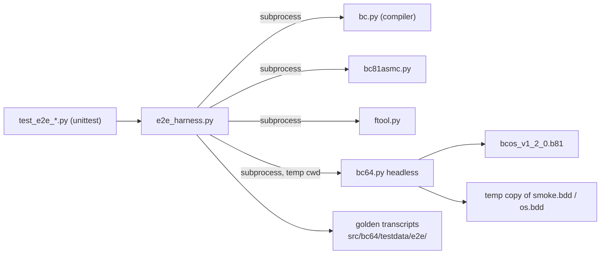
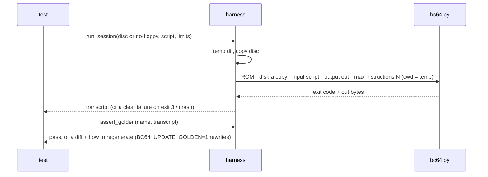

# End-to-End Tests on the Headless Emulator (after #3) Plan

**Plan Status**: `FINAL`

**Story Type**: `Internal`

> This plan captures **what** to build and **why**: domain, architecture, decisions and verified facts.
> It does **not** contain implementation code, pseudocode, line numbers, mock setups or test bodies.
> The implementation agent works out the **how** against the live code. See §4 Task Breakdown.

Issue: [bcichonski/bc16#49](https://github.com/bcichonski/bc16/issues/49). Base branch: `bc64`.
Builds on #3 (headless mode, PR #71) and #48 (unit tests, PR #52), both merged into `bc64`.

---

## 1. Problem Statement

*   **Context**: #3 added headless mode to `src/bc64.py` (`--disk-a/-b`, `--tape-dir`, `--input`, `--output`,
    `--max-instructions`, exit codes 0/1/2/3) and one smoke test (`src/test_bc64_smoke.py`). That test boots a
    frozen disc (`src/bc64/testdata/smoke.bdd`) and compares a session with a byte-exact transcript, plus a
    marker-only check on the live `src/os.bdd`. Nothing else drives the running system: the bcOS monitor, the
    bdos utilities and the compiler → assembler → disc → run chain have no automatic check.
*   **Goal**: a reusable e2e harness (Python `unittest`, run by the existing `python3 run_tests.py`) and a first
    set of scenarios. Each scenario boots the real system headless, types a script and compares the printer
    output with a committed golden transcript. One documented switch regenerates the transcripts.
*   **In scope**:
    *   the harness and golden-file mechanism;
    *   an emulator option to start **without floppy drives** (owner request, 2026-11-09, during this run), so
        the bcOS monitor scenarios really run "ROM only, no disc";
    *   scenarios: bcOS monitor, bdos shell, whole toolchain;
    *   docs.
*   **Out of scope**:
    *   **Apps scenarios (`calc`, TextEd / #47).** Owner comment on the issue, 2026-11-09: "for now exclude e2e
        apps tests".
    *   Fixing the bcOS/bdos bugs that the scenarios expose (see §2.4, "Known failures"). Fixing them means
        rebuilding `os.bdd`, and the owner holds an uncommitted rebuild in the main checkout.
    *   CI wiring (#50).
    *   CPU changes.

### 1.1 Technical Summary

*   **Touched components**:
    *   emulator: `src/bc64.py`, plus a small "no drive" device in `src/bc64/bc64_io.py`;
    *   new test files in `src/`;
    *   golden data under `src/bc64/testdata/e2e/`;
    *   docs.
*   **New abstraction**: `src/e2e_harness.py`, a test-support module that runs a session and compares
    transcripts. It also reads a disc catalog and adds a file to a temporary disc image.
*   **Infrastructure changes**: None.
*   **End-state observable behaviour**: `python3 run_tests.py` runs the e2e scenarios inside the emulator suite.
    `BC64_UPDATE_GOLDEN=1 python3 run_tests.py` (or the same variable on one e2e module) rewrites the golden
    transcripts. `python3 bc64.py ROM --no-floppy …` boots straight to the bcOS `>` prompt.

---

## 2. Architecture & Design

### 2.1 Architecture Overview

#### Involved services & owners

| Component | Technical Owner |
| :--- | :--- |
| emulator, e2e harness and tests (`src/`) | bcichonski |

#### C2 diagram

#### Flow diagram

### 2.2 External Contracts & Evidence

`N/A — Internal story`

#### Source Conflict Log

| Topic | Source A | Source B | Conflict | Chosen Handling |
| :--- | :--- | :--- | :--- | :--- |
| "bcOS monitor (ROM only, no disc)" | Issue scenarios | `FloppyDriveV1` always reports READY (`0x10`). Spike: with no `--disk-a`, bcOS takes the next script line as the disk name, creates a blank `.bdd` and crashes jumping into it | The issue can't be met with today's emulator | **Owner decision (2026-11-09, during the run): "i want an option to start without floppy drives".** New option `--no-floppy` (D1); the monitor scenarios use it. |
| "All scenarios pass" | AC 1 | Spikes on `bc64` @ `2edb602`: `cp` and the tape `s`/`l` round trip fail on today's system | A passing test would hide a real bug | The scenario is written as it should behave and marked `expectedFailure` with the reason (D7). The bugs are fixed in their own issues. |
| Golden transcripts on `os.bdd` | Issue: run on a copy of `os.bdd` | #3 amendment: the owner's uncommitted rebuild changes `os.bdd` listings and free space | Byte-exact goldens on the live disc break on every rebuild | Byte-exact shell scenarios run on the frozen `smoke.bdd`. The toolchain scenario uses the live `os.bdd` but compares only its own program's output (D4). |

### 2.3 Affected Areas

| Area / File (pointer) | Role in this change | Likely action |
| :--- | :--- | :--- |
| `src/bc64.py` (`build_parser`, `is_headless`, `Bc64.__init__`) | CLI and device wiring | Change: `--no-floppy` |
| `src/bc64/bc64_io.py` (`IOBus`, `IODevice`, `FloppyDriveV1`) | `IOBus` raises `KeyError` for an unmapped port, so port `0x08` must still answer | Change: add a small "no drive" device. `FloppyDriveV1` stays unchanged |
| `src/bc81asmc/bcOS/bcos.basm` (`os_boot`) | pings `0xf0` on port 8 and boots only if bit `0x10` is set, otherwise goes to `os_hello_nxt` | Reference only |
| `src/test_bc64_smoke.py`, `src/bc64/testdata/` | existing e2e pattern: subprocess, temp copy, byte-exact transcript, regenerate message | Reference; reuse its approach in the harness. Leave the smoke tests as they are |
| `src/e2e_harness.py` | session runner, golden compare and update, catalog reader, disc-put helper | New |
| `src/test_e2e_harness.py`, `src/test_e2e_bcos.py`, `src/test_e2e_bdos.py`, `src/test_e2e_toolchain.py` | tests (found by `-p "test_*.py"` from `src/`) | New |
| `src/bc64/testdata/e2e/` | scripts, golden transcripts, toolchain `.b` program | New |
| `src/ftool.py` | `dumpsector`, `btap2bin`. Importing it runs `main()` (#70), so call it as a subprocess | Reference |
| `src/bc/bc.py`, `src/bc81asmc/bc81asmc.py` | compiler and assembler; `#include` paths are relative to the main source's directory | Reference |
| `src/bdos/*.b` (`std.b`, `stdio.b`, `bdosh.b`, …) | libraries the toolchain program includes | Reference (copied to a temp dir) |
| `src/bdos/bdio.b` (`bdio_fcat_read`, `bdio_getfreesect`) | how bdos finds the first free catalog entry and the first free sector | Reference for the disc-put helper |
| `docs/01-emulator.md`, `docs/05-bdos.md`, `CLAUDE.md`, `src/bc64/CLAUDE.md`, `docs/specs/memory/design-decisions.md` | docs | Change |

### 2.4 Key Algorithms & Behaviour

*   **Verified spikes** (on `bc64` @ `2edb602`, Python 3.14, sessions take 0.5 to 4 s each):
    *   **No floppy.** A device on port `0x08` that always reads `0x00` and ignores writes boots bcOS to
        `bcOS 1.2`, `free F294 from 0D6A to FFFE`, `type h for help`, `> `. `z` gives `error 01`.
        `d 0000 0010` dumps the ROM. `w 2000` + `hello` + an empty line, then `d 2000 0008` shows
        `68 65 6C 6C 6F 0A 0D 11`. `p 2000 0005` prints `hello`. `h` prints the help.
    *   **bdos on `smoke.bdd`.** These work: `ls`; `cat -c test.b`; `hellowrd`; `rm test.b` then `ls` (TEST.B is
        gone, and `ftool dumpsector` shows the catalog); `cat -c nofile.txt` gives `error: E0 file not found`;
        an unknown command `foo` gives `error: E0 file not found`; `exit` gives `bye!`. `cat nofile.txt` without
        a switch prints `error: unknown switch`.
    *   **Toolchain.** `bc.py --btap prog.b`, then `bc81asmc.py --btap prog.basm`, then `ftool btap2bin` work in a
        temp dir that holds a copy of `src/bdos/*.b`. Together they take under 1 s.
*   **Known failures** (written as scenarios and marked `expectedFailure`, D7):
    *   **`cp test.b copy.b`** prints its dots and then reads keys until the input runs out. The emulator exits 0
        at end of input, so the rest of the script never runs. This happens on `smoke.bdd`, on the committed
        `os.bdd` and on the owner's rebuilt `os.bdd`. With other input orders, a Python `TypeError` in `op_JMP`
        (a jump to an unwritten address) was also seen.
    *   **Tape round trip.** `s 2000 0005 hello.txt` (tape `t1`) writes `t1.btap` (232 bytes = 29 bytes × 8 bits).
        `l 3000` (tape `t1`) prints `load 3000 for 2000` and then reads past the end of the tape (`TypeError` in
        `TapeRecorder.read_byte`). Related: #32 (`s`/`l` register quirk) and #62 (reading past the tape end).
    *   **Seen but not scenarios.** `d 00` (error `03`) followed by any command crashes the CPU (`KeyError` in
        `op_MOV_imm`). `q` crashes while printing the fatal error (`TypeError` in the CPU stack formatter).
        Scripts must avoid both. Scenarios end on end of input or `exit`. Report both in the PR.
*   **Session runner** (harness):
    *   Make a temp dir, copy the requested disc image(s) into it, and run `bc64.py` as a subprocess
        (`sys.executable`, cwd = the temp dir, stdin = DEVNULL). It always passes `--input`, `--output` and
        `--max-instructions`, and it passes either `--disk-a` (and optionally `--disk-b`, `--tape-dir`) or
        `--no-floppy`.
    *   It returns the printer bytes.
    *   **Exit 3** fails the test with a clear message: the instruction limit, the scenario name, and the
        output tail.
    *   **Any other non-zero exit** fails with the stderr tail.
    *   **Exit 0** is accepted. An expected `KIL` is not required.
    *   **Clean tree.** The source images are byte-identical after the run. The run never uses the trace word,
        so no `cpudebug.log` is produced, and the harness asserts that none appeared in the temp dir. Nothing is
        written under `src/`.
*   **Golden compare**:
    *   Goldens are stored as bytes, with `.gitattributes -text` like the smoke testdata (CRLF autoconversion
        must not touch them).
    *   On a mismatch, the test fails with a unified diff (latin-1 decoded, capped) and the regenerate
        instruction.
    *   With `BC64_UPDATE_GOLDEN=1` in the environment, the golden is written (created or overwritten) and the
        test passes, with a note on stderr only. Review the git diff by eye afterwards.
    *   An optional normaliser (a list of regex masks) can be passed per scenario. The scenarios in this plan
        compare no clock, date or random values, so they need none. The masking hook exists for later
        scenarios.
    *   Each golden must also contain a few markers, so an empty or truncated golden can't pass.
*   **Slow scenarios**: a decorator skips a scenario unless `BC64_E2E_SLOW=1`. The default run stays under
    60 s. No scenario in this plan is expected to need it; measure, and mark only one that runs longer than
    about 10 s.
*   **Disc-put helper**: adds a file to a **temp** disc image.
    1.  Read the catalog (track 0 sectors 1…31, 16-byte entries).
    2.  Find the first free entry and the first free sector after the used area, by the same rule bdio uses.
    3.  Write the sectors.
    4.  Write the entry: number, start track/sector, length in sectors, attributes `R X` (`0x05`), and the
        8.3 name, upper case and space-padded.
    It refuses a name that already exists and a disc that is full. It is checked by booting the disc and
    seeing the file in `ls`. When #37 (`ftool mkdisc`) lands, this helper can be replaced.
*   **Catalog reader**: parses the catalog of an image into `(name, ext, attributes, track, sector, length)`
    rows. Used after `rm` to check the disc state. It reads the image bytes directly. "Via ftool" in the issue
    is met in spirit: same format, and the ftool import is broken (#70).

---

## 3. Key Decisions & Assumptions

*   **D1 — `--no-floppy` (owner request)**:
    *   **Behaviour.** With the option, the floppy drive is not attached. Port `0x08` is answered by a "no drive"
        device whose status read is `0x00` (no READY bit) and which ignores writes. bcOS then skips the floppy
        boot (verified).
    *   **Mode.** The option counts as a headless option (scripted environment).
    *   **Conflicts.** It can't be combined with `--disk-a`/`--disk-b`: argparse usage error, exit 2.
    *   **Code.** `FloppyDriveV1` is unchanged. The new device lives in `bc64_io.py` next to the other devices
        (decision E2: devices don't touch the host).
    *   **Why a device.** `IOBus` raises `KeyError` on an unmapped port, and changing the bus default would
        affect every port.
*   **D2 — Harness as a plain module in `src/`**: `src/e2e_harness.py`. It does not start with `test_`, so
    discovery doesn't pick it up as tests. It follows the flat-import rule. The e2e tests sit next to
    `bc64.py` like `test_bc64_smoke.py`, because they cross components and drive the emulator (co-location
    rule: tests live with what they run).
*   **D3 — Golden data in `src/bc64/testdata/e2e/`**: one script `<scenario>.in.txt` and one golden
    `<scenario>.golden.txt` per scenario, plus the toolchain `.b` source. Byte-exact, marked `-text`.
*   **D4 — Discs**:
    *   **Monitor scenarios**: `--no-floppy`.
    *   **bdos shell scenarios**: the frozen `smoke.bdd`, which gives a stable byte-exact catalog and free space.
    *   **Toolchain scenario**: a temp copy of the live `src/os.bdd`, as the issue asks. It compares only the
        part of the transcript between the `A><prog>` line and the next `A>` prompt, against a golden snippet.
        So a rebuild of `os.bdd` doesn't break it.
*   **D5 — Regeneration switch is an environment variable** (`BC64_UPDATE_GOLDEN=1`), not a command-line flag.
    `unittest` and `run_tests.py` don't pass extra flags through, and a variable works for one module, one test
    or the whole run.
*   **D6 — Instruction limit per scenario**: about 10× the measured need, capped at the 200M already used by the
    smoke test. Exit 3 is a test failure with a clear message (AC 4). A harness self-test proves it with a tiny
    limit.
*   **D7 — Known system bugs are `expectedFailure`, not omitted**: the `cp`/`cat` copy scenario and the tape
    round trip are written as they should behave and marked `expectedFailure`. The decorator comment names the
    bug: `#32`/`#62` for tape. For `cp`, it says "found by #49, issue to be filed", because creating issues is
    not part of this autonomous run. The PR lists the bugs for the owner to file. This follows the repo
    convention ("Known bugs are `expectedFailure` tests that name their issue") and keeps AC 1 honest: every
    scenario exists and runs, and the ones that can't pass yet are visibly marked.
*   **D8 — No apps scenarios** (owner comment).
*   **D9 — The `/grind` verification includes e2e automatically**: `run_tests.py` already discovers
    `src/test_*.py`, so no runner change is needed. `CLAUDE.md` states that `python3 run_tests.py` includes
    the e2e scenarios and is the check.
*   **Assumption A1 — no masking needed now**: the chosen scenarios print no time, date or random values (spike
    transcripts). The implementer runs each scenario twice and checks that the outputs are identical. If they
    are not, add a mask. No correctness risk.

### 3.1 Decision Lock (Constants & Policies)

| Constant / Policy | Selected Value | Why | Where it lives |
| :--- | :--- | :--- | :--- |
| No-floppy option | `--no-floppy`; port `0x08` reads `0x00`, writes ignored; conflicts with `--disk-a/-b` (exit 2) | D1, owner request | `bc64.py`, `bc64_io.py` |
| Golden update switch | env `BC64_UPDATE_GOLDEN=1` | D5 | `e2e_harness.py` |
| Slow-scenario switch | env `BC64_E2E_SLOW=1` | AC 2 | `e2e_harness.py` |
| Golden location | `src/bc64/testdata/e2e/`, `-text` | D3 | testdata |
| Shell scenario disc | `src/bc64/testdata/smoke.bdd` (temp copy) | D4 | tests |
| Toolchain disc | `src/os.bdd` (temp copy), compare program output only | D4 | tests |
| Known bugs | `expectedFailure` with the reason/issue | D7 | tests |
| Instruction limit | about 10× measured, ≤ 200 000 000 | D6 | tests |
| Full e2e budget | < 60 s by default | AC 2 | tests |

### 3.2 Open Questions

No open questions.

---

## 4. Task Breakdown

| Task | Title | Depends on | Complexity |
| :--- | :--- | :--- | :--- |
| `T1` | Emulator `--no-floppy` option | — | `Medium` |
| `T2` | E2E harness and golden mechanism | — | `Medium` |
| `T3` | bcOS monitor scenarios | `T1`, `T2` | `Medium` |
| `T4` | bdos shell scenarios | `T2` | `Medium` |
| `T5` | Whole-toolchain scenario | `T2` | `Medium` |
| `T6` | Docs and decision record | `T1`, `T3`, `T4`, `T5` | `Low` |

### T1 — Emulator `--no-floppy` option

*   **Goal**: `python3 bc64.py ROM --no-floppy --input s.txt` boots to the bcOS `>` prompt with no disk prompt
    and no disc file created.
*   **Depends on**: `—`.
*   **Complexity**: `Medium`.
*   **Pointers**:
    *   `src/bc64.py` (`build_parser`, `is_headless`, `Bc64.__init__`, `main`);
    *   `src/bc64/bc64_io.py` (`IODevice`, `IOBus`, `FloppyDriveV1` constants);
    *   `os_boot` in `src/bc81asmc/bcOS/bcos.basm` (reference);
    *   D1 and §2.4 "No floppy".
*   **Definition of Done**:
    *   The option exists and shows in `--help`.
    *   With it, no `FloppyDriveV1` is attached and port `0x08` answers `0x00` on read and ignores writes.
    *   It counts as headless. Combined with `--disk-a`/`--disk-b`, it is a usage error (exit 2).
    *   Without it, behaviour is unchanged.
    *   `FloppyDriveV1` and `bc8183_cpu.py` are unchanged.
*   **Tests expected**: emulator suite (`src/test_bc64_cli.py`; device test in `src/bc64/`), silent, temp dirs:
    *   parsing, including the conflict with `--disk-a`;
    *   the device's read and write behaviour;
    *   a subprocess run of the real ROM with `--no-floppy` whose output contains `type h for help`, with no
        `Disk A name` and no `.bdd` file in the temp dir.

### T2 — E2E harness and golden mechanism

*   **Goal**: `src/e2e_harness.py` gives tests a session runner, a golden compare with update mode, masks, a
    slow-scenario skip, a catalog reader and a disc-put helper, per §2.4.
*   **Depends on**: `—`. Write it so `--no-floppy` is simply passed through; the self-tests don't need T1.
*   **Complexity**: `Medium`.
*   **Pointers**:
    *   `src/test_bc64_smoke.py` (subprocess pattern, regenerate message);
    *   `src/bc64/testdata/.gitattributes`;
    *   catalog format in `docs/05-bdos.md` (Disk format);
    *   `bdio_fcat_read` / `bdio_getfreesect` in `src/bdos/bdio.b`;
    *   D2, D3, D5, D6.
*   **Definition of Done**:
    *   Every harness behaviour in §2.4 exists.
    *   An exit-3 run fails with a message that names the limit and the scenario.
    *   Golden mismatch shows a diff and the regenerate instruction. `BC64_UPDATE_GOLDEN=1` writes the golden.
    *   Source images are verified unchanged after a session.
    *   No file is written outside temp dirs, except a golden in update mode.
*   **Tests expected**: `src/test_e2e_harness.py`, silent:
    *   a tiny `--max-instructions` on a real boot produces the clear limit failure, checked by catching the
        assertion;
    *   golden compare passes and fails, and update mode writes into a temp golden path, not the real testdata;
    *   masks apply;
    *   the catalog reader on `smoke.bdd` lists the known files;
    *   disc-put on a temp copy adds an entry that the catalog reader sees, and refuses duplicates;
    *   the slow decorator skips without the variable.

### T3 — bcOS monitor scenarios

*   **Goal**: monitor scenarios with `--no-floppy` and golden transcripts.
*   **Depends on**: `T1`, `T2`.
*   **Complexity**: `Medium`.
*   **Pointers**:
    *   §2.4 spikes and known failures;
    *   `docs/04-bcos.md` (commands, error codes);
    *   `--tape-dir`;
    *   D4, D7.
*   **Definition of Done**: `src/test_e2e_bcos.py` has these scenarios:
    *   (a) boot to the prompt, then unknown command → `error 01`;
    *   (b) `d`, then `w` (text + empty line), then `d` again shows the written bytes, and `p` shows the text;
    *   (c) tape `s` then `l` round trip into a different address, then `p` shows the same text, using a temp
        `--tape-dir`. Marked `expectedFailure` naming #32/#62 while it fails. If it passes, don't mark it.
    Scripts avoid `q` and invalid-argument errors followed by more commands (§2.4). The goldens are committed.
    The tape scenario leaves its `.btap` only in the temp dir.
*   **Tests expected**: the scenarios themselves. Each also asserts its key markers (for example `error 01`,
    `68 65 6C 6C 6F`).

### T4 — bdos shell scenarios

*   **Goal**: shell scenarios on a temp copy of `smoke.bdd` with golden transcripts and a catalog check.
*   **Depends on**: `T2`.
*   **Complexity**: `Medium`.
*   **Pointers**:
    *   §2.4 spikes and known failures;
    *   `docs/05-bdos.md` (utilities table);
    *   `src/bdos/cp.b` (for the expectedFailure reason);
    *   D4, D7.
*   **Definition of Done**: `src/test_e2e_bdos.py` has these scenarios:
    *   boot to `A>`;
    *   `ls` (expected catalog);
    *   `cat -c test.b`;
    *   `hellowrd` output;
    *   `rm test.b` then `ls` no longer shows it, and the catalog reader on the temp disc after the run agrees;
    *   error paths: an unknown command and `cat -c` of a missing file give `error: E0 file not found`;
    *   `cp test.b copy.b` then `cat -c copy.b` shows the same text: `expectedFailure` with the observed
        behaviour while it fails.
    The goldens are committed. Scenarios are split so one failure doesn't hide others.
*   **Tests expected**: the scenarios themselves, with markers.

### T5 — Whole-toolchain scenario

*   **Goal**: compile a small committed `.b` program, assemble it, convert it to sectors, add it to a temp copy
    of `src/os.bdd`, boot, run it, and compare its output with a golden snippet.
*   **Depends on**: `T2`.
*   **Complexity**: `Medium`.
*   **Pointers**:
    *   `src/bdos/helloworld.b` (shape: `#code 0x6000`, includes);
    *   `src/bc/bc.py`, `src/bc81asmc/bc81asmc.py`, `src/ftool.py btap2bin` (subprocesses; includes resolve
        next to the main source, so copy `src/bdos/*.b` into the temp dir);
    *   disc-put helper (T2);
    *   D4.
*   **Definition of Done**:
    *   A small program in `src/bc64/testdata/e2e/` is committed. It uses a function call, a loop and arithmetic,
        and prints a string, a decimal number and a hex number, so the runtime library and the `os_metatab`
        ABI are exercised.
    *   The test builds it in a temp dir (nothing is written into `src/`), puts it on the temp disc as
        e.g. `E2EPROG.PRG`, boots, runs it and compares the output section with the golden snippet.
    *   A failing compile, assemble or convert step fails the test with that tool's output.
*   **Tests expected**: the scenario itself. Also assert that `ls` shows the new file.

### T6 — Docs and decision record

*   **Goal**: users and agents know how to run, add and regenerate e2e tests, and how to use `--no-floppy`.
*   **Depends on**: `T1`, `T3`, `T4`, `T5`.
*   **Complexity**: `Low`.
*   **Pointers**:
    *   `docs/01-emulator.md` (options table, e2e section);
    *   `docs/05-bdos.md` (testing note);
    *   root `CLAUDE.md` (tests section: `run_tests.py` includes e2e and is the `/grind` check; the
        regenerate variable);
    *   `src/bc64/CLAUDE.md` (e2e section);
    *   `docs/specs/memory/design-decisions.md` (an emulator/test decision for `--no-floppy` and the e2e harness
        rules D2–D7).
*   **Definition of Done**:
    *   The docs describe `--no-floppy`, how to run e2e (all, one module), `BC64_UPDATE_GOLDEN=1`,
        `BC64_E2E_SLOW=1`, how to add a scenario (script + golden + markers), the frozen-disc rule, and the
        `expectedFailure` list.
    *   The commands shown were run once.
*   **Tests expected**: none (docs).

---

## 5. Verification

*   **Tests**: `python3 run_tests.py < /dev/null` from the repo root exits 0. The new e2e tests are counted.
    Expected failures show only for the documented known bugs. The whole run, including e2e, takes under 60 s
    of e2e time. Only Python 3.14 is in the sandbox.
*   **Regenerate**: `BC64_UPDATE_GOLDEN=1` on the e2e modules followed by `git status` shows no change when
    nothing changed, so the goldens are deterministic.
*   **Clean tree**: after a run, `git status` is clean except for intended changes. There is no `cpudebug.log`,
    `bc64.dmp`, `.btap` or `.bdd` in `src/`, and `src/os.bdd` and `smoke.bdd` are unchanged.
*   **No floppy**: `python3 bc64.py bc81asmc/bcOS/bcos_v1_2_0.b81 --no-floppy < /dev/null` (from `src/`) prints
    the bcOS prompt and exits 0.

---

## 6. Fact-Integrity Checklist

| Check | Yes / No / N/A | Notes |
| :--- | :--- | :--- |
| External contracts verified from producer/contract source | N/A | Internal story |
| Evidence sources are reproducible | N/A | Internal story |
| Identifier directionality / ordering / freshness meaning evidenced | N/A | Internal story |
| Every `Assumption` is linked to an Open Question (§3.2) | Yes | A1 has no correctness impact and is checked by running twice |
| No unresolved Open Questions (for `FINAL`) | Yes | |
| Each Decision states a single committed approach | Yes | |
| Tasks are independent, each with a Definition of Done and test expectations | Yes | |
| Required infra reflected | N/A | no toggles or infrastructure |

**Self-review note**:
*   Every scenario behaviour above was spiked on `bc64` @ `2edb602`, including the failures.
*   The judgement calls are:
    *   D7, writing known-broken scenarios as `expectedFailure` rather than dropping or fixing them;
    *   D4, using frozen and live discs.
*   `--no-floppy` is the owner's mid-run request.
*   Implementers must keep every run in temp dirs and must not rebuild `os.bdd`. Check goldens with
    `git show HEAD:<file>` for line endings, because the sandbox uses `autocrlf=true`.
*   Never use the `q` command or the trace word in scenarios.

---

## Amendment log

*   **2026-11-09 — `--no-floppy` added at the owner's request** ("i want an option to start without floppy
    drives") while drafting, after the spike showed the monitor can't be reached without a disc. Added: T1,
    D1, Source Conflict Log row, §5 check.
