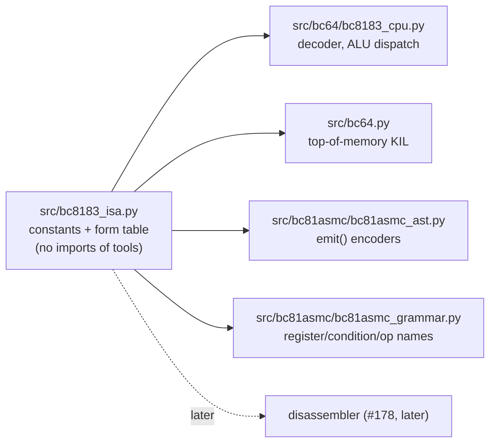
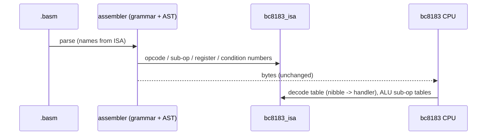

# Shared bc8183 ISA Table for the Emulator and the Assembler Plan

**Plan Status**: `FINAL`

**Story Type**: `Internal`

**Plan Revision**: `A0`

> This plan captures **what** to build and **why**: domain, architecture, decisions, and verified facts.
> It deliberately does **not** contain implementation code, pseudocode, line numbers, mock setups, or test bodies.
> The implementation agent discovers the **how** against live code. See §4 Task Breakdown.

---

## 1. Problem Statement

*   **Context**: Issue #5. The bc8183 opcode constants are defined twice: in `src/bc64/bc8183_cpu.py`
    (class `Bc8183`, used by the CPU decoder and ALU dispatch) and in `src/bc81asmc/bc81asmc_ast.py`
    (its own class `Bc8183`, "#from bc16_cpu.py", used by every `emit()`). The two copies already
    differ in naming and shape. The CPU has `CLC_ADD16 = 0xA0`-style combined codes, while the
    assembler has `CLC_ADD16 = 0x0` sub-op nibbles plus a separate group nibble, and a `CLC_SUN16` typo.
    Opcode/register/condition numbers are also hard-coded in other places:
    *   `src/bc81asmc/bc81asmc_grammar.py` has its own register-name list (`paramreg`), its condition list
        (`logictest`) and the ALU operation names;
    *   `src/bc64.py` writes the `KIL` byte `0xff` at the top of memory;
    *   `bc8183_cpu.FlagsRegister` numbers the flag bits that the condition codes test.

    Only a test (`src/bc81asmc/tests/bc81asmc_opcode_agreement_tests.py`) keeps the two sides in step,
    and the root `CLAUDE.md` lists "Opcodes: duplicated" as a cross-component contract.
*   **Goal**: one definition of the bc8183 instruction set, `src/bc8183_isa.py`. The CPU builds its decode
    and ALU dispatch tables from it, and the assembler takes every opcode, sub-opcode, mode bit, register
    number and condition code from it. The module also describes every instruction **form** (mnemonic,
    operand forms, opcode/sub-opcode, length, nibble layout), so a disassembler can be built on it later
    (#178). Nothing changes in the bytes that are produced, and nothing changes in how the CPU behaves.
*   **Scope change requested by the owner** (comment on #5, 2026-11-10: "Split to two issues, disassembler
    as a separate issue"; confirmed mid-run on 2026-11-24: "i want dissassembler issue to exist"). The
    disassembler is now issue **#178**, filed by this run, with a pointer comment on #5. So:
    *   **In scope**: the shared module; the CPU and the assembler (AST and grammar name lists) use it;
        `src/bc64.py`'s top-of-memory `KIL` byte comes from it; guard tests; byte-identical rebuild;
        docs pointers in `docs/01-emulator.md` and `docs/02-assembler.md`, the component `CLAUDE.md` files,
        a design decision, and the analysis docs.
    *   **Out of scope (moved to #178)**: the disassembler tool (`bc81dasm` / `ftool` sub-command), the
        **round-trip test** (AC 3), the **disassembler documentation** (second half of AC 5), the trace using
        the disassembler, and symbols from a map file (#9).
    *   **Out of scope (other)**: any opcode/encoding/semantics change, renaming instructions, changing
        assembler diagnostics or error texts, and changing the bcOS/bdos sources.

### 1.1 Technical Summary

*   **Touched components**: emulator (`src/bc64/bc8183_cpu.py`, `src/bc64.py`), assembler
    (`src/bc81asmc/bc81asmc_ast.py`, `src/bc81asmc/bc81asmc_grammar.py`), new shared module `src/bc8183_isa.py`.
*   **New pattern**: a declarative ISA module of plain data (constants plus an immutable table of instruction
    forms) with no imports from either tool. Both tools import it, and neither defines an opcode value itself.
*   **Infrastructure changes**: none. The new file ships in the bc64 release zip automatically
    (`scripts/make_release.py` packs all of `src/` except tests).
*   **End-state observable behaviour**: rebuilding bcOS, bdos and all apps gives byte-identical
    `.b81`/`.btap`/`.sector(s)`/`.bdd` outputs; every existing test passes unchanged; new tests fail if a
    tool defines an opcode literal of its own, or if the form table disagrees with what the assembler
    emits or what the CPU decodes.

---

## 2. Architecture & Design

### 2.1 Architecture Overview

#### Involved components & owners

| Component | Technical Owner |
| :--- | :--- |
| emulator `src/bc64/` | repo owner (bcichonski) |
| assembler `src/bc81asmc/` | repo owner (bcichonski) |
| new `src/bc8183_isa.py` | repo owner (bcichonski) |

#### C2 diagram

#### Flow diagram

### 2.2 External Contracts & Evidence

N/A: Internal story.

#### Source Conflict Log

| Topic | Source A | Source B | Conflict | Chosen Handling |
| :--- | :--- | :--- | :--- | :--- |
| Disassembler + round trip | Issue #5 body (Proposal, AC 3, AC 5) | Owner comment on #5 (2026-11-10) + owner message 2026-11-24 | The body includes a disassembler; the owner asked to split it out | Split to #178 (D1). AC 3 and the disassembler-docs half of AC 5 are **deviations from the AC** of #5, flagged in the PR and the final report |
| 16-bit ALU codes | CPU: combined `group<<4 \| op` (`CLC_ADD16 = 0xA0`) | Assembler: group nibble + op nibble (`CLC_ADD16 = 0x0`, `CLC_EXT_AR = 0xA`) | Same encoding, different shapes and names | ISA holds group nibbles and op nibbles once; the combined code is derived (D4) |
| `KIL` byte | Assembler emits `kil` as `F0` | `bc64.py` writes `0xff` at `0xffff` | Both decode as `KIL` (high nibble F); different low nibble | Keep both bytes as they are (byte identity, `write_top_kil` tests). The ISA gives the `KIL` opcode nibble, and the top-of-memory byte is derived from it as "KIL with low nibble F" (D6) |
| Analysis docs | `docs/analysis/01-emulator.md` improvement 4, `02-assembler.md` improvement 4 | This story | They describe ISA, disassembler and round trip as one item | Mark the ISA part done (#5), point the rest to #178 |

### 2.3 Affected Areas

| Area / File (pointer) | Role in this change | Likely action |
| :--- | :--- | :--- |
| `src/bc8183_isa.py` | The single definition: register numbers and names, register pairs, condition codes and flag bit numbers, the 16 opcode nibbles, mode bits, 8-bit ALU op numbers, the 16-bit ALU groups and op numbers, `EXT` sub-opcodes, stack-frame tags, and the instruction form table | New |
| `src/bc64/bc8183_cpu.py` (`Bc8183` class constants, `create_instructions`, `create_arithmetic_and_logical_unit`, `op_*` mode-bit tests, `FlagsRegister.ZERO/CARRY/NEGATIVE/OVERFLOW`) | Decoder and ALU dispatch built from the ISA; no numeric opcode/register/sub-op literal left | Change |
| `src/bc64.py` (`write_top_kil`) | The top-of-memory `KIL` byte comes from the ISA | Change |
| `src/bc81asmc/bc81asmc_ast.py` (class `Bc8183`, `ASMCODES`, `PAIR16_IMPLIED`, `CLR_PAIRS`, every `emit`) | Encoders take every number from the ISA; the duplicate constant class goes away or becomes a thin view on the ISA with no literals | Change |
| `src/bc81asmc/bc81asmc_grammar.py` (`paramreg`, `logictest`, ALU mnemonic names) | Register names, condition names and op names come from the ISA, in an order that keeps longest-match-first | Change |
| `src/bc81asmc/bc81asmc.py` | Assembler entry point; flat imports, started as a script from `src/bc81asmc/` | Reference (may need the import path, see D2) |
| `src/bc81asmc/tests/bc81asmc_opcode_agreement_tests.py` | Existing CPU↔assembler agreement table and coverage guards; must keep passing **unchanged** | Reference (do not edit) |
| `src/bc64/tests/*`, `src/bc81asmc/tests/*`, `src/tests/test_membus.py`-style users of `bc8183_cpu.Bc8183.STACKFRAME_TYPE_*`, `cpu.instructions`, `FlagsRegister.*`, AST class names/fields | Existing tests that reach into these names; they must keep working without edits | Reference (do not edit) |
| `src/tests/test_bc8183_isa.py` | New unit tests of the ISA module and the single-source guards (runs in the emulator suite of `run_tests.py`) | New |
| `src/bc81asmc/tests/` (a new `*_tests.py` module) | New test: ISA form table vs assembler output and CPU decode | New |
| `docs/01-emulator.md`, `docs/02-assembler.md` | Point to `src/bc8183_isa.py` as the source of the encoding (AC 5) | Change |
| `CLAUDE.md`, `src/bc64/CLAUDE.md`, `src/bc81asmc/CLAUDE.md` | "Opcodes duplicated" contract and rules become "one ISA module" | Change |
| `docs/specs/memory/design-decisions.md` | New global decision **G14** (one ISA module) | Change |
| `docs/analysis/01-emulator.md`, `docs/analysis/02-assembler.md` | Improvement 4: ISA done in #5, disassembler and round trip in #178 | Change |

### 2.4 Key Algorithms & Behaviour

*   **What the ISA module holds** (all plain data, importable with no side effects, no imports of
    `bc64`/`bc81asmc`):
    *   register numbers (`a`=1, `ci`=4, `di`=5, `cs`=8, `ds`=9, `f`=0xB, `si`=0xC, `ss`=0xD, `pc`=0xF)
        and the name↔number maps the assembler uses (including the pair names `csci`, `dsdi`, `sssi`, `af`
        and the high register each one encodes as);
    *   condition codes (`z`=0, `c`=1, `n`=2, `o`=3, negation bit 4 → `nz nc nn no`) and the flag bit numbers
        they test (Z=0, C=1, N=2, O=3);
    *   the 16 top-level opcode nibbles (`NOP`=0 … `KIL`=0xF, as in `create_instructions` today);
    *   mode bits: CLC register form 8, CLC extension F; JMP short/label 8; JMR register 8; CAL direct 8 and
        relative 1; IN/OUT register 8; EXT sub-opcodes JRX-address 1 and JRX-register 2;
    *   8-bit ALU op numbers (add 0 … not 7, inc 0xD, dec 0xE) and the 16-bit groups (arithmetic 0xA,
        binary 0xB) with their op numbers, and the 16-bit register-form bit 8;
    *   CPU stack-frame tags (push 0x10, call 0xC0) and the `KIL` opcode;
    *   the **instruction form table**: one immutable record per encoding form listed in
        `docs/02-assembler.md` "Instruction set". Each record has the mnemonic, the operand forms, the opcode
        nibble, the fixed sub-opcode/mode nibble(s), the length in bytes and the nibble layout, in the
        same notation as the docs' Encoding column (`1r ii`, `5F kk p0 hh ll`, `E1 t0 hh ll`, `Dr HH`, …).
        The register-count shift immediates (`5F kk p0 00 ii`), the `out #r, 0xHH` form (A11) and the
        CPU-only short register alias `5(o|8) r0` (CPU accepts it, the assembler never emits it, E15) are all
        described. The alias record is marked as not emitted by the assembler.
*   **CPU**: `create_instructions` maps each opcode nibble of the ISA to its `op_*` handler, and the ALU
    dicts are keyed by ISA op numbers (the 16-bit dict by the derived `group<<4 | op` code). Decoding,
    PC advance, flags and every stop/stderr message stay exactly as they are. The CPU class may keep its
    familiar attribute names (`Bc8183.A`, `Bc8183.STACKFRAME_TYPE_PUSH`, `Bc8183.CLC_OP_RNO`, …) **only as
    references to ISA values**, because existing tests read some of them. It must not write a literal.
*   **Assembler**: every `emit()` gets its nibbles from the ISA, and the grammar's register, condition and
    ALU-op alternatives are generated from ISA name lists. Their order must stay longest-match-first
    (`nz` before `z`, `nc` before `c`, `nn`/`no` before `n`; `csci`-style pairs parsed from two
    register names as today). Every grammar parser keeps its current module-level name (`mADD16r`, `mJMP`,
    `paramreg`, `logictest`, …), because the agreement test discovers forms by those names. Every AST
    class keeps its name, fields and equality. All diagnostics keep their text.
*   **Single-source rule (AC 1)**: an opcode, sub-opcode, mode bit, register number, condition code,
    ALU op number, stack tag or the `KIL` byte is written as a number only in `src/bc8183_isa.py`.
    `bc8183_cpu.py`, `bc64.py`, `bc81asmc_ast.py` and `bc81asmc_grammar.py` refer to it by name.
    Bit masks of the nibble arithmetic (`& 0xf`, `>> 4`, `& 0x3` for the flag number in a condition) and
    data widths (`0xff`, `0xffff`, sign bits) are not ISA values and may stay. A guard test enforces the
    rule (T4).
*   **Byte identity (AC 2)**: proven by building the pipeline before and after and comparing SHA-256 of
    every built `*.b81`, `*.btap`, `*.sector`, `*.sectors`, `*.bdd` under `src/` (28 files at the base
    commit). `scripts/code_size.py --check` must show delta 0 too.

---

## 3. Key Decisions & Assumptions

*   **D1. Disassembler split to #178** (owner comment on #5, owner message 2026-11-24). This run delivers the
    ISA module that #178 builds on. **Deviates from AC 3** (round trip) and **from AC 5's "the disassembler is
    documented"**: both moved to #178 and must be listed in the PR body as moved, never ticked as done here.
*   **D2. Location and import path**: the module is `src/bc8183_isa.py` (the name the issue proposes), at the
    `src/` root next to `bc64.py`, because it belongs to neither tool. The CPU imports it with `src/` on
    `sys.path`, which holds for every way the emulator runs today (`python3 bc64.py` from `src/`, unit tests
    run from `src/`, the console launcher runs scripts from `src/`). The assembler runs with
    `src/bc81asmc/` first on `sys.path`. Its modules must **append** the parent `src/` folder to `sys.path`
    (only if missing) before importing the ISA, the same way the agreement test and `scripts/code_size.py`
    already reach across folders. Appending, never inserting at the front, keeps the existing module
    resolution order, so `import bc81asmc` shadowing (see `scripts/code_size.py`) can't change.
    `python3 bc81asmc/bc81asmc.py`, `bcc`, `buildos`/`buildtools`/`buildapps`, the `bc81asmc` console
    command, `scripts/code_size.py` and the assembler test suite (run from `src/bc81asmc`) must all keep working.
*   **D3. Plain data, not code generation**: the ISA is constants plus a tuple of frozen records. The grammar
    keeps its hand-written parsy combinators (A1). Only the **name lists** inside them come from the ISA, so
    parse results and error messages stay identical. A table-driven grammar or table-driven encoders are not
    part of this story.
*   **D4. 16-bit ALU codes**: the ISA defines the group nibbles (A, B) and the per-group op nibbles once. The
    CPU's combined `group<<4 | op` dispatch keys are derived from them; they are not separate literals.
    The assembler's `CLC_SUN16` typo name goes away with its constant class.
*   **D5. Compatibility names on the CPU class**: the CPU's `Bc8183` keeps every attribute that existing tests
    read (`STACKFRAME_TYPE_PUSH`, `STACKFRAME_TYPE_CALL`, plus `instructions` keyed by nibble) as references to
    ISA values. `FlagsRegister.ZERO/CARRY/NEGATIVE/OVERFLOW` refer to the ISA flag numbers. `FlagsRegister.B0`–`B7`
    are generic bit positions used by device state registers in `bc64_io.py`, not ISA values, and stay as they are.
*   **D6. `KIL` bytes unchanged**: `kil` still assembles to `F0`, and `write_top_kil` still writes `0xFF`. In the
    ISA that byte is "the `KIL` opcode nibble with every low bit set", so both bytes come from the one `KIL` value.
*   **D7. Dead code left as is**: the 16-bit branch of `CLC_A_IMM.emit` (documented dead in
    `src/bc81asmc/CLAUDE.md`) is switched to ISA names like the rest and not removed. Deleting it is a separate
    cleanup.
*   **D8. Design decision id**: record the rule as **G14** in `docs/specs/memory/design-decisions.md` (Global,
    after G13). Before the PR, check `origin/master` for a newer G-id, because parallel stories have
    collided on decision ids before.
*   **D9. Tests are only added**: no existing test file is edited. The new tests are an ISA unit test module in
    `src/tests/` (the ISA lives in `src/`, so its tests go in `src/tests/` per the co-location rule), and an
    assembler-side form-table test in `src/bc81asmc/tests/`.
*   **Assumption A1 (no OQ, low stakes)**: "Opcode values exist in exactly one place" is read as *numbers that
    encode instructions*. The Encoding tables in `docs/02-assembler.md` stay as human-readable reference with a
    pointer to the module. Resolution attempt: AC 1 says "the CPU and the assembler import them", so it is
    about code. The docs AC 5 asks only for "point to the shared table".

### 3.1 Decision Lock (Constants & Policies)

| Constant / Policy | Selected Value | Why | Where it lives |
| :--- | :--- | :--- | :--- |
| Module path | `src/bc8183_isa.py` | Name from the issue; shared by two tools | `src/` |
| Import path rule (assembler) | append parent `src/` to `sys.path` if missing | keep resolution order, no shadowing | assembler modules |
| Decision id | `G14` | next free Global id at base `0edb080` | `docs/specs/memory/design-decisions.md` |
| Output bytes | identical to base (28 built files) + `code_size.py --check` delta 0 | AC 2 | §5 |
| Existing tests | unchanged | D9 | — |
| Disassembler, round trip, its docs | not here → #178 | D1 | — |

### 3.2 Open Questions

No open questions. The only scope doubt (the disassembler) was settled by the owner (D1).

---

## 4. Task Breakdown

Build-using tasks must not run at the same time in this worktree (both rewrite `src/os.bdd` and the
intermediates). Run T2 and T3 one after the other even though neither depends on the other.

Every coding agent's local check is `python3 run_tests.py --group unit < /dev/null`,
`python3 run_tests.py --group e2e --tier happy < /dev/null` and
`python3 run_tests.py --group e2e --changed origin/master < /dev/null` from the repo root, all exit 0. The full
suite runs once at finalize.

| Task | Title | Depends on | Complexity |
| :--- | :--- | :--- | :--- |
| `T1` | Shared ISA module with the form table, and its unit tests | — | `High` |
| `T2` | Emulator uses the ISA | `T1` | `Medium` |
| `T3` | Assembler uses the ISA | `T1` | `Medium` |
| `T4` | Single-source and form-table guard tests, byte-identity check | `T2`, `T3` | `Medium` |
| `T5` | Docs, CLAUDE.md files, design decision G14, analysis notes | `T2`, `T3` | `Medium` |

### T1 — Shared ISA module with the form table, and its unit tests

*   **Goal**: `src/bc8183_isa.py` exists and describes the whole bc8183 instruction set as data (§2.4): every
    constant both tools need, and one record per encoding form from `docs/02-assembler.md` "Instruction set",
    plus the CPU-only short ALU register alias.
*   **Depends on**: —
*   **Complexity**: `High`. This is the contract both tools and the future disassembler rely on, so a wrong value
    or a missing form costs a lot later.
*   **Pointers**: `src/bc64/bc8183_cpu.py` (current CPU constants, `create_instructions`, `op_*` mode bits,
    `op_CLC` 16-bit decode, `FlagsRegister`), `src/bc81asmc/bc81asmc_ast.py` (assembler constants, `emit`
    layouts), `docs/02-assembler.md` (Encoding column), `docs/01-emulator.md` ("8-bit ALU encoding",
    Registers table), decisions E15, A7, A8, A11.
*   **Definition of Done**:
    *   the module imports nothing from the tools and has no side effects;
    *   every value matches what the CPU and assembler use today (same numbers, verified against both files);
    *   the form records are immutable and cover every encoding row of the docs' tables, and each record's
        length agrees with its layout;
    *   the CPU and the assembler are **not** changed in this task.
*   **Tests expected** (unit, `src/tests/test_bc8183_isa.py`): every value is pinned against the documented
    number (registers, conditions, opcodes, ALU ops, groups, EXT sub-ops, stack tags); each opcode nibble has
    exactly one group name; each form's layout length equals its byte length; form keys are unique; condition
    names with negation map to code | 4; the module imports cleanly in a fresh interpreter with only `src/` on the
    path.
*   **Tests to modify**: None.

### T2 — Emulator uses the ISA

*   **Goal**: `bc8183_cpu.py` and `bc64.py` take every opcode/register/sub-op/mode/tag/`KIL` number from the ISA;
    the decode table and ALU dispatch tables are built from it.
*   **Depends on**: `T1`
*   **Complexity**: `Medium`
*   **Pointers**: `src/bc64/bc8183_cpu.py` (class constants, `create_instructions`, `create_registers`,
    `create_arithmetic_and_logical_unit`, `op_CLC`, `op_JMP`, `op_JMR`, `op_CAL`, `op_IN`, `op_OUT`, `op_EXT`,
    `op_RET`, `FlagsRegister`), `src/bc64.py` (`write_top_kil`), D2, D4, D5, D6.
*   **Definition of Done**:
    *   no numeric literal for an ISA value remains in `bc8183_cpu.py` or `bc64.py` (§2.4 single-source rule);
    *   compatibility attribute names read by existing tests still exist and hold the same values (D5);
        `cpu.instructions` is still keyed by the 16 nibbles;
    *   behaviour unchanged: every emulator test and the agreement test pass unedited, and e2e happy + changed pass.
*   **Tests expected**: unit tests (in a new module in `src/bc64/tests/` or in `src/tests/test_bc8183_isa.py`)
    that show the CPU's decode table and ALU dispatch keys are exactly the ISA's opcode nibbles and op codes, and
    that `write_top_kil` writes the ISA's top-of-memory `KIL` byte.
*   **Tests to modify**: None.

### T3 — Assembler uses the ISA

*   **Goal**: `bc81asmc_ast.py` and `bc81asmc_grammar.py` take every opcode/sub-op/mode/register/condition number
    and the register/condition/ALU-op name lists from the ISA; the assembler's duplicate constant class has no
    literals left.
*   **Depends on**: `T1`
*   **Complexity**: `Medium`
*   **Pointers**: `src/bc81asmc/bc81asmc_ast.py` (class `Bc8183`, `ASMCODES`, `PAIR16_IMPLIED`, `CLR_PAIRS`, every
    `emit`, `check_regs`), `src/bc81asmc/bc81asmc_grammar.py` (`paramreg`, `logictest`, the 8- and 16-bit ALU
    parsers, `mCLC`/`mnemonic` order), `src/bc81asmc/bc81asmc.py`, `scripts/code_size.py` (`load_assembler`),
    `src/bc64_toolchain.py`, D2, D3, D7.
*   **Definition of Done**:
    *   no numeric literal for an ISA value remains in `bc81asmc_ast.py` or `bc81asmc_grammar.py`;
    *   every grammar parser keeps its module-level name, order and parse result, and every AST class keeps its
        name, fields and equality; diagnostics are unchanged;
    *   the assembler still runs as `cd src && python3 bc81asmc/bc81asmc.py …`, via `./bcc`/`./buildos`, and from
        `src/bc81asmc` (its test suite); `scripts/code_size.py` still loads it;
    *   a full build (`cd src && ./buildos && ./buildtools && ./buildapps && ./makedisc`) succeeds.
*   **Tests expected**: unit tests in a new `src/bc81asmc/tests/*_tests.py` module showing that the grammar's
    register, condition and ALU-op names are exactly the ISA's lists, and that the assembler resolves names to ISA
    numbers (for example every register name and every condition code).
*   **Tests to modify**: None.

### T4 — Single-source and form-table guard tests, byte-identity check

*   **Goal**: tests make the single-source rule and the form table enforceable, and the byte identity of AC 2 is
    demonstrated.
*   **Depends on**: `T2`, `T3`
*   **Complexity**: `Medium`
*   **Pointers**: `src/bc81asmc/tests/bc81asmc_opcode_agreement_tests.py` (reuse its in-process `assemble`/
    `execute` approach; do **not** edit it), `src/tests/test_bc8183_isa.py`, §2.4, §5.
*   **Definition of Done**:
    *   a guard test parses `bc8183_cpu.py`, `bc64.py`, `bc81asmc_ast.py` and `bc81asmc_grammar.py` (Python `ast`,
        not regex on text) and fails when an opcode/register/sub-op/mode/condition/tag constant is defined there as
        an integer literal (the rule of §2.4, with the documented mask/width exceptions). A deliberate
        literal added in a scratch copy must make it fail (prove this once by hand, then revert);
    *   a form-table test assembles a representative source line for **every** emitted form of the ISA table and
        checks the assembled length and every fixed nibble against the record's layout. It also checks that the
        CPU, run for one instruction, consumes the same length (jumps/calls: lands on the target or the next
        instruction). Every grammar `m*` form parser maps to at least one ISA form;
    *   the byte-identity check of §5 was run and the result (28 files identical, `code_size.py --check` delta 0)
        is quoted in the task notes.
*   **Tests expected**: as above, unit level, in `src/tests/` (source guard) and `src/bc81asmc/tests/` (form table).
*   **Tests to modify**: None.

### T5 — Docs, CLAUDE.md files, design decision G14, analysis notes

*   **Goal**: docs and agent instructions describe one ISA module instead of duplicated constants (AC 5, first half).
*   **Depends on**: `T2`, `T3`
*   **Complexity**: `Medium`
*   **Pointers**: `docs/01-emulator.md` (source file table, "The bc8183 CPU"), `docs/02-assembler.md` (file table,
    "Instruction set" intro, Known quirks), root `CLAUDE.md` ("Cross-component contracts → Opcodes"),
    `src/bc64/CLAUDE.md` (Rules: "Opcode or encoding changes must also be made in …"), `src/bc81asmc/CLAUDE.md`
    (Rules: "Opcode constants are duplicated …"), `docs/specs/memory/design-decisions.md` (add G14 after G13; E3
    may point to it), `docs/analysis/01-emulator.md` and `docs/analysis/02-assembler.md` (improvement 4).
*   **Definition of Done**:
    *   both reference docs name `src/bc8183_isa.py` as the single source of the encoding, and say the
        disassembler is #178;
    *   the three CLAUDE.md files say: change an opcode/encoding in `src/bc8183_isa.py` only, add tests on both sides,
        extend the agreement and form-table tests;
    *   G14 states the rule, rationale, usage and trade-offs in the file's existing format;
    *   the analysis notes mark the ISA part done (#5) and move the disassembler and round trip to #178;
    *   no other decision, story or section text is changed (check the diff for edits outside these places).
*   **Tests expected**: none (docs only). The unit suite still passes.
*   **Tests to modify**: None.

---

## 5. Verification

*   **Unit**: `python3 run_tests.py --group unit < /dev/null`: exit 0.
*   **Full suite (finalize)**: `python3 run_tests.py < /dev/null`: exit 0. Report the expected failures separately
    (master baseline: the tape round trip), never as "all passed".
*   **Byte identity (AC 2)**: export the base (`git archive <base_ref> | tar -x` into a scratch folder), build it there
    (`cd src && ./buildos && ./buildtools && ./buildapps && ./makedisc`), do the same for the branch tree. Then compare
    `sha256sum` of every `*.b81`, `*.btap`, `*.sector`, `*.sectors`, `*.bdd` the build wrote under `src/` (28 files at
    base `0edb080`). All must be identical. Also run `python3 scripts/code_size.py --check`: delta 0.
*   **Single source (AC 1)**: the T4 guard test passes; `git grep -n "class Bc8183" -- src` shows no constant class with
    literals in the assembler.
*   **Agreement (AC 4)**: `src/bc81asmc/tests/bc81asmc_opcode_agreement_tests.py` and all emulator/assembler tests pass
    **unedited** (test-guard against the base ref shows no modified existing test).
*   **Tools still start**: `cd src && python3 bc81asmc/bc81asmc.py examples/<any>.basm` (or a temp copy) and
    `python3 bc64.py --help` work; `python3 scripts/code_size.py` loads the assembler.
*   **Docs (AC 5, first half)**: `git grep -n "bc8183_isa" -- docs/01-emulator.md docs/02-assembler.md` has matches.
*   **Deviation record**: the PR body lists AC 3 and "the disassembler is documented" as moved to #178 (D1).

---

## 6. Fact-Integrity Checklist

| Check | Yes / No / N/A | Notes |
| :--- | :--- | :--- |
| External contracts verified from producer/contract source | N/A | Internal story |
| Evidence sources are reproducible | N/A | Internal story |
| Identifier directionality / ordering / freshness meaning evidenced | N/A | Internal story |
| Every `Assumption` is linked to an Open Question (§3.2) | Yes | A1 is closed by the AC text, not open |
| No unresolved Open Questions (for `FINAL`) | Yes | Disassembler scope settled by the owner (D1) |
| Each Decision states a single committed approach | Yes | D1–D9 |
| Tasks are independent, each with a Definition of Done and test expectations | Yes | T2/T3 must not build at the same time (worktree) |
| Required infra reflected (toggle / bicep) | N/A | No toggle, no infra |

**Self-review note**: the facts come from reading both constant sets, every `emit`, the CPU decoder and the grammar at
base `0edb080`. Consumers of the constant names in tests were grepped, so the compatibility names in D5 are required,
not optional. The riskiest part is T3: the grammar's alternative order and module-level parser names are load-bearing,
both for parsing and for the agreement test's form discovery. The assembler import path (D2) must work for every way
the assembler is started. The ISA values in T1 must be checked against both files, not copied from one. Where the two
files disagree in shape (16-bit codes), the encoding is the same and D4 settles it.

---

## 7. Amendment Log

| Revision | Request | Decision | Plan changes |
| :--- | :--- | :--- | :--- |
