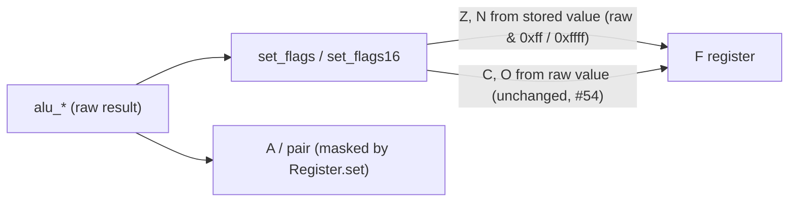

# CPU Zero Flag from the Unwrapped Result Plan

**Plan Status**: `FINAL`

**Story Type**: `Internal`

**Plan Revision**: `A0`

> This plan captures **what** to build and **why**: domain, architecture, decisions, and verified facts.
> It does **not** contain implementation code. The implementation agent discovers the **how** against live code.

Slug note: the filename keeps `From` capitalised (Title Case rule says `from`). The sandbox's virtiofs share is
case-insensitive, and a case-only rename there leaves phantom files (see the workspace memory), so the slug was
fixed before the plan existed.

---

## 1. Problem Statement

*   **Context**: `set_flags` (8-bit) and `set_flags16` (16-bit) in `src/bc64/bc8183_cpu.py` receive the **raw**
    result of an ALU operation, before it is wrapped into the register (`Register.set` masks with `& max_value`).
    `Z` is computed as `raw == 0`, so an operation that wraps to `0x00` / `0x0000` leaves `Z = 0`:
    8-bit `add`/`inc` at `0xff`, `not 0xff`; 16-bit `add`/`inc`/`mul`/`shl`/`not` that wrap to `0x0000`.
    A program cannot test "the register became zero" with `jmp z` after such an operation.
*   **Goal (issue "Expected")**: `Z` (and `N`) describe the value actually stored in the destination register
    (`A`) or pair.
*   **In scope**: `Z` and `N` of every 8-bit ALU operation except `shl`/`shr` (see D2), and of every 16-bit ALU
    operation (all go through `alu_setval16` → `set_flags16`); the pinned tests the issue names; docs
    (`docs/01-emulator.md` flags table, a new design decision `E11`); the dependency audit the issue asks for.
*   **Out of scope**:
    *   `C` and `O` meaning (carry/borrow/signed overflow) → **#54**. Their values stay exactly as today.
    *   8-bit `shl`/`shr` flags → **#55**. Their flags stay exactly as today (`Z`/`N`/`C`/`O` all unchanged).
    *   The `div`/`mod`-by-zero flag path (E10, #136): unchanged.
    *   `MOV`-into-`A` and `OUT #r, r2` flags: already computed from an 8-bit value, unchanged.

    The issue says "fix together" with #54/#55, but the owner's roadmap (`docs/analysis/08-self-hosted-roadmap.md`,
    phase 0) lists them as separate steps 4, 5 and 6, and #54 needs an owner decision on flag meaning. So this
    story does only step 4 (Assumption D1).

### 1.1 Technical Summary

*   **Touched**: emulator CPU (`src/bc64/bc8183_cpu.py`), its ALU tests (`src/bc64/tests/test_cpu_alu.py`),
    `docs/01-emulator.md`, `docs/specs/memory/design-decisions.md`, roadmap row in `docs/analysis/08-self-hosted-roadmap.md`.
*   **New patterns**: none. The flag helpers take the stored (masked) value for `Z`/`N`; `C`/`O` keep using the raw value.
*   **Infrastructure changes**: none. No opcode, encoding, assembler or compiler change.
*   **End-state observable behaviour**: `mov a, 0xff; add a, 0x01` → `A = 0x00`, `Z = 1` (`C = 1`, `O = 1` as today);
    `0xffff + 1` on `csci` → pair `0x0000`, `Z = 1`; `jmp z` after a wrap is taken.

---

## 2. Architecture & Design

### 2.1 Architecture Overview

Single component: the bc8183 CPU in the emulator. Every other component (bcOS, bdos, apps, compiler runtime) runs
on it; §2.3 records the audit showing none of them depends on the old `Z`.

### 2.2 External Contracts & Evidence

N/A — Internal story.

### 2.3 Affected Areas (verified facts)

*   `set_flags(regno, val)`: sets `Z`/`N` only when `regno == A`; `C`/`O` whenever `val` is given. Callers:
    `op_MOV_imm`/`op_MOV_reg`/`op_MOV_reg_mem` (no `val`, reads `A` → already 8-bit), `op_OUT` reg form
    (`val` is a register byte), and every 8-bit `alu_*`.
*   `alu_shl` calls `set_flags(A, val & 0x100)`, `alu_shr` calls `set_flags(A, -(val & 0x1))`. Masking that argument
    with `0xff` would change `shl`'s `Z` (it would always be 1), so a blanket mask is **not** behaviour-neutral for
    `shl`; D2 keeps both shifts' flags as they are today.
*   `set_flags16(val)` is called only from `alu_setval16`, used by every 16-bit ALU op (`add sub mul div mod inc dec
    and or xor shl shr not`). Raw values that wrap to `0x0000` with raw ≠ 0: `add`, `inc`, `mul`, `shl`, `not`.
    `sub`/`dec`/`and`/`or`/`xor`/`div`/`mod`/`shr` cannot.
*   `N` today: Python `&` on the raw value gives the same bit 7 / bit 15 as on the masked value, for negative raw
    values too. So `N` is already correct for every op except `shl`/`shr` (8-bit, #55). Computing it from the
    stored value changes nothing, but makes the definition explicit.
*   The A:F pair (`add af, …`): `alu_setval16` writes `F` and then `set_flags16` overwrites it (pinned by
    `test_add16_on_a_f_pair`). Unchanged by this story.
*   **Dependency audit (done during planning, 2026-11-19, on a full build of master `b6176e4`)**: every `jmp/jmr/jrx/clr/cal`
    on `z`/`nz` in all 15 `.basm` files of the build (bcOS, boot, bdos, every utility and app, both examples;
    the compiler runtime `bc_stdlib.py` is part of each program) was traced back to its flag-setting instruction.
    Results:
    1156 follow a non-wrapping op, 51 follow a `cal`/jump and 26 follow a label; none follow `add`/`inc`/`not` or a
    wrapping 16-bit op directly. Of 1295 `ret`s, two return right after a wrapping-capable op:
    `upchar` in `bcos.basm` (`add 0x41` on 0..25, cannot wrap) and a B function return in `texted`
    (`add csci, dsdi`; callers never test flags after a B call). The three `bc_stdlib.py` hits (`add csci, dsdi`,
    `inc dsdi` near a `jmr z/nz`) all have an intervening `xor a` / `or cs`. `asm` blocks in `.b` files outside the
    build (`src/bc/code/*.b`, `bdos/fddtest.b`) contain no `z`-test after `add`/`inc`/`not`/`mul`/`shl`.
    **Conclusion: no source or compiler change is needed.**
*   **Trial run (planning, reverted)**: a trial patch with `Z` from the stored value (shifts untouched) failed exactly
    7 emulator tests (the pinned ones in §4 T1). All other suites passed unchanged, e2e included
    (`e2e PASS: 108 tests, 1 expected failure` = the known tape round trip; assembler 6 expected failures,
    pre-existing).

### 2.4 Key Behaviour

*   8-bit (destination `A`): `Z = (stored A == 0)`, `N = bit 7 of stored A`. `C`/`O` exactly as today (raw value).
*   16-bit (destination pair): `Z = (stored pair == 0)`, `N = bit 15 of stored pair`. `C`/`O` exactly as today.
*   8-bit `shl`/`shr`: all four flags exactly as today (D2).
*   `div`/`mod` by zero: unchanged (E10).

---

## 3. Key Decisions & Assumptions

*   **D1 (Assumption, scope)**: only #53. `C`/`O` (#54) and 8-bit shift flags (#55) keep today's values bit for bit, even
    though the issue says "fix together". Reason: the roadmap lists them as separate steps, and #54 needs the owner
    to decide what `O`/`C` mean. Not a deviation from #53's "Expected".
*   **D2**: 8-bit `shl`/`shr` keep today's flags. Their pinned tests (`test_shl_imm_*`, `test_shr_imm_*`) stay
    unchanged and keep passing. #55 fixes them.
*   **D3**: 16-bit `shl` *does* get the corrected `Z` (e.g. `0x8000 << 1` → pair `0x0000`, `Z = 1`), because it goes
    through the shared `set_flags16` and the issue's "Expected" covers every pair. Its `C`/`O` are unchanged. #55
    still reviews 16-bit shift carry.
*   **D4**: `N` is computed from the stored value too (same results as today, §2.3), as the issue asks to "review it".
*   **D5**: pinned tests become correct-behaviour tests (the issue says so); their `PINNED` comments and the module
    docstring of `test_cpu_alu.py` say which issue they cover now. The `flags_from_raw` helper keeps its job for
    C/O; if it is used for a test whose `Z` now differs, adjust that test's expectation (only the tests listed may change).
*   **D6**: a new design decision `E11` records the flag definition ("Z/N from the stored result; C/O from the raw
    result until #54"). `docs/01-emulator.md` flags table is updated in the same change.
*   **D7**: no `.basm`, compiler or bcOS change (audit §2.3). Built programs are byte-identical (the CPU is not part of
    the build), so no golden, transcript or `code_size.csv` row changes.

### 3.1 Decision Lock

| Item | Value |
| :--- | :--- |
| 8-bit Z | stored `A` == 0 |
| 8-bit N | bit 7 of stored `A` |
| 16-bit Z | stored pair == 0 |
| 16-bit N | bit 15 of stored pair |
| C, O | unchanged (raw value), #54 |
| 8-bit shl/shr flags | unchanged, #55 |
| New design decision id | `E11` |

### 3.2 Open Questions

None.

---

## 4. Task Breakdown

| Task | Title | Depends on | Complexity |
| :--- | :--- | :--- | :--- |
| T1 | CPU: Z/N from the stored value + tests | — | Medium |
| T2 | Document the flag definition | — | Low |

### T1 — CPU: Z/N from the stored value + tests

*   **Goal**: §2.4 holds for every ALU operation; the pinned tests assert the correct `Z`.
*   **Depends on**: —
*   **Complexity**: `Medium` (small change, but the CPU is the reference for everything).
*   **Pointers**: `src/bc64/bc8183_cpu.py` (`set_flags`, `set_flags16`, `alu_setval16`, `alu_shl`, `alu_shr`, the
    other 8-bit `alu_*`), `src/bc64/tests/test_cpu_alu.py` (helpers `flags_of`, `flags_from_raw`, `check`, `check16`),
    `src/bc64/tests/test_cpu_control.py` (style model for conditional jumps).
*   **Definition of Done**:
    *   `Z`/`N` follow §2.4 for 8-bit `add sub and or xor not inc dec` and every 16-bit op; `C`/`O` values unchanged
        for every op; 8-bit `shl`/`shr` flags unchanged (all their existing tests pass untouched).
    *   The seven tests listed below assert `Z = 1` (C/N/O expectations as before) and no longer say `PINNED` for `Z`;
        the remaining PINNED notes about `C`/`O` name #54.
    *   New tests: `jmp z` (or `jmr z`) taken after an 8-bit `add`/`inc` wrap and after a 16-bit `add`/`inc` wrap,
        run as real code on the CPU; 16-bit `shl` wrapping to `0x0000` sets `Z`; `not16` of `0xffff` and `mul16`
        wrap covered by the rewritten tests; 8-bit `shl`/`shr` unaffected is already covered by their tests.
    *   No change to `bc81asmc`, the compiler, bcOS or bdos sources.
*   **Tests expected**: unit (emulator). Must run from `src/`: `python3 -m unittest discover -s bc64/tests -t . -p "test_*.py"`,
    then from the repo root `python3 run_tests.py < /dev/null` (builds + e2e; exits 0; expected failures stay
    the pre-existing ones: assembler 6, e2e 1).
*   **Tests to modify** (all in `src/bc64/tests/test_cpu_alu.py`; reason for each: the issue's "Expected" (Z describes the
    stored value), which changes the asserted `Z` from 0 to 1; C/N/O expectations stay):
    *   `src/bc64/tests/test_cpu_alu.py :: Alu8Tests.test_add_imm_wrap_at_0xff` — Z 0→1 (#53 Expected)
    *   `src/bc64/tests/test_cpu_alu.py :: Alu8Tests.test_inc_wrap_at_0xff` — Z 0→1 (#53 Expected)
    *   `src/bc64/tests/test_cpu_alu.py :: Alu8Tests.test_not_ff_gives_zero` — Z 0→1 (#53 Expected)
    *   `src/bc64/tests/test_cpu_alu.py :: Alu16Tests.test_add16_wrap_at_0xffff` — Z 0→1 (#53 Expected)
    *   `src/bc64/tests/test_cpu_alu.py :: Alu16Tests.test_inc16_wrap_at_0xffff` — Z 0→1 (#53 Expected)
    *   `src/bc64/tests/test_cpu_alu.py :: Alu16Tests.test_mul16_overflow` — Z 0→1 (#53 Expected)
    *   `src/bc64/tests/test_cpu_alu.py :: Alu16Tests.test_not16_ffff` — Z 0→1 (#53 Expected)
    *   the module docstring and the `flags_from_raw` docstring/comment of the same file — they describe Z as computed
        from the raw value (D5); text only, the helper's logic may change only if a listed test needs it.

### T2 — Document the flag definition

*   **Goal**: the docs state §2.4 as the CPU's flag definition.
*   **Depends on**: —
*   **Complexity**: `Low`.
*   **Pointers**: `docs/01-emulator.md` ("Flags (`F`)" table: `Z` and `N` rows say "stored result"; one sentence that
    `C`/`O` are still computed from the unwrapped result, see #54, and 8-bit `shl`/`shr` flags are #55);
    `docs/specs/memory/design-decisions.md` (new `### E11` after E10, Purpose / Rationale / Usage / Trade-offs, citing #53);
    `docs/analysis/08-self-hosted-roadmap.md` (phase 0 step 4 row: mark done/what was decided, if the table has such a column;
    otherwise leave it); `src/bc64/CLAUDE.md` only if it states flag semantics (it does not today; leave it).
*   **Definition of Done**: no doc describes `Z` as computed from the unwrapped result; E11 exists and matches §3.1.
*   **Tests expected**: none (docs only).
*   **Tests to modify**: None.

---

## 5. Verification

1.  From `src/`: `python3 -m unittest discover -s bc64/tests -t . -p "test_*.py"` → OK.
2.  From the repo root: `python3 run_tests.py < /dev/null` → exit 0. Report the expected failures by name
    (assembler 6, e2e 1 tape round trip), never as "all passed".
3.  `git status` after the run: only the intended source/doc/test files changed (the build must not change tracked files).
4.  Manual check in a test or a headless run: `mov a, 0xff; add a, 0x01; jmp z` is taken.

---

## 6. Fact-Integrity Checklist

| Check | Status |
| :--- | :--- |
| Issue "Expected" mapped to a task (Z/N from stored value → T1; docs → T2) | Yes |
| Pinned tests named in the issue located and checked by a trial run (7 fail, nothing else) | Yes |
| `N` claim verified (same bit for raw and masked values) | Yes |
| Shift interaction found and decided (D2/D3) | Yes |
| Dependency audit of all built `.basm`, `bc_stdlib.py`, unbuilt `asm` blocks done (§2.3) | Yes |
| No Open Questions | Yes |

**Self-review note**: the issue lists `test_mul16_overflow` etc. under `src/bc64/test_cpu_alu.py`; since #90 the file
is `src/bc64/tests/test_cpu_alu.py`. The issue's "fix together with #54/#55" is narrowed by D1 to this issue only. That
is a scope assumption, not a dropped criterion: #53's Expected is fully covered. The issue's checklist items (rebuild,
boot, smoke-test, assembler agreement test, docs) are covered by §5 and T2; `docs/02-assembler.md` doesn't describe
flags, so it needs no change.

---

## 7. Amendment Log

| Revision | Request | Source | Decision | Plan changes |
| :--- | :--- | :--- | :--- | :--- |
