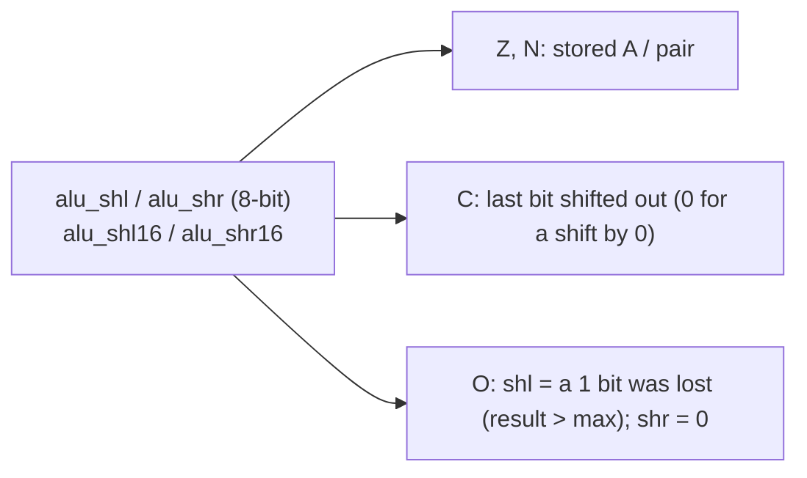

# CPU Shl/Shr Flags Describe the Shifted Result Plan

**Plan Status**: `FINAL`

**Story Type**: `Internal`

**Plan Revision**: `A0`

> This plan captures **what** to build and **why**: domain, architecture, decisions, and verified facts.
> It does **not** contain implementation code. The implementation agent discovers the **how** against live code.

---

## 1. Problem Statement

*   **Context**: in `src/bc64/bc8183_cpu.py`, `alu_shl` passes `val & 0x100` and `alu_shr` passes `-(val & 0x1)` to
    `set_flags(..., raw_zn=True)`. So the 8-bit shift flags do not describe the shifted result:
    *   `shl`: `Z = 1` whenever no bit leaves bit 7, even when `A` ≠ 0 (`0x40 << 1` → `A = 0x80`, `Z = 1`, `N = 0`);
        `N` is never set.
    *   `shr`: the flags follow bit 0 of the **result** (`0x03 >> 1` → `A = 0x01`, `N = 1`, `O = 1`);
        `C` is never set.
    *   16-bit `shl16`/`shr16` (the issue asks for "the same review"): `Z`/`N` are already from the stored pair (#53),
        but `C` is "any bit lost" for `shl16` (`val > 0xffff`) and never set for `shr16`.
*   **Goal (issue "Expected", confirmed by the owner on 2026-11-20: "it should be fixed as expected")**: `Z`/`N` from the
    stored result; `C` = the last bit shifted out (bit 7 side for `shl`, bit 0 side for `shr`), as most 8-bit CPUs do.
    Document the choice.
*   **In scope**: 8-bit `shl`/`shr` flags (imm and register forms share `alu_shl`/`alu_shr`), 16-bit `shl16`/`shr16`
    carry (and `O` of `shr16`, see D4); the pinned tests; docs (`docs/01-emulator.md` flags, design decision `E12`,
    E11's "#55" remarks, roadmap step 6); the dependency audit the issue asks for.
*   **Out of scope**:
    *   `C`/`O` meaning for the other ALU ops → **#54** (in progress in a parallel run; owner: `O` is "unsigned out of
        range", the CPU has no signed values). Their values stay as today.
    *   The register-form encoding of 8-bit `shl`/`shr` (collides with `inc`/`dec`) → **#56**.
    *   The A:F pair result (`F` is overwritten by the flags) → **#58**.

### 1.1 Technical Summary

*   **Touched**: `src/bc64/bc8183_cpu.py` (`alu_shl`, `alu_shr`, `alu_shl16`, `alu_shr16`, and `set_flags`' `raw_zn`
    parameter, which only exists for the shifts), `src/bc64/tests/test_cpu_alu.py`, `docs/01-emulator.md`,
    `docs/specs/memory/design-decisions.md`, `docs/analysis/08-self-hosted-roadmap.md`.
*   **New patterns**: none.
*   **Infrastructure changes**: none. No opcode, encoding, assembler or compiler change.
*   **End-state observable behaviour**: `mov a, 0x40; shl 0x01` → `A = 0x80`, `Z = 0`, `N = 1`, `C = 0`;
    `mov a, 0x03; shr 0x01` → `A = 0x01`, `C = 1`, `N = 0`, `O = 0`; `0x00ff` `shr16` by 8 → pair `0x0000`, `Z = 1`, `C = 1`.

---

## 2. Architecture & Design

### 2.1 Architecture Overview

Single component: the bc8183 CPU in the emulator. Everything else runs on it; §2.3 records the audit that shows none
of it depends on the old shift flags.

### 2.2 External Contracts & Evidence

N/A — Internal story.

### 2.3 Affected Areas (verified facts)

*   `set_flags(regno, val, raw_zn=False)`: `raw_zn=True` is used only by `alu_shl`/`alu_shr` to keep the legacy `Z`/`N`
    (added by #53). After this story nothing needs it.
*   8-bit shift count: the immediate byte, or a register value (`58 ro` form) — 0…255. 16-bit shift count: the imm16, or
    the implied second pair's value (`shl csci, dsdi` shifts by `dsdi`) — 0…0xffff. A count ≥ the width shifts
    everything out; the result is 0.
*   16-bit ops write back through `alu_setval16` → `set_flags16(val)`, which sets `Z`/`N` from the stored pair and `C`/`O`
    from the raw value (`C = O = val > 0xffff`; for `shr16` both are always 0).
*   `docs/01-emulator.md` "Flags (`F`)" says: "The 8-bit `shl`/`shr` flags are still the old definition (#55)."
    E11 in `design-decisions.md` says the same twice. Roadmap `08-self-hosted-roadmap.md` step 6 is #55.
*   **Dependency audit (planning, 2026-11-20, full build of master `378c69c`, all 15 `.basm` files of the build:
    bcOS, boot, bdos, utilities, apps, examples; the compiler runtime is part of each program)**: for every
    `shl`/`shr` (8- and 16-bit), the following instructions were walked up to the first flag consumer
    (`jmp/jmr/jrx/clr/cal/ret` on `z nz c nc n nn o no`), flag-setting instruction, label or unconditional jump.
    Result: 164 of 165 shifts are followed by a flag-setting instruction first (141 16-bit, 23 8-bit). The other one,
    `printhex8` in `bcos.basm` (`shr 0x04`, then `cal :printhex4`), lands in code whose first instruction after a
    `mov`/`psh` is `sub 0x0a`, which sets the flags. No shift result flag is read anywhere. The compiler emits
    `shl csci, dsdi` / `shr csci, dsdi` for `<<`/`>>` (`bc/bc_ast.py`), always followed by flag-setting code (in the
    audited outputs). `.b` sources outside the build have no `asm` shift. **No source or compiler change is needed.**
*   **Trial run (planning, reverted)**: a patch implementing §2.4 failed exactly 7 emulator tests: the 6 named in T1
    (8-bit) and `Alu16Tests.test_shr16_to_zero` (`0x00ff >> 8`: the last bit out is 1, so `C` becomes 1). The issue
    names `test_shl_imm_carry_out` too; its asserted flags stay the same (`0x81 << 1`: `C = 1`, `O = 1`, `A = 0x02`),
    only its comment changes. Full suite with the trial patch: only those 7 emulator tests fail; ftool, assembler
    (6 expected failures, pre-existing), compiler, release and e2e (108 tests, 1 expected failure = the known tape
    round trip) pass unchanged, so no golden or transcript changes.

### 2.4 Key Behaviour

Let `v` be the operand, `n` the shift count, `w` the width (8 or 16), `r` the stored result.

| Flag | `shl` / `shl16` | `shr` / `shr16` |
|---|---|---|
| `Z` | `r == 0` | `r == 0` |
| `N` | top bit of `r` (bit 7 / bit 15) | top bit of `r` |
| `C` | last bit shifted out = bit `w − n` of `v` (0 when `n == 0` or `n > w`) | last bit shifted out = bit `n − 1` of `v` (0 when `n == 0` or `n > w`) |
| `O` | 1 if any 1 bit was shifted out (the unsigned result `v · 2ⁿ` does not fit in `w` bits), else 0 | 0 (`v / 2ⁿ` always fits) |

A shift by 0 leaves `A`/the pair unchanged and sets `C = O = 0` (`Z`/`N` describe the value).

---

## 3. Key Decisions & Assumptions

*   **D1**: `Z`/`N`/`C` exactly as the issue's "Expected" (owner-confirmed). The `raw_zn` path of `set_flags` is removed,
    since nothing else uses it.
*   **D2 (Assumption)**: a shift by 0 clears `C` (and `O`) rather than leaving `C` unchanged (x86/Z80 style). Reason: every
    other ALU op of this CPU sets all four flags, so "always defined" is the simpler rule; no code shifts by 0 and tests
    a flag (§2.3 audit). Low stakes, reversible.
*   **D3 (Assumption)**: `O` after `shl` = "a 1 bit was lost" (unsigned result out of range), after `shr` = 0. Reason: the
    issue doesn't define `O` for shifts; the owner's #54 answer is that `O` means "unsigned out of range" and the CPU has
    no signed values. For `shl` this is exactly what `O` is today (`val > max`), and for 16-bit `shl16` it stays exactly
    as today. If #54 later redefines `O`, the shifts follow its definition in that story.
*   **D4**: 16-bit shifts get the same `C` rule (the issue asks for "the same review"); `shr16`'s `O` stays 0 (as today).
    `shl16`'s `O` is unchanged. `Z`/`N` 16-bit already follow #53.
*   **D5**: the pinned tests become correct-behaviour tests; their `PINNED` comments go, and the module docstring of
    `test_cpu_alu.py` stops calling the shift flags odd.
*   **D6**: new design decision **`E12`** records §2.4. E11's two "#55" remarks are updated to point at E12.
    `docs/01-emulator.md` gets a shift-flags paragraph/table under "Flags (`F`)". If the parallel #54 run lands an `E12`
    first, the later merge renumbers (merge conflict, resolved at merge time).
*   **D7**: no `.basm`, compiler or bcOS change (audit §2.3). Built programs are byte-identical; no golden, transcript or
    `code_size.csv` change.
*   **D8 (scope)**: #54 (C/O of the other ops) is not touched. The 8-bit register form encoding is #56.

### 3.1 Decision Lock

| Item | Value |
| :--- | :--- |
| Z, N | stored result |
| C | last bit shifted out; 0 for a shift by 0 or by more than the width |
| O (shl) | any 1 bit shifted out |
| O (shr) | 0 |
| 16-bit | same rules (bit 15 / width 16) |
| Design decision id | `E12` |

### 3.2 Open Questions

None.

---

## 4. Task Breakdown

| Task | Title | Depends on | Complexity |
| :--- | :--- | :--- | :--- |
| T1 | CPU: shift flags from the shifted result + tests | — | Medium |
| T2 | Document the shift flag definition | — | Low |

### T1 — CPU: shift flags from the shifted result + tests

*   **Goal**: §2.4 holds for 8-bit `shl`/`shr` and 16-bit `shl16`/`shr16`; the pinned tests assert it.
*   **Depends on**: —
*   **Complexity**: `Medium` (small change, but the CPU is the reference for everything).
*   **Pointers**: `src/bc64/bc8183_cpu.py` (`set_flags` and its `raw_zn` parameter, `set_flags16`, `alu_setval16`,
    `alu_shl`, `alu_shr`, `alu_shl16`, `alu_shr16`), `src/bc64/tests/test_cpu_alu.py` (`flags_of`, `check`, `check16`,
    the `JumpOnZeroAfterWrapTests` class as the model for running a conditional jump as real code).
*   **Definition of Done**:
    *   Flags follow §2.4 for every shift count 0…255 (8-bit) and 0…0xffff (16-bit); a huge 16-bit count must not make the
        CPU slow (don't build giant integers for counts far past the width).
    *   Every other op's flags are unchanged (all other existing tests pass untouched).
    *   `raw_zn` is gone from `set_flags` (nothing else uses it); comments mentioning #55 in the CPU are updated.
    *   The tests listed below assert §2.4 and no longer say `PINNED`.
    *   New tests, covering at least: `shl` into bit 7 sets `N`; `shl` to zero (`0x80 << 1`) sets `Z` and `C`; `shl` by
        n > 1 takes `C` from the last bit out, not the first (e.g. `0x40 << 2` → `C = 1`; `0x80 << 2` → `C = 0`, `O = 1`);
        `shl` by 8 and by more than 8; `shr` of an odd value sets `C`; `shr` by n > 1 takes bit `n − 1`; `shr` to zero
        sets `Z`; `shr` by 0 clears a preset `C`; 16-bit `shl16`/`shr16` `C` from the last bit out (imm and register
        forms, including a count > 16 and a large register count); and a `jmp c`/`jmr c`-style conditional jump (or
        whatever form the CPU offers for `C`) taken after `shr` of an odd value, run as real code.
    *   No change to `bc81asmc`, the compiler, bcOS or bdos sources.
*   **Tests expected**: unit (emulator). From `src/`: `python3 -m unittest discover -s bc64/tests -t . -p "test_*.py"`;
    then from the repo root `python3 run_tests.py < /dev/null` (builds + e2e; exits 0).
*   **Tests to modify** (all in `src/bc64/tests/test_cpu_alu.py`; the reason for each is the issue's "Expected" —
    `Z`/`N` from the stored result and `C` = the last bit shifted out — plus D2/D3):
    *   `src/bc64/tests/test_cpu_alu.py :: Alu8Tests.test_shl_imm_result` — `Z` 1→0 (#55 Expected)
    *   `src/bc64/tests/test_cpu_alu.py :: Alu8Tests.test_shl_imm_into_sign_bit` — `Z` 1→0, `N` 0→1 (#55 Expected)
    *   `src/bc64/tests/test_cpu_alu.py :: Alu8Tests.test_shl_imm_carry_out` — comment only; flags unchanged (#55 named it)
    *   `src/bc64/tests/test_cpu_alu.py :: Alu8Tests.test_shl_imm_by_zero` — `Z` 1→0 for `A = 0x12` (#55 Expected, D2)
    *   `src/bc64/tests/test_cpu_alu.py :: Alu8Tests.test_shr_imm_even_result` — `Z` 1→0 (#55 Expected)
    *   `src/bc64/tests/test_cpu_alu.py :: Alu8Tests.test_shr_imm_odd_result` — `N`, `O` 1→0, `C` from bit 0 of `0x06` = 0 (#55 Expected, D3)
    *   `src/bc64/tests/test_cpu_alu.py :: Alu8Tests.test_shr_imm_by_two` — `Z` 1→0 (#55 Expected)
    *   `src/bc64/tests/test_cpu_alu.py :: Alu16Tests.test_shr16_to_zero` — `C` 0→1 (last bit out of `0x00ff >> 8` is 1; #55 Expected applied to 16-bit, D4)
    *   `src/bc64/tests/test_cpu_alu.py :: Alu16Tests.test_shl16_carry_out` — comment only (`PINNED (#55)`); flags unchanged
    *   `src/bc64/tests/test_cpu_alu.py :: Alu16Tests.test_shl16_wrap_to_zero_sets_z` — comment only (mentions #55); flags unchanged
    *   the module docstring of the same file — it calls the shift flags odd/pinned (D5); text only.

### T2 — Document the shift flag definition

*   **Goal**: the docs state §2.4.
*   **Depends on**: —
*   **Complexity**: `Low`.
*   **Pointers**: `docs/01-emulator.md` ("Flags (`F`)": replace the "#55" sentence with the shift rule — a short table or
    list as in §2.4, citing E12); `docs/specs/memory/design-decisions.md` (new `### E12` after E11, Purpose / Rationale /
    Usage / Trade-offs, citing #55 and the owner's confirmation; update E11's two "#55" remarks to "see E12");
    `docs/analysis/08-self-hosted-roadmap.md` (step 6 row: add a short "**Decided (2026-11-20):** …" note like step 8's,
    nothing else). `docs/02-assembler.md` and `README.md` don't describe flags: leave them.
*   **Definition of Done**: no doc calls the shift flags the "old definition"/pending #55; E12 matches §3.1.
*   **Tests expected**: none (docs only).
*   **Tests to modify**: None.

---

## 5. Verification

1.  From `src/`: `python3 -m unittest discover -s bc64/tests -t . -p "test_*.py"` → OK.
2.  From the repo root: `python3 run_tests.py < /dev/null` → exit 0. Report expected failures by name, never as "all passed".
3.  `git status` after the run: only the intended source/doc/test files changed.
4.  The audit in §2.3 stays true on the branch (no `.basm`/compiler change, so it does by construction).

---

## 6. Fact-Integrity Checklist

| Check | Status |
| :--- | :--- |
| Issue "Expected" mapped to tasks (flags → T1, "document the choice" → T2) | Yes |
| Owner comment read ("it should be fixed as expected") | Yes |
| Pinned tests named in the issue located (path moved to `src/bc64/tests/` by #90) and checked by a trial run | Yes |
| Extra affected test found by the trial (`test_shr16_to_zero`) and listed | Yes |
| Dependency audit of all built `.basm` (incl. compiler runtime) done (§2.3) | Yes |
| `O` for shifts and shift-by-0 decided as recorded Assumptions (D2, D3) | Yes |
| No Open Questions | Yes |

**Self-review note**: the issue's test path `src/bc64/test_cpu_alu.py` is `src/bc64/tests/test_cpu_alu.py` since #90.
`test_shl_imm_carry_out` is listed by the issue but its flags are already right under the new rule; only its comment
changes. The issue's checklist (search `.basm`/`bc_stdlib`/`asm` blocks, rebuild + smoke, assembler agreement test,
docs, run_tests) is covered by §2.3, §5 and T2; the assembler has no flag semantics, so `bc81asmc` is untouched.
D2/D3 are the only choices not spelled out by the issue; both are low-stakes and documented in E12.

---

## 7. Amendment Log

| Revision | Request | Source | Decision | Plan changes |
| :--- | :--- | :--- | :--- | :--- |
