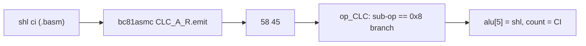

# CPU/ISA: Register Forms of SHL/SHR Plan

**Plan Status**: `FINAL`

**Story Type**: `Internal`

**Plan Revision**: `A0`

> This plan captures **what** to build and **why**. The implementation agent discovers the **how** against live code.

---

## 1. Problem Statement

*   **Context**: Issue #56 says the register forms of `shl`/`shr` can't be encoded. Its reasoning: setting bit 3 (`CLC_OP_RNO`) in the 8-bit `CLC` sub-opcode nibble turns `shl` (5) into 0xD = `inc` and `shr` (6) into 0xE = `dec`, so `shl a, ci` "would be `5d 40`". `op_CLC` carries a comment, `# this is bug, there is conflict between CLC_OP_RNO and register with INC, DEC, ZER`. The test `src/bc64/tests/test_cpu_alu.py :: test_shl_shr_register_forms_are_unreachable` pins that `5d`/`5e` decode as `inc`/`dec`.
*   **Verified fact, against the issue's premise**: the assembler never emits that short form. Every 8-bit register ALU op (`CLC_A_R.emit`) is emitted as the **long register form** `5 8 | r o`: first byte `0x58` (exactly `CLC_OP_RNO`), second byte = register number in the high nibble and the operation in the low nibble. The CPU's `op_CLC` decodes the exact-`0x8` sub-opcode in its own branch, which reads both from the second byte. That branch handles every operation 0–6, `shl`/`shr` included. Probed on `c0c26f7`: `58 45` (`shl a, ci`) with A=0x35, CI=3 gives A=0xa8, and `58 46` (`shr a, ci`) gives 0x06, both 2 bytes long. `docs/02-assembler.md` documents `add r … shr r` as `58 ro`. `bc81asmc_opcode_agreement_tests` already assembles and runs `shl ci` / `shr ci` and passes. So register-count shifts **already exist and work** end to end; only the comment, the pinned test's name and the docs suggest otherwise.
*   **What the CPU also has**: a **short register form**, an undocumented alias accepted only by the CPU. A sub-opcode nibble of `o | 8` for o = 1…4 (`59`…`5C`) reads the register from the high nibble of the next byte (`59 40` = `sub a, ci`, used hand-encoded in `src/bc64/tests/test_cpu.py`). It cannot exist for `shl`/`shr`/`not`, because 0xD/0xE/0xF are `inc`/`dec`/EXT. That gap is the "conflict" the comment and the issue describe.
*   **Goal**: settle the issue's decision ("decide whether register-count shifts exist in the ISA") as **yes, encoded as the long register form `58 r5` / `58 r6`**, which both sides already implement. Turn the pinned test into tests of the decided behaviour, fix the misleading CPU comment, and document the encoding rule and the decision, so BASM (roadmap phase 0, step 7) copies a settled encoding.
*   **In scope**: CPU tests for the register-count shifts (results, the E12 flags, length), a corrected `op_CLC` comment, assembler emit tests for `shl r`/`shr r`, docs (`01-emulator.md`, `02-assembler.md`), and a new design decision.
*   **Out of scope**: any CPU or assembler behaviour change; removing the CPU's short register form (hand-encoded tests use it, and nothing would gain from removing it); 16-bit shifts (`shl pair, pair2` is the EXT form `5F B5|8…`, which already works and is covered); #5 (the shared ISA table).

### 1.1 Technical Summary

*   **Touched projects**: emulator tests and one comment (`src/bc64/`), assembler tests (`src/bc81asmc/tests/`), docs.
*   **New patterns / abstractions**: none.
*   **Infrastructure changes**: none.
*   **End-state observable behavior**: unchanged bytes and behaviour. `shl r`/`shr r` assemble to `58 r5`/`58 r6` and shift `A` by the register's value with the E12 flags. Tests assert that, and the docs and a design decision state it.

---

## 2. Architecture & Design

### 2.1 Architecture Overview

| Component | Owner |
| :--- | :--- |
| emulator (`src/bc64/bc8183_cpu.py`) | repo owner |
| assembler (`src/bc81asmc/`) | repo owner |

### 2.2 External Contracts & Evidence

N/A: internal story.

#### Source Conflict Log

| Topic | Source A | Source B | Conflict | Chosen Handling |
| :--- | :--- | :--- | :--- | :--- |
| Encoding of `shl a, ci` | Issue #56: "would be `5d 40`" | Assembler `CLC_A_R.emit` + `docs/02-assembler.md`: `58 ro` → `58 45`; CPU executes it correctly (probe) | The issue reasons from the short register form, which the assembler never emits | Follow the code: register shifts exist as `58 r5`/`58 r6` (Decision D1). Flag the premise mismatch in the PR |
| "this is bug" comment in `op_CLC` | Comment calls the short-form gap a bug | Long form covers every op | The gap only affects an alias nobody emits | Rewrite the comment to describe the two register forms (D2) |

### 2.3 Affected Areas

| Area / File (pointer) | Role in this change | Likely action |
| :--- | :--- | :--- |
| `src/bc64/bc8183_cpu.py` (`op_CLC`, `CLC_*` constants) | Decodes the long (`0x8`) and short (`o|8`) register forms | Change comment only; no behaviour change |
| `src/bc64/tests/test_cpu_alu.py` | 8-bit ALU tests incl. the pinned test and the E12 shift-flag tests | Replace pinned test; add register-count shift tests |
| `src/bc81asmc/bc81asmc_ast.py` (`CLC_A_R`) | Emits `5 8 r o` for every 8-bit register op | Reference |
| `src/bc81asmc/tests/bc81asmc_emit_tests.py` / `bc81asmc_tests.py` | Emit/grammar tests | Add `shl r`/`shr r` byte tests |
| `src/bc81asmc/tests/bc81asmc_opcode_agreement_tests.py` | Already covers `shl reg`/`shr reg` | Reference (may extend) |
| `docs/02-assembler.md` (8-bit ALU table) | Documents `58 ro` | Add the note that `58 ro` is the only register encoding of `shl`/`shr`/`not`; there is no `5(o|8)` form |
| `docs/01-emulator.md` (CPU section) | CPU reference | Describe the two 8-bit register forms the CPU decodes |
| `docs/specs/memory/design-decisions.md` | Standing decisions | New `E15` (last on master is E14; re-check right before the PR) |

### 2.4 Key Algorithms & Behaviour

8-bit `CLC` (`0x5_`) decoding by the low nibble `s` of the first byte:
*   `s` = 0…6: immediate form `5s ii`, A = A op ii.
*   `s` = 7 / 0xD / 0xE: `not` / `inc` / `dec`, 1 byte.
*   `s` = 0xF: EXT (16-bit ops).
*   `s` = 0x8 exactly: **long register form** `58 ro`. The register number is in the high nibble of byte 2 and the op (0–6) in its low nibble, so A = A op reg[r]. This is the canonical register encoding and the only one the assembler emits.
*   `s` = 0x9…0xC: **short register form** `5(o|8) r0` for o = 1…4 (sub/and/or/xor), register in the high nibble of byte 2. This is a CPU-only alias. It cannot exist for `add`, which would be 0x8 (the long form), or for shl/shr/not, which would be 0xD/0xE/0xF.

The register-count shifts use the E12 flag rules with count = the register's current value (0–255). The register itself is unchanged, and with `shl a` / `shr a` the count is A's old value.

---

## 3. Key Decisions & Assumptions

*   **D1. Decision**: Register-count shifts exist in the ISA. `shl r` is `58 r5` and `shr r` is `58 r6`, the general long register form, as both the CPU and the assembler implement today. No new encoding is introduced. **Rationale**: it already works and is documented in `02-assembler.md`, and the issue asks for "a free encoding in both the CPU and the assembler", which `58 ro` already is. Removing the forms would break a working, documented instruction. Recorded as design decision `E15`.
*   **D2. Decision**: The CPU keeps its short register form for sub/and/or/xor unchanged; it is documented as a CPU-only alias that the assembler never emits. The `op_CLC` comment is rewritten to say that, and that shl/shr/not have no short form. **Rationale**: no behaviour change (the issue warns that CPU changes ripple into every program), and hand-encoded tests (`test_cpu.py`, `59 40`) use the alias.
*   **D3. Decision**: The pinned test `test_shl_shr_register_forms_are_unreachable` is replaced. Its byte-level assertion (single-byte `5d`/`5e` are `inc`/`dec`) stays true and may be kept under an accurate name, but its claim that the register forms are unreachable is wrong under D1. The replacement asserts the decided behaviour: `58 r5` / `58 r6` shift A by the register.
*   **Assumption A1 (no Open Question, low stakes)**: the issue offers two options; the owner did not pick one in the comments. Choosing "they exist" changes no behaviour or bytes, and it keeps every option open: the owner could still reject register shifts later without anything having depended on a new encoding. The PR flags this choice for the owner. This is **not a deviation from the AC**, since "decide" + "if they do, give them a free encoding in both" is met by the existing encoding, but the PR says plainly that no code change was needed and why the issue's premise (`5d 40`) did not match the assembler.

### 3.1 Decision Lock

| Constant / Policy | Selected Value | Why | Where it lives |
| :--- | :--- | :--- | :--- |
| `shl r` encoding | `58 r5` (2 bytes) | existing long register form | CPU `op_CLC`, assembler `CLC_A_R` |
| `shr r` encoding | `58 r6` (2 bytes) | same | same |
| Shift count from register | register value 0–255, flags per E12 | same as immediate | `alu[CLC_SHL/SHR]` |
| Short register form | kept, CPU-only alias for sub/and/or/xor | no behaviour change | `op_CLC` else branch |
| Decision id | `E15` (re-check origin/master before PR; renumber on collision) | E14 is the last on master `c0c26f7` | `design-decisions.md` |

### 3.2 Open Questions

No open questions.

---

## 4. Task Breakdown

| Task | Title | Depends on | Complexity |
| :--- | :--- | :--- | :--- |
| `T1` | CPU: tests for register-count shifts + corrected `op_CLC` comment | — | `Medium` |
| `T2` | Assembler: emit tests for `shl r` / `shr r` | — | `Low` |
| `T3` | Docs + design decision E15 | — | `Low` |

### T1 — CPU: tests for register-count shifts + corrected `op_CLC` comment

*   **Goal**: The emulator tests prove that `58 r5`/`58 r6` shift A by a register's value with the E12 flags, and the pinned "unreachable" test is gone. The `op_CLC` comment describes the long and short register forms correctly. CPU behaviour does not change.
*   **Depends on**: —
*   **Complexity**: `Medium`
*   **Pointers**: `src/bc64/bc8183_cpu.py` (`op_CLC` else-branch comment), `src/bc64/tests/test_cpu_alu.py` (pinned test near the 8-bit SHR tests; the E12 shift-flag test class with `shift8`/`shl8`/`shr8` helpers).
*   **Definition of Done**:
    *   `test_shl_shr_register_forms_are_unreachable` no longer exists; it is replaced by tests of the decided behaviour (D1/D3). A test that the single-byte `5d`/`5e` are `inc`/`dec` may remain under an accurate name.
    *   The `op_CLC` comment no longer says "this is bug". It states that the long register form (`58 ro`) handles every op incl. shl/shr, and that the short form `5(o|8) r0` exists only for sub/and/or/xor.
    *   No change to any executable line of `bc8183_cpu.py` (comment-only diff).
    *   `python3 run_tests.py --group unit < /dev/null` exits 0 (state the remaining expected failures, if any, by name).
*   **Tests expected** (unit, emulator): `shl a, r` and `shr a, r` via `58 r5`/`58 r6` for at least two different count registers (e.g. `ci`, `di`), checking the result, instruction length 2, the count register left unchanged, and E12 flags: C = last bit out, O for shl when a 1 bit is lost, N/Z from the stored result. Cover a count of 0 from a register (C and O cleared), a count > 8 from a register, and `shl a` / `shr a` (count = A's old value).
*   **Tests to modify**: `src/bc64/tests/test_cpu_alu.py :: Alu8Tests.test_shl_shr_register_forms_are_unreachable — its claim that the register forms are unreachable is wrong by Decision D1/D3; replace it with tests of 58 r5/58 r6`.

### T2 — Assembler: emit tests for `shl r` / `shr r`

*   **Goal**: The assembler tests pin that `shl r`/`shr r` emit the 2-byte long register form, so BASM has a byte-level reference.
*   **Depends on**: —
*   **Complexity**: `Low`
*   **Pointers**: `src/bc81asmc/bc81asmc_ast.py` (`CLC_A_R`), `src/bc81asmc/tests/bc81asmc_emit_tests.py` (byte-level emit tests; follow its pattern), `src/bc81asmc/tests/bc81asmc_opcode_agreement_tests.py` (already covers `shl reg`/`shr reg`; extending it is optional).
*   **Definition of Done**: new tests assert `shl ci` → `58 45`, `shr ci` → `58 46`, and at least one other register (e.g. `shl di` → `58 55`, `shr a` → `58 16`). No assembler source change. `cd src/bc81asmc && python3 -m unittest discover -s tests -t . -p "*_tests.py"` passes, and so does `python3 run_tests.py --group unit < /dev/null`.
*   **Tests expected** (unit, assembler): emitted bytes for `shl r` / `shr r` for several registers; parse result of `shl ci`/`shr ci` is the register form (`CLC_A_R`), not the immediate one.
*   **Tests to modify**: None.

### T3 — Docs + design decision E15

*   **Goal**: The reference docs and the decision record say that register-count shifts exist, how they are encoded, and why there is no short form for shl/shr/not.
*   **Depends on**: —
*   **Complexity**: `Low`
*   **Pointers**: `docs/02-assembler.md` (8-bit ALU table and the line under it), `docs/01-emulator.md` (`## The bc8183 CPU` section; add a short "8-bit ALU encoding" note or extend an existing subsection), `docs/specs/memory/design-decisions.md` (append `E15` after `E14`, same format: Purpose / Rationale / Usage / Trade-offs). Check the format of E12–E14 and refer to E12 for the flags.
*   **Definition of Done**:
    *   `02-assembler.md` states that `58 ro` is the register encoding of every 8-bit op, that `shl r`/`shr r` are `58 r5`/`58 r6`, and that no `5(o|8)` short form exists for shl/shr/not (that nibble is inc/dec/EXT), with a link to E15.
    *   `01-emulator.md` describes the CPU's 8-bit `CLC` sub-opcode decoding (immediate, long register form, short register alias for sub/and/or/xor only, not/inc/dec, EXT), with a link to E15.
    *   `design-decisions.md` has `E15. Register-count shifts use the long register form `58 r5` / `58 r6`` (wording free), citing #56, why no new encoding was needed, and that the short form is a CPU-only alias. If origin/master gained an E15 meanwhile, use the next free id and fix the links.
    *   No code changes. Markdown links resolve.
*   **Tests expected**: none (docs only).
*   **Tests to modify**: None.

---

## 5. Verification

*   **Unit**: `python3 run_tests.py --group unit < /dev/null`: exit 0. Report expected failures by name; they are not passes.
*   **Full**: `python3 run_tests.py < /dev/null` (builds the pipeline and runs e2e): exit 0. No built program changes, since there are no CPU/assembler behaviour changes; `git status` stays clean except for the intended files.
*   **Observable**: `bc81asmc` on a one-line `shl ci` gives bytes `58 45`; the CPU runs it as A <<= CI.
*   **Diff check**: `git diff origin/master -- src/bc64/bc8183_cpu.py src/bc81asmc/*.py` shows comment lines only.

---

## 6. Fact-Integrity Checklist

| Check | Yes / No / N/A | Notes |
| :--- | :--- | :--- |
| External contracts verified from source | N/A | Internal |
| Evidence sources reproducible | N/A | Internal |
| Identifier meaning evidenced | N/A | Internal |
| Every `Assumption` is linked to an Open Question (§3.2) | Yes | A1 is low-stakes and needs no OQ: no bytes or behaviour change; flagged in the PR |
| No unresolved Open Questions (for `FINAL`) | Yes | |
| Each Decision states a single committed approach | Yes | |
| Tasks are independent, each with a Definition of Done and test expectations | Yes | T1–T3 have no shared files |
| Required infra reflected | N/A | |

**Self-review note**: the main risk is the issue's premise. A coding agent reading only the issue could "fix" a non-bug by inventing a new encoding or changing `op_CLC`. Both are out of scope (D1/D2). The probe and the opcode-agreement test show the long form already works. T1's agent must derive the expected flags from E12, not from the current output alone. The E15 id may collide with parallel bc16 runs, so re-check before the PR.

---

## 7. Amendment Log

| Amendment | Request | Decision | Plan changes |
| :--- | :--- | :--- | :--- |
