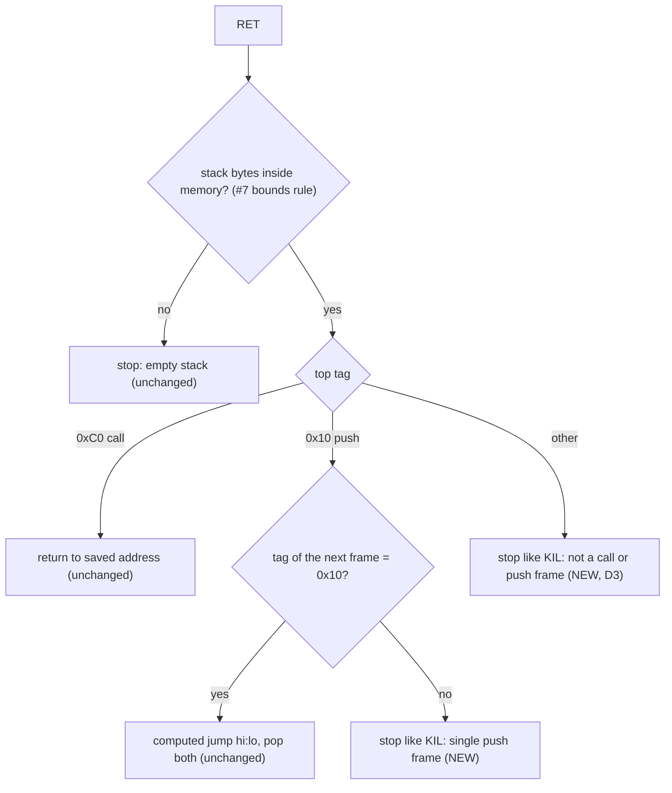

# CPU RET With Push Frames: Single Push Stops the CPU Plan

**Plan Status**: `FINAL`

**Story Type**: `Internal`

**Plan Revision**: `A0`

> This plan captures **what** to build and **why**: domain, architecture, decisions, and verified facts.
> It does **not** contain implementation code. The implementation agent discovers the **how** against live code.

---

## 1. Problem Statement

*   **Context**: `op_RET` in `src/bc64/bc8183_cpu.py` reads the tag of the top stack frame. A call frame (`0xc0`)
    returns to the saved address. Any other tag is treated as "two push frames": the high byte comes from the top
    pushed value, the low byte from the value two bytes further up, and both frames are popped. So
    `psh lo; psh hi; ret` is a computed jump. A subroutine that does a **single** `psh` and then `ret` builds an
    address from the pushed byte and the **return-hi byte of the call frame below** (the tag of the call frame is
    skipped), jumps there and usually crashes.
*   **Goal (owner decision, issue comment 2026-11-20)**: "two push computed ret is intended, single push should stop
    cpu like kil". So the two-push computed `RET` stays exactly as it is, and a `RET` whose top frame is a push frame
    with **no push frame directly below it** stops the CPU cleanly, like `KIL` and like the #7 stack-bounds stops.
    Document the answer in `docs/01-emulator.md` and design decision E4 (issue "Expected").
*   **In scope**: `op_RET`; new emulator tests; docs (`docs/01-emulator.md` stack frames + stop list, E4,
    `src/bc64/CLAUDE.md` stack bullet, roadmap step 10); the dependency audit the issue asks for.
*   **Out of scope**: `POP` frame-type checks (`POP` still doesn't check the tag, and nobody asked); `CAL`, `PSH`;
    any assembler/compiler change; the issue body's "psh (hi), psh (lo)" order wording (it is backwards versus the
    code and the existing test, see §2.3; the docs get the correct order).

### 1.1 Technical Summary

*   **Touched**: `src/bc64/bc8183_cpu.py` (`op_RET`, reusing the stop style of `stack_fault`),
    `src/bc64/tests/` (new tests), `docs/01-emulator.md`, `docs/specs/memory/design-decisions.md` (E4),
    `src/bc64/CLAUDE.md`, `docs/analysis/08-self-hosted-roadmap.md`.
*   **New patterns**: none (same clean-stop pattern as #7's `stack_fault` and #4's unknown EXT sub-opcode).
*   **Infrastructure changes**: none. No opcode or encoding change.
*   **End-state observable behaviour**: `cal sub` where `sub: psh a; ret` → the CPU stops on the `ret` (PC stays on
    it, registers/`SS:SI`/memory untouched), one stderr line naming `RET`, the address and the reason, exit 0 in
    `bc64.py`; `psh lo; psh hi; ret` still jumps to `hi:lo`.

---

## 2. Architecture & Design

### 2.1 Architecture Overview

### 2.2 External Contracts & Evidence

N/A — Internal story.

### 2.3 Affected Areas (verified facts)

*   Frames (E4): `PSH` writes tag `0x10` at `SI-1` and the value at `SI`, `SI -= 2`. `CAL` writes return-lo at `SI`,
    return-hi at `SI-1`, tag `0xc0` at `SI-2`, `SI -= 3`. So at `RET` with `addr = SS:SI`: top tag at `addr+1`; for a
    push frame its value at `addr+2`, the next frame's tag at `addr+3` and (if a push) its value at `addr+4`.
*   Order: the high byte is the **last** pushed value (`addr+2`), the low byte the one pushed before it (`addr+4`):
    `psh lo; psh hi; ret`. `test_RET_after_two_pushes_returns_to_pushed_address` (`src/bc64/tests/test_cpu_control.py`)
    asserts exactly that. `docs/01-emulator.md` "Stack frames" says `psh hi; psh lo; ret`, which is wrong; the issue
    body has the same slip.
*   `stack_fault(name, addrs)` (#7) checks bounds first and stops like `KIL` (stderr + debug trace, `kill = True`,
    nothing changed). `op_RET` calls it before reading the tags; a single push at the very top of memory already stops
    as "empty stack" (`test_cpu_stack_bounds.py :: FullMachineStackStopTests.test_RET_with_one_push_frame_needs_past_top_and_stops`)
    and must keep doing so, so the bounds check stays first.
*   The #4 unknown-EXT stop is the model for a non-bounds stop message (stderr line naming the instruction and PC,
    CPU stopped, exit 0).
*   Existing tests that exercise `RET`: `test_cpu_control.py :: CallRetTests` (call returns, nested calls, two-push
    computed jump) and `test_cpu_stack_bounds.py` (empty stack, one push at the top of memory). None asserts the
    single-push-on-a-call-frame behaviour (the issue says the tests didn't pin it), and none needs to change.
*   **Dependency audit (planning, 2026-11-20, master `48973c2`)**: a temporary probe in `op_RET` logged every `RET`
    whose top frame is not a call frame during a full `run_tests.py` (build of bcOS, boot, bdos, utilities, apps +
    every suite incl. e2e with `BC64_E2E_SLOW=1`). Result: §2.5. Static check: the `psh x` lines just before a
    `ret` in `bc_stdlib.py`, `boot.basm` and `bcos.basm` are all `psh a; pop f` (moving `A` into `F`), not a frame
    left for `ret`.

### 2.4 Key Behaviour

| Top frame at `RET` | Next frame | Result |
|---|---|---|
| any, bytes outside memory | — | stop: empty stack (unchanged, #7) |
| call (`0xC0`) | — | return (unchanged) |
| push (`0x10`) | push (`0x10`) | jump to `hi:lo`, both frames popped (unchanged) |
| push (`0x10`) | call, or any other tag | **stop like `KIL`** (new) |
| any other tag | — | **stop like `KIL`** (new, D3) |

A stop leaves PC on the `RET`, registers, flags, `SS:SI` and memory unchanged, writes one stderr line (and the
debug trace line), and `bc64.py` exits 0 and writes `bc64.dmp`, as for every clean stop.

### 2.5 Audit result

Probe run (2026-11-20, `run_tests.py` with `BC64_E2E_SLOW=1`, exit 0; e2e 108 tests with 1 expected failure =
the known tape round trip, assembler 6 expected failures, both pre-existing). Every `RET` whose top frame is not a
call frame, logged as PC / top tag / next tag:

| PC | Top | Next | Source |
|---|---|---|---|
| `0006` | `10` | `10` | `CallRetTests.test_RET_after_two_pushes_returns_to_pushed_address` (computed jump, stays) |
| `0001` | `10` | `ff` | `test_RET_with_one_push_frame_needs_past_top_and_stops` (bounds stop first, stays) |
| `0000`, `0001` | `ff` | — | the empty-stack unit tests (bounds stop first, stays) |
| `0868` | `8d` | `18` | bcOS `exec_dump` end, reached on the bad-argument path (`d 00`): its pops unbalance the stack; it stops today as `RET at 0868: empty stack (read past the top of memory), CPU stopped` (reproduced by hand) because the bounds check fails — with D5 it keeps exactly that message |

**No bcOS, boot, bdos, utility, app or compiler-runtime code executes a `RET` with a push frame on top** in the
whole build + test run, so nothing depends on the single-push behaviour, and no program executes a computed `RET` at
all today (it is a CPU feature kept for BASM/compiler use). D3's unknown-tag stop is only reachable when the bounds
check passes, which the `d 00` path never does.

---

## 3. Key Decisions & Assumptions

*   **D1 (owner)**: the two-push computed `RET` is intended and unchanged; a single push frame on top stops the CPU like
    `KIL`.
*   **D2**: "single push" means: top tag `0x10` and the tag of the next frame is not `0x10`. The CPU can't tell a
    "deliberate" second push from a stray one, so two pushes always jump (as today).
*   **D3 (Assumption)**: a top tag that is neither `0xC0` nor `0x10` (stack memory overwritten by the program) also stops
    instead of being read as push frames. Reason: today it falls into the push path, which reads the frame layout
    wrongly; that is the same class of bug as a single push and the owner's "stop like kil" is the safe answer. No
    code produces such a stack (the audit sees only `0x10`/`0xC0`). Low stakes, recorded in E4.
*   **D4**: the stop message follows the #7/#4 style: `RET at XXXX: <reason>, CPU stopped`, with the reason naming the
    frame problem (e.g. "single push frame on top of the stack" / "no call or push frame on top of the stack"). Exact
    wording is the agent's, but it must contain `RET`, the PC in hex and a reason, and go to stderr and the debug
    trace, never stdout.
*   **D5**: the bounds check (#7) runs first, so a stack that runs out of memory still reports "empty stack". The
    `needed` bytes for the push path include the next frame's tag.
*   **D6**: documentation: E4 records the rule (no new E number; the issue asks for E4). `docs/01-emulator.md` "Stack
    frames" gets the correct order `psh lo; psh hi; ret` and the single-push stop; the "stops the CPU cleanly" list in
    the memory section mentions it. `src/bc64/CLAUDE.md`'s stack bullet gets one sentence. Roadmap step 10 gets a
    "**Decided (2026-11-20):** …" note like steps 6 and 8.
*   **D7**: no `.basm`, compiler or bcOS change (audit), so built programs are byte-identical: no golden, transcript or
    `code_size.csv` change.

### 3.1 Decision Lock

| Item | Value |
| :--- | :--- |
| Two push frames on top | computed jump `hi:lo` (high = last pushed), unchanged |
| One push frame over a non-push frame | clean stop like `KIL` |
| Unknown top tag | clean stop like `KIL` (D3) |
| Bounds check | first, unchanged |
| Design decision | E4 updated |

### 3.2 Open Questions

None.

---

## 4. Task Breakdown

| Task | Title | Depends on | Complexity |
| :--- | :--- | :--- | :--- |
| T1 | CPU: RET stops on a single push frame + tests | — | Medium |
| T2 | Document the RET rule | — | Low |

### T1 — CPU: RET stops on a single push frame + tests

*   **Goal**: §2.4 holds.
*   **Depends on**: —
*   **Complexity**: `Medium` (small change, but the CPU is the reference for everything).
*   **Pointers**: `src/bc64/bc8183_cpu.py` (`op_RET`, `stack_fault`, the unknown-EXT stop from #4, `STACKFRAME_TYPE_*`),
    `src/bc64/tests/test_cpu_control.py` (`CallRetTests`), `src/bc64/tests/test_cpu_stack_bounds.py` (`full_machine`,
    `small_cpu`, `run`, `snapshot`, `assertStoppedOnInstruction` as the model for stop tests).
*   **Definition of Done**:
    *   `RET` behaves as §2.4; the two-push computed jump and call returns are unchanged.
    *   A stop leaves PC on the `RET`, registers, `SS:SI` and memory untouched, prints one line to stderr (and the debug
        trace), nothing on stdout (D4).
    *   New tests (add to `CallRetTests` or a new class in `src/bc64/tests/`), covering at least: `cal sub` with
        `sub: psh a; ret` stops on the `ret` with the documented state and message; a push frame on top of a push frame
        still jumps (already covered — keep it); two pushes on top of a call frame jump and leave the call frame; a
        single push after one `pop` of a two-push pair (push frame over call frame) stops; an unknown top tag stops (D3);
        a single push at the top of memory still reports "empty stack" (existing test, must stay green); and one
        `bc64.py`-level run (headless, like the #7 tests) showing exit 0 and the stderr line.
    *   No change to `bc81asmc`, the compiler, bcOS or bdos sources.
*   **Tests expected**: unit (emulator). From `src/`: `python3 -m unittest discover -s bc64/tests -t . -p "test_*.py"`;
    then from the repo root `python3 run_tests.py < /dev/null` (builds + e2e; exits 0).
*   **Tests to modify**: None.

### T2 — Document the RET rule

*   **Goal**: the docs state §2.4 and the correct push order.
*   **Depends on**: —
*   **Complexity**: `Low`.
*   **Pointers**: `docs/01-emulator.md` ("Stack frames": fix `psh hi; psh lo` → `psh lo; psh hi`, add the single-push /
    unknown-tag stop; the memory-section bullet listing clean stops), `docs/specs/memory/design-decisions.md` (E4:
    usage bullet for the rule, citing #59 and the owner's decision, D3 as part of it), `src/bc64/CLAUDE.md` (stack
    bullet: one sentence), `docs/analysis/08-self-hosted-roadmap.md` (step 10 row: "**Decided (2026-11-20):** …" note,
    nothing else).
*   **Definition of Done**: no doc says `psh hi; psh lo; ret`; E4 and `01-emulator.md` describe the stop.
*   **Tests expected**: none (docs only).
*   **Tests to modify**: None.

---

## 5. Verification

1.  From `src/`: `python3 -m unittest discover -s bc64/tests -t . -p "test_*.py"` → OK.
2.  From the repo root: `python3 run_tests.py < /dev/null` → exit 0. Report expected failures by name, never as "all
    passed".
3.  `git status` after the run: only the intended source/doc/test files changed (no golden/transcript change).
4.  The issue's checklist: search of `.basm`/`bc_stdlib.py`/`asm` blocks and the rebuild + boot + e2e smoke (§2.3
    audit, re-run by step 2 on the branch); the assembler agreement test is untouched (no opcode change) and runs in
    step 2; docs per T2.

---

## 6. Fact-Integrity Checklist

| Check | Status |
| :--- | :--- |
| Owner decision read (comment 2026-11-20) and mapped (D1 → T1, "document" → T2) | Yes |
| Pinned test named in the issue located (`src/bc64/tests/test_cpu_control.py` since #90) — it pins the two-push case, which stays | Yes |
| Push order checked against code and test (docs wrong, fixed in T2) | Yes |
| Interaction with #7 bounds stop checked (bounds first, D5) | Yes |
| Runtime audit of every non-call `RET` in a full build + all suites (§2.5) | Yes |
| No Open Questions | Yes |

**Self-review note**: the issue's test path `src/bc64/test_cpu_control.py` is `src/bc64/tests/test_cpu_control.py`
since #90. The issue asked to "change that test to assert the correct behaviour"; the owner confirmed the two-push
behaviour it asserts is correct, so it stays as it is and the new single-push behaviour gets new tests
(Tests to modify: None). D3 (unknown tag stops) goes slightly beyond the owner's words; it is flagged in the PR.
