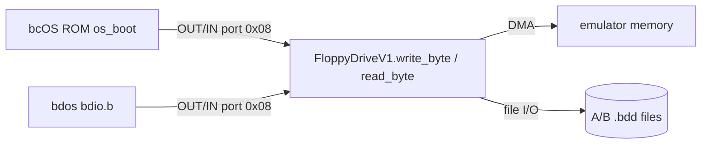

# FDD: a DMA Address Whose High Byte Is 0xf0 Is Taken as a PING Command — Plan

**Plan Status**: `FINAL`

**Story Type**: `Internal`

**Plan Revision**: `A0`

> This plan captures **what** to build and **why**. The implementation agent discovers the **how** against live code.

---

## 1. Problem Statement

*   **Context**: `FloppyDriveV1.write_byte` (`src/bc64/bc64_io.py`) tests the incoming byte against `CMD_PING` (`0xf0`) and `CMD_CFG` (`0xf1`) **before** it looks at the current state. So in the parameter states of the configure sequence, a byte equal to a command value is executed as that command instead of being taken as data:
    *   `CFG1` (address high byte) = `0xf0` → treated as PING: the status becomes `READY | FDDv1`, `dmaaddr` is not set, and the following low byte arrives in a ready state (→ drive failure). A buffer anywhere in `0xf000–0xf0ff` cannot be configured, and the next transfer uses the old DMA address.
    *   `CFG1` = `0xf1`, or `CFG2` (low byte) = `0xf0`/`0xf1` → the same class of bug (restarts configuration or pings). The issue names only the PING/high-byte case, but its **Expected** section covers every multi-byte state.
    *   In `RD1/RD2/WR1/WR2` the drive-select (`0xfa`/`0xfb`) and eject (`0xf4`) checks also run before the state checks, so a track/sector byte with one of those values is taken as a command. Such bytes are out of range for the geometry (64 tracks × 16 sectors), but the issue's Expected says they must be data too (→ an out-of-range transfer reports `0xe2`, as it does for any other out-of-range value).
*   **Goal**: bytes received in `CFG1`, `CFG2`, `RD1`, `RD2`, `WR1`, `WR2` are always data, whatever their value. Commands are recognised only outside those states (ready, ready|FDDv1, the failure states).
*   **In scope**: the check order in `FloppyDriveV1.write_byte`; the pinned test; new unit tests; `docs/01-emulator.md` FDD protocol text; design decision E5's usage note.
*   **Out of scope**: any change to what commands do or to their status codes; the existing rule that `READSECT`/`WRITESECT` are only accepted in exactly `STATE_READY` (#4, `test_read_command_in_failure_state_is_a_drive_failure`); the tape recorder and other devices; bcOS/bdos code (see §2.4 — none needs to change).

### 1.1 Technical Summary

*   **Touched projects**: emulator (`src/bc64/bc64_io.py`), its unit tests (`src/bc64/tests/test_devices.py`), docs.
*   **New patterns / abstractions**: none — a reordering inside an existing state machine (E5).
*   **Infrastructure changes**: None.
*   **End-state observable behavior**: `CFG, 0xf0, 0x12` sets DMA to `0xf012` with status `0x10`; a read into such a buffer lands there. Every other sequence behaves exactly as today.

---

## 2. Architecture & Design

### 2.1 Architecture Overview

Single component: the `FloppyDriveV1` I/O device on port `0x08`, driven byte by byte via `OUT`/`IN` by bcOS (`os_boot` in `src/bc81asmc/bcOS/bcos.basm`) and bdos (`src/bdos/bdio.b`). No interrupts (G8); software polls status (E5).

### 2.2 External Contracts & Evidence

N/A — Internal story.

### 2.3 Affected Areas

| Area / File (pointer) | Role in this change | Likely action |
| :--- | :--- | :--- |
| `src/bc64/bc64_io.py` — `FloppyDriveV1.write_byte` | The state machine; check order is the bug | Change |
| `src/bc64/tests/test_devices.py` — FDD test class | Pinned test of today's wrong behaviour; home of the new tests | Change (one listed test) + add tests |
| `docs/01-emulator.md` — "Port 0x8: floppy disk drive" | Protocol table; needs one sentence that parameter bytes are data whatever their value | Change |
| `docs/specs/memory/design-decisions.md` — E5 | Usage bullets of the state-machine rule | Change (add one usage bullet) |
| `src/bc81asmc/bcOS/bcos.basm` `os_boot`, `src/bdos/bdio.b` | Callers; always send `0xf1, hi, lo` and `0xf2/0xf3, track, sector` | Reference only |

### 2.4 Key Algorithms & Behaviour

**Rule (precedence in `write_byte`)**:
1.  If the drive is in a parameter state (`CFG1`, `CFG2`, `RD1`, `RD2`, `WR1`, `WR2`), the byte is that state's parameter, whatever its value — handled exactly as today's state branches handle it (address hi/lo, track, sector → transfer).
2.  Otherwise the byte is a command, matched as today: PING, CFG, SETDRVA/B, EJECT, READSECT/WRITESECT (only in exactly `STATE_READY`), anything else → `STATE_DRIVE_FAILURE`.

Consequences to preserve: PING still recovers from every failure state; CFG/SETDRV still work after a failure; READSECT in a failure state is still a drive failure; the `RD2`/`WR2` "no active drive" fall-through behaviour stays as it is.

**Callers (ABI check, done while planning)**: bcOS `os_boot` sends PING, SETDRVA, then `CFG, hi(bdos_bootaddr), lo`, then `READSECT, 0, 0`; bdio sends the same CFG/RD/WR byte triples. Neither ever relies on a command being recognised mid-sequence, so no ROM/bdos change is needed. Any in-tree buffer whose address has a high byte `0xf0`/`0xf1` or low byte `0xf0`/`0xf1` was broken before and works after; the full e2e suite (which boots bcOS + os.bdd and exercises `ls`/`cat`/`cp`) is the regression net for this.

**No-data behaviour**: N/A.

---

## 3. Key Decisions & Assumptions

*   **Decision D-61.1 — state before command.** Parameter states take precedence over every command value, for all six multi-byte states, not only `CFG1`/PING. Rationale: the issue's Expected section states it for all six states; a partial fix would leave the same bug for `CFG2 = 0xf0/0xf1` and `CFG1 = 0xf1`.
*   **Decision D-61.2 — no "reset" escape inside a sequence.** E5 says "a reset or command byte returns the device to a known state". After this change a PING sent mid-sequence is data, so the recovery from an aborted sequence is to finish it (at most two parameter bytes) and then PING. This is the direct consequence of the AC; recorded by adding a usage bullet to E5 (no new E-id, so no collision with parallel stories).
*   **Decision D-61.3 — out-of-range track/sector from command-valued bytes.** A track/sector byte such as `0xfa` is now data, so the transfer reports `STATE_READ_FAILURE` (`0xe2`) like any other out-of-range value, instead of switching drives.
*   **Assumption A-61.1 (closed)**: "ready/idle states" in the issue = every state that is not one of the six parameter states (including `READY|FDDv1` and the `0xe1–0xe3` failure states), because PING/CFG/SETDRV recovery from failures is pinned by existing tests that the issue does not ask to change.

### 3.1 Decision Lock

| Constant / Policy | Selected Value | Why | Where it lives |
| :--- | :--- | :--- | :--- |
| Parameter states | `CFG1, CFG2, RD1, RD2, WR1, WR2` | Issue Expected | `FloppyDriveV1.write_byte` |
| Command values / status codes | unchanged | ABI (E1/E5) | `FloppyDriveV1` constants |

### 3.2 Open Questions

No open questions.

---

## 4. Task Breakdown

| Task | Title | Depends on | Complexity |
| :--- | :--- | :--- | :--- |
| `T1` | Parameter bytes are data in every multi-byte FDD state | — | `Medium` |

### T1 — Parameter bytes are data in every multi-byte FDD state

*   **Goal**: `FloppyDriveV1.write_byte` handles the six parameter states before any command matching (§2.4), the pinned test asserts the correct behaviour, and docs describe the rule.
*   **Depends on**: —
*   **Complexity**: `Medium`
*   **Pointers**: `src/bc64/bc64_io.py` (`FloppyDriveV1.write_byte`), `src/bc64/tests/test_devices.py` (FDD tests, helpers `send`/`configure_dma`/`read_sector`/`write_sector`/`fill`), `docs/01-emulator.md` (Port 0x8 section), `docs/specs/memory/design-decisions.md` (E5).
*   **Definition of Done**:
    *   `CFG, 0xf0, lo` sets `dmaaddr = 0xf0lo`, status `0x10`; same for high byte `0xf1` and low bytes `0xf0`/`0xf1`.
    *   A sector read/write after configuring a `0xf0xx` buffer moves the 128 bytes to/from that address.
    *   Command-valued bytes as track/sector in RD/WR sequences are data (out-of-range → `0xe2`), active drive unchanged.
    *   All pre-existing FDD behaviour tests pass unchanged (ping recovery, failure-state rules, drive select, eject, read/write round trips).
    *   `docs/01-emulator.md` says parameter bytes are data whatever their value; E5 has the usage bullet from D-61.2. No other docs/decision text edited.
    *   `python3 run_tests.py` green (full: unit + e2e, which builds the system first).
*   **Tests expected** (unit, `src/bc64/tests/test_devices.py`): the renamed/rewritten pinned test; DMA address with each of hi `0xf0`/`0xf1` and lo `0xf0`/`0xf1`; a read (and a write) through a `0xf0xx` buffer landing at the right address; a command-valued track or sector byte in a read and a write sequence reporting `0xe2` without changing the active drive; PING after a completed sequence still reports `READY|FDDv1`.
*   **Tests to modify**:
    *   `src/bc64/tests/test_devices.py :: test_dma_address_with_high_byte_equal_to_ping_command_is_misread` — pins today's wrong behaviour; the issue's Test section says to change it to assert the correct behaviour (AC / D-61.1). Rename it (e.g. to say the high byte is taken as data) and assert `dmaaddr == 0xf0..` and status `0x10`.

---

## 5. Verification

*   **Unit**: `python3 run_tests.py --group unit < /dev/null` — green.
*   **Full**: `python3 run_tests.py < /dev/null` from the repo root (builds bcOS/bdos/discs, then e2e: boots bcOS + os.bdd, `ls`/`cat`/`cp`) — green; expected failures listed separately, not counted as passes.
*   **Observable**: in an emulator unit test, `OUT 0xf1, 0xf0, 0x00` then `READSECT 0,0` puts sector 0/0 at `0xf000`.
*   **Test guard**: only the one listed test changed; everything else is added.

---

## 6. Fact-Integrity Checklist

| Check | Result |
| :--- | :--- |
| Every AC fact extracted and mapped to a DoD item | Yes |
| External contracts verified | N/A |
| Callers of the changed protocol inspected (bcOS `os_boot`, bdio) | Yes |
| Existing tests touching the behaviour searched; Tests to modify complete | Yes (`grep CMD_PING/CMD_CFG/STATE_CFG` in `src/**/tests`) |
| No code / pseudocode / line numbers in the plan | Yes |
| Open Questions empty | Yes |

**Self-review**: the issue mentions only PING vs `CFG1`; the plan extends to all six states because the issue's Expected section says so (not a reinterpretation). The E5 "reset command" wording is softened by an added usage bullet only.

---

## 7. Amendment Log

| Rev | Request | Decision | Plan changes |
| :--- | :--- | :--- | :--- |
