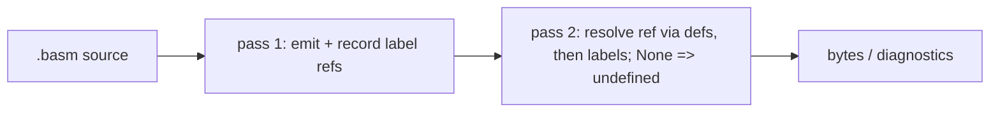

# Assembler: a label or `.def` at address 0x0000 is reported as "not defined" — Plan

**Plan Status**: `FINAL`

**Story Type**: `Internal`

**Plan Revision**: `A0`

> This plan captures **what** to build and **why**. The implementation agent discovers the **how** against live code.

---

## 1. Problem Statement

*   **Context**: issue #64 (filed 2026-11-09) reports that pass 2 of `src/bc81asmc/bc81asmc.py` tested `if not labeladdr:`. So a label at address 0, or `.def name, 0x0000`, counted as undefined. **The fix has already landed on master.** #10 (commit `b8755d0`, PR #81, plan decision D9) rewrote the fix-up loop. It now resolves the name from `.def`s first, then labels, and reports `undefined label ':name'` only when the result `is None`. `.assert` operands use the same `is None` rule. #10 also replaced the pinned tests that the issue names (`test_label_at_address_zero_is_rejected`, `test_def_with_value_zero_is_rejected`) with `test_label_at_address_zero_resolves` and `test_def_with_value_zero_resolves`. Since #90 these live in `src/bc81asmc/tests/bc81asmc_emit_tests.py`. The issue stayed open because no PR referenced it.
*   **Verified on master 378c69c (probe, 2026-11-20)**: every reference kind resolves a target at 0x0000. The issue's exact repro `.org 0x0000` / `start: nop` / `jmp z, :start` assembles to `00 68 00`. `.def zero, 0x0000` works through `jmp z`, `cal`, `.mv` and `jrx`. A label at 0 works through `jmr` (`70 81`), `jrx`, `clr`, `.mv` and `.db`.
*   **Goal**: close #64 with evidence. Add regression tests that pin the issue's exact repro and every label-reference kind (hi/lo absolute, short page-relative `jmp`, 7-bit relative, 15-bit relative) against a target at address 0x0000, both as a label and as a `.def`. Then a future falsy-check regression in any branch fails a test. Add a docs line saying that address 0 is a valid label/`.def` value.
*   **In scope**: new tests in `src/bc81asmc/tests/`, plus one docs note in `docs/02-assembler.md`.
*   **Out of scope**: any assembler source change (none needed). The compiler (`src/bc`). The roadmap document.

### 1.1 Technical Summary

*   **Touched projects**: `src/bc81asmc/tests/` (tests only) and `docs/02-assembler.md`.
*   **New patterns / abstractions**: none.
*   **Infrastructure changes**: none.
*   **End-state observable behavior**: unchanged from master. Only a missing name is `undefined label`, and that is now pinned for every reference kind.

---

## 2. Architecture & Design

### 2.1 Architecture Overview

| Service | Technical Owner |
| :--- | :--- |
| `bc81asmc` (assembler) | repo owner |

### 2.2 External Contracts & Evidence

N/A — Internal story.

### 2.3 Affected Areas

| Area / File (pointer) | Role in this change | Likely action |
| :--- | :--- | :--- |
| `src/bc81asmc/bc81asmc.py` (`compile`, label fix-up loop and `.assert` evaluation) | Already uses `is None`. This is the code under test | Reference |
| `src/bc81asmc/tests/bc81asmc_emit_tests.py` | Holds the `code()` / `assemble()` helpers and the two existing `*_resolves` tests from #10 | Change (add tests) |
| `docs/02-assembler.md` (Labels section near the `:label` explanation, and the "undefined label" row of the errors table) | Says what "undefined" means | Change (one note) |
| `docs/specs/plans/` (no #10 plan kept) | #10's D9 is only cited in test comments | Reference |

### 2.4 Key Algorithms & Behaviour

*   Rule (already implemented): a reference resolves to the `.def` value if the name is a `.def`, otherwise to the label's address. It is an error only when neither exists. The value 0x0000 is an ordinary address.
*   Reference kinds that the regression tests must each exercise against target 0x0000:
    *   absolute hi/lo: `.db :x`, `.mv pair, :x`, `cal :x`;
    *   short page-relative low byte: `jmp cond, :x`;
    *   7-bit relative: `jmr cond, :x`, for a label at 0 reached backwards;
    *   15-bit relative: `jrx cond, :x` and `clr :x`.
*   For each kind, expect the exact bytes the assembler emits today. The agent derives them from live output and checks them against the encoding table in `docs/02-assembler.md`.

---

## 3. Key Decisions & Assumptions

*   **D1 — No source change.** The defect was fixed by #10 (D9 there). This story only adds regression coverage and docs, and then closes the issue.
*   **D2 — The issue's "full rebuild, `git diff --exit-code` clean" check holds trivially.** No assembler byte-emitting code changes, so no build output can change. Since #92, build outputs are untracked anyway, so there is no committed output to diff. The memory map (G2) is untouched. The verification still runs the full suite, including `bc81asmc_opcode_agreement_tests.py` and the e2e build.
*   **D3 — The issue's "change the pinned tests" was done by #10.** No existing test needs editing, so `Tests to modify` is `None` for every task.
*   **Assumption A1 (low stakes)**: put the new tests next to the existing `*_resolves` tests in `bc81asmc_emit_tests.py`, not in a new file. That is the same component and follows the co-location convention.

### 3.1 Decision Lock (Constants & Policies)

| Constant / Policy | Selected Value | Why | Where it lives |
| :--- | :--- | :--- | :--- |
| Undefined-label rule | name absent from both `.def`s and labels (`is None`) | Issue "Expected" | `bc81asmc.py` (unchanged) |

### 3.2 Open Questions

No open questions.

---

## 4. Task Breakdown

| Task | Title | Depends on | Complexity |
| :--- | :--- | :--- | :--- |
| `T1` | Regression tests: address-0 targets across every reference kind | — | `Low` |
| `T2` | Docs: address 0 is a valid label / `.def` value | — | `Low` |

### T1 — Regression tests: address-0 targets across every reference kind

*   **Goal**: pin that a label at 0x0000 and a `.def` with value 0x0000 resolve through every reference kind, including the issue's exact repro.
*   **Depends on**: —
*   **Complexity**: `Low`
*   **Pointers**: `src/bc81asmc/tests/bc81asmc_emit_tests.py` (helpers `code`, `assemble`; existing `test_label_at_address_zero_resolves`), `src/bc81asmc/bc81asmc.py` (fix-up loop), and the `docs/02-assembler.md` encoding table.
*   **Definition of Done**: new unit tests cover the following, each asserting the exact emitted bytes:
    *   (a) the issue repro `.org 0x0000` + `start: nop` + `jmp z, :start`;
    *   (b) `.def zero, 0x0000` used through `jmp`, `cal`, `.mv` and `jrx`, with the `jrx` placed at a non-zero `.org`;
    *   (c) a label at 0 reached by `jmr`, `jrx`, `clr` and `.mv`.

    The tests pass on the current assembler. Each fails if the fix-up check is reverted to a falsiness test. Prove this by temporarily editing the condition in the file and restoring it, with no git stash or checkout. No existing test is changed.
*   **Tests expected**: unit (assembler emit), several small tests or one table-driven test with subtests.
*   **Tests to modify**: None

### T2 — Docs: address 0 is a valid label / `.def` value

*   **Goal**: the assembler reference states that a label or `.def` may resolve to 0x0000 and that only a missing name is `undefined label`.
*   **Depends on**: —
*   **Complexity**: `Low`
*   **Pointers**: `docs/02-assembler.md`: the Labels bullet ("To refer to a label, prefix it with a colon") and the `undefined label` row of the errors table.
*   **Definition of Done**: one short sentence or table note is added in the existing style. Nothing else in the doc changes.
*   **Tests expected**: none (docs only).
*   **Tests to modify**: None

---

## 5. Verification

*   **Unit**: `python3 run_tests.py --group unit` (or `cd src/bc81asmc && python3 -m unittest discover -s tests -p '*_tests.py'`). Must exit 0. Report any expected failures as such, never as passed.
*   **Full suite**: `python3 run_tests.py` from the repo root (builds the pipeline, then runs e2e). Must exit 0.
*   **Opcode agreement**: covered by the unit group (`bc81asmc_opcode_agreement_tests.py`).
*   **Observable**: `.org 0x0000` / `start: nop` / `jmp z, :start` assembles with no diagnostics to `00 68 00`.

---

## 6. Fact-Integrity Checklist

| Check | Yes / No / N/A | Notes |
| :--- | :--- | :--- |
| External contracts verified from producer/contract source | N/A | Internal |
| Evidence sources are reproducible | N/A | Internal |
| Identifier directionality / ordering / freshness meaning evidenced | N/A | Internal |
| Every `Assumption` is linked to an Open Question (§3.2) | Yes | A1 is low-stakes placement only and does not affect correctness |
| No unresolved Open Questions (for `FINAL`) | Yes | |
| Each Decision states a single committed approach | Yes | |
| Tasks are independent, each with a Definition of Done and test expectations | Yes | T1 ∥ T2 |
| Required infra reflected | N/A | |

**Self-review note**: the main fact is that the fix already exists on master. The fix-up loop and `.assert` were both verified by reading the live code and by probing every reference kind on 378c69c. The issue's rebuild/diff AC is satisfied by having no source change (D2), and its pinned-test AC was done by #10 (D3). The PR must say so explicitly rather than claim a fix. The T1 agent should derive expected bytes from live output and cross-check them against the docs encoding table.

---

## 7. Amendment Log

| Revision | Request | Source | Decision | Plan changes |
| :--- | :--- | :--- | :--- | :--- |
