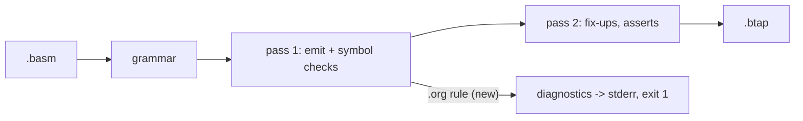

# Assembler: label fix-ups after a second `.org` patch the wrong bytes — Plan

**Plan Status**: `FINAL`

**Story Type**: `Internal`

**Plan Revision**: `A0`

> This plan captures **what** to build and **why**. The implementation agent discovers the **how** against live code.

---

## 1. Problem Statement

*   **Context**: `.org` sets both `startaddr` and `curraddr` on the assembler's `CodeContext`. Code is emitted contiguously into one byte array, so a second `.org` only shifts the addresses. Pass 2 writes each label fix-up at `addr - startaddr`, using the **last** `.org`'s `startaddr`. A label reference emitted after a second `.org` is patched at the wrong offset: it overwrites earlier code and leaves the `0xfa` placeholder in place, with no error. The `.btap` header also takes its load address from the last `.org`, while the image starts with the first `.org`'s code. So a second `.org` loads at the wrong address even if the fix-ups were right.
*   **Goal**: a second `.org`, or a `.org` after code or a label, is a positioned assembler **error** (issue option 2). Code with one `.org` at the top keeps assembling to identical bytes.
*   **In scope**: the rule and its diagnostics in `bc81asmc`, the tests for it, `docs/02-assembler.md` (`.org` row, Errors table), and a new assembler design decision.
*   **Out of scope**: an `--obj` / object-file format (roadmap phase 1). The compiler (`bc_ast.add_preamble` already emits exactly one `.org`). The self-hosted BASM (it copies this rule later).

### 1.1 Technical Summary

*   **Touched projects**: `src/bc81asmc/` (pass-1 loop in `bc81asmc.py`; `ORG` / `CodeContext` in `bc81asmc_ast.py` only if needed), `src/bc81asmc/tests/`, `docs/02-assembler.md`, `docs/specs/memory/design-decisions.md`.
*   **New patterns / abstractions**: none. A new diagnostic class in the existing A6 diagnostic list.
*   **Infrastructure changes**: none.
*   **End-state observable behavior**: `.org 0x1000\nnop\n.org 0x2000\n…` fails with `file:3:1: error: duplicate .org (first .org at line 1); use .org once, at the top`. `nop\n.org 0x1000\n` fails with `.org must come before any code or label`. The exit status is 1 and no `.btap` is written. Every committed source builds byte-identically.

---

## 2. Architecture & Design

### 2.1 Architecture Overview

| Component | Owner |
| :--- | :--- |
| `bc81asmc` (host assembler) | repo owner |

### 2.2 External Contracts & Evidence

N/A — Internal story.

#### Source Conflict Log

| Topic | Source A | Source B | Conflict | Chosen Handling |
| :--- | :--- | :--- | :--- | :--- |
| Fix option | Issue: "either fix-ups use the actual offset, **or** a second `.org` is rejected" | Owner, mid-run 2026-11-22: "reject second org" | Two options were open | Reject (D1) |
| `.org` docs | `docs/02-assembler.md`: "a second `.org` only shifts addresses" | D1 | The docs describe the behaviour being removed | Docs rewritten (T2) |

### 2.3 Affected Areas

| Area / File (pointer) | Role in this change | Likely action |
| :--- | :--- | :--- |
| `src/bc81asmc/bc81asmc.py` `compile()` pass-1 loop | Already collects positioned diagnostics (duplicate label/symbol). This is where the `.org` rule is checked. | Change |
| `src/bc81asmc/bc81asmc_ast.py` `ORG`, `CodeContext.set_addr` | Applies the address. A rejected `.org` must not change the context. | Reference / Change |
| `src/bc81asmc/tests/bc81asmc_emit_tests.py` | Has the two tests that pin the old multi-`.org` behaviour. | Change + add |
| `src/bc81asmc/tests/bc81asmc_compile_diag_tests.py` | Diagnostic-format tests (positions, sorting, CLI stderr). | Add |
| `docs/02-assembler.md` (Directives `.org` row, Errors table) | User reference. | Change |
| `docs/specs/memory/design-decisions.md` (assembler A-series, last is A8) | Standing decisions. | Add A9 |

### 2.4 Key Algorithms & Behaviour

*   **Rule**: a source has at most one `.org`, and it must come before the first emitted byte and before the first label. The following may come before it: comments, blank lines, `.def`, and an `.assert` with no label. A source with no `.org` stays valid and starts at 0x0000, as today.
*   **Second `.org`** (an earlier `.org` was accepted): diagnostic `duplicate .org (first .org at line N); use .org once, at the top`, positioned at the `.org` line's directive column.
*   **`.org` after code or a label** (no earlier `.org`, but a byte was emitted or a label was defined earlier, including a label on the `.org` line itself): diagnostic `.org must come before any code or label`, at the same position.
*   **Recovery**: a rejected `.org` has no effect. The addresses carry on unchanged, so later diagnostics (undefined labels, range errors) are still reported, sorted with the rest, as in A6. The run exits 1 and writes no `.btap`.
*   **Verified facts**: (a) every built `.basm` (bcOS, boot, bdos, all utilities/apps, examples; full build 2026-11-22) has only comments or blank lines before its single `.org`. (b) A trial fix-up patch with a full rebuild gave zero output diff against master, so nothing depends on multi-`.org` behaviour. (c) The assembler suite's only test that pins the old behaviour is `test_second_org_with_label_fixup_patches_wrong_bytes`; `test_second_org_only_shifts_addresses` pins the documented shifting. (d) Every other test with a `.org` puts it first, after `.def` lines at most.

---

## 3. Key Decisions & Assumptions

*   **D1 — Reject, don't re-address.** The owner chose this mid-run (2026-11-22, "reject second org"). Correcting the fix-up offsets would still leave the `.btap` load address taken from the last `.org`. Roadmap step 12 says object files allow `.org` only on the first line, and BASM copies the host rule. This becomes design decision **A9**.
*   **D2 — "Before any code or label", not "first line".** A literal first-line rule would reject every committed source: each starts with a header comment, and `boot.basm` has five comment lines first. `.def` lines before `.org` are used by the tests and are harmless (they don't depend on the address).
*   **D3 — A `.org` with no earlier `.org`, placed after code, is also an error.** It has the same defect: the image starts at 0x0000, but the header and label addresses follow the `.org`.
*   **Assumption (low stakes)**: wording of the two messages (Decision Lock). Not an AC.

### 3.1 Decision Lock (Constants & Policies)

| Constant / Policy | Selected Value | Why | Where it lives |
| :--- | :--- | :--- | :--- |
| Second-`.org` message | `duplicate .org (first .org at line N); use .org once, at the top` | Matches the `duplicate label … (first defined at line n)` style | pass-1 diagnostics |
| Late-`.org` message | `.org must come before any code or label` | Says how to fix it | pass-1 diagnostics |
| Column | column of the `.org` line's directive (the line's `col`) | Same as other line-level diagnostics | pass 1 |
| Rejected `.org` | no effect on the context | Keeps the later diagnostics meaningful | pass 1 |
| Decision id | A9 | Next free assembler id on master (A8 is the last) | design-decisions.md |

### 3.2 Open Questions

None.

---

## 4. Task Breakdown

| Task | Title | Depends on | Complexity |
| :--- | :--- | :--- | :--- |
| T1 | Reject a second or late `.org` in bc81asmc, with tests | — | Medium |
| T2 | Docs: `.org` row, Errors table, decision A9 | T1 | Low |

### T1 — Reject a second or late `.org` in bc81asmc, with tests

*   **Goal**: implement §2.4 in the assembler's pass 1, with the messages from §3.1.
*   **File pointers**: `src/bc81asmc/bc81asmc.py` (`compile`), `src/bc81asmc/bc81asmc_ast.py` (`ORG`, `CodeContext`), `src/bc81asmc/tests/bc81asmc_emit_tests.py`, `src/bc81asmc/tests/bc81asmc_compile_diag_tests.py`.
*   **Definition of Done**: both error cases raise `AssemblerError` with the exact message, line and column. A rejected `.org` leaves the addresses unchanged, and later diagnostics are still reported. A single `.org` at the top (after comments/`.def`) and a source with no `.org` assemble exactly as before. The full suite passes. A full rebuild gives the same outputs as before.
*   **Test expectations** (assembler unit tests): second `.org` (with and without code between them); `.org` after an instruction; `.org` after a label line; a label on the `.org` line; `.def` + `.org` still fine; a source with no `.org` still fine; recovery: a rejected `.org` plus an undefined label later gives both diagnostics, in line order; CLI: exit 1, the `file:line:col: error:` block on stderr, and no `.btap` written.
*   **Tests to modify**:
    *   `src/bc81asmc/tests/bc81asmc_emit_tests.py :: TestDirectives.test_second_org_with_label_fixup_patches_wrong_bytes` — pins the bug. Its source now fails with the duplicate-`.org` diagnostic; assert that instead (D1/A9, the issue's "change that test").
    *   `src/bc81asmc/tests/bc81asmc_emit_tests.py :: TestDirectives.test_second_org_only_shifts_addresses` — pins the documented "a second `.org` only shifts addresses", which D1 removes. It now asserts the duplicate-`.org` error.

### T2 — Docs: `.org` row, Errors table, decision A9

*   **Goal**: document the rule.
*   **File pointers**: `docs/02-assembler.md` (Directives table `.org` row; Errors class table), `docs/specs/memory/design-decisions.md` (add A9 after A8, same structure: Purpose / Rationale / Usage / Trade-offs; Usage says BASM must apply the same rule, roadmap step 12).
*   **Definition of Done**: the `.org` row says "once, before any code or label; a second or late `.org` is an error". The Errors table has a `.org` row with both messages and the column. A9 cites the owner's decision on #65 (2026-11-22). No mention remains anywhere in `docs/` that a second `.org` only shifts addresses (`grep -rn "second .org" docs/`).
*   **Test expectations**: none (docs only).
*   **Tests to modify**: None

---

## 5. Verification

1.  `python3 run_tests.py < /dev/null` from the repo root exits 0. It builds the full pipeline and runs every suite. The 6 assembler `expectedFailure`s on master are unrelated to this story: list them in the report, don't count them as passing.
2.  Full rebuild byte check: build origin/master and this branch in temp copies (`buildos`, `buildtools`, `buildapps`, `makedisc`), then `diff -r` the `src/` outputs. Expected: no difference except the changed `.py` files.
3.  `python3 scripts/code_size.py --check`: no program changes.
4.  Manual: `bc81asmc` on a two-`.org` file prints the diagnostic block on stderr, exits 1 and writes no `.btap`.

---

## 6. Fact-Integrity Checklist

| Check | Result |
| :--- | :--- |
| Every AC mapped to a task (fix or reject → T1; change the pinned test → T1 Tests to modify; update docs → T2; full rebuild / opcode agreement / run_tests → §5) | Yes |
| Facts verified against live code / a build (§2.4 a–d) | Yes |
| No hedged decisions | Yes (D1 decided by the owner) |
| Tests to modify searched (grep `.org` in all test dirs) | Yes |
| Open Questions empty | Yes |

Self-review: the issue's "keep the memory map unchanged" holds trivially (zero output diff). Its "check `bc81asmc_opcode_agreement_tests.py`" is covered by run_tests. Its "committed outputs (G3)" premise is stale: outputs have been untracked since #92, so the byte check compares builds, not `git diff`.

## 7. Amendment Log

| Rev | Request | Decision | Plan changes |
| :--- | :--- | :--- | :--- |
