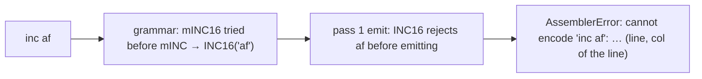

# Assembler: `inc af` and `dec af` Don't Parse — Plan

**Plan Status**: `FINAL`

**Story Type**: `Internal`

**Plan Revision**: `A1`

> This plan captures **what** to build and **why**. The implementation agent discovers the **how** against live code.

---

## 1. Problem Statement

*   **Context**: In `src/bc81asmc/bc81asmc_grammar.py` the `mnemonic` chain tries the 8-bit `mINC`/`mDEC` (operand `a`) before `mINC16`/`mDEC16` (operand: a register pair). On `inc af` the 8-bit parser matches `inc a`, the `f` is left over, and the line is a **parse error** (`expected new line` style). `inc csci` / `inc dsdi` work. The test `PinnedFindingsTests.test_inc_and_dec_of_af_cannot_be_parsed` pins today's parse error (#48, D7).
*   **Goal**: the issue offers two outcomes: assemble `inc af`/`dec af` to the 16-bit instruction, **or** reject them on purpose with a clear message. The owner chose on the issue (2026-11-20): *"reject with clear message - they makes no sense as they will destroy f register"*. So `inc af` and `dec af` must be **rejected with a clear, positioned assembler error that says why** (the 16-bit result overwrites the flags in `F`), instead of an accidental parse error.
*   **In scope**: grammar order of the `inc`/`dec` alternatives; the rejection of `af` for `inc`/`dec` in the 16-bit forms; tests; docs (`docs/02-assembler.md`, design decision, assembler `CLAUDE.md`).
*   **A1 (owner, 2026-11-20, mid-run): "make other arithmetic blocked on af"** — every 16-bit ALU instruction with destination `af` is rejected the same way, not only `inc`/`dec`: `add sub mul div mod and or xor shl shr not`, immediate and register forms. `af` is then no longer a valid operand of any 16-bit ALU instruction.
*   **Out of scope**: the CPU (`src/bc64/bc8183_cpu.py`) is not changed — a hand-encoded `5F AD a0`/`5F AE a0` still executes as today. Other 16-bit ops on `af` were in scope of #58 / PR #140 (owner: "af is not to be used in this context although allowed"); A1 now rejects them in the assembler too (D5). `clr af` is #67. `out #r, imm` is #11.

### 1.1 Technical Summary

*   **Touched projects**: `src/bc81asmc` (grammar, AST emit), its tests, docs.
*   **New patterns / abstractions**: none — reuses the existing `cannot encode` diagnostic path (emit raises → positioned `AssemblerError`, as for `clr af` and the implied-pair check of #57/A7).
*   **Infrastructure changes**: None.
*   **End-state observable behavior**: `inc af` / `dec af` produce `file:line:col: error: cannot encode 'inc af': …` naming the reason (it would overwrite the flags in `f`) and the alternatives (`inc a`, or a pair `csci`/`dsdi`); no bytes are emitted for that line; every other source assembles byte-identically to before.

---

## 2. Architecture & Design

### 2.1 Architecture Overview

| Component | Owner |
| :--- | :--- |
| `src/bc81asmc` (assembler) | bcichonski |

Flow for a line `inc af`:

### 2.2 External Contracts & Evidence

N/A — Internal story.

#### Source Conflict Log

| Topic | Source A | Source B | Conflict | Chosen Handling |
| :--- | :--- | :--- | :--- | :--- |
| Outcome | Issue body "Expected": assemble to 16-bit, alternatively reject | Owner comment 2026-11-20: reject with clear message | Two options in the body | Owner comment decides: **reject** (D1) |
| Issue checklist | Issue: generated `.btap/.b81/.sector(s)/os.bdd` are committed (G3), check `git diff --exit-code` | Repo since #90/#92 (G12): build outputs are untracked | `git diff` on generated files is no longer meaningful | Verify byte-identity by building at the base commit and at the branch and comparing the built outputs (§5) |
| `af` accepted | PR #140 (#58, open) E13: "the assembler accepts `af` as a destination and gives no warning"; A7 lists `add af, csci` as valid | This story (A1) rejects every 16-bit ALU op on `af` | Contradiction with an open PR and with A7's example | A7 and `docs/02-assembler.md` are updated here (T3/T2). PR #140 is not on master and is not edited; the PR body flags that E13's "assembler accepts `af`" sentence must change when one of the two merges after the other |
| "other arithmetic" | Owner: "make other arithmetic blocked on af" | `docs/02-assembler.md` splits the 16-bit ALU into an arithmetic group (`add sub mul div mod inc dec`) and a binary group (`and or xor shl shr not`) | Could mean group A only | All 16-bit ALU ops (D5): the owner's reason (the result overwrites `F`) applies to every one of them. Assumption, stated to the owner in the run report and the PR |

### 2.3 Affected Areas

| Area / File (pointer) | Role in this change | Likely action |
| :--- | :--- | :--- |
| `src/bc81asmc/bc81asmc_grammar.py` — `mnemonic` chain, `mINC`/`mDEC`/`mINC16`/`mDEC16` | Order of alternatives decides that `inc af` is a parse error today | Change: try the 16-bit forms before the 8-bit ones (the rule in `src/bc81asmc/CLAUDE.md`: more specific first) |
| `src/bc81asmc/bc81asmc_ast.py` — `INC16`, `DEC16`, `check_pair16`, `PAIR16_IMPLIED` | Emit of the 16-bit inc/dec; already raises for unknown pairs before emitting | Change: reject `af` for inc/dec with the locked message (§3.1) before any byte is emitted |
| `src/bc81asmc/bc81asmc.py` / `bc81asmc_diag.py` | Turns an emit exception into a positioned `cannot encode` diagnostic | Reference only |
| `src/bc81asmc/tests/bc81asmc_opcode_agreement_tests.py` — `PinnedFindingsTests` | Pins today's parse error | Modify the listed test (§4 T1) |
| `src/bc81asmc/tests/bc81asmc_compile_diag_tests.py`, `bc81asmc_emit_tests.py`, `bc81asmc_tests.py` | Existing homes for diagnostic / emit / grammar tests | Add tests |
| `docs/02-assembler.md` — 16-bit ALU section and Errors table | Documents accepted forms and error messages | Change |
| `docs/specs/memory/design-decisions.md` — Assembler section (A1–A7) | Decision record | New decision `A8` |
| `src/bc81asmc/CLAUDE.md` — Rules | Agent-facing rules | Add one bullet |

### 2.4 Key Algorithms & Behaviour

*   **Grammar order**: in `mnemonic`, `mINC16`/`mDEC16` come before `mINC`/`mDEC`. parsy alternation backtracks, so `inc a` (no second register letter) still falls through to the 8-bit form; `inc csci`/`inc dsdi` are unchanged. `inc af`/`dec af` now parse to `INC16('af')` / `DEC16('af')`.
*   **Rejection**: at emit time (pass 1), before anything is emitted, `INC16`/`DEC16` with pair `af` raise; the existing pipeline reports it as `cannot encode '<line>': <reason>` at the first non-blank column of the line, the line contributes no bytes, and assembly goes on (same as `clr af`). Other pair validation (`check_pair16`: unknown pair names) keeps its message and order. The check is case-sensitive in the same way the rest of the grammar is (lowercase only).
*   **Side effect, accepted**: a line like `inc aa` (two register letters that form no pair) was a parse error and becomes a `cannot encode … 'aa' is not a 16-bit pair` diagnostic, the same as `inc sssi` today. No committed source contains such a line.
*   **Byte identity**: no source under `src/` contains `inc af`/`dec af` (they could not parse), so the ROM, bdos, apps and discs are byte-identical. (A1: no source uses any 16-bit ALU op on `af` either; T3 re-checks.)

---

## 3. Key Decisions & Assumptions

*   **D1 — Reject, don't assemble** (owner comment on #66, 2026-11-20). `inc af`/`dec af` are assembler errors.
*   **D2 — Reject in emit via the `cannot encode` path, not in the grammar.** Parsing them as 16-bit instructions and rejecting in emit gives a positioned diagnostic with a reason, consistent with `clr af` (#67 area) and the implied-pair rule (A7); a grammar-level failure would only produce a generic "expected …" parse error, which is what the issue calls unclear. Parsing still stops at the first syntax error (A6), but this is no longer a syntax error, so later lines keep being checked.
*   **D3 — Only `inc` and `dec`** *(superseded by D5 in A1)*. The owner's comment is about these two; `not af` and the other 16-bit ops on `af` stay accepted (#58). Recorded in A8 so BASM (roadmap step 13: "BASM copies the grammar") applies the same rule.
*   **D5 (A1) — Every 16-bit ALU op on `af` is rejected.** Same mechanism as D2 (emit-time `cannot encode`, no bytes, assembly goes on), for `add sub mul div mod and or xor shl shr not` in immediate and register forms. The `af` rejection is checked before the implied-second-pair rule, so `add af, dsdi` reports the `af` rejection, not "second operand must be csci". Since `af` is no longer a valid 16-bit pair, the unknown-pair hint drops it. D3 is superseded by D5.
*   **D4 — No CPU change.** The emulator still executes a hand-encoded 16-bit inc/dec on `af`; only the assembler refuses to produce it.
*   **Assumption — no source depends on the old parse error**: verified by grep — no `.basm`/`.b` under `src/` and no compiler template emits `inc af`/`dec af` (the compiler emits pairs `csci`/`dsdi`).

### 3.1 Decision Lock (Constants & Policies)

| Constant / Policy | Selected Value | Why | Where it lives |
| :--- | :--- | :--- | :--- |
| Reason text for `inc af` / `dec af` | `inc af is not allowed: the 16-bit result would overwrite the flags in f (use inc a, or a pair csci or dsdi)` — with `dec` for `dec af` | States why (owner: "will destroy f register") and what to use instead | `INC16`/`DEC16` emit; full diagnostic is `cannot encode 'inc af': <reason>` |
| Reason text for every other 16-bit ALU op on `af` (A1) | `<op> af is not allowed: the 16-bit result would overwrite the flags in f (use a pair csci or dsdi)`, `<op>` the mnemonic as written (`add`, `shl`, `not`, …) | Same wording as the `inc`/`dec` reason; there is no 8-bit alternative to name for every op | 16-bit ALU emit; full diagnostic `cannot encode '<line>': <reason>` |
| Unknown-pair hint (A1) | `'<name>' is not a 16-bit pair (use csci or dsdi)` | `af` is no longer a valid pair for any 16-bit ALU op | `check_pair16` |
| Diagnostic position | line of the instruction, column of its first non-blank character | Same as every `cannot encode` diagnostic | existing pipeline |
| Bytes emitted for the rejected line | none | Same as `clr af` and implied-pair errors | emit raises before emitting |
| Decision id | `A8` (Assembler section, after A7) | Next free assembler id on master | `docs/specs/memory/design-decisions.md` |

### 3.2 Open Questions

No open questions.

---

## 4. Task Breakdown

| Task | Title | Depends on | Complexity |
| :--- | :--- | :--- | :--- |
| `T1` | Grammar order + reject `inc af`/`dec af` with a clear diagnostic, with tests | — | `Medium` |
| `T2` | Docs: assembler reference, decision A8, assembler CLAUDE.md | — | `Low` |
| `T3` | Reject every other 16-bit ALU op on `af` (A1), with tests | `T1` | `Medium` |

### T1 — Grammar order + reject `inc af`/`dec af`

*   **Goal**: `inc af` / `dec af` parse as the 16-bit forms and are reported as a positioned `cannot encode` error with the locked reason; nothing else changes.
*   **Depends on**: —
*   **Complexity**: `Medium`
*   **Pointers**: `src/bc81asmc/bc81asmc_grammar.py` (`mnemonic`), `src/bc81asmc/bc81asmc_ast.py` (`INC16`, `DEC16`, `check_pair16`), `src/bc81asmc/tests/`.
*   **Definition of Done**:
    *   `inc af` and `dec af` each give exactly one diagnostic `cannot encode 'inc af': <locked reason>` (resp. `dec`) at (line, first non-blank column), and no bytes for that line; a following valid line still assembles;
    *   `inc a`, `dec a`, `inc csci`, `dec csci`, `inc dsdi`, `dec dsdi`, `not af` assemble to the same bytes as before;
    *   unknown pairs (`inc sssi`) keep their existing message;
    *   the opcode agreement suite still passes; the full rebuild produces byte-identical outputs (§5);
    *   `python3 run_tests.py` exits 0 with no new expected failures.
*   **Tests expected** (unit, in the assembler's `tests/` folder, following the existing file split):
    *   grammar: `inc af`/`dec af` parse to the 16-bit AST nodes; `inc a`/`dec a` still parse to the 8-bit nodes;
    *   compile diagnostics: message text, position, no bytes, assembly continues to the next line;
    *   the pinned finding now asserts the rejection (see Tests to modify).
*   **Tests to modify**:
    *   `src/bc81asmc/tests/bc81asmc_opcode_agreement_tests.py :: PinnedFindingsTests.test_inc_and_dec_of_af_cannot_be_parsed` — it pins today's parse error; D1 (owner decision on #66) replaces that with an on-purpose `cannot encode` rejection, and the issue says to change this test to assert the correct behaviour. Rename it to describe the new behaviour and assert the `AssemblerError` with the locked reason.

### T2 — Docs

*   **Amended in**: `A1` — docs now cover every 16-bit ALU op on `af` (D5).

*   **Goal**: the docs say that `inc af`/`dec af` and every other 16-bit ALU op on `af` are rejected, why, and that this is the rule BASM must copy.
*   **Depends on**: —
*   **Complexity**: `Low`
*   **Pointers**: `docs/02-assembler.md` (16-bit ALU section, Errors table — the `unencodable line` / `implied pair` rows), `docs/specs/memory/design-decisions.md` (Assembler section, after A7), `src/bc81asmc/CLAUDE.md` (Rules).
*   **Definition of Done**:
    *   `docs/02-assembler.md`: the 16-bit ALU section heading and text say the 16-bit ALU works on `csci` and `dsdi` only; every 16-bit ALU op on `af` (`inc`/`dec` included) is an error (reason, link to A8); the implied-pair table drops the `af` row and `add af, csci` from the valid forms; the Errors table shows both locked messages (§3.1) and the new unknown-pair hint;
    *   `design-decisions.md`: `### A8.` covers all 16-bit ALU ops on `af` (both owner quotes: the #66 comment and the A1 instruction "make other arithmetic blocked on af", 2026-11-20); A7's Purpose/Usage no longer list `af`→`csci` or `add af, csci` as a valid form (note that A8 removed it); no CPU change (hand-encoded `5F … 1…` forms still run), BASM must apply the same rule (roadmap step 13); a note that PR #140's E13 (not on master) says the assembler accepts `af`;
    *   `src/bc81asmc/CLAUDE.md`: the A8 Rules bullet covers every 16-bit ALU op on `af`; the implied-pair bullet drops `af`→`csci`;
    *   no other text changed; no broken relative links.
*   **Tests expected**: none (docs only).
*   **Tests to modify**: None.

### T3 — Reject every other 16-bit ALU op on `af` (A1)

*   **Amended in**: `A1` (new task).
*   **Goal**: `add/sub/mul/div/mod/and/or/xor/shl/shr af, …` (immediate and register forms) and `not af` are positioned `cannot encode` errors with the locked reason (§3.1), checked before the implied-pair rule; no bytes for the line; assembly goes on.
*   **Depends on**: `T1` (same files and the same rejection helper).
*   **Complexity**: `Medium`
*   **Pointers**: `src/bc81asmc/bc81asmc_ast.py` (`CLC16_R_IMM`, `CLC16_R_R`, `NOT16`, `check_pair16`, `PAIR16_IMPLIED`, T1's `inc`/`dec` rejection), `src/bc81asmc/tests/`.
*   **Definition of Done**:
    *   every 16-bit ALU op on `af` gives exactly one diagnostic with the locked reason, at the first non-blank column; `inc af`/`dec af` keep T1's text;
    *   the same ops on `csci`/`dsdi` assemble to the same bytes as before; 8-bit ops on `a` and non-ALU uses of `af` (`jmp t, af`, `psh af`, `pop af`, `.mv af, …`, `mov`) are unchanged;
    *   the unknown-pair hint is `(use csci or dsdi)`;
    *   the opcode-agreement suite still covers every 16-bit ALU mnemonic form (via `csci`/`dsdi`);
    *   full rebuild byte-identical (no source uses a 16-bit ALU op on `af`: verified by grep of every tracked `.b`/`.basm` and the compiler templates);
    *   `python3 run_tests.py` exits 0 with no new expected failures.
*   **Tests expected** (unit): compile diagnostics for one immediate and one register form of each op and for `not af`; `add af, dsdi` reports the `af` rejection; csci/dsdi bytes unchanged; T1's tests updated where they assumed `not af` or the old hint.
*   **Tests to modify** (baseline tests that A1 makes wrong by design — D5):
    *   `src/bc81asmc/tests/bc81asmc_compile_diag_tests.py :: TestSixteenBitPairs.test_wrong_second_pair` — its `add af,dsdi` / `add af,af` subcases expect the implied-pair message; D5 checks `af` first. Move those two subcases to the `af` rejection (keep the csci/dsdi subcases).
    *   `src/bc81asmc/tests/bc81asmc_compile_diag_tests.py :: TestSixteenBitPairs.test_valid_pairs_still_encode` — `add af,csci` is no longer valid (D5); drop it from the valid list.
    *   `src/bc81asmc/tests/bc81asmc_opcode_agreement_tests.py :: simple_cases` (the `add16 af,imm` and `add16 af,csci` entries, run by `test_every_form_agrees_between_assembler_and_cpu`) — those forms no longer assemble (D5); remove the two entries.
    *   Tests T1 added in this branch (e.g. `not af` bytes unchanged, the full unknown-pair text) are not baseline tests; update them as D5 requires.

---

## 5. Verification

*   **Tests**: `python3 run_tests.py < /dev/null` from the repo root (builds then runs unit + e2e) — exit 0; report any expected failures by name, never as "all passed".
*   **Assembler suite**: `cd src/bc81asmc && python3 -m unittest discover -s tests -t . -p "*_tests.py"`.
*   **Byte identity (replaces the issue's `git diff --exit-code`, see Source Conflict Log)**: build at the base commit and at the branch (`cd src && ./buildos && ./buildtools && ./buildapps && ./makedisc`, in a temp copy for the base) and compare checksums of every built `.btap`, `.b81`, `.sector(s)`, `.bdd` — identical. Memory map (G2) untouched by construction.
*   **Observable**: a two-line file `inc af` / `nop` assembled with `bc81asmc.py` prints `…:1:1: error: cannot encode 'inc af': inc af is not allowed: …` and exits 1.

---

## 6. Fact-Integrity Checklist

| Check | Yes / No / N/A | Notes |
| :--- | :--- | :--- |
| External contracts verified from producer/contract source | N/A | Internal |
| Evidence sources are reproducible | N/A | Internal |
| Identifier directionality / ordering / freshness meaning evidenced | N/A | Internal |
| Every `Assumption` is linked to an Open Question (§3.2) | Yes | The one assumption is verified by grep, not open |
| No unresolved Open Questions (for `FINAL`) | Yes | Owner decided on the issue |
| Each Decision states a single committed approach | Yes | |
| Tasks are independent, each with a Definition of Done and test expectations | Yes | T1/T2 share only the locked message text |
| Required infra reflected | N/A | |

**Self-review note**: The only judgment call is where to reject (D2: emit, not grammar) — chosen for a positioned, explained diagnostic. Take care that reordering the `mnemonic` chain does not change how `inc a`/`dec a` parse (backtracking) and that the full rebuild stays byte-identical. PR #140 (#58, open) says the assembler accepts `af` for every 16-bit op; A8 narrows that for `inc`/`dec` only — mention it in the PR.

---

## 7. Amendment Log

| Revision | Request | Decision | Plan changes |
| :--- | :--- | :--- | :--- |
| `A1` | uncovered-AC (owner, mid-run): reject every other 16-bit ALU op on `af` | **Accepted** — owner instruction in the run, same reason as the issue comment; "other arithmetic" read as every 16-bit ALU op (Source Conflict Log) | §1 scope, D3 superseded by D5, §3.1 two new locks, Source Conflict Log rows; T2 amended; T3 added |
