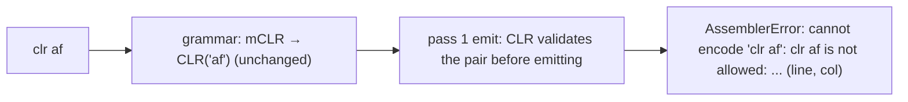

# Assembler: `clr af` Is Accepted by the Grammar but Crashes with KeyError — Plan

**Plan Status**: `FINAL`

**Story Type**: `Internal`

**Plan Revision**: `A0`

> This plan captures **what** to build and **why**. The implementation agent discovers the **how** against live code.

---

## 1. Problem Statement

*   **Context**: `clr` is the **relative call** (`A9 hh ll` for `clr :label`, `A1 pq` for `clr pair`). Its operand rule (`jmpaddrarg` → `paramreg2`) accepts any two concatenated register names, so `clr af` parses. `CLR.emit` then splits the operand as two 2-character names (`af`[0:2] and `af`[2:4] = `''`), and `REG2BIN('')` raises `KeyError`. Since #10 the assembler driver catches that and reports a generic, positioned `cannot encode 'clr af': operand not supported by this instruction`. So there is no traceback any more (the issue body predates #10), but the message doesn't say what is wrong. Any other odd concatenation (`clr aci`, `clr fa`, ...) fails the same way. The pinned test `PinnedFindingsTests.test_clr_af_fails_to_assemble` only checks for `cannot encode`.
*   **Goal**: the issue offers two outcomes: assemble `clr af` as a register-relative call with `A:F` as the offset, **or** have the assembler reject it with a clear message. **Owner decision (relayed mid-run, 2026-11-22):** "yes it is a relative call, disregard the comment". That answers a side note pointing out that the owner's issue comment ("to be consistent clr af should be allowed albeit it may not zero the f register") read `clr` as *clear*, not *call relative*. So that comment is withdrawn, and the outcome is **reject `clr af` with a clear, positioned assembler error that says why**: the call offset would be read from `a:f`, and `f` holds the flags, so the target is unpredictable.
*   **In scope**: the register-form operand check of `clr` in the assembler (reject `af` with a specific reason; reject any other pair `clr` cannot use with a specific message instead of the generic KeyError text), tests, docs (`docs/02-assembler.md`, design decision, `src/bc81asmc/CLAUDE.md`).
*   **Out of scope**: the CPU (`src/bc64/bc8183_cpu.py`): a hand-encoded `A1 1B` still runs as today (`op_CAL` reads only the high nibble of the pair byte and `get_addr(A)` = `A:F`). `cal af`, `jmp t, af` and `jrx t, af` still assemble silently to a call/jump to `A:F` (they read the pair through `REG2BIN('af')` = `A`). They have the same problem, but the issue and the owner's decision name only `clr`. They are listed as a follow-up in the PR (not changed here). The `clr :label` form and its range check are unchanged.

### 1.1 Technical Summary

*   **Touched projects**: `src/bc81asmc` (AST emit of `CLR`), its tests, docs.
*   **New patterns / abstractions**: none. It reuses the existing path where `emit` raises `ValueError` → positioned `cannot encode 'line': reason` `AssemblerError` (as for #57/A7 and #66/A8).
*   **Infrastructure changes**: None.
*   **End-state observable behavior**: `clr af` → `file:line:col: error: cannot encode 'clr af': clr af is not allowed: the call offset would be read from a:f, and f holds the flags (use a pair csci, dsdi or sssi)`, with no bytes for the line. `clr <other non-pair>` → `cannot encode 'clr aci': 'aci' is not a pair for clr (use csci, dsdi or sssi)`. `clr csci` / `clr dsdi` / `clr sssi` / `clr :label` encode exactly as before, and every program in the repo assembles byte-identically.

---

## 2. Architecture & Design

### 2.1 Architecture Overview

| Component | Owner |
| :--- | :--- |
| `src/bc81asmc` (assembler) | bcichonski |

### 2.2 External Contracts & Evidence

N/A — Internal story.

#### Source Conflict Log

| Topic | Source A | Source B | Conflict | Chosen Handling |
| :--- | :--- | :--- | :--- | :--- |
| Outcome | Owner issue comment 2026-11-22: "clr af should be allowed albeit it may not zero the f register" | Owner, relayed mid-run 2026-11-22: "yes it is a relative call, disregard the comment" | The comment assumed `clr` = clear | The later instruction wins: **reject** (D1). The interpretation is posted on the issue and flagged in the PR |
| Today's behaviour | Issue body: `clr af` gives a Python traceback | Live code since #10: positioned generic `cannot encode … operand not supported by this instruction` | Issue body is stale | Plan targets the live behaviour: a *clear* message replaces the generic one |
| Issue checklist | Issue: generated `.btap/.b81/.sector(s)/os.bdd` are committed (G3), check `git diff --exit-code` | Repo since #90/#92 (G12): build outputs are untracked | `git diff` on generated files is meaningless now | Byte-identity is checked with a full build + `scripts/code_size.py --check` (delta 0) (§5) |
| `af` as a call/jump pair | This story rejects `clr af` | `cal af`, `jmp t, af`, `jrx t, af` assemble to `A:F` targets | Inconsistent across call/jump forms | Out of scope (issue + owner name only `clr`); listed as a follow-up in the PR |

### 2.3 Affected Areas

| Area / File (pointer) | Role in this change | Likely action |
| :--- | :--- | :--- |
| `src/bc81asmc/bc81asmc_ast.py` — `CLR.emit` and the `reject_af_*` / `check_pair16` helpers near it | Encodes `clr pair` by splitting the operand into two 2-char register names | Change: validate the register operand before emitting anything |
| `src/bc81asmc/bc81asmc.py` — the `cannot encode` wrapper | Turns a `ValueError` from emit into the positioned diagnostic (a `KeyError` gets the generic reason) | Reference only |
| `src/bc81asmc/bc81asmc_grammar.py` — `mCLR`, `jmpaddrarg`, `paramreg2` | Accepts any two concatenated register names | Reference only (no grammar change, D2) |
| `src/bc64/bc8183_cpu.py` — `op_CAL`, `get_addr` | Register mode reads the high nibble of the pair byte; `A`/`F` → `A:F`, `CS`/`CI` → `cs:ci`, `DS`/`DI` → `ds:di`, `SS`/`SI` → `ss:si` | Reference only |
| `src/bc81asmc/tests/bc81asmc_opcode_agreement_tests.py` — `PinnedFindingsTests.test_clr_af_fails_to_assemble`; `call_cases` (`clr csci`/`clr dsdi` round trips) | Pins today's generic failure; agreement cases for valid pairs | Change the pinned test (listed below); add cases |
| `src/bc81asmc/tests/bc81asmc_compile_diag_tests.py` (`clr af` in a multi-error file, checks the `cannot encode 'clr af':` prefix) | Must keep passing; the prefix doesn't change | Reference |
| `docs/02-assembler.md` (Errors table row "unencodable line … e.g. `clr af`", the `clr pair` row of the instruction table), `docs/specs/memory/design-decisions.md` (new assembler decision after A8), `src/bc81asmc/CLAUDE.md` | Documentation of the rule | Change |

### 2.4 Key Algorithms & Behaviour

*   **The register-form rule for `clr`** (label form untouched): the operand must be one of the pairs `csci`, `dsdi`, `sssi` (case-insensitive like the rest of the AST). These are exactly the pairs the CPU's register-mode call resolves to a full pair, and the ones the encoder already handles. The emitted bytes for them stay `A1` + high-register nibble + low-register nibble, as today.
*   **`af`** is rejected first, with its own reason (the offset would be read from `a:f`, and `f` holds the flags).
*   **Any other concatenation** (`aci`, `fa`, `pcsi`, `ssci`, ...) is rejected with the "not a pair for clr" message. Today some of these assemble to bytes the CPU can't execute or reads differently (e.g. `ssci` → `A1 D4` → ss:si), and others hit the KeyError. No program in the repo uses the register form of `clr` (only `clr :label`), so no build output changes.
*   The check happens **before any nibble is emitted** (pass 1). The line then contributes no bytes, the rest of the file still assembles, and every error is reported.

---

## 3. Key Decisions & Assumptions

*   **D1 — Reject `clr af`, don't encode it.** Owner, mid-run: the issue comment is to be disregarded. A relative call by `a:f` mixes the flags byte into the offset, so the target is unpredictable. The precedent is A8 (#66: 16-bit ALU ops on `af` are rejected because they overwrite `F`).
*   **D2 — The check lives in `CLR.emit`, not the grammar.** Same as A7/A8: a grammar rejection would be an opaque `syntax error: expected …` that stops parsing. An emit-time `ValueError` gives the positioned `cannot encode 'line': reason` and assembly continues. This satisfies the issue's "rejects it with a clear message".
*   **D3 — `clr` also names the problem for any other non-pair operand.** Allowed pairs: `csci`, `dsdi`, `sssi`. The issue is about `clr af`, but the same KeyError path produces the same unhelpful message for `clr aci`. Fixing only `af` would leave the generic text for the rest. `sssi` stays allowed because it assembles today and the CPU resolves it (removing it would be an unasked-for behaviour change). **Assumption (low stakes, no repo source uses any register-form `clr`):** tightening `clr ssci`/`clr pcsi`-style concatenations, which today assemble to undocumented bytes, is acceptable. Flagged in the PR.
*   **D4 — New design decision `A9`** in `docs/specs/memory/design-decisions.md` (the next free assembler id on master at c745b4c). A parallel run (#65, assembler) may also add an `A9`. Re-check origin/master's last A-id right before opening the PR and renumber if it is taken (seen before with E12/E13).

### 3.1 Decision Lock (Constants & Policies)

| Constant / Policy | Selected Value | Why | Where it lives |
| :--- | :--- | :--- | :--- |
| `clr af` reason | `clr af is not allowed: the call offset would be read from a:f, and f holds the flags (use a pair csci, dsdi or sssi)` | Names the operand, the reason and the alternatives (A8 style) | `CLR.emit` (via a helper next to `reject_af_*`) |
| Other non-pair reason | `'<operand>' is not a pair for clr (use csci, dsdi or sssi)` (operand as written) | Matches the existing `'x' is not a 16-bit pair (use csci or dsdi)` style | same |
| Valid `clr` pairs | `csci`, `dsdi`, `sssi` | CPU-resolvable full pairs; unchanged encodings | same |
| Full diagnostic | `cannot encode 'clr af': <reason>` at the line's first non-blank column | Existing #10 wrapper; prefix pinned by `bc81asmc_compile_diag_tests.py` | `bc81asmc.py` (unchanged) |

### 3.2 Open Questions

No open questions. (The only owner decision, reject vs allow, was answered mid-run, D1.)

---

## 4. Task Breakdown

| Task | Title | Depends on | Complexity |
| :--- | :--- | :--- | :--- |
| `T1` | `clr` rejects `af` and non-pairs with clear messages | — | `Medium` |
| `T2` | Docs: Errors table, A9 decision, assembler CLAUDE.md | — | `Low` |

### T1 — `clr` rejects `af` and non-pairs with clear messages

*   **Goal**: `clr af` and any other register operand that isn't `csci`/`dsdi`/`sssi` produce the §3.1 messages as positioned `cannot encode` errors with no bytes emitted. Valid forms encode byte-identically to before.
*   **Depends on**: —
*   **Complexity**: `Medium`
*   **Pointers**: `src/bc81asmc/bc81asmc_ast.py` (`CLR`, the `reject_af_*`/`check_pair16` helpers), `src/bc81asmc/bc81asmc.py` (the wrapper, reference), tests in `src/bc81asmc/tests/`.
*   **Definition of Done**:
    *   `clr af` → exactly `cannot encode 'clr af': clr af is not allowed: the call offset would be read from a:f, and f holds the flags (use a pair csci, dsdi or sssi)` at (line, first non-blank column), and the line emits no bytes.
    *   `clr aci`, `clr fa`, `clr ssci` (examples) → `cannot encode 'clr <op>': '<op>' is not a pair for clr (use csci, dsdi or sssi)`, no bytes.
    *   `clr csci` / `clr dsdi` / `clr sssi` / `clr :label` bytes are unchanged (`A1 84`, `A1 95`, `A1 DC`, `A9 …`).
    *   A file with a bad `clr` line plus later lines still assembles the rest and reports every error (no early abort).
    *   Full suite `python3 run_tests.py < /dev/null` from the repo root exits 0. A full build and `python3 scripts/code_size.py --check` shows no program changed (delta 0).
*   **Tests expected** (unit, assembler; co-located in `src/bc81asmc/tests/`): the exact `clr af` message and position; the non-pair message for a few concatenations; unchanged encodings of the three valid pairs (assembler↔CPU agreement for `clr sssi` is welcome next to the existing `clr csci`/`clr dsdi` cases); no bytes emitted for the rejected line while surrounding lines assemble.
*   **Tests to modify**:
    *   `src/bc81asmc/tests/bc81asmc_opcode_agreement_tests.py :: PinnedFindingsTests.test_clr_af_fails_to_assemble` — it pins today's generic failure. Per the issue ("change that test to assert the correct behaviour") and D1, it must assert the specific rejection message. It may be renamed (e.g. `…_is_rejected_on_purpose`, like #66's `test_inc_and_dec_of_af_are_rejected_on_purpose`) and its comment updated (AC "Test", D1).

### T2 — Docs: Errors table, A9 decision, assembler CLAUDE.md

*   **Goal**: the docs state the `clr` register-form rule and why.
*   **Depends on**: — (wording fixed by §3.1)
*   **Complexity**: `Low`
*   **Pointers**: `docs/02-assembler.md` (Errors table: the "unencodable line … (e.g. `clr af`)" row's example and a new `clr af` / non-pair row in the style of the `inc af` row; the `clr pair` instruction row, naming the allowed pairs), `docs/specs/memory/design-decisions.md` (new `### A9.` after A8: Purpose / Rationale incl. the owner's mid-run decision and the withdrawn comment / Usage / Trade-offs, mentioning that `cal`/`jmp`/`jrx` with `af` are unchanged and that BASM must apply the same rule), `src/bc81asmc/CLAUDE.md` (one bullet next to the A8 bullet).
*   **Definition of Done**: the three files describe the rule with the exact §3.1 messages; links to the A9 anchor resolve; no other doc text changes meaning.
*   **Tests expected**: none (docs only); the full suite still exits 0.
*   **Tests to modify**: None.

---

## 5. Verification

*   **Unit + e2e**: `python3 run_tests.py < /dev/null` from the repo root exits 0 (it builds before e2e). Report expected failures, if any, by name. Don't call them passed.
*   **Byte identity**: after the build, `python3 scripts/code_size.py --check` reports no changed program (or build the base commit and the branch and compare `.b81`/`.btap`/`.sector(s)`/`os.bdd`/`utils.bdd`).
*   **Observable behaviour**: assembling a scratch file with `clr af`, `clr aci`, `clr csci`, `clr dsdi`, `clr sssi`, `clr :x` prints the two new messages at the right columns and encodes the valid lines as before.
*   **CPU agreement**: `bc81asmc_opcode_agreement_tests.py` passes.

---

## 6. Fact-Integrity Checklist

| Check | Yes / No / N/A | Notes |
| :--- | :--- | :--- |
| External contracts verified from producer/contract source | N/A | Internal |
| Evidence sources are reproducible | N/A | Internal |
| Identifier directionality / ordering / freshness meaning evidenced | N/A | Internal |
| Every `Assumption` is linked to an Open Question (§3.2) | Yes | D3's assumption is low stakes (no repo source uses register-form `clr`) and flagged in the PR; no OQ needed |
| No unresolved Open Questions (for `FINAL`) | Yes | |
| Each Decision states a single committed approach | Yes | |
| Tasks are independent, each with a Definition of Done and test expectations | Yes | T1 ∥ T2 |
| Required infra reflected | N/A | |

**Self-review note**: verified against live code at c745b4c: `clr af` today gives the generic `operand not supported` message (probe), and `clr csci/dsdi/sssi` assemble. The CPU resolves `A`/`F` to `A:F` in `get_addr`, so `clr af` *could* be encoded. Rejecting it rests on the owner's mid-run instruction. Take care to keep the `cannot encode 'clr af':` prefix (pinned by `bc81asmc_compile_diag_tests.py`), and don't touch `cal`/`jmp`/`jrx`. D3 tightens odd concatenations only for `clr`.

---

## 7. Amendment Log

| Amendment | Request | Decision | Plan changes |
| :--- | :--- | :--- | :--- |
