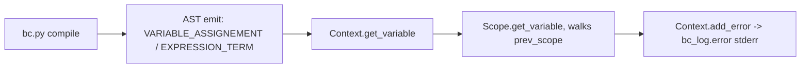
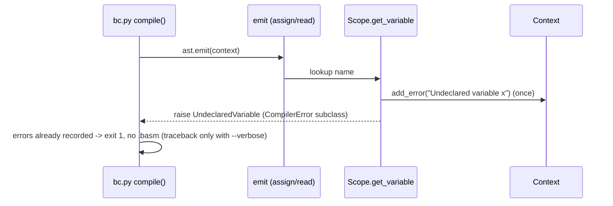

# Compiler: an Undeclared Variable Is an Error, Not a TypeError — Plan

**Plan Status**: `FINAL`

**Story Type**: `Internal`

**Plan Revision**: `A0`

Issue: [#68](https://github.com/bcichonski/bc16/issues/68). Self-hosted roadmap phase 0, step 20 (`docs/analysis/08-self-hosted-roadmap.md`).

---

## 1. Problem Statement

*   **Context**: `Scope.get_variable` (`src/bc/bc_ast.py`) records `Undeclared variable <name>` through `Context.add_error` when a name is in no scope, then returns `None`. Its callers (`VARIABLE_ASSIGNEMENT.emit`, the variable read in `EXPRESSION_TERM.emit`) and `get_variable` itself, when it walks up to the previous scope, then index `None`, so code generation dies with `TypeError: 'NoneType' object is not subscriptable`. Since #14 (`bc.py compile()`), the CLI swallows any exception raised after an error was recorded. So from the command line the user already sees one `prog.b: error: Undeclared variable x`, exit code 1, and no `.basm`. The `TypeError` traceback still shows with `--verbose`, and every in-process caller of `emit` (the unit tests, a future self-hosting oracle) gets a `TypeError`. The pinned test `src/bc/tests/bc_codegen_tests.py :: test_undeclared_variable_reported_by_context` swallows that `TypeError` on purpose (decision D7 of #48).
*   **Goal**: an undeclared variable, whether read or assigned, at the top level of a function or inside a call's argument scope, is a recorded compile error that stops code generation on purpose. Nothing raises `TypeError`, and the message is reported once.
*   **In scope**: `Scope.get_variable` miss handling; the pinned test; new unit tests for the read, assign and nested-scope cases; `docs/03-compiler.md`; checking that the generated code of every program is unchanged.
*   **Out of scope**: source locations (#28); type and call checking in general (#27); collecting further errors after the first undeclared variable (see D1); changing the message wording (see D3); `VARIABLE_ASSIGNEMENT`'s unreachable `self.context.add_error` unknown-type branch.

### 1.1 Technical Summary

*   **Touched projects**: `src/bc/bc_ast.py` (compiler), `src/bc/tests/` (compiler suite), `docs/03-compiler.md`.
*   **New patterns / abstractions**: a `CompilerError` subclass for "a user error was recorded, stop code generation" (D2).
*   **Infrastructure changes**: None.
*   **End-state observable behavior**: `bc.py` on `byte main() { x <- 1; return 1; }` prints exactly one `prog.b: error: Undeclared variable x` on stderr, exits 1 and writes no `.basm`. With `--verbose`, the traceback (C6) shows the deliberate compiler exception, not a `TypeError`. In-process, `PROGRAM.emit` raises that exception and `context.errors` holds the message once. Valid programs compile to byte-identical `.basm`.

---

## 2. Architecture & Design

### 2.1 Architecture Overview

#### Involved services & owners

| Service | Technical Owner |
| :--- | :--- |
| compiler `bc` (`src/bc/`) | repo owner (bcichonski) |

#### C2 diagram

#### Flow diagram

### 2.2 External Contracts & Evidence

N/A — Internal story.

#### Source Conflict Log

| Topic | Source A | Source B | Conflict | Chosen Handling |
| :--- | :--- | :--- | :--- | :--- |
| Message text | Issue "Expected": `undeclared variable 'x'` | `bc_output_tests.py` (written in #14, after the issue) pins `prog.b: error: Undeclared variable x` | wording differs | Keep the existing wording (D3). **Deviates from the issue's Expected wording**, flagged in the PR. |
| Verbose traceback | Issue: "crashes with a Python traceback" | C6 + `bc_output_tests.py :: test_undeclared_variable_verbose_keeps_traceback`: a traceback is printed only with `--verbose` | the verbose traceback is documented behaviour for any failed compile | Keep the verbose traceback. It now comes from the deliberate exception; a new test checks that no `TypeError` appears in it. |

### 2.3 Affected Areas

| Area / File (pointer) | Role in this change | Likely action |
| :--- | :--- | :--- |
| `src/bc/bc_ast.py` `CompilerError`, `Scope.get_variable`, `Context.get_variable` | the failing lookup; the walk up `prev_scope` indexes the inner result before the miss is detected | Change |
| `src/bc/bc_ast.py` `VARIABLE_ASSIGNEMENT.emit`, `EXPRESSION_TERM.emit`, `FUNCTION_CALL` parameter assignment (`get_variable_declared_only`) | callers; need no `None` handling once the lookup raises | Reference |
| `src/bc/bc.py` `compile()` | already treats "exception after a recorded error" as a clean exit 1; must keep doing so for the new exception | Reference (no change expected) |
| `src/bc/tests/bc_codegen_tests.py` | pinned test plus new cases | Change + add |
| `src/bc/tests/bc_output_tests.py` | CLI behaviour (one stderr line, exit 1, no `.basm`, verbose traceback) | Reference; add a "no TypeError" check as a new test |
| `docs/03-compiler.md` (error section) | documents compile errors | Change |
| `scripts/code_size.py --check` | proves the generated code of every program is unchanged | Reference |

### 2.4 Key Algorithms & Behaviour

*   A lookup searches the current scope (its function parameters unless `declaredOnly`, then its variables), then the previous scopes, as today. Offsets of a variable found in a previous scope are rebased exactly as today.
*   Only when the name is in **no** scope of the chain: record `Undeclared variable <name>` through `Context.add_error` **once** (not once per scope level), then raise the new `CompilerError` subclass. Nothing returns `None` to a caller any more.
*   `bc.py compile()` sees a non-empty `context.errors` and exits 1 without writing a `.basm` and without an `internal error:` line. The traceback appears only with `--verbose`.
*   Valid programs take exactly the same path as before: generated `.basm` is byte-identical.

---

## 3. Key Decisions & Assumptions

*   **D1 — Stop at the first undeclared variable.** The issue allows "stops cleanly, or keeps going". Stopping is chosen: carrying on would need a dummy variable with a made-up type and offset, emission would continue on wrong data, and the risk of follow-on errors or crashes elsewhere is not worth it before #27 (type and call checking) defines error collection. It also matches how `bc.py` handles every other recorded error.
*   **D2 — A dedicated `CompilerError` subclass (e.g. `UndeclaredVariableError`) raised after `add_error`.** A subclass lets tests and a future oracle tell "a user error was reported" from an internal fault. `bc.py` already treats it as a clean failure because the error is recorded first, so no `internal error:` line is printed (that line is for faults with no recorded error, #69).
*   **D3 — Keep the message `Undeclared variable <name>`.** It is pinned by `bc_output_tests.py` (#14, C6), which came after the issue text. The issue's `undeclared variable 'x'` reads as illustrative. **Deviates from the issue's "Expected" wording**: flagged in the PR for the owner.
*   **D4 — No location yet.** #28 is open; the issue says "with location once #28 lands".
*   **D5 — The verbose traceback stays** (C6: "A traceback is printed only with `--verbose`"). `test_undeclared_variable_verbose_keeps_traceback` stays valid and unchanged. A new test asserts the traceback no longer contains `TypeError`.
*   **Assumption A1 — The bdos/program check is done with `scripts/code_size.py --check` plus the full `run_tests.py`**, whose e2e suite rebuilds and boots `os.bdd`/`utils.bdd` and runs the utilities. Together they cover the issue's "recompile every program, diff the `.basm`, boot and smoke-test" check without committing build outputs (G12/#92). It doesn't affect correctness: the fix only touches a path valid programs never take.

### 3.1 Decision Lock (Constants & Policies)

| Constant / Policy | Selected Value | Why | Where it lives |
| :--- | :--- | :--- | :--- |
| Error message | `Undeclared variable <name>` | pinned by #14 tests (D3) | `Scope.get_variable` |
| Error policy | record once, then raise the `CompilerError` subclass | D1/D2 | `Scope.get_variable` |
| Generated code for valid programs | byte-identical (`code_size.py --check` exit 0) | the fix is on the error path only | — |

### 3.2 Open Questions

No open questions.

---

## 4. Task Breakdown

| Task | Title | Depends on | Complexity |
| :--- | :--- | :--- | :--- |
| `T1` | Undeclared variable raises a recorded compile error; tests and docs | — | `Medium` |

### T1 — Undeclared variable raises a recorded compile error; tests and docs

*   **Goal**: an undeclared variable (read or assigned, top level or inside a call's argument scope) records `Undeclared variable <name>` once and stops code generation with the new `CompilerError` subclass. Nothing raises `TypeError`.
*   **Depends on**: `—`.
*   **Complexity**: `Medium`.
*   **Pointers**: `src/bc/bc_ast.py` (`CompilerError`, `Scope.get_variable`), `src/bc/bc.py` `compile()` (check only), `src/bc/tests/bc_codegen_tests.py`, `src/bc/tests/bc_output_tests.py`, `docs/03-compiler.md` (errors bullet near the top), `src/bc/CLAUDE.md` (mentions `CompilerError`; update only if the new subclass needs a word there).
*   **Definition of Done**:
    *   no code path of `Scope.get_variable` returns `None` or indexes a `None` result; the error is recorded exactly once per failed lookup, even when the lookup walked through previous scopes;
    *   `bc.py` CLI: one stderr error line, exit 1, no `.basm`, no `internal error:` line; with `--verbose` the traceback contains no `TypeError`;
    *   the pinned test asserts the new behaviour (the subclass is raised, the error is recorded once, the stderr line is printed) and no longer tolerates `TypeError`;
    *   `docs/03-compiler.md` says an undeclared variable is reported as `Undeclared variable <name>` and stops the compile (no location until #28);
    *   `python3 scripts/code_size.py --check` exits 0 (every program's `.basm` unchanged) after `cd src && ./buildos && ./buildtools && ./buildapps && ./makedisc`, and `python3 run_tests.py < /dev/null` exits 0.
*   **Tests expected** (unit, compiler suite, `src/bc/tests/`):
    *   assignment to an undeclared variable at function level → subclass raised, error recorded once;
    *   read of an undeclared variable (in a `return` or an expression) → same;
    *   an undeclared variable used as a call argument (the lookup walks into the previous scope) → same, recorded once, no `TypeError`;
    *   a declared variable read through a previous scope (call argument) still compiles as before;
    *   CLI (`bc_output_tests.py`, new test): `--verbose` output of an undeclared-variable compile has no `TypeError`.
*   **Tests to modify**:
    *   `src/bc/tests/bc_codegen_tests.py :: TestVariables.test_undeclared_variable_reported_by_context`: pins today's `TypeError`; the issue ("Test" section) says to change it to the correct behaviour once fixed (Goal, D2).

---

## 5. Verification

*   **Compiler suite**: `cd src/bc && python3 -m unittest discover -s tests -t . -p "*_tests.py"`: exits 0.
*   **Full build + code check**: `cd src && ./buildos && ./buildtools && ./buildapps && ./makedisc`, then `python3 scripts/code_size.py --check` from the repo root exits 0: every program's generated `.basm` (bdos, utilities, apps) is unchanged.
*   **Everything**: `python3 run_tests.py < /dev/null` exits 0. The e2e suite rebuilds and boots `os.bdd`/`utils.bdd` and runs ls/cat/texted and the other utilities. Report any remaining expected failures by name; don't call them passed.
*   **Observable**: `python3 src/bc/bc.py` on a temp `byte main() { x <- 1; return 1; }` prints `…: error: Undeclared variable x` once, exits 1 and writes no `.basm`. With `--verbose`, no `TypeError` appears.
*   `git status` is clean apart from the intended source/test/doc changes (build outputs are ignored).

---

## 6. Fact-Integrity Checklist

| Check | Yes / No / N/A | Notes |
| :--- | :--- | :--- |
| External contracts verified from producer/contract source | N/A | Internal |
| Evidence sources are reproducible | N/A | Internal |
| Identifier directionality / ordering / freshness meaning evidenced | N/A | Internal |
| Every `Assumption` is linked to an Open Question (§3.2) | Yes | A1 doesn't affect correctness (error path only; the checks are mechanical) |
| No unresolved Open Questions (for `FINAL`) | Yes | |
| Each Decision states a single committed approach | Yes | D1 stop, D3 keep the wording |
| Tasks are independent, each with a Definition of Done and test expectations | Yes | single task |
| Required infra reflected | N/A | no toggle / infra |

**Self-review note**: The CLI already hides the crash (#14), so the visible change is small: the `TypeError` disappears from `--verbose` and from in-process `emit`. Take care with the `prev_scope` walk: the inner lookup must not record the error a second time, and a declared variable found in an outer scope must keep its rebased offset. D3 deliberately keeps the #14 message instead of the issue's quoted wording; the PR must say so.
