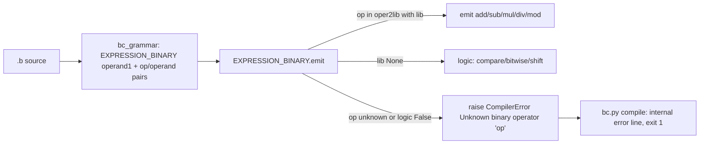

# Compiler: the unknown-operator error in `EXPRESSION_BINARY` references a missing attribute — Plan

**Plan Status**: `FINAL`

**Story Type**: `Internal`

**Plan Revision**: `A0`

> This plan captures **what** to build and **why**. The implementation agent discovers the **how** against live code.

---

## 1. Problem Statement

*   **Context**: issue #69 (found while writing #48's unit tests). In `src/bc/bc_ast.py`, `EXPRESSION_BINARY.emit` reports an operator it can't emit with `"Unknown binary operator '{0}'".format(self.operator)`. `EXPRESSION_BINARY` has no `operator` field (it has `operand1` and `arguments`, a list of `[operator, operand]` pairs). The line was copied from `EXPRESSION_UNARY`, so reaching it raises `AttributeError` instead of a compiler error. The owner's comment makes it a phase 0 prerequisite (step 21 in `docs/analysis/08-self-hosted-roadmap.md`).
*   **Verified on master `03d72e6` (read 2026-11-22)**:
    *   The loop in `emit` reads `opercommutative[op]` first and `oper2lib[op]` later. An operator missing from those dicts raises `KeyError` at the first lookup, **before** the faulty message line. The message line is only reached for an operator that is in both tables with `oper2lib` = `None` but that `logic()` doesn't handle (it returns `False`).
    *   Today both tables and `logic()` cover the same 17 operators the grammar produces, so neither path can be reached from source code. No existing test reaches it, and no test pins today's behaviour (the issue's "Test" section names none).
    *   The faulty line uses `context.add_error` (a recorded error), while the issue's Expected section asks for a raised `CompilerError`. `bc.py compile()` catches a `CompilerError` (when no error was recorded before it) and prints it through `bc_log.error` as `internal error: …`, exit 1, with no `.basm` written.
    *   `EXPRESSION_UNARY.emit`'s own unknown-operator branch is correct (it has an `operator` field) and is not part of this issue.
*   **Goal**: an operator that `EXPRESSION_BINARY.emit` can't emit raises `CompilerError("Unknown binary operator '<op>'")`, naming the operator from the current `arguments` pair, whether it is missing from the tables or is in them without a `logic()` case. It must never raise `AttributeError` or `KeyError`. The generated code for every valid program stays byte-identical.
*   **In scope**: `src/bc/bc_ast.py` (`EXPRESSION_BINARY.emit` only), new unit tests in `src/bc/tests/bc_codegen_tests.py`, and a short note in `docs/03-compiler.md`.
*   **Out of scope**: new operators (#18), source locations in errors (#28), `EXPRESSION_UNARY`, and the operator tables themselves.

### 1.1 Technical Summary

*   **Touched projects**: compiler (`src/bc/`), its tests, docs.
*   **New patterns / abstractions**: none. It uses the existing `CompilerError` class.
*   **Infrastructure changes**: none.
*   **End-state observable behavior**: unchanged for every valid program. An internal grammar/emit mismatch now gives `internal error: Unknown binary operator '<op>'` and exit 1, instead of a Python traceback.

---

## 2. Architecture & Design

### 2.1 Architecture Overview

| Service | Technical Owner |
| :--- | :--- |
| B compiler (`src/bc`) | repo owner |

### 2.2 External Contracts & Evidence

N/A — Internal story.

#### Source Conflict Log

| Topic | Source A | Source B | Conflict | Chosen Handling |
| :--- | :--- | :--- | :--- | :--- |
| Error mechanism | Faulty line: `context.add_error` | Issue Expected: "raised as `CompilerError`" | Recorded error vs. exception | Raise `CompilerError` (the AC). D1 |
| Pinned test | Issue "Test": a pinned test to change | No test reaches the branch; none is named | Nothing to change | Add new tests only; `Tests to modify: None` |
| Reachability | Issue: unknown op reaches the message | Live code: an op missing from the tables raises `KeyError` first | The fix at the message line alone is not enough | Check for an unknown operator before any table lookup. D2 |
| "Be careful" checks | Issue: diff the committed `.basm`, rebuild `os.bdd` | #90/#92: build outputs are untracked | No committed `.basm` to diff | Compare against a base build instead: `scripts/code_size.py --check` delta 0, and a full `run_tests.py` (it builds and boots `os.bdd` in e2e) |

### 2.3 Affected Areas

| Area / File (pointer) | Role in this change | Likely action |
| :--- | :--- | :--- |
| `src/bc/bc_ast.py` — `EXPRESSION_BINARY.emit`, `oper2lib`, `opercommutative`, `logic` | Binary expression codegen | Change (`emit` only) |
| `src/bc/bc_ast.py` — `CompilerError` | Exception type | Reference |
| `src/bc/bc.py` — `compile()` | Turns a `CompilerError` into `internal error: …`, exit 1 | Reference |
| `src/bc/tests/bc_codegen_tests.py` | Codegen tests, `TestScopeErrors` style for `CompilerError` | Change (add tests) |
| `docs/03-compiler.md` | Errors bullet in the usage section | Change (one sentence) |
| `scripts/code_size.py` | `--check` reports per-program size/hash delta against `src/bc/code_size.csv` | Reference (verification) |

### 2.4 Key Algorithms & Behaviour

*   For each `[op, operand]` pair in `arguments`, `emit` takes the operator from the pair. If `op` is not a known binary operator (not in `oper2lib`/`opercommutative`), it raises `CompilerError("Unknown binary operator '<op>'")` before it looks up either table.
*   A known operator with no library instruction goes to `logic()` as today. If `logic()` returns `False`, it raises the same `CompilerError` with the same operator.
*   The code emitted for every known operator is unchanged, in content and order.

---

## 3. Key Decisions & Assumptions

*   **D1 — Raise, don't record**: the unknown-operator case raises `CompilerError`, per the issue's Expected section. It is an internal compiler fault (grammar and emit disagree), not a user source error, so `bc.py` reports it as `internal error: …`. The message text keeps the issue's wording: `Unknown binary operator '<op>'`.
*   **D2 — Check before lookup**: the check runs before the `opercommutative` lookup, so a missing operator never surfaces as `KeyError`. This goes slightly past the issue's "Where" line (one message), but it is needed to meet its Expected section for any operator a grammar change could add (#18).
*   **D3 — No design-decision entry**: this is a bug fix inside C6's existing error model. `docs/specs/memory/design-decisions.md` is not changed.
*   **Assumption A1 (low stakes)**: the CLI-level check (internal error line, exit 1) is covered by `bc.py`'s existing `CompilerError` handling. The new tests stay at the `emit` level and build the AST node directly, as the issue asks.

### 3.1 Decision Lock (Constants & Policies)

| Constant / Policy | Selected Value | Why | Where it lives |
| :--- | :--- | :--- | :--- |
| Message | `Unknown binary operator '<op>'` | Issue wording | `bc_ast.py` |
| Exception | `CompilerError` | Issue Expected section | `bc_ast.py` |
| Codegen identity | `code_size.py --check` delta 0 for all programs | Issue "Be careful" | verification |

### 3.2 Open Questions

No open questions.

---

## 4. Task Breakdown

| Task | Title | Depends on | Complexity |
| :--- | :--- | :--- | :--- |
| `T1` | Raise `CompilerError` for an unknown binary operator, plus unit tests | — | `Low` |
| `T2` | Docs: internal unknown-operator error | — | `Low` |

### T1 — Raise `CompilerError` for an unknown binary operator

*   **Goal**: `EXPRESSION_BINARY.emit` raises `CompilerError("Unknown binary operator '<op>'")` naming the pair's operator, both for an operator missing from the tables and for a table operator that `logic()` doesn't handle. It never raises `AttributeError` or `KeyError`.
*   **Depends on**: `—`.
*   **Complexity**: `Low`.
*   **Pointers**: `src/bc/bc_ast.py` (`EXPRESSION_BINARY.emit`, `oper2lib`, `opercommutative`, `logic`), `src/bc/tests/bc_codegen_tests.py` (`TestScopeErrors` shows the `assertRaises(CompilerError)` style and `stdout` capture).
*   **Definition of Done**:
    *   Unit tests build an `EXPRESSION_BINARY` directly (operand1 a constant term, one pair with a made-up operator such as `'^^'`), emit it into a fresh `Context`, and assert `CompilerError` with exactly `Unknown binary operator '^^'`.
    *   A second test covers the `logic()`-returns-`False` path (for example, a known `None`-lib operator with `logic` patched to return `False` for that one test, or a temporary table entry restored in `finally`/`addCleanup`). It asserts the same exception type and that the message names that operator.
    *   The tests fail on master: `AttributeError`/`KeyError` instead of `CompilerError`. Prove it by temporarily reverting the change in the file, not with git stash/checkout.
    *   Nothing outside `EXPRESSION_BINARY.emit` changes in `bc_ast.py`. `python3 scripts/code_size.py --check` after a full build reports no size or hash change for any program.
    *   `python3 run_tests.py < /dev/null` from the repo root exits 0, and the expected-failure count is unchanged from master.
*   **Tests expected**: compiler unit tests (`src/bc/tests/bc_codegen_tests.py`), the two paths above.
*   **Tests to modify**: `None`.

### T2 — Docs: internal unknown-operator error

*   **Goal**: `docs/03-compiler.md` says that an internal compiler fault (for example, an operator the grammar accepts but codegen can't emit) is reported as `internal error: <message>` with exit 1, and names `Unknown binary operator '<op>'` as an example.
*   **Depends on**: `—`.
*   **Complexity**: `Low`.
*   **Pointers**: `docs/03-compiler.md` (the "Errors and warnings go to stderr…" bullet in the usage section).
*   **Definition of Done**: one or two sentences added next to that bullet, in the surrounding style. No other doc rewrites.
*   **Tests expected**: none (docs only).
*   **Tests to modify**: `None`.

---

## 5. Verification

*   **Build**: `cd src && ./buildos && ./buildtools && ./buildapps && ./makedisc` (or let `run_tests.py` build).
*   **Tests**: `python3 run_tests.py < /dev/null` from the repo root: exit 0. Report the expected-failure count, which must be unchanged from master. Never call it "all passed" while any remain.
*   **Codegen identity**: `python3 scripts/code_size.py --check` after the build: delta 0 for every program. This replaces the issue's "diff against committed `.basm`", since build outputs are untracked.
*   **Observable behaviour**: valid programs compile as before. The new tests show the `CompilerError`.
*   **Git status**: clean apart from `bc_ast.py`, the test file, docs and the plan files.

---

## 6. Fact-Integrity Checklist

| Check | Yes / No / N/A | Notes |
| :--- | :--- | :--- |
| External contracts verified from producer/contract source | N/A | Internal |
| Evidence sources are reproducible | N/A | Internal |
| Identifier directionality / ordering / freshness meaning evidenced | N/A | Internal |
| Every `Assumption` is linked to an Open Question (§3.2) | Yes | A1 is low stakes and closed by the issue's "Test" text |
| No unresolved Open Questions (for `FINAL`) | Yes | |
| Each Decision states a single committed approach | Yes | |
| Tasks are independent, each with a Definition of Done and test expectations | Yes | T1 and T2 can run in parallel |
| Required infra reflected (toggle / bicep) | N/A | |

**Self-review note**: the main risk is changing emitted code by accident while restructuring the loop. The `code_size.py --check` delta-0 gate covers it. The `KeyError` path (D2) is a small widening of the "Where" line, needed for the Expected section; it is flagged in the PR.

---

## 7. Amendment Log

| Revision | Request | Decision | Plan changes |
| :--- | :--- | :--- | :--- |
