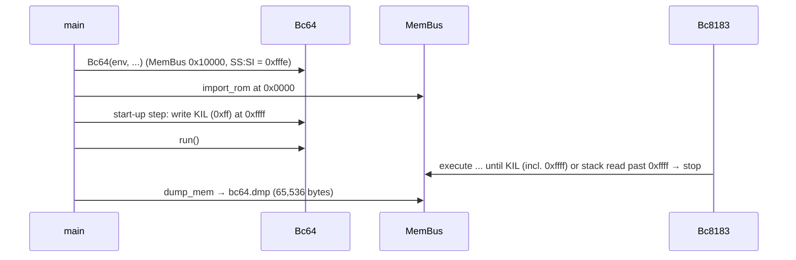

# Emulator Memory Must Be the Full 64 KB (0x0000–0xffff) Plan

**Plan Status**: `FINAL`

**Story Type**: `Internal`

**Plan Revision**: `A0`

> This plan captures **what** to build and **why** — domain, architecture, decisions, and verified facts.
> It deliberately does **not** contain implementation code, pseudocode, line numbers, mock setups, or test bodies.
> The implementation agent discovers the **how** against live code. See §4 Task Breakdown.

---

## 1. Problem Statement

*   **Context**: `src/bc64.py` uses `TOPMEM = 0xffff` as the memory **size**. `MemBus(env, TOPMEM)` allocates 65,535 bytes, so address `0xffff` is out of range (`IndexError`). The CPU derives its initial stack pointer from the bus size (`size − 1` = `0xfffe`), `main` writes a `0xff` marker at `0xfffe` (the first push overwrites it), and `dump_mem` writes 65,535 bytes to `bc64.dmp`. A `ret`/`pop` on an empty stack reads past the end of memory and crashes the emulator with a Python `IndexError`; the CPU's stack dump then crashes too (`TypeError` in `print_cpu_stack`).
*   **Goal**: 65,536 bytes of RAM, `0x0000–0xffff`, exactly as the owner decided in the issue: the stack still starts at `0xfffe`; `0xffff` holds `KIL` (`0xff`) as the ultimate stop; executing `0xffff` stops the machine; a `ret`/`pop` beyond the stack top stops cleanly instead of raising. Nothing else in the memory map moves, and every build output stays byte-identical.
*   **In scope**: `bc64.py` constants, memory size, start-up byte, memory dump; CPU initial stack pointer; clean stop on stack accesses outside memory; the CPU stack dump on an empty stack; floppy DMA address wrap; tests; docs (`docs/01-emulator.md`, `docs/05-bdos.md`, `docs/analysis/README.md`, `docs/analysis/01-emulator.md`, `design-decisions.md` G2, root `CLAUDE.md`, `src/bc64/CLAUDE.md`).
*   **Out of scope**: any change to bcOS, bdos, programs, the assembler or the compiler; refreshing the stale `bcos.btap` (see §2.2 Source Conflict Log); changing `MemBus` bounds semantics; other known CPU quirks (#4).

### 1.1 Technical Summary

*   **Touched projects**: emulator only — `src/bc64.py`, `src/bc64/bc8183_cpu.py`, `src/bc64/bc64_io.py` (DMA), emulator/CLI/e2e tests, docs.
*   **New patterns / abstractions**: three named constants (memory size, top address, stack top); the CPU accepts its initial stack pointer from its owner; a single "stack access outside memory → clean stop" rule in the CPU.
*   **Infrastructure changes**: `None`.
*   **End-state observable behavior**: `0xffff` is ordinary RAM holding `0xff` after start-up; `bc64.dmp` is 65,536 bytes; jumping to or running into `0xffff` halts; monitor `q` (and a bad-argument command such as `d 00`), which today crash with a traceback, now stop the emulator cleanly with exit code 0 and a one-line message on stderr.

---

## 2. Architecture & Design

### 2.1 Architecture Overview

#### Involved services & owners

| Component | Technical Owner |
| :--- | :--- |
| emulator (`src/bc64.py`, `src/bc64/`) | repo owner (bcichonski) |

#### C2 diagram

```mermaid
flowchart LR
  main["bc64.py main()"] -->|creates| Bc64
  Bc64 -->|MemBus(MEM_SIZE)| MemBus["bc64_mem.MemBus\n65,536 bytes"]
  Bc64 -->|stack top 0xfffe| CPU["bc8183_cpu.Bc8183"]
  CPU -->|read/write| MemBus
  FDD["bc64_io.FloppyDriveV1 (DMA)"] -->|read/write, 16-bit wrap| MemBus
  main -->|import_rom @0x0000, then KIL @0xffff| MemBus
  main -->|on halt: dump 65,536 bytes| Dump["bc64.dmp"]
```

#### Flow diagram



### 2.2 External Contracts & Evidence

`N/A — Internal story`

#### Source Conflict Log

| Topic | Source A | Source B | Conflict | Chosen Handling |
| :--- | :--- | :--- | :--- | :--- |
| AC-3 "full rebuild changes no build output (`git diff --exit-code`)" | AC-3 | Spike on base `c433c1e` (a full rebuild with `python3`, equivalent to `buildos`/`buildtools`/`buildapps`/`makedisc`) | The rebuild already differs at base in **one** file: `src/bc81asmc/bcOS/bcos.btap` (committed 2024-09-24, stale since `bcos.basm` changed in 2024-11-02 `b5580c4`). `bcos_v1_2_0.b81`, every bdos `.btap`/`.sector(s)`, `os.bdd` and all `.basm` contents are identical (the `.basm` files differ only in CRLF/LF, which git normalises). | #7 does not touch the build pipeline, so the check is: a rebuild on the branch gives exactly the same result as on base — every build output clean except the pre-existing `bcos.btap` drift, which is identical before and after. `bcos.btap` is **not** refreshed here (unrelated churn, G3); the PR flags it as a follow-up. |
| Known "crashes" of monitor `q` and `d 00` + more input | `docs/01-emulator.md` (e2e section), `src/test_e2e_bcos.py` docstring, `src/bc64/CLAUDE.md` | Spike: both are a `RET` on an empty stack (`exception at 0547` for `q`, `0868` for `d 00`; `IndexError: bytearray index out of range`, then `TypeError` in `print_cpu_stack`) | After #7 they are the issue's "`ret` on an empty stack", so they stop cleanly. | Decision D4: treat them as clean stops; update the docs and the docstring; add e2e coverage. |

### 2.3 Affected Areas

| Area / File (pointer) | Role in this change | Likely action |
| :--- | :--- | :--- |
| `src/bc64.py` — `TOPMEM`, `Bc64.__init__`, `main`, `dump_mem` | Memory size, the start-up marker write, the dump loop. `TOPMEM` is the only memory constant. | Change |
| `src/bc64/bc8183_cpu.py` — `__init__`/`create_registers` | Initial `SS:SI` is derived from `membus.size − 1`. | Change (accept the stack top from the owner) |
| `src/bc64/bc8183_cpu.py` — `_PSH`, `_POP`, `op_PSH`, `op_POP`, `op_CAL`, `op_RET` | Stack reads/writes at `SI−2…SI+4` with plain Python ints: reads past the end raise `IndexError`, writes below 0 silently index from the end of the bytearray. | Change (bounds rule, D3) |
| `src/bc64/bc8183_cpu.py` — `print_cpu_stack`/`process_frame`, `run_next_opcode` | Stack dump printed on any exception. With a 0x10000 bus and an empty stack it would hit the `0xff` byte at `0xffff`, return a `None` frame and raise `TypeError`. | Change (empty stack prints as empty) |
| `src/bc64/bc8183_cpu.py` — `Register`, `inc_pc`, `get_addr`, `alu_setval16`, `op_EXT` | PC (`Register(0xffff)`) and register pairs already wrap modulo 0x10000. | Reference (covered by tests, no change expected) |
| `src/bc64/bc64_io.py` — `FloppyDriveV1.read_sector` / `write_sector` | DMA uses `dmaaddr + i` unmasked: a sector crossing `0xffff` raises `IndexError`. | Change (wrap, D5) |
| `src/bc64/bc64_mem.py` | Plain `bytearray` of a given size; out-of-range raises, negative indexes from the end (pinned by tests). | Reference (unchanged) |
| `src/bc64/test_membus.py` | `EmulatorMemorySizeTests` pins today's 65,535 bytes and holds the #7 `expectedFailure`. | Change (listed in Tests to modify) |
| `src/bc64/test_cpu_control.py`, `src/bc64/test_cpu.py` | CPU tests on 0x400/0x100 buses expect the bare-CPU stack at `size − 1` (`STACK_TOP = MEMSIZE − 1`). | Reference — must keep passing unchanged (D2) |
| `src/test_bc64_cli.py` | Subprocess runs of `bc64.py` with tiny ROMs; asserts stdout is exactly the printer output. | Reference + new tests |
| `src/test_e2e_bcos.py`, `src/e2e_harness.py`, `src/bc64/testdata/e2e/` | Monitor scenarios; the harness fails on a non-zero exit. | New scenarios + docstring change |
| `docs/01-emulator.md`, `docs/05-bdos.md`, `docs/analysis/README.md`, `docs/analysis/01-emulator.md`, `docs/specs/memory/design-decisions.md` (G2), `CLAUDE.md`, `src/bc64/CLAUDE.md` | Describe 65,535 bytes / `TOPMEM`, the `0xfffe` marker, the `q` crash. | Change |

### 2.4 Key Algorithms & Behaviour

*   **Memory**: 65,536 bytes. Three named constants in `bc64.py`: memory size `0x10000`, top address `0xffff`, stack top `0xfffe`. `TOPMEM` goes away (nothing outside `bc64.py` and the pinned test uses it).
*   **Start-up**: after the ROM is loaded at `0x0000`, the emulator writes `KIL` (`0xff`) at `0xffff`. The old `0xff` write at `0xfffe` is removed. The write lives in a `Bc64` start-up step that `main` calls after `import_rom`, so tests can trigger it without a ROM file.
*   **Initial stack**: `Bc64` gives the CPU `SS:SI = 0xfffe`. A bare `Bc8183` created without an explicit stack top keeps today's default (`membus.size − 1`), so CPU tests on small buses are unaffected.
*   **Stack frames are unchanged** (E4): `PSH` writes the value at `SI` and the tag `0x10` at `SI−1`, then `SI −= 2`; `CAL` writes 3 bytes at `SI−2…SI`; `POP` reads `SI+2`; `RET` reads the tag at `SI+1` and the address at `SI+2…SI+3` (call frame) or `SI+2`/`SI+4` (two push frames). The first push still writes `0xfffe` (value) and `0xfffd` (tag).
*   **Stack bounds rule (D3)**: before a stack instruction changes anything, the CPU checks that every stack byte it is about to read or write lies inside memory (`0 ≤ addr < membus.size`). If not, it stops: `kill` is set exactly as `KIL` does, the PC stays on the offending instruction, registers, `SS:SI` and memory are untouched, and one line goes to **stderr** (and to the debug trace) naming the instruction (`RET`/`POP`/`PSH`/`CAL`), its address and that the CPU stopped on an empty stack (read past the top) or a stack overflow (write below `0x0000`). Consequences on the full machine with `SS:SI = 0xfffe`: `POP` reads `0x10000` → stop; `RET` reads tag `0xff` at `0xffff` (not a call frame) → needs `0x10000` → stop; after one `PSH`, `RET` needs `0x10000` → stop. `bc64.run` then returns "halted", so `main` dumps memory and exits 0 — the same contract as `KIL`.
*   **Stack dump (`print_cpu_stack`)**: an empty stack, or a top-of-memory byte that isn't a complete frame, prints as `:::empty:::` / ends the listing; it never raises.
*   **Everything else wraps modulo 0x10000** (16-bit address bus), which is already true for the PC (`0xffff + 1 → 0x0000`), register pairs and `JRX`/`CLR` targets. Floppy DMA joins them (D5): byte `i` of a sector transfer goes to `(dmaaddr + i) & 0xffff`.
*   **Executing `0xffff`**: holds `0xff` = `KIL`, so a jump there, or running sequentially into it, halts. No special code: it falls out of the start-up byte.
*   **Memory dump**: `bc64.dmp` is all 65,536 bytes; its last byte is `0xff` unless a program overwrote it.

---

## 3. Key Decisions & Assumptions

*   **D1 — Three constants, sizes not addresses**: memory size `0x10000`, top address `0xffff`, stack top `0xfffe` are separate named constants in `bc64.py` (issue Proposal). `TOPMEM` is removed rather than kept as an alias, so no code can confuse size with address again.
*   **D2 — The CPU takes its stack top from its owner**: `Bc64` passes `0xfffe`; a bare CPU keeps `membus.size − 1`. Rationale: the CPU test suites (`test_cpu_control.py` `STACK_TOP = MEMSIZE − 1`, `test_cpu.py`) are a safety net that must keep passing unchanged, and the real machine's stack top is a machine fact, not a bus-size formula.
*   **D3 — Stack accesses outside memory stop the CPU cleanly, in both directions**: reading past the last byte (empty-stack `RET`/`POP`, the owner's decision) and writing below `0x0000` (stack overflow, for symmetry — today it silently wraps to the end of the bytearray and would overwrite the `KIL` byte). The check is against `membus.size`, so it works for any bus size. The message goes to stderr because stdout carries printer output (`test_bc64_cli` asserts stdout is exactly the printed bytes). Exit code 0 and a memory dump, as for `KIL` (the issue: "stop the machine cleanly" / "reaching the ultimate KIL").
*   **D4 — Monitor `q` and a bad-argument command are empty-stack `RET`s**: verified by spike (§2.2). They become clean stops; docs that call them crashes are corrected, and e2e tests pin the new behaviour. bcOS is not changed.
*   **D5 — Non-stack address arithmetic wraps modulo 0x10000**: the issue asks for "wrap or fail consistently". The PC and register pairs already wrap; DMA is the only other path that can exceed `0xffff`, so it wraps too. The stack is the one place that fails, because the owner decided a stack read past the top is the ultimate stop.
*   **D6 — `MemBus` stays a plain sized bytearray**: out-of-range still raises and negative indexes still read from the end (pinned by `MemBusTests`). Bounds and wrap are the CPU's and DMA's job (the bus is generic and used with small sizes in tests).
*   **D7 — Build outputs**: the emulator is not part of the build pipeline, so no `.basm`/`.btap`/`.b81`/`.sector(s)`/`os.bdd`/`smoke.bdd` changes. The pre-existing stale `bcos.btap` stays untouched (§2.2).
*   **Assumption (low stakes, recorded)**: "user memory `0x6000–0xffff`" in the `docs/05-bdos.md` AC means the region from `0x6000` to the top of the map, shared with the CPU stack that grows down from `0xfffe`, with `0xffff` reserved for `KIL`. The docs say exactly that; no address moves. This does not affect correctness.

### 3.1 Decision Lock (Constants & Policies)

| Constant / Policy | Selected Value | Why | Where it lives |
| :--- | :--- | :--- | :--- |
| Memory size | `0x10000` (65,536) | full 64 KB | `src/bc64.py` |
| Top address | `0xffff` | last addressable byte | `src/bc64.py` |
| Stack top (initial `SS:SI`) | `0xfffe` | owner decision, unchanged | `src/bc64.py` → CPU |
| Byte at `0xffff` after start-up | `0xff` (`KIL`) | owner decision | `Bc64` start-up step called by `main` after the ROM load |
| Bare-CPU default stack top | `membus.size − 1` | keep CPU tests unchanged | `src/bc64/bc8183_cpu.py` |
| Stack access outside `0 … size−1` | clean stop: `kill`, no state change, PC on the instruction, one stderr line | owner decision + symmetry | CPU stack instructions |
| Exit code of a clean stack stop | `0` with `bc64.dmp`, as `KIL` | same contract as halt | `bc64.py` (no change needed if `kill` is used) |
| DMA address past `0xffff` | wraps to `0x0000` | 16-bit bus, consistent with PC/pairs | `src/bc64/bc64_io.py` |

### 3.2 Open Questions

No open questions.

---

## 4. Task Breakdown

| Task | Title | Depends on | Complexity |
| :--- | :--- | :--- | :--- |
| `T1` | 64 KB memory, constants, `KIL` at `0xffff`, full dump | — | `Medium` |
| `T2` | Clean stop on stack access outside memory; empty-stack dump; DMA wrap | `T1` | `Medium` |
| `T3` | End-to-end: monitor `q` / bad-argument stop cleanly; memory-map rebuild check | `T2` | `Medium` |
| `T4` | Docs and design decisions agree with the code | `T2` | `Low` |

### T1 — 64 KB memory, constants, `KIL` at `0xffff`, full dump

*   **Goal**: The emulator has 65,536 bytes; `0xffff` is ordinary RAM holding `KIL` after start-up; the stack starts at `0xfffe`; `bc64.dmp` holds 65,536 bytes.
*   **Depends on**: `—`.
*   **Complexity**: `Medium`.
*   **Pointers**: `src/bc64.py` (`TOPMEM`, `Bc64.__init__`, `main`, `dump_mem`); `src/bc64/bc8183_cpu.py` (`__init__`, `create_registers`); `src/bc64/test_membus.py`; `src/test_bc64_cli.py` (subprocess helpers, tiny ROMs).
*   **Definition of Done**:
    *   three named constants (D1); `TOPMEM` removed; `MemBus` created with 0x10000;
    *   the CPU accepts an initial stack pointer; `Bc64` passes `0xfffe`; a bare CPU defaults to `membus.size − 1`;
    *   a `Bc64` start-up step writes `0xff` at `0xffff`; `main` calls it after `import_rom`; the `0xfffe` marker write is gone;
    *   `dump_mem` writes all 65,536 bytes;
    *   `python3 run_tests.py --group unit < /dev/null` passes.
*   **Tests expected** (unit, emulator suite — append to `src/bc64/test_membus.py` or a new `src/bc64/test_*.py`; CLI tests appended to `src/test_bc64_cli.py`):
    *   memory size is 0x10000; read/write round trip at `0xffff`, `0xfffe` and `0x0000`;
    *   `Bc64`'s CPU starts with `SS:SI = 0xfffe`; the first push writes `0xfffe` (value) and `0xfffd` (tag) and leaves `0xffff` alone;
    *   after the start-up step `0xffff` reads `0xff`;
    *   a jump to `0xffff` on the full machine halts with the PC at `0xffff`; running sequentially (e.g. a run of `NOP`s) into `0xffff` halts there;
    *   on a full-size bare CPU, the PC wraps from `0xffff` to `0x0000` when `0xffff` holds a 1-byte non-KIL instruction (16-bit wrap);
    *   CLI (subprocess): a halting ROM produces a 65,536-byte `bc64.dmp` whose last byte is `0xff`.
*   **Tests to modify**:
    *   `src/bc64/test_membus.py :: EmulatorMemorySizeTests.test_emulator_memory_is_64_kb` — remove its `@unittest.expectedFailure`; the fix lands (AC-1; `docs/01-emulator.md` rule "When a fix lands … remove its decorator").
    *   `src/bc64/test_membus.py :: EmulatorMemorySizeTests.test_emulator_memory_is_65535_bytes_today` — delete or replace; it pins `TOPMEM = 0xffff`, a 65,535-byte bus and `IndexError` at `0xffff`, which AC-1 and D1 deliberately change ("pinned today's behaviour, owned by #7").

### T2 — Clean stop on stack access outside memory; empty-stack dump; DMA wrap

*   **Goal**: `RET`/`POP` on an empty stack (and `PSH`/`CAL` below `0x0000`) stop the CPU cleanly instead of raising; the CPU stack dump never crashes on an empty stack; floppy DMA wraps at `0xffff`.
*   **Depends on**: `T1`.
*   **Complexity**: `Medium`.
*   **Pointers**: `src/bc64/bc8183_cpu.py` (`_PSH`, `_POP`, `op_PSH`, `op_POP`, `op_CAL`, `op_RET`, `print_cpu_stack`, `process_frame`, `run_next_opcode`, `print_debug`); `src/bc64/bc64_io.py` (`FloppyDriveV1.read_sector`, `write_sector`); `src/bc64.py` (`Bc64.run`, `main`); tests `src/bc64/test_cpu_control.py`, `src/bc64/test_devices.py` (style references).
*   **Definition of Done**:
    *   the stack bounds rule of §2.4 / D3 holds for all four instructions, checked against `membus.size`, before any state changes; the stop sets `kill`, leaves the PC on the instruction and prints one line to stderr (also to the debug trace);
    *   `bc64.py` run on such a program exits 0 and writes `bc64.dmp` (no traceback);
    *   `print_cpu_stack` on an empty stack (full machine, `SS:SI = 0xfffe`, `0xff` at `0xffff`) prints the empty marker and returns; an unrelated exception (e.g. the pinned `div` by zero) still propagates its original exception;
    *   DMA read and write of a sector starting near `0xffff` wrap to `0x0000`;
    *   all existing CPU/device tests pass unchanged; `python3 run_tests.py < /dev/null` passes.
*   **Tests expected** (unit, emulator suite; new tests only):
    *   full machine (`Bc64` after start-up): `POP` on an empty stack stops — `kill` set, PC on the `POP`, destination register and `SS:SI` unchanged, no exception, a message on stderr;
    *   full machine: `RET` on an empty stack stops the same way; `RET` with one push frame on the stack (needs `0x10000`) stops; a normal `CAL`/`RET` and `PSH`/`POP` round trip at the top of memory still works;
    *   small bus (0x400, default stack top `0x3ff`): `POP` and `RET` on an empty stack stop cleanly (rule is size-based);
    *   stack overflow: `PSH` / `CAL` with `SS:SI` so low that a byte would land below `0x0000` stop cleanly and write nothing;
    *   `print_cpu_stack` on an empty full-size stack does not raise;
    *   CLI (subprocess, append to `src/test_bc64_cli.py`): a ROM whose first instruction is `RET` exits 0, writes `bc64.dmp`, has no `Traceback` on stderr, a stop message on stderr, and empty stdout;
    *   DMA: with a full-size bus, a sector read with DMA address `0xff80`-ish crossing `0xffff` lands its tail at `0x0000…`; a sector write reads its tail from `0x0000…`.
*   **Tests to modify**: `None`.

### T3 — End-to-end: monitor `q` / bad-argument stop cleanly; memory-map rebuild check

*   **Goal**: The real system proves #7: bcOS and `os.bdd` boot and run as before, `q` and a bad-argument command now end the session cleanly, and a full rebuild shows no build output changes.
*   **Depends on**: `T2`.
*   **Complexity**: `Medium`.
*   **Pointers**: `src/test_e2e_bcos.py`, `src/e2e_harness.py`, `src/bc64/testdata/e2e/` (`bcos_*.in.txt` / `.golden.txt`), `src/bc64/CLAUDE.md` (smoke refresh recipe), root `CLAUDE.md` (rebuild commands), `src/makedisc`, `src/buildos`, `src/buildtools`, `src/buildapps`.
*   **Definition of Done**:
    *   new e2e scenarios (new golden files; new test methods appended to `src/test_e2e_bcos.py`): `q` at the monitor prompt ends the run with exit 0; `d 00` followed by more commands ends the run with exit 0 at the bad argument (the later commands are not run). Goldens generated with `BC64_UPDATE_GOLDEN=1` and reviewed; they show the boot banner unchanged (`free F294 from 0D6A to FFFE`);
    *   the module docstring of `src/test_e2e_bcos.py` no longer calls `q` / bad-argument commands crashes (it may still say scenario scripts avoid them in the middle of a script, because they end the session);
    *   the smoke transcript regenerated per `src/bc64/CLAUDE.md` from the committed `smoke.bdd` is byte-identical to the committed `smoke_transcript.txt` (the emulator change does not alter any session); nothing under `src/bc64/testdata/` changes except the new e2e files;
    *   memory-map check: a full rebuild (ROM, bdos, utilities, apps, `makedisc`; on Linux run the same commands with `python3`, see root `CLAUDE.md`) leaves `git diff --exit-code` clean on all `.basm`/`.btap`/`.b81`/`.sector`/`.sectors`/`os.bdd` **except** the pre-existing stale `src/bc81asmc/bcOS/bcos.btap` (§2.2), which must be byte-identical to what the same rebuild produces on the base commit; the rebuilt files are then restored (not committed). Record the result in the task notes;
    *   `python3 run_tests.py < /dev/null` passes (all suites incl. e2e).
*   **Tests expected**: e2e — the two clean-stop scenarios above (golden + markers such as the prompt and the command echo).
*   **Tests to modify**:
    *   `src/test_e2e_bcos.py :: module docstring` — the sentence "both crash the CPU" becomes wrong by design: both are empty-stack `ret`s that now stop cleanly (D4, AC-2).

### T4 — Docs and design decisions agree with the code

*   **Goal**: Every doc named in AC-5, plus the agent guides, describes the 64 KB memory, the stack at `0xfffe` and `0xffff` = `KIL`.
*   **Depends on**: `T2`.
*   **Complexity**: `Low`.
*   **Pointers**: `docs/01-emulator.md` (Memory section, exit-code table, e2e notes about `q`/bad-argument, Known quirks entry for #7), `docs/05-bdos.md` (memory map table, free-memory note), `docs/analysis/README.md` (key numbers: user memory row), `docs/analysis/01-emulator.md` (problem 6 / item 3: mark done), `docs/specs/memory/design-decisions.md` (G2 memory map), root `CLAUDE.md` (memory map list), `src/bc64/CLAUDE.md` (Rules: the `TOPMEM` line; the e2e note about `q`).
*   **Definition of Done**:
    *   `01-emulator.md`: 65,536 bytes `0x0000–0xffff`; constants; `SS:SI = 0xfffe` at start-up; `0xffff` = `KIL` written after the ROM load; executing it halts; `ret`/`pop` past the top of memory (and a stack overflow below `0x0000`) stop cleanly with exit 0 and a stderr line; DMA wraps; `bc64.dmp` is 65,536 bytes; the #7 Known-quirks entry removed; the `q`/bad-argument note corrected;
    *   `05-bdos.md`: map shows user memory from `0x6000`, the CPU stack growing down from `0xfffe`, and `0xffff` reserved (`KIL`); no other row changes;
    *   `analysis/README.md`: user memory row reflects the full 64 KB (`0x6000–0xfffe` usable for program + stack, `0xffff` reserved) with no "#7 limitation" note; `analysis/01-emulator.md` marks #7 done;
    *   G2 in `design-decisions.md`: "CPU stack: from `0xfffe`, downwards; `0xffff` = `KIL` (reserved)"; every other G2 address unchanged; root `CLAUDE.md` memory map gains the `0xffff` line;
    *   `src/bc64/CLAUDE.md`: the `TOPMEM` rule replaced by the new facts;
    *   no doc still claims 65,535 bytes or `TOPMEM` (`grep -rn "TOPMEM\|65,535\|65535 bytes" docs CLAUDE.md src/bc64/CLAUDE.md` finds nothing outside `docs/specs/plans/` and `docs/CHANGELOG.md`).
*   **Tests expected**: none (docs only); `python3 run_tests.py --group unit < /dev/null` still passes.
*   **Tests to modify**: `None`.

---

## 5. Verification

*   **Tests**: `python3 run_tests.py < /dev/null` from the repo root — all suites green (emulator, ftool, assembler, compiler, e2e). Python 3.10 compatibility (CI): `docker run --rm -v "$PWD":/w -w /w python:3.10-slim sh -c "pip install -q parsy && python run_tests.py --group unit < /dev/null"` if Docker is available.
*   **Memory map**: full rebuild → `git diff --exit-code` clean on every build output except the pre-existing stale `bcos.btap` (identical to a base rebuild); restore afterwards. G2 addresses unchanged in `boot.basm`, `bdioh.b`, `bdos.b` and every `#code`/`#heap` (no source under `src/bdos/`, `src/bc81asmc/`, `src/bc/` changed: `git diff --stat origin/bc64 -- src/bdos src/bc81asmc src/bc` empty).
*   **Smoke/CI parity**: regenerate the smoke transcript from the committed `smoke.bdd` (recipe in `src/bc64/CLAUDE.md`) and confirm `git diff --exit-code src/bc64/testdata/` is clean.
*   **Observable behaviour**: `printf 'q\n' | python3 bc64.py bc81asmc/bcOS/bcos_v1_2_0.b81 --no-floppy` (in a temp dir) exits 0 with a one-line stop message on stderr and no traceback; `bc64.dmp` is 65,536 bytes ending in `0xff`.

---

## 6. Fact-Integrity Checklist

| Check | Yes / No / N/A | Notes |
| :--- | :--- | :--- |
| External contracts verified from producer/contract source | N/A | Internal story |
| Evidence sources are reproducible | N/A | Internal story |
| Identifier directionality / ordering / freshness meaning evidenced | N/A | Internal story |
| Every `Assumption` is linked to an Open Question (§3.2) | Yes | The one assumption (wording of "user memory 0x6000–0xffff") is low stakes, docs-only, and does not affect correctness, so it needs no OQ |
| No unresolved Open Questions (for `FINAL`) | Yes | |
| Each Decision states a single committed approach | Yes | D1–D7 |
| Tasks are independent, each with a Definition of Done and test expectations | Yes | T1→T2→T3/T4 chain; T3 and T4 can run in parallel |
| Required infra reflected (toggle / bicep) | N/A | No toggles or messaging in this repo |

**Self-review note**: Facts were checked against live code and by spikes on base `c433c1e`. Both known monitor "crashes" are empty-stack `RET`s, and a full rebuild matches the commit except the long-stale `bcos.btap`. Take extra care in T2: check the bounds **before** any register or memory write (RET reads up to `SI+4`, CAL writes down to `SI−2`), keep the stop message off stdout, and keep the bare-CPU default stack top so the existing CPU suites stay untouched. The stack-overflow half of D3 is the plan's own choice for symmetry, beyond the owner's explicit text. It only changes behaviour that today silently corrupts the top of memory.

---

## 7. Amendment Log

| Amendment | Request | Decision | Plan changes |
| :--- | :--- | :--- | :--- |
