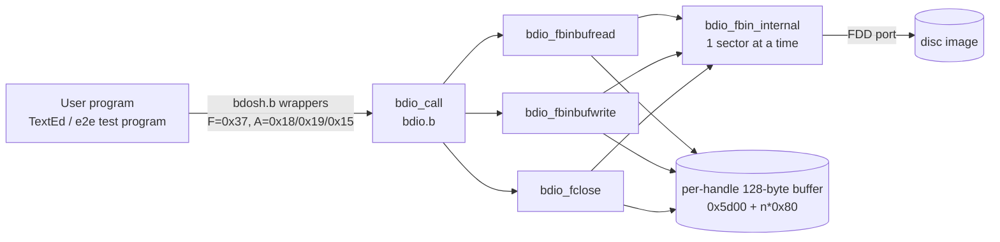
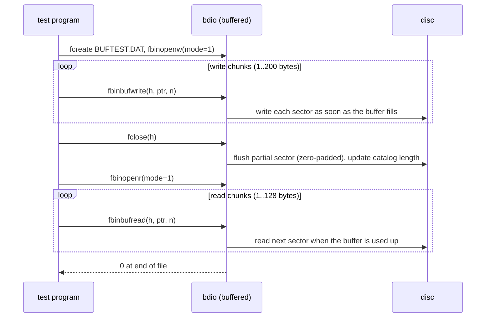

# bdos: Buffered File I/O Loses and Misreads Data — Plan

**Plan Status**: `FINAL`

**Story Type**: `Internal`

**Plan Revision**: `A0`

> This plan captures **what** to build and **why**. It does **not** contain implementation code,
> pseudocode or line numbers. The implementation agent discovers the **how** against live code.

---

## 1. Problem Statement

*   **Context**: bdos 1.1 has a buffered byte-count file API: `bdio_fbinbufread` (`0x18`) and
    `bdio_fbinbufwrite` (`0x19`), with `bdio_fclose` flushing a write handle. TextEd is the only
    user. Issue #76 lists 7 defects found by reading `src/bdos/bdio.b`. Re-reading the code for
    this plan confirmed all 7 and found more:
    *   the write path's full-sector loop flushes the buffer **before** it copies the next 128
        caller bytes into it, so the design is a "lazy flush" where `BUFFCOUNTER = 0` can mean
        either "empty" or "full and unflushed". That ambiguity is the root of defects 6 and 7;
    *   both functions keep the byte count in a `byte` `result`, so any return above 255 wraps;
    *   `bdio_fbinopen_internal` zeroes "the buffer" of the returned handle **even when the open
        failed**. An error code (`0xe0`–`0xe5`) maps to a buffer index of 1–6, so a buffered open of
        a missing file zeroes up to `0x6000–0x607f`, the start of the running user program;
    *   a fresh buffered read handle starts with `BUFFCOUNTER = 0`, which the read code reads as
        "128 unread bytes in the buffer" (defect 1).
*   **Goal**: a file written through the buffered API in chunks of any size reads back byte for byte
    through the buffered API in chunks of any size, with a documented contract, no debug output, and
    a headless e2e round-trip test that proves it. The rebuilt `BDOS.SYS` ships on `os.bdd`.
*   **In scope**: `bdio_fbinbufread`, `bdio_fbinbufwrite`, the buffered branch of `bdio_fclose`, the
    buffered-buffer initialisation in `bdio_fbinopen_internal`; rebuilding bdos; patching `BDOS.SYS`
    into `os.bdd`; refreshing `smoke.bdd` + transcript; a new e2e test; `docs/05-bdos.md`.
*   **Out of scope**: TextEd (#47 owns its load/save code and its rebuild); the full `makedisc`
    rebuild (#1/#47); other bdos debug leftovers (#46); the `"."` progress dots that
    `bdio_fbin_internal` prints every 8th sector (shared with program loading, not debug output of
    the two buffered functions); byte-exact file lengths (BFS stores whole sectors only); sector
    allocation and the free-sector pointer.

### 1.1 Technical Summary

*   **Touched components**: bdos (`src/bdos/bdio.b`, generated `bdos.basm/.btap/.sector`), the
    system disc `src/os.bdd`, the frozen smoke disc and transcript, the e2e suite, `docs/05-bdos.md`.
*   **New patterns**: a new e2e test module that compiles a B test program, puts it on a disc copy,
    runs it headless and then also inspects the written file in the disc image from Python.
*   **Infrastructure changes**: none. Memory map unchanged (bdos at `0x0f00`, buffers at `0x5d00`).
*   **End-state observable behaviour**: the round-trip program prints only its own result lines; the
    file it wrote is on the disc image with the right catalog length and bytes.

---

## 2. Architecture & Design

### 2.1 Architecture Overview

#### Involved components & owners

| Component | Technical Owner |
| :--- | :--- |
| bdos / bdio (`src/bdos/`) | bcichonski |
| system disc, e2e suite (`src/os.bdd`, `src/test_e2e_*.py`, `src/e2e_harness.py`) | bcichonski |

#### C2 diagram

#### Flow diagram (happy path)

### 2.2 External Contracts & Evidence

N/A — Internal story.

#### Source Conflict Log

| Topic | Source A | Source B | Conflict | Chosen Handling |
| :--- | :--- | :--- | :--- | :--- |
| Committed bdos build | `src/bdos/bdos.basm/.btap/.sector` | a fresh `./bcc bdos/bdos` of the unchanged source | The committed outputs are stale: a fresh build differs (current compiler emits e.g. `add csci, dsdi` instead of `cal :add16`, heap head `0x5fd0` vs `0x4f40`), is 18 386 bytes (144 sectors) vs 16 011, and `os.bdd`'s `BDOS.SYS` matches neither | Spike: a fresh build of the unchanged source, patched into a copy of `os.bdd`, passes `test_e2e_bdos` and `test_e2e_toolchain`. Rebuild with the current toolchain (D5); the diff of the generated files is large and that is expected |
| `EOF` in the docs | `docs/05-bdos.md`: "bytes read (`0` = error/EOF)" | AC-1 | none — AC-1 sharpens it | The contract in D2 |

### 2.3 Affected Areas

| Area / File (pointer) | Role in this change | Likely action |
| :--- | :--- | :--- |
| `src/bdos/bdio.b` — `bdio_fbinbufread`, `bdio_fbinbufwrite` | the buffered read/write | Change (rewrite of both bodies) |
| `src/bdos/bdio.b` — `bdio_fclose` (buffered write branch) | final flush + catalog length | Change (only if D3's invariant needs it) |
| `src/bdos/bdio.b` — `bdio_fbinopen_internal`, `bdio_new_fdesc` | buffer zeroing and the initial `BUFFCOUNTER` | Change |
| `src/bdos/bdio.b` — `bdio_fbin_internal`, `bdio_fbinbuf_getbufaddr`, `bdio_getfdesc_addr` | sector I/O, buffer address, descriptor address | Reference |
| `src/bdos/bdioh.b` | descriptor offsets, `BDIO_SECTBUF_LEN`, `BDIO_FBINBUF*_ERROR`, `BDIO_FOPEN_MODE_BUFFERED` | Reference (add a constant only if needed) |
| `src/bdos/bdosh.b` | user-side wrappers; length passed via `BDIO_VAR_PMEMBUF_LEN` (`0x0d92`) | Reference (ABI unchanged) |
| `src/bdos/std.b` — `memcpy(Psource, Pdest, len)` | **source first, destination second** | Reference |
| `src/bdos/texted.b` | only existing caller (1-byte reads, line writes) | Reference — not changed here |
| `src/bdos/bdos.basm`, `.btap`, `.sector` | generated bdos | Regenerate |
| `src/os.bdd` (track 2 sector 0, 152-sector `BDOS.SYS` slot) | system disc | Patch `BDOS.SYS` only |
| `src/bc64/testdata/smoke.bdd`, `smoke_transcript.txt` | frozen smoke disc (CI refreshes and diffs it) | Regenerate per CI procedure |
| `src/e2e_harness.py` (`disc_put`, `run_session`, `read_catalog`, `check_golden`) | e2e helpers | Reference (extend only if a helper is missing) |
| `src/test_e2e_toolchain.py`, `src/bc64/testdata/e2e/toolchain_prog.b` | model for compiling and running a B program headless | Reference |
| new `src/test_e2e_bdio_buffered.py` + `src/bc64/testdata/e2e/bdio_buffered_prog.b` (+ golden) | round-trip test | New |
| `docs/05-bdos.md` (bdio API table), `src/bdos/bdos.md` | contract docs | Change |

### 2.4 Key Algorithms & Behaviour

**Buffer counter semantics (the core of the fix).** One byte per descriptor, `BUFFCOUNTER`:

*   **Read handle**: the number of bytes of the current buffer **already consumed**. `128` means
    "buffer used up — load the next sector before copying". A freshly opened buffered read handle
    starts at `128`, so the first read loads sector 1.
*   **Write handle**: the number of bytes **pending** in the buffer, always `0..127` between calls.
    The moment the buffer reaches 128 bytes it is written to disc and the counter goes back to `0`
    (eager flush). So "counter = 0" always means "nothing pending", and `bdio_fclose` flushing only
    when the counter is non-zero is then correct.

**Read (`length` bytes into the caller's buffer).** Repeat until `length` bytes are copied or the
file ends: if the buffer is used up, read the next sector into it (if there is none — end of file —
stop); copy `min(remaining request, 128 − consumed)` bytes from `buffer + consumed` to the caller's
next position; advance both. Store the counter. Return the number of bytes copied.

**Write.** Repeat until `length` bytes are taken: copy `min(remaining, 128 − pending)` caller bytes
to `buffer + pending`; if the buffer is now full, write it as the next sector and reset the counter.
Store the counter. Return the number of bytes taken.

**Close (buffered write handle).** If bytes are pending, zero the rest of the buffer, write it as the
last sector; then update the catalog length as today.

**Open.** Zero the buffer and set the initial counter only when the open returned a valid handle.

**Error / no-data behaviour.**
*   A handle not opened in buffered mode → return `0` (`BDIO_FBINBUF*_ERROR`), nothing copied.
*   `length = 0` → return `0`, no disc access.
*   End of file in the middle of a request → return the bytes copied so far (less than `length`).
    The next call returns `0`.
*   BFS stores whole sectors, so the bytes after the last written byte of the final sector are the
    zero padding written by `bdio_fclose`; a reader sees them as data. This is the contract, not a
    bug (D2).

---

## 3. Key Decisions & Assumptions

*   **D1 — Rewrite the two bodies around one loop each, not patch the 7 defects one by one.** The
    lazy-flush design makes `BUFFCOUNTER = 0` ambiguous; patching individual lines keeps the
    ambiguity. The rules in §2.4 are the contract the rewrite implements.
*   **D2 — Buffered read/write contract** (goes into `docs/05-bdos.md`):
    *   read returns the number of bytes copied, `1..length`; fewer than `length` only when the end
        of the file is reached during the call; `0` at the end of the file, for `length = 0`, or for
        a handle that is not buffered;
    *   write returns the number of bytes accepted (`length` on success), `0` for a non-buffered
        handle; data reaches the disc as each 128-byte sector fills and the rest on `bdio_fclose`;
    *   a file's length is whole sectors; the final sector is zero-padded, and a buffered reader gets
        those padding bytes before the `0`;
    *   chunks may be any length for write and `1..128` (any `word` value works) for read; the
        caller's buffer must hold `length` bytes.
*   **D3 — Eager flush on write**: write the buffer the moment it is full (§2.4). It makes the
    `fclose` rule (flush when counter ≠ 0) correct without a separate "full" flag.
*   **D4 — Read counter starts at 128** ("used up") for a buffered read handle; `0` for a write
    handle. Set where the buffered open initialises the buffer, only on a successful open.
*   **D5 — Rebuild bdos with the current toolchain and patch only `BDOS.SYS` into the existing
    `os.bdd`** (track 2, sector 0, `ftool importsector`), not a full `makedisc`. The issue offers
    both; the full rebuild needs `texted.btap` (never committed) and changes `TEXTED.PRG`/`TEST.B`
    that protected e2e goldens depend on, which is #1/#47's work. The 152-sector `BDOS.SYS` slot is
    first zero-filled, so no tail of the old, longer image stays on the disc. The catalog entry
    (152 sectors) is not changed. The boot loader reads sectors `0x20..0xbf` (160), which covers it.
*   **D6 — Results are `word`**. `result` and the byte counts in both functions use `word` so a
    request above 255 bytes isn't truncated (the wrapper already returns `word`).
*   **D7 — The round-trip test checks the disc too**: after the headless run the test reads the
    written file straight from the disc image copy (catalog entry + sectors) and compares it to the
    expected pattern + zero padding. That proves the write side on its own, so a symmetric bug in
    read and write can't cancel out.
*   **D8 — Remove only the debug `printf`s inside the two buffered functions** (and any commented-out
    debug in the rewritten bodies). Others are #46's.
*   **Assumption A1** — closed: the AC lists all chunk-size cases; no stakeholder question remains.

### 3.1 Decision Lock (Constants & Policies)

| Constant / Policy | Selected Value | Why | Where it lives |
| :--- | :--- | :--- | :--- |
| Test file name | `BUFTEST.DAT` (catalog `BUFTEST DAT`) | fits 8.3, not on the disc | test program |
| Test pattern | byte `i` = `(7*i + 3) & 0xff` | non-repeating within a sector, includes `0x00` | test program + Python test |
| Pattern length | `589` bytes (5 sectors, 51 padding bytes) | > 2 sectors (AC-3) | test program + Python test |
| Write chunks, in order | `1, 127, 128, 60, 200, 3, 70` (sum 589) | `1+127` ends exactly on 128; `128` is a whole sector; `200` spans sectors and is > 128 | test program |
| Read chunks, in order | `128, 1, 50, 127, 100, 128, 55` (sum 589) | different boundaries from the write side, includes 1 and 128 | test program |
| After the pattern | one read of 128 → returns 51 (all `0x00`), next read of 128 → returns 0 | EOF contract (D2) | test program |
| Extra checks | `bdio_fbinbufread` on a **sector-mode** read handle returns 0; a buffered open of a missing file returns `0xe0` and the program keeps running | AC-1 error path; open-zeroing bug | test program |
| Expected catalog length of `BUFTEST.DAT` | 5 sectors | ceil(589/128) | Python test |
| `BDOS.SYS` slot | track 2 sector 0, 152 sectors, zero-filled before import | D5 | disc patch |

### 3.2 Open Questions

No open questions. (Disc-rebuild choice resolved from the issue's own notes and the #47 plan — D5;
contract details resolved from AC-1/AC-2 — D2.)

---

## 4. Task Breakdown

| Task | Title | Depends on | Complexity |
| :--- | :--- | :--- | :--- |
| `T1` | Fix bdio buffered read/write/close/open, rebuild bdos, patch `os.bdd`, refresh smoke | — | `High` |
| `T2` | E2E round-trip test of the buffered API | `T1` | `Medium` |
| `T3` | Document the buffered contract | — | `Low` |

### T1 — Fix bdio buffered I/O and ship it on the disc

*   **Goal**: `bdio_fbinbufread`/`bdio_fbinbufwrite`/`bdio_fclose`/buffered open behave per §2.4 and
    D1–D4, D6, D8; the rebuilt `BDOS.SYS` is on `os.bdd`; CI's frozen-disc check passes.
*   **Depends on**: —
*   **Complexity**: `High` — B language quirks (`=` is comparison, `<-` assignment, byte/word
    arithmetic), core OS I/O used by every file program, and a disc patch.
*   **Pointers**: §2.3 rows for `bdio.b`, `bdioh.b`, `std.b` (`memcpy` argument order), the generated
    bdos files, `os.bdd`, smoke files; `src/bdos/CLAUDE.md` (B quirks, memory map);
    `src/bc64/CLAUDE.md` (smoke refresh); `.github/workflows/tests.yml` (the exact smoke refresh
    commands). Build from `src/`: `bash <(tr -d '\r' < bcc) bdos/bdos`, then
    `python3 ftool.py btap2bin bdos/bdos.btap bdos/bdos.sector` (the checked-out scripts are CRLF and
    call `winpty python`; don't commit changed copies of them).
*   **Definition of Done**:
    *   the two functions follow §2.4 / D2; none of the 7 defects in the issue nor the extra ones in
        §1 remain; no `printf` in either function;
    *   `bdos.basm`, `bdos.btap`, `bdos.sector` regenerated; bdos still ends below `0x5d00` (check the
        `.btap` preamble / end address);
    *   `os.bdd`: the 152-sector slot at track 2 sector 0 is zero-filled and then holds the new
        `bdos.sector`; nothing else on the disc changes (compare the rest of the image byte for
        byte);
    *   `smoke.bdd` and `smoke_transcript.txt` refreshed exactly as the CI job does it, so
        `git diff --exit-code src/bc64/testdata/` after a CI-style refresh is clean;
    *   a manual headless spike (temp dir, disc copy) writes a multi-sector file in mixed chunks and
        reads it back correctly — record the result in the task notes;
    *   `python3 run_tests.py < /dev/null` from the repo root is green.
*   **Tests expected**: the existing e2e suite stays green against the patched disc. The dedicated
    round-trip test is T2.
*   **Tests to modify**: None.

### T2 — E2E round-trip test of the buffered API

*   **Goal**: an e2e test proves AC-1..AC-4 headless: write in mixed chunks, close, reopen buffered,
    read in other chunks, compare; EOF behaviour; non-buffered-handle error; missing-file open; no
    debug output; disc contents right.
*   **Depends on**: `T1`.
*   **Complexity**: `Medium`.
*   **Pointers**: `src/test_e2e_toolchain.py` (compile → assemble → `btap2bin` → `disc_put` →
    `run_session` → section of the output), `src/e2e_harness.py` (`disc_put`, `read_catalog`,
    `check_golden`, `golden_path`), `src/bc64/testdata/e2e/toolchain_prog.b` (program shape:
    `#code 0x6000`, `#include`s), `src/bdos/bdosh.b` (wrappers), §3.1 for every constant.
    Put the B program in `src/bc64/testdata/e2e/` and the test module in `src/` as
    `test_e2e_*.py` so `run_tests.py`'s e2e suite picks it up; check `run_tests.py`/`test_run_tests.py`
    for how modules are discovered or listed.
*   **Definition of Done**:
    *   the B program uses only the bdosh.b API and §3.1's constants, and prints one short result
        line per check (e.g. `write ok`, `read ok`, `eof ok`, `nonbuf ok`, `missing ok`, or a
        mismatch line naming the offset/expected/actual) — nothing else;
    *   the Python test compiles it, puts it on a disc copy, runs it headless with a bounded
        instruction count, compares the program's output section with a new committed golden, and
        then reads `BUFTEST.DAT` from the disc copy: catalog length 5 and bytes = pattern + 51 zero
        bytes;
    *   the test fails if the fix is reverted (prove it by temporarily restoring the old
        `BDOS.SYS` slot in the temp disc copy or the old `bdio.b` build — no git stash/checkout);
    *   `python3 run_tests.py < /dev/null` green; runtime of the new test well under a minute.
*   **Tests expected**: one e2e module (one or a few test methods) as described; golden reviewed by
    eye.
*   **Tests to modify**: None.

### T3 — Document the buffered contract

*   **Goal**: `docs/05-bdos.md` states the D2 contract; `src/bdos/bdos.md` points to it.
*   **Depends on**: —
*   **Complexity**: `Low`.
*   **Pointers**: `docs/05-bdos.md` bdio API table (rows `0x18`, `0x19`, `0x15`) and the
    handles/descriptor notes below it; `src/bdos/bdos.md`.
*   **Definition of Done**: a short "Buffered I/O" subsection covering return values, EOF, chunk
    sizes, whole-sector length and zero padding, flush-on-full and flush-on-close, the buffer
    counter meaning per handle type; the `0x18`/`0x19` rows match it; no other behaviour claims
    change.
*   **Tests expected**: none (docs).
*   **Tests to modify**: None.

---

## 5. Verification

*   **Build**: from `src/`, `bash <(tr -d '\r' < bcc) bdos/bdos` and
    `python3 ftool.py btap2bin bdos/bdos.btap bdos/bdos.sector`; the committed outputs equal a fresh
    build; bdos ends below `0x5d00`.
*   **Tests**: `python3 run_tests.py < /dev/null` from the repo root — all suites green, including the
    new round-trip test.
*   **CI parity**: run the `e2e` job's smoke refresh commands locally; `git diff --exit-code
    src/bc64/testdata/` is clean.
*   **Observable behaviour**: the round-trip program's output is exactly the result lines; the disc
    copy holds `BUFTEST.DAT`, 5 sectors, pattern + zero padding.

---

## 6. Fact-Integrity Checklist

| Check | Yes / No / N/A | Notes |
| :--- | :--- | :--- |
| External contracts verified from producer/contract source | N/A | Internal |
| Evidence sources are reproducible | N/A | Internal |
| Identifier directionality / ordering / freshness meaning evidenced | N/A | Internal |
| Every `Assumption` is linked to an Open Question (§3.2) | Yes | A1 closed |
| No unresolved Open Questions (for `FINAL`) | Yes | |
| Each Decision states a single committed approach | Yes | D5 picks the BDOS.SYS-only patch |
| Tasks are independent, each with a Definition of Done and test expectations | Yes | T2 needs T1's disc |
| Required infra reflected | N/A | no toggles / infra |

**Self-review note**: the riskiest part is B itself — `=` vs `<-`, mixing `byte` and `word` in
comparisons and arithmetic, and `memcpy`'s source-first order (the old code gets the direction right
but the offsets wrong). The committed bdos build is stale vs the current compiler; a spike showed a
fresh build boots and passes the bdos/toolchain e2e tests, so the large generated diff is expected.
T2's direct disc check (D7) is what guards against read and write bugs masking each other.

---

## 7. Amendment Log

| Rev | Request (by) | Decision | Plan changes |
| :--- | :--- | :--- | :--- |
| A0 | — | initial plan | — |
