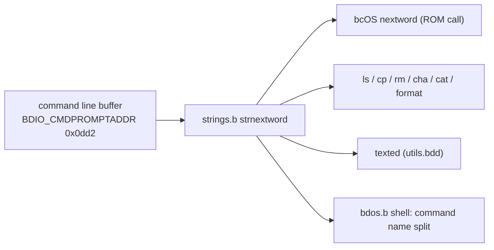
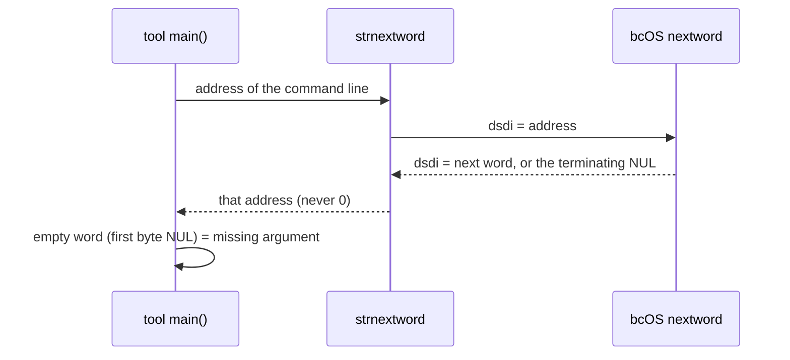

# strings.b: One `strnextword` and a Documented Contract Plan

**Plan Status**: `FINAL`

**Story Type**: `Internal`

**Plan Revision**: `A0`

> This plan captures **what** to build and **why**: domain, architecture, decisions and verified facts.
> It does **not** contain implementation code, pseudocode, line numbers or test bodies.
> The implementation agent works out the **how** against the live code. See §4 Task Breakdown.

---

## 1. Problem Statement

*   **Context**: `src/bdos/strings.b` holds two word-scanning functions. `strnextwordnull` (the
    first definition, renamed by #10 / PR #81 so that duplicate labels could become assembler
    errors) returns `0` when there is no next word. Nobody calls it. `strnextword`, which every
    program calls, returns the address of the terminating NUL when there is no next word, and never
    `0`. The issue proposes option A (keep the current contract) or option B (switch to 0).
*   **What already landed**: #1 (PR #86, 2026-11-11) chose option A **for TextEd only**: TextEd now
    tests the first byte of the word (`peek8(P)`) instead of the pointer, and
    `src/tests/test_e2e_texted_commands.py` covers `s`/`l` without a name, a name over 12
    characters, and `i`/`p`/`d` with zero or one number. The CHANGELOG entry of #1 says #82 stays
    open for the library and the other tools. Verified on master `0fd4ba3`: `texted.b`'s
    `parse2args` and `<file>` parser use `peek8(Pwstart)` / `peek8(Pwend)`.
*   **Goal**: finish option A. One `strnextword` in `strings.b`, its contract written down in the
    function comment, in `docs/05-bdos.md` and as a design decision, and e2e evidence that the other
    callers (`ls`, `cp`, `rm`, `cha`, `cat`) handle a missing argument without crashing or touching
    the disc.
*   **In scope**: deleting `strnextwordnull`; the contract docs; e2e tests for missing arguments of
    `ls`/`cp`/`rm`/`cha`/`cat`; the code-size record.
*   **Out of scope**: changing any program's behaviour; `format`'s missing-drive behaviour (see D-3);
    the bcOS `nextword` routine; `bdos.b`'s own use of `strnextword` (shell command-name split,
    unchanged).

### 1.1 Technical Summary

*   **Touched areas**: `src/bdos/strings.b` (library), `docs/05-bdos.md`,
    `docs/specs/memory/design-decisions.md`, `src/bc/code_size.csv`, new e2e test file in `src/tests/`.
*   **New patterns / abstractions**: none.
*   **Infrastructure changes**: none. Build outputs are not tracked (G12, #92), so nothing generated
    is committed.
*   **End-state observable behaviour**: every program that includes `strings.b` is a little smaller
    (the dead function is no longer linked: the compiler links every function of every include).
    Behaviour of every tool is unchanged.

---

## 2. Architecture & Design

### 2.1 Architecture Overview

#### Involved components & owners

| Component | Technical Owner |
| :--- | :--- |
| bdos library `src/bdos/strings.b` | repo owner (bcichonski) |
| bdos tools `ls`, `cp`, `rm`, `cha`, `cat`, `format`, `texted`, shell `bdos.b` | repo owner |
| e2e harness `src/tests/e2e_harness.py` | repo owner |

#### C2 diagram

#### Flow diagram

### 2.2 External Contracts & Evidence

N/A — Internal story.

#### Source Conflict Log

| Topic | Source A | Source B | Conflict | Chosen Handling |
| :--- | :--- | :--- | :--- | :--- |
| AC 2 test file | issue: `src/test_e2e_texted.py` | repo: tests moved to `src/tests/` by #90; TextEd missing-arg tests already in `src/tests/test_e2e_texted_commands.py` (#1) | path and "still to do" | Treat AC 2 as met by the existing file; no TextEd code change. Flag as deviation in the PR. |
| AC 4 rebuilt outputs | issue: commit rebuilt `.basm`/`.btap`/`.sectors`, `os.bdd`, `smoke.bdd`, smoke transcript | repo: since #92 the ROM, `os.bdd`, `smoke.bdd` and build outputs are untracked; CI and `run_tests.py` build them | nothing to commit | Rebuild locally and run the full suite (CI builds too); commit only sources, docs and the code-size CSV. Flag as deviation in the PR. |
| AC 3 "other callers" | issue lists `ls`, `cp`, `rm`, `cha`, `format` | repo: `cat.b` also calls `strnextword` | missing tool | Cover `cat` too. |

### 2.3 Affected Areas

| Area / File (pointer) | Role in this change | Likely action |
| :--- | :--- | :--- |
| `src/bdos/strings.b` | holds `strnextwordnull` (dead) and `strnextword` | Change: delete `strnextwordnull`; write the contract in `strnextword`'s comment |
| `src/bc81asmc/bcOS/bcos.basm` `nextword` | ROM routine `strnextword` wraps; leaves `dsdi` on the NUL with `a = 0` when there is no next word | Reference only |
| `src/bdos/texted.b` | already tests `peek8(...)` (#1) | Reference only |
| `src/bdos/ls.b`, `cp.b`, `rm.b`, `cha.b`, `cat.b`, `format.b`, `bdos.b` | callers that rely on a non-zero pointer (`poke8(Pargs - 1, …)`, `strncmp`, `getoptions`, `getdrive`) | Reference only (no change) |
| `docs/05-bdos.md` (section on the command line, "programs parse it with `strnextword(...)`") | user/dev docs of the bdos programs | Change: state the contract |
| `docs/specs/memory/design-decisions.md` | A6 trade-off says the dead copy is kept; D-series holds bdos decisions | Change: update A6's note, add the new decision (next free id **D9**; re-check on origin/master before the PR) |
| `docs/03-compiler.md` library table | lists `strnextword` | Reference; edit only if it mentions the second copy |
| `src/bc/code_size.csv`, `scripts/code_size.py` | metrics log of program sizes | Change: `--record` the smaller programs (recommended, metrics only) |
| `src/tests/` new e2e file, `e2e_harness.run_session(..., inspect=)`, `test_e2e_texted_commands.py` (model) | e2e tests | New |

### 2.4 Key Algorithms & Behaviour

*   **Contract (option A, locked)**: `strnextword(P)` skips the current word and the spaces after it,
    and returns the address of the next word. When there is no next word it returns the address of
    the terminating NUL. It never returns `0`. A caller detects a missing argument by checking the
    first byte of the result (`NULLCHAR`), not the pointer.
*   **Why existing callers are safe** (reasoning for AC 3, to be repeated in the PR):
    *   the result is always inside the command-line buffer at `0x0dd2` (it moves forward from its
        argument and stops at the NUL), so `poke8(Pargs - 1, NULLCHAR)` writes inside that buffer
        (at worst it overwrites the last character of the command name, which is no longer needed);
        it can never write `0x0000`-`0x0001`;
    *   `strncmp`, `getoptions` and `getdrive` on an empty string see a NUL and match nothing, so
        the tools go on with an empty file name and the bdos returns `E0 file not found`, or `ls`
        lists the current drive.
*   **Observed today** (probe on master `0fd4ba3`, built os.bdd, 2026-11-22):
    *   `ls` and `ls ` list the current drive;
    *   `cp`, `cp `, `cp ls.prg`, `rm`, `rm `, `rm -f`, `cha`, `cha +r` print `error: E0 file not found`;
    *   `cat` prints `error: unknown switch`, then `printing A:  … with options 00...` and
        `error: E0 file not found`; `cat -c` prints `printing … with options 10...` and the E0 error;
    *   the disc image is byte-identical afterwards for all of these, and the next command works;
    *   `format` with no drive formats the **active drive** (A, the boot disc) and then fails to copy
        the tools (`E0`), leaving A unusable and the prompt at `B>`; `format -q` prints
        `format error: 15` and also leaves the prompt at `B>`. This does not involve address
        `0x0000` and does not depend on `strnextword` returning 0 or not (`getdrive` of an empty
        string means "current drive"). See D-3.

---

## 3. Key Decisions & Assumptions

*   **D-1 — Option A.** Keep `strnextword`'s NUL-pointer contract and delete `strnextwordnull`.
    Rationale: the issue calls A the smaller option; #1 already moved TextEd to it; option B needs a
    0 check in seven callers and grows every program, while TEXTED has almost no slack.
*   **D-2 — No behaviour change in any tool.** AC 3 asks the other callers to "behave as before".
    The e2e tests pin today's missing-argument output and check the disc is untouched.
*   **D-3 — `format` without a drive is reported, not fixed or pinned.** Formatting the boot disc on
    a bare `format` is a real hazard, but changing it is a product decision (require a drive? ask for
    confirmation?) that the issue does not make, and it is unrelated to `strnextword`'s return
    value. No e2e test pins it (a test that pins a known bug hides it, G11). The PR explains it,
    with the AC 3 reasoning for `format` (no `0x0000` access), and proposes a follow-up issue for
    the owner to file or decline.
*   **D-4 — Deviations from the issue's AC (to be listed in the PR):** AC 2 is met by #1's existing
    tests in `src/tests/test_e2e_texted_commands.py` (the path in the issue predates #90); AC 4's
    "commit rebuilt outputs" is obsolete since #92 (nothing generated is tracked; the pipeline is
    rebuilt and the full suite run instead).
*   **D-5 — Contract recorded as design decision D9** (bdos section) and A6's trade-off sentence
    about the kept dead copy is updated to say it was removed by #82.
*   **Assumption**: deleting the function changes only code size and addresses, not behaviour. It is
    unreferenced (verified by grep over `src/`); the full e2e suite is the check. Disc positions
    come from `plan_disc()` (#89), so smaller programs don't churn goldens.

### 3.1 Decision Lock (Constants & Policies)

| Constant / Policy | Selected Value | Why | Where it lives |
| :--- | :--- | :--- | :--- |
| `strnextword` no-next-word result | address of the terminating NUL, never `0` | D-1, option A | `strings.b` comment, `docs/05-bdos.md`, D9 |
| Missing-argument test | first byte of the word is `NULLCHAR` | option A | callers (TextEd already) |
| `format` with no drive | unchanged, not pinned, follow-up proposed | D-3 | PR body |

### 3.2 Open Questions

No open questions.

---

## 4. Task Breakdown

| Task | Title | Depends on | Complexity |
| :--- | :--- | :--- | :--- |
| `T1` | One `strnextword` with a documented contract | — | `Low` |
| `T2` | e2e tests: bdos tools with a missing argument | `T1` | `Medium` |

### T1 — One `strnextword` with a documented contract

*   **Goal**: `strings.b` has a single `strnextword`; its contract is written in its comment,
    in `docs/05-bdos.md` and as design decision D9.
*   **Depends on**: —
*   **Complexity**: `Low`
*   **Pointers**: `src/bdos/strings.b`; `docs/05-bdos.md` (command line paragraph);
    `docs/specs/memory/design-decisions.md` (A6 trade-offs, D-series: add D9 after D8);
    `docs/03-compiler.md` library table (check only); `scripts/code_size.py`, `src/bc/code_size.csv`.
*   **Definition of Done**:
    *   `strnextwordnull` is gone; no source under `src/` references it;
    *   `strnextword`'s comment states: returns the address of the next word, or of the terminating
        NUL when there is none, never 0; callers test the first byte;
    *   `docs/05-bdos.md` states the same contract where it says programs parse the command line
        with `strnextword`;
    *   D9 records the contract (purpose, rationale incl. option B rejected, usage, trade-offs) and
        A6 no longer claims the dead copy is kept;
    *   the full pipeline builds (`cd src && ./buildos && ./buildtools && ./buildapps && ./makedisc`);
    *   `python3 scripts/code_size.py --record` appended the changed rows (every program that
        includes `strings.b` gets smaller; no program grows);
    *   `python3 run_tests.py < /dev/null` from the repo root exits 0.
*   **Tests expected**: none new (no behaviour change); the full suite is the regression check.
*   **Tests to modify**: None.

### T2 — e2e tests: bdos tools with a missing argument

*   **Goal**: e2e evidence for AC 3: `ls`, `cp`, `rm`, `cha` and `cat` run without an argument
    (and with an option but no file) behave as today, leave both disc images byte-identical, and the
    shell keeps working.
*   **Depends on**: `T1` (tests run against the rebuilt discs; builds must not overlap).
*   **Complexity**: `Medium`
*   **Pointers**: new file in `src/tests/` (e.g. `test_e2e_bdos_args.py`), modelled on
    `src/tests/test_e2e_texted_commands.py` and `src/tests/test_e2e_bdos.py`;
    `e2e_harness.run_session(..., inspect=...)` to compare the disc copies with the source images;
    `h.OS_DISK`, `h.UTILS_DISK`, `h.assert_markers`; §2.4 "Observed today" for the expected output.
*   **Definition of Done**:
    *   tests cover, on os.bdd in A: `ls` without arguments lists the current drive; `cp`,
        `cp <one file>`, `rm`, `rm -f`, `cha`, `cha +r` print `error: E0 file not found`; `cat`
        prints `error: unknown switch` then the E0 error, `cat -c` the E0 error;
    *   after each, both disc images are byte-identical to the source images, and a following
        command (e.g. `ls`) still works;
    *   no test for `format` without a drive (D-3);
    *   output matching uses markers, not a new golden (keep the session small: e2e is slow);
    *   `python3 run_tests.py < /dev/null` from the repo root exits 0.
*   **Tests expected**: e2e on the headless emulator, behaviours above.
*   **Tests to modify**: None.

---

## 5. Verification

*   **Build**: `cd src && ./buildos && ./buildtools && ./buildapps && ./makedisc` — no errors.
*   **Tests**: `python3 run_tests.py < /dev/null` from the repo root — exit 0; report any expected
    failures separately (none are known in these suites).
*   **Code size**: `python3 scripts/code_size.py` shows every program including `strings.b` smaller
    and none larger (metrics only).
*   **Observable behaviour**: `grep -rn strnextwordnull src/` is empty; TextEd and the tools behave as
    in §2.4 "Observed today".

---

## 6. Fact-Integrity Checklist

| Check | Yes / No / N/A | Notes |
| :--- | :--- | :--- |
| External contracts verified from producer/contract source | N/A | Internal |
| Evidence sources are reproducible | N/A | Internal |
| Identifier directionality / ordering / freshness meaning evidenced | N/A | Internal |
| Every `Assumption` is linked to an Open Question (§3.2) | Yes | The one assumption is checked by the full suite, not a stakeholder question |
| No unresolved Open Questions (for `FINAL`) | Yes | |
| Each Decision states a single committed approach | Yes | |
| Tasks are independent, each with a Definition of Done and test expectations | Yes | T2 depends on T1 only for build ordering |
| Required infra reflected (toggle / bicep) | N/A | |

**Self-review note**: The TextEd half of the issue was delivered by #1, so the remaining work is
small; the plan flags AC 2 and AC 4 as deviations rather than redoing them. The risky finding is
bare `format` wiping the boot disc: it is kept out of scope (D-3) because the fix is an owner
choice, and it must be stated plainly in the PR. T2's agent should probe each command once before
writing markers, because `cp`/`rm`/`cha` output line breaks differ slightly.

---

## 7. Amendment Log

| Revision | Request | Decision | Plan changes |
| :--- | :--- | :--- | :--- |
