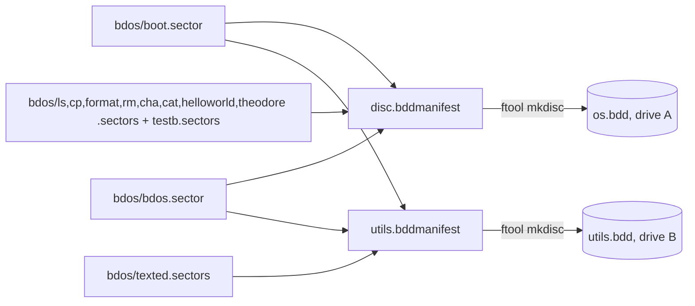

# Separate Bootable utils.bdd Disc for Applications and Games Plan

**Plan Status**: `FINAL`

**Story Type**: `Internal`

**Plan Revision**: `A0`

> This plan captures **what** to build and **why**. The implementation agent discovers the **how** against live code.

---

## 1. Problem Statement

*   **Context**: `src/os.bdd` mixes the system (boot sector, catalog, `BDOS.SYS`, `LS`/`CP`/`FORMAT`/`RM`/`CHA`/`CAT`) with user programs (`TEXTED.PRG` 112 sectors, `HELLOWRD.PRG`, `TEST.B`, `THEODORE.PRG`). A disc is 128 KB; the system disc will run out of room as programs are added. Issue #85 sets up a second disc, `utils.bdd`, for applications and games, and moves TextEd onto it.
*   **Goal**: Two discs built from one command (`./makedisc`): `os.bdd` (system, drive A by default) and `utils.bdd` (apps, drive B by default; also bootable alone with no system utilities). TextEd runs from B in the default session `--disk-a os.bdd --disk-b utils.bdd` (`b:` then `texted`), and save/load works on B.
*   **In scope**: utils disc manifest + build, removing TEXTED from `os.bdd`, test rework (texted e2e on A/B, utils disc structure and solo boot), goldens, docs, CI trigger on `master` (owner instruction for this run).
*   **Out of scope** (issue): shell changes for cross-drive execution; porting `calc`/`theodore`/games; packaging a release (`scripts/make_release.py` is untouched — see D9).

**The issue text predates #37, #92 and #2.** Several scope bullets name artifacts that no longer exist. The mapping is in §2.2 (Source Conflict Log). None of it changes an acceptance criterion.

### 1.1 Technical Summary

*   **Touched areas**: `src/disc.bddmanifest`, new `src/utils.bddmanifest`, `src/makedisc`, `src/buildapps` (comment only if needed), `run_tests.py`, `src/tests/e2e_harness.py`, e2e tests and goldens, `docs/05-bdos.md`, `docs/01-emulator.md`, `CLAUDE.md`, `src/bdos/CLAUDE.md`, `README.md`, `.github/workflows/tests.yml` (already done on the branch).
*   **New patterns**: none. `ftool mkdisc` (#37) already builds any disc from a manifest; utils.bdd is a second manifest.
*   **Infrastructure changes**: none. `utils.bdd` is a build output, ignored by the existing `*.bdd` rule in `.gitignore` (verified: `git check-ignore -v src/utils.bdd` → `.gitignore:119:*.bdd`).
*   **End state**: `cd src && ./buildos && ./buildtools && ./buildapps && ./makedisc` writes `os.bdd` (no TEXTED) and `utils.bdd` (BOOTSECT.BIN, DISC.CAT, BDOS.SYS, TEXTED.PRG). The texted e2e tests boot os.bdd in A with a copy of utils.bdd in B.

---

## 2. Architecture & Design

### 2.1 Architecture Overview

Flow of the default session: boot bcOS → boots bdos from A (`os.bdd`) → `b:` makes B active → `texted` is looked up on B (`bdio_execute` searches the active drive only) → TextEd saves/loads files on the active drive B.

### 2.2 External Contracts & Evidence

`N/A — Internal story`

#### Source Conflict Log

| Topic | Issue text | Current repo (master + PR #98) | Chosen Handling |
| :--- | :--- | :--- | :--- |
| Catalog source (open question) | hand-made `fcat0800.sector` vs a manifest | #37: `ftool mkdisc` + `src/disc.bddmanifest` generates the catalog; `fcat0800.sector` is gone | Second manifest `src/utils.bddmanifest` (D2). Closes the open question. |
| "Commit `utils.bdd` like the other generated files" (scope 1) | commit it | #92: no disc/ROM is committed; `*.bdd` ignored; CI fails on a dirty tree | `utils.bdd` is a build output, **not committed** (D3). Not an AC; consistent with "the other generated files" today. |
| "Remove TEXTED from `fcat0800.sector` and `makedisc`" (scope 2) | edit hand catalog | the catalog comes from `disc.bddmanifest` | Remove the TEXTED line from `disc.bddmanifest`; `makedisc` still converts `texted.btap` (utils needs it). |
| "Refresh `smoke.bdd`" (scope 2) | smoke.bdd + transcript | #92 removed `smoke.bdd`; the smoke test boots a temp copy of `os.bdd`; transcript `src/bc64/testdata/smoke_transcript.txt` is masked (#89) | Regenerate `smoke_transcript.txt` only. |
| `src/test_e2e_texted.py` "runs from frozen smoke.bdd" | | it is `src/tests/test_e2e_texted.py` and boots `os.bdd` | Rework that file plus the two other texted modules that reuse its helpers (D6). |
| `src/bdos.bdd` (open question) | remove it | not tracked any more (`git ls-files` shows no `.bdd`) | Nothing to do; owner comment "bdos.bdd can be removed if not used" is satisfied. |
| `THEODORE.PRG` | issue lists it as a future port | #2 put `THEODORE.PRG` on `os.bdd` | Stays on `os.bdd` (D5): AC-3 names exactly four utils catalog entries; theodore's move belongs to its own follow-up issue. |
| Base branch | — | owner: branch from `master`, merge back to `master`; `tests.yml` triggered on `bc64` only | Branch stacked on PR #98 (`01afe23` "ci: work from master instead of bc64" + #89 harness), PR into `master` (D10). |

### 2.3 Affected Areas

| Area / File (pointer) | Role in this change | Likely action |
| :--- | :--- | :--- |
| `src/disc.bddmanifest` | os.bdd layout | Change: drop `TEXTED.PRG` |
| `src/utils.bddmanifest` | utils.bdd layout (same boot/catalog/system lines as os) | New |
| `src/ftool_mkdisc.py` | builds a disc from a manifest; deterministic | Reference only (no change expected) |
| `src/makedisc` | converts .btap → sectors, runs mkdisc | Change: also build `utils.bdd` |
| `src/buildapps` | compiles helloworld/texted/theodore | Reference; must keep building texted (issue scope 4c) |
| `run_tests.py` (`MANIFEST`, `BUILT_OUTPUTS`, `missing_disc_source`, `missing_build_output`) | e2e build/hint logic | Change: know `utils.bdd` and the utils manifest sources |
| `src/tests/e2e_harness.py` | `OS_DISK`, `MANIFEST`, `planned_entry(name, manifest)`, `run_session(disks=…)` | Change: add `UTILS_DISK`, `UTILS_MANIFEST` |
| `src/tests/test_e2e_disc.py` | os.bdd structure vs manifest (`check_disc_structure`) | Add utils.bdd structure tests |
| `src/tests/test_e2e_texted.py`, `test_e2e_texted_commands.py`, `test_e2e_texted_flows.py` | TextEd e2e on os.bdd in A | Change: A/B default setup |
| `src/tests/test_e2e_bdos.py`, `src/tests/test_e2e_harness.py` | expect `TEXTED.PRG` on os.bdd | Change (listed in Tests to modify) |
| `src/bc64/testdata/e2e/*.golden.txt`, `src/bc64/testdata/smoke_transcript.txt` | goldens with a TEXTED `ls` row | Regenerate |
| `src/run`, `src/tests/test_run_script.py` | interactive launcher; checks ROM + os.bdd | Reference only; the B disc is answered at the "Disk B name:" prompt |
| `docs/05-bdos.md`, `docs/01-emulator.md`, `CLAUDE.md`, `src/bdos/CLAUDE.md`, `README.md` | layout tables, pipeline, headless example, "add a program" steps | Change |

### 2.4 Key Algorithms & Behaviour

*   **utils.bdd layout**: the first three manifest lines are identical to `disc.bddmanifest` (boot `at=0/0 max=1` from `bdos/boot.sector`, `DISC.CAT - role=catalog at=0/1 max=31`, `BDOS.SYS bdos/bdos.sector role=system at=2/0 max=160`), then `TEXTED.PRG bdos/texted.sectors RX` (no `S`, no `at=`, so it lands at 12/0). Verified by spike: entries BOOTSECT 0/0 len 1, DISC.CAT 0/1 len 31, BDOS.SYS 2/0 len 160, TEXTED 12/0 len 112 (0x70).
*   **Same system parts**: both manifests name the same `bdos/boot.sector` and `bdos/bdos.sector`, which `makedisc` converts once. So `BOOTSECT.BIN` and `BDOS.SYS` bytes are identical on both discs by construction; a test asserts it.
*   **Reproducible**: `ftool mkdisc` on the same manifest twice gives byte-identical images (verified by spike with `cmp`).
*   **Verified runtime facts (spike on the current build)**:
    *   os.bdd in A, utils.bdd in B: `b:` → prompt `B>`; `ls` → `error: E0 file not found`; `texted` starts `TextEd v1.2`; `s note.txt` writes NOTE.TXT to B (catalog of B shows it at 19/0); a fresh session with that B disc loads it back (`0001 lines loaded`).
    *   utils.bdd alone in A boots to `bDOS 1.1 shell` / `A>`; `ls` → `error: E0 file not found`; `texted` runs.
    *   From A, file names take a drive prefix: `cat -c b:note.txt` prints `printing B:NOTE    TXT …`, `ls b:` lists drive B.
*   **Catalog lengths**: `mkdisc` catalogs every non-system file with its real size, so AC-5 holds by construction; the structure check (`check_disc_structure`) asserts it per disc.

---

## 3. Key Decisions & Assumptions

*   **D1 — Name `utils.bdd`.** The owner approved it in the issue comment ("naming is fine").
*   **D2 — Catalog source: a second manifest `src/utils.bddmanifest`**, built by the existing `ftool mkdisc`. No new tool code. The hand-made catalog no longer exists (#37).
*   **D3 — `utils.bdd` is a build output, not committed** (deviates from the issue's scope 1 wording "Commit `utils.bdd`", which predates #92; not an AC). It is ignored by `*.bdd`; CI's clean-tree guard keeps it that way.
*   **D4 — One command: `./makedisc` builds both discs.** The documented full pipeline stays `cd src && ./buildos && ./buildtools && ./buildapps && ./makedisc`; `./makedisc` alone rebuilds both discs from the built `.btap` files. Running it twice gives byte-identical discs (AC-1).
*   **D5 — `HELLOWRD.PRG`, `TEST.B` and `THEODORE.PRG` stay on `os.bdd`.** HELLOWRD and TEST.B are the smoke-test program and sample file used by the bdos/smoke e2e tests. THEODORE stays because AC-3 lists exactly the four utils entries and porting it is a follow-up issue (out of scope). Its move to utils.bdd should be its own issue.
*   **D6 — Every TextEd e2e test uses the default A/B setup.** os.bdd in A, a temp copy of utils.bdd in B, the script starts with `b:` and runs `texted` on B. The restart round trip keeps the **B** disc of session 1 as the B disc of session 2 (A is a fresh os.bdd copy). The `cat -c` check runs from A as `cat -c b:<file>` (cat lives on A). `test_e2e_texted_commands.py` and `test_e2e_texted_flows.py` reuse `test_e2e_texted` helpers and run TEXTED, so they move too (they would fail otherwise). Their assertions about TextEd behaviour stay the same; only the drive setup, prompts (`B>` instead of `A>`) and any `ls` used to observe the disc (now `ls b:` from A, or an equivalent catalog read) change.
*   **D7 — The solo-boot test checks the catalog through the harness** (`read_catalog` on utils.bdd: exactly BOOTSECT.BIN, DISC.CAT, BDOS.SYS, TEXTED.PRG) plus a session: utils.bdd alone in A boots to the shell prompt, and `ls` gives `error: E0 file not found`.
*   **D8 — `run_tests.py` treats `utils.bdd` like `os.bdd`.** It is a required built output for e2e, and the sources of `utils.bddmanifest` are checked by the `--no-build` hint like those of `disc.bddmanifest`.
*   **D9 — `scripts/make_release.py` is unchanged.** Packaging the release is out of scope in the issue. Note for the owner: the bc64 zip currently ships `os.bdd` only, so a release cut after this story would have no TextEd until `utils.bdd` is added to the zip (follow-up).
*   **D10 — Branch base.** Owner instruction for this run: branch from `master`, PR into `master`. `master` still triggers `tests` on `bc64` only and lacks #89's harness (`DISC_MASKS`, `planned_entry`), which PR #98 (`ai/docs/changelog-catchup-2` → `master`, open) carries. The branch is stacked on PR #98's head, plus a CLAUDE.md commit naming `master` as the development/CI branch. Until #98 merges, the #85 PR diff also shows #98's commits.
*   **D11 — No shell change** (issue "Decided"): after `b:`, `ls` is not found; the user returns with `a:`. Documented in `docs/05-bdos.md`.

### 3.1 Decision Lock

| Constant / Policy | Selected Value | Why | Where it lives |
| :--- | :--- | :--- | :--- |
| Utils disc file | `src/utils.bdd` | D1 | `makedisc`, harness, run_tests |
| Utils manifest | `src/utils.bddmanifest` | D2; `.bddmanifest` avoids the `*.manifest` ignore rule (#37) | `src/` |
| TEXTED attributes on utils | `RX` (no `S`) | issue scope 1 | utils manifest |
| TEXTED position on utils | 12/0 (first after the BDOS slot, no `at=`) | mkdisc default | utils manifest |
| Build command | `./makedisc` builds both discs | D4 | `src/makedisc` |
| Default session | `--disk-a os.bdd --disk-b utils.bdd` | issue | docs |

### 3.2 Open Questions

No open questions. (Catalog source → D2; naming → D1, owner comment; bdos.bdd → already untracked; HELLOWRD/TEST.B placement → D5.)

---

## 4. Task Breakdown

| Task | Title | Depends on | Complexity |
| :--- | :--- | :--- | :--- |
| `T1` | Build `utils.bdd` from a second manifest, with structure and solo-boot tests | — | `Medium` |
| `T2` | Run every TextEd e2e test in the default A/B setup | `T1` | `Medium` |
| `T3` | Remove TEXTED from `os.bdd`, update os-side tests and goldens | `T2` | `Medium` |
| `T4` | Docs: two-disc layout, default A/B session, pipeline | `T3` | `Low` |

Every task must leave `python3 run_tests.py < /dev/null` (from the repo root; it builds first) green, and `git status` clean of build outputs.

### T1 — Build `utils.bdd` from a second manifest

*   **Goal**: `./makedisc` also writes `src/utils.bdd` from `src/utils.bddmanifest`; tests prove its structure, that it boots alone without utilities, and that the build is reproducible. `os.bdd` is unchanged in this task (TEXTED is on both discs until T3).
*   **Depends on**: —
*   **Complexity**: `Medium`
*   **Pointers**: `src/disc.bddmanifest` (copy the header comments' style and the three role lines), `src/makedisc`, `src/ftool_mkdisc.py` (`plan_disc`), `run_tests.py` (`BUILT_OUTPUTS`, `missing_disc_source`, `missing_build_output`), `src/tests/e2e_harness.py`, `src/tests/test_e2e_disc.py` (`check_disc_structure`), `src/tests/test_run_tests.py` (existing tests of the hint logic).
*   **Definition of Done**:
    *   `src/utils.bddmanifest` exists, with the same boot/catalog/system lines as `disc.bddmanifest` and `TEXTED.PRG bdos/texted.sectors RX`.
    *   `./makedisc` builds both discs; it fails (non-zero) if either mkdisc fails.
    *   `e2e_harness` exposes the utils disc path and manifest path next to `OS_DISK`/`MANIFEST`.
    *   `run_tests.py` needs `utils.bdd` as a built output and checks the utils manifest's sources in the `--no-build` hint; its existing behaviour for `os.bdd`/`disc.bddmanifest` is unchanged.
    *   `src/utils.bdd` stays ignored (no tracked or untracked change after a build).
*   **Tests expected** (new tests only):
    *   e2e (`test_e2e_disc.py` or a new `src/tests/test_e2e_utils_disc.py`): utils.bdd matches `plan_disc(utils.bddmanifest)` via `check_disc_structure`; its catalog is exactly BOOTSECT.BIN, DISC.CAT, BDOS.SYS, TEXTED.PRG; TEXTED has attributes R+X and not S; the `BOOTSECT.BIN` and `BDOS.SYS` byte ranges equal those on os.bdd; `ftool mkdisc` run twice on the utils manifest into a temp dir gives byte-identical images, equal to the built `utils.bdd`.
    *   e2e session: utils.bdd alone in A boots to `bDOS 1.1 shell` and the `A>` prompt; `ls` prints `error: E0 file not found`; `exit` ends with `bye!`. Assert with markers; a golden is optional (use `DISC_MASKS` if one is added).
    *   unit (`test_run_tests.py`): the missing-output hint names `utils.bdd` when it is missing, and a missing utils-manifest source is reported.
*   **Tests to modify**: None

### T2 — TextEd e2e tests in the default A/B setup

*   **Goal**: Every TextEd e2e test boots os.bdd in A with a temp copy of utils.bdd in B and runs `b:` then `texted`; the save → restart → load round trip happens on B (AC-2).
*   **Depends on**: `T1`
*   **Complexity**: `Medium`
*   **Pointers**: `src/tests/test_e2e_texted.py` (`run_two_sessions`, `cat_records` with its `A>cat -c` marker), `src/tests/test_e2e_texted_commands.py` (`run_one`), `src/tests/test_e2e_texted_flows.py`, `src/tests/e2e_harness.py` (`run_session(disks={"a":…, "b":…}, inspect=…)` gives `paths["b"]`), golden `src/bc64/testdata/e2e/texted_roundtrip.golden.txt`.
*   **Definition of Done**:
    *   No TextEd e2e test runs TEXTED from drive A any more; all scripts start with `b:`.
    *   The restart keeps session 1's B disc as session 2's B disc; A is a fresh os.bdd copy each session.
    *   The `cat -c` record check reads the file on B from A (`cat -c b:<file>`), keeping its record/padding assertions.
    *   Tests that used `ls` to observe the disc observe drive B instead (e.g. `ls b:` from A, or the harness catalog reader on the kept B image), keeping what they prove (e.g. "a bare `s` creates no file").
    *   Every assertion about TextEd's own behaviour (lines, counts, error texts, banner, debug text absent) is kept; only drive setup, prompt letters and disc observation change.
    *   The `texted_roundtrip` golden is regenerated (`BC64_UPDATE_GOLDEN=1`) and its diff is only the drive letter/prompt lines.
*   **Tests expected**: the reworked modules pass; add one assertion that the saved file is on B's catalog and not on A's (the A image after session 1 has no such entry).
*   **Tests to modify**:
    *   `src/tests/test_e2e_texted.py :: run_two_sessions, cat_records and every TextedRoundTripTests test` — AC-2 / D6: TEXTED runs from B, the round trip is on B.
    *   `src/tests/test_e2e_texted_commands.py :: run_one and every test in the module` — D6: TEXTED leaves os.bdd in T3, so its sessions must run it from B; prompt `B>`, disc observed on B.
    *   `src/tests/test_e2e_texted_flows.py :: every test in the module` — D6: same reason; reuses the helpers above.
    *   `src/bc64/testdata/e2e/texted_roundtrip.golden.txt` — AC-2: output now shows `B>` prompts and the `b:` command.

### T3 — Remove TEXTED from os.bdd

*   **Goal**: `os.bdd` no longer contains `TEXTED.PRG`; it still boots and all system utilities work; the goldens and smoke transcript are regenerated and reviewed (AC-4).
*   **Depends on**: `T2`
*   **Complexity**: `Medium`
*   **Pointers**: `src/disc.bddmanifest`, `src/tests/test_e2e_bdos.py` (`CATALOG_LINES`, rm test markers), `src/tests/test_e2e_harness.py` (`CatalogTests`), goldens in `src/bc64/testdata/e2e/` (`bdos_ls`, `bdos_rm`, `disc_ls_all`), `src/bc64/testdata/smoke_transcript.txt`, `python3 run_tests.py --update-golden`.
*   **Definition of Done**:
    *   The `TEXTED.PRG` line is gone from `disc.bddmanifest`; later files move up (expected; #89 masks the positions).
    *   `makedisc` still converts `texted.btap` (utils.bdd needs it).
    *   Goldens regenerated with `--update-golden`; their diffs only drop the `TEXTED  .PRG` row (and masked numbers). Review each diff.
    *   A new assertion that `os.bdd`'s catalog has no `TEXTED.PRG` and that `texted` typed at the A prompt with only os.bdd gives `error: E0 file not found`.
    *   `test_e2e_disc` (`disc_ls_all`, `disc_help`) and the smoke test still pass against the new layout.
*   **Tests expected**: os.bdd without TEXTED (catalog + session), as above; the existing bdos utility tests stay green.
*   **Tests to modify**:
    *   `src/tests/test_e2e_bdos.py :: CATALOG_LINES (used by test_ls_lists_catalog)` — AC-4: TEXTED.PRG is no longer on os.bdd; `planned_entry("TEXTED.PRG")` would raise.
    *   `src/tests/test_e2e_bdos.py :: BdosShellTests.test_rm_removes_file_from_ls_and_catalog` — AC-4: its `TEXTED  .PRG` marker no longer appears; use a file still on os.bdd.
    *   `src/tests/test_e2e_harness.py :: CatalogTests.test_reader_lists_known_files` — AC-4: `("TEXTED", "PRG")` is no longer on os.bdd; use another known file.
    *   `src/bc64/testdata/e2e/bdos_ls.golden.txt`, `src/bc64/testdata/e2e/bdos_rm.golden.txt`, `src/bc64/testdata/e2e/disc_ls_all.golden.txt`, `src/bc64/testdata/smoke_transcript.txt` — AC-4: the `TEXTED  .PRG` ls row disappears (regenerated, reviewed).

### T4 — Docs

*   **Goal**: The docs describe both discs, the default A/B session and the build.
*   **Depends on**: `T3`
*   **Complexity**: `Low`
*   **Pointers**: `docs/05-bdos.md` (layout section "Layout of the system disc", build commands, ftool/mkdisc section, tests section), `docs/01-emulator.md` (headless example, e2e test table), `CLAUDE.md` (pipeline diagram, build commands, headless example), `src/bdos/CLAUDE.md` (commands, "add a program" steps: an app goes in `utils.bddmanifest`, a system utility in `disc.bddmanifest`), `README.md` (getting started, prompt answers).
*   **Definition of Done**:
    *   `docs/05-bdos.md`: an updated os.bdd layout (no TEXTED), a `utils.bdd` layout table (four entries, TEXTED at 12/0, 112 sectors at the time of writing; the manifest stays the authority, as the docs already say for os.bdd), the default A/B setup (`b:` then `texted`, `a:` to get back to the utilities, `ls b:` from A), and that `ls` is not found after `b:` (no shell change).
    *   `CLAUDE.md` and `src/bdos/CLAUDE.md`: `./makedisc` builds both discs; headless example with `--disk-b utils.bdd`; where a new application goes.
    *   `README.md`: the "Disk B name:" prompt answer `utils.bdd`.
    *   Nothing claims `utils.bdd` is committed.
*   **Tests expected**: none (docs). The full suite still passes.
*   **Tests to modify**: None

---

## 5. Verification

*   **Full suite**: from the repo root, `python3 run_tests.py < /dev/null` (builds the pipeline, then unit + e2e): all PASS. `verify.sh` reports UNSUPPORTED for this pure-Python repo; this is the check.
*   **Reproducible build** (AC-1): `cd src && ./makedisc && cp utils.bdd /tmp/u1 && ./makedisc && cmp utils.bdd /tmp/u1`.
*   **Default session** (AC-2): `printf 'b:\ntexted\ni 10 10\nhello\n\ns note.txt\nq\nexit\n' | python3 bc64.py bc81asmc/bcOS/bcos_v1_2_0.b81 --disk-a <copy of os.bdd> --disk-b <copy of utils.bdd> --output out.txt`.
*   **Solo boot** (AC-3): utils.bdd copy alone in A; `ls` → `error: E0 file not found`.
*   **Clean tree**: `git status --porcelain` is empty after build + tests (CI guard).
*   **CI** (AC-6): the `tests` workflow runs on the PR into `master` (trigger from `01afe23`) and is green.

---

## 6. Fact-Integrity Checklist

| Check | Yes / No / N/A | Notes |
| :--- | :--- | :--- |
| External contracts verified from producer/contract source | N/A | Internal |
| Evidence sources are reproducible | N/A | Internal |
| Identifier directionality / ordering / freshness meaning evidenced | N/A | Internal |
| Every `Assumption` is linked to an Open Question (§3.2) | Yes | None remain; issue/repo drift is resolved in the Source Conflict Log |
| No unresolved Open Questions (for `FINAL`) | Yes | |
| Each Decision states a single committed approach | Yes | |
| Tasks are independent, each with a Definition of Done and test expectations | Yes | Sequenced T1→T2→T3→T4 so each wave stays green |
| Required infra reflected | N/A | |

**Self-review note**: The runtime facts (B drive execution, save/load on B, solo boot, `b:` file prefixes, reproducible mkdisc) were verified by a spike on the current build, not assumed. The issue text predates #37/#92, so its "commit utils.bdd / fcat0800 / smoke.bdd" items are mapped to the current pipeline (§2.2); none of the AC changes. Take care in T2: `test_e2e_texted_commands`/`flows` import helpers from `test_e2e_texted`, so change the shared helpers once and keep every TextEd-behaviour assertion. In T3 review each regenerated golden diff by eye.

---

## 7. Amendment Log

| Amendment | Request | Decision | Plan changes |
| :--- | :--- | :--- | :--- |
